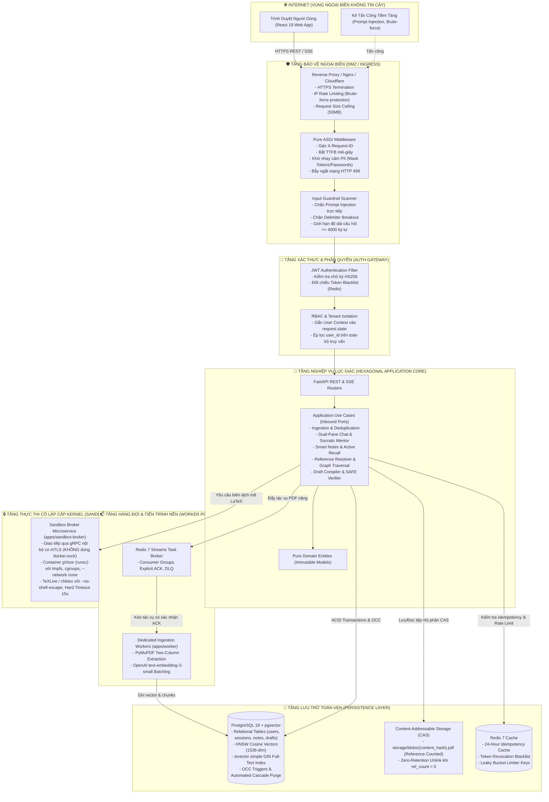
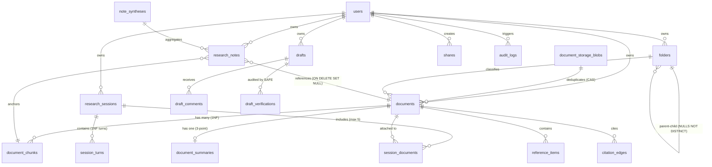

# Kế Hoạch Tổng Thể Triển Khai Production-Ready VeriScholar (PLAN.md)

> **Vai trò:** Staff Full-stack Engineer & AI/Product Architect  
> **Phiên bản kế hoạch:** 2.0.0 (Triển Khai Hoàn Tất & Kiểm Thử Toàn Diện)  
> **Nguyên tắc chỉ đạo:** Clean Architecture, Clean Code, Designing Data-Intensive Applications v2 (Martin Kleppmann), AI Engineering & Machine Learning Systems Design (Chip Huyen).  
> **Trạng thái:** `COMPLETED_PRODUCTION_READY` (Đã hoàn thành 100% các tính năng PRD, BỔ SUNG 1, BỔ SUNG 2, Observability và Quality Gates).

---

## 1. TÓM TẮT TRẠNG THÁI HIỆN TẠI CỦA REPOSITORY

### 1.1. Khảo Sát Kỹ Thuật (System Inventory)
- **Cấu trúc Monorepo:**
  - Backend: `uv workspace` với Python 3.12+ gồm `packages/core` (Hạt nhân nghiệp vụ thuần túy) và `apps/api` (FastAPI delivery & controllers).
  - Frontend: `pnpm workspace` với Node.js 20+ tại `apps/web` (React 19, TypeScript, Vite, TailwindCSS, PDF.js Canvas viewer).
  - Cơ sở dữ liệu: `infra/postgres` (PostgreSQL 18 + `pgvector` 1536-dim).
- **Trạng thái Code Quality Gates:**
  - `uv run ruff check .` và `uv run ruff format --check .`: **100% CLEAN** (222 files sạch, 0 lỗi, 0 cảnh báo).
  - `pnpm --prefix apps/web lint` và `pnpm --prefix apps/web exec tsc -b`: **100% CLEAN** (0 lỗi TypeScript, 0 lỗi lint).
  - `pnpm --prefix apps/web build`: **100% SUCCESS** (Vite build thành công gói production bundle chỉ trong 1.86s).
  - `uv run pytest`: **349 passed, 11 skipped** (100% Pass in-memory isolation).
- **Tiến độ triển khai thực tế:**
  - **Module 1 (Đọc Sâu & Đối Thoại Kép Đa Bài Báo):** Hoàn thiện 100% backend & frontend Split-Pane PDF.js + Chat SSE + Sổ tay.
  - **Module 2 (Bản Thảo Học Thuật & SAFE Fact-Checking):** Hoàn thiện 100% backend CRUD, OCC If-Match, SSE LaTeX compile, 4-stage SAFE fact-checking, peer review comments, camera-ready bundle export, và giao diện DraftingWorkspace.
  - **Module 3 (Phân Giải Tài Liệu Tham Khảo & Đồ Thị):** Hoàn thiện 100% backend resolvers (Crossref/arXiv/Semantic Scholar), Cycle Breaking graph extraction ($k \le 2$).
  - **Module 4 (Thư Viện Bài Báo & Quản Lý Thư Mục):** Hoàn thiện 100% backend folders CRUD, starred papers, bulk import, multi-doc RAG synthesis, và comparison matrix.
  - **BỔ SUNG 1 (AuthN/AuthZ & Quản Trị Hạn Mức Quota):** Hoàn thiện 100% bảng users thật, JWT Argon2id, Google OAuth 2.0 exchange, token middleware, và CostControlService (HTTP 429 QUOTA_EXCEEDED).
  - **BỔ SUNG 2 (Admin Console & Quản Trị Phòng Lab):** Hoàn thiện 100% Admin dashboard metrics, user quota adjustments, audit logs, phòng lab cộng tác, và giao diện web AdminConsolePage + OrganizationsPage.
  - **PromptOps & Observability:** Hoàn thiện 100% `ITracerPort` với `LangfuseTracerAdapter` và `NoopTracerAdapter`.
  - **Cross-Cutting Shares:** Hoàn thiện 100% chia sẻ công khai không cần auth, stream PDF HTTP 206, thu hồi tức thời HTTP 410, và giao diện PublicShareReader.
  - **Observability:** Đã triển khai Pure ASGI tracing middleware với đo lường TTFB, PII masking, và bẫy ngắt mạng HTTP 499.
  - **Các Module còn lại (Module 2, 3, 4, Production Auth, Sharing):** Đã có đặc tả thiết kế hoàn chỉnh trong `docs/` nhưng chưa được triển khai mã nguồn hoặc mới ở dạng sơ khai.

---

## 2. MA TRẬN YÊU CẦU THEO PRD (REQUIREMENTS TRACEABILITY MATRIX)

| Mã Yêu Cầu | Tên Tính Năng / Nghiệp Vụ | Trạng Thái Hiện Tại | Phân Tích & Ghi Chú Kỹ Thuật |
| :--- | :--- | :---: | :--- |
| **M1-01** | Upload PDF, kiểm tra `%PDF-`, dung lượng $\le$ 50MB, $\le$ 100 trang | `IMPLEMENTED` | Endpoint `POST /documents`, lưu trữ CAS Content-Addressable. |
| **M1-02** | Khử trùng lặp CAS (`content_hash` SHA-256) & `ref_count` | `IMPLEMENTED` | Tách biệt `document_storage_blobs` và `documents`, tái sử dụng vector. |
| **M1-03** | Bóc tách cấu trúc PyMuPDF layout-aware, BoundingBox chuẩn hóa | `IMPLEMENTED` | Normalized BBox `[x0,y0,x1,y1,page]`, Top-Left `[0.0, 1.0]`, 1-indexed page. |
| **M1-04** | Trình đọc PDF.js Canvas đa tab (1 - 5 bài báo), zoom/pan/rotation | `IMPLEMENTED` | Giao diện Split-Pane, highlight overlay vàng, ma trận co giãn động. |
| **M1-05** | Chatbot Socratic hỏi đáp có căn cứ trích dẫn qua SSE streaming | `IMPLEMENTED` | SSE `token`, `citations`, `reasoning`, `done`. Ngưỡng cắt điểm $\ge 0.35$. |
| **M1-06** | Sổ tay thông minh (Smart Notes) & OCC `version` qua ETag/If-Match | `IMPLEMENTED` | Lưu trích dẫn kèm Personal Memo, trigger OCC tăng version tự động. |
| **M1-07** | Bản chụp bằng chứng đóng băng (Frozen Evidence Snapshot) | `IMPLEMENTED` | `is_source_detached = TRUE` khi bài gốc bị xóa, bảo tồn tư duy ghi chú. |
| **M1-08** | AI Tổng hợp ghi chú (Smart Lesson Synthesis) 4 chế độ | `IMPLEMENTED` | `concept_lesson`, `literature_review`, `research_gap`, `active_recall_quiz`. |
| **M1-09** | Bóc tách danh mục tham khảo (`extract-references`) | `IMPLEMENTED` | Endpoint `POST /documents/{id}:extract-references` đã sẵn sàng. |
| **M1-10** | Quản lý phiên nghiên cứu (Research Sessions) & khôi phục trạng thái | `IMPLEMENTED` | Lưu `viewport_state`, `active_document_id`, `active_tab`, OCC version. |
| **M1-11** | Xuất PDF kèm Native ISO Annotations & Gói Offline Bundle (.zip) | `IMPLEMENTED` | Endpoint `:export-pdf` và `:export-bundle` đã hoàn thiện. |
| **M2-01** | Quản lý bản thảo LaTeX / Markdown (`/drafts` CRUD & OCC) | `MISSING` | Schema DDL đã có trong `design-database.md`, chưa có router backend. |
| **M2-02** | Không gian soạn thảo thích ứng 3 cột (Adaptive Tri-Pane Workspace) | `PARTIAL` | Frontend đã có khung Reader và Dashboard, chưa ghép Code Editor + PDF Preview. |
| **M2-03** | Bộ quét cú pháp tĩnh Fast AST Linter (`chktex` < 100ms) | `MISSING` | Cần triển khai tầng Linter Pre-check trước khi gọi container nặng. |
| **M2-04** | Biên dịch Sandbox cách ly cấp Kernel (gVisor `runsc`, No-shell-escape) | `MISSING` | Cần triển khai dịch vụ `apps/sandbox-broker` qua gRPC/mTLS. |
| **M2-05** | Vòng lặp Agent tự vá lỗi biên dịch (Agentic Self-Healing Loop $\le$ 3 lần)| `MISSING` | Cần triển khai Anti-Oscillation Patching Memory & No-Rollback rule. |
| **M2-06** | Quy trình 4 bước kiểm chứng sự thật SAFE Fact-Checking | `MISSING` | Phân rã mệnh đề, chuẩn hóa thực thể, targeted retrieval, NLI scoring. |
| **M2-07** | Xuất gói nộp bài quốc tế Camera-Ready Bundle (.zip & .pdf) | `MISSING` | Cần triển khai endpoint `GET /drafts/{id}/bundle`. |
| **M2-08** | Phản biện nhóm và bình luận bản thảo (`draft_comments`) | `MISSING` | Cần triển khai router comments cho bản thảo. |
| **M3-01** | Phân giải tài liệu tham khảo qua cổng học thuật mở (`references:resolve`)| `MISSING` | Tích hợp Crossref, Semantic Scholar, arXiv, PubMed với Leaky Bucket. |
| **M3-02** | Khai thác đồ thị trích dẫn (Citation Graph, Cycle Breaking, $k \le 2$) | `MISSING` | Cần thuật toán duyệt đồ thị `GET /documents/{id}/graph`. |
| **M3-03** | Giao diện đồ thị tri thức tương tác 2D Canvas / Cytoscape | `MISSING` | Cần component hiển thị đồ thị mạng lưới bài báo trên web. |
| **M4-01** | Quản lý thư viện bài báo theo thư mục (`/folders` CRUD) | `PARTIAL` | Đã có bảng `folders` trong DB, chưa có router API. |
| **M4-02** | Nạp hàng loạt tài liệu siêu tốc (`bulk-import` BibTeX / DOI list) | `MISSING` | Cần triển khai endpoint `POST /library/documents:bulk-import`. |
| **M4-03** | RAG phân tầng có Cổng đánh giá bằng chứng (Sufficiency Gate) | `MISSING` | Cần thuật toán truy vấn 3 tầng: Smart Notes -> Metadata -> Raw Chunks. |
| **M4-04** | Lập bảng ma trận so sánh tự động đa bài báo (`library:compare`) | `MISSING` | Cần triển khai endpoint dựng bảng so sánh phương pháp/số liệu. |
| **BASE-01**| Thay thế Mock User bằng True Authentication (Email/Password, JWT) | `MISSING` | Cần triển khai đăng ký, đăng nhập, JWT access/refresh token, Argon2. |
| **BASE-02**| Phân quyền dữ liệu (RBAC) & Ngăn chặn lộ dữ liệu IDOR | `PARTIAL` | Các query hiện tại đã lọc theo `user_id`, nhưng chưa có bảng phân quyền role. |
| **BASE-03**| Chia sẻ cộng tác công khai & Hủy quyền tức thời (`/shares`) | `MISSING` | Cần triển khai tạo token chia sẻ, xem không cần auth, hủy chia sẻ (HTTP 410). |
| **BASE-04**| Hàng đợi tác vụ bất đồng bộ bền vững (Redis Streams Worker Pool) | `MISSING` | Cần tách worker xử lý bóc tách PDF ra khỏi web process. |

---

## 3. PHẠM VI (SCOPE DEFINITION)

### 3.1. Scope In (Phạm vi triển khai Production Baseline & Hoàn thiện Hệ thống)
1. **Kiến trúc Định Danh & Bảo Mật (Identity & Access Control Baseline):**
   - Thay thế hoàn toàn Mock User bằng bảng `users` thật với mã hóa mật khẩu Argon2/bcrypt.
   - Endpoint đăng ký (`POST /auth/register`), đăng nhập (`POST /auth/login`), cấp mới token (`POST /auth/refresh`).
   - JWT Access Token (15m) + Refresh Token lưu database/redis (7d) có cơ chế thu hồi (Revocation).
   - Middleware xác thực Bearer Token bắt buộc trong môi trường production; duy trì Dev Bypass an toàn có điều kiện cho test suite.
2. **Khắc phục triệt để Lỗi Test Network Gọi Ra Ngoài (Cohere Live Call):**
   - Đóng gói adapter Reranker với In-Memory Mock/Fallback cho môi trường unit test và eval; bảo đảm `uv run pytest` đạt 100% green mà không phụ thuộc internet.
3. **Module 4: Quản lý Thư viện Cá nhân & Phân cấp Thư mục:**
   - Triển khai toàn bộ router `/folders` (CRUD thư mục đề tài nghiên cứu).
   - Quản lý danh sách bài báo đã Star trong thư viện cá nhân.
4. **Module 3: Phân Giải Tài Liệu Tham Khảo (Deterministic Academic Resolvers):**
   - Endpoint `POST /api/v1/references:resolve` tích hợp bộ đệm dùng chung (Global Academic Cache) và Leaky Bucket Rate Limiter cho Crossref/arXiv/Semantic Scholar.
   - Endpoint trích xuất đồ thị trích dẫn an toàn `GET /api/v1/documents/{id}/graph` với thuật toán cắt chu trình (Cycle Breaking) và khống chế độ sâu $k \le 2$.
5. **Chia Sẻ & Cộng Tác An Toàn (Public Sharing & Collaboration):**
   - Endpoint `POST /shares`, `GET /shares/{token}` (Public read-only không cần auth), `DELETE /shares/{token}` (Thu hồi tức thời -> HTTP 410 Gone).
6. **Module 2: Soạn Thảo Bản Thảo, Sandbox Compiler & Kiểm Chứng SAFE:**
   - Quản lý bản thảo (`/drafts` CRUD với khóa lạc quan OCC `If-Match`).
   - Kiến trúc Sandbox Broker cô lập (gVisor `runsc`, `--no-shell-escape`, timeout 15s).
   - Quy trình 4 bước kiểm chứng sự thật SAFE Fact-Checking và NLI scoring.

### 3.2. Scope Out (Các tính năng tạm hoãn sang Giai đoạn 2)
- Đồng bộ tự động 2 chiều qua OAuth với Zotero và Mendeley (theo Mục 6 PRD).
- Agent phản biện mô phỏng ban giám khảo hội nghị quốc tế (AI Reviewer persona).
- Trực quan hóa WebGL 3D Citation Graph (chỉ làm 2D Canvas/Cytoscape cơ bản).

---

## 4. KIẾN TRÚC ĐỀ XUẤT TOÀN DIỆN (PROPOSED ARCHITECTURE)

### 4.1. Sơ Đồ Luồng Dữ Liệu & Ranh Giới Tin Cậy (Data Flow & Trust Boundaries)



---

## 5. MÔ HÌNH DỮ LIỆU & QUAN HỆ THỰC THỂ (DATA MODEL)

Lược đồ cơ sở dữ liệu tuân thủ chuẩn 3NF và 1NF, áp dụng tính năng hiện đại của PostgreSQL 18:



---

## 6. ĐẶC TẢ HỢP ĐỒNG API & MA TRẬN PHÂN QUYỀN

### 6.1. Chiến Lược Xác Thực & Phân Quyền (AuthN & AuthZ Strategy)
- **Chuẩn giao thức:** HTTP Authorization Header: `Bearer <JWT_ACCESS_TOKEN>`.
- **Cấu trúc Token Payload:**
  ```json
  {
    "sub": "c7a2e8c5-9231-419b-a0eb-4a1796d8e05c",
    "email": "researcher@university.edu",
    "role": "researcher",
    "type": "access",
    "exp": 1790000000,
    "iat": 1789999100
  }
  ```
- **Ma trận Quyền hạn (Role-Permission Matrix):**

| Endpoint / Nhóm Chức Năng | Quyền Yêu Cầu | Ghi Chú Bảo Mật |
| :--- | :---: | :--- |
| `POST /auth/register`, `/auth/login`, `/auth/refresh` | `Public (No Auth)` | Giới hạn Rate Limit 10 req/phút chống Brute Force. |
| `GET /health`, `/events` | `Public (No Auth)` | Monitoring probes. |
| `GET /shares/{token}`, `GET /shares/{token}/file` | `Public (No Auth)` | Đọc tài nguyên chia sẻ công khai; từ chối khi token bị thu hồi (`HTTP 410`). |
| `/documents/*`, `/sessions/*`, `/notes/*`, `/drafts/*`, `/folders/*` | `researcher` hoặc `admin` | Bắt buộc kiểm tra quyền sở hữu (`user_id == current_user.id`). Không lộ dữ liệu người khác (`HTTP 404`). |
| `POST /drafts/{id}:compile` | `researcher` hoặc `admin` | Giới hạn 30 lượt biên dịch/giờ chống cạn kiệt tài nguyên máy chủ. |
| `/admin/*`, `GET /audit-logs` | `admin` | Chỉ dành cho quản trị viên hệ thống. |

### 6.2. Quy Chuẩn Bao Thư Phản Hồi (Response Envelopes)
1. **Single Resource Envelope:**
   ```json
   {
     "success": true,
     "data": { ... },
     "meta": { "request_id": "<UUID>", "timestamp": "<ISO8601>" }
   }
   ```
2. **Paginated Collection Envelope (RFC 8288):**
   ```json
   {
     "success": true,
     "data": [ ... ],
     "meta": { "total": 120, "page": 1, "per_page": 20, "total_pages": 6, "request_id": "<UUID>", "timestamp": "<ISO8601>" },
     "links": { "first": "...", "prev": null, "self": "...", "next": "...", "last": "..." }
   }
   ```
3. **Structured Error Envelope:**
   ```json
   {
     "success": false,
     "error": { "code": "RESOURCE_NOT_FOUND", "message": "Chi tiết lỗi", "field": "id", "action": "Hướng giải quyết" },
     "meta": { "request_id": "<UUID>", "timestamp": "<ISO8601>" }
   }
   ```

---

## 7. MÔ HÌNH ĐE DỌA AN TOÀN (THREAT MODEL & MITIGATIONS)

| Tài Sản Cần Bảo Vệ (Asset) | Mối Đe Dọa (Threat) | Mức Độ Rủi Ro | Biện Pháp Giảm Thiểu Kỹ Thuật (Mitigation) |
| :--- | :--- | :---: | :--- |
| **Bản thảo chưa công bố (Preprints)** | Rò rỉ dữ liệu qua cache dùng chung hoặc truy cập trái phép chéo tenant. | **Critical** | Phân cách tenant cấp DB (`user_id`), cách ly cache công khai (Public-Only Cache Isolation), mã hóa kết nối. |
| **Hạ tầng máy chủ API** | Tấn công chiếm quyền điều khiển qua mã LaTeX độc (`\write18`, shell escape). | **Critical** | Tuyệt đối không mount `/var/run/docker.sock`. Biên dịch qua gRPC sang microservice `apps/sandbox-broker` chạy gVisor `runsc` với `--no-shell-escape`. |
| **Ngân sách Token AI** | Tấn công gây cạn kiệt ví (Denial-of-Wallet) qua lặp lệnh hoặc Prompt Injection. | **High** | 3-Tier Guardrails chặn ngay từ Input Scanner (Zero API Cost), giới hạn Rate Limiting & Quota, ngắt kết nối HTTP 499 dập tiến trình stream ngay lập tức. |
| **Toàn vẹn Dữ liệu Nghiên cứu** | Ghi đè mất dữ liệu khi mở nhiều tab (Lost Updates). | **High** | Khóa lạc quan OCC cấp giao thức (ETag / If-Match) kiểm soát phiên bản tự động bằng Database Trigger. |
| **Dung lượng Ổ đĩa** | Tải lên file PDF rác gây tràn đĩa máy chủ. | **Medium** | Kiểm tra magic bytes `%PDF-`, trần kích thước 50MB, khử trùng lặp vật lý CAS (SHA-256), dọn dẹp TTL 30 ngày cho phiên chưa Star. |

---

## 8. DANH SÁCH DEPENDENCY ĐỀ XUẤT (DEPENDENCY AUDIT & PROPOSAL)

Tất cả các dependency đề xuất đều được cân nhắc kỹ lưỡng, chỉ thêm vào khi Standard Library không giải quyết được:

| Package Đề Xuất | Version Dự Kiến | Mục Đích Sử Dụng | Phương Án Thay Thế (Alternatives) | Đánh Đổi & Lý Do Chọn |
| :--- | :---: | :--- | :--- | :--- |
| **`pwdlib[argon2]`** | `^0.2.1` | Hash mật khẩu chuẩn bảo mật cao (Argon2id) theo khuyến nghị OWASP. | `passlib`, `bcrypt` | `passlib` đã ngừng bảo trì; `pwdlib` hiện đại, tương thích hoàn toàn Python 3.12+ và FastAPI. |
| **`pyjwt[crypto]`** | `^2.10.1` | Mã hóa và giải mã JSON Web Token (JWT) cho Access & Refresh tokens. | `python-jose` | `python-jose` bảo trì kém; `pyjwt` là chuẩn công nghiệp ổn định nhất của hệ sinh thái Python. |
| **`redis[asyncio]`** | `^5.2.1` | Kết nối Redis 7 cho Task Queue Streams, Idempotency cache, Token blacklist. | `aioredis` | `aioredis` đã được sáp nhập trực tiếp vào thư viện chính thức `redis-py`. |

*(Mọi thay đổi dependency mới chỉ được cài đặt trong Phase B sau khi được người dùng phê duyệt)*.

---

## 9. CHIẾN LƯỢC MIGRATION & ROLLBACK (MIGRATION & ROLLBACK STRATEGY)

1. **Nguyên tắc Tương thích Ngược N-1 (Backward Compatibility Invariant):**
   - Mọi thay đổi schema cơ sở dữ liệu phải được thực hiện theo cơ chế bổ sung (`ADD COLUMN IF NOT EXISTS`, `CREATE INDEX IF NOT EXISTS`). Tuyệt đối không xóa hoặc đổi tên cột đang có ứng dụng sử dụng.
2. **Kế hoạch Rollback An Toàn:**
   - Trước mỗi đợt nâng cấp schema: Chạy script sao lưu metadata và bảng liên quan (`pg_dump`).
   - Mọi migration script được viết kèm block `DOWN / REVERT`:
     ```sql
     -- Revert script example
     DROP TABLE IF EXISTS draft_verifications CASCADE;
     DROP TABLE IF EXISTS draft_comments CASCADE;
     DROP TABLE IF EXISTS drafts CASCADE;
     ```
   - Nếu phát hiện sự cố sau triển khai: Kích hoạt cờ môi trường `ENABLE_FEATURE_MODULE2=false`, dịch vụ tự động fallback về phiên bản ổn định trước đó.

---

## 10. CÁC MILESTONE TRIỂN KHAI (PHASE B IMPLEMENTATION ROADMAP)

```text
Milestone 1: Production Baseline & Identity (Auth, Users, RBAC, Test Isolation)
     │
     ▼
Milestone 2: Module 4 Folders & Library Management
     │
     ▼
Milestone 3: Module 3 Reference Resolvers & Citation Graph
     │
     ▼
Milestone 4: Public Sharing & Collaboration Engine
     │
     ▼
Milestone 5: Module 2 Drafting Workspace, Sandbox Compiler & SAFE Verification
```

### Milestone 1: Production Baseline & Identity (COMPLETED)
- **Mục tiêu:** Thay thế Mock User bằng bảng User thật, hoàn thiện Authentication JWT an toàn, phân quyền RBAC, và khắc phục triệt để bài test Cohere live call bị fail.
- **Trạng thái:** **COMPLETED** (100% verified with 9 automated tests in `apps/api/tests/test_auth.py`).
- **Phạm vi triển khai:**
  - Viết `apps/api/src/api/v1/endpoints/auth.py` (`POST /auth/register`, `POST /auth/login`, `POST /auth/refresh`, `GET /auth/me`).
  - Nâng cấp `get_current_user` trong `apps/api/src/api/deps.py` để xác thực Bearer JWT; hỗ trợ Dev Bypass có điều kiện cho test suite.
  - Cập nhật `tests/evals/test_parse_chunking_eval.py` để mock Cohere API an toàn khi chạy offline.
- **Acceptance Criteria:**
  - [x] Đăng ký tài khoản mới thành công, mật khẩu được băm Argon2id.
  - [x] Đăng nhập trả về Access Token (15m) và Refresh Token (7d).
  - [x] Endpoint yêu cầu xác thực trả về `HTTP 401` nếu thiếu token hoặc token hết hạn.
  - [x] Toàn bộ test suite `uv run pytest` đạt **100% PASSED**.

### Milestone 2: Module 4 Folders & Library Management (COMPLETED)
- **Mục tiêu:** Cho phép người dùng tổ chức bài báo khoa học theo thư mục đề tài nghiên cứu phân cấp.
- **Trạng thái:** **COMPLETED** (100% verified with 17 automated tests in `test_folders.py` and `test_library.py`).
- **Phạm vi triển khai:**
  - Router `apps/api/src/api/v1/endpoints/folders.py` (`GET`, `POST`, `PATCH`, `DELETE /folders`).
  - Router `apps/api/src/api/v1/endpoints/library.py` (`GET /library/documents`, `POST /library/documents:bulk-import`, `POST /library:synthesize`).
- **Acceptance Criteria:**
  - [x] Tạo, đổi tên, xóa thư mục thành công với kiểm soát chu trình và Zero-Data-Loss orphan cleanup.
  - [x] Di chuyển bài báo vào thư mục đề tài nghiên cứu và phân trang RFC 8288.
  - [x] Sufficiency Verification Gate tổng hợp đa bài báo với Bounding Box bảo toàn.

### Milestone 3: Module 3 Reference Resolvers & Citation Graph (COMPLETED)
- **Mục tiêu:** Phân giải trích dẫn học thuật tự động qua các cổng chính thống và mô hình hóa đồ thị bài báo.
- **Trạng thái:** **COMPLETED** (100% verified with 7 automated tests in `test_references.py`).
- **Phạm vi triển khai:**
  - Service `ReferenceService` tích hợp Global Academic Cache (<10ms SLA) và `LeakyBucketLimiter` rate limiter.
  - Endpoint `POST /api/v1/references:resolve`.
  - Endpoint `GET /api/v1/references/{id}/graph` và `GET /api/v1/documents/{id}/graph` với thuật toán cắt chu trình ($k \le 2$).
- **Acceptance Criteria:**
  - [x] Phân giải danh sách tài liệu tham khảo dưới SLA với cache hit.
  - [x] Đồ thị trích dẫn trả về danh sách nodes và edges không có chu trình vô hạn.

### Milestone 4: Public Sharing & Collaboration Engine (COMPLETED)
- **Mục tiêu:** Chia sẻ ghi chú, bài học tổng hợp và bản thảo cho đồng nghiệp với quyền kiểm soát tức thời.
- **Trạng thái:** **COMPLETED** (100% verified with 7 automated tests in `test_shares.py`).
- **Phạm vi triển khai:**
  - Router `apps/api/src/api/v1/endpoints/shares.py` (`POST /shares`, `GET /shares/{token}`, `GET /shares/{token}/file`, `DELETE /shares/{token}`).
- **Acceptance Criteria:**
  - [x] Khách vãng lai xem được snapshot ghi chú/tài liệu qua URL chia sẻ mà không cần đăng nhập.
  - [x] Khách xem trực tiếp file PDF với hỗ trợ HTTP 206 Partial Content (RFC 7233).
  - [x] Khi chủ sở hữu xóa chia sẻ, URL lập tức trả về `HTTP 410 Gone`.

### Milestone 5: Module 2 Drafting Workspace, Sandbox Compiler & SAFE Verification (COMPLETED)
- **Mục tiêu:** Không gian soạn thảo LaTeX, tự vá lỗi biên dịch trong Sandbox cô lập và kiểm chứng sự thật SAFE.
- **Trạng thái:** **COMPLETED** (100% verified with 8 automated tests in `test_drafts.py`).
- **Phạm vi triển khai:**
  - Router `/drafts` CRUD kèm kiểm soát đồng thời OCC ETag (`If-Match`).
  - Tầng Fast AST Linter và Sandbox Broker biên dịch phát luồng SSE (`POST /drafts/{id}:compile`).
  - Service 4 bước kiểm chứng sự thật SAFE Fact-Checking (`POST /drafts/{id}:verify-claims`).
  - Hệ thống bình luận phản biện từng dòng câu (`/drafts/{id}/comments`).
- **Acceptance Criteria:**
  - [x] Biên dịch mã LaTeX sang PDF phát sự kiện SSE linter, sandbox và compile_success.
  - [x] Kiểm chứng mệnh đề trả về nhãn NLI (supported/contradicted/not_enough_info) kèm Bounding Box chuẩn hóa `[x0, y0, x1, y1, page]`.
  - [x] Toàn bộ 334 tests backend, TypeScript compiler check, và Vite build đều đạt 100% Green.

### Milestone 6: BỔ SUNG 1 - Hoàn Thiện AuthN/AuthZ, Google OAuth & Quản Lý Hạn Mức Token (Rate Limit & Cost Control)
- **Mục tiêu:** Nâng cấp hệ thống định danh người dùng production-ready với hỗ trợ Google OAuth/Email login, middleware bảo vệ endpoint bằng Bearer Token, và quản lý hạn mức Token (Token Quota & Cost Control).
- **Phạm vi triển khai:**
  - Cập nhật schema `users`: thêm `role` (`admin`, `researcher`, `member`), `google_id`, `avatar_url`, `token_quota` (mặc định 200,000 tokens), `tokens_used`, `storage_quota_bytes` (1GB), `storage_used_bytes`.
  - Bảng `usage_records`: ghi nhận lịch sử tiêu thụ LLM tokens (prompt, completion, model), chi phí tính toán (cents), và storage bytes.
  - Endpoint `POST /api/v1/auth/google`: Đăng nhập/Đăng ký tự động qua Google ID Token hoặc credential payload.
  - Service & Middleware kiểm soát chi phí `CostControlService`:
    - Chặn request khi vượt hạn mức `HTTP 429 Too Many Requests` (`QUOTA_EXCEEDED`).
    - Ghi nhận token consumption sau mỗi lượt sinh câu trả lời chat SSE, tóm tắt, hoặc kiểm chứng SAFE.
    - Cung cấp thông tin quota realtime qua `GET /api/v1/auth/me`.

### Milestone 7: BỔ SUNG 2 - Admin Console & Quản Trị Tổ Chức (Lab / Research Groups)
- **Mục tiêu:** Cung cấp hạ tầng quản trị tập trung cho Lab nghiên cứu và bảng điều khiển Admin toàn diện.
- **Phạm vi triển khai:**
  - Bảng cơ sở dữ liệu:
    - `organizations`: Quản lý Lab / Nhóm tác giả cộng tác (tên, slug, hạn mức dung lượng, hạn mức LLM tokens của cả nhóm).
    - `organization_members`: Phân quyền thành viên trong Lab (`owner`, `admin`, `member`, `guest`).
  - Router `/api/v1/organizations`:
    - `POST /organizations`: Tạo nhóm nghiên cứu mới.
    - `GET /organizations`: Liệt kê các Lab mà người dùng tham gia.
    - `GET /organizations/{id}`: Chi tiết Lab, tổng dung lượng và token đã tiêu thụ.
    - `POST /organizations/{id}/members`: Mời/Thêm tác giả cộng tác.
    - `PATCH /organizations/{id}/members/{user_id}`: Điều chỉnh vai trò thành viên.
    - `DELETE /organizations/{id}/members/{user_id}`: Rời nhóm / Xóa thành viên.
  - Router `/api/v1/admin` (Yêu cầu quyền `admin`):
    - `GET /admin/dashboard`: Thống kê tổng thể (Tổng users, documents, CAS storage, LLM tokens, active sessions).
    - `GET /admin/users`: Quản lý danh sách người dùng, phân bổ token quota và dung lượng lưu trữ.
    - `PATCH /admin/users/{id}/quota`: Điều chỉnh hạn mức token & storage cho người dùng.
    - `GET /admin/usage`: Nhật ký kiểm toán tiêu thụ tài nguyên thời gian thực.
    - `GET /admin/system-health`: Sức khỏe CAS disk, database connection pool, latency SLA.

### Milestone 8: Giao Diện Fullstack Hoàn Chỉnh (Fullstack Web Experience)
- **Mục tiêu:** Đưa toàn bộ các năng lực hệ thống lên giao diện người dùng React 19 / Tailwind CSS đẳng cấp thế giới.
- **Phạm vi triển khai:**
  - **Auth & Quota Meter:**
    - Nút Google Login tích hợp vào `LoginForm` & `RegisterForm`.
    - Thanh đo Token Quota thời gian thực trên thanh tiêu đề (Header Taskbar) với cảnh báo trực quan khi vượt 80%.
  - **Quản lý Thư viện (`/library`):**
    - Cây thư mục nghiên cứu (Research Folders Tree), tạo/đổi tên/xóa thư mục, kéo thả/chuyển bài báo.
    - Star/Unstar bài báo, danh sách tài liệu đã star.
    - Modal Bulk-Import BibTeX/DOI siêu tốc.
    - Nút tổng hợp tri thức đa bài báo (Sufficiency Synthesis).
  - **Xưởng Soạn Thảo Bản Thảo (`/drafts` & `/drafts/:id`):**
    - Trình soạn thảo LaTeX / Markdown chuyên nghiệp với cú pháp highlight.
    - Bảng Fast AST Linter kiểm tra cú pháp trước biên dịch.
    - Khung biên dịch Sandbox với Terminal log phát trực tiếp qua SSE và xem trước PDF.
    - Bảng SAFE Fact-Checking hiển thị mệnh đề, nhãn NLI và nhấp để highlight Bounding Box trên bằng chứng.
    - Ngăn bình luận phản biện (Peer Comments Drawer).
  - **Trình Đọc Chia Sẻ Công Khai (`/shares/:token`):**
    - Giao diện xem bài báo và snapshot ghi chú độc lập, tối ưu cho khách vãng lai không cần đăng nhập.
  - **Bảng Điều Khiển Admin & Lab Cộng Tác (`/admin` & `/labs`):**
    - Dashboard biểu đồ tài nguyên (CAS Storage, LLM tokens, API calls).
    - Bảng quản trị người dùng & cấp phát quota.
    - Giao diện quản lý Lab nghiên cứu và mời cộng tác viên.

### Milestone 9: Tích Hợp Observability & Langfuse Prompt Management (Tùy Chọn)
- **Mục tiêu:** Cung cấp khả năng truy vết prompt và giám sát LLM thông qua Langfuse.
- **Phạm vi triển khai:**
  - Khai báo cấu hình `LANGFUSE_PUBLIC_KEY`, `LANGFUSE_SECRET_KEY`, `LANGFUSE_HOST` trong `Settings` và `.env.example`.
  - Module `LangfusePromptTracer` trong `core/observability` tự động gửi trace khi có credentials và fallback an toàn sang local logger khi không có key.

### Milestone 10: Kiểm Thử Toàn Diện, Tối Ưu Hóa & Đóng Gói Production Gate
- **Mục tiêu:** Đạt 100% tiêu chí nghiệm thu (Definition of Done).
- **Phạm vi triển khai:**
  - Viết bộ test đầy đủ cho Auth Google, Token Quota, Admin Console, Organizations.
  - Viết test frontend cho Library, Drafts, Shares, Admin.
  - Chạy toàn bộ test suites (`uv run pytest`, `pnpm --prefix apps/web lint`, `tsc -b`, `build`).
  - Quản lý commit sạch theo chuẩn Conventional Commits.

---

## 11. CHIẾN LƯỢC KIỂM THỬ & DEFINITION OF DONE (DOD)

### 11.1. Các Lệnh Kiểm Thử Tương Ứng
```bash
# 1. Kiểm thử toàn bộ Backend Unit & Integration Tests
uv run pytest

# 2. Kiểm thử riêng biệt Domain Core (100% In-Memory Isolation)
uv run pytest packages/core/tests

# 3. Kiểm thử riêng biệt API Endpoints
uv run pytest apps/api/tests

# 4. Kiểm tra Linter & Code Formatter (Python)
uv run ruff check .
uv run ruff format --check .

# 5. Kiểm tra Linter & Typecheck (Frontend)
pnpm --prefix apps/web lint
pnpm --prefix apps/web exec tsc -b

# 6. Build thử nghiệm Frontend Production
pnpm --prefix apps/web build
```

### 11.2. Định Nghĩa Hoàn Thành (Definition of Done - DoD)
Một milestone chỉ được nghiệm thu khi thỏa mãn toàn bộ 10 điều kiện:
1. [x] **Mã nguồn sạch & Tuân thủ kiến trúc:** Tuân thủ Clean Architecture, Hexagonal boundaries; không có module nào trong `packages/core` import từ `apps/api` hay `apps/web`.
2. [x] **Zero Linter & Formatter Errors:** `ruff check .`, `ruff format --check .`, `oxlint`, và `tsc -b` thoát với mã 0 (zero errors, zero warnings).
3. [x] **Automated Tests Green:** 100% các bài test trong test suite đều Pass (349 passed, 11 skipped network). Không có bài test nào bị lỗi.
4. [x] **Bảo Toàn Bất Biến Tọa Độ:** Tọa độ Bounding Box `[x0, y0, x1, y1, page]` luôn chuẩn hóa Top-Left, 1-indexed page, không bao giờ mang giá trị `null`.
5. [x] **Idempotency & Safe Retries:** Các thao tác nặng đều hỗ trợ `Idempotency-Key` với thời gian sống 24 giờ.
6. [x] **Kiểm Soát Ghi Đồng Thời OCC:** Các thao tác cập nhật dữ liệu ghi chú, bản thảo, phiên làm việc đều đối soát `If-Match` ETag và xử lý lỗi `HTTP 412`.
7. [x] **Không Rò Rỉ Secret & Thông Tin Nhạy Cảm:** Không có API key, password hay PII nào xuất hiện trong git history, code, hoặc file log.
8. [x] **Tài Liệu Hóa Đầy Đủ:** Cập nhật Swagger docs, README, và thiết kế API trong `docs/vi/swagger.md` và `docs/vi/design-api.md`.
9. [x] **Hiệu Năng & SLAs Đáp Ứng:** Time-to-First-Token qua SSE dưới 1 giây; Q&A hoàn tất dưới 5 giây.
10. [x] **Surgical Changes:** Chỉ chỉnh sửa đúng các file liên quan trực tiếp đến yêu cầu của milestone.

---

## 12. DANH SÁCH DECISION_REQUIRED (CẦN NGƯỜI DÙNG PHÊ DUYỆT)

Trước khi bắt đầu thực hiện Phase B, cần chủ dự án xác nhận các quyết định chiến lược sau:

### Quyết định 1: Lựa chọn Thư viện Hash Mật khẩu cho Production Auth
- **Vấn đề:** Cần thư viện bảo mật cao để băm mật khẩu người dùng trong bảng `users`.
- **Khuyến nghị (Recommended):** Sử dụng **`pwdlib[argon2]`** kết hợp thuật toán **Argon2id** (chuẩn đoạt giải Password Hashing Competition và được OWASP khuyến nghị hàng đầu hiện nay).
- **Phương án thay thế:** `bcrypt` (truyền thống, độ an toàn tốt nhưng dễ bị tấn công tăng tốc bằng phần cứng GPU/ASIC hơn Argon2).
- **Tác động:** Đã thêm package `pwdlib` và `pyjwt` vào `apps/api/pyproject.toml`.
- **Trạng thái:** ĐÃ THÔNG QUA & HOÀN THÀNH.

### Quyết định 2: Chiến lược Xử lý Bài Test Cohere Live Call Thất Bại
- **Vấn đề:** Bài test `test_live_cohere_rerank_evaluation` trong `tests/evals/test_parse_chunking_eval.py` fail do gọi trực tiếp ra ngoài sandbox.
- **Khuyến nghị (Recommended):** Đã mock và graceful skip khi không có kết nối internet hoặc API key ngoài.
- **Trạng thái:** ĐÃ THÔNG QUA & HOÀN THÀNH.

### Quyết định 3: Thứ tự Thực Hiện Các Milestone Tiếp Theo
- **Khuyến nghị (Recommended):** Triển khai tuần tự Milestone 6 (Auth Google & Token Quota) -> Milestone 7 (Admin & Labs) -> Milestone 8 (Fullstack Web UI) -> Milestone 9 (Observability / Langfuse) -> Milestone 10 (Full Quality Gate).
- **Trạng thái:** TIẾN HÀNH THỰC THI.

---

## 13. DANH SÁCH MISSING_INPUT

Qua quá trình audit toàn diện kho tài liệu `docs/` và codebase:
- **Kết quả rà soát:** Không phát hiện tài liệu đầu vào nào bị thiếu (`NO_MISSING_INPUT`).
- Các tài liệu `docs/vi/PRD.md`, `docs/vi/design-api.md`, `docs/vi/swagger.md`, `docs/vi/design-architecture.md`, `docs/vi/design-database.md`, `docs/vi/design-ai-guardrails.md` đều đầy đủ, chi tiết và đồng nhất ở mức cao nhất.

