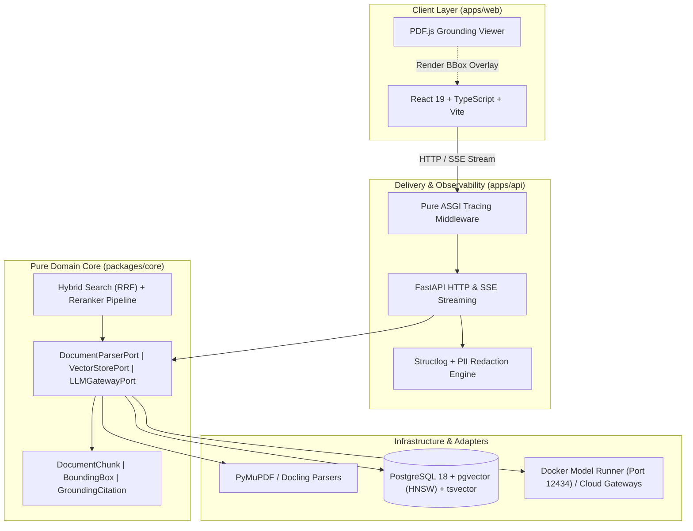

<div align="center">

# 🎓 VeriScholar

**Open-Source, Production-Grade Academic Research & Writing Assistant**  
*Powered by Advanced Hybrid RAG with Strict Multimodal Grounding & Zero-Hallucination Guarantees*

[](LICENSE)
[](https://www.python.org/downloads/)
[](https://github.com/astral-sh/uv)
[](https://fastapi.tiangolo.com)
[](https://github.com/pgvector/pgvector)
[](https://www.docker.com/)
[](https://react.dev)
[](https://www.typescriptlang.org)
[](https://github.com/astral-sh/ruff)

[Overview](#-overview) •
[Key Features](#-key-features) •
[Architecture](#-architecture) •
[Workspace Components](#-workspace-components) •
[Quickstart](#-quickstart) •
[Quality Gates](#-quality-gates--testing) •
[Documentation](#-documentation) •
[Contributing](#-contributing) •
[License](#-license)

</div>

---

## 📖 Overview

**VeriScholar** is an open-source academic intelligence platform engineered for researchers, scientists, and students. Unlike generic conversational AI tools that suffer from subtle hallucinations and vague attributions, VeriScholar enforces **verifiable, citation-grounded synthesis**. Every claim, equation, or statistic generated by the system is visually linked to the exact coordinates (`BoundingBox`) on the source PDF pages.

### The Core Problem Solved
Traditional RAG pipelines truncate PDFs into unstructured text chunks, losing visual layout context (two-column flow, mathematical equations, tables, figures). VeriScholar treats academic documents as structured multimodal artifacts:
- **Zero Hallucination:** Claims require direct textual/visual backing. If evidence is absent, the system explicitly abstains.
- **Visual Grounding:** Interactive frontend highlights exact source bounding boxes in real time.
- **Dual Local & Cloud Inference:** Run 100% offline with **Docker Model Runner (DMR)** / Ollama, or connect to state-of-the-art Cloud LLMs (OpenAI, Gemini).
- **Production Observability:** Streaming TTFB (Time-To-First-Byte) tracking, automated PII/API-key redaction, and graceful client abort (HTTP 499) handling.

---

## ✨ Key Features

| Capability | Technical Realization |
| :--- | :--- |
| **Multimodal PDF Ingestion** | Dual-engine parser combining **PyMuPDF** (ultra-fast text/bbox extraction) and **Docling** (complex two-column and table layout analysis) via `DocumentParserPort`. |
| **Atomic Evidence Retrieval** | Immutable `DocumentChunk` records with normalized `[x0, y0, x1, y1, page]` bounding boxes (1-indexed page, top-left origin). |
| **Unified Relational & Vector DB** | **PostgreSQL 18 + `pgvector`** storing metadata, chunk hierarchies, and 1024-dim dense vectors (`BGE-M3` with HNSW index) in a single ACID store. |
| **Advanced Hybrid Search** | Reciprocal Rank Fusion (RRF) combining dense semantic vectors (`<=>` Cosine Distance) and sparse lexical keywords (`tsvector` BM25) directly in SQL. |
| **Deterministic Cross-Encoder Reranking** | Two-stage retrieval pipeline with cross-encoder reranking (`bge-reranker` / `FlashRank`) ensuring top-5 precision under strict SLAs (< 5s). |
| **Flexible LLM Runtime** | Seamless execution via **Docker Model Runner (DMR)** for local models (`ai/smollm2`, `ai/llama3.2`), or Cloud Gateways (OpenAI, Google Gemini). |
| **Interactive PDF Viewer** | React 19 + PDF.js canvas overlay rendering synchronized highlights directly on academic paper pages. |
| **Production Observability** | Pure ASGI middleware capturing end-to-end latency, Time-To-First-Byte (TTFB), request tracing (`X-Request-ID`), and secret masking. |

---

## 🏛 Architecture

VeriScholar is organized as a unified monorepo adhering strictly to **Clean Architecture / Ports & Adapters (Hexagonal)** principles:



---

## 📦 Workspace Components

Each package in the monorepo has dedicated documentation detailing its internal design:

| Package | Path | Layer Role | Documentation |
| :--- | :--- | :--- | :--- |
| **`core`** | [`packages/core/`](packages/core/) | Pure Domain Core | Pure entities (`DocumentChunk`, `BoundingBox`), Ports, and Hybrid Search algorithms. |
| **`api`** | [`apps/api/`](apps/api/) | Delivery & Observability | FastAPI server, pure ASGI TTFB tracing, secret masking, and adapters. 👉 **[Read API Guide](apps/api/README.md)** |
| **`worker`** | [`apps/worker/`](docs/vi/backend-directory-structure.md) | Background Workers | Dedicated ingestion worker pool, Redis Streams consumer, explicit ACK, and DLQ. |
| **`sandbox-broker`** | [`apps/sandbox-broker/`](docs/vi/backend-directory-structure.md) | Isolated Execution | Kernel-isolated compile sandbox (gVisor `runsc`) over internal gRPC/mTLS. |
| **`web`** | [`apps/web/`](apps/web/) | User Interface | React 19, TypeScript, PDF.js visual grounding canvas overlay. |
| **`infra`** | [`infra/`](infra/) | Infrastructure | Docker Compose definition, PostgreSQL 18 + `pgvector` and Redis 7 setup. 👉 **[Read Docker Guide](docs/vi/guide-docker.md)** |

---

## 🚀 Quickstart

### Prerequisites
- **Python 3.12+**
- **[uv](https://docs.astral.sh/uv/)** (recommended Python package manager)
- **Node.js 20+** & **[pnpm 9+](https://pnpm.io/)**
- **Docker & Docker Compose** (for PostgreSQL + `pgvector` and Docker Model Runner)

### 1. Clone & Setup Workspace
```bash
git clone https://github.com/dammanhdungvn/VeriScholar.git
cd VeriScholar

# Install Python workspace dependencies (backend & core)
uv sync --all-packages

# Install Frontend dependencies
pnpm --prefix apps/web install
```

### 2. Launch Local Database Infrastructure
Spin up the PostgreSQL container with `pgvector` pre-configured:
```bash
# Start PostgreSQL 18 + pgvector in the background
docker compose up -d

# Verify container is healthy
docker compose ps
# Expected: verischolar-postgres-dev ... Up (healthy)
```

### 3. (Optional) Run Local LLM with Docker Model Runner
VeriScholar natively integrates with **Docker Model Runner (DMR)** for local inference:
```bash
# Pull lightweight model for development
docker model pull ai/smollm2

# Check running runner on port 12434
docker model status
```

### 4. Configure Environment Variables
Copy and customize the template in `apps/api/` (see [Configuration Guide](apps/api/README.md#%EF%B8%8F-configuration-reference)):
```bash
cp apps/api/.env.example apps/api/.env
```

### 5. Launch Backend API
```bash
# Run FastAPI server with multi-directory hot-reload
uv run --package api api

# Verification probe
curl http://localhost:8000/health
# Response: {"status":"ok","service":"verischolar-api"}
```
Interactive OpenAPI documentation is accessible at: `http://localhost:8000/docs`.

### 6. Launch Frontend UI
```bash
# Start Vite development server
pnpm --prefix apps/web dev
```
Open your browser at `http://localhost:5173`.

---

## 🛡 Quality Gates & Testing

VeriScholar enforces strict pre-commit verification gates across both Python and TypeScript stacks:

```bash
# 1. Run backend unit & integration tests
uv run pytest

# 2. Run Python linting and formatting checks (Ruff)
uv run ruff check .
uv run ruff format --check .

# 3. Run Frontend linting (oxlint) & TypeScript type-check
pnpm --prefix apps/web lint
pnpm --prefix apps/web exec tsc -b

# 4. Validate Frontend production build
pnpm --prefix apps/web build
```

### Quality Gate Checkpoints
- [x] **Zero Warning / Zero Lint:** Ruff and Oxlint exit cleanly.
- [x] **Strict Async Hygiene:** Blocking CPU tasks (PDF rendering) offloaded via `asyncio.to_thread()`.
- [x] **Atomic Evidence Invariant:** BoundingBox coordinates `[x0, y0, x1, y1, page]` (1-indexed, Top-Left) are preserved in all chunks.
- [x] **Observability & PII Safe:** Automatic redaction of JWT tokens, OpenAI project keys (`sk-proj-...`), and Google AI keys (`AIzaSy...`).
- [x] **Transaction Atomicity:** All database mutations scoped within `async with session.begin():`.

---

## 📚 Documentation

The authoritative **Single Source of Truth** for VeriScholar MVP specifications and engineering guides is maintained in [`docs/PRD/`](docs/PRD/) and [`docs/`](docs/README.md):
- **[MVP Master Overview & Scope (`docs/PRD/00-overview-and-cleanup.md`)](docs/PRD/00-overview-and-cleanup.md):** 4 MVP routes, core product vision, and out-of-scope pruning rules.
- **[Authentication & Account Settings (`docs/PRD/01-authentication-and-profile.md`)](docs/PRD/01-authentication-and-profile.md):** JWT + Google GIS OAuth 2.0, ORCID iD, and 3-tab Account Settings modal.
- **[Dashboard & Discovery (`docs/PRD/02-dashboard-and-discovery.md`)](docs/PRD/02-dashboard-and-discovery.md):** 4-item left navigation taskbar (`Đoạn chat mới`, `Tìm kiếm bài báo`, `Thư viện`, `Soạn thảo LaTeX`), Session history, and External Academic Search (`/discovery`).
- **[Deep Reading, Hybrid RAG & GraphRAG (`docs/PRD/03-deep-reading-rag-and-graphrag.md`)](docs/PRD/03-deep-reading-rag-and-graphrag.md):** Multi-tab PDF.js canvas with normalized `[x0, y0, x1, y1, page]` bounding boxes, Hybrid RAG + GraphRAG strictly on **PostgreSQL + `pgvector`** (`graph_nodes` and `graph_edges`), Smart Notes, and Reference Drawer.
- **[Personal Library & Folders (`docs/PRD/04-personal-library.md`)](docs/PRD/04-personal-library.md):** Hierarchical folders and starred documents management (`/library`).
- **[LaTeX Studio & AI Writing Assistant (`docs/PRD/05-latex-writing-studio.md`)](docs/PRD/05-latex-writing-studio.md):** Tri-pane LaTeX code editor, Tectonic sandbox compiler with self-healing, and AI Writing Assistant (`/writing`).
- **[Database Schema & Storage (`docs/PRD/06-database-and-storage.md`)](docs/PRD/06-database-and-storage.md):** PostgreSQL + `pgvector` schema (`users`, `folders`, `document_storage_blobs`, `documents`, `document_chunks`, `document_summaries`, `graph_nodes`, `graph_edges`, `reference_items`, `global_academic_cache`, `research_sessions`, `session_documents`, `session_turns`, `research_notes`, `drafts`).
- **[Monitoring, Observability & Langfuse (`docs/PRD/07-monitoring-and-langfuse.md`)](docs/PRD/07-monitoring-and-langfuse.md):** Structlog JSON, `trace_id`, Langfuse Cloud (`verischolar-dev` / `verischolar-prod`), Sentry, and Alert Webhooks.
- **[Architecture & Operations Portal (`docs/README.md`)](docs/README.md):** Detailed architecture, frontend engineering, CI/CD, and QA guides.
- **[Engineering & Agent Protocol (`AGENTS.md`)](AGENTS.md):** Mandatory behavioral laws, SOLID design rules, and monorepo invariants.

---

## 🤝 Contributing

We welcome contributions from the open-source community! Before submitting a pull request, please:
1. Review [`AGENTS.md`](AGENTS.md) for architectural laws and behavioral standards.
2. Ensure commit messages follow Conventional Commits: `[<package_name>] <type>: <description>`.
3. Run the full verification suite (`pytest`, `ruff`, `oxlint`, `tsc -b`, `vite build`).

---

## 📄 License

This project is licensed under the terms of the **MIT License**. See the [LICENSE](LICENSE) file for details.

---

<div align="center">
  <sub>Built with precision for researchers worldwide by <b>Dam Manh Dung</b>.</sub>
</div>
