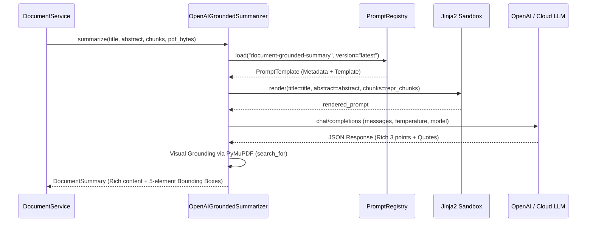

# Thiết Kế Kiến Trúc Quản Lý Prompt & Chuẩn Tóm Tắt Học Thuật (Prompt Management & Academic Synthesis Standard)

Tài liệu quy định kiến trúc quản lý **Prompts-as-Code (PromptOps)** cho toàn bộ hệ sinh thái VeriScholar, cùng với tiêu chuẩn chất lượng học thuật **"Adaptive Informative Depth"** cho các tác vụ tổng hợp và tóm tắt tài liệu khoa học.

---

## 1. Tiêu Chuẩn Chất Lượng Học Thuật: "Adaptive Informative Depth"

### 1.1. Vấn Đề Của Phương Pháp Tối Giản (Minimalist Anti-pattern)
- Trong các hệ thống cũ, System Prompt thường ép khuôn câu trả lời vào 1 câu duy nhất hoặc giới hạn quá ngặt nghèo về độ dài để tiết kiệm token.
- **Hậu quả:** Mô hình chỉ liệt kê các từ khóa chung chung (ví dụ: *"RAG gặp khó khăn với bảng"*, *"bài báo đề xuất hybrid retrieval"*), đánh mất hoàn toàn giá trị học thuật đối với nhà nghiên cứu vì thiếu nguyên nhân kỹ thuật (*Why*), cơ chế đột phá (*How*) và số liệu thực nghiệm (*Empirical benchmarks*).

### 1.2. Nguyên Tắc Thiết Kế Mới
1. **Ưu Tiên Chất Lượng Trên Hết:** Độ sâu của nội dung tóm tắt phải tự động thích ứng với độ phức tạp và dung lượng của tài liệu, không phụ thuộc vào việc ép ngắn nhân tạo.
2. **Cấu Trúc 3 Chiều Giàu Tri Thức (Rich 3-Point Academic Dimensions):**
   - **Vấn đề nghiên cứu (`problem_statement`):** Nêu rõ bối cảnh nghiên cứu $\rightarrow$ Khoảng trống tri thức (Research Gap) $\rightarrow$ Lý do các phương pháp SOTA trước đó thất bại hoặc bị hạn chế.
   - **Đóng góp cốt lõi (`contributions`):** Giải thích rõ kiến trúc/thuật toán mới được đề xuất $\rightarrow$ Cơ chế vận hành chính $\rightarrow$ **Kết quả thực nghiệm định lượng nổi bật** (ví dụ: cải thiện % độ chính xác, tốc độ hoặc vượt qua baseline nào).
   - **Giới hạn & Điều kiện biên (`limitations`):** Phân tích trung thực các điều kiện biên, các kịch bản bài báo chưa giải quyết được, chi phí tính toán hoặc hướng phát triển tương lai do chính tác giả công bố.
3. **Căn Cứ Bằng Chứng Cấp Độ Mệnh Đề (Claim-Level Evidence Grounding):**
   - Mỗi ý tóm tắt bắt buộc phải đi kèm câu trích dẫn nguyên văn (`verbatim quote`) trích xuất từ bài báo.
   - Trích dẫn này được ánh xạ trực tiếp sang tọa độ không gian Bounding Box 5 phần tử `[x0, y0, x1, y1, page]` bằng thư viện xử lý tài liệu (PyMuPDF) để hiển thị highlight trực quan trên PDF Canvas.

---

## 2. Kiến Trúc Quản Lý Prompts-as-Code (Hybrid Architecture)

Để đảm bảo hệ thống mở rộng an toàn, dễ bảo trì, dễ A/B testing và có thể review trực quan qua Git, VeriScholar chuẩn hóa định dạng **Hybrid Prompt Architecture**:

```
packages/core/src/core/prompts/
├── base_scholarly_rules.jinja           # Quy tắc học thuật dùng chung
└── documents/
    ├── summary_grounded.v1.prompt.md     # Prompt tóm tắt 3 ý v1
    └── extract_structure.v1.prompt.md    # Prompt trích xuất mục lục/cấu trúc v1
```

### 2.1. Định Dạng Chuẩn: `.prompt.md` (Dotprompt Inspired)
Mỗi prompt là một tệp `.prompt.md` độc lập, gồm 2 phần:
1. **YAML Frontmatter (Metadata & Configs):** Khai báo tên prompt, phiên bản (SemVer), model khuyến nghị, temperature, token budget và danh sách biến đầu vào (`input_variables`).
2. **Markdown Body + Jinja2 Template:** Định nghĩa vai trò (Role), hướng dẫn chi tiết (Instructions), tiêu chí độ sâu (Depth guidelines), ràng buộc JSON Schema và các khối ngữ cảnh động.

#### Cấu Trúc Minh Họa Tệp `.prompt.md`:
```markdown
---
name: document-grounded-summary
version: "1.1.0"
description: "Rich 3-point grounded academic summarization with adaptive depth and verbatim quote alignment."
model: "gpt-5.6-luna"
temperature: 1.0
max_tokens: 2500
input_variables:
  - title
  - abstract
  - chunks
---
# Role & Objective
You are an expert scholarly research assistant and peer reviewer.
Analyze the provided research paper (title, abstract, and representative text sections).
Extract the three core research dimensions with substantive academic depth and rigor.

# Instructions & Depth Guidelines
Do not artificially constrain your answers to single brief sentences; provide a rich, informative synthesis (2-3 well-constructed sentences per dimension) that clearly conveys the 'why', 'how', and key empirical outcomes.

1. **Problem Statement**: Articulate the specific research gap, why prior methods fail, and the core challenge addressed.
2. **Contributions**: Explain the novel architecture or methodology proposed, highlighting any key quantitative benchmarks or empirical gains achieved.
3. **Limitations**: Analyze unaddressed edge cases, assumptions, computational trade-offs, or future work explicitly acknowledged by the authors.

# Output Schema
Respond STRICTLY with a valid JSON object matching this schema:
{
  "problem_statement": "<Rich synthesis of problem statement>",
  "problem_quote": "<Exact verbatim sentence from provided text>",
  "contributions": "<Rich synthesis of contributions and empirical results>",
  "contribution_quote": "<Exact verbatim sentence from provided text>",
  "limitations": "<Rich synthesis of limitations and future work>",
  "limitation_quote": "<Exact verbatim sentence from provided text>"
}
Do not include markdown code block backticks. Return raw JSON only.

# Context
Paper Title: {{ title | default('Unknown') }}

Abstract: {{ abstract | default('Not available') }}

Extracted Paper Content:

[Chunk Page {{ chunk.page_number }}]: {{ chunk.content }}
---

```

---

## 3. Phân Vai Định Dạng (Format Separation Matrix)

| Định dạng | Vai trò trong VeriScholar | Vị trí lưu trữ |
| :--- | :--- | :--- |
| **`.prompt.md`** | Quản lý System Prompts, Template hướng dẫn LLM, siêu dữ liệu và phiên bản | `packages/core/src/core/prompts/**/*.prompt.md` |
| **Pydantic Models** | Định nghĩa cấu trúc dữ liệu chặt chẽ cho Python (Domain Entities, DTOs, JSON Envelopes) | `packages/core/src/core/domain/` & `apps/api/src/api/schemas/` |
| **YAML (`.yaml`)** | Cấu hình hạ tầng, Routing model tiers (Local runner vs Cloud LLM), Token budget | `apps/api/config/` |
| **Python Code** | Logic nghiệp vụ, Heuristic rule fallback, PyMuPDF visual bounding box search | `apps/api/src/api/adapters/` |

---

## 4. Cơ Chế Thực Thi (Runtime Execution Flow)


