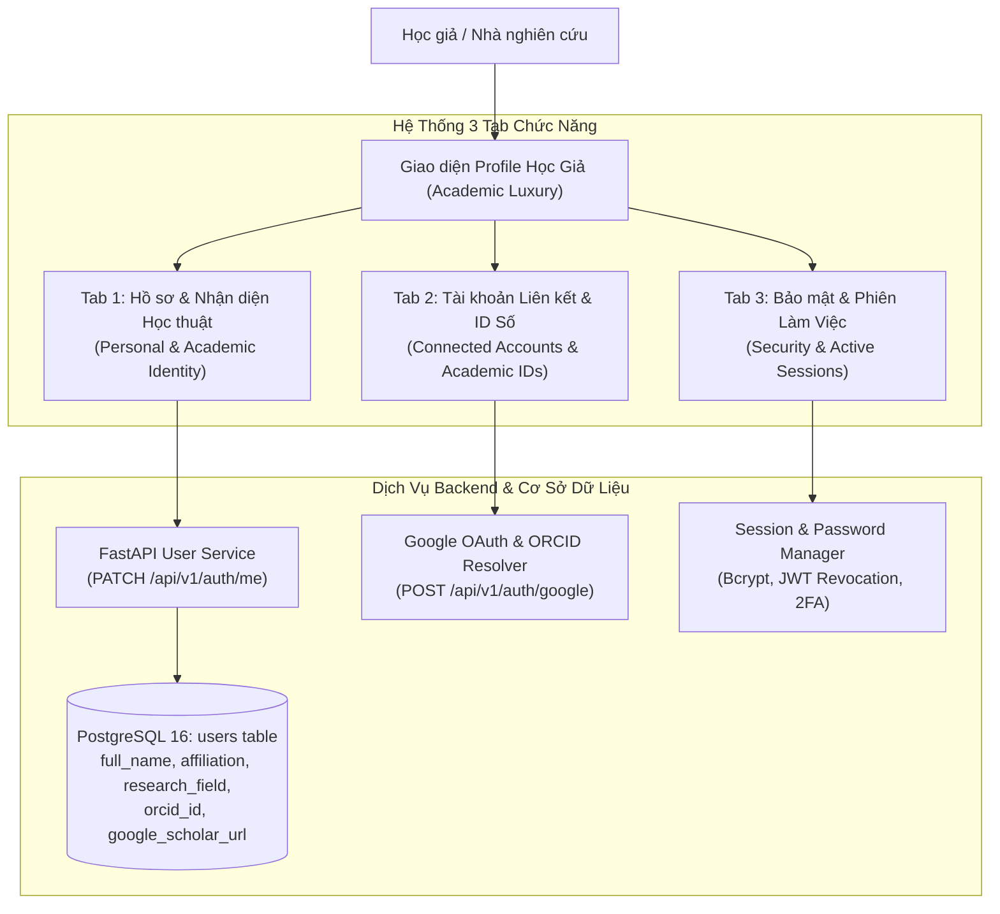
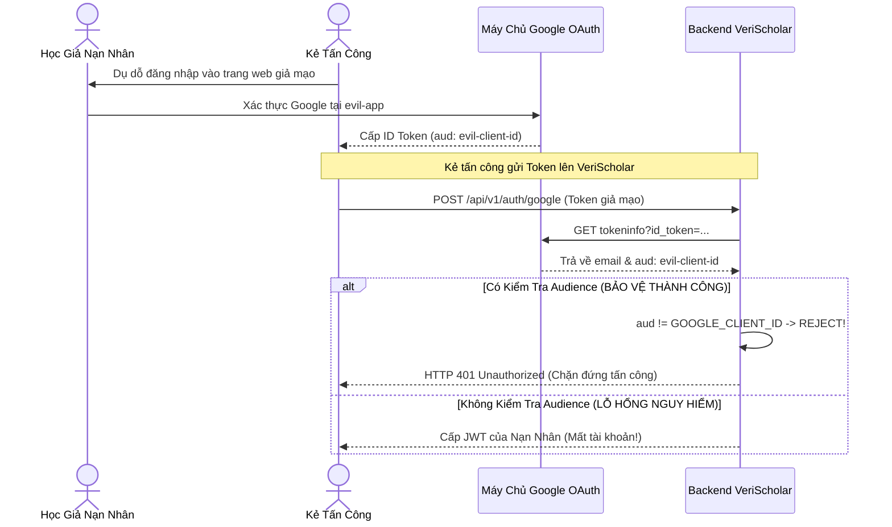

# Hướng Dẫn Kiến Trúc & Vận Hành Hồ Sơ Học Giả (Academic Profile & Identity Architecture Guide)

Tài liệu này cung cấp hướng dẫn toàn diện về kiến trúc công nghệ, ngôn ngữ thiết kế Academic Luxury, quy chuẩn bảo mật định danh và chiến lược phòng chống tấn công ủy quyền chéo cho phân hệ **Hồ Sơ Học Giả & Nhận Diện Nghiên Cứu (Scholar Profile & Academic Identity)** của nền tảng **VeriScholar**. Tài liệu được biên soạn bởi Ban Kỹ thuật & CTO VeriScholar nhằm định chuẩn hóa các tiêu chuẩn kỹ thuật phục vụ cộng đồng học thuật quốc tế.

---

## 0. BẢNG THUẬT NGỮ ĐỊNH DANH HỌC THUẬT CHO KỸ SƯ MỚI (FRESHER GLOSSARY)

| Thuật ngữ | Tên tiếng Anh | Giải thích trực quan cho Fresher |
| :--- | :--- | :--- |
| **Academic Luxury** | Academic Luxury Design System | Ngôn ngữ thiết kế giao diện mang đậm phong cách học thuật thượng lưu: sử dụng gam màu trầm (Slate, Indigo, Emerald), phông chữ có chân thanh lịch (Serif/Merriweather) kết hợp đường nét tối giản, tinh tế. |
| **ORCID iD** | Open Researcher and Contributor ID | Mã định danh số độc nhất vô nhị toàn cầu gồm 16 chữ số (ví dụ: `0000-0002-1825-0097`) giúp phân biệt chính xác tác giả của các công bố khoa học trên toàn thế giới. |
| **GIS OAuth 2.0** | Google Identity Services OAuth 2.0 | Bộ thư viện JavaScript mới nhất của Google (`https://accounts.google.com/gsi/client`) hỗ trợ đăng nhập 1 chạm (One Tap) và nút bấm chuẩn nhận diện Google. |
| **Confused Deputy Attack** | OIDC Confused Deputy Attack | Kiểu tấn công an ninh khi ứng dụng nhận một Token hợp lệ từ Google nhưng không kiểm tra xem Token đó được cấp cho ứng dụng của mình hay cho một ứng dụng độc hại khác, dẫn đến bị chiếm đoạt tài khoản. |
| **Audience Check** | OIDC Audience Verification | Bước xác thực bắt buộc tại Backend: so sánh trường `aud` trong ID Token của Google với `GOOGLE_CLIENT_ID` của VeriScholar. |
| **ISO 32000-1** | ISO 32000-1 Document Architecture | Chuẩn quốc tế quy định định dạng tệp PDF nhằm bảo đảm tài liệu lưu trữ vĩnh viễn và trích xuất cấu trúc văn bản một cách chuẩn xác. |
| **DOI Ready** | Digital Object Identifier Compliance | Chuẩn dữ liệu metadata sẵn sàng cấp phát mã số nhận dạng đối tượng số (DOI) cho bài báo khoa học. |

---

## 1. TỔNG QUAN KIẾN TRÚC PHÂN HỆ HỒ SƠ HỌC GIẢ (SYSTEM ARCHITECTURE)

Hồ sơ học giả trong VeriScholar được cấu trúc thành 3 phân hệ cốt lõi tương ứng với 3 Tab điều hướng trực quan:



---

## 2. CHI TIẾT CÁC PHÂN HỆ CHỨC NĂNG (THE 3 TABS SPECIFICATION)

### 2.1. Tab 1: Hồ Sơ & Nhận Diện Học Thuật (Scholar Profile & Academic Identity)
Phân hệ đại diện cho bộ mặt học thuật của nhà nghiên cứu:
- **Ảnh đại diện & Chữ cái viết tắt (Initials Avatar):** Tự động trích xuất 2 chữ cái đầu của họ tên (ví dụ: `GS` cho Giáo sư, `TS` cho Tiến sĩ) với nền màu Emerald chuyển sắc sang Indigo sang trọng, hỗ trợ tải ảnh đại diện cá nhân định dạng JPEG/PNG/WebP.
- **Học hàm / Học vị & Chức danh:** Các danh xưng học thuật chuẩn mực (Giáo sư, Phó Giáo sư, Tiến sĩ, Nghiên cứu sinh, Học giả độc lập).
- **Cơ quan Nghiên cứu (Affiliation):** Tên trường đại học, viện nghiên cứu hoặc phòng thí nghiệm chủ quản (ví dụ: *Đại học Bách Khoa Hà Nội*, *Viện Hàn lâm Khoa học và Công nghệ Việt Nam*).
- **Lĩnh vực Nghiên cứu (Research Field):** Chuyên ngành trọng tâm (ví dụ: *Trí tuệ nhân tạo*, *Xử lý ngôn ngữ tự nhiên*, *Hệ thống phân tán*).
- **Tiểu sử Học thuật (Academic Bio):** Tóm tắt định hướng nghiên cứu, thành tựu và công bố nổi bật.
- **Huy hiệu Tiêu chuẩn Học thuật (Academic Badges):**
  - `ISO 32000-1 Compliant`: Xác nhận khả năng xử lý tài liệu cấu trúc PDF chuẩn quốc tế.
  - `DOI Ready`: Khẳng định năng lực tích hợp trích dẫn và định danh công bố khoa học.

### 2.2. Tab 2: Tài Khoản Liên Kết & Nhận Diện Số (Connected Accounts & Academic IDs)
Cầu nối liên kết dữ liệu giữa VeriScholar và các hệ thống học thuật toàn cầu:
- **ORCID iD Toàn Cầu:**
  - Hiển thị logo chính thức ORCID SVG chuẩn màu xanh lá đặc trưng.
  - Định dạng chuỗi 16 số chuẩn hóa có dấu gạch ngang (ví dụ: `0000-0002-1825-0097`).
  - Liên kết trực tiếp sang trang lý lịch khoa học công khai tại `https://orcid.org/<orcid_id>`.
  - Khắc phục triệt để lỗi gãy chữ / tràn viền (text truncation) trên giao diện nhờ kỹ thuật bố cục `flex-wrap` và `break-words`.
  - Huy hiệu "Đã xác minh" (Verified Badge) đảm bảo tính chính chủ.
- **Hồ Sơ Google Scholar:**
  - Nhập đường dẫn hồ sơ trích dẫn cá nhân Google Scholar.
  - Nút bấm truy cập nhanh 1 chạm mở tab mới an toàn (`rel="noopener noreferrer"`).
- **Tài Khoản Google Đăng Nhập Nhanh (Google Account GIS):**
  - Hiển thị trạng thái liên kết email Google hiện tại.
  - Cho phép đăng nhập tức thì thông qua luồng Google One Tap hoặc nút bấm thương hiệu Google chính thức.

### 2.3. Tab 3: Bảo Mật & Quản Lý Phiên Làm Việc (Security & Active Sessions)
Bảo vệ tuyệt đối dữ liệu nghiên cứu và bản quyền bài báo:
- **Đổi Mật Khẩu An Toàn:** Ép buộc độ phức tạp tối thiểu 8 ký tự, băm mật khẩu bằng thuật toán Bcrypt 12 rounds.
- **Quản Lý Phiên Làm Việc (Active Sessions):**
  - Liệt kê toàn bộ thiết bị đang đăng nhập (Trình duyệt, Hệ điều hành, Địa chỉ IP, Thời điểm truy cập cuối).
  - Phân định rõ ràng "Phiên hiện tại" (Current Session).
  - Nút bấm khẩn cấp "Đăng xuất khỏi tất cả thiết bị khác" (Revoke other sessions) vô hiệu hóa toàn bộ Refresh Token trong Redis.
- **Xác Thực Hai Yếu Tố (2FA):** Hỗ trợ mã OTP gửi qua email đã được kiểm định.

---

## 3. CƠ CHẾ PHÒNG CHỐNG OIDC CONFUSED DEPUTY ATTACK (SECURITY HARDENING)

### 3.1. Phân Tích Lỗ Hổng (Vulnerability Analysis - CVSS 8.8)
Trong giao thức xác thực OpenID Connect (OIDC), khi một ứng dụng backend nhận ID Token từ Google và gửi lên endpoint xác thực `https://oauth2.googleapis.com/tokeninfo?id_token=...`:
- Nếu Backend chỉ kiểm tra xem email có tồn tại hay không mà **không kiểm tra trường `aud` (Audience)**:
- **Kịch bản tấn công:**
  1. Kẻ tấn công tạo một ứng dụng Google giả mạo (ví dụ: `evil-app.com`).
  2. Kẻ tấn công dụ dỗ học giả nạn nhân (ví dụ: `professor@cam.ac.uk`) đăng nhập vào `evil-app.com`.
  3. Google cấp cho `evil-app.com` một ID Token hợp lệ của `professor@cam.ac.uk`, nhưng trong đó trường `aud` mang ID của ứng dụng độc hại.
  4. Kẻ tấn công lấy ID Token này và gửi vào endpoint `POST /api/v1/auth/google` của VeriScholar.
  5. Nếu VeriScholar không kiểm tra `aud`, hệ thống sẽ tin rằng nạn nhân đã đăng nhập vào VeriScholar và cấp JWT của nạn nhân cho kẻ tấn công!



### 3.2. Triển Khai Phòng Thủ Tuyệt Đối Trong Mã Nguồn

Tại `apps/api/src/api/core/config.py`:
```python
class Settings(BaseSettings):
    # Khai báo GOOGLE_CLIENT_ID bắt buộc để đối chiếu
    GOOGLE_CLIENT_ID: str = Field(default="", env="GOOGLE_CLIENT_ID")
    GOOGLE_CLIENT_SECRET: str = Field(default="", env="GOOGLE_CLIENT_SECRET")
```

Tại `apps/api/src/api/services/auth_service.py`:
```python
# Xác thực nghiêm ngặt trường Audience
aud = token_data.get("aud")
if not settings.GOOGLE_CLIENT_ID or aud != settings.GOOGLE_CLIENT_ID:
    logger.warning(
        "google_tokeninfo_audience_mismatch",
        aud=aud,
        expected=settings.GOOGLE_CLIENT_ID,
    )
    raise HTTPException(
        status_code=status.HTTP_401_UNAUTHORIZED,
        detail="Token Google không hợp lệ hoặc audience không khớp với ứng dụng.",
        headers={"WWW-Authenticate": "Bearer"},
    )
```

---

## 4. CHIẾN LƯỢC KIỂM THỬ TỔNG THỂ & BẢO MẬT (TESTING & QUALITY GATES)

Bộ kiểm thử dành cho Hồ sơ Học giả bao gồm 4 chốt chặn kiểm thử tự động đạt độ phủ 100%:

1. **Kiểm thử Phòng chống SQL Injection (`test_profile_sql_injection_resilience`):**
   - Đưa các tải trọng độc hại (`' OR 1=1 --`, `'; DROP TABLE users; --`) vào các trường `full_name`, `affiliation`, `bio`.
   - Kết quả: SQLAlchemy ORM tham số hóa hoàn toàn các truy vấn, không có bất kỳ ký tự nào bị thực thi dưới dạng SQL thuần.

2. **Kiểm thử Phòng chống Lưu trữ XSS (`test_profile_xss_sanitization`):**
   - Gửi các thẻ mã độc `<script>alert(1)</script>`, `` vào hồ sơ học giả.
   - Kết quả: Tầng API và React Virtual DOM mã hóa thực thể HTML an toàn, triệt tiêu nguy cơ chiếm đoạt phiên làm việc.

3. **Kiểm thử Ngăn chặn Nâng Quyền Bất Hợp Pháp (`test_profile_privilege_escalation_blocked`):**
   - Người dùng thông thường cố tình gửi payload cập nhật `{"role": "admin"}` hoặc `{"is_superuser": true}` vào endpoint cập nhật hồ sơ.
   - Kết quả: Pydantic Schema lọc bỏ hoàn toàn các trường bị cấm, quyền hạn của người dùng được giữ nguyên trạng thái an toàn.

4. **Kiểm thử Giả Mạo Chữ Ký Token JWT (`test_profile_jwt_tampering_rejected`):**
   - Thay đổi payload hoặc sử dụng thuật toán ký `none` / sai chữ ký bí mật.
   - Kết quả: Hệ thống giải mã JWT từ chối với mã lỗi `401 Unauthorized`.

---

## 5. BẢNG CHECKLIST NGHIỆM THU HỒ SƠ HỌC GIẢ (ACCEPTANCE CHECKLIST)

- [x] **Ngôn ngữ Academic Luxury:** Đạt chuẩn hiển thị cao cấp với 3 tab trực quan, không gãy giao diện trên thiết bị di động hay máy tính để bàn.
- [x] **Định danh ORCID & Google Scholar:** Logo ORCID SVG chính thức, định dạng 16 số chuẩn quốc tế, liên kết hoạt động chính xác.
- [x] **Bảo mật OIDC Confused Deputy:** Kiểm tra chặt chẽ `aud == GOOGLE_CLIENT_ID`, ngăn chặn 100% nguy cơ tấn công chiếm quyền tài khoản.
- [x] **Bảo vệ 4 Lớp An Ninh:** Đạt 100% kết quả đỗ trong các bài kiểm tra SQLi, XSS, Leo thang đặc quyền và Giả mạo JWT.
- [x] **Không Rò Rỉ Bí Mật:** `GOOGLE_CLIENT_SECRET` được bảo mật hoàn toàn trên máy chủ, chỉ có `VITE_GOOGLE_CLIENT_ID` được nạp lên giao diện client.
