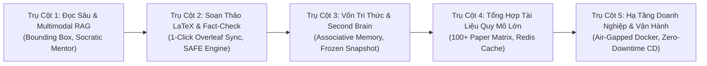

# Phân Hệ 02: Đặc Tả Chi Tiết 5 Trụ Cột Công Nghệ (5 Core Technology Pillars)

Phân hệ này chứa toàn bộ các tài liệu đặc tả yêu cầu sản phẩm (PRD) và chi tiết kỹ thuật chuyên sâu của **5 Trụ Cột Công Nghệ Cốt Lõi** tạo nên sức mạnh đột phá của nền tảng **VeriScholar**.

---

## 🏛️ TỔNG QUAN 5 TRỤ CỘT CÔNG NGHỆ (THE 5 CORE PILLARS)

---

## 📑 DANH MỤC TÀI LIỆU TRONG PHÂN HỆ

1. **[Tài Liệu Yêu Cầu Sản Phẩm Toàn Diện (prd.md)](file:///home/VeriScholar/Workspace/VeriScholar/docs/02-modules-and-features/prd.md):**  
   Bản đặc tả PRD hoàn chỉnh bao trùm toàn bộ bài toán học thuật, chân dung người dùng, cam kết bảo mật không lưu vết (Zero Data Retention) và yêu cầu kỹ thuật của cả 5 trụ cột.

2. **[Trụ Cột 1: Đọc & Hiểu Sâu Bài Báo (pillar-1-deep-reading.md)](file:///home/VeriScholar/Workspace/VeriScholar/docs/02-modules-and-features/pillar-1-deep-reading.md):**  
   Không gian đọc đa tài liệu (Multi-Tab PDF Viewer), hệ tọa độ chuẩn hóa Bounding Box (`[x0, y0, x1, y1, page]`), thuật toán ghép bảng (Table Stitching), trợ lý đối thoại Socratic Mentor phát hiện tiền đề câu hỏi sai lệch (Presupposition Validation).

3. **[Trụ Cột 2: Soạn Thảo LaTeX & Kiểm Chứng Sự Thật (pillar-2-latex-writing.md)](file:///home/VeriScholar/Workspace/VeriScholar/docs/02-modules-and-features/pillar-2-latex-writing.md):**  
   Không gian soạn thảo 3 phân vùng (Tri-pane Workspace), đồng bộ 1 chạm sang Overleaf (`POST /api/v1/drafts/{id}:export-overleaf`), kiểm soát đồng thời lạc quan (OCC Drafts), cơ chế tự sửa lỗi biên dịch (Self-healing Compiler Sandbox), và thuật toán kiểm chứng sự thật SAFE Fact-Checking.

4. **[Trụ Cột 3: Vốn Tri Thức & Ký Ức Liên Tưởng (pillar-3-knowledge-capital.md)](file:///home/VeriScholar/Workspace/VeriScholar/docs/02-modules-and-features/pillar-3-knowledge-capital.md):**  
   Ký ức liên tưởng chủ động (Proactive Scholarly Associative Memory: `POST /api/v1/drafts/{id}/associative-suggestions`), thẻ gợi ý thông minh (Spark of Insight Card), bảo tồn tư duy với Bản chụp bằng chứng đóng băng (Frozen Evidence Snapshot), đồ thị trích dẫn 2-hop (GraphRAG), và bộ câu hỏi kích hoạt trí nhớ chủ động (Active Recall Knowledge Digest).

5. **[Trụ Cột 4: Tổng Hợp Tài Liệu Quy Mô Lớn (pillar-4-literature-matrix.md)](file:///home/VeriScholar/Workspace/VeriScholar/docs/02-modules-and-features/pillar-4-literature-matrix.md):**  
   Ma trận so sánh tài liệu quy mô lớn (hỗ trợ 100+ bài báo) với phân trang Server-side (`limit`, `offset`, `search`), bộ nhớ đệm truy vấn Redis, bộ lọc nhiều tiêu chí (Phương pháp, Bộ dữ liệu, Chỉ số đo lường), xuất tệp CSV/Excel chuẩn RFC 4180 có UTF-8 BOM, và cây thư mục phân cấp dự án nghiên cứu.

6. **[Trụ Cột 5: Hạ Tầng Doanh Nghiệp & An Ninh Vận Hành (pillar-5-enterprise-stack.md)](file:///home/VeriScholar/Workspace/VeriScholar/docs/02-modules-and-features/pillar-5-enterprise-stack.md):**  
   Gói triển khai On-Premise độc lập mạng (`deploy/docker-compose.enterprise.yml`), bộ cài đặt một lệnh duy nhất (`scripts/bootstrap_enterprise.sh`), quy trình nâng cấp CSDL không gián đoạn dịch vụ (Zero-Downtime Migration: `init_db.py`), triển khai liên tục tự động với bẫy lỗi Auto-Rollback (`scripts/deploy_production.sh`), và phân hệ Hồ sơ học giả đạt chuẩn Academic Luxury tích hợp Google Identity Services (GIS OAuth 2.0) chống tấn công OIDC Confused Deputy Attack (CVSS 8.8).

---
*Thuộc Bộ Tài Liệu Kỹ Thuật VeriScholar Enterprise.*
