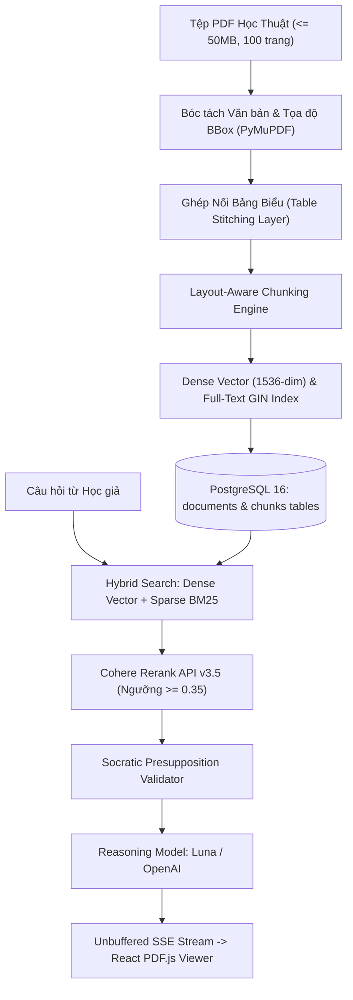

# Trụ Cột 1: Đọc & Hiểu Sâu Bài Báo Khoa Học (Deep Reading & Multimodal RAG)

Tài liệu này đặc tả chi tiết kiến trúc, luồng xử lý và tiêu chuẩn kỹ thuật của **Trụ Cột 1 (Module 1: Deep Reading Workspace & Multimodal RAG)** của nền tảng **VeriScholar**.

---

## 1. TỔNG QUAN & NGUYÊN LÝ THIẾT KẾ (PILLAR OVERVIEW)

Trụ cột 1 giải quyết bài toán đọc hiểu tài liệu PDF học thuật đa cột, phức tạp, chứa nhiều công thức và bảng biểu:
- **Tập trung vào 1 bài báo hoặc Cụm 1 - 5 bài báo liên quan mật thiết** (Multi-Paper Deep Reading Session).
- **Phản hồi có căn cứ tọa độ Bounding Box** hiển thị lớp phủ màu vàng trên giao diện đọc PDF, bảo đảm người dùng nhìn thấy rõ bằng chứng đoạn trích dẫn nằm ở đâu.
- **Triệt tiêu hoàn toàn hiện tượng ảo giác (Hallucination)** nhờ mô hình Hybrid RAG (Dense OpenAI 1536-dim + Sparse BM25/Simple) kết hợp Cohere Reranking.
- **Trợ lý đối thoại Socratic Mentor:** Chủ động kiểm tra và uốn nắn các tiền đề câu hỏi sai lệch (Presupposition Validation) thay vì a dua nịnh hót (Sycophancy).



---

## 2. CÁC TÍNH NĂNG KỸ THUẬT CỐT LÕI (CORE CAPABILITIES)

### 2.1. Trình Đọc PDF Đa Tab (Multi-Tab PDF.js Canvas Viewer)
- Bố cục 2 nửa chia đôi màn hình (Split-Pane Layout): Nửa trái là Trình đọc PDF, nửa phải là Trợ lý đối thoại và Sổ tay.
- Hỗ trợ cuộn mượt, phóng to thu nhỏ (50% - 300%), xoay trang (`rotation`), và định hướng cây mục lục (TOC Tree).
- Hệ tọa độ chuẩn hóa Top-Left `[x0, y0, x1, y1, page]` độc lập hoàn toàn với kích thước màn hình và góc xoay trang (`Dynamic Viewport Matrix Scaling`).

### 2.2. Đóng Gói Ngữ Cảnh Đa Bài Báo (Cross-Document Context Namespacing)
- Khi nạp cụm 2 - 5 bài báo trong cùng một phiên nghiên cứu, mỗi đoạn trích dẫn đưa vào Prompt LLM được bọc trong thẻ định danh:
  ```xml
  <evidence document_id="doc-uuid-1" title="Attention Is All You Need" page="3" bbox="[0.1, 0.2, 0.9, 0.4]">
  ...
  </evidence>
  ```
- Ngăn chặn triệt để hiện tượng nhầm lẫn nguồn gốc (Context Entanglement).

### 2.3. Khôi Phục Phiên Nguyên Vẹn (Session Persistence & Snapshots)
- Lưu trữ vị trí đọc dở (`viewport_state`: trang hiện tại, tỷ lệ zoom, tọa độ cuộn) và tab đang mở vào bảng `conversations`.
- Cơ chế khóa lạc quan OCC (`version`) chống mất dữ liệu khi mở trên nhiều cửa sổ.

---

## 3. DANH MỤC API TRỤ CỘT 1 (API ENDPOINTS)

| Phương thức | Endpoint | Chức năng |
| :--- | :--- | :--- |
| `POST` | `/api/v1/documents` | Tải lên tài liệu PDF học thuật (hỗ trợ multipart) |
| `GET` | `/api/v1/documents/{id}` | Lấy chi tiết siêu dữ liệu tài liệu |
| `DELETE` | `/api/v1/documents/{id}` | Xóa tài liệu (Cascade Purge & Frozen Snapshot) |
| `GET` | `/api/v1/documents/{id}/chunks` | Lấy danh sách chunks kèm tọa độ Bounding Box |
| `POST` | `/api/v1/sessions` | Khởi tạo phiên nghiên cứu đọc sâu |
| `GET` | `/api/v1/sessions/{id}` | Khôi phục nguyên vẹn phiên nghiên cứu |
| `PATCH` | `/api/v1/sessions/{id}/viewport` | Lưu tọa độ cuộn trang và tỷ lệ zoom |
| `POST` | `/api/v1/sessions/{id}/messages` | Gửi câu hỏi và nhận luồng SSE streaming |

---
*Thuộc Bộ Tài Liệu Kỹ Thuật VeriScholar Enterprise.*
