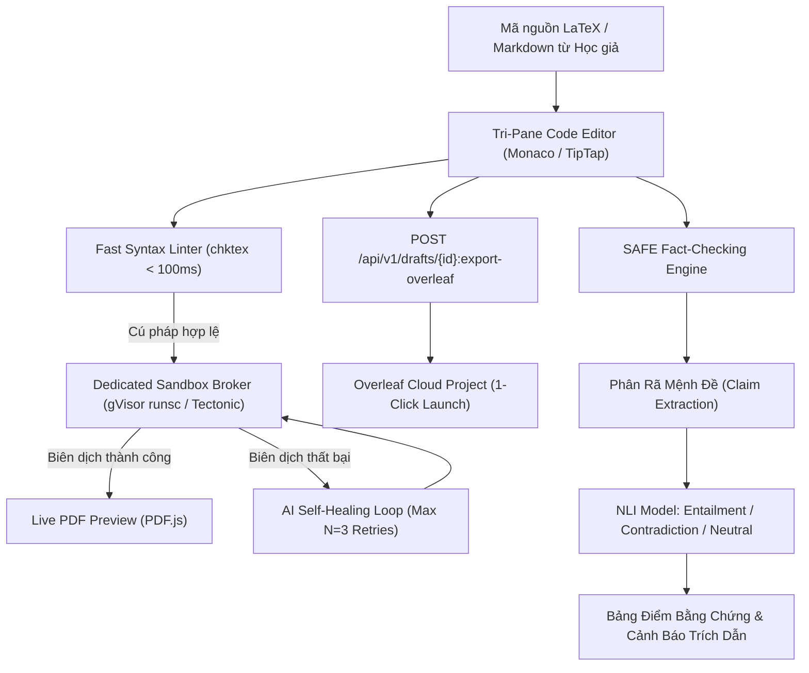

# Trụ Cột 2: Soạn Thảo LaTeX Học Thuật & Kiểm Chứng Sự Thật (LaTeX Writing & SAFE Fact-Checking)

Tài liệu này đặc tả chi tiết kiến trúc, luồng xử lý và tiêu chuẩn kỹ thuật của **Trụ Cột 2 (Module 2: Collaborative LaTeX Writing, 1-Click Overleaf Sync & SAFE Fact-Checking Engine)** của nền tảng **VeriScholar**.

---

## 1. TỔNG QUAN & NGUYÊN LÝ THIẾT KẾ (PILLAR OVERVIEW)

Trụ cột 2 cung cấp môi trường soạn thảo học thuật toàn diện dành cho các nhà nghiên cứu và học giả:
- **Không gian soạn thảo 3 cột thích ứng (Adaptive Tri-Pane Workspace):** Code Editor (LaTeX/Markdown) | Live PDF Preview | AI Assistant.
- **Tích hợp Đồng bộ 1 Chạm sang Overleaf (1-Click Overleaf Integration):** Đóng gói trực tiếp mã nguồn và danh mục trích dẫn sang Overleaf chỉ với 1 cú nhấp chuột.
- **Vòng lặp Agentic Tự Vá Lỗi Biên Dịch (Agentic Self-Healing Compiler):** Khắc phục lỗi cú pháp LaTeX trong container Sandbox cô lập cấp Kernel.
- **Bộ máy Kiểm chứng Sự thật Học thuật (SAFE Fact-Checking Engine):** Phân rã câu văn và kiểm tra mức độ xác thực khoa học trước khi nộp bài.

---

## 2. CÁC TÍNH NĂNG KỸ THUẬT CỐT LÕI (CORE CAPABILITIES)

### 2.1. Đồng Bộ Hóa 1-Chạm Sang Overleaf (1-Click Overleaf Sync Integration)
- **Endpoint:** `POST /api/v1/drafts/{id}:export-overleaf`
- **Cơ chế hoạt động:**
  1. Backend bóc tách toàn văn bản thảo thành `main.tex`.
  2. Bóc tách và liên kết danh mục tham khảo thành tệp `references.bib`.
  3. Đóng gói các tài sản đồ họa thành payload form POST tương thích giao thức Overleaf Launch URL.
  4. Phía Web Client, nút bấm `"Đồng bộ Overleaf (1-Click)"` mở ngay tab trình duyệt mới dẫn thẳng vào dự án Overleaf đã nạp sẵn toàn bộ mã nguồn.

### 2.2. Vòng Lặp Agentic Tự Vá Lỗi Biên Dịch (LaTeX Self-Healing Sandbox)
- Vận hành bộ biên dịch Tectonic/TeXLive trong container cô lập: Không cấp quyền root, không mount file socket Docker, giới hạn tài nguyên cgroups (1 CPU, 512MB RAM, timeout 15s) và cấm cờ shell escape (`--no-shell-escape`).
- Chu trình tự động: Bắt log stderr → AI phân tích dòng lỗi → Tạo bản vá → Biên dịch lại (tối đa 3 lần).
- **Bộ nhớ chống lặp vòng tròn (Anti-Oscillation Patching Memory):** Lưu lịch sử các bước vá lỗi trước đó, áp dụng No-Rollback Constraint ngăn AI quay lại cấu trúc code đã gây lỗi.

### 2.3. Kiểm Chứng Sự Thật SAFE Fact-Checking
- Phân rã đoạn văn bản của học giả thành các mệnh đề hạt nhân (Atomic Claims).
- Tự động truy vấn tài liệu gốc trong thư viện qua Hybrid Search.
- Chạy mô hình NLI gán nhãn:
  - `Entailment` (Có cơ sở): Highlight màu xanh lá kèm Bounding Box chứng minh.
  - `Contradiction` (Mâu thuẫn): Highlight màu đỏ, cảnh báo số liệu hoặc kết luận trái ngược bài báo gốc.
  - `Neutral` (Thiếu căn cứ): Highlight màu vàng cam, cảnh báo khẳng định chưa được chứng minh.

### 2.4. Kiểm Soát Sửa Đổi Đồng Thời Khóa Lạc Quan (OCC Drafts)
- Bảng `drafts` quản lý phiên bản `version: integer`. Mọi thao tác sửa đổi (`PATCH /api/v1/drafts/{id}`) bắt buộc phải khớp version, triệt tiêu nguy cơ ghi đè dữ liệu (Lost Update).

---

## 3. DANH MỤC API TRỤ CỘT 2 (API ENDPOINTS)

| Phương thức | Endpoint | Chức năng |
| :--- | :--- | :--- |
| `POST` | `/api/v1/drafts` | Khởi tạo bản thảo nghiên cứu mới |
| `GET` | `/api/v1/drafts/{id}` | Lấy toàn văn bản thảo kèm version OCC |
| `PATCH` | `/api/v1/drafts/{id}` | Cập nhật nội dung bản thảo kèm kiểm tra version |
| `DELETE` | `/api/v1/drafts/{id}` | Xóa bản thảo |
| `POST` | `/api/v1/drafts/{id}:compile` | Kích hoạt biên dịch Sandbox ra file PDF |
| `POST` | `/api/v1/drafts/{id}:export-overleaf` | Tạo payload mở dự án Overleaf 1-Click |
| `POST` | `/api/v1/drafts/{id}:fact-check` | Chạy kiểm chứng sự thật học thuật SAFE |
| `POST` | `/api/v1/drafts/{id}/comments` | Thêm bình luận phản biện (Peer Review Comments) |

---
*Thuộc Bộ Tài Liệu Kỹ Thuật VeriScholar Enterprise.*
