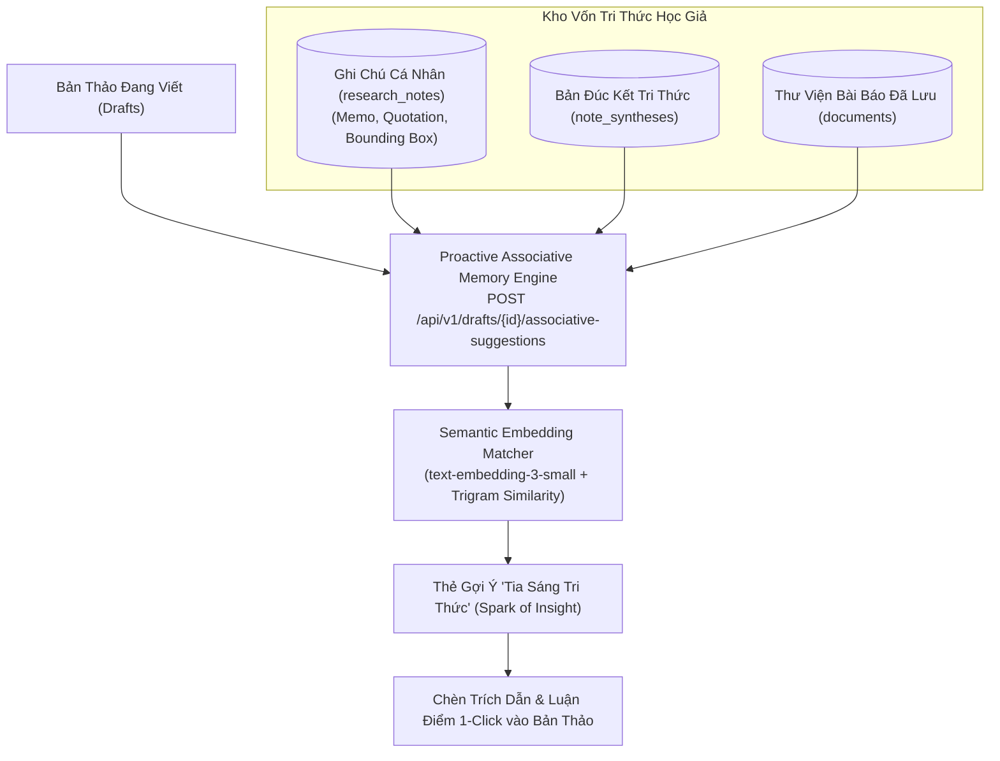

# Trụ Cột 3: Vốn Tri Thức Học Thuật & Ký Ức Liên Tưởng (Knowledge Capital & Associative Memory)

Tài liệu này đặc tả chi tiết kiến trúc, luồng xử lý và tiêu chuẩn kỹ thuật của **Trụ Cột 3 (Module 3: Smart Notebook, Proactive Scholarly Associative Memory, Frozen Evidence Snapshot & GraphRAG)** của nền tảng **VeriScholar**.

---

## 1. TỔNG QUAN & NGUYÊN LÝ THIẾT KẾ (PILLAR OVERVIEW)

Trụ cột 3 xây dựng "Bộ não thứ hai" (Second Brain) biến các ghi chú đọc sách phân mảnh thành vốn tài sản trí tuệ tích lũy lâu dài cho học giả:
- **Ký Ức Liên Tưởng Chủ Động (Proactive Scholarly Associative Memory):** Tự động liên tưởng các ý tưởng trong quá khứ khi đang viết bản thảo mới.
- **Bảo Tồn Tư Duy Khoa Học (Frozen Evidence Snapshot):** Ngay cả khi tài liệu PDF gốc bị xóa, các câu trích dẫn và ghi chú cá nhân vẫn được bảo lưu vĩnh viễn với nhãn `[Source Detached]`.
- **Mạng Lưới Đồ Thị Trích Dẫn 2-hop (GraphRAG Engine):** Khám phá đường đi phát triển của các công trình khoa học và cắt đứt các chu trình trích dẫn vòng lặp (Cycle Breaking).
- **Bộ Câu Hỏi Kích Hoạt Trí Nhớ (Active Recall Knowledge Digest):** Tự động tạo thẻ ghi nhớ và câu hỏi tự vấn kiểm tra mức độ thấu hiểu.



---

## 2. CÁC TÍNH NĂNG KỸ THUẬT CỐT LÕI (CORE CAPABILITIES)

### 2.1. Ký Ức Liên Tưởng Học Thuật Chủ Động (Proactive Associative Memory)
- **Endpoint:** `POST /api/v1/drafts/{id}/associative-suggestions`
- **Cơ chế hoạt động:**
  1. Khi học giả đang gõ một đoạn văn mới trong Writing Workspace, hệ thống phân tích ngữ nghĩa đoạn văn hiện hành.
  2. Truy vấn tương đồng ngữ nghĩa (Cosine Similarity `>= 0.75`) kết hợp Trigram Lexical Search trên toàn bộ ghi chú (`research_notes`), bản tổng hợp (`note_syntheses`) và thư viện của tác giả.
  3. Kết quả được hiển thị dưới dạng thẻ gợi ý nổi *"Tia sáng Tri thức" (Spark of Insight Card)* ngay cạnh con trỏ chuột, nhắc nhở: *"Bạn đã từng ghi chú về vấn đề này trong bài báo [Vaswani et al., 2017] vào ngày 12/08/2026. Bấm để xem hoặc chèn trích dẫn"*.

### 2.2. Bản Chụp Bằng Chứng Đóng Băng (Frozen Evidence Snapshot)
- **Bảo vệ quyền riêng tư & toàn vẹn:** Khi bài báo gốc bị xóa (Zero-Retention Guarantee), hệ thống kích hoạt trigger CSDL PostgreSQL:
  ```sql
  CREATE OR REPLACE FUNCTION handle_note_source_detached()
  RETURNS TRIGGER AS $$
  BEGIN
      IF OLD.document_id IS NOT NULL AND NEW.document_id IS NULL THEN
          NEW.is_source_detached = TRUE;
      END IF;
      RETURN NEW;
  END;
  $$ LANGUAGE plpgsql;
  ```
- Kết quả: Toàn bộ vector chunks và file PDF gốc bị xóa sổ khỏi đĩa, nhưng câu trích dẫn văn bản và suy nghĩ cá nhân của tác giả vẫn được giữ nguyên trạng thái `[Source Document Detached]`.

### 2.3. Đồ Thị Trích Dẫn 2-hop (GraphRAG & Cycle Breaking)
- Bóc tách danh mục tham khảo qua Crossref / Semantic Scholar API.
- Dựng đồ thị liên kết 2-hop (bài trích dẫn trực tiếp và bài trích dẫn cấp hai).
- Thuật toán loại bỏ chu trình (Cycle Breaking): Tự động cắt các vòng lặp trích dẫn chéo giữa các bài báo bằng thuật toán DFS phát hiện Back-Edges.

---

## 3. DANH MỤC API TRỤ CỘT 3 (API ENDPOINTS)

| Phương thức | Endpoint | Chức năng |
| :--- | :--- | :--- |
| `POST` | `/api/v1/notes` | Tạo ghi chú cá nhân mới gắn với bài báo và BBox |
| `GET` | `/api/v1/notes` | Lấy danh sách ghi chú (phân trang, lọc theo document) |
| `PATCH` | `/api/v1/notes/{id}` | Cập nhật nội dung ghi chú kèm kiểm tra OCC version |
| `DELETE` | `/api/v1/notes/{id}` | Xóa ghi chú |
| `POST` | `/api/v1/notes:synthesize` | Kích hoạt tổng hợp tri thức từ cụm ghi chú |
| `POST` | `/api/v1/drafts/{id}/associative-suggestions` | Lấy gợi ý liên tưởng tri thức chủ động |
| `GET` | `/api/v1/documents/{id}/citation-graph` | Trích xuất đồ thị trích dẫn 2-hop |

---
*Thuộc Bộ Tài Liệu Kỹ Thuật VeriScholar Enterprise.*
