# Trụ Cột 5: Hạ Tầng Doanh Nghiệp On-Premise & Hồ Sơ Học Giả (Enterprise Scalability & Academic Identity)

Tài liệu này đặc tả chi tiết kiến trúc, luồng xử lý và tiêu chuẩn kỹ thuật của **Trụ Cột 5 (Module 5: Turn-key Enterprise Stack, Zero-Downtime CD, Automated Rollback, Google GIS OAuth 2.0 & Scholar Identity)** của nền tảng **VeriScholar**.

---

## 1. TỔNG QUAN & NGUYÊN LÝ THIẾT KẾ (PILLAR OVERVIEW)

Trụ cột 5 đảm bảo khả năng sẵn sàng phục vụ cấp độ doanh nghiệp (Enterprise Readiness), triển khai độc lập tại các viện nghiên cứu và bảo vệ tối đa định danh học thuật:
- **Gói Cài Đặt On-Premise Air-Gapped (Single-Command Bootstrap):** Triển khai toàn bộ cụm dịch vụ trong mạng nội bộ cô lập không cần internet qua `bootstrap_enterprise.sh`.
- **Đường Ống Triển Khai Tự Động & Auto-Rollback (Continuous Deployment):** Tự động di trú CSDL Zero-Downtime và tự động khôi phục phiên bản trước nếu dịch vụ không đạt chuẩn sức khỏe.
- **Hồ Sơ Học Giả Đẳng Cấp (Academic Luxury Scholar Profile):** Hệ thống 3 Tabs hoàn thiện nhận diện học thuật, liên kết ORCID iD, Google Scholar và quản trị phiên làm việc.
- **Bảo Mật Xác Thực Google Identity Services (GIS OAuth 2.0):** Khắc phục triệt để lỗ hổng OIDC Confused Deputy Attack (CVSS 8.8) bằng kiểm tra chặt chẽ `aud == GOOGLE_CLIENT_ID`.

```mermaid
flowchart TD
    subgraph ENTERPRISE_STACK ["Cụm Dịch Vụ Enterprise On-Premise (Docker)"]
        NginxProxy["Nginx Reverse Proxy & SSL (Port 80/443)"]
        FastAPIApp["FastAPI Gateway Application (2 Uvicorn Workers)"]
        ARQWorker["ARQ Background Ingestion Worker"]
        PgBouncer["PgBouncer Connection Pooler (Port 6432)"]
        PostgresDB[("PostgreSQL 16 + pgvector (Port 5432)")]
        RedisStore[("Redis 7 In-Memory Store (Port 6379)")]

        NginxProxy --> FastAPIApp
        FastAPIApp --> PgBouncer
        PgBouncer --> PostgresDB
        FastAPIApp --> RedisStore
        ARQWorker --> RedisStore
        ARQWorker --> PgBouncer
    end

    subgraph CI_CD_PIPELINE ["Quy Trình Triển Khai Tự Động CD"]
        GitCommit["Push to main / CD Trigger"] --> Preflight["Pre-flight Checks"]
        Preflight --> ZeroDDL["Zero-Downtime DB Migration (init_db.py)"]
        ZeroDDL --> WebDeploy["Build & Atomic Deploy Web to /var/www"]
        WebDeploy --> Reload["Nginx Reload & API Service Restart"]
        Reload --> HealthProbe["Health Check Probe (15 attempts, 30s)"]
        HealthProbe -->|HTTP 200 OK| ProductionLive["Production Live Success"]
        HealthProbe -->|Timeout / Error| AutoRollback["Auto-Rollback Trigger (Git Checkout & Service Restore)"]
    end
```



---

## 2. CÁC TÍNH NĂNG KỸ THUẬT CỐT LÕI (CORE CAPABILITIES)

### 2.1. Gói Triển Khai On-Premise Trọn Gói (Turnkey Enterprise Bundle)
- **Tệp cấu hình:** `deploy/docker-compose.enterprise.yml`
- **Kịch bản khởi tạo:** `scripts/bootstrap_enterprise.sh`
- Khởi tạo tự động toàn bộ 6 dịch vụ chỉ với một câu lệnh:
  ```bash
  ./scripts/bootstrap_enterprise.sh
  ```
- Tự động sinh mật khẩu ngẫu nhiên độ an toàn cao (`openssl rand -hex 32`) cho CSDL PostgreSQL và khóa ký JWT, lưu trữ bảo mật với phân quyền `chmod 600`.

### 2.2. Quy Trình Nâng Cấp CSDL Zero-Downtime & Auto-Rollback
- **Kịch bản triển khai:** `scripts/deploy_production.sh`
- **Module di trú:** `apps/api/src/api/db/init_db.py`
  - Chạy di trú độc lập từ dòng lệnh: `python -m api.db.init_db`.
  - 100% câu lệnh DDL sử dụng `ADD COLUMN IF NOT EXISTS`, không khóa bảng hay ngắt kết nối người dùng.
- **Cơ chế Auto-Rollback:**
  - Bẫy lỗi Bash `trap rollback_on_failure EXIT` tự động quay về commit Git trước đó (`PREV_COMMIT`) nếu endpoint kiểm tra sức khỏe `https://verischolar.duckdns.org/health` không phản hồi HTTP 200 trong vòng 30 giây.

### 2.3. Hồ Sơ Học Giả Academic Luxury & An Ninh OIDC Confused Deputy
- **Thiết kế 3 Tabs:**
  1. *Tab 1: Hồ sơ & Nhận diện Học thuật:* Avatar viết tắt/ảnh, Chức danh, Cơ quan nghiên cứu, Chuyên ngành, Tiểu sử, Huy hiệu ISO 32000-1 và DOI Ready.
  2. *Tab 2: Tài khoản Liên kết & ID Số:* ORCID iD quốc tế (logo SVG, link chuẩn, chống tràn viền giao diện), Google Scholar URL, Google GIS Account.
  3. *Tab 3: Bảo mật & Quản lý Phiên:* Đổi mật khẩu Bcrypt, danh sách thiết bị đăng nhập, đăng xuất khẩn cấp toàn bộ thiết bị khác.
- **Phòng thủ Confused Deputy:**
  - Backend bắt buộc kiểm tra trường `aud` trong Google tokeninfo:
    ```python
    aud = token_data.get("aud")
    if not settings.GOOGLE_CLIENT_ID or aud != settings.GOOGLE_CLIENT_ID:
        raise HTTPException(status_code=401, detail="Token audience mismatch")
    ```

---

## 3. DANH MỤC API TRỤ CỘT 5 (API ENDPOINTS)

| Phương thức | Endpoint | Chức năng |
| :--- | :--- | :--- |
| `POST` | `/api/v1/auth/google` | Đăng nhập / Đăng ký qua Google GIS OAuth 2.0 (Audience Verified) |
| `GET` | `/api/v1/auth/me` | Lấy thông tin hồ sơ học giả hiện tại |
| `PATCH` | `/api/v1/auth/me` | Cập nhật hồ sơ (full_name, affiliation, research_field, orcid_id) |
| `POST` | `/api/v1/auth/change-password` | Đổi mật khẩu người dùng (Bcrypt 12 rounds) |
| `GET` | `/health` | Kiểm tra sức khỏe toàn diện hệ thống (PostgreSQL, Redis, API) |

---
*Thuộc Bộ Tài Liệu Kỹ Thuật VeriScholar Enterprise.*
