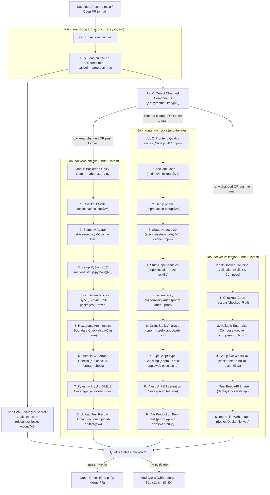

# Hướng Dẫn Xây Dựng & Vận Hành Đường Ống CI/CD (Continuous Integration Guide)

Tài liệu này cung cấp hướng dẫn toàn diện về kiến trúc, nguyên lý thiết kế, cấu hình chi tiết và quy trình vận hành hệ thống **Tích hợp Liên tục (CI - Continuous Integration)** cho kho mã nguồn đa thành phần (**Monorepo**) của nền tảng **VeriScholar** bằng **GitHub Actions** theo các chuẩn mực kỹ thuật phân tán từ ***Continuous Delivery* (Jez Humble & David Farley)**, ***Site Reliability Engineering* (Google)** và quy chuẩn an toàn chuỗi cung ứng phần mềm **SLSA / NIST SP 800-218**.

---

## 0. BẢNG THUẬT NGỮ CI/CD CHO KỸ SƯ MỚI (FRESHER GLOSSARY)

Để giúp các kỹ sư mới (Fresher / Junior) dễ dàng tiếp cận và làm chủ hệ thống CI/CD, bảng dưới đây giải thích trực quan các thuật ngữ và khái niệm chuyên ngành cốt lõi:

| Thuật ngữ | Tên tiếng Anh đầy đủ | Giải thích trực quan cho Fresher |
| :--- | :--- | :--- |
| **CI** | Continuous Integration (Tích hợp liên tục) | Quy trình tự động hóa việc kiểm tra, phân tích cú pháp (linting), biên dịch (compiling) và chạy bài kiểm thử (testing) mỗi khi lập trình viên đẩy mã nguồn mới lên kho lưu trữ, nhằm phát hiện lỗi sớm nhất có thể. |
| **CD** | Continuous Delivery / Deployment (Chuyển giao / Triển khai liên tục) | Quy trình tự động hóa việc đóng gói phần mềm thành Docker Image hoặc bản phát hành (release) và triển khai an toàn lên môi trường máy chủ (Staging / Production). |
| **Workflow** | GitHub Actions Workflow | Một quy trình tự động hóa hoàn chỉnh được định nghĩa bằng tệp cấu hình YAML đặt trong thư mục `.github/workflows/`, bao gồm một hoặc nhiều Tác vụ (Jobs) được kích hoạt bởi các Sự kiện (Events). |
| **Job** | Workflow Job (Tác vụ độc lập) | Một tập hợp các bước (Steps) thực thi trên cùng một máy ảo chạy ngầm (Runner). Các Jobs mặc định chạy song song (Parallel) với nhau để tiết kiệm thời gian. |
| **Step** | Action Step (Bước thực thi) | Một nhiệm vụ cụ thể bên trong Job, có thể là một câu lệnh dòng lệnh Shell (ví dụ `run: uv run pytest`) hoặc một hành động đóng gói sẵn (Action tái sử dụng, ví dụ `actions/checkout`). |
| **Runner** | GitHub-hosted Runner (Máy ảo thực thi) | Máy chủ đám mây do GitHub cung cấp (ví dụ hệ điều hành `ubuntu-latest`) được cấp phát tự động để chạy các câu lệnh trong Workflow của bạn. |
| **Quality Gates** | Quality Gates (Cổng kiểm soát chất lượng) | Các bài kiểm tra bắt buộc phải vượt qua 100% (không có cảnh báo, không có lỗi, bài kiểm thử đỗ hết) thì mã nguồn mới được phép gộp (merge) vào nhánh chính (`main`). |
| **Double Trigger Anti-Pattern** | Double Trigger Anti-Pattern (Lỗi kích hoạt trùng lặp) | Hiện tượng cấu hình cả `push` lẫn `pull_request` trên cùng một nhánh tính năng, dẫn đến mỗi commit đẩy lên đều kích hoạt 2 lượt chạy workflow giống hệt nhau, gây lãng phí 100% thời gian và chi phí máy chủ. |
| **Path-based Change Detection** | Path-based Change Detection (Lọc tác vụ theo đường dẫn thay đổi) | Kỹ thuật tự động phân tích commit xem người dùng chỉ sửa đổi Backend hay Frontend; nếu chỉ sửa Frontend thì bỏ qua không chạy các Job Backend (và ngược lại), giúp rút ngắn thời gian phản hồi. |
| **Hexagonal Boundary Gate** | Hexagonal Boundary Gate (Chốt chặn ranh giới kiến trúc lục giác) | Bước kiểm tra tự động quét mã nguồn gói lõi `packages/core`, bảo đảm lập trình viên không vô tình gọi hoặc import các thư viện hạ tầng/giao thức (`fastapi`, `sqlalchemy`, `docker`, `fitz`). |
| **Secret Scanning** | Secret Scanning (Quét phát hiện rò rỉ mã khóa bí mật) | Công cụ tự động phát hiện các chuỗi ký tự nhạy cảm (như OpenAI Key `sk-proj-...`, Google Key `AIzaSy...`, JWT Secret) bị vô tình commit vào mã nguồn bằng công cụ chuyên dụng như Gitleaks. |
| **Vulnerability Audit** | Vulnerability Audit (Kiểm toán lỗ hổng thư viện phụ thuộc) | Quá trình tự động đối chiếu các gói thư viện đã cài đặt với cơ sở dữ liệu lỗ hổng bảo mật quốc gia (CVE Database) qua lệnh `pnpm audit --prod` để phát hiện các gói có nguy cơ bị tấn công. |
| **Test Observability** | Test Observability & Artifacts (Khả năng quan sát kiểm thử & Lưu trữ báo cáo) | Khả năng xuất kết quả kiểm thử ra tệp chuẩn định dạng XML (JUnit XML) và độ phủ mã nguồn (Code Coverage), sau đó tải lên lưu trữ đám mây (Artifacts) để kỹ sư xem lại báo cáo trực quan mà không cần cuộn hàng trăm dòng log. |
| **Frozen Lockfile** | Frozen Lockfile (Khóa phụ thuộc nghiêm ngặt) | Cơ chế ép buộc trình quản lý gói (`uv sync --frozen` hoặc `pnpm install --frozen-lockfile`) chỉ cài đúng các phiên bản đã được ghi nhận trong tệp khóa, ngăn chặn nguy cơ cài đặt phiên bản lạ bị chèn mã độc. |
| **Concurrency Control** | Concurrency Cancellation (Kiểm soát hủy luồng trùng lặp) | Kỹ thuật tự động hủy bỏ (Cancel) lượt chạy CI cũ nếu lập trình viên tiếp tục đẩy thêm commit mới vào cùng một Pull Request, giúp tiết kiệm tài nguyên máy chủ. |
| **Least Privilege** | Principle of Least Privilege (Đặc quyền tối thiểu) | Nguyên tắc bảo mật chỉ cấp quyền hạn tối thiểu vừa đủ cho token của CI (ví dụ chỉ cấp `contents: read`), chống rò rỉ hoặc bị mã độc chiếm quyền sửa đổi mã nguồn. |

---

## 1. TỔNG QUAN KIẾN TRÚC CI TRONG MONOREPO VERISCHOLAR

Dự án **VeriScholar** là một Monorepo tích hợp hai hệ sinh thái công nghệ:
1. **Backend Python 3.12+:** Sử dụng công cụ quản lý gói siêu tốc `uv` (`uv workspace`), bao gồm ứng dụng máy chủ API (`apps/api`), lõi nghiệp vụ thuần túy (`packages/core`), cụm tác vụ nền (`apps/worker`), và bộ môi trường bảo mật sandbox (`apps/sandbox-broker`).
2. **Frontend React 19 + TypeScript:** Sử dụng trình quản lý gói `pnpm 9+`, bao gồm ứng dụng web tương tác trực quan tài liệu PDF (`apps/web`), kiểm tra cú pháp bằng `oxlint` và biên dịch bằng `Vite`.

### 1.1. Các Nguyên Lý Vận Hành Đạt Chuẩn Production
- **Triệt tiêu Double Trigger (No Redundant Runs):** Chỉ kích hoạt sự kiện `push` trên nhánh chính (`main`), còn các nhánh phát triển tính năng (`feature/**`) chỉ kích hoạt thông qua sự kiện `pull_request`.
- **Tối ưu hóa phản hồi nhanh (Path-based Change Detection):** Sử dụng `dorny/paths-filter@v3` để phân tích phạm vi thay đổi. Nếu lập trình viên chỉ cập nhật Frontend, CI sẽ tự động bỏ qua Job Backend và ngược lại.
- **Thực thi song song (Parallel Execution):** Tách biệt các tác vụ `security-scan`, `backend-checks` và `frontend-checks` chạy song song trên các máy ảo độc lập, hoàn thành toàn bộ kiểm tra trong dưới 90 giây.
- **Bảo toàn ranh giới kiến trúc lục giác (Hexagonal Boundary Enforcement):** Tự động phân tích cây mã nguồn để bảo đảm `packages/core` hoàn toàn trong sạch, không phụ thuộc vào bất kỳ thư viện I/O hay framework web nào.
- **Bảo mật chuỗi cung ứng & Kiểm toán lỗ hổng (Supply Chain Hardening):** Tích hợp Gitleaks quét rò rỉ API key, `pnpm audit --prod` kiểm tra lỗ hổng bảo mật, và cờ `--frozen` ép buộc tính tất định của thư viện.

---

## 2. SƠ ĐỒ LUỒNG HOẠT ĐỘNG CI (PIPELINE ARCHITECTURE)

Sơ đồ tuần tự thể hiện cách thức GitHub Actions tiếp nhận sự kiện, lọc đường dẫn và phân nhánh kiểm tra:



---

## 3. CHI TIẾT CÁC CỔNG KIỂM SOÁT CHẤT LƯỢNG (QUALITY GATES SPECIFICATION)

Để một nhánh mã nguồn được phép gộp vào `main`, nó bắt buộc phải vượt qua đầy đủ 7 chốt chặn kỹ thuật:

### 3.1. Chốt chặn 1: Định Dạng & Tiêu Chuẩn Mã Nguồn Python (Ruff Lint & Format)
- **Mục đích:** Đảm bảo toàn bộ mã nguồn Python tuân thủ chuẩn mực PEP 8, loại bỏ các hàm/biến thừa, phát hiện sớm các lỗi import vòng lặp hoặc cú pháp bất hợp lệ.
- **Lệnh thực thi trong CI:**
  ```bash
  uv run ruff check .
  uv run ruff format --check .
  ```
- **Tiêu chuẩn đỗ:** Thoát với mã lỗi `0` (Exit code 0), không có bất kỳ cảnh báo (warning) hay lỗi (error) nào chưa được sửa.

### 3.2. Chốt chặn 2: Kiểm Thử Đơn Vị, Độ Phủ & Khả Năng Quan Sát Backend (Pytest + JUnit + Coverage)
- **Mục đích:** Đảm bảo hệ thống nhật ký có cấu trúc (`structlog`), lớp lọc thông tin nhạy cảm (`PII sanitization`), tầng trung gian ASGI thuần túy (`PureASGITracingMiddleware`), và các cổng giao tiếp miền (`Core Ports`) hoạt động chính xác theo hợp đồng dữ liệu; đồng thời xuất báo cáo `test-results.xml` và đo lường độ phủ mã nguồn (`pytest-cov`).
- **Lệnh thực thi trong CI:**
  ```bash
  uv run pytest --junitxml=test-results.xml --cov=packages/core --cov=apps/api
  ```
- **Tiêu chuẩn đỗ:** 100% các ca kiểm thử trong `apps/api/tests/` và `packages/core/tests/` phải thành công với trạng thái `PASSED`. Báo cáo kiểm thử được tải lên GitHub Artifacts lưu trữ trong 7 ngày.

### 3.3. Chốt chặn 3: Kiểm Tra Mã Nguồn Frontend (Oxlint Linter)
- **Mục đích:** Sử dụng công cụ `oxlint` (viết bằng Rust, tốc độ nhanh gấp 50-100 lần ESLint truyền thống) để quét toàn bộ mã nguồn React 19 / TypeScript, phát hiện lỗi Hooks, vi phạm chuẩn tiếp cận (A11y), và các lỗi logic biến.
- **Lệnh thực thi trong CI:**
  ```bash
  pnpm --prefix apps/web lint
  ```
- **Tiêu chuẩn đỗ:** 0 warnings, 0 errors.

### 3.4. Chốt chặn 4: Kiểm Tra Kiểu Dữ Liệu Tĩnh Frontend (TypeScript Compiler)
- **Mục đích:** Ngăn ngừa triệt để các lỗi `TypeError: Cannot read properties of undefined` phổ biến trong JavaScript bằng cách xác thực tính đúng đắn của toàn bộ các giao diện (`interface`), kiểu dữ liệu (`type`), và thuộc tính truyền vào component (`props`).
- **Lệnh thực thi trong CI:**
  ```bash
  pnpm --prefix apps/web exec tsc -b
  ```
- **Tiêu chuẩn đỗ:** Trình biên dịch TypeScript không phát hiện bất kỳ xung đột kiểu dữ liệu nào giữa các tệp mã nguồn.

### 3.5. Chốt chặn 5: Đóng Gói Ứng Dụng Sản Phẩm (Vite Production Build)
- **Mục đích:** Xác minh rằng ứng dụng web có thể được thu nhỏ (minification), đóng gói phân mảnh (code splitting) và kết xuất thành công các tệp HTML/CSS/JS tĩnh mà không bị thiếu tài nguyên ảnh (assets) hay lỗi cú pháp ẩn.
- **Lệnh thực thi trong CI:**
  ```bash
  pnpm --prefix apps/web build
  ```
- **Tiêu chuẩn đỗ:** Thư mục `apps/web/dist` được tạo thành công với đầy đủ các tệp tài nguyên tĩnh hợp lệ.

### 3.6. Chốt chặn 6: Kiểm Tra Bí Mật Tự Động (Secret Scanning Gate)
- **Mục đích:** Quét toàn bộ lịch sử commit trong Pull Request bằng `gitleaks` nhằm ngăn chặn tuyệt đối tình trạng lập trình viên vô tình commit khóa API (OpenAI, Anthropic, Gemini, GitHub Personal Access Token) hoặc JWT Secret vào kho mã nguồn mở.
- **Lệnh thực thi trong CI:** Tác vụ `gitleaks/gitleaks-action@v2` tự động quét toàn bộ cây git (`fetch-depth: 0`).
- **Tiêu chuẩn đỗ:** Không phát hiện bất kỳ chuỗi ký tự nhạy cảm hay private key nào trong mã nguồn.

### 3.7. Chốt chặn 7: Bảo Vệ Ranh Giới Kiến Trúc Lục Giác (Hexagonal Architecture Boundary Gate)
- **Mục đích:** Bảo vệ tính toàn vẹn của lõi nghiệp vụ `packages/core/src/core/domain/`. Tuyệt đối không cho phép bất kỳ mã hạ tầng, framework web hoặc thư viện I/O nặng nào (`fastapi`, `sqlalchemy`, `uvicorn`, `docker`, `fitz`) xâm nhập vào tầng nghiệp vụ cốt lõi.
- **Lệnh thực thi trong CI:**
  ```bash
  uv run python -c "
  import sys
  from pathlib import Path
  core_path = Path('packages/core/src/core/domain')
  violations = []
  if core_path.exists():
      for py_file in core_path.rglob('*.py'):
          content = py_file.read_text()
          for banned in ['fastapi', 'sqlalchemy', 'uvicorn', 'docker', 'fitz']:
              if f'import {banned}' in content or f'from {banned}' in content:
                  violations.append(f'{py_file}: chứa import cấm \"{banned}\"')
  if violations:
      print('\n'.join(violations))
      sys.exit(1)
  print('Hexagonal boundary verification: PASSED')
  "
  ```
- **Tiêu chuẩn đỗ:** Trả về thông báo `Hexagonal boundary verification: PASSED` với mã thoát `0`.

### 3.8. Chốt chặn 8: Kiểm Thử Đơn Vị & Tích Hợp Giao Diện Frontend (Vitest Suite)
- **Mục đích:** Khắc phục triệt để lỗ hổng thiếu sót bài kiểm thử giao diện trong CI. Tự động thực thi toàn bộ bài test unit và integration trên client (`apps/web`), kiểm tra các thành phần React, Custom Hooks (`useGoogleAuth`, `useNotes`), xử lý Store trạng thái Zustand, và các Modal quan trọng (`ComparisonMatrixModal`, `ScholarProfileModal`).
- **Lệnh thực thi trong CI:**
  ```bash
  pnpm --prefix apps/web test:run
  ```
- **Tiêu chuẩn đỗ:** 100% các tệp test đỗ với trạng thái `PASSED`. Bất kỳ bài test nào bị lỗi đều kích hoạt cảnh báo đỏ và chặn đứng hành động hợp nhất (merge) Pull Request.

### 3.9. Chốt chặn 9: Xác Thực Cấu Hình & Đóng Gói Container Docker (Docker Infrastructure Gate)
- **Mục đích:** Bảo đảm tính toàn vẹn của gói triển khai On-Premise Enterprise. Tự động kiểm tra cú pháp tệp `deploy/docker-compose.enterprise.yml` và kiểm tra khả năng đóng gói (build testing) của cả hai Dockerfile sản xuất (`deploy/Dockerfile.api` và `deploy/Dockerfile.web`) bằng Docker Buildx.
- **Lệnh thực thi trong CI:**
  ```bash
  docker compose -f deploy/docker-compose.enterprise.yml config -q
  docker build -f deploy/Dockerfile.api .
  docker build -f deploy/Dockerfile.web .
  ```
- **Tiêu chuẩn đỗ:** Cú pháp docker-compose hợp lệ không phát sinh cảnh báo, cả 2 Docker image biên dịch thành công mà không thiếu phụ thuộc (`pnpm-lock.yaml`, `uv.lock`).

---

## 4. CHI TIẾT TỆP CẤU HÌNH GITHUB ACTIONS CHUẨN HÓA (`.github/workflows/ci.yml`)

Dưới đây là nội dung chuẩn hóa hoàn chỉnh của tệp cấu hình đường ống CI được lưu trữ tại `.github/workflows/ci.yml`:

```yaml
name: Continuous Integration (Quality Gates)

on:
  push:
    branches:
      - main
  pull_request:
    branches:
      - main

concurrency:
  group: ${{ github.workflow }}-${{ github.ref }}
  cancel-in-progress: true

permissions:
  contents: read

jobs:
  detect-changes:
    name: Detect Changed Components
    runs-on: ubuntu-latest
    outputs:
      backend: ${{ steps.filter.outputs.backend }}
      frontend: ${{ steps.filter.outputs.frontend }}
    steps:
      - name: Checkout repository
        uses: actions/checkout@v4

      - name: Filter changed paths
        id: filter
        uses: dorny/paths-filter@v3
        with:
          filters: |
            backend:
              - 'apps/api/**'
              - 'apps/worker/**'
              - 'apps/sandbox-broker/**'
              - 'packages/core/**'
              - 'pyproject.toml'
              - 'uv.lock'
            frontend:
              - 'apps/web/**'

  security-scan:
    name: Security & Secret Leak Detection
    runs-on: ubuntu-latest
    timeout-minutes: 5
    steps:
      - name: Checkout repository
        uses: actions/checkout@v4
        with:
          fetch-depth: 0

      - name: Run Gitleaks (Secret Detection)
        uses: gitleaks/gitleaks-action@v2
        env:
          GITHUB_TOKEN: ${{ secrets.GITHUB_TOKEN }}

  backend-checks:
    name: Backend Quality Gates (Python / uv)
    needs: [detect-changes]
    if: needs.detect-changes.outputs.backend == 'true' || github.event_name == 'push'
    runs-on: ubuntu-latest
    timeout-minutes: 10

    steps:
      - name: Checkout repository
        uses: actions/checkout@v4

      - name: Install uv package manager
        uses: astral-sh/setup-uv@v5
        with:
          version: "latest"
          enable-cache: true
          cache-suffix: "backend-uv"

      - name: Set up Python 3.12
        uses: actions/setup-python@v5
        with:
          python-version: "3.12"

      - name: Install backend dependencies (Strict Sync)
        run: |
          uv sync --all-packages --frozen

      - name: Verify Hexagonal Architecture Boundaries
        run: |
          # Ngăn chặn rò rỉ mã hạ tầng vào packages/core
          uv run python -c "
          import sys
          from pathlib import Path
          core_path = Path('packages/core/src/core/domain')
          violations = []
          if core_path.exists():
              for py_file in core_path.rglob('*.py'):
                  content = py_file.read_text()
                  for banned in ['fastapi', 'sqlalchemy', 'uvicorn', 'docker', 'fitz']:
                      if f'import {banned}' in content or f'from {banned}' in content:
                          violations.append(f'{py_file}: chứa import cấm \"{banned}\"')
          if violations:
              print('\n'.join(violations))
              sys.exit(1)
          print('Hexagonal boundary verification: PASSED')
          "

      - name: Run Ruff Linter & Formatter checks
        run: |
          uv run ruff check .
          uv run ruff format --check .

      - name: Run Pytest with JUnit & Coverage
        env:
          PYTHONPATH: apps/api/src:packages/core/src
          ENVIRONMENT: test
        run: |
          uv run pytest --junitxml=test-results.xml --cov=packages/core --cov=apps/api

      - name: Upload Test Results
        if: always()
        uses: actions/upload-artifact@v4
        with:
          name: backend-test-results
          path: test-results.xml
          retention-days: 7

  frontend-checks:
    name: Frontend Quality Gates (TypeScript / React / pnpm)
    needs: [detect-changes]
    if: needs.detect-changes.outputs.frontend == 'true' || github.event_name == 'push'
    runs-on: ubuntu-latest
    timeout-minutes: 10
    defaults:
      run:
        working-directory: apps/web

    steps:
      - name: Checkout repository
        uses: actions/checkout@v4

      - name: Install pnpm
        uses: pnpm/action-setup@v4
        with:
          version: 9

      - name: Set up Node.js 20
        uses: actions/setup-node@v4
        with:
          node-version: 20
          cache: "pnpm"
          cache-dependency-path: "apps/web/pnpm-lock.yaml"

      - name: Install frontend dependencies (Frozen Lockfile)
        run: |
          pnpm install --frozen-lockfile

      - name: Run Dependency Vulnerability Audit
        run: |
          pnpm audit --prod

      - name: Run Oxlint (Fast code linting)
        run: |
          pnpm lint

      - name: Run TypeScript type-checking
        run: |
          pnpm exec tsc -b

      - name: Run Vitest unit & integration test suite
        run: |
          pnpm test:run --reporter=default --reporter=junit --outputFile=test-results.xml

      - name: Upload Frontend Test Results
        if: always()
        uses: actions/upload-artifact@v4
        with:
          name: frontend-test-results
          path: apps/web/test-results.xml
          retention-days: 7

      - name: Run Vite production build test
        run: |
          pnpm build

  docker-validation:
    name: Container & Infrastructure Validation (Docker)
    needs: [detect-changes]
    if: needs.detect-changes.outputs.backend == 'true' || needs.detect-changes.outputs.frontend == 'true' || github.event_name == 'push'
    runs-on: ubuntu-latest
    timeout-minutes: 8

    steps:
      - name: Checkout repository
        uses: actions/checkout@v4

      - name: Validate Enterprise Docker Compose Configuration
        run: |
          docker compose -f deploy/docker-compose.enterprise.yml config -q
          echo "Enterprise docker-compose configuration is valid."

      - name: Set up Docker Buildx
        uses: docker/setup-buildx-action@v3

      - name: Test Build Backend Docker Image
        uses: docker/build-push-action@v6
        with:
          context: .
          file: deploy/Dockerfile.api
          push: false
          tags: verischolar-api:ci-test

      - name: Test Build Frontend Docker Image
        uses: docker/build-push-action@v6
        with:
          context: .
          file: deploy/Dockerfile.web
          push: false
          tags: verischolar-web:ci-test
```

---

## 5. NGUYÊN TẮC BẢO MẬT & TOÀN VẸN TRONG CI (SECURITY INVARIANTS)

Để bảo đảm hệ thống CI vận hành an toàn tuyệt đối, các quy tắc bất biến sau phải được tuân thủ nghiêm ngặt:

1. **Không bao giờ đưa tệp `.env` vào kho lưu trữ:** Tệp `.gitignore` luôn loại trừ `.env`. Trên môi trường CI, các bài kiểm thử chỉ sử dụng các biến môi trường kiểm thử giả lập hoặc lấy mẫu từ `apps/api/.env.example`.
2. **Khóa phụ thuộc nghiêm ngặt (Strict Frozen Lockfiles):** Luôn dùng `uv sync --all-packages --frozen` và `pnpm install --frozen-lockfile`. Không bao giờ cài đặt các phiên bản trôi nổi (`floating versions`), ngăn ngừa nguy cơ chuỗi cung ứng mã nguồn (Supply Chain Attacks).
3. **Che giấu thông tin nhạy cảm (PII Redaction):** Các bộ test phải xác minh rằng mọi nhật ký xuất ra đều được bọc bởi bộ lọc che giấu token (`***REDACTED***`).
4. **Giới hạn thời gian chạy (Timeout Limits):** Mỗi Job được cấu hình `timeout-minutes` (5 - 10 phút) để tự động ngắt nếu xảy ra vòng lặp vô tận hoặc treo mạng, tránh lãng phí chi phí GitHub Actions runner.

---

## 6. QUY TRÌNH KIỂM THỬ CỤC BỘ TRƯỚC KHI PUSH (LOCAL PRE-PUSH VERIFICATION)

Trước khi đẩy bất kỳ commit nào lên GitHub để tạo Pull Request, kỹ sư phát triển cần chạy chuỗi lệnh kiểm tra toàn diện tại máy cục bộ:

```bash
# 1. Kiểm tra ranh giới kiến trúc lục giác
uv run python -c "
import sys
from pathlib import Path
core_path = Path('packages/core/src/core/domain')
if core_path.exists():
    for py_file in core_path.rglob('*.py'):
        c = py_file.read_text()
        for b in ['fastapi', 'sqlalchemy', 'uvicorn', 'docker', 'fitz']:
            if f'import {b}' in c or f'from {b}' in c:
                sys.exit(f'Violation: {py_file} imports {b}')
print('Hexagonal boundary: PASSED')
"

# 2. Kiểm tra định dạng và mã nguồn Python
uv run ruff check .
uv run ruff format --check .

# 3. Chạy toàn bộ bài kiểm thử Backend kèm độ phủ mã nguồn
uv run pytest --cov=packages/core --cov=apps/api

# 4. Kiểm tra lỗ hổng phụ thuộc Frontend
pnpm --prefix apps/web audit --prod

# 5. Kiểm tra cú pháp và định dạng Frontend
pnpm --prefix apps/web lint

# 6. Kiểm tra kiểu dữ liệu tĩnh Frontend
pnpm --prefix apps/web exec tsc -b

# 7. Thử nghiệm đóng gói sản phẩm Frontend
pnpm --prefix apps/web build
```

> [!TIP]
> Bạn có thể chạy kiểm tra toàn bộ chuỗi Quality Gates cục bộ trong vòng chưa đầy 3 giây với một dòng lệnh:
> ```bash
> uv run pytest && uv run ruff check . && uv run ruff format --check . && pnpm --prefix apps/web audit --prod && pnpm --prefix apps/web lint && pnpm --prefix apps/web exec tsc -b && pnpm --prefix apps/web build
> ```

---

## 7. HƯỚNG DẪN XỬ LÝ SỰ CỐ THƯỜNG GẶP TRÊN CI (TROUBLESHOOTING GUIDE)

### Sự cố 1: Lỗi `Gitleaks` báo phát hiện Secret Leak
- **Triệu chứng:** Tác vụ `security-scan` thất bại, chỉ ra chuỗi ký tự dạng private key hoặc API token trong commit.
- **Cách khắc phục:** Loại bỏ hoàn toàn chuỗi token nhạy cảm khỏi mã nguồn, đưa vào biến môi trường cục bộ `.env` (chưa commit). Nếu token đã vô tình bị push lên lịch sử git, cần dùng công cụ `git-filter-repo` hoặc BFG Repo Cleaner để xóa vĩnh viễn khỏi commit history và thu hồi (revoke) key ngay lập tức trên dashboard của nhà cung cấp.

### Sự cố 2: Lỗi vi phạm ranh giới kiến trúc lục giác (Hexagonal Boundary Violation)
- **Triệu chứng:** Bước `Verify Hexagonal Architecture Boundaries` báo lỗi tệp trong `packages/core` chứa câu lệnh import cấm (ví dụ: `from fastapi import HTTPException`).
- **Cách khắc phục:** Di chuyển các định nghĩa phụ thuộc giao thức hoặc I/O sang `apps/api/` hoặc `infra/`. Tại `packages/core`, chỉ định nghĩa các ngoại lệ nghiệp vụ thuần túy (Domain Exceptions kế thừa từ `Exception`) và các Cổng trừu tượng (Abstract Ports).

### Sự cố 3: Lỗi `Ruff` cảnh báo khoảng trắng hoặc thứ tự Import
- **Triệu chứng:** Bước `uv run ruff check .` hoặc `format --check .` báo lỗi vi phạm định dạng.
- **Cách khắc phục nhanh:** Chạy lệnh tự động sửa lỗi tại máy cục bộ:
  ```bash
  uv run ruff check . --fix
  uv run ruff format .
  ```
  Sau đó `git add` và commit lại.

### Sự cố 4: Lỗi `pnpm audit` phát hiện lỗ hổng bảo mật (Vulnerabilities Found)
- **Triệu chứng:** Bước `pnpm audit --prod` báo mã thoát khác 0 do có phụ thuộc chứa lỗ hổng bảo mật mức nghiêm trọng (High/Critical).
- **Cách khắc phục:** Chạy `pnpm update <package_name>` hoặc `pnpm audit --fix` để nâng cấp phiên bản bản vá an toàn, sau đó commit lại tệp khóa `pnpm-lock.yaml`.

### Sự cố 5: Lỗi không tìm thấy `pnpm-lock.yaml` trong Monorepo Subfolder
- **Triệu chứng:** Bước `Install frontend dependencies (Frozen Lockfile)` hoặc `actions/setup-node` báo lỗi `Dependencies lock file is not found in root. Supported file patterns: pnpm-lock.yaml`.
- **Nguyên nhân:** Trong Monorepo VeriScholar, frontend nằm ở thư mục con `apps/web/`, nên tệp `pnpm-lock.yaml` và `package.json` nằm tại `apps/web/` chứ không nằm ở thư mục gốc repo.
- **Cách khắc phục:**
  1. Thêm `cache-dependency-path: "apps/web/pnpm-lock.yaml"` vào bước `actions/setup-node@v4`.
  2. Cấu hình `defaults.run.working-directory: apps/web` cho toàn bộ Job `frontend-checks` để các lệnh `pnpm install --frozen-lockfile`, `pnpm audit --prod`, `pnpm lint` và `pnpm build` tự động thực thi đúng ngữ cảnh thư mục `apps/web/`.

---

## 8. BẢNG CHECKLIST NGHIỆM THU ĐƯỜNG ỐNG CI (ACCEPTANCE CHECKLIST)

- [x] **Triệt tiêu kích hoạt trùng lặp (No Double Trigger):** Sự kiện `push` chỉ lắng nghe nhánh `main`; các nhánh tính năng chỉ chạy thông qua `pull_request`.
- [x] **Phát hiện thay đổi theo đường dẫn (Path Filtering):** Sử dụng `dorny/paths-filter@v3` để phân định chính xác các commit chạm vào Backend (`apps/api`, `packages/core`, `pyproject.toml`, `uv.lock`) và Frontend (`apps/web`, `package.json`, `pnpm-lock.yaml`).
- [x] **Kiểm soát hủy luồng trùng lặp (Concurrency Control):** Cấu hình `cancel-in-progress: true` tự động dọn dẹp các luồng cũ khi có commit mới.
- [x] **Đặc quyền tối thiểu (Principle of Least Privilege):** Toàn bộ workflow giới hạn `permissions: contents: read`.
- [x] **Quét rò rỉ mã khóa bí mật (Secret Scanning):** Tích hợp `gitleaks/gitleaks-action@v2` chạy toàn diện trên cây commit.
- [x] **Bảo vệ ranh giới lục giác (Hexagonal Boundary Gate):** Tự động quét và chặn các import hạ tầng (`fastapi`, `sqlalchemy`, `docker`, `fitz`) bên trong `packages/core`.
- [x] **Khóa phụ thuộc nghiêm ngặt (Deterministic Builds):** Áp dụng `uv sync --all-packages --frozen` và `pnpm install --frozen-lockfile`.
- [x] **Kiểm toán lỗ hổng bảo mật phụ thuộc (Vulnerability Audit):** Tích hợp `pnpm audit --prod` trong luồng Frontend.
- [x] **Khả năng quan sát kiểm thử (Test Observability):** Xuất báo cáo `test-results.xml` và độ phủ mã nguồn, lưu trữ dạng GitHub Artifacts trong 7 ngày.
- [x] **Kiểm thử tự động giao diện (Frontend Vitest Suite):** Tích hợp `pnpm test:run` chạy toàn diện unit và integration test, bảo đảm 100% pass trước khi build.
- [x] **Xác thực hạ tầng & đóng gói Container (Docker Gate):** Xác thực cú pháp `docker-compose.enterprise.yml` và kiểm tra khả năng build cả API và Web image với Docker Buildx.
- [x] **Tài liệu hướng dẫn hoàn chỉnh:** Cung cấp giải thích chi tiết song ngữ kèm bảng thuật ngữ trực quan cho Fresher.
