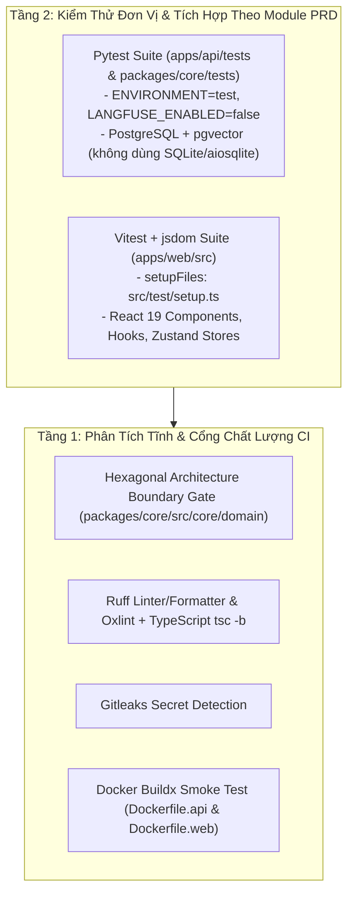

# Chiến Lược Kiểm Thử & Đảm Bảo Chất Lượng MVP (Testing Strategy & QA)

Tài liệu này định nghĩa kiến trúc khung kiểm thử và tiêu chuẩn viết bài kiểm thử mới cho nền tảng **VeriScholar MVP**, đồng bộ với **[`docs/PRD/`](../PRD/00-overview-and-cleanup.md)**.

> **Trạng thái hiện tại:** Toàn bộ bộ unit test cũ của kiến trúc 5-Pillar/SQLite đã được dọn sạch để tránh lệch chuẩn nghiệp vụ. Khung chạy test (`pytest` và `vitest`) được giữ sẵn ở trạng thái sạch (cho phép 0 test đi qua CI an toàn) để viết mới từng module bám sát `docs/PRD/01..07`.

---

## 1. KIẾN TRÚC KIM TỰ THÁP KIỂM THỬ MVP



---

## 2. KHUNG KIỂM THỬ BACKEND & CORE (`pytest`)

- **Cấu hình gốc:** Khai báo tại `pyproject.toml` (`testpaths = ["apps/api/tests", "packages/core/tests"]`).
- **Fixture toàn cục (`apps/api/tests/conftest.py`):**
  - Tự động ép `ENVIRONMENT="test"` và `LANGFUSE_ENABLED="false"` trước khi nạp ứng dụng, đảm bảo không phát sinh kết nối telemetry ra ngoài trong lúc chạy test.
  - Hook `pytest_sessionfinish` chuyển mã thoát `NO_TESTS_COLLECTED` (`5`) về `0` khi kho test đang trống, nhưng giữ nguyên mã lỗi khác `0` ngay khi có bất kỳ test nào thất bại hoặc lỗi cú pháp.
- **Nguyên tắc viết test mới:**
  - Tuyệt đối không đưa `aiosqlite` / SQLite quay lại dự án; các bài test tích hợp CSDL phải bám sát lược đồ **PostgreSQL + `pgvector`** trong [`05-favorite-library-and-graphrag.md`](../PRD/05-favorite-library-and-graphrag.md) và [`00-overview-and-cleanup.md`](../PRD/00-overview-and-cleanup.md).
  - Lệnh chạy kiểm thử:
    ```bash
    uv run pytest
    ```

---

## 3. KHUNG KIỂM THỬ FRONTEND (`vitest`)

- **Cấu hình gốc:** Khai báo tại `apps/web/vite.config.ts` với `environment: "jsdom"`, `setupFiles: ["./src/test/setup.ts"]`, và `passWithNoTests: true`.
- **Môi trường giả lập (`apps/web/src/test/setup.ts`):** Cung cấp sẵn `@testing-library/jest-dom/vitest`, polyfill `Promise.try` / `Iterator` / `Map.prototype.getOrInsertComputed` cho `pdfjs-dist`, cùng mock `window.matchMedia` và `ResizeObserver`.
- **Nguyên tắc viết test mới:**
  - Đặt file `*.test.ts` / `*.test.tsx` cạnh module tương ứng trong `apps/web/src/features/` theo đúng 4 phân hệ giao diện của MVP (`🔍 Khám phá & Phiên đọc`, `⭐ Kho Yêu thích`, `✍️ Soạn thảo LaTeX`, `👤 Tài khoản & Giao diện`).
  - Lệnh chạy kiểm thử:
    ```bash
    npm --prefix apps/web run test
    ```

---
*Thuộc Bộ Tài Liệu Kỹ Thuật VeriScholar MVP.*
