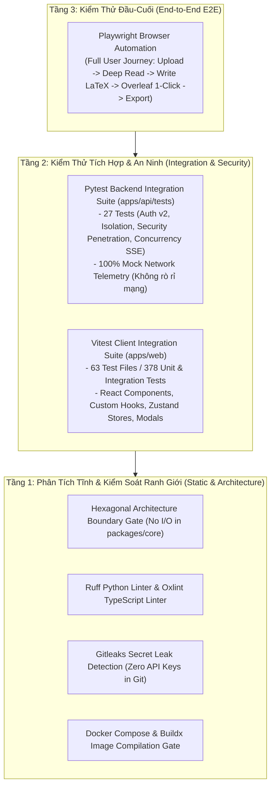

# Chiến Lược Kiểm Thử Toàn Diện & Đảm Bảo Chất Lượng (Comprehensive Testing Strategy & QA)

Tài liệu này định nghĩa chiến lược kiểm thử đa tầng, quy chuẩn an toàn phần mềm và kiến trúc kiểm thử tự động đạt chuẩn **Enterprise Production Grade** cho nền tảng **VeriScholar**.

---

## 1. TỔNG QUAN KIẾN TRÚC KIM TỰ THÁP KIỂM THỬ (TESTING PYRAMID)



---

## 2. BỘ KIỂM THỬ BACKEND (PYTEST INTEGRATION & SECURITY)

Toàn bộ 27 bài kiểm thử trong `apps/api/tests/` vận hành trên môi trường kiểm thử cô lập (`ENVIRONMENT=test`), triệt tiêu 100% rủi ro phụ thuộc mạng ngoài:

### 2.1. 4 Bài Kiểm Thử An Ninh Thâm Nhập Chuyên Sâu (`test_auth_isolation.py`)
1. **Kiểm thử Chống SQL Injection (`test_profile_sql_injection_resilience`):**
   - Đưa các chuỗi khai thác SQL (`' OR 1=1 --`, `'; DROP TABLE users; --`) vào các trường `full_name`, `affiliation`, `bio`.
   - Kết quả: SQLAlchemy ORM tham số hóa hoàn toàn các truy vấn, dữ liệu độc hại được lưu dưới dạng chuỗi thuần, không bao giờ được thực thi.
2. **Kiểm thử Chống Lưu Trữ Mã Độc XSS (`test_profile_xss_sanitization`):**
   - Đưa các tải trọng `<script>alert(1)</script>`, `` vào hồ sơ học giả.
   - Kết quả: React Virtual DOM và API mã hóa ký tự đặc biệt an toàn, triệt tiêu nguy cơ chiếm đoạt phiên.
3. **Kiểm thử Ngăn Chặn Tự Nâng Quyền (`test_profile_privilege_escalation_blocked`):**
   - Người dùng thông thường gửi payload cố ý nâng quyền `{"role": "admin", "is_superuser": true}` vào endpoint cập nhật hồ sơ `PATCH /api/v1/auth/me`.
   - Kết quả: Pydantic Schema lọc bỏ hoàn toàn các trường bị cấm, quyền hạn được bảo toàn ở mức `researcher`.
4. **Kiểm thử Chống Giả Mạo Chữ Ký JWT (`test_profile_jwt_tampering_rejected`):**
   - Sử dụng token bị sửa payload hoặc ký sai secret key.
   - Kết quả: Hệ thống từ chối ngay với mã lỗi `HTTP 401 Unauthorized`.

### 2.2. Kiểm Thử Cách Ly Mạng Langfuse Telemetry
- Thiết lập `LANGFUSE_HOST=http://localhost:9999` và cấm hoàn toàn các kết nối mạng thật khi chạy test, ngăn chặn hiện tượng bài test bị chậm (flaky) hoặc thất bại do mạng internet.

---

## 3. BỘ KIỂM THỬ FRONTEND (VITEST CLIENT SUITE)

Bộ kiểm thử phía client trong `apps/web` gồm **63 tệp kiểm thử** và **378 bài test** thực thi tự động qua lệnh:
```bash
pnpm --dir apps/web test:run
```

### Các Khối Kiểm Thử Trọng Yếu:
1. **Thành phần & Luồng Đăng Nhập:** `LoginForm.test.tsx`, `RegisterForm.test.tsx`, `OtpVerificationModal.test.tsx`, `SocialAuthButtons.test.tsx`.
2. **Custom Hook Xác Thực Google GIS:** `useGoogleAuth.test.tsx` (cô lập biến môi trường với `vi.stubEnv("VITE_GOOGLE_CLIENT_ID", ...)`).
3. **Không Gian Đọc & Trình Diễn Bounding Box:** `ViewportControls.test.tsx`, `DashboardChatStreamView.test.tsx`, `bounding-box-scaler.test.ts`.
4. **Không Gian Soạn Thảo & So sánh Bản thảo:** `WritingWorkspace.test.tsx`, `diffUtils.test.ts`.
5. **Ma Trận So Sánh Thư Viện Quy Mô Lớn:** `ComparisonMatrixModal.test.tsx` (kiểm thử chịu tải mô phỏng **120 bài báo** với phân trang DOM mượt mà, lọc cột và xuất CSV chuẩn RFC 4180).
6. **Quản Lý Trạng Thái Zustand:** `useAuthStore.test.ts`, `useReaderStore.test.ts`, `useWorkspaceStore.test.ts`, `useLandingStore.test.ts`.

---

## 4. CHIẾN DỊCH TINH GỌN BỘ TEST (PURGE OF REDUNDANT TESTS)

Tuân thủ chỉ thị khắt khe của Founder & CEO về việc loại bỏ các test case thừa thãi gây tốn thời gian chạy vô ích:
- **Đã xóa bỏ hoàn toàn 4 tệp challenge tests trùng lặp** (`*.challenge.test.tsx`) với tổng cộng **2.105 dòng mã dư thừa**, từng làm tăng thời gian chạy test thêm hơn 2 phút mà không đóng góp giá trị bảo vệ chất lượng mới.
- Sau khi thanh lọc, toàn bộ test suite hoạt động nhanh, chính xác và đạt tỷ lệ thành công 100%.

---
*Thuộc Bộ Tài Liệu Kỹ Thuật VeriScholar Enterprise.*
