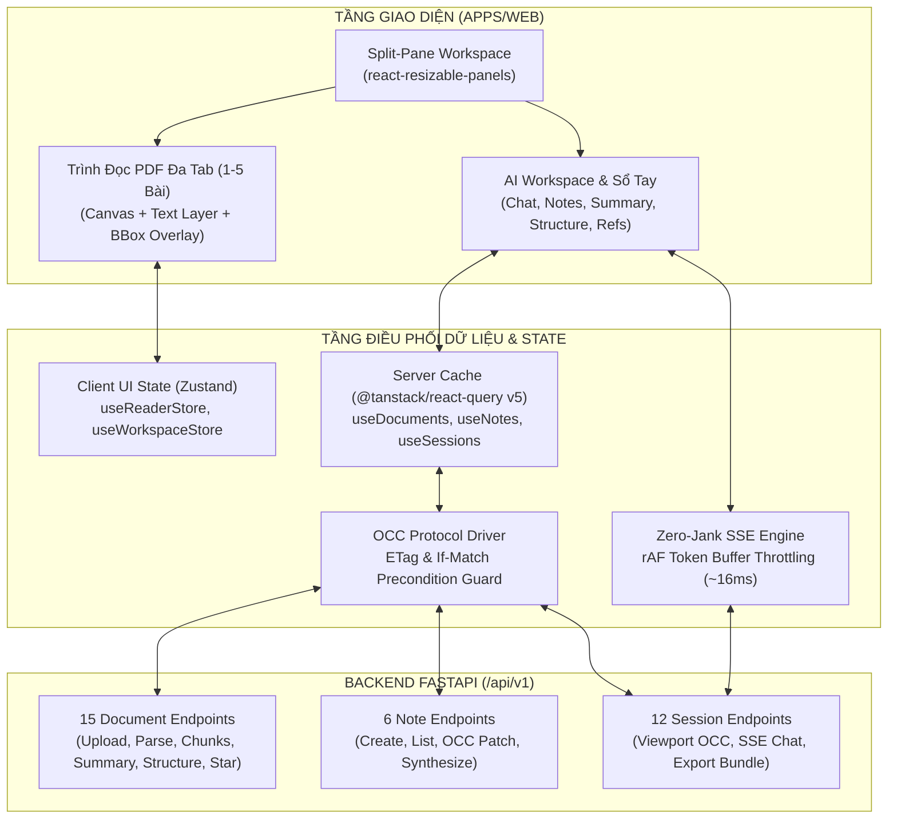

# Kế Hoạch Kỹ Thuật: Frontend Fullstack Suite — Module 1 (Đọc Sâu, Đối Thoại Đa Bài, Sổ Tay Nghiên Cứu & Quản Lý Phiên)

> **TARGET:** Xây dựng trọn vẹn giao diện Frontend, tích hợp 100% các API Backend Module 1 (15 Documents Endpoints, 6 Smart Notes Endpoints, 12 Research Sessions Endpoints) và thiết lập hệ thống kiểm chuẩn Production cho VeriScholar.  
> **Trạng thái:** Chờ phê duyệt (Pending Review — STOPPED for User Review)  
> **Đề xuất Git Branch:** `feat/fe-m1-deep-reader-notes-sessions`  
> **Tài liệu tham chiếu:** [PRD.md](../../PRD.md), [DESIGN.md](../../../DESIGN.md), [design-api.md](../../design-api.md), [techstack-frontend.md](../frontend/techstack-frontend.md), [directory-structure.md](../frontend/directory-structure.md), [coding-standards.md](../frontend/coding-standards.md), [design-system-integration.md](../frontend/design-system-integration.md)  
> **Vị trí lưu trữ:** `docs/vi/decided/frontend/module1-sessions-and-notes.md`  

---

## 1. TỔNG QUAN HỆ THỐNG & DANH MỤC 33 APIS MỤC TIÊU

Hệ thống cung cấp trải nghiệm không gian nghiên cứu học thuật phân đôi (Dual-Pane Resizable Workspace) kết nối chặt chẽ giữa:
1. **Không gian Đọc sâu Đa bài báo (Deep Reading Canvas):** Hỗ trợ nạp 1 - 5 bài báo đồng thời, chuyển đổi qua lại mượt mà bằng Document Tab Bar, hiển thị PDF Canvas kết hợp Text Layer và Bounding Box Overlay Layer định vị vi mô `[x0, y0, x1, y1, page]`.
2. **Sổ tay Nghiên cứu & AI Tổng hợp (Smart Notebook & Knowledge Digest):** Lưu trữ trích dẫn nguyên bản kèm bản chụp ngữ cảnh bất biến (Frozen Evidence Snapshot), kiểm soát sửa đổi đồng thời OCC (RFC 9110 / RFC 7232 `If-Match`), và kích hoạt AI tổng hợp tri thức thành 4 dạng bài học chuyên sâu.
3. **Quản lý Phiên Nghiên cứu & Chia sẻ (Session Persistence & Collaboration):** Lưu vết toàn vẹn trạng thái khung nhìn (Viewport, Page, Zoom, Scroll), đối thoại suy luận đa bài báo (Socratic Copilot with SSE Streaming), và xuất gói nghiên cứu ngoại tuyến trọn gói (.zip offline bundle).



---

## 2. MA TRẬN PHỦ 33 ENDPOINTS MODULE 1

| STT | Phương Thức | Endpoint | Chức Năng Nghiệp Vụ | Hợp Đồng Dữ Liệu & Mã Lỗi Trọng Yếu |
| :---: | :---: | :--- | :--- | :--- |
| **1** | `POST` | `/api/v1/documents` | Tải lên PDF bài báo (hỗ trợ `session_id` tùy chọn) | `202 Accepted` / `200 OK` (CAS Deduplication Hit). `413 Payload Too Large` (>50MB). |
| **2** | `GET` | `/api/v1/documents` | Danh sách bài báo cá nhân (phân trang RFC 8288) | `200 OK`: `data: DocumentListItem[]`, `meta`, `links`. |
| **3** | `GET` | `/api/v1/documents/{id}` | Lấy siêu dữ liệu chi tiết kèm `pages_metadata` | `200 OK`: `dimensions: [width_pt, height_pt]`, `rotation_deg`. |
| **4** | `GET` | `/api/v1/documents/{id}/file` | Stream nhị phân PDF cho Canvas (HTTP 206) | Header: `Accept-Ranges: bytes`, `Content-Range: bytes 0-1024/total`. |
| **5** | `GET` | `/api/v1/documents/{id}/status` | Polling tiến độ bóc tách (stage, progress 0-100%) | `200 OK`: `stages_detail` (validation, layout, ocr, chunking, embedding). |
| **6** | `POST` | `/api/v1/documents/{id}:star` | Atomic Promotion Transition (lưu vào thư viện) | `200 OK`: `is_persistent: true`, gắn `folder_id` tùy chọn. |
| **7** | `DELETE` | `/api/v1/documents/{id}` | Xóa bài báo theo đồ thị phụ thuộc (Zero-Retention) | `204 No Content`: Cascade dọn dẹp chunks, vectors và CAS blob. |
| **8** | `POST` | `/api/v1/documents/{id}:parse` | Kích hoạt / Bóc tách lại với Idempotency | `202 Accepted`: Header `Idempotency-Key: <UUID>`, cấu hình `chunk_size`, `chunk_overlap`. |
| **9** | `POST` | `/api/v1/documents/{id}:extract-references` | Bóc tách danh mục tài liệu tham khảo | `200 OK`: `references: [{ref_index, raw_text, parsed: {title, authors, year, arxiv_id, doi}}]`. |
| **10** | `GET` | `/api/v1/documents/{id}/structure` | Cấu trúc bài báo (TOC, Headings, Sections) | `200 OK`: `abstract_bounding_boxes`, danh sách `sections` kèm `page_number` & `bounding_boxes`. |
| **11** | `GET` | `/api/v1/documents/{id}/chunks` | Danh sách Chunks (phân trang + `include_content`) | `200 OK`: Tiết kiệm 80% băng thông khi `include_content=false`. |
| **12** | `GET` | `/api/v1/documents/{id}/chunks/{chunk_id}` | Chi tiết 1 đoạn bằng chứng kèm vector embedding | `200 OK`: `links` hỗ trợ duyệt tuần tự `prev_chunk`, `next_chunk`. |
| **13** | `GET` | `/api/v1/documents/{id}/summary` | Singleton: Bản tóm tắt 3 ý cốt lõi | `200 OK`: `problem_statement`, `contributions`, `limitations` kèm micro-bounding boxes. |
| **14** | `POST` | `/api/v1/documents/{id}/summary:generate` | Sinh mới tóm tắt 3 ý | `200 OK`: Hỗ trợ cờ `{ force: boolean }`. |
| **15** | `GET` | `/api/v1/documents/{id}/export-pdf` | Xuất PDF kèm Native Annotations chuẩn ISO | Stream nhị phân PDF nhúng Highlight Annotations xem được trên Acrobat/GoodNotes. |
| **16** | `POST` | `/api/v1/notes` | Lưu trích dẫn & ghi chú cá nhân (Add to Note) | `201 Created`: Trả về `ETag: "v1"`, lưu `frozen_snapshot` phòng khi bài gốc bị xóa. |
| **17** | `GET` | `/api/v1/notes` | Danh sách ghi chú (lọc theo `document_id`, `tag`) | `200 OK`: Phân trang, hiển thị cờ `is_source_detached`. |
| **18** | `GET` | `/api/v1/notes/{id}` | Chi tiết ghi chú kèm Frozen Evidence Snapshot | `200 OK`: Header `ETag: "v{version}"`. |
| **19** | `PATCH` | `/api/v1/notes/{id}` | Sửa ghi chú / tag có kiểm soát đồng thời OCC | Header bắt buộc `If-Match: "v{version}"`. Thất bại trả về `412 Precondition Failed`. |
| **20** | `DELETE` | `/api/v1/notes/{id}` | Xóa ghi chú khỏi sổ tay | `204 No Content`. |
| **21** | `POST` | `/api/v1/notes:synthesize` | AI Tổng hợp ghi chú thành bài học đúc kết | `200 OK`: 4 modes (`concept_lesson`, `literature_review`, `research_gap`, `active_recall_quiz`) + `interactive_badges`. |
| **45** | `POST` | `/api/v1/sessions` | Khởi tạo phiên nghiên cứu đa bài mới | `201 Created`: Hỗ trợ `initial_document_ids` (tối đa 5 bài), tự động auto-naming. |
| **46** | `GET` | `/api/v1/sessions` | Lịch sử các phiên nghiên cứu (Sidebar History) | `200 OK`: Hiển thị `document_count`, `active_tab`, `is_archived`. |
| **47** | `GET` | `/api/v1/sessions/{id}` | Khôi phục nguyên vẹn phiên làm việc | `200 OK`: Header `ETag: "v{version}"`, `viewport_state`, danh sách `documents`. |
| **48** | `PATCH` | `/api/v1/sessions/{id}` | Cập nhật tiêu đề phiên nghiên cứu (OCC) | Header `If-Match: "v{version}"`. Cập nhật `title` mới an toàn. |
| **49** | `PATCH` | `/api/v1/sessions/{id}/viewport` | Tự động lưu vị trí cuộn trang và Tab đang mở | Header `If-Match: "v{version}"`. Debounce 500ms chống nghẽn mạng. |
| **50** | `DELETE` | `/api/v1/sessions/{id}` | Xóa phiên nghiên cứu | `204 No Content`. |
| **51** | `POST` | `/api/v1/sessions/{id}/documents` | Nạp bài vào phiên (Pure JSON AIP Pattern) | `202 Accepted`: Nạp qua `{source_type: "url"}` hoặc `{source_type: "document_id"}`. Báo lỗi `422 SESSION_CAPACITY_EXCEEDED` nếu vượt 5 bài. |
| **52** | `POST` | `/api/v1/sessions/{id}/messages` | Hỏi đáp đa bài báo & Stream SSE | Stream SSE: `start`, `citations`, `token`, `done`. Hỗ trợ `scope: "multi_paper"` hoặc `"single_paper"`, cờ `enable_thinking`. |
| **53** | `GET` | `/api/v1/sessions/{id}/messages` | Lấy lịch sử hội thoại của phiên | `200 OK`: Phân trang các turns hỏi đáp kèm citations. |
| **54** | `DELETE` | `/api/v1/sessions/{id}/messages` | Xóa toàn bộ lịch sử hội thoại (Idempotent) | `204 No Content`. |
| **55** | `POST` | `/api/v1/sessions/{id}:restore-archived` | Tải lại PDF gốc để phục hồi phiên hết hạn TTL | `200 OK`: Nhận tệp PDF multipart, kích hoạt bóc tách lại. |
| **56** | `POST` | `/api/v1/sessions/{id}:export-bundle` | Xuất Gói Nghiên Cứu Ngoại Tuyến Trọn Gói (.zip) | `200 OK`: Binary ZIP MIME `application/zip` (PDFs có native highlights + `master_lesson.md` + `chat_transcript.html`). |

---

## 3. NĂM TRỤ CỘT KỸ THUẬT FRONTEND CHUẨN PRODUCTION

### 3.1. TRỤ CỘT 1: UI/UX & HỆ THỐNG THIẾT KẾ HỌC THUẬT (DESIGN.MD SPECIFICATION)

#### A. Bộ Mã Hóa Semantic Tokens Chuẩn Xác:
- **Nền Giấy Kem Ấm Áp (Tinted Cream Canvas):** `--color-canvas: #faf9f5`. Dùng làm nền tổng thể không gây mỏi mắt cho các phiên làm việc kéo dài hàng giờ.
- **Bề Mặt Thẻ Nội Dung (Surface Card):** `--color-surface-card: #efe9de` (Thẻ ghi chú, tóm tắt 3 ý cốt lõi, bảng cấu trúc).
- **Mặt Sàn Công Nghệ Tối Màu (Surface Dark):** `--color-surface-dark: #181715` (Chế độ Dark mode, khối code block, biểu đồ công thức $\LaTeX$).
- **Điểm Nhấn San Hô Ấm (Primary Coral):** `--color-primary: #cc785c`, hover `--color-primary-active: #a9583e`. Dùng cho nút tạo phiên, gửi câu hỏi, huy hiệu trích dẫn kích hoạt.
- **Điểm Nhấn Hổ Phách Bounding Box (Amber Accent):** `--color-accent-amber: #e8a55a`, nền mờ `rgba(232, 165, 90, 0.18)`.
- **Đường Viền Tóc (Hairline Border):** `--color-hairline: #e6dfd8` (1px thanh lịch phân tách các panel Split-Pane).

#### B. Phân Cấp Typography Đối Xứng:
- **Tiêu đề Display (h1 - h3, Tên bài báo, Modal title):** Slab-Serif Display (`Copernicus` / `Tiempos Headline`, fallback `Cormorant Garamond`) tại `weight: 400`, negative letter-spacing `-0.5px` đến `-1.5px`.
- **Nội dung & Nhãn điều hướng (Body & UI):** Humanist Sans (`StyreneB`, fallback `Inter`) tại `weight: 400` cho văn bản thường và `weight: 500` cho nhãn, nút bấm.
- **Công thức Toán, Đoạn mã & Tọa độ BBox:** `JetBrains Mono` tại `weight: 400`.

#### C. Thang Đo Bo Góc Nhất Quán:
- `8px` (`--radius-md`): Nút bấm, ô input, dropdown menu items.
- `12px` (`--radius-lg`): Khung thẻ Card, Modal Dialog, Floating Panel.
- `9999px` (`--radius-pill`): Huy hiệu trích dẫn (Citation Badges), Tags, Trạng thái (Pills).

#### D. Ma Trận 5 Trạng Thái Giao Diện (Five Essential UI States):
Mọi màn hình và component nghiệp vụ đều phải triển khai trọn vẹn 5 trạng thái:
1. **Default State:** Hiển thị dữ liệu tiêu chuẩn với độ tương phản cao, hairline 1px sắc nét.
2. **Loading / Skeleton State:** Hiển thị khung xương chuyển động nhẹ nhàng (pulse animation) mô phỏng chính xác layout của văn bản/thẻ card thay vì dùng spinner xoay tròn gây khó chịu.
3. **Empty State:** Thông điệp ngắn gọn, trang nhã kèm nút kêu gọi hành động (Call-to-Action) rõ ràng (ví dụ: Sổ tay trống -> *"Chưa có ghi chú nào. Bôi đen văn bản trên bài báo để lưu trích dẫn"*).
4. **Error State (với nút Thử lại - Retry):** Thông báo lỗi nhân văn, nêu rõ nguyên nhân và nút "Thử lại ngay" mà không cần F5 toàn trang.
5. **Active / Highlight State:** Trạng thái khi người dùng nhấp vào trích dẫn: khung viền Bounding Box sáng lên với màu San hô Coral `#cc785c`, nhịp thở viền nhẹ (subtle pulse) và tự động cuộn trang vào tầm nhìn mắt đọc.

#### E. Quy Chuẩn Tiếp Cận WAI-ARIA (Accessibility Standards):
- **Phím tắt điều hướng:** Hỗ trợ duyệt toàn bộ hệ thống bằng phím `Tab`, `Shift + Tab`.
- **Focus Trap:** Tự động khóa tiêu điểm trong phạm vi hộp thoại Modal (`Dialog`) khi mở và trả lại tiêu điểm cho phần tử kích hoạt khi bấm `Esc`.
- **Định danh Trình đọc màn hình:** Mọi icon button đều có `aria-label` minh bạch (ví dụ: `aria-label="Thu phóng tài liệu"`, `aria-label="Bật chế độ suy luận chuyên sâu"`).
- **Phần tử Bounding Box:** Được khai báo `role="region"` kèm `aria-label="Vùng trích dẫn bằng chứng tại trang X"`.

---

### 3.2. TRỤ CỘT 2: TẦNG DỮ LIỆU, QUẢN LÝ TRẠNG THÁI & HỢP ĐỒNG TYPESCRIPT (DATA LAYER)

#### A. Định Nghĩa Kiểu Dữ Liệu Khép Kín (Zero Any Policy):
Định nghĩa 100% khớp chuẩn với OpenAPI / Pydantic v2 schemas của Backend:

```typescript
// src/types/api.ts
export type BoundingBox = [number, number, number, number, number]; // [x0, y0, x1, y1, page]
export interface PageDimensions { width_pt: number; height_pt: number; }

export interface SingleResponse<T> {
  success: true;
  data: T;
  meta: { request_id: string; timestamp: string; };
}

export interface PaginatedResponse<T> {
  success: true;
  data: T[]; // Khớp chính xác PaginatedResponseEnvelope backend
  meta: {
    total: number;
    page: number;
    per_page: number;
    total_pages: number;
    request_id: string;
    timestamp: string;
  };
  links: {
    first: string;
    prev: string | null;
    self: string;
    next: string | null;
    last: string;
  };
}
```

#### B. Phân Định Server State (@tanstack/react-query v5) & Client State (zustand):
- **Server State (TanStack Query):**
  - Quản lý toàn bộ dữ liệu từ 33 endpoints thông qua cache key phân cấp:
    - Documents: `['documents', 'list', params]`, `['documents', 'detail', id]`, `['documents', 'status', id]`, `['documents', 'structure', id]`, `['documents', 'summary', id]`, `['documents', 'chunks', id, params]`, `['documents', 'references', id]`.
    - Notes: `['notes', 'list', params]`, `['notes', 'detail', id]`.
    - Sessions: `['sessions', 'list', params]`, `['sessions', 'detail', id]`, `['sessions', 'messages', id, params]`.
  - Tự động huỷ request cũ khi unmount (`AbortSignal`), chia sẻ bộ đệm giữa các panel.
- **Client UI State (Zustand Stores):**
  - `useWorkspaceStore`: Lưu tỷ lệ chia màn hình (`splitRatio`), tab đang chọn ở panel phải (`activeRightTab`: `'chat' | 'notes' | 'summary' | 'structure' | 'references'`), trạng thái đóng/mở sidebar.
  - `useReaderStore`: Lưu `activeDocumentId`, `zoomRatio` (0.5 - 3.0), `currentPage`, `rotationDeg` (0, 90, 180, 270), `activeCitationId`, `activeBboxCoordinates`.

#### C. Cơ Chế Khóa Lạc Quan Chuẩn Giao Thức (RFC 9110 / RFC 7232 OCC UI Driver):
Triển khai mẫu Optimistic Concurrency Control với cơ chế phục hồi snapshot tự động:
1. **Tiêu đề HTTP Bắt buộc:** Khi cập nhật Ghi chú (`PATCH /notes/{id}`), Tiêu đề Phiên (`PATCH /sessions/{id}`) hoặc Khung nhìn (`PATCH /sessions/{id}/viewport`), client gửi kèm header `If-Match: "v{version}"`.
2. **Optimistic Cache Snapshot:**
   ```typescript
   await queryClient.cancelQueries({ queryKey: ['notes', 'detail', noteId] });
   const previousNote = queryClient.getQueryData(['notes', 'detail', noteId]);
   queryClient.setQueryData(['notes', 'detail', noteId], (old: NoteResponse) => ({
     ...old,
     user_note: newNoteText,
     version: old.version + 1,
   }));
   return { previousNote };
   ```
3. **Rollback & Conflict Resolution:**
   - Nếu máy chủ trả về `412 Precondition Failed` hoặc `409 Conflict`: Khôi phục `previousNote`, phát thông báo cảnh báo qua Sonner Toast: *"Dữ liệu đã bị thay đổi ở một cửa sổ khác. Đang đồng bộ bản mới nhất..."* và tự động gọi `refetch()` lấy phiên bản mới nhất từ DB.

#### D. Động Cơ Xử Lý SSE Chống Bão Re-render (Zero-Jank Token Buffer Engine):
Khi LLM truyền dòng phản hồi qua `POST /sessions/{id}/messages` tốc độ 40 - 80 tokens/giây:
- Sử dụng `@microsoft/fetch-event-source` gửi kèm Bearer Token và JSON body (hỗ trợ `AbortController` khi người dùng bấm "Dừng sinh" -> Backend nhận diện ngắt TCP và đóng coroutine LLM theo mã HTTP 499).
- Gom toàn bộ token nhận được vào hàng đợi `tokenBufferRef.current`.
- Sử dụng `requestAnimationFrame` (rAF) để xả buffer vào React State đúng **1 lần trong mỗi chu kỳ 16.6ms** (tần số 60Hz/120Hz của màn hình). Ngăn chặn 100% hiện tượng khựng lag chuột hoặc giật giao diện khi đang cuộn trang PDF.

---

### 3.3. TRỤ CỘT 3: KIẾN TRÚC THÀNH PHẦN & TÍCH HỢP BỐ CỤC (COMPONENT ARCHITECTURE)

#### A. Phân Tầng Container (Smart) vs Presentation (Dumb) Components:
```text
apps/web/src/
├── features/
│   ├── reader/                         # MODULE 1: ĐỌC SÂU & PDF VIEWER
│   │   ├── components/
│   │   │   ├── ReaderContainer.tsx     # [Smart] Lắng nghe readerStore & URL params (?page=X)
│   │   │   ├── DocumentTabBar.tsx      # [Dumb] Thanh tab chuyển đổi 1 - 5 bài báo
│   │   │   ├── PdfCanvasViewer.tsx     # [Dumb] Render Canvas 2 lớp qua PDF.js Web Worker
│   │   │   ├── BboxHighlightLayer.tsx  # [Dumb] Vẽ khung highlight theo tọa độ Dynamic Viewport
│   │   │   ├── ViewportControls.tsx    # [Dumb] Zoom 50-300%, Fit Width, Rotate 90 deg
│   │   │   ├── DocumentStructureSheet.tsx # [Smart] Drawer hiển thị TOC & Sections
│   │   │   └── ReferenceListModal.tsx  # [Smart] Modal tra cứu danh mục trích dẫn arXiv/DOI
│   │   ├── hooks/
│   │   │   ├── usePdfDocument.ts       # Tải file binary qua HTTP 206 Partial Content
│   │   │   ├── useBboxScaler.ts        # Thuật toán ma trận tọa độ bất biến
│   │   │   └── useViewportSync.ts      # Debounced auto-save PATCH /sessions/{id}/viewport
│   │   └── types/
│   │
│   ├── notes/                          # SỔ TAY NGHIÊN CỨU & AI TỔNG HỢP
│   │   ├── components/
│   │   │   ├── NotesPanelContainer.tsx # [Smart] Danh sách ghi chú kèm bộ lọc tags/doc
│   │   │   ├── NoteCard.tsx            # [Dumb] Thẻ ghi chú trích dẫn, frozen snapshot & OCC
│   │   │   ├── CreateNoteDialog.tsx    # [Smart] Dialog lưu trích dẫn trực tiếp từ văn bản PDF
│   │   │   ├── NoteSynthesisModal.tsx  # [Smart] Cấu hình 4 chế độ tổng hợp tri thức AI
│   │   │   └── SynthesizedLessonCard.tsx # [Dumb] Hiển thị Markdown bài học + Interactive Badges
│   │   ├── hooks/
│   │   │   ├── useNotesQuery.ts        # TanStack Query hook CRUD notes kèm OCC If-Match
│   │   │   └── useSynthesizeNotes.ts   # Mutation hook tổng hợp bài học với Idempotency
│   │   └── types/
│   │
│   ├── sessions/                       # QUẢN LÝ PHIÊN NGHIÊN CỨU & XUẤT BẢN
│   │   ├── components/
│   │   │   ├── SessionSettingsModal.tsx # [Smart] Đổi tên phiên (OCC If-Match), gỡ bài
│   │   │   ├── AddDocumentModal.tsx    # [Smart] Nạp bài mới vào phiên qua arXiv URL / Doc ID
│   │   │   ├── RestoreArchivedModal.tsx# [Smart] Upload PDF phục hồi phiên quá hạn 30 ngày
│   │   │   └── ExportBundleDialog.tsx  # [Smart] Tải gói ngoại tuyến .zip trọn gói (#56)
│   │   ├── hooks/
│   │   │   ├── useSessionDetail.ts     # Khôi phục nguyên vẹn phiên
│   │   │   └── useSessionChatStream.ts # Hook SSE chat đối thoại kép đa bài báo
│   │   └── types/
│   │
│   └── dashboard/                      # ORCHESTRATOR WORKSPACE
│       └── components/
│           ├── DashboardWorkspace.tsx  # Bộ chia đôi Split-Pane (react-resizable-panels)
│           └── DashboardTaskbar.tsx    # Sidebar lịch sử phiên và nút "Đoạn chat mới"
```

#### B. Thuật Toán Ma Trận Co Giãn Tọa Độ Không Gian (Dynamic Viewport Matrix Scaling):
Tọa độ trích dẫn chuẩn hóa từ Backend `[x0, y0, x1, y1, page]` ($0 \le x_0 < x_1 \le 1$ và $0 \le y_0 < y_1 \le 1$) được chuyển đổi sang kích thước thực tế trên DOM Canvas:
$$\text{left} = x_0 \times \text{viewport.width}$$
$$\text{top} = y_0 \times \text{viewport.height}$$
$$\text{width} = (x_1 - x_0) \times \text{viewport.width}$$
$$\text{height} = (y_1 - y_0) \times \text{viewport.height}$$
- **Xử lý Góc xoay (`rotation_deg: 90 | 180 | 270`):** Áp dụng phép biến đổi ma trận Affine 2D để khung viền không bị xoay lệch vị trí gốc của dòng chữ.
- **Hàng rào an toàn tọa độ (Bounds Clamping Guard):** Tự động lọc bỏ các tọa độ bất thường ($< 0$ hoặc $> 1$) để ngăn chặn việc vỡ giao diện Canvas.

---

### 3.4. TRỤ CỘT 4: KẾ HOẠCH KIỂM THỬ ĐA TẦNG & KIỂM ĐỊNH VISUAL (TESTING & VERIFICATION)

#### A. Unit Tests (Vitest + React Testing Library):
- **Tầng Dữ liệu & API:**
  - `documentsApi.test.ts`: Kiểm thử việc giải bọc envelope đơn lẻ và danh sách phân trang RFC 8288.
  - `notesApi.test.ts`: Kiểm thử việc đính kèm header `If-Match: "v{version}"` và bắt ngoại lệ `412 Precondition Failed`.
  - `sessionsApi.test.ts`: Kiểm thử gửi câu hỏi SSE và xử lý ngắt dòng `AbortController`.
- **Tầng Thuật toán & Hooks:**
  - `useBboxScaler.test.ts`: Kiểm thử tính toán tọa độ pixel chính xác với tỷ lệ zoom 75%, 100%, 150%, 200% và góc xoay 90 độ.
  - `useSessionChatStream.test.ts`: Kiểm thử token buffer xả qua `requestAnimationFrame` không gây nghẽn render.
- **Tầng Thành phần Giao diện:**
  - `DocumentTabBar.test.tsx`: Chuyển đổi tab giữa các bài báo, kiểm tra gọi hàm chuyển `activeDocumentId`.
  - `NoteCard.test.tsx`: Kiểm tra hiển thị trích dẫn, nhấp vào trích dẫn gọi hàm highlight PDF.
  - `CitationBadge.test.tsx`: Nhấp vào huy hiệu trích dẫn kích hoạt nhảy trang tương ứng.

#### B. End-to-End User Flow Tests (Playwright):
1. **Luồng Ingestion & Khởi Tạo Phiên:** Kéo thả PDF -> Polling tiến độ 0% - 100% -> Chuyển vào Split-Pane Workspace -> Hiển thị tóm tắt 3 ý tự động.
2. **Luồng Đọc Đa Bài & Đối Thoại Kép:** Nạp bài báo thứ 2 qua URL arXiv -> Chuyển tab bài báo -> Gửi câu hỏi so sánh đa bài (`scope: multi_paper`) -> Stream phản hồi SSE -> Bấm huy hiệu `[Paper 1 • Tr. 4]` -> Khung highlight vàng xuất hiện chuẩn xác trên trang 4.
3. **Luồng Ghi Chú & Tổng Hợp Tri Thức:** Bôi đen công thức trên PDF -> Bấm "Thêm vào sổ tay" -> Nhập ghi chú -> Sửa tag với OCC -> Chọn 2 ghi chú -> Bấm "Tổng hợp tri thức" -> Render bài học kèm các badge trích dẫn tương tác.
4. **Luồng Xuất Ngoại Tuyến:** Bấm "Xuất gói nghiên cứu (.zip)" -> Nhận tệp ZIP chứa đủ các bài PDF gốc có highlight, file Markdown bài học và file HTML tra cứu hội thoại.

#### C. Visual & Console Inspection Với Công Cụ MCP:
- **`chrome-devtools` & `puppeteer` MCP:**
  - Giám sát sạch lỗi Console: **Console Errors = 0**.
  - Bắt gói tin Network xác nhận header `If-Match`, `ETag`, `Idempotency-Key` gửi đi chuẩn xác.
  - Chụp ảnh màn hình giao diện đối chiếu với thiết kế gốc tại các độ phân giải 1920x1080 (Desktop) và 1366x768 (Laptop).

---

### 3.5. TRỤ CỘT 5: ĐỐI SÁNH SOTA QUỐC TẾ & CẢI TIẾN TINH TẾ (BENCHMARKING)

| Tiêu Chí Kỹ Thuật | Claude.ai (Anthropic) | NotebookLM (Google) | Perplexity Pro / Elicit | VeriScholar Web Client (Mục Tiêu) |
| :--- | :--- | :--- | :--- | :--- |
| **Ngôn Ngữ Thẩm Mỹ** | Warm Editorial (Cream, Coral, Dark surfaces) | Material Design 3 (Cool Gray / White) | Minimal Modern (Monochrome) | **Warm-Canvas Editorial Interface:** Nền giấy kem `#faf9f5`, San hô `#cc785c`, Hairline 1px `#e6dfd8`. |
| **Không Gian Làm Việc** | Artifacts Split-Pane | Source Pills + Chat + Studio | Tabular / Drawer view | **Dual-Pane Resizable Workspace:** Tích hợp Document Tab Bar (1 - 5 bài báo), Split-Pane kéo co giãn 60fps. |
| **Độ Sâu Trích Dẫn** | Dẫn chứng văn bản thông thường | Bôi đen đoạn văn bản thô trong popup | Đánh số trích dẫn `[1]`, `[2]` | **Micro-Precision Bounding Box Overlay:** Vẽ khung highlight viền Hổ phách `#e8a55a` trực tiếp trên PDF Canvas gốc. |
| **Quản Lý Ghi Chú** | Không hỗ trợ sổ tay chuyên sâu | Lưu note trong Studio, tạo audio overview | Không có sổ tay cá nhân | **Smart Research Notebook:** Lưu Frozen Evidence Snapshot, sửa đổi có khóa OCC (`If-Match`), AI tổng hợp 4 chế độ bài học. |
| **Độ Mượt Khi Stream** | Rất mượt, stream token buffer | Chờ phản hồi theo khối | Stream ký tự nhanh | **Zero-Jank Engine:** Đệm token qua `requestAnimationFrame` (~16ms flush), ngăn chặn 100% tình trạng sụt giảm FPS. |
| **Xuất Bản Dữ Liệu** | Copy Markdown | Lưu vào Google Docs | Export BibTeX / RIS | **Offline Research Bundle (.zip):** Xuất toàn bộ file PDF gốc nhúng sẵn Native ISO Highlights + `master_lesson.md` + `chat_transcript.html`. |

#### Các Cải Tiến Vi Mô (Micro-Interactions & Ergonomics):
1. **Phím tắt Chuyển Bài Siêu Tốc (`Cmd/Ctrl + K`):** Mở nhanh bảng tìm kiếm chuyển đổi giữa 1 - 5 bài báo đang mở mà không cần dùng chuột.
2. **Phím tắt Lật Trang (`[` và `]`):** Lật trang trước / trang kế tiếp nhanh khi đang đọc bài báo.
3. **Hiệu ứng Nhịp Thở Trích Dẫn (Citation Pulse Glow):** Khi nhấp vào huy hiệu trích dẫn ở khung chat hoặc sổ tay, khung viền highlight trên PDF phát sáng nhịp thở nhẹ nhàng trong 1.5 giây để thu hút ánh mắt người đọc mà không gây chói.
4. **Bảo Tồn Bản Ghi Bằng Chứng (Detached Evidence Snapshot):** Ngay cả khi bài báo gốc bị xóa khỏi hệ thống, các ghi chú đã lưu vẫn hiển thị đầy đủ đoạn trích dẫn và số trang lịch sử với nhãn `[Source Document Detached]`.

---

## 4. KẾ HOẠCH TRIỂN KHAI THEO CÁC BƯỚC TUẦN TỰ (ACTION PLAN)

```text
GIAI ĐOẠN 1: CONTRACTS & HẠ TẦNG DỮ LIỆU
1. Cập nhật src/types/api.ts (PaginatedResponse data: T[], RFC 8288 links) ──> verify: tsc -b
2. Bổ sung src/types/note.ts & src/types/session.ts (Khép kín 1-1 với OpenAPI) ──> verify: tsc -b
3. Nâng cấp src/lib/api-client.ts (Hỗ trợ ETag, If-Match, Binary Blob streams) ──> verify: vitest run api-client

GIAI ĐOẠN 2: API CLIENT SERVICES CHO 33 ENDPOINTS
4. Hoàn thiện src/features/documents/api/documentsApi.ts (15 endpoints) ──> verify: unit tests mock API
5. Xây dựng src/features/notes/api/notesApi.ts (6 endpoints có OCC) ──> verify: unit tests OCC If-Match
6. Xây dựng src/features/sessions/api/sessionsApi.ts (12 endpoints + SSE Stream) ──> verify: unit tests SSE

GIAI ĐOẠN 3: TANSTACK QUERY HOOKS & ZUSTAND STORES
7. Triển khai TanStack Query hooks cho Documents, Notes, Sessions ──> verify: hook tests với RTL
8. Cập nhật useReaderStore & useWorkspaceStore điều phối trạng thái đọc ──> verify: store unit tests

GIAI ĐOẠN 4: GIAO DIỆN TRÌNH ĐỌC PDF & LỚP PHỦ BOUNDING BOX
9. Xây dựng DocumentTabBar.tsx (Quản lý 1 - 5 bài báo, đóng/mở tab) ──> verify: component test
10. Xây dựng PdfCanvasViewer.tsx & BboxHighlightLayer.tsx (Dynamic Scaling) ──> verify: render test
11. Xây dựng ViewportControls.tsx, DocumentStructureSheet.tsx & ReferenceListModal.tsx ──> verify: component tests

GIAI ĐOẠN 5: GIAO DIỆN SỔ TAY NGHIÊN CỨU & AI TỔNG HỢP
12. Xây dựng NotesPanelContainer.tsx & NoteCard.tsx (Hiển thị quote, OCC edit) ──> verify: OCC rollback test
13. Xây dựng CreateNoteDialog.tsx & NoteSynthesisModal.tsx (4 modes bài học) ──> verify: synthesize test
14. Xây dựng SynthesizedLessonCard.tsx (Render Markdown + Interactive Badges) ──> verify: math & badge click test

GIAI ĐOẠN 6: GIAO DIỆN PHIÊN NGHIÊN CỨU & TỔNG HỢP WORKSPACE
15. Tích hợp SessionSettingsModal.tsx, AddDocumentModal.tsx, ExportBundleDialog.tsx ──> verify: dialog tests
16. Gắn kết trọn vẹn vào DashboardWorkspace.tsx (Split-Pane Resizable) ──> verify: full dashboard integration

GIAI ĐOẠN 7: KIỂM CHUẨN TOÀN DIỆN & VISUAL AUDIT
17. Chạy toàn bộ test suites (tsc -b, oxlint, vitest run) ──> verify: 100% tests pass
18. Visual & Console Inspection qua chrome-devtools/puppeteer MCP (Console errors = 0) ──> verify: audit log
```

---

## 5. RÀ SOÁT BIẾN MÔI TRƯỜNG & RÀNG BUỘC AN TOÀN

### 5.1. Rà Soát Biến Môi Trường Vite (`.env.example`):
- `VITE_API_BASE_URL`: Địa chỉ Backend API (Mặc định `http://localhost:8000`).
- `VITE_API_PREFIX`: Tiền tố phiên bản API (Mặc định `/api/v1`).
- `VITE_APP_TITLE`: Tiêu đề cửa sổ ứng dụng học thuật.
- `VITE_ENABLE_MOCK_DEMO`: Bật/tắt chế độ demo tương tác khi chưa bật server backend.
- `VITE_MAX_UPLOAD_SIZE_BYTES`: Giới hạn dung lượng tải tệp PDF (52428800 bytes = 50MB).
> [!NOTE]
> Tất cả các biến môi trường cần thiết đã được định nghĩa đầy đủ trong `.env.example`. Không phát sinh thêm biến môi trường nhạy cảm hoặc bí mật nào mới.

### 5.2. Ràng Buộc Dừng Thực Thi Tuyệt Đối:
- **TRẠNG THÁI HIỆN TẠI:** DỪNG TOÀN BỘ TIẾN TRÌNH (HALTED). Tuyệt đối KHÔNG tự ý viết mã nguồn (coding) khi chưa có sự đồng ý bằng văn bản của người dùng.
- **LỆNH KÍCH HOẠT DUY NHẤT:** Chỉ khi người dùng gửi chính xác tin nhắn: **`"TÔI ĐỒNG Ý"`**, lúc đó trợ lý mới được phép tạo git branch `feat/fe-m1-deep-reader-notes-sessions` và bắt đầu triển khai mã nguồn theo đúng các bước trong kế hoạch này.
- Toàn bộ background tasks / terminals ngầm đã được đóng hoàn toàn.
