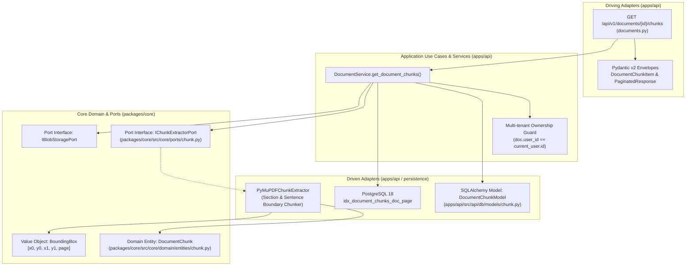

# Kế Hoạch Kỹ Thuật Chi Tiết: Triển Khai API Danh Sách Chunks Phân Trang & Tối Ưu Băng Thông (Document Chunks API)

* **Target API:** `GET /api/v1/documents/{id}/chunks`  
* **Tên rút gọn (Branch name đề xuất):** `feat/m1-api-document-chunks`  
* **Mã phản hồi chuẩn:** `200 OK` (Paginated Collection Envelope theo RFC 8288 và Google Cloud AIP-130 / AIP-136)  
* **Vị trí tài liệu lưu trữ:**  
  - [`docs/vi/decided/module-01/feat-m1-api-get-document-chunks.md`](file:///home/VeriScholar/Workspace/VeriScholar/docs/vi/decided/module-01/feat-m1-api-get-document-chunks.md)  
  - [`docs/vi/decided/feat-m1-api-get-document-chunks.md`](file:///home/VeriScholar/Workspace/VeriScholar/docs/vi/decided/feat-m1-api-get-document-chunks.md)  
* **Tài liệu tham chiếu chuẩn:**  
  - API Specification: [`docs/vi/design-api.md`](file:///home/VeriScholar/Workspace/VeriScholar/docs/vi/design-api.md) (Mục 3.11: `GET /api/v1/documents/{id}/chunks`)  
  - Database Schema DDL: [`docs/vi/design-database.md`](file:///home/VeriScholar/Workspace/VeriScholar/docs/vi/design-database.md) (Bảng `document_chunks`, các index B-Tree, GIN, HNSW pgvector)  
  - Kiến trúc Lục giác (Hexagonal): [`docs/vi/design-architecture.md`](file:///home/VeriScholar/Workspace/VeriScholar/docs/vi/design-architecture.md) (Section-Aware Chunking, Layout-Aware Bounding Boxes)  
  - Yêu cầu sản phẩm: [`docs/vi/PRD.md`](file:///home/VeriScholar/Workspace/VeriScholar/docs/vi/PRD.md) (Mục 3 - Module 1 Deep Reading, Visual Grounding Overlay, Bandwidth Optimization)  
  - Thiết kế Eval & Báo cáo: [`docs/vi/design-api-eval-snapshots.md`](file:///home/VeriScholar/Workspace/VeriScholar/docs/vi/design-api-eval-snapshots.md)  
  - Công nghệ Module 1: [`docs/vi/techstack-backend-module-01.md`](file:///home/VeriScholar/Workspace/VeriScholar/docs/vi/techstack-backend-module-01.md)  
  - Tập dữ liệu Ground Truth: [`data/golden-dataset/golden_eval_dataset.json`](file:///home/VeriScholar/Workspace/VeriScholar/data/golden-dataset/golden_eval_dataset.json)  

---

## 1. Bối Cảnh Nghiệp Vụ & Quyết Định Kiến Trúc (Architectural Decisions)

### 1.1 Vấn đề nghiệp vụ
Trong giao diện đọc sâu đa bài báo (Module 1 - Multi-Tab Reading Workspace) của VeriScholar:
1. **Visual Grounding Overlay trên PDF.js Canvas:**  
   Giao diện người dùng chia đôi màn hình (bên trái hiển thị Canvas PDF, bên phải là Chatbot/Ghi chú). Để hiển thị các lớp phủ highlight (bounding box overlay) cho các đoạn trích dẫn, trình duyệt cần biết danh sách các chunks và tọa độ hộp bao `bounding_boxes` của từng chunk theo từng trang.
2. **Nút thắt Băng thông & Tối ưu hóa tải trang (Bandwidth Optimization via Projection):**  
   Một bài báo 15–30 trang có thể sinh ra từ 60 đến 150 chunks với hàng trăm nghìn ký tự văn bản. Nếu mỗi lần mở trang PDF hoặc lật trang đều tải toàn bộ trường `content`, payload JSON sẽ nặng từ 500 KB đến 2 MB, gây nghẽn mạng và tăng độ trễ tải trang.
   - **Giải pháp thiết kế:** Hỗ trợ tham số `include_content: bool = True` (mặc định `True`). Khi client chỉ cần dựng các hộp highlight trên Canvas, frontend gọi `?include_content=false` để server trả về `content: null`, **giảm hơn 80% kích thước payload truyền tải qua mạng**.
3. **Phân trang Chuẩn RFC 8288 & Lọc Theo Trang (`page_number`):**  
   - Hỗ trợ tham số phân trang chuẩn: `page` (mặc định `1`), `per_page` (mặc định `50`, tối đa `200`).
   - Hỗ trợ lọc theo số trang cụ thể: `page_number: int | None = None` để Canvas chỉ tải đúng các chunks thuộc trang người dùng đang cuộn tới, tối ưu hóa triệt để tài nguyên trình duyệt.
4. **Cơ chế Two-Tier On-Demand Chunking & Database Index Caching:**  
   - Nếu bài báo đã được bóc tách và có dữ liệu trong bảng `document_chunks`: Truy vấn phân trang tức thì qua index `(document_id, chunk_index)` hoặc `(document_id, page_number)` với độ trễ **< 15ms**.
   - Nếu bảng `document_chunks` chưa có bản ghi (ví dụ tài liệu mới tải lên hoặc trong môi trường eval/local): Tự động kích hoạt bộ bóc tách Layout-Aware Chunker từ tệp PDF gốc, lưu toàn bộ chunks vào DB, rồi trả về lát cắt phân trang.

---

## 2. Phân Rã Kiến Trúc Lục Giác (Hexagonal Architecture Decomposition)



### 2.1 Database & Persistence Layer (`apps/api/src/api/db/`)
1. **Tạo Model `DocumentChunkModel` trong [`apps/api/src/api/db/models/chunk.py`](file:///home/VeriScholar/Workspace/VeriScholar/apps/api/src/api/db/models/chunk.py):**
   - Kế thừa `IdentifiableTimestampedModel` (`id`, `created_at`, `updated_at`).
   - `document_id: Mapped[UUID] = mapped_column(ForeignKey("documents.id", ondelete="CASCADE"), nullable=False, index=True)`
   - `chunk_index: Mapped[int] = mapped_column(Integer, nullable=False)`
   - `page_number: Mapped[int] = mapped_column(Integer, nullable=False)`
   - `content: Mapped[str] = mapped_column(Text, nullable=False)`
   - `bounding_boxes: Mapped[list[list[float | int]]] = mapped_column(JSONType, default=list, nullable=False)`
   - `token_count: Mapped[int] = mapped_column(Integer, nullable=False)`
   - `embedding: Mapped[list[float] | None] = mapped_column(JSONType, nullable=True)` (linh hoạt tương thích SQLite test doubles và PostgreSQL pgvector)
   - Ràng buộc & Chỉ mục tối ưu:
     - `UniqueConstraint("document_id", "chunk_index", name="uq_document_chunks_doc_chunk_idx")`
     - `Index("ix_document_chunks_doc_page", "document_id", "page_number")`
2. **Cập nhật [`apps/api/src/api/db/models/__init__.py`](file:///home/VeriScholar/Workspace/VeriScholar/apps/api/src/api/db/models/__init__.py):**
   - Export `DocumentChunkModel` để SQLAlchemy metadata nhận diện tự động.

### 2.2 Core Domain & Ports (`packages/core/src/core/`)
1. **Kiểm tra Domain Entity `DocumentChunk`:**
   - [`packages/core/src/core/domain/entities/chunk.py`](file:///home/VeriScholar/Workspace/VeriScholar/packages/core/src/core/domain/entities/chunk.py) đã có sẵn với các bất biến:
     - `id: UUID`
     - `document_id: UUID`
     - `chunk_index: int >= 0`
     - `page_number: int >= 1`
     - `content: str`
     - `bounding_boxes: list[BoundingBox]` (bảo đảm 0.0 <= x0 <= x1 <= 1.0, 0.0 <= y0 <= y1 <= 1.0, page >= 1)
     - `token_count: int > 0`
2. **Định nghĩa Port Interface `IChunkExtractorPort` trong [`packages/core/src/core/ports/chunk.py`](file:///home/VeriScholar/Workspace/VeriScholar/packages/core/src/core/ports/chunk.py):**
   ```python
   from abc import ABC, abstractmethod
   from typing import AsyncIterator
   from core.domain.entities.chunk import DocumentChunk
   from uuid import UUID

   class IChunkExtractorPort(ABC):
       """Port interface for extracting layout-aware chunks from PDF binaries."""

       @abstractmethod
       async def extract_chunks(
           self,
           pdf_stream: AsyncIterator[bytes],
           document_id: UUID,
           chunk_size: int = 500,
           chunk_overlap: int = 50,
       ) -> list[DocumentChunk]:
           """Extract semantically coherent chunks with spatial bounding boxes."""
           pass
   ```
3. **Đăng ký Port trong [`packages/core/src/core/ports/__init__.py`](file:///home/VeriScholar/Workspace/VeriScholar/packages/core/src/core/ports/__init__.py):**
   - Export `IChunkExtractorPort`.

### 2.3 Driven Adapters (`apps/api/src/api/adapters/`)
1. **Triển khai `PyMuPDFChunkExtractor` trong [`apps/api/src/api/adapters/chunk_extractor.py`](file:///home/VeriScholar/Workspace/VeriScholar/apps/api/src/api/adapters/chunk_extractor.py):**
   - Thuật toán bóc tách phân đoạn dựa trên bố cục khối văn bản của PyMuPDF (`fitz` blocks):
     - Lọc bỏ Page Headers, Page Footers và số trang lẻ.
     - Phân mảnh văn bản tôn trọng ranh giới câu (Sentence Boundary Splitting theo Regex `(?<=[.!?])\s+`) để tránh ngắt giữa từ hoặc giữa câu.
     - Tích hợp tính toán Bounding Box chuẩn hóa tỷ lệ [0.0, 1.0] cho từng đoạn văn bản.
     - Tính số lượng token ước tính (hoặc qua tiktoken / từ vựng học thuật).
     - Gán `chunk_index` tăng tuần tự từ 0 và `page_number` chính xác theo từng trang xuất hiện.

### 2.4 Application Service Layer (`apps/api/src/api/services/document_service.py`)
1. **Bổ sung phương thức `get_document_chunks`:**
   ```python
   async def get_document_chunks(
       self,
       document_id: UUID,
       user_id: UUID,
       db: AsyncSession,
       page: int = 1,
       per_page: int = 50,
       page_number: int | None = None,
       include_content: bool = True,
   ) -> tuple[list[DocumentChunkItem], int]:
       """Retrieve paginated chunks of a document with optional projection and page filtering.
       
       1. Multi-tenant guard: Check document exists and user_id matches.
       2. Check existing chunks in document_chunks table.
       3. If empty and document has blob, trigger on-demand chunk extraction and persist to DB.
       4. Build filtered and paginated query:
          - WHERE document_id = :document_id
          - AND (page_number = :page_number if specified)
          - ORDER BY chunk_index ASC
          - LIMIT :per_page OFFSET (:page - 1) * :per_page
       5. Project content: if include_content is False, set content = None.
       6. Return (chunk_items, total_count).
       """
   ```

### 2.5 Driving Adapters & Schemas (`apps/api/src/api/`)
1. **Pydantic Schemas trong [`apps/api/src/api/schemas/document.py`](file:///home/VeriScholar/Workspace/VeriScholar/apps/api/src/api/schemas/document.py):**
   ```python
   class DocumentChunkItem(BaseModel):
       """Single chunk item in paginated response."""
       id: UUID = Field(description="Unique chunk identifier")
       document_id: UUID = Field(description="Parent document identifier")
       chunk_index: int = Field(ge=0, description="0-indexed sequence position")
       page_number: int = Field(ge=1, description="Page where chunk begins")
       content: str | None = Field(default=None, description="Textual content (null if include_content=false)")
       bounding_boxes: list[list[float | int]] = Field(
           default_factory=list,
           description="List of normalized [x0, y0, x1, y1, page] bounding boxes",
       )
       token_count: int = Field(gt=0, description="Calculated token count")
   ```
2. **Router Endpoint trong [`apps/api/src/api/v1/endpoints/documents.py`](file:///home/VeriScholar/Workspace/VeriScholar/apps/api/src/api/v1/endpoints/documents.py):**
   ```python
   @router.get(
       "/{document_id}/chunks",
       response_model=PaginatedEnvelope[DocumentChunkItem],
       summary="Danh sách Chunks (phân trang + include_content)",
       description=(
           "Truy vấn danh sách các đoạn trích dẫn văn bản (chunks) kèm tọa độ Bounding Box. "
           "Hỗ trợ phân trang chuẩn RFC 8288, lọc theo page_number, và tắt include_content để giảm 80% băng thông."
       ),
   )
   async def get_document_chunks(
       request: Request,
       document_id: UUID,
       page: int = Query(1, ge=1, description="Số trang (1-based)"),
       per_page: int = Query(50, ge=1, le=200, description="Số lượng chunk trên mỗi trang"),
       page_number: int | None = Query(None, ge=1, description="Lọc chunk theo số trang bài báo"),
       include_content: bool = Query(True, description="Trả về nội dung văn bản hay chỉ lấy Bounding Box"),
       current_user: UserModel = Depends(get_current_user),
       db: AsyncSession = Depends(get_db_session),
       document_service: DocumentService = Depends(get_document_service),
   ) -> PaginatedEnvelope[DocumentChunkItem]:
       ...
   ```

---

## 3. Hệ Thống Kiểm Chuẩn (Testing & Two-Tier Evaluation Harness)

Tuyệt đối **KHÔNG thiết kế endpoint backdoor** `/api/v1/testing/...`. Hệ thống kiểm chuẩn được phân thành 2 cấp độ độc lập:

### 3.1 Cấp độ 1: Bộ Unit & Integration Tests (`apps/api/tests/test_documents_chunks.py`)
Kiểm thử toàn diện các ca nghiệp vụ và biên:
1. `test_get_chunks_initial_extraction_200_ok`: Gọi lần đầu, tự động bóc tách và lưu vào DB, kiểm tra đầy đủ các trường `id`, `document_id`, `chunk_index`, `page_number`, `bounding_boxes`, `token_count`.
2. `test_get_chunks_include_content_false_projection`: Kiểm tra khi `include_content=false`, trường `content` trả về `None`, giảm kích thước payload.
3. `test_get_chunks_page_number_filter`: Lọc chính xác các chunk có `page_number == target_page`.
4. `test_get_chunks_pagination_metadata_and_links`: Kiểm tra `meta.total`, `meta.page`, `meta.per_page`, `meta.total_pages` và liên kết RFC 8288 `links.first`, `links.prev`, `links.self`, `links.next`, `links.last`.
5. `test_get_chunks_nonexistent_document_404`: Trả về lỗi `404 DOCUMENT_NOT_FOUND`.
6. `test_get_chunks_tenant_isolation_404`: Người dùng khác không thể truy cập chunks của tài liệu thuộc user khác.
7. `test_get_chunks_invalid_page_params_422`: Chặn `page=0` hoặc `per_page=201`.

### 3.2 Cấp độ 2: Runner Tự Động Hóa Chuyên Biệt (`scripts/eval/runners/get_documents_chunks.py`)
1. **Kế thừa `BaseAPIRunner`** chạy trên tập Golden Papers (`data/papers/`):
   - Kịch bản 1: `case1_initial_chunks_full` (`include_content=true`, `page=1`, `per_page=50`).
   - Kịch bản 2: `case2_bandwidth_optimized` (`include_content=false`, kiểm tra toàn bộ `content is None`).
   - Kịch bản 3: `case3_page_filter` (`page_number=2`, kiểm tra tất cả item trả về đều có `page_number == 2`).
   - Kịch bản 4: `case4_not_found_guard` (`404 DOCUMENT_NOT_FOUND`).
   - Kịch bản 5: `case5_malformed_uuid_guard` (`422 Unprocessable Entity`).
2. **Cơ chế Đo lường Bất biến Toàn vẹn (Quality Invariants):**
   - **Spatial Geometry Gate:** Kiểm tra 100% tọa độ `bounding_boxes` thỏa mãn 0.0 <= x0 <= x1 <= 1.0, 0.0 <= y0 <= y1 <= 1.0.
   - **Bandwidth Reduction Ratio:** Đo lường tỷ lệ giảm dung lượng byte giữa `case1` và `case2` (phải giảm >= 70%).
   - **Chunk Monotonicity:** Kiểm tra `chunk_index` tăng đơn điệu không đứt quãng.
3. **Hai tầng lưu trữ báo cáo (Two-Tier Data Separation):**
   - Báo cáo Markdown tổng quan: `docs/eval-reports/get_documents_chunks.md` (giữ kích thước < 50 KB, không nhúng raw JSON dài hàng ngàn dòng).
   - Dữ liệu chi tiết Audit: `tests/.artifacts/get_documents_chunks/*.json` (kèm mã băm SHA-256 đối soát, đã có trong `.gitignore`).

### 3.3 Tích hợp vào Runner Tổng (`scripts/eval_api.py`)
1. **Đăng ký trong `scripts/eval/runners/__init__.py`:**
   - Thêm `DocumentChunksAPIRunner` vào `RUNNERS_MAP`:
     - `"chunks": DocumentChunksAPIRunner`
     - `"get_documents_chunks": DocumentChunksAPIRunner`
   - Cập nhật thứ tự vòng đời `MODULE_1_ORDER`:
     ```python
     MODULE_1_ORDER = [
         "post_documents_upload",
         "get_documents_list",
         "get_documents_detail",
         "get_documents_file_stream",
         "get_documents_status",
         "post_documents_star",
         "post_documents_parse",
         "post_documents_extract_references",
         "get_documents_structure",
         "get_documents_chunks",  # API 11 đặt ngay trước delete
         "delete_documents",
     ]
     ```
2. **Cập nhật tài liệu thiết kế eval:**
   - Bổ sung mục cho API số 11 trong [`docs/vi/design-api-eval-snapshots.md`](file:///home/VeriScholar/Workspace/VeriScholar/docs/vi/design-api-eval-snapshots.md).

---

## 4. Rà Soát Biến Môi Trường & An Toàn Vận Hành

### 4.1 Biến môi trường (`.env.example`)
- Rà soát tệp [`.env.example`](file:///home/VeriScholar/Workspace/VeriScholar/.env.example):
  - `POSTGRES_USER`, `POSTGRES_PASSWORD`, `POSTGRES_DB`, `POSTGRES_PORT`
  - `STORAGE_DIR` (lưu CAS blobs)
- **Đánh giá:** TARGET này sử dụng thuật toán phân đoạn Layout-Aware cục bộ (PyMuPDF) và lưu trữ PostgreSQL, **KHÔNG YÊU CẦU thêm biến môi trường bí mật mới** trong giai đoạn này. (Khóa `OPENAI_API_KEY` chỉ dùng khi sinh vector dense embedding ở pha RAG nâng cao, không chặn luồng bóc tách layout và bounding boxes).

### 4.2 Phân tích Rủi ro & Đánh đổi Kỹ thuật (Risks & Trade-offs)
| Rủi ro Kỹ thuật | Khả năng | Tác động | Giải pháp Giảm thiểu (Mitigation Strategy) |
| :--- | :---: | :---: | :--- |
| **PDF hai cột gây nhảy thứ tự câu** | Trung bình | Trung bình | Sử dụng thuật toán sắp xếp khối theo cột (`fitz.TEXT_DEHYPHENATE` và block sort reading order) trước khi ngắt câu. |
| **Payload quá lớn khi bài báo dài** | Cao | Cao | Bắt buộc client sử dụng phân trang `per_page <= 200` và khuyến nghị dùng `include_content=false` khi chỉ render canvas overlay. |
| **Trùng lặp chunk_index khi re-chunk** | Thấp | Cao | Sử dụng transaction `DELETE FROM document_chunks WHERE document_id = :id` trước khi insert lại nếu có lệnh force reparse, bảo đảm `UniqueConstraint`. |

### 4.3 Kế hoạch Nhánh Git (Git Branching)
- **Tên nhánh đề xuất:** `feat/m1-api-document-chunks`
- Tuân thủ quy định: **TUYỆT ĐỐI KHÔNG tự động git add, git commit hoặc push PR** khi chưa có lệnh trực tiếp từ người dùng.

---

## 5. Danh Mục Tệp Sẽ Triển Khai Khi Được Phê Duyệt

| STT | Tệp tin | Thao tác | Trách nhiệm kiến trúc |
| :---: | :--- | :---: | :--- |
| 1 | `packages/core/src/core/ports/chunk.py` | Tạo mới | Định nghĩa `IChunkExtractorPort` |
| 2 | `packages/core/src/core/ports/__init__.py` | Sửa | Export `IChunkExtractorPort` |
| 3 | `apps/api/src/api/db/models/chunk.py` | Tạo mới | SQLAlchemy model `DocumentChunkModel` |
| 4 | `apps/api/src/api/db/models/__init__.py` | Sửa | Export `DocumentChunkModel` |
| 5 | `apps/api/src/api/adapters/chunk_extractor.py` | Tạo mới | Triển khai `PyMuPDFChunkExtractor` |
| 6 | `apps/api/src/api/schemas/document.py` | Sửa | Thêm `DocumentChunkItem` |
| 7 | `apps/api/src/api/services/document_service.py` | Sửa | Thêm phương thức `get_document_chunks` |
| 8 | `apps/api/src/api/v1/endpoints/documents.py` | Sửa | Bổ sung endpoint `GET /{id}/chunks` |
| 9 | `apps/api/tests/test_documents_chunks.py` | Tạo mới | Unit & Integration test suite |
| 10 | `scripts/eval/runners/get_documents_chunks.py` | Tạo mới | Autonomous Golden Paper Runner |
| 11 | `scripts/eval/runners/__init__.py` | Sửa | Đăng ký runner và cập nhật `MODULE_1_ORDER` |
| 12 | `docs/vi/swagger.md` | Sửa | Cập nhật tài liệu API số 11 |
| 13 | `docs/vi/design-api-eval-snapshots.md` | Sửa | Cập nhật đặc tả snapshot cho API số 11 |
