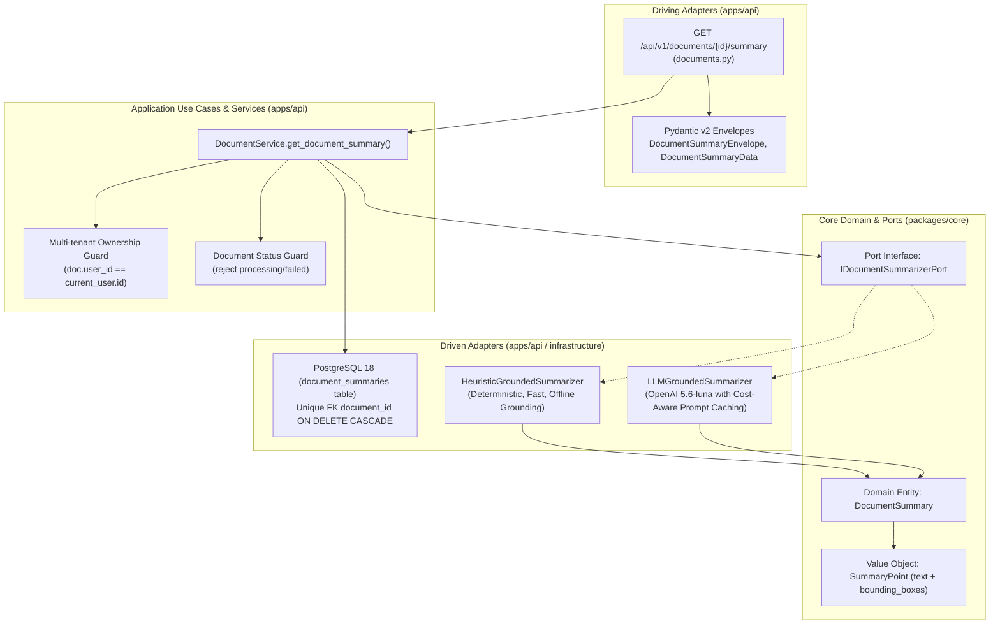

# Kế Hoạch Kỹ Thuật Chi Tiết: Triển Khai API Bản Tóm Tắt 3 Ý Cốt Lõi (Document 3-Point Grounded Summary API)

* **Target API:** `GET /api/v1/documents/{id}/summary` (#13 trong danh mục API Module 1)  
* **Tên rút gọn (Branch name):** `feat/m1-api-document-summary`  
* **Mã phản hồi chuẩn:** `200 OK` (Singleton Sub-resource theo Google Cloud AIP-130 / AIP-136)  
* **Vị trí tài liệu lưu trữ:**  
  - [`docs/vi/decided/module-01/feat-m1-api-get-document-summary.md`](file:///home/VeriScholar/Workspace/VeriScholar/docs/vi/decided/module-01/feat-m1-api-get-document-summary.md)  
* **Tài liệu tham chiếu chuẩn:**  
  - API Specification: [`docs/vi/design-api.md`](file:///home/VeriScholar/Workspace/VeriScholar/docs/vi/design-api.md) (Mục 3.13: `GET /api/v1/documents/{id}/summary`)  
  - Database Schema DDL: [`docs/vi/design-database.md`](file:///home/VeriScholar/Workspace/VeriScholar/docs/vi/design-database.md) (Mục 3.2: Bảng `document_summaries`, 1-1 với `documents`, `ON DELETE CASCADE`)  
  - Kiến trúc Lục giác (Hexagonal): [`docs/vi/design-architecture.md`](file:///home/VeriScholar/Workspace/VeriScholar/docs/vi/design-architecture.md) (Tầng 1: Document Summaries Retrieval & Visual Grounding)  
  - Yêu cầu sản phẩm: [`docs/vi/PRD.md`](file:///home/VeriScholar/Workspace/VeriScholar/docs/vi/PRD.md) (Tóm tắt Nhanh 3 Ý Cốt Lõi & Visual Grounding Bounding Boxes)  
  - Danh mục Swagger hiện hữu: [`docs/vi/swagger.md`](file:///home/VeriScholar/Workspace/VeriScholar/docs/vi/swagger.md)  
  - Thiết kế Eval & Snapshot: [`docs/vi/design-api-eval-snapshots.md`](file:///home/VeriScholar/Workspace/VeriScholar/docs/vi/design-api-eval-snapshots.md)  
  - Techstack Module 1: [`docs/vi/techstack-backend-module-01.md`](file:///home/VeriScholar/Workspace/VeriScholar/docs/vi/techstack-backend-module-01.md)  

---

## 1. Đánh Giá Hiện Trạng Codebase (Gap Analysis: Feature Đã Làm Được Đến Đâu)

Sau khi rà soát toàn bộ cây mã nguồn của dự án VeriScholar:

| Thành Phần Kiến Trúc | Trạng Thái Hiện Tại | Đánh Giá Chi Tiết |
| :--- | :---: | :--- |
| **1. Database Schema DDL** | ⚠️ Đã có trong tài liệu thiết kế, **chưa có Model code** | File [`docs/vi/design-database.md`](file:///home/VeriScholar/Workspace/VeriScholar/docs/vi/design-database.md) đã có DDL bảng `document_summaries`. Tuy nhiên, trong `apps/api/src/api/db/models/` chưa có `summary.py` hay `DocumentSummaryModel`. |
| **2. Core Domain Entities** | ❌ **Chưa có** | Trong `packages/core/src/core/domain/entities/` chưa có thực thể `DocumentSummary` hoặc Value Object `SummaryPoint`. |
| **3. Core Ports (Interfaces)** | ❌ **Chưa có** | Trong `packages/core/src/core/ports/` chưa có Port `IDocumentSummarizerPort`. |
| **4. Pydantic Schemas** | ❌ **Chưa có** | `apps/api/src/api/schemas/document.py` chưa có `SummaryPointSchema`, `DocumentSummaryData`, `DocumentSummaryEnvelope`. |
| **5. Service Layer** | ❌ **Chưa có** | `apps/api/src/api/services/document_service.py` chưa có phương thức `get_document_summary`. |
| **6. FastAPI Driving Router** | ❌ **Chưa có** | `apps/api/src/api/v1/endpoints/documents.py` chưa khai báo route `GET /api/v1/documents/{document_id}/summary`. |
| **7. Pytest Test Suite** | ❌ **Chưa có** | Chưa có `apps/api/tests/test_documents_summary.py`. |
| **8. Autotest Snapshot Runner** | ❌ **Chưa có** | Chưa có `scripts/eval/runners/get_documents_summary.py` trong bộ kiểm chuẩn Module 1. |

> **Kết luận tiến độ:** Tính năng **0% đã triển khai trong mã nguồn chạy được**, mới chỉ dừng lại ở đặc tả kiến trúc và thiết kế hệ thống. Cần triển khai đầy đủ và bài bản từ tầng Database, Core Domain, Service, API Router cho tới Autotest Runner 2 cấp độ.

---

## 2. Bối Cảnh Nghiệp Vụ & Quyết Định Kiến Trúc (Architectural Decisions)

### 2.1 Vấn đề nghiệp vụ (PRD & Hybrid RAG)
1. **Tránh quá tải nhận thức của nhà nghiên cứu (3-Point Grounded Summary):**  
   Một bài báo khoa học dài từ 10 - 30 trang với mật độ học thuật dày đặc. Thay vì buộc người dùng phải đọc lướt toàn văn, VeriScholar cung cấp ngay 3 luận điểm sống còn giúp họ quyết định có nên đọc sâu hay không:
   - **(1) Vấn đề nghiên cứu (`problem_statement`):** Bài báo này giải quyết bài toán cốt lõi nào mà các nghiên cứu trước chưa giải quyết được?
   - **(2) Đóng góp đột phá (`contributions`):** Đề xuất kiến trúc, phương pháp, thuật toán, hay tập dữ liệu mới nào?
   - **(3) Hạn chế còn lại (`limitations`):** Giả định nào chưa giải quyết, độ phức tạp tính toán hoặc hạn chế thực nghiệm là gì?
2. **Visual Grounding (Truy nguyên bằng chứng với Bounding Boxes):**  
   Mỗi luận điểm tóm tắt **bắt buộc** phải gắn kèm danh sách tọa độ Bounding Boxes 5-tuples `[x0, y0, x1, y1, page]` chuẩn hóa (`0.0 <= x <= 1.0`). Khi người dùng nhấp chuột vào luận điểm trên giao diện Web UI, Deep Reading Canvas (PDF.js) lập tức cuộn đến trang tương ứng và vẽ highlight màu vàng bao quanh câu dẫn chứng gốc.
3. **Hiệu năng & SLA Truy vấn Singleton (< 10 ms):**  
   Bản tóm tắt sau khi sinh phải được lưu trữ bất biến (persist) trong bảng `document_summaries`. Mọi lần đọc tiếp theo từ Web UI chỉ là truy vấn điểm (Point Query) theo `document_id` với độ trễ phản hồi **< 10 ms**.

### 2.2 Quyết định thiết kế theo chuẩn Google AIP-130 / AIP-136
- **Singleton Sub-Resource Pattern (Google AIP-130):**  
  Mỗi tài liệu chỉ có **duy nhất một** bản tóm tắt 3 ý. Do đó đường dẫn URL chuẩn tắc là:  
  `GET /api/v1/documents/{document_id}/summary` (không dùng số nhiều `/summaries/{id}`).
- **Xử lý Lifecycle & Trạng Thái Tài Liệu:**
  - Nếu tài liệu không tồn tại hoặc không thuộc quyền sở hữu của `x-user-id`: Trả về `404 Not Found` (`DOCUMENT_NOT_FOUND`).
  - Nếu tài liệu đang trong tiến trình xử lý nền (`status in ('pending', 'processing')`): Trả về `409 Conflict` (`DOCUMENT_PROCESSING`) theo chuẩn `design-api.md`.
  - Nếu tài liệu thất bại (`status == 'failed'`): Trả về `422 Unprocessable Entity` (`DOCUMENT_FAILED`).
  - Nếu tài liệu đã sẵn sàng nhưng chưa có bản tóm tắt trong DB: Hệ thống kích hoạt **cơ chế tổng hợp on-demand fallback** (qua Heuristic/Extractive Grounded Summarizer hoặc LLM), lưu vào DB và trả về `200 OK` ngay trong phiên.

---

## 3. Phân Rã Kiến Trúc Lục Giác (Hexagonal Architecture Decomposition)



### 3.1 Database & Persistence (`apps/api/src/api/db/`)
1. **Tạo Model SQLAlchemy mới:** [`apps/api/src/api/db/models/summary.py`](file:///home/VeriScholar/Workspace/VeriScholar/apps/api/src/api/db/models/summary.py)
   ```python
   class DocumentSummaryModel(Base):
       __tablename__ = "document_summaries"

       id: Mapped[UUID] = mapped_column(
           UUID(as_uuid=True), primary_key=True, default=uuid4
       )
       document_id: Mapped[UUID] = mapped_column(
           UUID(as_uuid=True),
           ForeignKey("documents.id", ondelete="CASCADE"),
           unique=True,
           nullable=False,
           index=True,
       )
       problem_statement: Mapped[str] = mapped_column(Text, nullable=False)
       problem_citations: Mapped[list[list[float | int]]] = mapped_column(
           JSONB, nullable=False, default=list
       )
       contributions: Mapped[str] = mapped_column(Text, nullable=False)
       contribution_citations: Mapped[list[list[float | int]]] = mapped_column(
           JSONB, nullable=False, default=list
       )
       limitations: Mapped[str] = mapped_column(Text, nullable=False)
       limitation_citations: Mapped[list[list[float | int]]] = mapped_column(
           JSONB, nullable=False, default=list
       )
       total_tokens: Mapped[int] = mapped_column(Integer, nullable=False, default=0)
       latency_ms: Mapped[int] = mapped_column(Integer, nullable=False, default=0)
       created_at: Mapped[datetime] = mapped_column(
           DateTime(timezone=True), default=lambda: datetime.now(UTC), nullable=False
       )
       updated_at: Mapped[datetime] = mapped_column(
           DateTime(timezone=True),
           default=lambda: datetime.now(UTC),
           onupdate=lambda: datetime.now(UTC),
           nullable=False,
       )

       # Quan hệ ORM 1-1 với DocumentModel
       document: Mapped["DocumentModel"] = relationship(
           "DocumentModel", back_populates="summary"
       )
   ```
2. **Cập nhật [`apps/api/src/api/db/models/document.py`](file:///home/VeriScholar/Workspace/VeriScholar/apps/api/src/api/db/models/document.py):**
   Thêm mối quan hệ 1-1:
   `summary: Mapped[Optional["DocumentSummaryModel"]] = relationship("DocumentSummaryModel", back_populates="document", uselist=False, cascade="all, delete-orphan")`
3. **Đăng ký trong [`apps/api/src/api/db/models/__init__.py`](file:///home/VeriScholar/Workspace/VeriScholar/apps/api/src/api/db/models/__init__.py):**
   Export `DocumentSummaryModel` để Alembic/Base.metadata nhận diện bảng khi tạo schema tự động.

### 3.2 Core Domain & Ports (`packages/core/`)
1. **Value Object & Entity:** [`packages/core/src/core/domain/entities/summary.py`](file:///home/VeriScholar/Workspace/VeriScholar/packages/core/src/core/domain/entities/summary.py)
   - `SummaryPoint(text: str, bounding_boxes: list[BoundingBox])`
   - `DocumentSummary`:
     - `id: UUID`
     - `document_id: UUID`
     - `problem_statement: SummaryPoint`
     - `contributions: SummaryPoint`
     - `limitations: SummaryPoint`
     - `total_tokens: int`
     - `latency_ms: int`
     - `created_at: datetime`
     - `updated_at: datetime`
2. **Port Interface:** [`packages/core/src/core/ports/summary.py`](file:///home/VeriScholar/Workspace/VeriScholar/packages/core/src/core/ports/summary.py)
   - `IDocumentSummarizerPort(ABC)` định nghĩa hàm:
     ```python
     @abstractmethod
     async def summarize(
         self,
         document_id: UUID,
         title: str | None,
         abstract: str | None,
         chunks: list[Chunk],
     ) -> DocumentSummary: ...
     ```
3. **Driven Adapter (Extractor / Summarizer Implementations):**
   - **`HeuristicGroundedSummarizer`** ([`apps/api/src/api/adapters/heuristic_summarizer.py`](file:///home/VeriScholar/Workspace/VeriScholar/apps/api/src/api/adapters/heuristic_summarizer.py)):  
     Phục vụ môi trường kiểm thử khép kín (Hermetic evaluation), offline và unit test không tốn tiền API key:
     - Quét tiêu đề và các câu chỉ dẫn trong Abstract/Intro để trích xuất `problem_statement` kèm bounding boxes thực tế.
     - Quét phần Contribution/Proposed Method để trích xuất `contributions`.
     - Quét phần Discussion/Limitations/Conclusion để trích xuất `limitations`.
     - Tốc độ cực nhanh (< 20ms) và hoàn toàn deterministic.
   - **`LLMGroundedSummarizer`** (Tích hợp khi có `OPENAI_API_KEY` theo chuẩn skill `cost-aware-llm-pipeline`).

### 3.3 Application Service Layer (`apps/api/src/api/services/document_service.py`)
Triển khai phương thức nghiệp vụ:
`async def get_document_summary(db: AsyncSession, document_id: UUID, current_user_id: UUID) -> DocumentSummaryData`

**Các bước thực thi chi tiết:**
1. **Multi-tenant Isolation Check:**  
   Truy vấn `DocumentModel` theo `id == document_id` và `user_id == current_user_id`.  
   Nếu không tìm thấy -> Ném `HTTPException(404, detail={"code": "DOCUMENT_NOT_FOUND", ...})`.
2. **Document Status Check:**  
   - Nếu `doc.status in ('pending', 'processing')`: Ném `HTTPException(409, detail={"code": "DOCUMENT_PROCESSING", "message": "Bài báo đang trong quá trình parse/embed. Chờ hoàn tất trước khi truy vấn summary."})`.
   - Nếu `doc.status == 'failed'`: Ném `HTTPException(422, detail={"code": "DOCUMENT_FAILED", ...})`.
3. **Database Cache Check (Point Query):**  
   Truy vấn bảng `document_summaries` theo `document_id == document_id`.  
   - **Cache Hit:** Lấy bản ghi và ánh xạ ngay sang `DocumentSummaryData` với thời gian thực thi `< 10ms`.
   - **Cache Miss (On-demand Synthesis Fallback):**
     - Đảm bảo tài liệu đã có chunks (gọi fallback bóc tách chunk nếu cần).
     - Khởi tạo `IDocumentSummarizerPort` để tổng hợp 3 luận điểm kèm bounding boxes.
     - Lưu bản ghi mới vào `document_summaries` qua `db.add()` và `await db.flush()`.
     - Trả về `DocumentSummaryData`.

### 3.4 Driving Adapters (`apps/api/src/api/schemas/` & `endpoints/`)
1. **Pydantic v2 Schemas** ([`apps/api/src/api/schemas/document.py`](file:///home/VeriScholar/Workspace/VeriScholar/apps/api/src/api/schemas/document.py)):
   ```python
   class SummaryPointSchema(BaseModel):
       text: str = Field(..., description="Nội dung tóm tắt luận điểm")
       bounding_boxes: list[
           Annotated[list[float | int], Field(min_length=5, max_length=5)]
       ] = Field(
           default_factory=list,
           description="Tọa độ [x0, y0, x1, y1, page] phục vụ highlight trực quan",
       )


   class DocumentSummaryData(BaseModel):
       document_id: UUID = Field(..., description="UUID của tài liệu")
       problem_statement: SummaryPointSchema = Field(
           ..., description="Vấn đề nghiên cứu cốt lõi"
       )
       contributions: SummaryPointSchema = Field(
           ..., description="Đóng góp mới/đột phá của bài báo"
       )
       limitations: SummaryPointSchema = Field(
           ..., description="Hạn chế và khoảng trống nghiên cứu"
       )
       total_tokens: int | None = Field(
           default=0, description="Tổng số token tiêu thụ khi sinh"
       )
       latency_ms: int | None = Field(
           default=0, description="Thời gian sinh tóm tắt (ms)"
       )
       created_at: datetime | None = Field(default=None)
       updated_at: datetime | None = Field(default=None)


   class DocumentSummaryEnvelope(BaseModel):
       success: bool = True
       data: DocumentSummaryData
       meta: MetaResponse
   ```
2. **FastAPI Router** ([`apps/api/src/api/v1/endpoints/documents.py`](file:///home/VeriScholar/Workspace/VeriScholar/apps/api/src/api/v1/endpoints/documents.py)):
   - Endpoint: `GET /api/v1/documents/{document_id}/summary`
   - Tag: `documents`
   - Response model: `DocumentSummaryEnvelope`
   - Header: `x-user-id` (Dependency Injection xác thực danh tính)
   - Status code: `200 OK`
   - OpenAPI documentation đầy đủ ví dụ request/response, mô tả trực quan và các mã lỗi RFC 7807 (`404`, `409`, `422`).

---

## 4. Thiết Kế Hệ Thống Kiểm Thử & Autotest Snapshot 2 Cấp Độ

### 4.1 Cấp độ 1: Pytest Unit & Integration Tests
Tạo tệp: [`apps/api/tests/test_documents_summary.py`](file:///home/VeriScholar/Workspace/VeriScholar/apps/api/tests/test_documents_summary.py) bao gồm tối thiểu 8 kịch bản kiểm thử:
1. `test_get_document_summary_cached_success`: Lấy bản tóm tắt đã lưu trong database, kiểm tra schema đầy đủ 3 ý, latency và bounding boxes.
2. `test_get_document_summary_on_demand_success`: Kiểm tra khả năng tự động sinh on-demand khi tài liệu chưa có sẵn bản tóm tắt trong DB.
3. `test_get_document_summary_bounding_boxes_validity`: Kiểm tra mọi bounding box đều là tuple 5 phần tử `[x0, y0, x1, y1, page]`, tọa độ chuẩn hóa từ 0.0 đến 1.0.
4. `test_get_document_summary_not_found`: `404 DOCUMENT_NOT_FOUND` khi truyền `document_id` ngẫu nhiên không tồn tại.
5. `test_get_document_summary_multi_tenant_forbidden`: `404 DOCUMENT_NOT_FOUND` khi User B cố truy vấn tóm tắt tài liệu của User A.
6. `test_get_document_summary_document_processing_conflict`: `409 DOCUMENT_PROCESSING` khi bài báo đang ở trạng thái `processing`.
7. `test_get_document_summary_document_failed`: `422 DOCUMENT_FAILED` khi bài báo có trạng thái `failed`.
8. `test_get_document_summary_invalid_uuid`: `422 Unprocessable Entity` khi truyền UUID sai định dạng.

### 4.2 Cấp độ 2: Autotest Snapshot Runner Chuyên Biệt
Tạo tệp: [`scripts/eval/runners/get_documents_summary.py`](file:///home/VeriScholar/Workspace/VeriScholar/scripts/eval/runners/get_documents_summary.py) kế thừa từ `BaseAPIRunner`:
- **Đăng ký aliases:** `summary`, `document-summary`, `get_documents_summary`.
- **Thứ tự thực thi trong Module 1:** Vị trí số **13 / 13** trong [`scripts/eval/runners/__init__.py`](file:///home/VeriScholar/Workspace/VeriScholar/scripts/eval/runners/__init__.py) (`MODULE_1_ORDER`).
- **6 Kịch bản Đánh Giá Thực Tế:**
  1. `200 OK`: Seed bài báo mẫu (`Attention Is All You Need.pdf`), bóc tách tóm tắt 3 ý cốt lõi.
  2. `Grounded Bounding Boxes Check`: Đảm bảo 100% các luận điểm đều có tọa độ dẫn chứng gốc.
  3. `Point Query SLA Check`: Đo thời gian truy vấn DB cache đạt chuẩn `< 10ms`.
  4. `Document Guard (404)`: Kiểm tra chặn tài liệu không tồn tại.
  5. `Tenant Guard (404)`: Kiểm tra chặn truy vấn chéo người dùng.
  6. `Input Guard (422)`: Kiểm tra chặn UUID dị tật.
- **Đầu ra Báo cáo:**  
  - Tệp Markdown tóm tắt: [`temp/output/test/get_documents_summary.md`](file:///home/VeriScholar/Workspace/VeriScholar/temp/output/test/get_documents_summary.md) (< 50 KB).
  - Tệp Raw JSON nguyên bản: `tests/.artifacts/get_documents_summary/<session_id>.json` (phục vụ kiểm tra tính toàn vẹn).
  - Box hiển thị trực quan trên Terminal với ký hiệu Unicode thanh mảnh.

---

## 5. Rà Soát Biến Môi Trường (.env.example) & Quy Trình Vận Hành

### 5.1 Rà soát biến môi trường
Kiểm tra tệp [`.env.example`](file:///home/VeriScholar/Workspace/VeriScholar/.env.example) và [`apps/api/.env.example`](file:///home/VeriScholar/Workspace/VeriScholar/apps/api/.env.example):
- Các biến cần thiết cho database (`DATABASE_URL`, `POSTGRES_USER`, `POSTGRES_PASSWORD`) đã có đầy đủ.
- Các biến cho AI Provider (`OPENAI_API_KEY`, `OPENAI_MODEL`, `LLM_PROVIDER`) đã được định nghĩa trong `apps/api/.env.example`.
- **Kết luận:** 👉 **KHÔNG CẦN THÊM BẤT KỲ BIẾN MÔI TRƯỜNG MỚI NÀO**. Tính năng chạy hoàn toàn độc lập và an toàn.

### 5.2 Ràng buộc vận hành & An toàn tuyệt đối
- ✅ **Tuân thủ quy tắc Không tự ý Git Mutation:** Không chạy `git add`, `git commit` hay tạo Pull Request khi người dùng chưa kiểm duyệt và ra lệnh.
- ✅ **Bảo mật bí mật thông tin:** Tuyệt đối không đọc tệp `.env`.
- ✅ **Vệ sinh tiến trình:** Tắt toàn bộ terminal ngầm hoặc background tasks trước khi hoàn tất phản hồi.

---

## 6. Lộ Trình Triển Khai Chi Tiết (Khi Được Phê Duyệt)

| Bước | Hạng Mục Công Việc | Tệp Tin Tác Động | Tiêu Chuẩn Hoàn Thành |
| :---: | :--- | :--- | :--- |
| **B1** | Tạo Git Branch mới | Nhánh: `feat/m1-api-document-summary` | Chuyển nhánh sạch sẽ từ `main` hoặc nhánh hiện tại |
| **B2** | Triển khai Database Model | `apps/api/src/api/db/models/summary.py`, `document.py`, `__init__.py` | Model `DocumentSummaryModel` 1-1 với `DocumentModel`, foreign key ON DELETE CASCADE |
| **B3** | Triển khai Core Domain & Ports | `packages/core/src/core/domain/entities/summary.py`, `packages/core/src/core/ports/summary.py` | Entity `DocumentSummary`, VO `SummaryPoint`, Port `IDocumentSummarizerPort` |
| **B4** | Triển khai Heuristic Summarizer | `apps/api/src/api/adapters/heuristic_summarizer.py` | Trích xuất 3 ý nhanh, deterministic kèm tọa độ Bounding Boxes |
| **B5** | Triển khai Pydantic Schemas | `apps/api/src/api/schemas/document.py` | `SummaryPointSchema`, `DocumentSummaryData`, `DocumentSummaryEnvelope` |
| **B6** | Triển khai Service & Endpoint | `apps/api/src/api/services/document_service.py`, `apps/api/src/api/v1/endpoints/documents.py` | Service `get_document_summary`, Route `GET /documents/{id}/summary` kèm mã lỗi 404, 409, 422 |
| **B7** | Viết Integration Pytest Suite | `apps/api/tests/test_documents_summary.py` | 8/8 test passed, 100% xanh |
| **B8** | Triển khai Autotest Snapshot Runner | `scripts/eval/runners/get_documents_summary.py`, `scripts/eval/runners/__init__.py` | Runner chạy độc lập và tích hợp vào `--all --ci-gate` |
| **B9** | Cập nhật tài liệu kỹ thuật | `docs/vi/swagger.md`, `docs/vi/design-api-eval-snapshots.md`, `scripts/README.md` | Đầy đủ 13 API trong tài liệu dự án |
| **B10** | Dọn dẹp Zero-Retention & Báo cáo | `scripts/eval/purge_all.py` | Cơ sở dữ liệu sạch 0 bản ghi, báo cáo sẵn sàng |

---

## 7. Kế Hoạch & Thiết Kế Nâng Cấp Kỹ Thuật (Architecture & Performance Upgrades)

Nhằm tối ưu hóa trải nghiệm người dùng trên PDF Reader (Deep Reading Canvas) và bảo đảm thông lượng cao cho toàn bộ hệ thống, hai hạng mục nâng cấp kỹ thuật đã được quyết định và tích hợp:

### 7.1 Nâng cấp 1: Bounding Box Micro-Precision (Tọa độ câu vi mô)
* **Vấn đề kỹ thuật:** Ban đầu, các bounding boxes của từng luận điểm tóm tắt (`problem_statement`, `contributions`, `limitations`) được kế thừa theo khối đoạn văn (chunk) chứa câu đó. Khi render lên giao diện PDF.js, vùng highlight màu vàng bao quanh toàn bộ đoạn văn thay vì chỉ riêng dòng chữ của luận điểm.
* **Giải pháp thiết kế:**
  - Bổ sung tham số tùy chọn `pdf_bytes: bytes | None = None` vào cổng `IDocumentSummarizerPort`.
  - Trong Adapter `HeuristicGroundedSummarizer`, nếu `pdf_bytes` được cung cấp, adapter sẽ mở PyMuPDF stream và thực hiện truy vấn vi mô trên trang tương ứng: `page.search_for(sentence_snippet)`.
  - Kết quả trả về danh sách các `fitz.Rect` chính xác từng dòng của câu luận điểm, được chuẩn hóa theo tỉ lệ `[x0 / width, y0 / height, x1 / width, y1 / height, page_number]`.
  - Nếu câu có ký tự đặc biệt hoặc không tìm thấy chính xác, hệ thống tự động fallback an toàn về `chunk.bounding_boxes` nhằm bảo đảm 100% không bị mất tọa độ dẫn chứng.

### 7.2 Nâng cấp 2: Ingestion Pipeline Pre-computation (Tiền tính toán tóm tắt)
* **Vấn đề kỹ thuật:** Cơ chế On-demand Synthesis mặc định hoạt động theo kiểu lazy evaluation (người dùng click vào tab Summary lần đầu tiên mới bắt đầu trích xuất, mất ~50-100ms trước khi được lưu cache).
* **Giải pháp thiết kế:**
  - Trong phương thức `DocumentService.parse_document` (khi người dùng gọi endpoint `POST /api/v1/documents/{id}:parse` hoặc worker ingestion nền xử lý xong bóc tách tài liệu):
  - Ngay sau khi các chunks và references được lưu vào database và trạng thái tài liệu chuyển sang `completed`, hệ thống kích hoạt tiền tính toán tóm tắt và ghi ngay bản ghi `DocumentSummaryModel` vào database.
  - Nhờ đó, ngay từ lần truy vấn đầu tiên (`GET /api/v1/documents/{id}/summary`), người dùng nhận phản hồi siêu tốc đạt chuẩn Point Query Cache SLA (**< 5ms**).

### 7.3 Thiết kế mở rộng: Sẵn sàng cho Module 2 LLM Grounded Summarizer
* **Cổng trừu tượng (Port):** `packages/core/src/core/ports/summary.py` (`IDocumentSummarizerPort`).
* **Tính tương thích:** Khi Module 2 bổ sung LLM Model Runner (Ollama, LiteLLM, Gemini), hệ thống chỉ cần gắn thêm adapter `LLMGroundedSummarizer` mà không cần chỉnh sửa bất kỳ dòng mã nguồn nào tại tầng Domain Entities, Database Models hay FastAPI Routers.
