# VeriScholar MVP — Database Entity-Relationship Diagram (ERD)

Tài liệu đặc tả kiến trúc cơ sở dữ liệu quan hệ (PostgreSQL 16 + pgvector) và toàn bộ 20 thực thể (bảng) trong hệ sinh thái **VeriScholar**.

---

## 1. Sơ Đồ Thực Thể Liên Kết (Mermaid ERD)

```mermaid
erDiagram
    %% ==========================================
    %% MODULE 1: AUTHENTICATION, USER & BYOK
    %% ==========================================
    users ||--o{ user_api_keys : "owns"
    users ||--o| scholar_profiles : "has"
    users ||--o{ folders : "owns"
    users ||--o{ documents : "owns"
    users ||--o{ research_sessions : "creates"
    users ||--o{ drafts : "authors"
    users ||--o{ wiki_pages : "compiles"

    users {
        uuid id PK "Khóa chính UUIDv4"
        varchar email "Email đăng nhập (Unique)"
        varchar full_name "Họ và tên người dùng"
        varchar hashed_password "Mật khẩu mã hóa Argon2id"
        varchar role "Vai trò: scholar, admin"
        boolean is_active "Trạng thái hoạt động"
        boolean is_verified "Trạng thái xác thực email"
        varchar institution "Viện nghiên cứu / Trường Đại học"
        varchar department "Khoa / Bộ môn"
        varchar academic_rank "Học hàm / Học vị"
        varchar orcid_id "Mã định danh ORCID"
        text byok_api_key_encrypted "Khóa API BYOK mã hóa AES-GCM"
        timestamptz created_at "Thời điểm tạo tài khoản"
        timestamptz updated_at "Thời điểm cập nhật"
    }

    user_api_keys {
        uuid id PK
        uuid user_id FK "Người sở hữu khóa"
        varchar provider "Nhà cung cấp (OpenAI, Gemini, Anthropic)"
        varchar encrypted_key "Khóa API mã hóa envelope"
        varchar key_hint "4 ký tự cuối nhận diện khóa"
        boolean is_active "Cờ kích hoạt"
    }

    scholar_profiles {
        uuid id PK
        uuid user_id FK "Tài khoản học giả tương ứng"
        varchar institution "Cơ quan công tác"
        varchar department "Đơn vị chuyên môn"
        varchar academic_rank "Chức danh khoa học"
        varchar orcid_id "Liên kết ORCID chính thức"
        text bio "Tiểu sử học thuật"
        jsonb research_interests "Danh mục hướng nghiên cứu quan tâm"
    }

    %% ==========================================
    %% MODULE 2: CAS STORAGE & PAPER LIBRARY
    %% ==========================================
    folders ||--o{ folders : "subfolder"
    folders ||--o{ documents : "organizes"
    folders ||--o{ folder_community_summaries : "summarizes"
    folders ||--o{ wiki_pages : "scopes"
    document_storage_blobs ||--o{ documents : "stores_binary"
    document_storage_blobs ||--o{ draft_assets : "stores_figure"
    documents ||--o{ document_chunks : "chunked_into"
    documents ||--o{ document_summaries : "synthesizes"
    documents ||--o{ reference_items : "contains_citations"
    documents ||--o{ reference_items : "resolved_citation"

    document_storage_blobs {
        uuid id PK
        varchar content_hash "Băm SHA-256 CAS phi trùng lặp"
        text storage_path "Đường dẫn tệp vật lý"
        bigint file_size_bytes "Dung lượng tệp (bytes)"
        int ref_count "Bộ đếm tham chiếu tài liệu"
        varchar status "Trạng thái: ready, processing, error"
    }

    folders {
        uuid id PK
        uuid user_id FK "Người tạo thư mục"
        uuid parent_id FK "Thư mục cha (Cấu trúc phân cấp)"
        varchar name "Tên thư mục đề tài"
        varchar color "Mã màu nhận diện giao diện"
        text description "Ghi chú mục tiêu thư mục"
    }

    documents {
        uuid id PK
        uuid user_id FK "Chủ sở hữu bài báo"
        uuid blob_id FK "Liên kết tệp nhị phân CAS"
        uuid folder_id FK "Thư mục chứa (nếu có)"
        varchar filename "Tên tệp PDF gốc"
        text title "Tiêu đề bài báo khoa học"
        jsonb authors "Danh sách tác giả"
        int publication_year "Năm xuất bản"
        varchar doi "Mã số định danh DOI"
        bigint file_size_bytes "Dung lượng tệp"
        int page_count "Tổng số trang PDF"
        int chunk_count "Số đoạn văn bản bóc tách"
        varchar status "Trạng thái xử lý bóc tách"
        boolean is_starred "Đánh dấu sao bài báo trọng tâm"
    }

    document_chunks {
        uuid id PK
        uuid document_id FK "Bài báo xuất xứ"
        uuid user_id FK "Chủ sở hữu phân vùng"
        int chunk_index "Chỉ số thứ tự đoạn trong bài"
        int page_number "Trang PDF chứa đoạn"
        text content "Nội dung văn bản học thuật"
        jsonb bounding_boxes "Tọa độ hộp bao trên trang PDF"
        vector embedding "Vector ngữ nghĩa 1536 chiều"
    }

    document_summaries {
        uuid id PK
        uuid document_id FK "Bài báo tóm tắt"
        uuid user_id FK "Người yêu cầu tóm tắt"
        text problem_statement "Bài toán nghiên cứu đặt ra"
        text contributions "Các đóng góp học thuật cốt lõi"
        text limitations "Các rào cản và hạn chế"
    }

    reference_items {
        uuid id PK
        uuid document_id FK "Bài báo trích dẫn"
        uuid resolved_document_id FK "Bài báo trong kho được đối soát trúng"
        int ref_index "Số thứ tự tài liệu tham khảo [i]"
        text raw_text "Chuỗi trích dẫn gốc trong PDF"
        text parsed_title "Tiêu đề đã chuẩn hóa"
        varchar doi "Mã DOI trích dẫn"
        varchar arxiv_id "Mã định danh arXiv"
    }

    %% ==========================================
    %% MODULE 3: RESEARCH SESSIONS & DEEP READING
    %% ==========================================
    research_sessions ||--o{ session_documents : "includes"
    documents ||--o{ session_documents : "participates_in"
    research_sessions ||--o{ session_turns : "conversation"
    documents ||--o{ research_notes : "annotated_on"
    document_chunks ||--o{ research_notes : "anchored_to"

    research_sessions {
        uuid id PK
        uuid user_id FK "Nhà nghiên cứu chủ trì"
        uuid active_document_id FK "Bài báo đang mở trên Reader"
        varchar title "Tiêu đề phiên nghiên cứu"
        varchar active_tab "Tab làm việc: reader, chat, roadmap"
        jsonb viewport_state "Vị trí cuộn và mức thu phóng PDF"
        boolean is_archived "Trạng thái lưu trữ"
    }

    session_documents {
        uuid session_id PK "Khóa chính kết hợp FK"
        uuid document_id PK "Khóa chính kết hợp FK"
        int display_order "Thứ tự hiển thị tab đọc"
        timestamptz added_at "Thời điểm đưa vào phiên"
    }

    session_turns {
        uuid id PK
        uuid session_id FK "Phiên đối thoại"
        uuid user_id FK "Người hỏi"
        text question "Câu hỏi học thuật của người dùng"
        text answer "Câu trả lời RAG có chứng minh nguồn"
        jsonb citations "Danh sách trích dẫn kèm tọa độ Bounding Box"
        varchar finish_reason "Lý do kết thúc chuỗi suy luận"
        varchar trace_id "Mã truy vết Langfuse"
    }

    research_notes {
        uuid id PK
        uuid document_id FK "Bài báo được ghi chú"
        uuid chunk_id FK "Đoạn văn bản neo giữ"
        text selected_text "Đoạn trích dẫn gốc"
        jsonb bounding_boxes "Tọa độ tô sáng trên PDF"
        int page_number "Số trang PDF"
        text user_note "Ghi chú phân tích của học giả"
        boolean is_source_detached "Cờ báo nếu nguồn bị sửa"
    }

    %% ==========================================
    %% MODULE 4: KNOWLEDGE GRAPH & COMPILED WIKI
    %% ==========================================
    documents ||--o{ graph_nodes : "extracts_entities"
    graph_nodes ||--o{ graph_edges : "source"
    graph_nodes ||--o{ graph_edges : "target"
    document_chunks ||--o{ graph_edges : "evidence"

    graph_nodes {
        uuid id PK
        uuid document_id FK "Bài báo khai sinh thực thể"
        varchar node_type "Loại thực thể: Paper, Method, Dataset, Metric"
        varchar canonical_name "Tên chuẩn hóa (Canonical)"
        varchar display_name "Tên hiển thị trực quan"
        text description "Định nghĩa hoặc mô tả thực thể"
        vector embedding "Vector ngữ nghĩa phục vụ Vector Search"
    }

    graph_edges {
        uuid id PK
        uuid source_node_id FK "Đỉnh xuất phát"
        uuid target_node_id FK "Đỉnh đích"
        uuid document_id FK "Bài báo minh chứng quan hệ"
        uuid evidence_chunk_id FK "Đoạn văn bản làm bằng chứng liên kết"
        varchar edge_type "Loại quan hệ: PROPOSES, EVALUATED_ON, ACHIEVES, CITES"
        float weight "Trọng số liên kết"
        int page_number "Trang chứa bằng chứng"
    }

    folder_community_summaries {
        uuid id PK
        uuid folder_id FK "Thư mục đề tài tương ứng"
        text summary_text "Tóm tắt vĩ mô cộng đồng Leiden"
        jsonb key_findings "Các phát hiện quan trọng"
        vector embedding "Vector tóm tắt vĩ mô GraphRAG"
    }

    wiki_pages {
        uuid id PK
        uuid folder_id FK "Thư mục đề tài (tùy chọn)"
        uuid user_id FK "Tác giả biên soạn"
        varchar slug "Đường dẫn URL duy nhất (kebab-case)"
        varchar title "Tiêu đề khái niệm / chuyên đề"
        varchar page_type "Loại trang: topic, method, research_gap, comparison"
        text markdown_content "Toàn văn Markdown kèm công thức LaTeX"
        jsonb yaml_metadata "Siêu dữ liệu YAML Frontmatter"
        jsonb wikilinks "Danh sách liên kết [[wikilinks]] nội bộ"
        vector embedding "Vector trang wiki"
    }

    %% ==========================================
    %% MODULE 5: AGENTIC DRAFTING & OVERLEAF WRITING
    %% ==========================================
    research_sessions ||--o{ drafts : "promotes_to_draft"
    drafts ||--o{ draft_assets : "includes_figures"
    drafts ||--o{ draft_messages : "coauthor_chat"

    drafts {
        uuid id PK
        uuid user_id FK "Tác giả bản thảo"
        uuid source_session_id FK "Phiên nghiên cứu khởi nguồn"
        varchar title "Tiêu đề bản thảo bài báo"
        text content "Mã nguồn LaTeX bản thảo (main.tex)"
        text bib_content "Mục lục trích dẫn BibTeX (references.bib)"
        varchar format "Định dạng xuất bản (latex, markdown)"
        varchar template "Mẫu hội nghị: IEEE, ACM, Springer, arXiv"
        int version "Phiên bản OCC Optimistic Locking"
    }

    draft_assets {
        uuid id PK
        uuid draft_id FK "Bản thảo liên kết"
        uuid blob_id FK "Tệp nhị phân hình ảnh CAS"
        varchar file_name "Tên tệp chèn vào LaTeX (fig1.png)"
        varchar mime_type "Định dạng MIME (image/png, pdf)"
        int byte_size "Dung lượng ảnh (bytes)"
    }

    draft_messages {
        uuid id PK
        uuid draft_id FK "Hội thoại hỗ trợ viết bài"
        varchar role "Vai trò: user, assistant, system"
        text content "Nội dung phản hồi hoặc mã LaTeX"
        int compile_attempts "Số lần kích hoạt biên dịch TeXLive"
        varchar trace_id "Mã truy vết quan sát Langfuse"
    }
```



---

## 2. Danh Mục 5 Phân Hệ Bảng Dữ Liệu

1. **Phân hệ Định danh & Khóa Bảo Mật (Module 1 - Auth & BYOK):**
   - `users`: Thông tin tài khoản học giả, vai trò, viện nghiên cứu và khóa mã hóa BYOK.
   - `user_api_keys`: Khóa API các nhà cung cấp mô hình ngôn ngữ lớn (OpenAI, Anthropic, Gemini) mã hóa an toàn.
   - `scholar_profiles`: Hồ sơ học thuật mở rộng, số ORCID, danh mục lĩnh vực quan tâm.

2. **Phân hệ Lưu Trữ CAS & Thư Viện Tài Liệu (Module 2 - CAS Storage & Library):**
   - `document_storage_blobs`: Lưu trữ nhị phân phi trùng lặp (Content-Addressable Storage) theo mã băm SHA-256.
   - `folders`: Cây thư mục phân cấp tổ chức tài liệu nghiên cứu cá nhân.
   - `documents`: Hồ sơ bài báo PDF đã bóc tách siêu dữ liệu, số trang, tiến độ xử lý.
   - `document_chunks`: Các đoạn văn bản phân mảnh kèm vector nhúng 1536 chiều và tọa độ hộp bao (Bounding Boxes).
   - `document_summaries`: Bảng tóm tắt có cấu trúc 3 phần (Bài toán, Đóng góp, Hạn chế).
   - `reference_items`: Danh mục tài liệu tham khảo bóc tách từ bài báo và đối soát chéo tự động.

3. **Phân hệ Phiên Nghiên Cứu & Đọc Sâu (Module 3 - Sessions & Deep Reading):**
   - `research_sessions`: Quản lý không gian làm việc đa bài báo, trạng thái cuộn và tab hiển thị.
   - `session_documents`: Bảng liên kết nhiều-nhiều (N-N) giữa phiên nghiên cứu và bài báo.
   - `session_turns`: Lịch sử hỏi đáp học thuật qua Hybrid RAG kèm trích dẫn chứng minh.
   - `research_notes`: Ghi chú học thuật có neo giữ tọa độ trên trang PDF (Anchor Memory).

4. **Phân hệ Đồ Thị Tri Thức & Wiki Học Thuật (Module 4 - GraphRAG & LLM Wiki):**
   - `graph_nodes`: 4 loại thực thể tri thức cốt lõi (*Bài báo, Phương pháp, Tập dữ liệu, Chỉ số*).
   - `graph_edges`: 4 loại quan hệ học thuật (*PROPOSES, EVALUATED_ON, ACHIEVES, CITES*).
   - `folder_community_summaries`: Tóm tắt vĩ mô các cụm phát hiện Leiden phục vụ truy vấn GraphRAG toàn cục.
   - `wiki_pages`: Trang Wiki tri thức học thuật tổng hợp kèm siêu dữ liệu YAML Frontmatter và liên kết `[[wikilinks]]`.

5. **Phân hệ Biên Soạn Bài Báo Tự Động (Module 5 - Agentic LaTeX Writing):**
   - `drafts`: Bản thảo bài báo khoa học định dạng LaTeX chuẩn hội nghị IEEE/ACM.
   - `draft_assets`: Các hình ảnh, đồ thị minh họa chèn vào bản thảo khoa học.
   - `draft_messages`: Nhật ký hội thoại giữa tác giả và Agent đồng tác giả AI.

---

## 3. Cách Sử Dụng Sơ Đồ ERD

- **Xem trực tiếp trên GitHub/GitLab:** GitHub và GitLab hỗ trợ hiển thị trực quan biểu đồ Mermaid trong khối ` ```mermaid ` mà không cần cài thêm plugin.
- **Xem trong VS Code / Cursor:** Cài extension **Markdown Preview Mermaid Support** để xem biểu đồ render tương tác ngay trong bản preview Markdown (`Ctrl + Shift + V`).
- **Xuất ảnh chất lượng cao:** Sao chép khối mã `mermaid` trên và dán vào [Mermaid Live Editor](https://mermaid.live) để chỉnh sửa màu sắc hoặc xuất ảnh vector **SVG / PNG** độ phân giải cao cho báo cáo đồ án.
