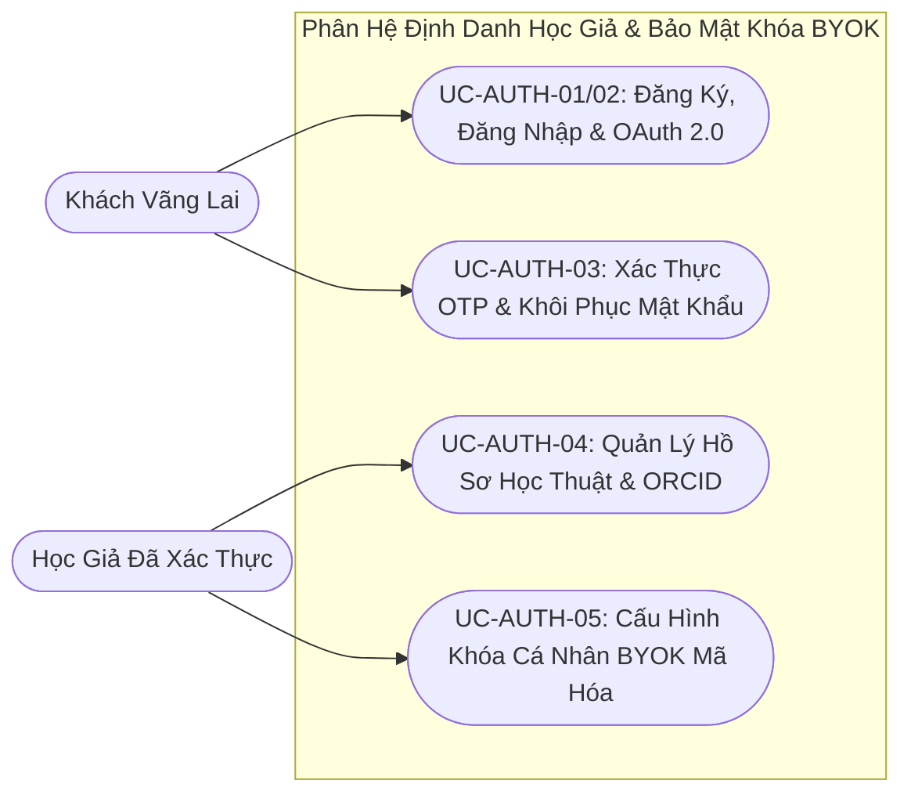

# VERISCHOLAR MVP — TÀI LIỆU YÊU CẦU SẢN PHẨM: XÁC THỰC, HỒ SƠ HỌC GIẢ & BẢO MẬT KHÓA BYOK
# (PRODUCT REQUIREMENTS DOCUMENT: AUTHENTICATION, SCHOLAR PROFILE & BYOK PRIVACY)

**Mã phân hệ:** `PRD-01`  
**Phiên bản:** `2.0-OFFICIAL`  
**Vai trò phụ trách:** Chuyên viên Phân tích Nghiệp vụ (Lead Business Analyst — BA)  
**Tài liệu Kỹ thuật liên đới:** [`01-auth-and-user-spec.md`](../specs/01-auth-and-user-spec.md)  
**File nền tảng liên đới:** [`00-overview-and-cleanup.md`](./00-overview-and-cleanup.md)  
**Trạng thái:** CHÍNH THỨC BAN HÀNH (RELEASE CANDIDATE)

---

## 1. Tầm Nhìn & Nỗi Đau Nghiệp Vụ (Vision & Real-World Pain Points)

### 1.1. Tầm nhìn phân hệ
Cung cấp cổng truy cập an toàn, tin cậy và liền mạch cho học giả, bảo vệ tính riêng tư tuyệt đối cho các tài sản nghiên cứu cá nhân (bài báo chưa công bố, ghi chú ý tưởng, bản thảo khoa học), đồng thời trao quyền tự chủ năng lực tính toán AI thông qua cơ chế tự mang khóa cá nhân (BYOK — Bring Your Own Key).

### 1.2. Nỗi đau thực tế của học giả (Có Định Lượng Nghiệp Vụ)
1. **Mất thời gian do đứt gãy phiên làm việc đa thiết bị (30 – 45 phút/ngày):** Học giả và nghiên cứu sinh thường luân chuyển giữa máy trạm phòng thí nghiệm, máy tính thư viện và laptop cá nhân. Việc phiên đăng nhập bị ngắt quãng đột ngột khiến họ phải đăng nhập lại nhiều lần và tìm lại dở dang các bài báo đang đọc, gây lãng phí trung bình **30 – 45 phút mỗi ngày** và làm gãy mạch tư duy học thuật.
2. **Nỗi sợ lộ khóa API cá nhân gắn thẻ tín dụng (Personal API Key & Financial Risk):** Nhiều nhà nghiên cứu tự chi trả khóa AI cá nhân với hạn mức hàng trăm USD/tháng để phân tích sâu tài liệu. Họ luôn lo sợ khóa cá nhân bị lộ trên giao diện, bị ghi vào nhật ký hệ thống hoặc bị lạm dụng trái phép dẫn đến thiệt hại tài chính và lộ câu hỏi nghiên cứu độc quyền.
3. **Bị động khi cạn hạn ngạch AI dùng chung giữa mùa nộp bài (Mid-Reading Quota Exhaustion):** Khi đang đọc phân tích bài báo dài 40 – 50 trang sát giờ nộp bản thảo hội nghị mà hạn mức mặc định của nền tảng báo hết lượt, học giả bị đẩy vào thế bị động và có nguy cơ trễ hạn nếu không có cơ chế tự gắn khóa riêng để duy trì công việc.
4. **Nguy cơ rò rỉ tài sản sở hữu trí tuệ giữa các tài khoản (Cross-Tenant IP Leakage):** Bản thảo đang chờ phản biện kín và ghi chú nghiên cứu là tài sản trí tuệ quyết định học vị và uy tín khoa học; bất kỳ kẽ hở phân quyền nào cho phép người dùng này dò thấy tài liệu của người dùng khác đều là rủi ro không thể chấp nhận.

### 1.3. Bảng Đối Chiếu Giá Trị Trước & Sau Khi Áp Dụng Phân Hệ Xác Thực & BYOK (Before vs. After Value Matrix)

| Tiêu chí Nghiệp vụ Học thuật | Công cụ nghiên cứu truyền thống / AI rời rạc | Phân hệ Xác Thực & Hồ Sơ Học Giả VeriScholar |
| :--- | :--- | :--- |
| **Duy trì mạch làm việc** | Hết hạn phiên đột ngột, văng khỏi trang đang đọc và mất câu hỏi đang gõ. | **Gia hạn phiên ngầm tự động**, giữ nguyên trang đọc PDF và cuộc trò chuyện hiện tại. |
| **Tự chủ hạn ngạch AI (BYOK)** | Phụ thuộc cứng vào hạn mức chung hoặc dán khóa thô không mã hóa. | **Mã hóa bảo mật khóa cá nhân**, tự động che ký tự (`sk-proj-...4f8A`) và chỉ phục vụ chính chủ. |
| **Định danh học thuật** | Tài khoản chung chung không gắn thông tin học thuật chuẩn quốc tế. | Hồ sơ tích hợp **Học hàm/Học vị, Đơn vị công tác và mã ORCID 16 số** đồng bộ sang bản thảo. |
| **Cô lập dữ liệu nghiên cứu** | Dễ lộ thông tin tồn tại tài khoản hoặc đoán mã định danh tài nguyên. | **Chống dò quét danh tính (Anti-Enumeration)** và cô lập tuyệt đối tài nguyên theo chủ sở hữu. |

---

## 2. Chân Dung Tác Nhân (Actors & Personas)

* **Học giả đã xác thực (Verified Scholar):** Người dùng đã đăng ký và xác nhận thư điện tử học thuật, có toàn quyền tạo phiên đọc sâu, tải tài liệu PDF, quản lý bản thảo và cấu hình khóa cá nhân (BYOK).
* **Học giả mới đăng ký (Unverified Scholar):** Tài khoản vừa khởi tạo, được phép truy cập không gian làm việc cơ bản nhưng cần hoàn tất xác nhận mã OTP qua thư điện tử để kích hoạt đầy đủ quyền hạn.
* **Khách vãng lai (Guest User):** Người dùng chưa đăng nhập, chỉ xem được trang giới thiệu và được điều hướng đến màn hình Đăng nhập/Đăng ký khi bắt đầu sử dụng.



---

## 3. Đặc Tả Chi Tiết Các Use Cases Nghiệp Vụ (Detailed Use Cases)

### UC-AUTH-01: Đăng Ký Tài Khoản Học Giả Mới
* **Tác nhân:** Khách vãng lai.
* **Điều kiện tiên quyết:** Chưa đăng nhập vào hệ thống.
* **Sự kiện kích hoạt:** Bấm nút "Đăng ký" trên trang giới thiệu hoặc chuyển từ màn hình Đăng nhập.
* **Luồng chuẩn (Happy Path):**
  1. Người dùng nhập Họ và tên, Địa chỉ Email, Mật khẩu (tối thiểu 8 ký tự, gồm cả chữ và số) và Xác nhận mật khẩu.
  2. Người dùng bấm "Tạo tài khoản".
  3. Hệ thống kiểm tra tính hợp lệ của thông tin, xác nhận email chưa tồn tại và khởi tạo tài khoản mới ở trạng thái chờ xác thực.
  4. Hệ thống gửi thư điện tử chứa mã xác thực 6 chữ số đến hộp thư người dùng, cấp phiên làm việc tức thì và chuyển hướng vào màn hình chính.
* **Kết quả đầu ra (Post-conditions):**
  * Tài khoản học giả mới được khởi tạo an toàn, mã xác thực được gửi đi và phiên làm việc đầu tiên được kích hoạt.
* **Luồng ngoại lệ (Exception Flows):**
  * *1a. Email đã được sử dụng:* Hệ thống từ chối tạo mới và hiển thị thông báo: *"Địa chỉ email này đã được sử dụng. Vui lòng đăng nhập hoặc sử dụng tính năng quên mật khẩu."*
  * *1b. Mật khẩu chưa đủ độ mạnh hoặc email dùng một lần:* Hệ thống cảnh báo ngay dưới trường nhập liệu và yêu cầu sử dụng mật khẩu tối thiểu 8 ký tự (chữ và số) cùng địa chỉ email hợp lệ.
  * *1c. Thư xác thực đến chậm do tường lửa trường đại học:* Học giả vẫn vào được không gian làm việc cơ bản và có thể bấm nút "Gửi lại mã xác thực" (tối đa 3 lần trong 15 phút).

---

### UC-AUTH-02: Đăng Nhập & Duy Trì Phiên Làm Việc Liên Tục
* **Tác nhân:** Học giả đã có tài khoản.
* **Điều kiện tiên quyết:** Có tài khoản Email/Mật khẩu hoặc tài khoản Google/GitHub.
* **Sự kiện kích hoạt:** Bấm "Đăng nhập" từ màn hình chính.
* **Luồng chuẩn (Happy Path):**
  1. **Đăng nhập bằng Email & Mật khẩu:** Người dùng nhập Email, Mật khẩu, tùy chọn tích "Ghi nhớ đăng nhập" (duy trì phiên 30 ngày thay vì 7 ngày mặc định) và bấm "Đăng nhập".
  2. **Đăng nhập 1-Click (Google / GitHub):** Người dùng chọn biểu tượng nhà cung cấp, đồng ý cấp quyền hồ sơ cơ bản; hệ thống tự động liên kết hoặc tạo tài khoản đã xác thực.
  3. Hệ thống cấp phiên truy cập và đưa học giả vào Không gian làm việc. Khi phiên ngắn hạn sắp hết hạn trong lúc đang đọc bài, hệ thống tự động làm mới phiên ngầm mà không tải lại trang.
* **Kết quả đầu ra (Post-conditions):**
  * Học giả có phiên làm việc hợp lệ, tải đầy đủ danh mục tài liệu, phiên đọc sâu và cấu hình giao diện cá nhân.
* **Luồng ngoại lệ (Exception Flows):**
  * *2a. Sai email hoặc mật khẩu:* Hệ thống hiển thị thông báo trung tính *"Email hoặc mật khẩu không chính xác"* để ngăn chặn hành vi dò quét danh tính học giả.
  * *2b. Nhập sai mật khẩu liên tiếp quá 10 lần:* Hệ thống tạm khóa biểu mẫu đăng nhập trong 5 phút để bảo vệ tài khoản khỏi tấn công dò mật khẩu tự động.
  * *2c. Phiên đăng nhập dài hạn hết hạn hoặc đã đăng xuất:* Hệ thống thu hồi phiên cũ và điều hướng học giả về màn hình Đăng nhập.

---

### UC-AUTH-03: Khôi Phục Mật Khẩu Bằng Mã OTP 6 Chữ Số
* **Tác nhân:** Học giả quên mật khẩu truy cập.
* **Điều kiện tiên quyết:** Đã có tài khoản trên hệ thống.
* **Sự kiện kích hoạt:** Bấm "Quên mật khẩu?" tại biểu mẫu Đăng nhập.
* **Luồng chuẩn (Happy Path):**
  1. Người dùng nhập địa chỉ email đã đăng ký và bấm "Gửi mã khôi phục".
  2. Hệ thống gửi mã xác thực gồm 6 chữ số (hiệu lực trong 5 phút) đến email và chuyển sang màn hình nhập mã.
  3. Người dùng nhập mã 6 chữ số kèm mật khẩu mới hợp lệ; hệ thống xác nhận thành công, cập nhật mật khẩu mới và thu hồi các phiên đăng nhập cũ.
* **Kết quả đầu ra (Post-conditions):**
  * Mật khẩu mới được cập nhật an toàn, mã OTP vừa dùng bị hủy ngay lập tức và học giả có thể đăng nhập bằng mật khẩu mới.
* **Luồng ngoại lệ (Exception Flows):**
  * *3a. Nhập email chưa từng đăng ký (Anti-Enumeration):* Hệ thống vẫn hiển thị thông báo trung tính *"Nếu email tồn tại trên hệ thống, mã xác thực OTP đã được gửi"* nhưng không phát sinh thư gửi đi.
  * *3b. Nhập sai mã OTP quá 5 lần liên tiếp:* Hệ thống tự động hủy mã OTP hiện tại và tạm khóa yêu cầu gửi lại trong 15 phút để chống vét cạn mã.

---

### UC-AUTH-04: Quản Lý Hồ Sơ Học Thuật Cá Nhân
* **Tác nhân:** Học giả đang đăng nhập.
* **Điều kiện tiên quyết:** Đã đăng nhập vào hệ thống.
* **Sự kiện kích hoạt:** Mở mục `👤 Tài khoản & Cấu hình` trên thanh điều hướng.
* **Luồng chuẩn (Happy Path):**
  1. Màn hình hiển thị thông tin học thuật: Họ tên, Email, Đơn vị công tác (Trường/Viện), Khoa/Bộ môn, Học hàm/Học vị, Mã định danh quốc tế ORCID và Giới thiệu hướng nghiên cứu.
  2. Người dùng cập nhật thông tin và bấm "Lưu thay đổi".
  3. Hệ thống kiểm tra quy chuẩn dữ liệu, lưu hồ sơ và hiển thị thông báo xác nhận.
* **Kết quả đầu ra (Post-conditions):**
  * Thông tin hồ sơ học thuật và mã định danh ORCID được lưu trữ chuẩn xác và đồng bộ trên toàn bộ phiên làm việc của học giả.
* **Luồng ngoại lệ (Exception Flows):**
  * *4a. Mã ORCID sai định dạng chuẩn quốc tế:* Nếu mã nhập vào không đúng quy chuẩn 16 ký tự chia 4 nhóm (ví dụ `0000-0002-1825-0097`), hệ thống giữ nguyên dữ liệu cũ và báo lỗi rõ tại trường ORCID.

---

### UC-AUTH-05: Cấu Hình Khóa Riêng Tư AI (Bring Your Own Key — BYOK)
* **Tác nhân:** Học giả muốn sử dụng khóa AI cá nhân để tự chủ hạn ngạch tính toán.
* **Điều kiện tiên quyết:** Đã đăng nhập và mở tab "Bảo mật & Khóa BYOK" trong phần Cài đặt tài khoản.
* **Sự kiện kích hoạt:** Nhập khóa API cá nhân và bấm "Lưu & Xác thực khóa".
* **Luồng chuẩn (Happy Path):**
  1. Màn hình hiển thị trạng thái hiện tại (đang dùng hạn mức mặc định hoặc đã gắn khóa riêng).
  2. Người dùng nhập khóa cá nhân vào ô bảo mật (ký tự tự động ẩn) và bấm "Lưu & Xác thực khóa".
  3. Hệ thống kiểm tra tính hợp lệ của khóa với nhà cung cấp AI, mã hóa bảo mật trước khi lưu và chỉ hiển thị chuỗi nhận diện đã che (ví dụ `sk-proj-...4f8A`).
  4. Mọi tác vụ hỏi đáp và soạn thảo tiếp theo của học giả sẽ ưu tiên sử dụng khóa riêng này. Khi học giả bấm "Gỡ khóa riêng", hệ thống xóa vĩnh viễn khóa khỏi máy chủ và quay về hạn mức mặc định.
* **Kết quả đầu ra (Post-conditions):**
  * Khóa cá nhân được mã hóa an toàn tuyệt đối; khóa thô không bao giờ xuất hiện lại trên giao diện hay nhật ký hệ thống.
* **Luồng ngoại lệ (Exception Flows):**
  * *5a. Khóa không hợp lệ hoặc đã bị thu hồi:* Hệ thống từ chối lưu, hủy ngay chuỗi khóa khỏi bộ nhớ tạm và báo rõ khóa không hợp lệ.
  * *5b. Khóa đúng nhưng tài khoản nhà cung cấp hết số dư tín dụng:* Hệ thống thông báo rõ tài khoản AI cá nhân đã cạn hạn mức thanh toán để học giả kiểm tra lại.

---

### UC-AUTH-06: Chuyển Đổi Chủ Đề Giao Diện Sáng / Tối
* **Tác nhân:** Học giả đang sử dụng hệ thống.
* **Điều kiện tiên quyết:** Đang mở ứng dụng.
* **Sự kiện kích hoạt:** Bấm nút chuyển đổi chủ đề Sáng / Tối / Theo hệ thống trên thanh công cụ hoặc trong Cài đặt.
* **Luồng chuẩn (Happy Path):**
  1. Người dùng chọn 1 trong 3 chế độ hiển thị: Sáng (`Light`), Tối (`Dark`) hoặc Theo hệ điều hành (`System`).
  2. Giao diện chuyển đổi bảng màu tức thì mà không cần tải lại trang và lưu tùy chọn vào hồ sơ học giả để đồng bộ trên mọi thiết bị.
* **Kết quả đầu ra (Post-conditions):**
  * Chủ đề giao diện mới được áp dụng tức thì và ghi nhận bền vững trong hồ sơ tài khoản của học giả.
* **Luồng ngoại lệ (Exception Flows):**
  * *6a. Giá trị cấu hình gửi lên không thuộc 3 chế độ chuẩn:* Hệ thống từ chối giá trị lạ và duy trì chế độ hiển thị hợp lệ hiện hành.

---

## 4. Tiêu Chí Nghiệm Thu Hành Vi (Gherkin Acceptance Criteria)

```gherkin
@auth @registration
Feature: Đăng ký tài khoản học giả mới
  Scenario: Đăng ký thành công với thông tin hợp lệ
    Given khách vãng lai đang ở màn hình Đăng ký
    When nhập họ tên "Nguyễn Văn Khoa", email "khoa.nguyen@univ.edu.vn", mật khẩu "Science2026@"
    And bấm nút "Tạo tài khoản"
    Then hệ thống tạo tài khoản mới và gửi mã xác nhận đến email "khoa.nguyen@univ.edu.vn"
    And chuyển hướng người dùng vào trang Không gian làm việc

  Scenario: Đăng ký thất bại do trùng lặp email
    Given một tài khoản với email "khoa.nguyen@univ.edu.vn" đã tồn tại trên hệ thống
    When khách vãng lai cố gắng đăng ký với email "khoa.nguyen@univ.edu.vn"
    Then hệ thống từ chối đăng ký và hiển thị thông báo "Địa chỉ email này đã được sử dụng"

@auth @byok
Feature: Bảo mật khóa riêng cá nhân BYOK
  Scenario: Thiết lập khóa BYOK thành công
    Given học giả đang đăng nhập và truy cập trang Cài đặt Khóa riêng
    When nhập khóa OpenAI hợp lệ dạng "sk-proj-..."
    And bấm nút "Lưu & Xác thực khóa"
    Then hệ thống xác nhận khóa hợp lệ, mã hóa an toàn và thông báo "Đã kích hoạt khóa riêng thành công"
    And giao diện ẩn các ký tự khóa chỉ hiển thị 4 ký tự cuối

@auth @isolation
Feature: Cô lập dữ liệu đa người dùng tuyệt đối
  Scenario: Không thể truy cập tài nguyên của học giả khác
    Given học giả A đang đăng nhập với tài khoản "userA@univ.edu.vn"
    When học giả A cố tình truy cập vào đường dẫn tài liệu hoặc phiên đọc thuộc sở hữu của học giả B
    Then hệ thống phản hồi thông báo "Không tìm thấy tài nguyên"
    And tuyệt đối không hiển thị bất kỳ tiêu đề hay nội dung nào của học giả B
```

---

## 5. Quy Tắc Nghiệp Vụ Bất Biến (Business Rules & Invariants)

1. **Ràng Buộc Quyền Sở Hữu Toàn Vẹn Của Học Giả (Scholar Ownership Invariant):** Toàn bộ bài báo, phiên đọc, bản thảo và ghi chú đều gắn chặt với tài khoản sở hữu. Khi học giả xóa tài khoản, toàn bộ dữ liệu thuộc sở hữu của họ bị xóa vĩnh viễn khỏi hệ thống.
2. **Không Tiết Lộ Danh Tính Qua Thông Báo Lỗi (Anti-Enumeration Rule):** Mọi thông báo lỗi đăng nhập hoặc quên mật khẩu đều dùng câu chữ trung tính, không tiết lộ một địa chỉ email đã đăng ký hay chưa.
3. **Bảo Mật Tuyệt Đối Khóa BYOK:** Khóa riêng tư của học giả phải được mã hóa bảo mật trước khi lưu trữ, chỉ giải mã trên bộ nhớ tạm khi gọi mô hình AI cho chính học giả đó và chỉ hiển thị 4 ký tự cuối trên giao diện.
4. **Bảo Toàn Mạch Nghiên Cứu Không Gián Đoạn (Seamless Research Continuity):** Quá trình gia hạn phiên làm việc ngắn hạn phải diễn ra ngầm định, không làm gián đoạn trang PDF đang đọc hay cuộc hội thoại đang diễn ra.

---

## 7. Tài Liệu Tham Chiếu Báo Cáo & Bảo Vệ Đồ Án Tốt Nghiệp

Dành cho tác giả khi biên soạn Thuyết minh Đồ án Tốt nghiệp và chuẩn bị slide bảo vệ trước Hội đồng:
* **Giải thích bình dân, ẩn dụ thực tế & Use case BYOK:** Xem mục 1 trong [Sổ Tay Bảo Vệ Đồ Án Tốt Nghiệp — Chương 1](../THESIS_DEFENSE_GUIDE.md#chương-1-định-danh-học-giả-mã-orcid--két-sắt-khóa-byok).
* **Phân tích Tại sao bắt buộc & Cơ chế Hybrid thông minh:** Xem mục 2 trong [Sổ Tay Bảo Vệ Đồ Án — Chương 1](../THESIS_DEFENSE_GUIDE.md#chương-1-định-danh-học-giả-mã-orcid--két-sắt-khóa-byok).
* **Bộ câu hỏi & câu trả lời phản biện Hội đồng (Q&A):** Xem mục 3 trong [Sổ Tay Bảo Vệ Đồ Án — Chương 1](../THESIS_DEFENSE_GUIDE.md#chương-1-định-danh-học-giả-mã-orcid--két-sắt-khóa-byok).
* **Bằng chứng thực nghiệm Langfuse Cloud & OpenAI:** Xem mục 4 trong [Sổ Tay Bảo Vệ Đồ Án — Chương 1](../THESIS_DEFENSE_GUIDE.md#chương-1-định-danh-học-giả-mã-orcid--két-sắt-khóa-byok).

