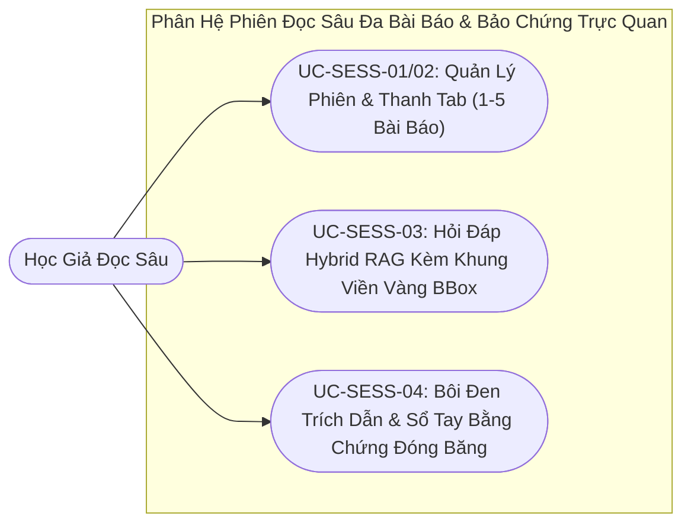

# VERISCHOLAR MVP — TÀI LIỆU YÊU CẦU SẢN PHẨM: PHIÊN ĐỌC SÂU ĐA BÀI BÁO, HỎI ĐÁP BẢO CHỨNG TRỰC QUAN & TIỆN ÍCH TRÍCH DẪN
# (PRODUCT REQUIREMENTS DOCUMENT: DEEP READING SESSIONS, MULTI-TAB WORKSPACE & VISUAL GROUNDING RAG)

**Mã phân hệ:** `PRD-03`  
**Phiên bản:** `2.0-OFFICIAL`  
**Vai trò phụ trách:** Chuyên viên Phân tích Nghiệp vụ (Lead Business Analyst — BA)  
**Tài liệu Kỹ thuật liên đới:** [`03-sessions-and-deep-reading-spec.md`](../specs/03-sessions-and-deep-reading-spec.md)  
**File nền tảng liên đới:** [`00-overview-and-cleanup.md`](./00-overview-and-cleanup.md)  
**Trạng thái:** CHÍNH THỨC BAN HÀNH (RELEASE CANDIDATE)

---

## 1. Tầm Nhìn & Nỗi Đau Nghiệp Vụ (Vision & Pain Points)

### 1.1. Tầm nhìn phân hệ
Cung cấp một không gian làm việc trung tâm chuyên sâu, mô phỏng bàn làm việc thực thụ của một nhà khoa học: **Bên trái là Trình đọc PDF bài báo gốc**, **Bên phải là Trợ lý AI Sư phạm đàm thoại Tiếng Việt**. Mọi kết luận, số liệu và luận điểm của AI đều gắn liền với bằng chứng trực quan trên trang giấy, cho phép học giả kiểm chứng ngay lập tức chỉ với 1 thao tác bấm.

### 1.2. Nỗi đau thực tế của học giả (Có Định Lượng Thực Nghiệm)
1. **Nỗi sợ AI "ảo giác" số liệu bảng biểu & Thời gian kiểm chứng thủ công (Empirical Hallucination & Verification Tax):** Khi nghiên cứu sinh đọc các bài báo hội nghị (NeurIPS, ACL, CVPR) có bố cục 2 cột dày đặc và nhiều bảng kết quả thực nghiệm (Ablation Studies), các công cụ trò chuyện AI thông thường có tỷ lệ **tự bịa đặt số liệu hoặc ghép nhầm dòng dữ liệu lên tới 30% – 40%**. Để kiểm chứng một câu trả lời của AI, học giả mất trung bình **8 – 12 phút** căng mắt dò tìm lại từng đoạn văn trên trang PDF tiếng Anh, làm triệt tiêu lợi ích tiết kiệm thời gian của AI.
2. **Đứt gãy nhận thức khi đối chiếu đa bài báo (Multi-Paper Comparison Overload):** Một nghiên cứu khoa học luôn đòi hỏi đối chiếu đồng thời từ 2 đến 5 bài báo (ví dụ: so sánh hàm mất mát của bài báo gốc với 3 bài báo cải tiến). Việc phải mở 4 – 5 cửa sổ trình đọc PDF rời rạc và tự sao chép từng đoạn sang cửa sổ chat khiến **hơn 35% thông tin ngữ cảnh bị thất thoát**, đồng thời AI không thể tự động đối chiếu chéo giữa các tài liệu đang mở.
3. **Mất dấu vị trí đọc & Đứt gãy trích dẫn khi dọn dẹp tài liệu (State Loss & Broken Citation Links):** Khi đóng trình duyệt hoặc chuyển đổi giữa các đề tài, người đọc phải tự nhớ mình đang đọc đến trang mấy, mức thu phóng bao nhiêu. Nghiêm trọng hơn, trong các công cụ ghi chú truyền thống, khi học giả xóa một tệp PDF bản nháp để giải phóng bộ nhớ, toàn bộ các ghi chú trích dẫn đã kỳ công ghi chép từ bài báo đó bị mất liên kết hoặc biến mất hoàn toàn.

### 1.3. Bảng Đối Chiếu Giá Trị Trước & Sau Khi Áp Dụng Phiên Đọc Sâu (Before vs. After Value Matrix)

| Tiêu chí Nghiệp vụ Đọc sâu | Đọc trên Trình đọc PDF thường + ChatGPT rời rạc | Không gian Đọc sâu Đa bài báo VeriScholar |
| :--- | :--- | :--- |
| **Kiểm chứng số liệu thực nghiệm** | Tự đọc dò bằng mắt thường trên trang PDF 2 cột (mất 8 – 12 phút/lần). | Bấm huy hiệu **`[📄 Tên bài • Trang X]`** $\rightarrow$ Tự cuộn trang và vẽ **Khung viền vàng** trong **< 1 giây**. |
| **So sánh phương pháp 3 – 5 bài báo** | Mở 5 cửa sổ riêng lẻ, tự copy-paste từng đoạn văn sang khung chat. | Quản lý tập trung trên **Thanh Tab (1 – 5 bài)**; AI tự động truy xuất và đối chiếu chéo toàn bộ các tab đang mở. |
| **Ghi chép khi bắt gặp ý hay** | Copy sang phần mềm thứ 3 (Word/Notion), tự gõ lại tên bài và số trang. | Bôi đen văn bản $\rightarrow$ Bấm **`[📝 Vào sổ tay]`** lưu tức thì kèm số trang và bản chụp chứng cứ. |
| **Xóa file PDF gốc sau khi đọc xong** | Mất trắng hoặc lỗi liên kết toàn bộ các đoạn trích dẫn đã lưu. | Cơ chế **Bản chụp Chứng cứ Đóng băng** giữ nguyên vẹn đoạn trích và số trang trong sổ tay vĩnh viễn. |

---

## 2. Chân Dung Tác Nhân (Actors & Personas)

* **Học giả đọc sâu (Deep Reader):** Cần đọc kỹ từng trang tài liệu, phóng to công thức toán học, tra cứu mục lục và hỏi đáp chi tiết về các đoạn khó hiểu.
* **Học giả đối chiếu (Comparative Scholar):** Mở đồng thời 2 đến 5 bài báo trong cùng một phiên để so sánh kiến trúc mô hình, kết quả đo lường và hạn chế của từng phương pháp.



---

## 3. Đặc Tả Chi Tiết Các Use Cases Nghiệp Vụ (Detailed Use Cases)

### UC-SESS-01: Quản Lý Phiên Đọc Nghiên Cứu (Session Lifecycle)
* **Tác nhân:** Học giả.
* **Điều kiện tiên quyết:** Đã đăng nhập vào hệ thống.
* **Sự kiện kích hoạt:** Bấm nút "Phiên nghiên cứu mới" trên thanh điều hướng hoặc mở đọc một bài báo từ trang Khám phá.
* **Luồng chuẩn (Happy Path):**
  1. Hệ thống khởi tạo một Phiên đọc sâu mới với tiêu đề mặc định (ví dụ: *"Phiên nghiên cứu #1"* hoặc lấy theo tên bài báo đầu tiên).
  2. Người dùng có thể:
     - Đổi tên phiên đọc để dễ ghi nhớ (ví dụ: *"Đọc sâu cơ chế Attention 2026"*).
     - Lưu trữ (Archive) các phiên đã hoàn thành để làm gọn danh sách làm việc.
     - Khôi phục phiên đã lưu trữ bất kỳ lúc nào để tiếp tục nghiên cứu.
     - Xóa vĩnh viễn phiên đọc khi không còn nhu cầu.
  3. Khi xóa phiên đọc, hệ thống chỉ xóa lịch sử hỏi đáp và các ghi chú thuộc phiên đó; các bài báo gốc trong Kho tài liệu của người dùng vẫn được bảo toàn nguyên vẹn.
* **Kết quả đầu ra (Post-conditions):**
  * Phiên đọc mới hoặc trạng thái cập nhật của phiên đọc được lưu trữ bền vững; danh sách bài báo gốc trong kho tài liệu chung không bị ảnh hưởng khi xóa phiên.
* **Luồng ngoại lệ:**
  * *1a. Khởi tạo phiên đọc khi chưa chọn bài báo nào:* Hệ thống vẫn cho phép mở không gian phiên đọc trống và hiển thị nút gợi ý chọn bài báo từ Kho tài liệu hoặc tìm kiếm bài mới ngay giữa màn hình.

---

### UC-SESS-02: Đối Chiếu Đa Bài Báo Qua Thanh Tab (Multi-Tab Workspace, Tối Đa 5 Bài)
* **Tác nhân:** Học giả đối chiếu.
* **Điều kiện tiên quyết:** Đang trong một Phiên đọc sâu.
* **Sự kiện kích hoạt:** Bấm nút `[➕ Thêm bài báo]` trên thanh tab hoặc bấm `[➕ Thêm vào phiên này]` từ Bảng Tham khảo.
* **Luồng chuẩn (Happy Path):**
  1. Người dùng chọn thêm một bài báo từ Kho tài liệu của mình vào phiên đọc hiện tại.
  2. Thanh Tab hiển thị thêm bài báo mới (Tab 2, Tab 3...).
  3. Bấm vào bất kỳ Tab nào, khung đọc PDF bên trái tự động chuyển mượt mà sang hiển thị bài báo đó.
  4. Trợ lý AI bên phải tự động cập nhật ngữ cảnh: câu hỏi của người dùng có thể yêu cầu AI đối chiếu đồng thời thông tin giữa các bài báo đang mở trong các tab.
  5. Người dùng có thể bấm nút `[✕]` trên từng tab để gỡ bớt bài báo ra khỏi phiên khi đã tham khảo xong.
* **Kết quả đầu ra (Post-conditions):**
  * Danh sách các bài báo đang mở trong phiên (từ 1 đến 5 bài) được đồng bộ tức thì với bộ nhớ ngữ cảnh của Trợ lý AI.
* **Luồng ngoại lệ:**
  * *2a. Đã mở đủ 5/5 bài báo:* Hệ thống chặn thêm mới và hiển thị hộp thoại chọn nhanh: *"Phiên đọc chỉ hỗ trợ tối đa 5 bài báo cùng lúc để bảo đảm độ chính xác cao nhất cho Trợ lý AI. Vui lòng chọn đóng bớt 1 bài báo dưới đây để mở bài mới."*
  * *2b. Đóng bài báo đang hiển thị hiện hành:* Khi học giả bấm `[✕]` trên tab đang mở, hệ thống tự động chuyển khung đọc sang tab bài báo liền kề mà không làm gián đoạn cuộc trò chuyện.

---

### UC-SESS-03: Tương Tác Trên Khung Đọc PDF Gốc & Thanh Công Cụ Nổi
* **Tác nhân:** Học giả đọc sâu.
* **Điều kiện tiên quyết:** Bài báo đã được tải đầy đủ trên khung đọc PDF bên trái.
* **Sự kiện kích hoạt:** Thao tác cuộn trang, phóng to hoặc dùng chuột bôi đen văn bản trên PDF.
* **Luồng chuẩn (Happy Path):**
  1. **Công cụ đọc chuyên nghiệp:** Học giả có thể phóng to / thu nhỏ (`50%` đến `300%`), vừa khít chiều ngang trang, nhảy nhanh đến số trang bất kỳ, và mở Bảng Mục lục bài báo để bấm nhảy đến từng phần (`Introduction`, `Methodology`...).
  2. **Thanh công cụ bôi đen nổi (Scholar Selection Menu):** Khi người dùng dùng chuột bôi đen bất kỳ đoạn văn hoặc công thức toán nào trên trang PDF, một thanh công cụ nổi tinh gọn hiện ra ngay phía trên vùng chọn với 3 nút tác vụ:
     - **`[💬 Đưa vào Chat]`**: Tự động đưa đoạn văn vừa bôi đen (kèm số trang) sang ô nhập chat bên phải để yêu cầu AI dịch sang Tiếng Việt hoặc giải thích chi tiết.
     - **`[📝 Vào sổ tay]`**: Mở hộp thoại lưu nhanh đoạn trích đó (kèm tọa độ khung viền và số trang) vào tiện ích Sổ tay trích dẫn cá nhân.
     - **`[📋 Trích dẫn]`**: Sao chép đoạn văn kèm trích dẫn chuẩn học thuật `[Tên bài báo • Trang X]` vào bộ nhớ tạm.
* **Kết quả đầu ra (Post-conditions):**
  * Đoạn văn bản hoặc công thức được học giả bôi đen được định vị chính xác kèm số trang và tọa độ hình học, sẵn sàng chuyển sang khung hỏi đáp hoặc sổ tay.
* **Luồng ngoại lệ:**
  * *3a. Bôi đen qua ranh giới bố cục 2 cột hoặc công thức toán phức tạp:* Nếu vùng bôi đen chứa các ký hiệu toán học bị lỗi mã hóa phông chữ trên PDF gốc, khi đưa vào khung Chat, Trợ lý AI tự động đối chiếu với ngữ cảnh trang đó để khôi phục lại biểu thức toán học chuẩn xác trước khi giải thích.
  * *3b. Bài báo chỉ có bản Tóm tắt (Thu phí bản quyền):* Khung đọc bên trái tự động hiển thị giao diện **Thẻ Tóm Tắt Học Thuật** rõ ràng kèm nút cho phép người dùng tự tải lên tệp PDF cá nhân nếu có.

---

### UC-SESS-04: Hỏi Đáp Học Sâu Tiếng Việt & Bảo Chứng Khung Viền Vàng (Visual Grounding)
* **Tác nhân:** Học giả đọc sâu.
* **Điều kiện tiên quyết:** Đang trong phiên đọc, có ít nhất 1 bài báo đang mở.
* **Sự kiện kích hoạt:** Nhập câu hỏi vào ô Chat AI bên phải và bấm Gửi (hoặc nhấn Enter).
* **Luồng chuẩn (Happy Path):**
  1. Học giả đặt câu hỏi bằng Tiếng Việt (ví dụ: *"Tác giả đề xuất hàm mất mát Loss Function như thế nào và kết quả BLEU score đạt bao nhiêu?"*).
  2. Trợ lý AI phản hồi trực tiếp bằng Tiếng Việt với văn phong sư phạm mạch lạc; các công thức toán được hiển thị chuẩn LaTeX sắc nét.
  3. **Huy hiệu Dẫn chứng Bấm-Để-Kiểm-Chứng:** Ở cuối mỗi kết luận, công thức hoặc số liệu thực nghiệm, AI đều gắn huy hiệu dẫn chứng dạng **`[📄 Tên bài • Trang X]`**.
  4. **Kiểm chứng trong 1 giây (Visual Grounding):** Khi người dùng bấm vào huy hiệu dẫn chứng:
     - Khung đọc PDF bên trái tự động chuyển sang đúng Tab bài báo đó (nếu đang ở tab khác).
     - Cuộn mượt mà đến đúng Trang X.
     - Tự động vẽ một **Khung viền màu vàng (`Bounding Box`)** bao quanh chính xác đoạn văn hoặc bảng biểu gốc trên trang PDF để người dùng đối chiếu bằng mắt thường ngay lập tức.
  5. Người dùng có thể bấm nút `[⏹️ Dừng trả lời]` nếu muốn ngắt câu trả lời giữa chừng, hoặc bấm `[🔄 Làm mới đoạn chat]` để xóa lịch sử hỏi đáp của phiên và bắt đầu chuỗi câu hỏi mới.
* **Kết quả đầu ra (Post-conditions):**
  * Câu trả lời Tiếng Việt kèm các huy hiệu bảo chứng và tọa độ Khung viền vàng được lưu vào lịch sử phiên đọc; học giả kiểm chứng được tận mắt vị trí số liệu gốc trên trang PDF.
* **Luồng ngoại lệ:**
  * *4a. Câu hỏi về số liệu hoặc thông tin không tồn tại trong các bài báo đang mở (Zero-Hallucination Refusal):* Trợ lý AI bắt buộc từ chối suy đoán và trả lời rõ: *"Thông tin hoặc số liệu bạn hỏi hiện không được đề cập trong các bài báo đang mở trong phiên đọc này."* Tuyệt đối không tự lấy số liệu từ trí nhớ bên ngoài mà không có dẫn chứng trong bài.
  * *4b. Hỏi đáp khi bài báo mới thêm vẫn đang bóc tách toàn văn ngầm:* Hệ thống vẫn trả lời ngay dựa trên phần Tóm tắt (Abstract) của bài báo đó và hiển thị dòng chú thích minh bạch: *"Bài báo [Tên bài] đang được hoàn tất phân tích toàn văn ngầm; câu trả lời hiện tại dựa trên phần Tóm tắt."*

---

### UC-SESS-05: Tiện Ích Ghim Trích Dẫn Vào Sổ Tay Nghiên Cứu Nhúng
* **Tác nhân:** Học giả muốn lưu lại các luận điểm đắt giá để chuẩn bị viết bài báo sau này.
* **Điều kiện tiên quyết:** Đang trong phiên đọc.
* **Sự kiện kích hoạt:** Bấm nút `[📝 Vào sổ tay]` từ menu bôi đen hoặc mở tab "Sổ tay trích dẫn" ở ngăn phụ bên phải.
* **Luồng chuẩn (Happy Path):**
  1. Người dùng nhập tiêu đề ghi chú, cảm nghĩ cá nhân và gắn nhãn phân loại (ví dụ: `#RelatedWork`, `#Dataset`, `#Baseline`).
  2. Hệ thống lưu đoạn trích kèm ảnh chụp chứng cứ đóng băng và tọa độ hình học trên trang PDF.
  3. Danh sách các ghi chú được sắp xếp gọn gàng theo bài báo; bấm vào bất kỳ ghi chú nào, trang PDF tự động cuộn về đúng vị trí đã lưu.
  4. Các ghi chú này sẽ tự động trở thành nguồn tư liệu đầu vào khi người dùng chuyển sang Phân hệ Soạn thảo LaTeX (`PRD-06`).
* **Kết quả đầu ra (Post-conditions):**
  * Ghi chú học thuật được lưu trữ bền vững trong phiên đọc kèm tọa độ trích dẫn và bản chụp văn bản gốc.
* **Luồng ngoại lệ:**
  * *5a. Bài báo gốc bị xóa khỏi Kho tài liệu sau khi đã ghi chú (Detached Citation Snapshot Preservation):* Nếu sau này học giả xóa tệp PDF của bài báo đó khỏi hệ thống, ghi chú trong sổ tay **vẫn được bảo toàn nguyên vẹn** kèm nguyên văn đoạn trích, tên bài báo và số trang nhờ cơ chế Bản chụp Chứng cứ Đóng băng (chỉ hiển thị nhãn *"Tài liệu gốc đã được gỡ khỏi kho"* khi bấm vào).

---

### UC-SESS-06: Tự Động Ghi Nhớ Trạng Thái Khung Đọc (Viewport State Memory)
* **Tác nhân:** Hệ thống.
* **Điều kiện tiên quyết:** Học giả đang thao tác đọc bài báo.
* **Sự kiện kích hoạt:** Học giả cuộn trang, đổi mức zoom hoặc chuyển tab bài báo.
* **Luồng chuẩn (Happy Path):**
  1. Hệ thống tự động ghi nhớ vị trí bài báo đang xem, số trang hiện tại và tỷ lệ thu phóng.
  2. Khi học giả chuyển sang làm việc ở mục khác hoặc đóng trình duyệt và mở lại phiên đọc, màn hình hiển thị lại chính xác vị trí bài báo và số trang đang đọc dở dang mà không cần thao tác tìm lại.
* **Kết quả đầu ra (Post-conditions):**
  * Trạng thái khung nhìn (tài liệu đang chọn, số trang, độ thu phóng, vị trí cuộn) được khôi phục chính xác 100% ở lần truy cập tiếp theo.
* **Luồng ngoại lệ:**
  * *6a. Bài báo đang xem ở lần trước đã bị gỡ khỏi phiên:* Khi mở lại phiên đọc, hệ thống tự động chọn hiển thị bài báo đầu tiên còn lại trong thanh Tab tại trang 1.

---

## 4. Tiêu Chí Nghiệm Thu Hành Vi (Gherkin Acceptance Criteria)

```gherkin
@session @multitab
Feature: Quản lý tối đa 5 bài báo trong một phiên đọc
  Scenario: Thêm bài báo thành công khi phiên chưa đầy
    Given phiên đọc đang mở 3 bài báo
    When học giả bấm thêm bài báo "BERT_Paper.pdf" vào phiên
    Then thanh Tab hiển thị thêm bài báo thứ 4
    And học giả có thể bấm chuyển đổi giữa 4 bài báo mượt mà

  Scenario: Chặn thêm bài báo thứ 6
    Given phiên đọc đang mở đủ 5 bài báo
    When học giả cố gắng thêm bài báo thứ 6 vào phiên
    Then hệ thống từ chối và hiển thị thông báo "Phiên đọc chỉ hỗ trợ tối đa 5 bài báo cùng lúc"

@session @visual_grounding
Feature: Bấm huy hiệu dẫn chứng kiểm chứng Khung viền vàng
  Scenario: Nhảy trang và vẽ khung viền vàng chính xác
    Given Trợ lý AI trả lời có chứa huy hiệu "[📄 Attention • Trang 4]"
    When học giả bấm chuột vào huy hiệu dẫn chứng này
    Then khung đọc PDF bên trái tự động chuyển sang tab "Attention"
    And cuộn trang tới đúng Trang 4
    And vẽ khung viền màu vàng bao quanh đúng đoạn văn chứa số liệu gốc

@session @notes
Feature: Ghim trích dẫn nhúng vào sổ tay
  Scenario: Lưu trích dẫn kèm tọa độ Bounding Box
    Given học giả dùng chuột bôi đen đoạn văn công thức toán trên Trang 3
    When bấm nút "[📝 Vào sổ tay]" trên thanh công cụ nổi
    And nhập ghi chú "Công thức suy hao cần đưa vào phần Phương pháp"
    Then ghi chú được lưu vào ngăn Sổ tay cá nhân kèm số trang và tọa độ Bounding Box
```

---

## 5. Quy Tắc Nghiệp Vụ Bất Biến (Business Rules & Invariants)

1. **Giới Hạn Ngữ Cảnh 5 Bài Báo:** Mỗi phiên đọc chỉ cho phép tối đa 5 bài báo mở đồng thời để bảo đảm giới hạn ngữ cảnh của mô hình ngôn ngữ và tránh hiện tượng pha loãng sự chú ý.
2. **Khung Đọc Luôn Giữ Bản Gốc:** Khung đọc bên trái luôn là bản gốc PDF tiếng Anh để bảo đảm tính chuẩn xác của tài liệu khoa học; không tự ý dịch đè lên văn bản gốc trên canvas.
3. **Bảo Chứng 100% Cho Số Liệu:** Mọi câu trả lời của AI có chứa số liệu thực nghiệm hoặc kết quả định lượng bắt buộc phải gắn huy hiệu dẫn chứng có thể bấm để kích hoạt khung viền vàng.
4. **Cô Lập Phiên Độc Lập:** Xóa một phiên đọc chỉ xóa lịch sử trao đổi trong phiên đó, tuyệt đối không làm mất các file PDF trong kho tài liệu chung của học giả.
