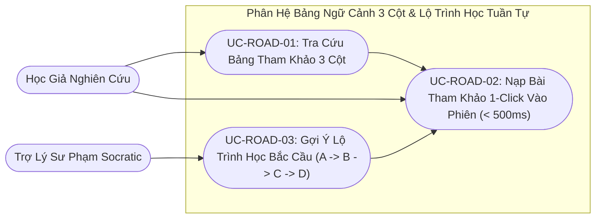

# VERISCHOLAR MVP — TÀI LIỆU YÊU CẦU SẢN PHẨM: BẢNG QUẢN LÝ NGỮ CẢNH 3 CỘT & LỘ TRÌNH HỌC TUẦN TỰ
# (PRODUCT REQUIREMENTS DOCUMENT: 3-COLUMN CONTEXT TABLE & SEQUENTIAL LEARNING ROADMAP)

**Mã phân hệ:** `PRD-04`  
**Phiên bản:** `2.0-OFFICIAL`  
**Vai trò phụ trách:** Chuyên viên Phân tích Nghiệp vụ (Lead Business Analyst — BA)  
**Tài liệu Kỹ thuật liên đới:** [`04-context-table-and-roadmap-spec.md`](../specs/04-context-table-and-roadmap-spec.md)  
**File nền tảng liên đới:** [`00-overview-and-cleanup.md`](./00-overview-and-cleanup.md)  
**Trạng thái:** CHÍNH THỨC BAN HÀNH (RELEASE CANDIDATE)

---

## 1. Tầm Nhìn Nghiệp Vụ & Nỗi Đau Người Dùng (Business Context & Pain Points)

Trong hoạt động nghiên cứu học thuật, việc đọc một bài báo khoa học đỉnh cao không bao giờ là một hoạt động đơn lẻ khép kín:
- **Nỗi đau 1 — Đứt gãy mạch tư duy khi tra cứu tài liệu tham khảo (15 – 23 phút khôi phục sự tập trung):** Một bài báo nghiên cứu thường chứa từ 30 đến 70 tài liệu tham khảo ở mục cuối. Khi gặp một trích dẫn quan trọng ở giữa bài (ví dụ `[14]`), người đọc phải cuộn xuống tận cuối tài liệu, sao chép tên bài báo, mở tab trình duyệt mới để tìm kiếm, vượt qua các trang web lộn xộn để tìm bản PDF, rồi tải về và mở riêng. Quá trình thủ công này mất trung bình **3 – 5 phút thao tác cơ học** cho mỗi bài tham khảo và làm tiêu tốn **15 – 23 phút** để não bộ khôi phục lại trạng thái tập trung sâu (Deep Flow) ban đầu.
- **Nỗi đau 2 — Hiện tượng "học nhảy cóc" và ngợp kiến thức toán học ($Bậc\ 1 \to 4$):** Khảo sát đào tạo sau đại học cho thấy **hơn 55% sinh viên và nghiên cứu sinh mới bỏ cuộc giữa chừng** khi đọc các bài báo ở trình độ cao (ví dụ: bài báo kinh điển 2017 *Attention Is All You Need* thực chất nằm ở **Bậc 4 - Trình độ Đại học**). Tác giả chỉ nhắc lướt qua các công thức kế thừa từ Bậc 1 (Bag-of-Words), Bậc 2 (RNN/Vanishing Gradient), Bậc 3 (Seq2Seq + Attention sơ khai). Khi người đọc hỏi các công cụ AI thông thường, AI giải thích thẳng vào ngọn ($D$) mà thiếu lộ trình cội nguồn, đồng thời thiếu **trực giác toán học (Mathematical Intuition)** khiến người học ngợp và từ bỏ.
- **Nỗi đau 3 — Hố sâu giữa toán học và lập trình (Theory-to-Code Gap):** 90% sinh viên hiểu công thức toán trên giấy nhưng khi mở IDE lên viết PyTorch thì bế tắc hoàn toàn vì không biết kích thước Tensor thực tế ghép nối ra sao `[batch, heads, seq_len, dim]`.
- **Nỗi đau 4 — Loãng ngữ cảnh khi nạp tràn lan (Context Dilution & Accuracy Drop):** Nếu đưa bừa bãi toàn bộ 50 tài liệu tham khảo vào cuộc trò chuyện cùng lúc, độ chính xác khi trích xuất số liệu của AI bị **suy giảm tới 40%** do nhiễu chéo giữa các bài báo. Học giả cần quyền chủ động lựa chọn chính xác 1 – 5 bài báo trọng tâm nhất.

### 1.1. Bảng Đối Chiếu Giá Trị Trước & Sau Khi Áp Dụng Bảng Ngữ Cảnh & Lộ Trình Học (Before vs. After Value Matrix)

| Tiêu chí Nghiệp vụ Học thuật | Cách đọc tra cứu truyền thống | Bảng Ngữ Cảnh 3 Cột & Lộ Trình Socratic VeriScholar |
| :--- | :--- | :--- |
| **Tra cứu tài liệu tham khảo `[k]`** | Cuộn xuống cuối trang PDF $\rightarrow$ Copy tên $\rightarrow$ Mở Google Scholar tìm kiếm (mất 3 – 5 phút/bài). | Mở **Bảng Ngữ cảnh 3 Cột** xem ngay tiêu đề, tác giả, trạng thái PDF mở và đường dẫn gốc tại chỗ. |
| **Đưa bài tham khảo vào hỏi đáp** | Phải tải file PDF về máy tính rồi tự tạo phiên làm việc mới hoặc tải lên thủ công. | Bấm **1-Click `[➕ Thêm vào phiên]`** $\rightarrow$ Có mặt ngay trên thanh Tab và hỏi đáp được trong **< 500ms**. |
| **Tiếp cận bài báo kế thừa** | Tự mò mẫm đoán ý nghĩa ký hiệu hoặc nhảy cóc vào Bậc 4 mà chưa học Bậc 1, 2, 3. | AI phát **Thẻ Gợi Ý Lộ Trình Gợi Mở (Opt-in Scaffolding)** chỉ rõ các cột mốc cội nguồn cần học trước. |
| **Giải mã công thức toán học** | Đọc các chứng minh đại số khô khan, không hiểu bản chất hình học. | **Bóc tách Trực giác Toán học:** Giải nghĩa bản chất hình học và phân rã biến đầu vào vs trọng số. |
| **Chuyển từ Toán sang Code** | Hiểu công thức nhưng chịu chết không biết viết PyTorch thế nào. | **Math-to-Tensor Grounding:** Hiển thị trực quan kích thước Tensor và code PyTorch 5 dòng. |
| **Khắc sâu kiến thức lâu dài** | Đọc thụ động, ảo tưởng hiểu bài, 1 tuần sau quên sạch. | **Active Recall Probes:** AI chủ động đặt câu hỏi phản xạ chiều sâu để kiểm tra bản chất. |

VeriScholar giải quyết triệt để vấn đề này bằng hai cơ chế nghiệp vụ đột phá:
1. **Bảng Quản Lý Ngữ Cảnh 3 Cột (Smart 3-Column Reference Table):** Tự động bóc tách và phân loại toàn bộ tài liệu tham khảo, cho phép người dùng mở rộng ngữ cảnh phiên đọc chỉ với 1 cú nhấp chuột mà không rời mắt khỏi trang sách.
2. **Lộ Trình Học Tuần Tự Socratic ($A \rightarrow B \rightarrow C \rightarrow D$):** Trợ lý AI chủ động nhận diện khoảng trống kiến thức nền tảng và phát thẻ gợi ý học tuần tự, bắc cầu đưa người đọc quay về tài liệu gốc trước khi đi sâu vào ứng dụng phức tạp.

---

## 2. Các Tác Nhân Tham Gia (Actors)

| Tác nhân | Vai trò trong phân hệ | Trách nhiệm & Kỳ vọng |
| :--- | :--- | :--- |
| **Nhà Nghiên Cứu / Học Giả** | Người dùng chính đang đọc và nghiên cứu tài liệu | Tra cứu danh mục tham khảo tức thì, chọn nạp thêm bài báo liên quan vào phiên đọc, tiếp nhận gợi ý lộ trình học để đào sâu chuyên môn. |
| **Trợ Lý AI Socratic** | Trợ lý phân tích văn bản và định hướng sư phạm | Phân tích nội dung đang thảo luận, phát hiện các định lý/mô hình kế thừa từ tài liệu tham khảo, phát thẻ gợi ý bắc cầu lộ trình học. |
| **Hệ Thống Phân Giải Học Thuật** | Dịch vụ trung gian xác thực dữ liệu | Tự động đối chiếu mã định danh chuẩn (DOI / arXiv ID), xác định trạng thái truy cập mở (Open Access) hoặc tài liệu thu phí (Paywall). |



---

## 3. Danh Sách Use Cases Chi Tiết (Structured Use Cases)

### UC-ROAD-01: Tra cứu & Quản lý Tài liệu Tham khảo qua Bảng 3 Cột
- **Tác nhân:** Nhà Nghiên Cứu.
- **Tiền điều kiện:** Người dùng đang mở một tài liệu nghiên cứu trong phiên đọc sâu.
- **Sự kiện kích hoạt:** Người dùng nhấp vào nút `[📚 Danh mục Tham khảo]` trên thanh công cụ đọc bài.
- **Luồng sự kiện chính (Happy Path):**
  1. Hệ thống mở ngăn trượt hiển thị danh mục tài liệu tham khảo được bóc tách từ cuối bài báo theo định dạng 3 cột chuẩn hóa:
     - **Cột 1 (Thông tin bài báo):** Số thứ tự trích dẫn `[1]`, `[2]`, `[3]`, Tiêu đề bài báo, Danh sách tác giả, Năm xuất bản, Mã định danh học thuật chuẩn (`DOI` hoặc `arXiv ID`), và huy hiệu trạng thái truy cập (`🟢 Truy cập mở (PDF)` hoặc `🟡 Chỉ có Tóm tắt (Bản thu phí)`).
     - **Cột 2 (Nguồn gốc xuất bản):** Đường dẫn trực tiếp có thể bấm được mở sang trang web nhà xuất bản gốc trong tab mới.
     - **Cột 3 (Hành động ngữ cảnh):** Nút hành động tương tác trực tiếp với phiên nghiên cứu (`[➕ Thêm vào phiên]` hoặc `[🗑️ Gỡ khỏi phiên]`).
  2. Người dùng có thể sử dụng thanh tìm kiếm nhanh ở đầu bảng để lọc tài liệu theo tên tác giả, năm hoặc từ khóa tiêu đề.
  3. Bảng hiển thị rõ ràng những bài báo đã được nạp vào phiên nghiên cứu hiện tại giúp người dùng dễ dàng kiểm soát tài nguyên.
- **Kết quả đầu ra (Post-conditions):**
  - Toàn bộ danh mục tài liệu tham khảo cuối bài được hiển thị trực quan thành 3 cột kèm trạng thái sẵn sàng của tệp PDF và trạng thái hiện diện trong phiên đọc.
- **Luồng sự kiện ngoại lệ (Exception Flows):**
  - *Ngoại lệ 1a — Tài liệu tham khảo là sách chuyên khảo, trang web hoặc trình bày dị bản không có mã định danh chuẩn:* Hệ thống vẫn giữ nguyên văn bản trích dẫn gốc ở Cột 1, tạo đường dẫn tra cứu tiêu đề tự động ở Cột 2 và hiển thị nhãn *"Trích dẫn ngoài / Sách"* để học giả dễ dàng đối chiếu.
  - *Ngoại lệ 1b — Bài báo dạng bản thảo sơ khởi không có mục Tài liệu tham khảo:* Ngăn trượt hiển thị thông báo rõ ràng *"Không phát hiện danh mục tài liệu tham khảo chuẩn ở cuối bài báo này"* kèm nút gợi ý tìm kiếm bài báo liên quan theo chủ đề.

---

### UC-ROAD-02: Nạp Nhanh Bài Báo Tham Khảo Vào Phiên Nghiên Cứu (1-Click Fast Ingestion)
- **Tác nhân:** Nhà Nghiên Cứu.
- **Tiền điều kiện:** Ngăn trượt Bảng 3 Cột đang mở; bài báo tham khảo muốn thêm chưa có trong phiên; phiên chưa vượt quá giới hạn tối đa 5 bài báo.
- **Sự kiện kích hoạt:** Người dùng nhấp vào nút `[➕ Thêm vào phiên]` tại Cột 3 của một tài liệu tham khảo.
- **Luồng sự kiện chính (Happy Path):**
  1. **Tầng 1 — Khả dụng tức thì trong 500ms:** Hệ thống ghi nhận bài báo vào phiên nghiên cứu, cập nhật nút bấm sang trạng thái `[🗑️ Gỡ khỏi phiên]`, đồng thời mở thêm một Tab tài liệu mới trên thanh quản lý tài liệu. Bộ nhớ ngữ cảnh của trợ lý AI lập tức tiếp nhận thông tin Tóm tắt (Abstract) và các điểm cốt lõi của bài báo này. Người dùng có thể đặt câu hỏi so sánh ngay lập tức.
  2. **Tầng 2 — Bóc tách toàn văn ngầm (Background Processing):**
     - Nếu bài báo có bản PDF truy cập mở miễn phí: Hệ thống âm thầm tải toàn văn bài báo về máy chủ, bóc tách cấu trúc và tạo các chỉ mục định vị không gian.
     - Khi bóc tách toàn văn hoàn tất, Tab tài liệu chuyển sang trạng thái sẵn sàng đầy đủ, cho phép người dùng nhấp vào đọc toàn văn PDF và hiển thị khung viền minh chứng.
- **Kết quả đầu ra (Post-conditions):**
  - Bài báo tham khảo xuất hiện ngay trên thanh Tab của phiên đọc trong dưới 500ms và tự động nâng cấp lên bản toàn văn có Khung viền vàng sau khi tiến trình tải ngầm hoàn tất.
- **Luồng sự kiện ngoại lệ (Exception Flows):**
  - *Ngoại lệ 2a — Phiên nghiên cứu đã mở đủ 5 bài báo:* Hệ thống hiển thị hộp thoại cho phép người dùng chọn đóng nhanh một tab bài báo ít dùng trước khi nạp thêm (xem `UC-ROAD-04`).
  - *Ngoại lệ 2b — Đường dẫn PDF của nhà xuất bản bị đứt kết nối trong lúc tải ngầm (Tier-2 Download Fallback):* Nếu quá trình tải toàn văn ở Tầng 2 gặp sự cố từ phía máy chủ nhà xuất bản, hệ thống tự động giữ bài báo ở chế độ **Thẻ Tóm Tắt Học Thuật** ổn định và hiển thị thông báo nhẹ hướng dẫn người dùng thử tải lại hoặc tự tải tệp PDF cá nhân lên, tuyệt đối không làm văng phiên đọc.

---

### UC-ROAD-03: Gợi Ý Lộ Trình Phổ Hệ Tri Thức & Bóc Tách Trực Giác Toán (Socratic Scaffolding & Math Grounding)
- **Tác nhân:** Nhà Nghiên Cứu & Trợ Lý AI Socratic.
- **Tiền điều kiện:** Người dùng đang đối thoại với trợ lý AI về tài liệu hiện tại trong phiên đọc sâu.
- **Sự kiện kích hoạt:** Người dùng đặt câu hỏi về một công thức toán, thuật toán hoặc khái niệm phức tạp ($Bậc\ 4$) mà tài liệu hiện tại chỉ kế thừa từ các công trình tiền đề trước đó ($Bậc\ 1, 2, 3$).
- **Luồng sự kiện chính (Happy Path):**
  1. **Bóc tách Trực giác Toán học (Mathematical Intuition Explainer):**
     - Trợ lý AI giải thích trực quan bản chất hình học hoặc tương tự đời thực của công thức, chỉ rõ đâu là biến số dữ liệu đầu vào và đâu là trọng số tối ưu trước khi đi vào chứng minh đại số.
  2. **Cầu Nối Toán Sang Mã Nguồn (Math-to-Tensor Grounding):**
     - Đối với các công thức toán thực thi mô hình (ví dụ: Self-Attention), AI cung cấp nút xem **Kích thước Tensor thực tế** (ví dụ: `[batch_size, num_heads, seq_len, head_dim]`) và đoạn code PyTorch 5 dòng tối thiểu để người học ánh xạ ngay sang lập trình.
  3. **Thẻ Gợi Ý Lộ Trình Phổ Hệ Tri Thức Gợi Mở (Opt-in Scaffolding Card):**
     - AI không võ đoán hay phán xét trình độ người dùng. Ở cuối câu trả lời, AI hiển thị thẻ gợi ý mang tính đồng hành:
       > *"💡 Bài báo bạn đang đọc thuộc Bậc 4 (Kiến trúc Transformer). Nếu bạn là người mới chưa có kiến thức vững vàng thì hãy tham khảo lộ trình dưới đây để hiểu bản chất của paper hơn nha:*
       > - *Bậc 2 (Cột mốc RNN & Triệt tiêu đạo hàm): Bài báo Elman (1990).*
       > - *Bậc 3 (Cột mốc Attention sơ khai giải cứu RNN): Bài báo Bahdanau et al. (2014).*
       > 👉 `[➕ Nạp bài Bậc 3 vào phiên để tìm hiểu trước]`"
     - Thẻ chỉ đặt nút hành động `[➕ Nạp vào phiên]` ở bậc liền kề trực tiếp nhất để tránh làm ngợp người học.
  4. **Kiểm Tra Phản Xạ Hiểu Bài Chủ Động (Active Recall Probe):**
     - Sau khi người dùng đọc xong lời giải thích, AI chủ động đặt một câu hỏi phản xạ chiều sâu nghịch đảo (ví dụ: *"Nếu ta không chia ma trận cho căn bậc hai $\sqrt{d_k}$ thì hàm Softmax sẽ gặp hiện tượng gì?"*) để người học khắc sâu kiến thức vào não bộ, chống ảo tưởng hiểu bài.
- **Kết quả đầu ra (Post-conditions):**
  - Học giả nắm được bản chất trực giác của toán học, có cầu nối sang code PyTorch, nhận được thẻ gợi ý lộ trình cội nguồn văn minh, và được kích hoạt tư duy phản xạ chủ động.
- **Luồng sự kiện ngoại lệ (Exception Flows):**
  - *Ngoại lệ 3a — Người dùng là học giả Senior đã vững kiến thức:* Người dùng chỉ cần bấm nút `[✕ Bỏ qua gợi ý]` hoặc tiếp tục đọc, thẻ nằm gọn ở chân tin nhắn không làm gián đoạn mạch làm việc.
  - *Ngoại lệ 3b — Tài liệu nền tảng đã có sẵn trong phiên:* AI chỉ dẫn chiếu trực tiếp đến Tab tài liệu đã mở và số trang liên quan mà không hiển thị nút nạp thêm.

---

### UC-ROAD-04: Xử Lý Ngoại Lệ Bài Báo Thu Phí & Giới Hạn Phiên Nghiên Cứu
- **Tác nhân:** Nhà Nghiên Cứu.
- **Tiền điều kiện:** Người dùng thực hiện thao tác nạp tài liệu tham khảo.
- **Sự kiện kích hoạt:** Tài liệu thuộc diện thu phí hoặc phiên nghiên cứu đã đạt giới hạn dung lượng.
- **Luồng sự kiện chính (Happy Path & Fallback):**
  - **Tình huống A — Bài báo bị khóa thu phí (Paywall Fallback):**
    1. Khi người dùng nạp một tài liệu tham khảo không có bản PDF mở miễn phí, hệ thống thông báo minh bạch: *"Tài liệu này thuộc diện thu phí của nhà xuất bản. Hệ thống đã nạp bản Tóm tắt (Abstract) và các luận điểm chính vào phiên đối thoại."*
    2. Tab tài liệu mở ra ở chế độ Thẻ Tóm Tắt (Abstract Card View) kèm nút hành động: `[📤 Tự tải lên file PDF của bạn nếu có bản quyền cá nhân]`.
    3. Trợ lý AI cam kết tuân thủ quy tắc trung thực: chỉ giải thích dựa trên bản tóm tắt, từ chối bịa đặt các công thức chi tiết trong thân bài và khuyến khích người dùng tải file toàn văn lên nếu cần đào sâu.
  - **Tình huống B — Vượt giới hạn dung lượng phiên đọc (Session Limit Guard):**
    1. Khi phiên đã có đủ 5 bài báo mở đồng thời, thao tác nạp thêm bài thứ 6 sẽ kích hoạt hộp thoại cảnh báo: *"Phiên nghiên cứu đã đạt giới hạn tối đa 5 tài liệu đồng thời để đảm bảo hiệu năng xử lý và độ tập trung cao nhất. Vui lòng đóng bớt một tài liệu trước khi nạp thêm."*
    2. Hộp thoại liệt kê danh sách 5 bài báo hiện tại kèm nút `[Đóng bài này]` để người dùng chọn giải phóng không gian ngay lập tức.
- **Kết quả đầu ra (Post-conditions):**
  - Mọi trường hợp bài báo thu phí hoặc đầy giới hạn 5 tab đều có phương án xử lý trơn tru, trung thực học thuật và không làm đứt mạch đọc của học giả.

---

## 4. Tiêu Chí Nghiệm Thu Nghiệp Vụ (Acceptance Criteria - Gherkin)

### Kịch bản 1: Bóc tách và hiển thị danh mục tham khảo chuẩn hóa 3 cột
```gherkin
Given người dùng đang mở một tài liệu nghiên cứu có mục References ở cuối bài
When người dùng mở ngăn trượt danh mục tham khảo
Then hệ thống phải hiển thị danh sách các tài liệu tham khảo được chia làm 3 cột rõ ràng:
  And Cột 1 hiển thị số thứ tự, tên bài báo, tác giả, năm và mã định danh chuẩn DOI hoặc arXiv
  And Cột 2 hiển thị đường dẫn truy cập bài báo gốc
  And Cột 3 hiển thị nút trạng thái cho phép nạp bài hoặc gỡ bài khỏi phiên
  And mỗi tài liệu phải có nhãn trực quan phân biệt bài có sẵn PDF miễn phí hay chỉ có bản tóm tắt
```

### Kịch bản 2: Nạp nhanh tài liệu tham khảo vào phiên nghiên cứu trong 500ms
```gherkin
Given phiên nghiên cứu đang mở dưới 5 tài liệu
  And tài liệu tham khảo [3] có bản PDF mở miễn phí
When người dùng nhấp nút "[➕ Thêm vào phiên]" tại dòng tài liệu [3]
Then trong vòng dưới 500 mili-giây, hệ thống phải mở thêm một Tab tài liệu [3] trên thanh đọc
  And trợ lý AI lập tức có thể trả lời các câu hỏi về phần tóm tắt của tài liệu [3]
  And hệ thống âm thầm thực hiện tải và bóc tách toàn văn bản PDF ở chế độ chạy ngầm
  And sau khi hoàn tất tải ngầm, người dùng có thể nhấp vào xem toàn văn bài báo và sử dụng tính năng soi minh chứng
```

### Kịch bản 3: Gợi ý lộ trình phổ hệ tri thức & bóc tách trực giác toán
```gherkin
Given người dùng đang hỏi về một công thức phức tạp kế thừa từ bài báo tham khảo [14]
When trợ lý AI phân tích và phát hiện khoảng trống kiến thức nền tảng
Then câu trả lời của AI phải bóc tách bản chất trực giác toán học và kích thước Tensor PyTorch tương ứng
  And câu trả lời phải chứa Thẻ Gợi Ý Lộ Trình Phổ Hệ Tri Thức mang văn phong gợi mở (Opt-in)
  And thẻ phải giải thích nhẹ nhàng: "Nếu bạn là người mới... hãy tham khảo lộ trình dưới đây"
  And thẻ phải cung cấp nút bấm trực tiếp "[➕ Nạp bài [14] vào phiên để tìm hiểu trước]" tại bậc liền kề
  And AI chủ động đưa ra câu hỏi kiểm tra phản xạ hiểu bài (Active Recall Probe) để chống ảo tưởng năng lực
```

### Kịch bản 4: Chống bịa đặt nội dung khi bài báo bị thu phí bản quyền
```gherkin
Given tài liệu tham khảo được nạp chỉ có bản Tóm tắt vì bài gốc bị khóa thu phí
When người dùng đặt câu hỏi yêu cầu giải thích một bảng số liệu hoặc công thức chi tiết trong thân bài
Then trợ lý AI phải thông báo trung thực rằng hiện chỉ có bản tóm tắt của tài liệu này
  And AI tuyệt đối không được tự ý suy đoán hoặc bịa đặt số liệu chi tiết
  And giao diện hiển thị tùy chọn cho phép người dùng tự tải tệp PDF lên nếu họ sở hữu bản quyền cá nhân
```

---

## 5. Quy Tắc Nghiệp Vụ Bất Biến (Business Invariants)

1. **Nguyên Tắc Giới Hạn Dung Lượng Tập Trung (Focus Capacity Constraint):**
   - Mỗi phiên nghiên cứu chỉ cho phép mở đồng thời tối đa **5 tài liệu**.
   - Mục đích nhằm bảo toàn khả năng xử lý ngữ cảnh sắc bén của AI, ngăn ngừa nhiễu thông tin chéo và giữ vững sự tập trung của nhà nghiên cứu vào một cụm tài liệu trọng điểm.
2. **Nguyên Tắc Khả Dụng Hai Tầng (Two-Tier Availability Invariant):**
   - Phản hồi giao diện và khả năng hỏi đáp cấp tóm tắt phải hoàn tất trong thời gian dưới **500 mili-giây**.
   - Toàn văn tài liệu được tải và lập chỉ mục không đồng bộ mà không bao giờ chặn (block) mạch đọc hay thao tác của người dùng.
3. **Nguyên Tắc Trung Thực Học Thuật & Chống Ảo Giác (Academic Integrity Guardrail):**
   - Tuyệt đối cấm AI tự phóng tác hoặc tạo ra các công thức toán, số liệu thực nghiệm của những bài báo chưa có toàn văn PDF.
   - Khi thiếu tài liệu, hệ thống bắt buộc phải giải thích lý do minh bạch và hướng dẫn cách bổ sung tài liệu.
4. **Nguyên Tắc Bảo Toàn Tài Liệu Gốc Khi Gỡ Khỏi Phiên:**
   - Hành động `[🗑️ Gỡ khỏi phiên]` tại Cột 3 chỉ đơn thuần là gỡ bỏ bài báo ra khỏi không gian làm việc của phiên đọc hiện tại.
   - Hành động này tuyệt đối không xóa bài báo hay dữ liệu chỉ mục đã lưu trong thư viện của người dùng.
