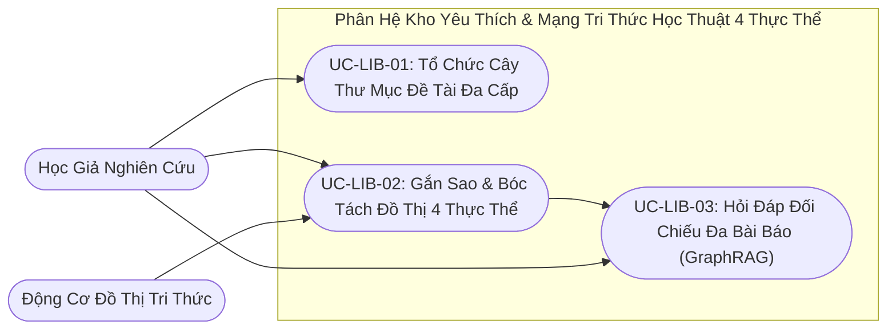

# VERISCHOLAR MVP — TÀI LIỆU YÊU CẦU SẢN PHẨM: KHO BÀI BÁO YÊU THÍCH & MẠNG TRI THỨC HỌC THUẬT 4 THỰC THỂ
# (PRODUCT REQUIREMENTS DOCUMENT: FAVORITE PAPERS LIBRARY & 4-ENTITY ACADEMIC KNOWLEDGE GRAPH)

**Mã phân hệ:** `PRD-05`  
**Phiên bản:** `2.0-OFFICIAL`  
**Vai trò phụ trách:** Chuyên viên Phân tích Nghiệp vụ (Lead Business Analyst — BA)  
**Tài liệu Kỹ thuật liên đới:** [`05-favorite-library-and-graphrag-spec.md`](../specs/05-favorite-library-and-graphrag-spec.md)  
**File nền tảng liên đới:** [`00-overview-and-cleanup.md`](./00-overview-and-cleanup.md)  
**Trạng thái:** CHÍNH THỨC BAN HÀNH (RELEASE CANDIDATE)

---

## 1. Tầm Nhìn Nghiệp Vụ & Nỗi Đau Người Dùng (Business Context & Pain Points)

### 1.1. Tầm nhìn phân hệ
Biến kho bài báo yêu thích của học giả từ một danh sách tệp tĩnh rời rạc thành một **Mạng Tri Thức Học Thuật 4 Thực Thể** sống động (`Bài báo`, `Phương pháp`, `Tập dữ liệu`, `Kết quả đo lường`), giúp người nghiên cứu phân loại đề tài theo cây thư mục và hỏi đáp đối chiếu thực nghiệm xuyên suốt hàng chục công trình chỉ bằng một câu truy vấn.

### 1.2. Nỗi đau thực tế của học giả (Có Định Lượng Nghiệp Vụ)
1. **Thư viện cá nhân biến thành "kho lưu trữ chết" (Knowledge Silos):** Sau vài tháng tải hàng chục bài báo về máy tính, hơn **70% học giả** không còn nhớ bài báo nào chứng minh định lý nào hoặc bài nào đạt độ chính xác cao nhất trên tập dữ liệu chuẩn, buộc phải mở đọc lại từ đầu.
2. **Đứt gãy liên kết phương pháp và tập dữ liệu giữa các công trình:** Các phần mềm quản lý trích dẫn truyền thống chỉ lưu bài báo như các tệp đơn lẻ, không thể hiện được mối quan hệ kế thừa (Bài báo A đề xuất mô hình gốc $\rightarrow$ Bài báo B cải tiến trên tập dữ liệu C).
3. **Mất 30 – 50 giờ tổng hợp bảng so sánh thực nghiệm khi viết bài và phản biện (SOTA Synthesis Burden):** Khi viết mục *Related Work / Experiments* hoặc trả lời chất vấn phản biện (Rebuttal) trong hạn 7 – 10 ngày, tác giả phải lật lại 20 – 30 bài báo để chép tay từng chỉ số đo lường (`BLEU`, `Top-1 Accuracy`, `F1`), vừa kiệt sức vừa dễ chép nhầm số liệu.
4. **Khó phát hiện sự chênh lệch số liệu thực nghiệm giữa các bài báo độc lập:** Khi nhiều bài báo cùng đánh giá một mô hình trên cùng một tập dữ liệu nhưng báo cáo kết quả khác nhau do thiết lập thử nghiệm khác nhau, học giả thiếu công cụ tự động gom nhóm và đặt cạnh nhau kèm số trang chứng cứ để đối chiếu khách quan.

### 1.3. Bảng Đối Chiếu Giá Trị Trước & Sau Khi Áp Dụng Kho Yêu Thích & Đồ Thị Tri Thức (Before vs. After Value Matrix)

| Tiêu chí Nghiệp vụ Học thuật | Lưu trữ Thư mục / Zotero Truyền thống | Kho Yêu Thích & Đồ Thị 4 Thực Thể VeriScholar |
| :--- | :--- | :--- |
| **Tổ chức tài liệu theo đề tài** | Lưu tệp rời rạc trên ổ cứng; xóa thư mục dễ làm mất tệp gốc. | **Cây thư mục đa tầng gắn màu**; xóa thư mục vẫn bảo toàn 100% bài báo gốc. |
| **Kết nối tri thức khi gắn sao** | Chỉ đánh dấu dấu trang tĩnh, không trích xuất nội dung bên trong. | Tự động bóc tách **4 Thực thể chuẩn** và gộp điểm nút phương pháp/dữ liệu trùng tên. |
| **Tổng hợp bảng so sánh SOTA** | Mở lại 20 – 30 tệp PDF để dò tìm từng bảng số liệu (mất 30 – 50 giờ). | Đặt 1 câu hỏi tự nhiên $\rightarrow$ Nhận ngay **Bảng đối chiếu số liệu kèm số trang** và sơ đồ nhánh. |
| **Kiểm soát phạm vi trích dẫn** | Không phân biệt được bài đã loại bỏ với bài đang dùng. | **Bỏ dấu sao (`Unstar`)** lập tức thu hồi bài báo khỏi phạm vi trả lời tổng hợp. |

---

## 2. Các Tác Nhân Tham Gia (Actors)

| Tác nhân | Vai trò trong phân hệ | Trách nhiệm & Kỳ vọng |
| :--- | :--- | :--- |
| **Nhà Nghiên Cứu / Học Giả** | Chủ sở hữu kho tri thức cá nhân | Đánh dấu yêu thích bài báo, tổ chức cây thư mục đề tài, tra cứu tổng hợp và so sánh thực nghiệm đa tài liệu. |
| **Động Cơ Tri Thức Đồ Thị** | Hệ thống tự động bóc tách và hợp nhất thực thể | Tự động trích xuất 4 loại thực thể học thuật khi bài báo được gắn sao, gộp các điểm nút chuẩn hóa trùng tên và liên kết cạnh quan hệ. |
| **Trợ Lý Soạn Thảo Tích Hợp** | Tác nhân liên thông sang không gian viết bài | Truy xuất mạng tri thức trong kho yêu thích để lấy số liệu thực nghiệm và dẫn chứng khi hỗ trợ viết bản thảo (`PRD-06`). |



---

## 3. Danh Sách Use Cases Chi Tiết (Structured Use Cases)

### UC-LIB-01: Quản Lý Cây Thư Mục Đề Tài & Phân Loại Bài Báo
- **Tác nhân:** Nhà Nghiên Cứu.
- **Điều kiện tiên quyết:** Người dùng đã đăng nhập và truy cập màn hình Kho Yêu Thích (`/library`).
- **Sự kiện kích hoạt:** Người dùng tạo mới, cập nhật hoặc xóa thư mục đề tài nghiên cứu.
- **Luồng chuẩn (Happy Path):**
  1. Người dùng nhấp nút `[➕ Thư mục mới]`, nhập Tên thư mục (1 – 100 ký tự), chọn Mã màu nhận diện và Thư mục cha (nếu phân cấp nhiều tầng).
  2. Hệ thống lưu thư mục và hiển thị ngay trên cây điều hướng bên trái.
  3. Người dùng gán các bài báo vào thư mục hoặc đổi tên, đổi màu, xóa thư mục khi kết thúc đề tài.
- **Kết quả đầu ra (Post-conditions):**
  - Cây thư mục cá nhân được cập nhật tức thì; các bài báo bên trong giữ nguyên toàn vẹn nội dung và lịch sử ghi chú.
- **Luồng ngoại lệ (Exception Flows):**
  - *1a. Xóa thư mục đang chứa bài báo:* Hệ thống chỉ xóa nhãn thư mục phân loại; toàn bộ bài báo bên trong được chuyển về danh mục gốc của người dùng mà không bị mất dữ liệu.
  - *1b. Trùng tên thư mục trong cùng cấp cha hoặc gán thư mục cha tạo vòng lặp:* Hệ thống chặn thao tác và hiển thị thông báo yêu cầu chọn tên hoặc thư mục cha hợp lệ.

---

### UC-LIB-02: Đánh Dấu Bài Báo Yêu Thích & Kích Hoạt Mạng Tri Thức
- **Tác nhân:** Nhà Nghiên Cứu.
- **Điều kiện tiên quyết:** Người dùng đang đọc một bài báo trong phiên nghiên cứu hoặc xem danh sách tài liệu.
- **Sự kiện kích hoạt:** Người dùng nhấp biểu tượng ngôi sao `[⭐ Yêu thích]`.
- **Luồng chuẩn (Happy Path):**
  1. Biểu tượng ngôi sao sáng vàng; bài báo được thêm ngay vào Kho Yêu Thích (kèm tùy chọn gán vào một Thư mục đề tài).
  2. Hệ thống tự động kích hoạt ngầm tiến trình quét bài báo để trích xuất các thực thể học thuật (`Phương pháp`, `Tập dữ liệu`, `Kết quả đo lường`) và kết nối vào mạng lưới tri thức cá nhân của người dùng.
- **Kết quả đầu ra (Post-conditions):**
  - Bài báo xuất hiện trong Kho Yêu Thích và các thực thể trích xuất từ bài báo được hợp nhất vào đồ thị tri thức cá nhân của học giả.
- **Luồng ngoại lệ (Exception Flows):**
  - *2a. Bỏ đánh dấu yêu thích (`Unstar`):* Khi người dùng nhấp tắt ngôi sao, hệ thống lập tức loại bài báo và các cạnh quan hệ riêng của bài đó khỏi phạm vi truy vấn đồ thị, nhưng vẫn bảo toàn các điểm nút phương pháp/dữ liệu trung tâm nếu còn bài báo khác liên kết tới.
  - *2b. Tiến trình trích xuất thực thể gặp sự cố hoặc bài báo lý thuyết thuần túy không có bảng thực nghiệm:* Bài báo vẫn được lưu giữ an toàn trong Kho Yêu Thích; hệ thống chỉ tạo các thực thể có trong bài và cho phép kích hoạt trích xuất lại khi cần.

---

### UC-LIB-03: Hợp Nhất Thực Thể Chuẩn Hóa Trên Đồ Thị 4 Thực Thể (Canonical Hub Merging)
- **Tác nhân:** Động Cơ Tri Thức Đồ Thị.
- **Điều kiện tiên quyết:** Bài báo đã được đánh dấu yêu thích.
- **Sự kiện kích hoạt:** Hệ thống hoàn tất bóc tách thực thể từ bài báo.
- **Luồng chuẩn (Happy Path):**
  1. Hệ thống chuẩn hóa dữ liệu vào đúng **4 Loại Thực Thể Cố Định**:
     - `Bài Báo (Paper)`: Tiêu đề, tác giả, năm, nơi công bố.
     - `Phương Pháp (Method)`: Thuật toán, mô hình, kiến trúc (ví dụ: *Transformer*, *ResNet-50*).
     - `Tập Dữ Liệu (Dataset)`: Bộ dữ liệu chuẩn (ví dụ: *ImageNet-1K*, *WMT-2014*).
     - `Kết Quả Đo Lường (MetricResult)`: Con số thực nghiệm kèm thước đo và số trang chứng cứ (ví dụ: *BLEU 28.4 • Trang 8*).
  2. Hệ thống thiết lập **4 Kiểu Quan Hệ Chuẩn**: `Đề Xuất (PROPOSES)`, `Đánh Giá Trên (EVALUATED_ON)`, `Đạt Được (ACHIEVES)` và `Trích Dẫn (CITES)`.
  3. **Hợp nhất điểm nút trung tâm (Canonical Hub):** Khi nhiều bài báo của cùng một học giả cùng nhắc tới một tên phương pháp hoặc tập dữ liệu chuẩn hóa (không phân biệt chữ hoa/thường và khoảng trắng thừa), hệ thống tự động gộp về một điểm nút trung tâm duy nhất và nối cạnh từ tất cả các bài báo đó tới nút trung tâm.
- **Kết quả đầu ra (Post-conditions):**
  - Đồ thị tri thức tạo thành mạng lưới liên thông đa bài báo, không sinh các nút phương pháp/tập dữ liệu trùng lặp và mọi con số đo lường đều gắn chặt với số trang nguồn.
- **Luồng ngoại lệ (Exception Flows):**
  - *3a. Nhiều bài báo công bố kết quả đo lường khác nhau trên cùng một tập dữ liệu:* Hệ thống giữ nguyên từng nút `Kết Quả Đo Lường` riêng biệt gắn với từng bài báo và số trang nguồn tương ứng (không ghi đè lên nhau) để học giả đối chiếu minh bạch.

---

### UC-LIB-04: Hỏi Đáp Tổng Hợp & Đối Chiếu Đa Tài Liệu Trong Kho
- **Tác nhân:** Nhà Nghiên Cứu.
- **Điều kiện tiên quyết:** Kho Yêu Thích có các bài báo đã được trích xuất đồ thị tri thức.
- **Sự kiện kích hoạt:** Người dùng nhập câu hỏi so sánh tổng hợp tại ô tra cứu Kho Yêu Thích.
- **Luồng chuẩn (Happy Path):**
  1. Người dùng nhập câu hỏi tự nhiên (ví dụ: *"Những bài báo nào trong kho của tôi đánh giá trên tập WMT-2014 và đạt điểm BLEU cao nhất?"*).
  2. Hệ thống tìm các điểm nút thực thể khớp ngữ nghĩa nhất rồi mở rộng 1 bước nhảy quan hệ sang các bài báo, phương pháp và kết quả đo lường liên đới.
  3. Hệ thống trả về bản tổng hợp đối chiếu kèm trích dẫn tên bài báo, số trang gốc và hiển thị sơ đồ mạng lưới trực quan (Subgraph) của các thực thể liên quan.
- **Kết quả đầu ra (Post-conditions):**
  - Học giả nhận được câu trả lời đối chiếu đa bài báo có dẫn chứng số trang và sơ đồ đồ thị con tương ứng.
- **Luồng ngoại lệ (Exception Flows):**
  - *4a. Không tìm thấy thực thể khớp trong kho yêu thích:* Hệ thống thông báo rõ trong kho hiện chưa có bài báo nào đề cập đến thực thể/tập dữ liệu được hỏi, tuyệt đối không tự bịa số liệu ngoài kho.

---

## 4. Tiêu Chí Nghiệm Thu Nghiệp Vụ (Acceptance Criteria - Gherkin)

```gherkin
@library @folders
Feature: Quản lý thư mục đề tài không làm mất tài liệu gốc
  Scenario: Xóa thư mục bảo toàn bài báo
    Given người dùng đang có một thư mục đề tài chứa 3 bài báo khoa học
    When người dùng thực hiện thao tác xóa thư mục này
    Then cấu trúc thư mục phân loại phải bị gỡ bỏ khỏi cây thư mục
    And cả 3 bài báo bên trong vẫn tồn tại nguyên vẹn trong kho tài liệu chung của người dùng

@library @graph_canonical
Feature: Bóc tách tự động và hợp nhất thực thể dùng chung
  Scenario: Hai bài báo cùng dùng phương pháp Transformer gộp chung 1 nút Hub
    Given trong kho đã có bài báo A đề xuất phương pháp "Transformer"
    When người dùng đánh dấu yêu thích thêm bài báo B cũng áp dụng phương pháp "Transformer"
    Then hệ thống nhận diện "Transformer" là điểm nút dùng chung duy nhất của người dùng
    And trên mạng tri thức, cả bài báo A và bài báo B đều liên kết đến cùng một điểm nút "Transformer"

@library @synthesis
Feature: Hỏi đáp tổng hợp thực nghiệm đa bài báo chính xác
  Scenario: So sánh điểm số thực nghiệm trên cùng tập dữ liệu
    Given kho yêu thích có 2 bài báo cùng thử nghiệm trên tập dữ liệu "WMT-2014"
    And bài báo A đạt điểm "BLEU: 28.4", bài báo B đạt điểm "BLEU: 27.5"
    When người dùng đặt câu hỏi: "Bài báo nào đạt điểm BLEU cao hơn trên tập WMT-2014?"
    Then câu trả lời khẳng định bài báo A đạt điểm cao hơn với điểm số 28.4 kèm số trang dẫn chứng
    And giao diện hiển thị sơ đồ kết nối trực quan giữa 2 bài báo và điểm số thực nghiệm

@library @unstar
Feature: Dọn dẹp sạch phạm vi tri thức khi người dùng bỏ yêu thích
  Scenario: Bỏ dấu sao thu hồi bài báo khỏi truy vấn tổng hợp
    Given một bài báo đang được đánh dấu yêu thích và có các nút thực thể trong mạng tri thức
    When người dùng nhấp bỏ dấu sao yêu thích (Unstar) bài báo đó
    Then bài báo đó lập tức bị loại khỏi phạm vi trả lời của các câu hỏi tra cứu tổng hợp
    And các thực thể phương pháp nền tảng dùng chung với bài báo khác vẫn được bảo toàn nguyên vẹn
```

---

## 5. Quy Tắc Nghiệp Vụ Bất Biến (Business Invariants)

1. **Nguyên Tắc 4 Thực Thể & 4 Quan Hệ Cố Định (Strict 4-Entity Schema):** Đồ thị tri thức chỉ sử dụng đúng 4 loại thực thể (`Paper`, `Method`, `Dataset`, `MetricResult`) và 4 kiểu quan hệ (`PROPOSES`, `EVALUATED_ON`, `ACHIEVES`, `CITES`); tuyệt đối không sinh nhãn tùy tiện.
2. **Nguyên Tắc Điểm Nút Trung Tâm Dùng Chung (Canonical Hub Merging):** Các thực thể `Method` hoặc `Dataset` trùng tên chuẩn hóa trong phạm vi một học giả bắt buộc được gộp về một nút trung tâm duy nhất và giữ tồn tại khi một bài báo đơn lẻ bị gỡ.
3. **Nguyên Tắc Cô Lập Đồ Thị Cá Nhân Tuyệt Đối (Strict Scholar Isolation):** Cây thư mục và đồ thị tri thức của học giả nào chỉ thuộc quyền truy xuất của học giả đó.
4. **Nguyên Tắc Minh Chứng Số Liệu Thực Nghiệm (Grounded Metric Evidence):** Mọi nút `MetricResult` bắt buộc gắn liền với bài báo nguồn và số trang nơi trích xuất con số đó.
