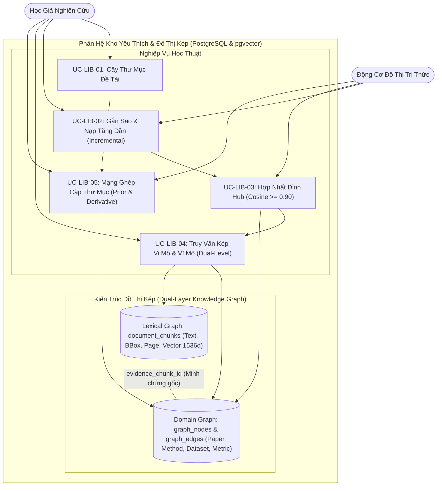

# VERISCHOLAR MVP — TÀI LIỆU YÊU CẦU SẢN PHẨM: KHO BÀI BÁO YÊU THÍCH & MẠNG TRI THỨC HỌC THUẬT 4 THỰC THỂ
# (PRODUCT REQUIREMENTS DOCUMENT: FAVORITE PAPERS LIBRARY & 4-ENTITY ACADEMIC KNOWLEDGE GRAPH)

**Mã phân hệ:** `PRD-05`  
**Phiên bản:** `2.0-OFFICIAL`  
**Vai trò phụ trách:** Chuyên viên Phân tích Nghiệp vụ (Lead Business Analyst — BA)  
**Tài liệu Kỹ thuật liên đới:** [`05-favorite-library-and-graphrag-spec.md`](../specs/05-favorite-library-and-graphrag-spec.md)  
**File nền tảng liên đới:** [`00-overview-and-cleanup.md`](./00-overview-and-cleanup.md)  
**Trạng thái:** CHÍNH THỨC BAN HÀNH (RELEASE CANDIDATE)

---

## 1. Tầm Nhìn Nghiệp Vụ & Nỗi Đau Người Dùng (Business Context & Pain Points)

### 1.1. Tầm nhìn phân hệ
Biến kho bài báo yêu thích của học giả từ danh sách tệp tĩnh thành **Mạng Tri Thức Học Thuật 4 Thực Thể** (`Bài báo`, `Phương pháp`, `Tập dữ liệu`, `Kết quả đo lường`) kết hợp cơ chế **Truy vấn Kép Vi mô & Vĩ mô (Dual-Level GraphRAG)** và **Bản đồ Thư mục học (Bibliometric Prior/Derivative Works)**, giúp tổ chức thư mục đề tài và tổng hợp số liệu thực nghiệm SOTA xuyên suốt nhiều công trình trong tích tắc.

### 1.2. Nỗi đau thực tế của học giả
1. **Kho lưu trữ chết và đứt gãy liên kết:** Hơn **70% học giả** không nhớ bài báo nào đề xuất thuật toán nào hoặc đạt kết quả cao nhất trên dữ liệu chuẩn, buộc phải mở đọc lại từng tệp PDF rời rạc.
2. **Mất 30 – 50 giờ tổng hợp bảng so sánh thực nghiệm (SOTA Burden):** Khi viết phần Related Work hoặc phản hồi phản biện (Rebuttal), tác giả phải lật lại 20 – 30 bài báo để chép tay từng con số đo lường (`BLEU`, `Accuracy`, `F1`), dễ nhầm lẫn ngữ cảnh thử nghiệm.
3. **Mất phương hướng khi tiếp cận đề tài mới:** Người nghiên cứu khó xác định đâu là các bài báo kinh điển cội nguồn (*Prior Works*) cần đọc trước, và đâu là các công trình phái sinh cải tiến mới nhất (*Derivative Works*).
4. **Hạn chế của GraphRAG thông thường:** Hệ thống hỏi đáp cục bộ chỉ trả lời được câu hỏi về một đỉnh đơn lẻ, thất bại khi học giả hỏi các câu bao quát vĩ mô (*"Các hướng tiếp cận chính và hạn chế của các bài báo trong đề tài này là gì?"*).

### 1.3. Bảng Đối Chiếu Giá Trị Trước & Sau Khi Áp Dụng (Before vs. After Value Matrix)

| Tiêu chí Nghiệp vụ | Lưu trữ Zotero / Thư mục rời | Mạng Tri Thức Học Thuật VeriScholar |
| :--- | :--- | :--- |
| **Tổ chức đề tài** | Tệp PDF tĩnh, dễ phân mảnh hoặc mất khi xóa thư mục. | **Cây thư mục gắn màu**, xóa thư mục bảo toàn 100% bài báo gốc. |
| **Nạp tri thức khi gắn sao** | Đánh dấu thủ công, không phân tích cấu trúc bên trong. | **Nạp tăng dần (< 3s)** bóc tách 4 thực thể và gộp điểm nút Hub ngữ nghĩa. |
| **Hỏi đáp thực nghiệm SOTA** | Mở 20 – 30 tệp PDF dò số liệu thủ công (30 – 50 giờ). | **Truy vấn Vi mô (Local Search)** trả về bảng đối chiếu kèm số trang và viền vàng. |
| **Hỏi đáp vĩ mô toàn đề tài** | Không hỗ trợ, AI thông thường bị loãng ngữ cảnh. | **Truy vấn Vĩ mô (Global Search)** tổng hợp toàn diện theo cụm đề tài thư mục. |
| **Bản đồ phát triển đề tài** | Tự tra cứu thủ công cây trích dẫn trên mạng. | **Bản đồ Thư mục học** tự phân loại Tác phẩm Cội nguồn và Tác phẩm Phái sinh. |

---

## 2. Các Tác Nhân & Luồng Nghiệp Vụ (Actors & Workflow)

| Tác nhân | Vai trò | Trách nhiệm & Kỳ vọng |
| :--- | :--- | :--- |
| **Nhà Nghiên Cứu** | Chủ sở hữu kho tri thức | Đánh dấu yêu thích, quản lý cây thư mục, tra cứu vi mô/vĩ mô và trực quan hóa bản đồ tri thức. |
| **Động Cơ Tri Thức Đồ Thị** | Động cơ phân tích ngầm | Bóc tách 4 thực thể tăng dần, hợp nhất Hub (Cosine $\ge 0.90$), tính toán ghép cặp thư mục học. |
| **Trợ Lý Soạn Thảo AI** | Cầu nối sang không gian viết | Khai thác đồ thị để trích dẫn số liệu SOTA và mã BibTeX tự động vào bản thảo (`PRD-06`). |



---

## 3. Danh Sách Use Cases Chi Tiết (Structured Use Cases)

### UC-LIB-01: Quản Lý Cây Thư Mục Đề Tài & Phân Loại Bài Báo
- **Tác nhân:** Nhà Nghiên Cứu.
- **Luồng chuẩn:** Tạo mới, sửa, gán màu, phân cấp cây thư mục đề tài (`/library`). Khi xóa thư mục, chỉ xóa nhãn phân loại, toàn bộ bài báo bên trong được bảo toàn nguyên vẹn trong danh mục gốc.
- **Quy tắc chặn vòng lặp:** Phát hiện và từ chối hành vi gán thư mục cha tạo vòng lặp lồng nhau ($A \rightarrow B \rightarrow A$).

### UC-LIB-02: Đánh Dấu Bài Báo Yêu Thích & Nạp Đồ Thị Tăng Dần (Incremental Indexing)
- **Tác nhân:** Nhà Nghiên Cứu, Động Cơ Tri Thức.
- **Luồng chuẩn:** Bấm `[⭐ Yêu thích]` $\rightarrow$ Ngôi sao sáng vàng trong $< 200$ms. Hệ thống kích hoạt xử lý nền bóc tách 4 thực thể độc lập cho riêng bài báo đó ($< 3$s), không phải tái lập chỉ mục toàn bộ thư viện.
- **Hành vi Unstar:** Khi bỏ sao, hệ thống thu hồi các cạnh của bài báo đó khỏi phạm vi truy vấn nhưng bảo toàn các đỉnh Hub dùng chung với bài báo khác.

### UC-LIB-03: Hợp Nhất Thực Thể Chuẩn Hóa & Khử Nhập Nhằng Ngữ Nghĩa (Canonical Hubs)
- **Tác nhân:** Động Cơ Tri Thức.
- **Luồng chuẩn:** Bóc tách dữ liệu vào đúng 4 thực thể (`Paper`, `Method`, `Dataset`, `MetricResult`) và 4 quan hệ (`PROPOSES`, `EVALUATED_ON`, `ACHIEVES`, `CITES`).
- **Khử nhập nhằng:** Nếu $\text{Cosine Similarity} \ge 0.90$ trên `pgvector`, tự động gộp về một điểm nút trung tâm duy nhất (Hub), chống nổ đỉnh phân mảnh ("ViT" vs "Vision Transformer").

### UC-LIB-04: Truy Vấn Kép Vi Mô & Vĩ Mô (Dual-Level GraphRAG Retrieval)
- **Tác nhân:** Nhà Nghiên Cứu.
- **Luồng chuẩn:** Ô tra cứu tự động định tuyến theo ý định câu hỏi:
  1. **Truy vấn Vi mô (Local Search):** HNSW Vector Anchor $\rightarrow$ 1-Hop CTE Traversal $\rightarrow$ Trả về ma trận SOTA đối chiếu số liệu thực nghiệm gắn với tọa độ viền vàng Bounding Box trên PDF gốc.
  2. **Truy vấn Vĩ mô (Global Search):** Tổng hợp chủ đề, phương pháp và hạn chế xuyên suốt toàn bộ một thư mục đề tài dựa trên bản tóm tắt cụm tri thức.

### UC-LIB-05: Mạng Ghép Cặp Thư Mục & Bản Đồ Cội Nguồn (Connected Papers Prior & Derivative)
- **Tác nhân:** Nhà Nghiên Cứu.
- **Luồng chuẩn:** Tự động tính toán Ghép cặp Thư mục (Bibliographic Coupling) giữa các bài báo có chung $\ge 3$ tài liệu tham khảo. Phân loại trực quan:
  - **Tác phẩm Cội nguồn (Prior Works):** Các bài báo kinh điển có số lượng liên kết tham chiếu cao nhất trong kho.
  - **Tác phẩm Phái sinh (Derivative Works):** Các công trình mới nhất mở rộng từ nền tảng trên.
- **Trực quan hóa:** Hiển thị sơ đồ Cytoscape với kích thước đỉnh theo độ ảnh hưởng (Degree Centrality), nhấp vào cạnh sẽ nhảy tới Bounding Box trang PDF tương ứng.

---

## 4. Tiêu Chí Nghiệm Thu Nghiệp Vụ (Acceptance Criteria - Gherkin)

```gherkin
@library @incremental
Feature: Nạp tăng dần và hợp nhất đỉnh Hub dùng chung
  Scenario: Hai bài báo cùng áp dụng Transformer gộp chung 1 nút Hub
    Given kho yêu thích đã có bài báo A đề xuất phương pháp "Transformer"
    When người dùng đánh dấu yêu thích thêm bài báo B cũng áp dụng "Transformer"
    Then hệ thống hoàn tất nạp tăng dần trong < 3 giây mà không chạy lại toàn bộ kho
    And cả bài báo A và B đều kết nối tới cùng một nút Hub trung tâm trên đồ thị

@library @dual_retrieval
Feature: Truy vấn kép vi mô và vĩ mô
  Scenario: Truy vấn vi mô trả về số liệu thực nghiệm kèm số trang
    Given kho yêu thích có 2 bài báo thử nghiệm trên tập dữ liệu "WMT-2014"
    When người dùng hỏi: "Bài báo nào đạt BLEU cao hơn trên tập WMT-2014?"
    Then hệ thống trả về bảng so sánh đối chiếu có số trang và đường dẫn Bounding Box chính xác

@library @bibliometrics
Feature: Bản đồ thư mục học phát hiện tác phẩm cội nguồn
  Scenario: Tự động gắn nhãn tác phẩm cội nguồn dựa trên ghép cặp tham khảo
    Given 3 bài báo trong thư mục cùng trích dẫn công trình nền tảng của Vaswani (2017)
    When người dùng mở chế độ xem Mạng Tri Thức của thư mục
    Then bài báo Vaswani (2017) được hiển thị với kích thước lớn nhất và gắn nhãn "Tác phẩm Cội nguồn"
```

---

## 5. Quy Tắc Nghiệp Vụ Bất Biến (Business Invariants)

1. **Nguyên Tắc 4 Thực Thể & 4 Quan Hệ Cố Định:** Đồ thị chỉ chấp nhận 4 nhãn thực thể (`Paper`, `Method`, `Dataset`, `MetricResult`) và 4 kiểu cạnh (`PROPOSES`, `EVALUATED_ON`, `ACHIEVES`, `CITES`).
2. **Nguyên Tắc Hợp Nhất Đỉnh Hub Ngữ Nghĩa (Cosine $\ge 0.90$):** Gom cụm các biến thể tên gọi về một nút trung tâm duy nhất, bảo toàn nguyên vẹn khi có một bài báo bị bỏ sao (`Unstar`).
3. **Nguyên Tắc Cô Lập Đồ Thị Cá Nhân Tuyệt Đối:** Toàn bộ bảng `graph_nodes` và `graph_edges` bắt buộc lọc chặt chẽ theo `user_id`, không bao giờ trộn lẫn tri thức giữa hai học giả.
4. **Nguyên Tắc Neo Giữ Bounding Box Đồ Thị Kép (Lexical & Domain Grounding):** Mọi cạnh thực nghiệm trong Domain Graph bắt buộc liên kết với `evidence_chunk_id` trong Lexical Graph để định vị viền vàng trên PDF.
5. **Nguyên Tắc Bộ Sáu Ngữ Cảnh Đo Lường (Contextual Metric Tuple Invariant):** Mọi nút `MetricResult` bắt buộc gắn với tuple `(Tập dữ liệu, Tác vụ, Phân chia dữ liệu, Tên chỉ số, Giá trị, Số trang)`.
6. **Nguyên Tắc Cập Nhật Tăng Dần & Không Nghẽn UI (Incremental Indexing Invariant):** Việc gắn sao hoặc tra cứu vi mô/vĩ mô tuyệt đối không làm nghẽn giao diện và không yêu cầu tính toán lại toàn bộ kho tài liệu.
