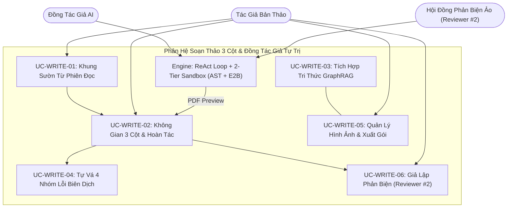

# VERISCHOLAR MVP — TÀI LIỆU YÊU CẦU SẢN PHẨM: KHÔNG GIAN SOẠN THẢO HỌC THUẬT & ĐỒNG TÁC GIẢ AI TỰ TRỊ
# (PRODUCT REQUIREMENTS DOCUMENT: AGENTIC SCHOLARLY WRITING WORKSPACE & AUTONOMOUS AI CO-AUTHOR)

**Mã phân hệ:** `PRD-06` | **Phiên bản:** `2.0-OFFICIAL` | **Vai trò:** Lead Business Analyst (BA)  
**Tài liệu Kỹ thuật liên đới:** [`06-agentic-overleaf-writing-spec.md`](../specs/06-agentic-overleaf-writing-spec.md) | **Cơ sở:** [`00-overview-and-cleanup.md`](./00-overview-and-cleanup.md)

---

## 1. Tầm Nhìn Nghiệp Vụ & Nỗi Đau Người Dùng (Business Context & Pain Points)

### 1.1. Tầm nhìn phân hệ
Cung cấp không gian soạn thảo bản thảo khoa học 3 cột khép kín, kế thừa trực tiếp bài báo và ghi chú từ phiên đọc sâu, tích hợp **Đồng tác giả AI tự trị** có khả năng tra cứu số liệu từ kho tri thức cá nhân, tự chèn trích dẫn chuẩn, tự vá 4 nhóm lỗi biên dịch và giả lập phản biện hội đồng trước khi xuất bản in PDF.

### 1.2. Nỗi đau thực tế của học giả (Có Định Lượng Nghiệp Vụ)
1. **Đứt gãy từ Đọc sang Viết (Mất 2–4 giờ):** Sau khi đọc 3–5 bài báo, học giả phải mở trình soạn thảo từ trang trắng, tự tìm, chép tay từng trích dẫn và ghi chú rời rạc.
2. **Ác mộng 4 nhóm lỗi biên dịch LaTeX (Mất 6–10 giờ/bản thảo):** Khi soạn thảo theo chuẩn IEEE/ACM/Springer, 85% lỗi không phải chỉ là thiếu ngoặc mà tập trung ở 4 nhóm:
   - *Ký tự đặc biệt chưa escape (`ERR_SPECIAL_CHAR`, ~35%):* Ký tự `&`, `%`, `_`, `#`, `$` trong tiêu đề/abstract làm vỡ cú pháp.
   - *Thiếu gói lệnh (`ERR_MISSING_PACKAGE`, ~25%):* Dùng `\mathbb{R}` hay ma trận mà thiếu `amsmath`, `amssymb`, hoặc chèn hình thiếu `graphicx`.
   - *Lệch cấu trúc bảng (`ERR_TABLE_ALIGNMENT`, ~20%):* Môi trường `tabular` định nghĩa 3 cột nhưng dòng dữ liệu chứa 4 dấu `&`.
   - *Lỗi ngoặc/môi trường (`ERR_SYNTAX_BRACKET`, ~15%):* Thiếu `$` hoặc không đóng khớp `\begin{...}\end{...}`.
   Hệ quả làm xuất hiện hàng loạt dấu hỏi chấm `[?]` hoặc làm sập tiến trình biên dịch với hàng nghìn dòng nhật ký log khó hiểu.
3. **Nỗi sợ AI viết đè và bịa trích dẫn:** AI thông thường thường bịa trích dẫn không có thật hoặc phá vỡ cấu trúc văn bản mà không có cơ chế hoàn tác an toàn.
4. **Điểm mù phản biện & Hội đồng ảo:** Người viết có thiên kiến khẳng định (Confirmation Bias), dễ bị "Reviewer #2" bắt bẻ vì tuyên bố khống thiếu chứng minh (*unsupported claims*), thiếu baseline so sánh, hoặc thiếu kiểm định ý nghĩa thống kê ($p$-value < 0.05).

### 1.3. Bảng Đối Chiếu Giá Trị Trước & Sau (Before vs. After Value Matrix)

| Tiêu chí Nghiệp vụ | Quy trình Truyền thống (Trình đọc rời + Overleaf) | Không gian Soạn thảo 3 Cột VeriScholar |
| :--- | :--- | :--- |
| **Khởi tạo bản thảo** | Tự tạo dự án trống, tự tìm và chép tay từng mã trích dẫn (2–4 giờ). | **1-Click `[✍️ Bắt đầu viết bài]`** $\rightarrow$ Khung bài báo, trích dẫn, bản in sẵn sàng (< 1.5s). |
| **Chèn dẫn chứng & số liệu** | Tự lật lại từng bài báo để chép số liệu và gõ nhãn trích dẫn. | **Đồng tác giả AI** tự truy vấn Kho Yêu Thích GraphRAG, chèn dẫn chứng và citation key đồng bộ. |
| **Xử lý 4 nhóm lỗi LaTeX** | Tự dò từng dòng log tìm lỗi ký tự, thiếu package, lệch bảng, thiếu ngoặc (6–10h). | **Vòng lặp tự vá 2 tầng (Tối đa 3 lần)**: Tự nhận diện và sửa 4 nhóm lỗi tự động trong < 200ms đến 15s. |
| **Kiểm soát can thiệp của AI** | Hoàn tác thủ công từng file, dễ mất dữ liệu. | **1-Click `[↩️ Hoàn tác]`** khôi phục nguyên trạng cả `main.tex`, `references.bib` và phiên bản OCC. |
| **Rà soát phản biện** | Tự đọc chủ quan, dễ bị từ chối vì thiếu số liệu, thiếu baseline. | **Giả lập Phản biện (Reviewer #2)**: Soi lỗi logic, tuyên bố khống, thiếu baseline và thiếu $p$-value. |

---

## 2. Các Tác Nhân Tham Gia (Actors)

| Tác nhân | Vai trò | Trách nhiệm & Kỳ vọng |
| :--- | :--- | :--- |
| **Nhà Nghiên Cứu / Tác Giả** | Chủ sở hữu bản thảo | Định hướng đề tài, ra lệnh cho AI soạn thảo, chỉnh sửa thủ công và quyết định hoàn tác. |
| **Đồng Tác Giả AI** | Trợ lý tự trị chuyên sâu | Viết nội dung chuẩn mực, bổ sung trích dẫn từ kho cá nhân và tự vá 4 nhóm lỗi biên dịch. |
| **Phản Biện Ảo (Reviewer #2)** | Kiểm định viên độc lập | Soi lỗi lập luận, phát hiện tuyên bố khống, thiếu baseline đối chuẩn và thiếu $p$-value. |
| **Động Cơ Biên Dịch Cô Lập** | Hạ tầng biên dịch an toàn | Biên dịch mã nguồn, bib và hình ảnh thành PDF chuẩn trong môi trường cô lập (< 15s). |



---

## 3. Danh Sách Use Cases Chi Tiết (Structured Use Cases)

### UC-WRITE-01: Chuyển Giao Khung Sườn Liền Mạch Từ Phiên Đọc (Reading-to-Writing Handover)
- **Tác nhân:** Nhà Nghiên Cứu.
- **Tiền đề / Kích hoạt:** Người dùng đang ở phiên đọc có tài liệu/ghi chú $\rightarrow$ bấm `[✍️ Bắt đầu viết bài từ phiên này]`.
- **Luồng chuẩn:**
  1. Khởi tạo bản thảo mới liên kết với phiên đọc; sinh **Khung Sườn Học Thuật Chuẩn** (Title, Abstract, Intro, Related Work, Methods, Experiments).
  2. Nạp 100% bài báo trong phiên vào `references.bib` với khóa trích dẫn chuẩn hóa; tự động escape ký tự đặc biệt (`&`, `%`, `_`, `$`, `#`).
  3. Tự động biên dịch bản in xem trước và mở Không Gian Soạn Thảo 3 Cột (< 1.5s).
- **Ngoại lệ:** Tạo bản thảo độc lập không qua phiên đọc: sinh template mẫu chuẩn; tự điền metadata khuyết thiếu nếu có.

### UC-WRITE-02: Không Gian Soạn Thảo 3 Cột, SyncTeX 2 Chiều & Hoàn Tác 1-Click
- **Tác nhân:** Nhà Nghiên Cứu.
- **Tiền đề / Kích hoạt:** Bản thảo đang mở $\rightarrow$ tương tác soạn thảo, biên dịch hoặc hoàn tác.
- **Luồng chuẩn:**
  1. *Cột 1 (Trái):* Cây tệp (`main.tex`, `references.bib`, `figures/`), trình soạn thảo Monaco, nút `[⚙️ Biên dịch]`, `[🧹 Dựng lại]`, `[↩️ Hoàn tác]`.
  2. *Cột 2 (Giữa):* Bản xem trước PDF với SyncTeX 2 chiều (Click code $\rightarrow$ highlight PDF; Double-click PDF $\rightarrow$ cuộn tới dòng code).
  3. *Cột 3 (Phải):* Khung hội thoại Đồng tác giả AI hiển thị tiến trình SSE thời gian thực.
  4. *Hoàn tác 1-Click (`Composite Snapshot Undo`):* Trước mỗi lần AI can thiệp, chụp snapshot toàn dự án (`main.tex`, `references.bib`, OCC version). Bấm `[↩️ Hoàn tác]` khôi phục 100% trạng thái gốc.
- **Ngoại lệ:** Xung đột phiên bản đa tab: chặn ghi đè mù quáng, yêu cầu reload. Chưa có snapshot: thông báo không có thay đổi để hoàn tác.

### UC-WRITE-03: Đồng Tác Giả AI Soạn Thảo & Tích Hợp Tri Thức Kho Yêu Thích
- **Tác nhân:** Nhà Nghiên Cứu & Đồng Tác Giả AI.
- **Tiền đề / Kích hoạt:** Bản thảo đang mở $\rightarrow$ người dùng nhập yêu cầu viết/sửa vào khung chat Cột 3.
- **Luồng chuẩn:**
  1. AI phân tích ngữ cảnh bản thảo, truy vấn Kho Yêu Thích & GraphRAG để trích xuất số liệu/luận điểm chính xác.
  2. AI tự động chèn khóa trích dẫn vào `references.bib` nếu chưa có (ngăn lỗi `[?]`), viết đoạn văn học thuật vào `main.tex`, và tự kích hoạt biên dịch.
- **Ngoại lệ:** Luận điểm không có trong kho tri thức: AI từ chối khẳng định và nêu rõ thiếu tài liệu chứng minh, không bịa trích dẫn.

### UC-WRITE-04: Biên Dịch Hộp Cát 2 Tầng & Tự Vá 4 Nhóm Lỗi Cú Pháp (Zero-Click Self-Healing)
- **Tác nhân:** Đồng Tác Giả AI & Động Cơ Biên Dịch Cô Lập.
- **Tiền đề / Kích hoạt:** Bản thảo được yêu cầu biên dịch (thủ công hoặc sau khi AI viết).
- **Luồng chuẩn:**
  1. *Tầng 1 (Fast AST Syntax Linter < 200ms):* Quét nhanh đóng mở ngoặc toán học (`$`, `$$`, `\begin{...}\end{...}`).
  2. *Tầng 2 (E2B Cloud Sandbox MicroVM):* Biên dịch qua `latexmk` đa vòng (hỗ trợ `-pdf`/`-xelatex`), dùng cache `.aux`, `.bbl` (< 1.5s, timeout 15s, `--no-shell-escape`).
  3. *Vòng lặp tự vá 4 nhóm lỗi (Tối đa 3 lần, chống dao động SHA-256):*
     - `ERR_SPECIAL_CHAR`: Tự escape `&`, `%`, `_`, `#`, `$` trong văn bản/tiêu đề.
     - `ERR_MISSING_PACKAGE`: Tự động bổ sung `\usepackage{...}` (`amsmath`, `amssymb`, `graphicx`, `booktabs`) khi gặp `Undefined control sequence`.
     - `ERR_TABLE_ALIGNMENT`: Cân bằng số dấu `&` theo số cột khai báo trong `\begin{tabular}{...}`.
     - `ERR_SYNTAX_BRACKET`: Tự đóng các cặp ngoặc `{...}`, `[...]` hoặc khối `\end{...}` thiếu.
     - Hiển thị tiến trình trên Cột 3: `⚠️ Phát hiện lỗi` $\rightarrow$ `✍️ Đang vá lỗi` $\rightarrow$ `⚙️ Biên dịch lại (x/3)` $\rightarrow$ `🎉 Hoàn tất!`.
- **Ngoại lệ:** Quá 15s hoặc lỗi cache: cho phép `[🧹 Xóa đệm & Dựng lại]`. Hết 3 lần vá: dừng an toàn, hiển thị dòng lỗi, cho phép hoàn tác 1-Click.

### UC-WRITE-05: Quản Lý Hình Ảnh Đính Kèm & Xuất Gói Nộp Bài Hoàn Chỉnh (Assets & Export)
- **Tác nhân:** Nhà Nghiên Cứu.
- **Tiền đề / Kích hoạt:** Tải ảnh lên `figures/` hoặc bấm `[📦 Xuất gói nộp bài]`.
- **Luồng chuẩn:**
  1. *Hình ảnh (`figures/`):* Hỗ trợ PNG, JPEG, WebP, PDF vector (<= 10MB/tệp, <= 50MB/bản thảo). Nhấp tên ảnh tự chèn snippet vào vị trí con trỏ.
  2. *Xuất gói (`ZIP`):* Đóng gói toàn bộ `main.tex`, `references.bib`, thư mục `figures/` và PDF đã biên dịch, tương thích 100% với Overleaf/ArXiv.
- **Ngoại lệ:** File ảnh sai định dạng/quá dung lượng: từ chối và cảnh báo. Chưa biên dịch thành công: vẫn cho xuất source bundle đầy đủ.

### UC-WRITE-06: Giả Lập Phản Biện Hội Đồng (Simulated Peer Reviewer - "Reviewer #2")
- **Tác nhân:** Nhà Nghiên Cứu & Hội Đồng Phản Biện Ảo (Reviewer #2).
- **Tiền đề / Kích hoạt:** Bản thảo có nội dung học thuật $\rightarrow$ bấm `[🧐 Giả lập phản biện]` hoặc yêu cầu trong chat Cột 3.
- **Luồng chuẩn:**
  1. Tác tử Reviewer #2 rà soát bản thảo theo tiêu chuẩn phản biện quốc tế (IEEE/ACM/NeurIPS).
  2. *Kiểm định 3 trọng tâm:*
     - **Tuyên bố khống (Unsupported Claims):** Bắt lỗi khẳng định chủ quan thiếu số liệu hoặc thiếu citation chứng minh.
     - **Độ phủ Baseline (Baseline Sufficiency):** So sánh với các mô hình liên quan trong Kho Yêu Thích để chỉ ra baseline bị bỏ sót.
     - **Ý nghĩa Thống kê (Statistical Rigor):** Cảnh báo bảng kết quả chỉ có điểm trung bình mà thiếu độ lệch chuẩn ($\pm \sigma$) hoặc thiếu $p$-value ($p < 0.05$).
  3. Xuất Báo cáo Phản biện 3 cấp độ: 🔴 Rủi ro cao (Deal-breaker), 🟡 Cần sửa đổi lớn (Major Revision), 🟢 Góp ý diễn đạt (Minor Edit). Hỗ trợ 1-Click `[Sửa theo phản biện]`.
- **Ngoại lệ:** Bản thảo < 300 từ: yêu cầu bổ sung nội dung trước khi phản biện toàn diện.

---

## 4. Tiêu Chí Nghiệm Thu Nghiệp Vụ (Acceptance Criteria - Gherkin)

```gherkin
@writing @handover
Feature: Tạo bản thảo tức thì từ phiên đọc với khung sườn học thuật hợp lệ
  Scenario: Khởi tạo bản thảo từ phiên đọc sâu
    Given người dùng đang có một phiên đọc sâu chứa 3 bài báo khoa học và các ghi chú trích dẫn
    When người dùng nhấp nút "[✍️ Bắt đầu viết bài từ phiên này]"
    Then hệ thống tạo ngay một bản thảo mới gắn với đề tài phiên đọc
    And danh mục trích dẫn nạp đầy đủ mã chuẩn của cả 3 bài báo
    And bản xem trước PDF hiển thị thành công trên Cột 2 mà không có lỗi cú pháp

@writing @self_healing @error_classes
  Scenario Outline: Tự sửa lỗi biên dịch theo 4 nhóm lỗi phổ biến
    Given mã nguồn bài báo gặp lỗi biên dịch thuộc nhóm "<error_class>" tại dòng <line>
    When tiến trình biên dịch tài liệu được kích hoạt
    Then hệ thống phân loại đúng nhóm lỗi "<error_class>" từ log biên dịch
    And đồng tác giả AI áp dụng quy tắc sửa lỗi tự động tương ứng
    And hệ thống biên dịch lại và cập nhật bản in PDF thành công trong tối đa 3 lần thử

    Examples:
      | error_class          | line | mo_ta_loi                               |
      | ERR_SPECIAL_CHAR     | 15   | Ký tự & chưa escape trong tiêu đề       |
      | ERR_MISSING_PACKAGE  | 28   | Lệnh \mathbb chưa nạp amssymb           |
      | ERR_TABLE_ALIGNMENT  | 64   | Thừa dấu & so với số cột trong tabular |
      | ERR_SYNTAX_BRACKET   | 92   | Thiếu dấu đóng ngoặc nhọn }             |

@writing @peer_review
  Scenario: Giả lập phản biện hội đồng phát hiện tuyên bố khống và thiếu thống kê
    Given bản thảo có câu "Phương pháp của chúng tôi vượt trội toàn diện" không kèm số liệu
    And bảng kết quả thực nghiệm chỉ có điểm F1 trung bình mà không có độ lệch chuẩn
    When người dùng bấm nút "[🧐 Giả lập phản biện hội đồng]"
    Then hệ thống gắn cờ đỏ (Deal-breaker) cho tuyên bố khống và cờ vàng (Major Revision) cho thiếu p-value

@writing @undo_export
  Scenario: Hoàn tác 1-Click và xuất gói nộp bài
    Given đồng tác giả AI vừa thực hiện chỉnh sửa nội dung trong bản thảo
    When người dùng nhấp nút "[↩️ Hoàn tác]"
    Then nội dung bài báo và danh mục trích dẫn lập tức khôi phục chính xác về trạng thái trước can thiệp
    When người dùng nhấp nút "[📦 Xuất gói nộp bài]"
    Then hệ thống tải xuống tệp nén ZIP chứa đủ mã nguồn, bib, figures/ và bản in PDF
```

---

## 5. Quy Tắc Nghiệp Vụ Bất Biến (Business Invariants)

1. **Tác Giả Nắm Quyền Tối Thượng & Bản Chụp Toàn Dự Án:** Trước mỗi lượt AI can thiệp, bắt buộc lưu bản chụp toàn diện (`main.tex`, `references.bib`, OCC version) cho phép hoàn tác 1-Click 100%.
2. **Cách Ly Lục Giác Thuần Khiết:** `packages/core/` tuyệt đối cấm import thư viện đồ họa ngoài hoặc gọi tiến trình biên dịch trực tiếp. Mọi tương tác biên dịch phải đi qua Port và Sandbox Adapter.
3. **Thoát Ký Tự Đặc Biệt BibTeX Tất Định:** Mọi trường tiêu đề và tác giả khi sinh bib bắt buộc escape ký tự nhạy cảm (`&`, `%`, `_`, `$`, `#`) để ngăn lỗi biên dịch ngay từ gốc.
4. **Ngân Sách Tự Khắc Phục Lỗi An Toàn:** Tối đa **3 lần thử**, tối đa **15 giây/lần**, dừng ngay nếu phát hiện mã băm trạng thái SHA-256 bị lặp lại.
5. **Toàn Vẹn & Không Chặn Xuất Bản Thảo:** Luôn cho phép xuất gói nộp bài kể cả khi chưa biên dịch thành công PDF.
6. **Bảo Mật Biên Dịch Cô Lập:** Mọi biên dịch PDF bắt buộc chạy trong E2B MicroVM Sandbox với cờ `--no-shell-escape` và cấm truy cập mạng/tệp ngoài.
7. **Phân Loại 4 Nhóm Lỗi Cú Pháp:** Mọi lỗi biên dịch phải phân loại về 1 trong 4 nhóm (`ERR_SPECIAL_CHAR`, `ERR_MISSING_PACKAGE`, `ERR_TABLE_ALIGNMENT`, `ERR_SYNTAX_BRACKET`) để áp dụng chiến lược vá lỗi chính xác.
8. **Phản Biện Khách Quan Không Nhân Nhượng:** Reviewer #2 luôn duy trì tiêu chuẩn học thuật quốc tế nghiêm ngặt, không thỏa hiệp hay khen ngợi hình thức.
