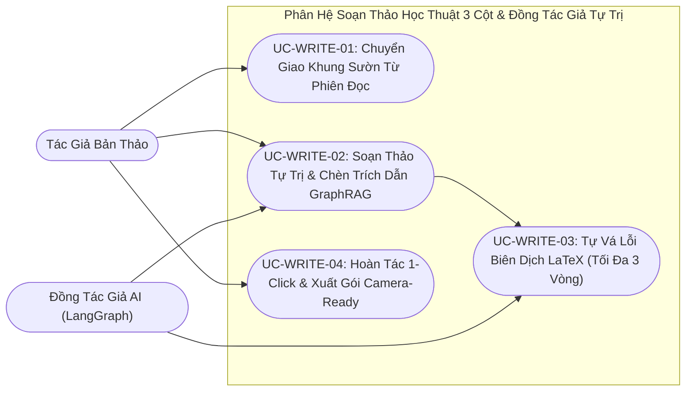

# VERISCHOLAR MVP — TÀI LIỆU YÊU CẦU SẢN PHẨM: KHÔNG GIAN SOẠN THẢO HỌC THUẬT & ĐỒNG TÁC GIẢ AI TỰ TRỊ
# (PRODUCT REQUIREMENTS DOCUMENT: AGENTIC SCHOLARLY WRITING WORKSPACE & AUTONOMOUS AI CO-AUTHOR)

**Mã phân hệ:** `PRD-06`  
**Phiên bản:** `2.0-OFFICIAL`  
**Vai trò phụ trách:** Chuyên viên Phân tích Nghiệp vụ (Lead Business Analyst — BA)  
**Tài liệu Kỹ thuật liên đới:** [`06-agentic-overleaf-writing-spec.md`](../specs/06-agentic-overleaf-writing-spec.md)  
**File nền tảng liên đới:** [`00-overview-and-cleanup.md`](./00-overview-and-cleanup.md)  
**Trạng thái:** CHÍNH THỨC BAN HÀNH (RELEASE CANDIDATE)

---

## 1. Tầm Nhìn Nghiệp Vụ & Nỗi Đau Người Dùng (Business Context & Pain Points)

### 1.1. Tầm nhìn phân hệ
Cung cấp một không gian soạn thảo bản thảo khoa học 3 cột khép kín, kế thừa trực tiếp toàn bộ bài báo và ghi chú từ phiên đọc sâu, tích hợp **Đồng tác giả AI tự trị** có khả năng tra cứu số liệu từ kho tri thức cá nhân, tự động chèn trích dẫn chuẩn và tự động vá lỗi cú pháp biên dịch trước khi xuất bản in PDF.

### 1.2. Nỗi đau thực tế của học giả (Có Định Lượng Nghiệp Vụ)
1. **Đứt gãy từ khâu Đọc sang khâu Viết (Mất 2 – 4 giờ khởi tạo bản thảo):** Sau khi đọc xong 3 – 5 bài báo, học giả phải mở phần mềm soạn thảo bên ngoài từ trang giấy trắng, tự tìm kiếm và dán lại từng mục tài liệu tham khảo và sao chép thủ công từng ghi chú rời rạc.
2. **Ác mộng lỗi biên dịch LaTeX sát giờ nộp bài (Mất 6 – 10 giờ/bản thảo):** Khi soạn bài báo nhiều công thức toán học và bảng biểu theo chuẩn IEEE/ACM/Springer, việc thiếu một dấu ngoặc, xung đột gói ký hiệu toán hoặc lệch mã trích dẫn làm xuất hiện hàng loạt dấu hỏi chấm **`[?]`** hoặc làm sập tiến trình biên dịch với hàng nghìn dòng nhật ký lỗi khó hiểu.
3. **Nỗi sợ AI viết đè làm hỏng bản thảo hoặc tự bịa trích dẫn:** Khi nhờ các công cụ AI thông thường viết nháp mục *Related Work*, AI thường tự bịa ra các trích dẫn không có thật hoặc sửa hỏng cấu trúc văn bản hiện có của tác giả mà không có cơ chế hoàn tác an toàn.

### 1.3. Bảng Đối Chiếu Giá Trị Trước & Sau Khi Áp Dụng Không Gian Soạn Thảo Tự Trị (Before vs. After Value Matrix)

| Tiêu chí Nghiệp vụ Soạn thảo | Quy trình Viết bài Truyền thống (Trình đọc rời + Overleaf) | Không gian Soạn thảo Học thuật 3 Cột VeriScholar |
| :--- | :--- | :--- |
| **Khởi tạo bản thảo từ phiên đọc** | Tự tạo dự án trống, tự tìm và chép tay từng mã trích dẫn (mất 2 – 4 giờ). | Bấm **1-Click `[✍️ Bắt đầu viết bài từ phiên này]`** $\rightarrow$ Có sẵn khung bài báo, danh mục trích dẫn và bản in xem trước. |
| **Chèn dẫn chứng & số liệu thực nghiệm** | Tự lật lại từng bài báo để chép số liệu và gõ nhãn trích dẫn. | **Đồng tác giả AI** tự truy vấn Kho Yêu Thích, chèn đoạn văn kèm khóa trích dẫn đồng bộ. |
| **Xử lý lỗi cú pháp biên dịch** | Tự dò từng dòng nhật ký biên dịch để tìm dấu ngoặc thiếu hoặc lỗi lệnh toán. | **Vòng lặp tự vá lỗi tự trị (Tối đa 3 lần)** tự đọc lỗi, sửa cú pháp và biên dịch lại đến khi thành công. |
| **Kiểm soát khi AI sửa chưa ưng ý** | Phải tự bấm hoàn tác thủ công từng dòng trên nhiều tệp khác nhau. | Bấm **1-Click `[↩️ Hoàn tác]`** khôi phục nguyên trạng cả nội dung bài báo lẫn danh mục trích dẫn. |

---

## 2. Các Tác Nhân Tham Gia (Actors)

| Tác nhân | Vai trò trong phân hệ | Trách nhiệm & Kỳ vọng |
| :--- | :--- | :--- |
| **Nhà Nghiên Cứu / Tác Giả** | Chủ sở hữu bản thảo | Định hướng đề tài, ra lệnh cho AI soạn thảo từng mục, chỉnh sửa thủ công và quyết định giữ lại hoặc hoàn tác thay đổi của AI. |
| **Đồng Tác Giả AI (AI Co-Author)** | Trợ lý soạn thảo tự trị chuyên sâu | Viết nội dung học thuật chuẩn mực, tự bổ sung mục trích dẫn từ kho tài liệu của học giả và tự vá lỗi cú pháp biên dịch. |
| **Động Cơ Biên Dịch Cô Lập** | Hạ tầng biên dịch đám mây an toàn | Biên dịch toàn bộ gói mã nguồn, danh mục trích dẫn và hình ảnh thành bản in PDF chuẩn quốc tế trong thời gian giới hạn an toàn (`15 giây`). |



---

## 3. Danh Sách Use Cases Chi Tiết (Structured Use Cases)

### UC-WRITE-01: Chuyển Giao Khung Sườn Liền Mạch Từ Phiên Đọc (Reading-to-Writing Handover)
- **Tác nhân:** Nhà Nghiên Cứu.
- **Điều kiện tiên quyết:** Người dùng đang ở trong một phiên nghiên cứu có tài liệu và các ghi chú trích dẫn.
- **Sự kiện kích hoạt:** Người dùng nhấp nút `[✍️ Bắt đầu viết bài từ phiên này]` trên thanh công cụ đọc (hoặc tạo bản thảo mới từ danh sách).
- **Luồng chuẩn (Happy Path):**
  1. Hệ thống tự động khởi tạo một bản thảo nghiên cứu mới liên kết với phiên đọc hiện tại.
  2. Hệ thống tự động sinh **Khung Sườn Học Thuật Chuẩn**:
     - Danh mục tài liệu tham khảo nạp đầy đủ 100% các bài báo đang mở trong phiên đọc kèm khóa trích dẫn chuẩn hóa không trùng lặp.
     - Nội dung bản thảo được thiết lập sẵn cấu trúc hoàn chỉnh: Tiêu đề, Tóm tắt, Giới thiệu, Tổng quan nghiên cứu (đã gắn sẵn trích dẫn tới các bài báo trong phiên), Phương pháp luận và Thực nghiệm.
  3. Hệ thống biên dịch sẵn bản in xem trước và chuyển người dùng sang Không Gian Soạn Thảo 3 Cột.
- **Kết quả đầu ra (Post-conditions):**
  - Bản thảo mới được tạo thành công với nội dung khung bài báo và danh mục trích dẫn hợp lệ cú pháp 100%, hiển thị ngay bản in xem trước trên Cột 2.
- **Luồng ngoại lệ (Exception Flows):**
  - *1a. Tạo bản thảo độc lập không qua phiên đọc:* Học giả có thể tạo bản thảo mới trực tiếp từ trang quản lý bản thảo với khung mẫu học thuật chuẩn.
  - *1b. Bài báo trong phiên thiếu một số thông tin xuất bản phụ (như năm hoặc nơi công bố) hoặc chứa ký tự đặc biệt:* Hệ thống tự động điền giá trị dự phòng chuẩn quốc tế và chuẩn hóa ký tự đặc biệt để đảm bảo không phát sinh lỗi biên dịch.

---

### UC-WRITE-02: Không Gian Soạn Thảo Học Thuật 3 Cột & Hoàn Tác 1-Click
- **Tác nhân:** Nhà Nghiên Cứu.
- **Điều kiện tiên quyết:** Người dùng đã mở một bản thảo nghiên cứu.
- **Sự kiện kích hoạt:** Tương tác soạn thảo, biên dịch hoặc hoàn tác trên giao diện 3 cột.
- **Luồng chuẩn (Happy Path):**
  1. **Cột 1 (Trái) — Cây tệp & Trình soạn thảo:** Chuyển đổi giữa nội dung bài báo chính, danh mục trích dẫn và danh mục hình ảnh; hỗ trợ gõ chỉnh sửa trực tiếp, nút `[⚙️ Biên dịch PDF]` và nút `[↩️ Hoàn tác]`.
  2. **Cột 2 (Giữa) — Bản xem trước PDF:** Hiển thị trực tiếp bản in PDF sắc nét được biên dịch thực tế, kèm nút tải gói nộp bài.
  3. **Cột 3 (Phải) — Khung đối thoại Đồng tác giả AI:** Lưu trữ bền vững lịch sử trao đổi và hiển thị huy hiệu tiến trình hành động của AI theo thời gian thực.
  4. **Hoàn tác 1-Click (`Undo`):** Trước mỗi lượt AI chỉnh sửa bản thảo, hệ thống tự động lưu một bản chụp trạng thái gốc của tác giả. Nếu không ưng ý với kết quả của AI, tác giả bấm `[↩️ Hoàn tác]` để khôi phục ngay lập tức cả nội dung bài báo lẫn danh mục trích dẫn về đúng trạng thái trước khi AI can thiệp.
- **Kết quả đầu ra (Post-conditions):**
  - Mọi cập nhật hợp lệ được lưu trữ kèm kiểm soát phiên bản; tác giả luôn nắm quyền hoàn tác 1-Click sau khi AI chỉnh sửa.
- **Luồng ngoại lệ (Exception Flows):**
  - *2a. Xung đột phiên bản khi lưu đồng thời từ hai tab trình duyệt khác nhau:* Hệ thống từ chối ghi đè mù quáng và thông báo rõ bản thảo đã được cập nhật ở phiên khác, yêu cầu tải lại bản mới nhất.
  - *2b. Bấm Hoàn tác khi chưa có bản sao lưu trước đó:* Hệ thống thông báo hiện không có thay đổi nào của AI cần hoàn tác và giữ nguyên nội dung hiện tại.

---

### UC-WRITE-03: Đồng Tác Giả AI Soạn Thảo & Tích Hợp Tri Thức Kho Yêu Thích
- **Tác nhân:** Nhà Nghiên Cứu & Đồng Tác Giả AI.
- **Điều kiện tiên quyết:** Bản thảo đang mở và người dùng gửi yêu cầu vào khung hội thoại Cột 3.
- **Sự kiện kích hoạt:** Người dùng ra lệnh soạn thảo (ví dụ: *"Hãy viết mục Tổng quan nghiên cứu so sánh cơ chế Attention với CNN dựa trên kho bài báo yêu thích"*).
- **Luồng chuẩn (Happy Path):**
  1. Đồng tác giả AI đọc nội dung bản thảo hiện tại và tự động truy vấn Kho Bài Báo Yêu Thích cùng Mạng Tri Thức Đồ Thị của học giả để lấy luận điểm và số liệu thực nghiệm chính xác.
  2. AI tự động bổ sung thông tin trích dẫn còn thiếu vào danh mục tham khảo của bản thảo để không bao giờ xảy ra lỗi trích dẫn khuyết `[?]`.
  3. AI cập nhật đoạn văn học thuật mới vào bản thảo và tự động kích hoạt biên dịch để làm mới bản in xem trước ở Cột 2.
- **Kết quả đầu ra (Post-conditions):**
  - Nội dung bài báo và danh mục trích dẫn được cập nhật đồng bộ, bản sao lưu trước chỉnh sửa được bảo toàn và tiến trình biên dịch được kích hoạt.
- **Luồng ngoại lệ (Exception Flows):**
  - *3a. Yêu cầu dẫn chứng luận điểm không có trong kho tài liệu của học giả:* AI tuyệt đối không tự bịa khóa trích dẫn hư cấu mà thông báo rõ điểm nào chưa có tài liệu minh chứng trong kho cá nhân.

---

### UC-WRITE-04: Biên Dịch Hộp Cát An Toàn & Vòng Lặp Tự Sửa Lỗi Cú Pháp (Zero-Click Self-Healing)
- **Tác nhân:** Đồng Tác Giả AI & Động Cơ Biên Dịch Cô Lập.
- **Điều kiện tiên quyết:** Bản thảo được yêu cầu biên dịch (do người dùng bấm nút hoặc do AI kích hoạt sau khi viết).
- **Sự kiện kích hoạt:** Hệ thống gửi gói bản thảo tới Động cơ Biên dịch cô lập.
- **Luồng chuẩn (Happy Path & Self-Healing Loop):**
  1. Động cơ Biên dịch thực thi dựng bản in PDF trong môi trường đám mây cô lập an toàn (chặn tuyệt đối các lệnh truy cập hệ thống tệp bên ngoài) với thời gian giới hạn tối đa **15 giây**.
  2. Nếu biên dịch thành công ngay lần đầu: Bản in PDF mới nhất hiển thị ngay tại Cột 2.
  3. **Vòng lặp tự vá lỗi tự trị (Tối đa 3 lần thử):** Nếu biên dịch thất bại do lỗi cú pháp, thiếu ngoặc toán học hoặc xung đột gói lệnh:
     - Đồng tác giả AI tự động đọc nhật ký lỗi biên dịch, xác định dòng bị lỗi và tự chỉnh sửa mã nguồn để vá lỗi.
     - AI tự động gửi biên dịch lại cho đến khi thành công (tối đa 3 lần thử liên tiếp).
     - Cột 3 hiển thị huy hiệu trạng thái trực quan từng bước: *`⚠️ Phát hiện lỗi cú pháp` $\rightarrow$ `✍️ AI đang tự vá lỗi` $\rightarrow$ `⚙️ Biên dịch lại` $\rightarrow$ `🎉 Hoàn tất!`*.
- **Kết quả đầu ra (Post-conditions):**
  - Bản in PDF biên dịch thành công được cập nhật lên Cột 2; nếu quá 3 lần thử vẫn còn lỗi, hệ thống dừng vòng lặp an toàn và hiển thị rõ dòng lỗi để tác giả kiểm tra hoặc bấm Hoàn tác.
- **Luồng ngoại lệ (Exception Flows):**
  - *4a. Quá thời gian biên dịch 15 giây (do hình ảnh quá nặng hoặc vòng lặp lệnh vô hạn):* Hệ thống tự động ngắt tiến trình biên dịch hộp cát, giữ nguyên bản xem trước PDF hợp lệ gần nhất và thông báo tác giả tối ưu hóa hình ảnh hoặc kiểm tra lại lệnh lặp.
  - *4b. Hết ngân sách 3 lần tự sửa lỗi mà vẫn chưa biên dịch được:* Hệ thống dừng vòng lặp ngay lập tức để bảo vệ hạn ngạch AI, hiển thị thông báo kèm nhật ký dòng lỗi và cho phép tác giả hoàn tác 1-Click về bản gốc.

---

### UC-WRITE-05: Quản Lý Hình Ảnh Đính Kèm & Xuất Gói Nộp Bài Hoàn Chỉnh (Assets & Export)
- **Tác nhân:** Nhà Nghiên Cứu.
- **Điều kiện tiên quyết:** Bản thảo đang mở.
- **Sự kiện kích hoạt:** Người dùng tải lên sơ đồ/biểu đồ hoặc bấm nút `[📦 Xuất gói nộp bài]`.
- **Luồng chuẩn (Happy Path):**
  1. **Quản lý hình ảnh (`figures/`):** Người dùng tải lên tệp hình ảnh minh họa (hỗ trợ PNG, JPEG, WebP, PDF vector; tối đa 10MB/tệp và tối đa 50MB/bản thảo). Nhấp vào tên ảnh sẽ tự động chèn đoạn lệnh hiển thị hình ảnh chuẩn vào vị trí con trỏ.
  2. **Xuất gói nộp bài (`ZIP`):** Khi nhấp `[📦 Xuất gói nộp bài]`, hệ thống đóng gói toàn bộ dự án thành tệp nén chuẩn gồm: tệp mã nguồn chính, tệp danh mục trích dẫn, thư mục hình ảnh `figures/` và tệp bản in PDF đã biên dịch, tương thích 100% với Overleaf và các cổng nộp bài hội nghị quốc tế.
- **Kết quả đầu ra (Post-conditions):**
  - Tệp hình ảnh được lưu trữ an toàn và gói nén nộp bài tải xuống tự chứa đầy đủ mọi thành phần của bản thảo.
- **Luồng ngoại lệ (Exception Flows):**
  - *5a. Tệp ảnh tải lên sai định dạng, vượt quá 10MB hoặc tên tệp chứa ký tự đường dẫn không an toàn:* Hệ thống từ chối tệp và thông báo rõ quy chuẩn định dạng, dung lượng và tên tệp hợp lệ.
  - *5b. Xuất gói nộp bài khi bản thảo chưa có bản in PDF biên dịch thành công:* Hệ thống tuyệt đối không chặn quyền tải về của tác giả mà vẫn xuất đầy đủ tệp nén chứa mã nguồn, danh mục trích dẫn và toàn bộ thư mục hình ảnh để tác giả sử dụng ngay.

---

## 4. Tiêu Chí Nghiệm Thu Nghiệp Vụ (Acceptance Criteria - Gherkin)

```gherkin
@writing @handover
Feature: Tạo bản thảo tức thì từ phiên đọc với khung sườn học thuật hợp lệ
  Scenario: Khởi tạo bản thảo từ phiên đọc sâu
    Given người dùng đang có một phiên đọc sâu chứa 3 bài báo khoa học và các ghi chú trích dẫn
    When người dùng nhấp nút "[✍️ Bắt đầu viết bài từ phiên này]"
    Then hệ thống tạo ngay một bản thảo mới gắn với đề tài phiên đọc
    And danh mục trích dẫn nạp đầy đủ mã chuẩn của cả 3 bài báo
    And bản xem trước PDF hiển thị thành công trên Cột 2 mà không có lỗi cú pháp

@writing @self_healing
Feature: AI tự động vá lỗi biên dịch cú pháp tối đa 3 lần
  Scenario: Tự sửa lỗi thiếu dấu đóng ngoặc toán học
    Given mã nguồn bài báo bị lỗi cú pháp thiếu dấu đóng ngoặc công thức toán ở dòng 42
    When tiến trình biên dịch tài liệu được kích hoạt
    Then đồng tác giả AI tự động đọc nhật ký lỗi, sửa lại mã nguồn và gửi biên dịch lại
    And toàn bộ tiến trình tự vá lỗi hiển thị huy hiệu trạng thái rõ ràng ở Cột 3
    And số lần tự sửa lỗi tối đa không vượt quá 3 lần

@writing @undo
Feature: Hoàn tác 1-Click bảo toàn quyền kiểm soát của tác giả
  Scenario: Khôi phục nguyên trạng bản thảo trước khi AI can thiệp
    Given đồng tác giả AI vừa thực hiện chỉnh sửa nội dung trong bản thảo
    When người dùng nhấp nút "[↩️ Hoàn tác]"
    Then nội dung bài báo và danh mục trích dẫn lập tức khôi phục chính xác về trạng thái trước khi AI chỉnh sửa

@writing @export
Feature: Xuất gói nộp bài hoàn chỉnh tương thích tuyệt đối
  Scenario: Tải gói nén ZIP chứa đầy đủ mã nguồn và hình ảnh
    Given bản thảo nghiên cứu có mã nguồn, danh mục trích dẫn và 2 tệp ảnh sơ đồ
    When người dùng nhấp nút "[📦 Xuất gói nộp bài]"
    Then hệ thống tải xuống tệp nén chuẩn chứa đủ mã nguồn chính, danh mục trích dẫn, thư mục figures/ và bản in PDF
```

---

## 5. Quy Tắc Nghiệp Vụ Bất Biến (Business Invariants)

1. **Nguyên Tắc Tác Giả Nắm Quyền Tối Thượng (Author Sovereignty Invariant):** Trước khi AI thực hiện chỉnh sửa đầu tiên trong một lượt hỗ trợ, hệ thống bắt buộc chụp lại đúng một bản sao lưu trạng thái gốc của tác giả để nút Hoàn tác 1-Click (`Undo`) luôn khôi phục chính xác 100%.
2. **Nguyên Tắc Ngân Sách Tự Khắc Phục Lỗi An Toàn (Self-Healing Retry Budget):** Vòng lặp tự động sửa lỗi biên dịch của AI giới hạn nghiêm ngặt ở mức tối đa **3 lần thử** và thời gian biên dịch tối đa **15 giây/lần**.
3. **Nguyên Tắc Toàn Vẹn & Không Chặn Xuất Bản Thảo (Non-Blocking Bundle Export):** Học giả luôn có quyền tải gói nén bản thảo về máy bất kỳ lúc nào (kể cả khi đang có lỗi cú pháp chưa biên dịch xong PDF).
4. **Nguyên Tắc Bảo Mật Biên Dịch Cô Lập (Sandboxed Compilation Isolation):** Toàn bộ quá trình biên dịch PDF bắt buộc chạy trên môi trường hộp cát đám mây cô lập, vô hiệu hóa quyền thực thi lệnh hệ thống ngoài để bảo vệ tuyệt đối máy chủ và dữ liệu học giả.
