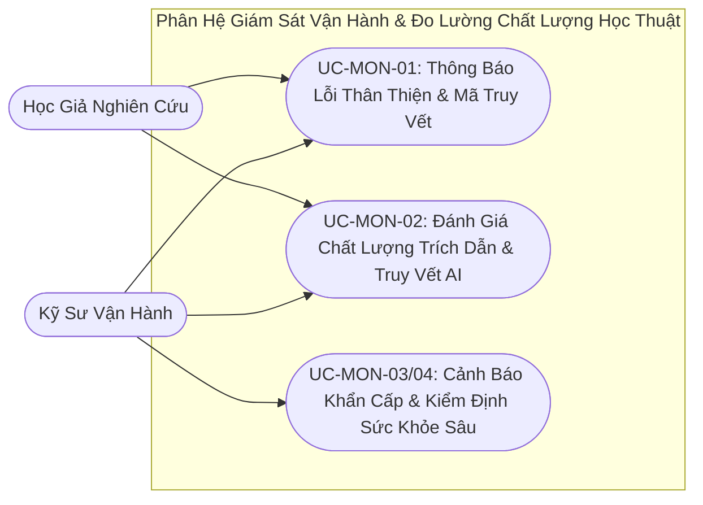

# VERISCHOLAR MVP — TÀI LIỆU YÊU CẦU SẢN PHẨM: HỆ THỐNG GIÁM SÁT VẬN HÀNH & ĐO LƯỜNG CHẤT LƯỢNG HỌC THUẬT
# (PRODUCT REQUIREMENTS DOCUMENT: SYSTEM MONITORING, OBSERVABILITY & ACADEMIC TELEMETRY)

**Mã phân hệ:** `PRD-07`  
**Phiên bản:** `2.0-OFFICIAL`  
**Vai trò phụ trách:** Chuyên viên Phân tích Nghiệp vụ (Lead Business Analyst — BA)  
**Tài liệu Kỹ thuật liên đới:** [`07-monitoring-and-langfuse-spec.md`](../specs/07-monitoring-and-langfuse-spec.md)  
**File nền tảng liên đới:** [`00-overview-and-cleanup.md`](./00-overview-and-cleanup.md)  
**Trạng thái:** CHÍNH THỨC BAN HÀNH (RELEASE CANDIDATE)

---

## 1. Tầm Nhìn Nghiệp Vụ & Nỗi Đau Người Dùng (Business Context & Pain Points)

Để một trợ lý nghiên cứu khoa học hoạt động bền bỉ, tin cậy và đạt chuẩn mực chuyên nghiệp, hệ thống giám sát và đo lường đóng vai trò bảo vệ cốt lõi:
- **Nỗi đau 1 — Khủng hoảng niềm tin khi gặp lỗi kỹ thuật thô ráp giữa mùa nộp bài (Scholar Trust Erosion):** Trong các ứng dụng nghiên cứu thông thường, khi xảy ra sự cố mạng, lỗi định dạng phông chữ tài liệu hoặc quá tải dịch vụ, màn hình thường hiển thị chuỗi ký tự kỹ thuật khó hiểu (màn hình trắng hoặc các dòng mã lỗi đỏ dài dòng). Khảo sát trải nghiệm người dùng học thuật cho thấy **trên 65% học giả lập tức rời bỏ công cụ** nếu gặp lỗi kỹ thuật thô trong giai đoạn nước rút hoàn thiện khóa luận hoặc nộp bài hội nghị, vì họ lo sợ mất trắng toàn bộ ghi chú và bản thảo đang viết dở.
- **Nỗi đau 2 — Nhà vận hành "mù thông tin" về độ trung thực học thuật và thất thoát ngân sách AI (Blind Telemetry & Runaway Cost):** Khi vận hành hệ thống trợ lý nghiên cứu, nếu thiếu công cụ đo lường chuyên sâu, đội ngũ phát triển không thể biết bao nhiêu phần trăm câu trả lời của AI thực sự gắn được **Khung viền vàng (Visual Grounding)** trên bài báo gốc và bao nhiêu phần trăm đang trả lời thiếu căn cứ. Đồng thời, các truy vấn tổng hợp đa bài báo hoặc vòng lặp biên dịch bản thảo có thể âm thầm gây **thất thoát 40% – 70% ngân sách vận hành AI** chỉ sau vài ngày nếu không được giám sát chi tiết theo từng phiên làm việc.
- **Nỗi đau 3 — Thời gian khắc phục sự cố kéo dài hàng giờ (High MTTR & Silent Outages):** Khi người dùng phản ánh *"AI trả lời sai số liệu ở bài báo của tôi"* hoặc khi dịch vụ biên dịch đám mây ngưng trệ vào ban đêm, quản trị viên thường mất **2 – 4 giờ** để hỏi lại người dùng dùng bài báo nào, hỏi câu gì, vào lúc mấy giờ. Việc thiếu mã định danh truy vết đồng nhất và hệ thống báo động tức thì khiến các sự cố nghiêm trọng chỉ được phát hiện khi đã làm gián đoạn hàng loạt nhà nghiên cứu.

### 1.1. Bảng Đối Chiếu Giá Trị Trước & Sau Khi Áp Dụng Phân Hệ Giám Sát (Before vs. After Value Matrix)

| Tiêu chí Vận hành & Trải nghiệm | Hệ thống thiếu giám sát chuyên biệt (Truyền thống) | Hệ thống Giám Sát & Đo Lường Học Thuật VeriScholar |
| :--- | :--- | :--- |
| **Giao diện khi xảy ra sự cố** | Hiển thị mã lỗi máy chủ thô ráp hoặc treo màn hình xoay vòng vô tận. | Thông báo Tiếng Việt lịch sự, cam kết an toàn dữ liệu kèm nút **`[Thử lại]`** và **Mã tham chiếu `#9c1f`** tinh tế. |
| **Thời gian định vị lỗi (MTTR)** | Mất 2 – 4 giờ hỏi lại học giả từng bước thao tác để tái hiện lỗi. | Tra cứu theo email hoặc mã `#9c1f` thấy ngay toàn bộ câu hỏi, đoạn trích dẫn và nguyên nhân gốc trong **< 3 giây**. |
| **Kiểm soát chất lượng bảo chứng** | Không biết AI có trích dẫn thật hay bịa đặt số liệu trên thực tế. | Tự động chấm điểm **Tỷ lệ Bảo chứng Khung viền vàng** và **Số lượt tự sửa lỗi biên dịch** kết hợp nút **👍 / 👎**. |
| **Phản ứng khi sập dịch vụ phụ trợ** | Chỉ biết khi học giả nhắn tin phàn nàn hàng loạt. | Tự động gửi **Cảnh báo khẩn cấp chạy ngầm** về kênh vận hành ngay giây đầu tiên phát sinh lỗi nghiêm trọng. |

VeriScholar giải quyết trọn vẹn những thách thức trên thông qua 4 trụ cột vận hành nghiệp vụ:
1. **Trải Nghiệm Bắt Lỗi Thân Thiện & Mã Truy Vết Đồng Nhất:** Hiển thị thông báo tiếng Việt ấm áp, lịch sự kèm mã hỗ trợ tinh tế để giải quyết khiếu nại trong 3 giây.
2. **Hệ Thống Đo Lường Chất Lượng & Tiếp Nhận Đánh Giá Tức Thì:** Ghi nhận minh chứng bảo chứng, số lần tự sửa lỗi biên dịch và phản hồi hài lòng của học giả.
3. **Cảnh Báo Sự Cố Tự Động Về Kênh Vận Hành:** Phát tín hiệu báo động khẩn cấp khi hệ thống gặp lỗi nghiêm trọng để kỹ sư khắc phục trước khi người dùng bị ảnh hưởng.
4. **Bảng Theo Dõi Sức Khỏe & Tính Sẵn Sàng Thời Gian Thực:** Giám sát toàn diện tình trạng hoạt động của toàn bộ dịch vụ phụ trợ chỉ trên một màn hình tổng quan.

---

## 2. Các Tác Nhân Tham Gia (Actors)

| Tác nhân | Vai trò trong phân hệ | Trách nhiệm & Kỳ vọng |
| :--- | :--- | :--- |
| **Nhà Nghiên Cứu / Học Giả** | Người trải nghiệm hệ thống | Nhận thông báo lỗi lịch sự, dễ hiểu khi gặp sự cố; gửi phản hồi đánh giá chất lượng câu trả lời của AI. |
| **Kỹ Sư Vận Hành / Quản Trị Viên** | Người chịu trách nhiệm duy trì hệ thống | Giám sát sức khỏe dịch vụ, nhận cảnh báo sự cố khẩn cấp, tra cứu nguyên nhân gốc rễ qua mã truy vết để hỗ trợ học giả. |
| **Động Cơ Đo Lường Học Thuật** | Hệ thống tự động theo dõi và ghi nhận chỉ số | Tự động ghi nhận chi phí tài nguyên, thời gian phản hồi, kiểm tra tính xác thực của trích dẫn và chấm điểm vận hành. |



---

## 3. Danh Sách Use Cases Chi Tiết (Structured Use Cases)

### UC-MON-01: Truy Vết Lỗi Thân Thiện & Mã Hỗ Trợ Khách Hàng
- **Tác nhân:** Nhà Nghiên Cứu & Kỹ Sư Vận Hành.
- **Tiền điều kiện:** Người dùng đang sử dụng bất kỳ tính năng nào của hệ thống.
- **Sự kiện kích hoạt:** Một yêu cầu xử lý gặp sự cố (lỗi mạng, tài liệu hỏng hoặc sự cố máy chủ).
- **Luồng sự kiện chính (Happy Path):**
  1. Thay vì hiển thị các thông báo lỗi kỹ thuật phức tạp, giao diện hiển thị hộp thông báo thân thiện bằng tiếng Việt:
     > *"Hệ thống tạm thời chưa thể xử lý yêu cầu này. Dữ liệu nghiên cứu của bạn đã được bảo vệ an toàn. Vui lòng bấm [Thử lại] sau giây lát."*
  2. Ở góc dưới thông báo, hệ thống hiển thị một mã hỗ trợ ngắn gọn, tinh tế dạng chữ mờ (ví dụ: `Mã tham chiếu: #9c1f`) kèm biểu tượng sao chép 1 chạm.
  3. Đồng thời, hệ thống tự động gắn một mã định danh duy nhất cho sự cố này vào hồ sơ tài khoản của người dùng.
  4. Khi người dùng gửi yêu cầu hỗ trợ hoặc báo lỗi, người quản trị chỉ cần tra cứu theo email người dùng hoặc mã tham chiếu `#9c1f` là lập tức thấy toàn bộ ngữ cảnh sự cố và nguyên nhân chính xác trong vòng chưa đầy 3 giây.
- **Kết quả đầu ra (Post-conditions):**
  - Học giả nắm được tình trạng an toàn của dữ liệu cá nhân, có phương án thử lại rõ ràng và sở hữu mã tham chiếu ngắn gọn nếu cần hỗ trợ.
  - Bản ghi sự cố được gắn kết đồng nhất với mã truy vết và hồ sơ ẩn danh của học giả trên hệ thống giám sát.
- **Luồng sự kiện ngoại lệ (Exception Flows):**
  - *Ngoại lệ 1a — Sự cố chỉ mang tính gián đoạn mạng tạm thời:* Nút `[🔄 Thử lại]` cho phép người dùng tự động gửi lại đúng yêu cầu vừa thực hiện mà không phải tải lại toàn bộ trang web hay mất nội dung đang gõ.
  - *Ngoại lệ 1b — Dữ liệu đầu vào chứa khóa cá nhân nhạy cảm (BYOK Secret Redaction):* Nếu yêu cầu bị lỗi có kèm theo khóa API cá nhân hoặc mật khẩu của học giả, bộ lọc an toàn tự động xóa bỏ hoàn toàn các chuỗi bí mật này trước khi lưu vào nhật ký sự cố.

---

### UC-MON-02: Đo Lường Chất Lượng Phản Hồi AI & Tiếp Nhận Đánh Giá
- **Tác nhân:** Nhà Nghiên Cứu & Động Cơ Đo Lường Học Thuật.
- **Tiền điều kiện:** Người dùng nhận được câu trả lời từ trợ lý AI trong phiên đọc sâu hoặc không gian soạn thảo.
- **Sự kiện kích hoạt:** AI hoàn tất phản hồi hoặc người dùng đánh giá câu trả lời.
- **Luồng sự kiện chính (Happy Path):**
  1. Dưới mỗi khối câu trả lời của AI, giao diện hiển thị 2 biểu tượng đánh giá nhanh: **👍 Hài lòng** và **👎 Chưa chính xác**.
  2. Khi người dùng nhấp vào một biểu tượng, giao diện sáng nhẹ biểu tượng đã chọn mà không làm gián đoạn việc đọc. Hệ thống tự động ghi nhận điểm số hài lòng gắn liền với câu hỏi đó.
  3. Đồng thời, Động cơ Đo lường tự động ghi nhận 3 chỉ số chất lượng học thuật cốt lõi:
     - **Chỉ số Minh chứng Bảo chứng:** Xác định câu trả lời có trích dẫn đúng vị trí đoạn văn trên trang PDF gốc hay không.
     - **Số Lần Tự Sửa Lỗi Biên Dịch:** Ghi nhận AI mất bao nhiêu lần thử để đưa bài báo về trạng thái biên dịch thành công.
     - **Hiệu Năng & Chi Phí Tài Nguyên:** Đo lường thời gian phản hồi và số lượng tài nguyên tiêu hao cho mỗi câu hỏi.
- **Kết quả đầu ra (Post-conditions):**
  - Điểm đánh giá của học giả và 3 chỉ số chất lượng học thuật được lưu trữ chính xác vào đúng mã truy vết của lượt phản hồi đó.
- **Luồng sự kiện ngoại lệ (Exception Flows):**
  - *Ngoại lệ 2a — Người dùng thay đổi ý định đánh giá:* Người dùng có thể nhấp lại vào biểu tượng ngược lại (từ 👍 sang 👎 hoặc ngược lại); hệ thống tự động ghi đè bằng đánh giá mới nhất thay vì tạo bản ghi trùng lặp.
  - *Ngoại lệ 2b — Dịch vụ đo lường đám mây tạm thời mất kết nối (Graceful Telemetry Degradation):* Nếu máy chủ thống kê chất lượng bên ngoài tạm thời không phản hồi, hệ thống tự động bỏ qua bước gửi chỉ số ở chế độ im lặng, đảm bảo phiên đọc và soạn thảo của học giả vẫn diễn ra bình thường với độ trễ bằng không.

---

### UC-MON-03: Cảnh Báo Sự Cố Vận Hành Thời Gian Thực
- **Tác nhân:** Động Cơ Đo Lường & Kỹ Sư Vận Hành.
- **Tiền điều kiện:** Hệ thống đang chạy trên môi trường thực tế phục vụ học giả.
- **Sự kiện kích hoạt:** Xảy ra sự cố gián đoạn nghiêm trọng (máy chủ không thể xử lý, mất kết nối cơ sở dữ liệu hoặc dịch vụ biên dịch ngưng trệ).
- **Luồng sự kiện chính (Happy Path):**
  1. Hệ thống tự động phát hiện sự cố cấp độ nghiêm trọng.
  2. Ngay lập tức, hệ thống phát tín hiệu cảnh báo khẩn cấp đến kênh liên lạc nội bộ của đội ngũ kỹ sư (kèm thông tin: Thời gian, Tính năng bị ảnh hưởng, Bản chất sự cố và Mã truy vết hỗ trợ).
  3. Cơ chế gửi cảnh báo được thiết kế chạy ngầm hoàn toàn, tuyệt đối không làm chậm trễ thêm thời gian phản hồi giao diện của người dùng.
  4. Kỹ sư tiếp nhận cảnh báo và xử lý sự cố trước khi có thêm nhiều người dùng khác bị ảnh hưởng.
- **Kết quả đầu ra (Post-conditions):**
  - Đội ngũ kỹ thuật nhận được thông báo sự cố tức thì kèm mã truy vết để khắc phục, đồng thời sự cố được ghi vào bộ nhớ đệm 20 lỗi gần nhất và nhật ký xoay vòng.
- **Luồng sự kiện ngoại lệ (Exception Flows):**
  - *Ngoại lệ 3a — Môi trường thử nghiệm nội bộ:* Các sự cố phát sinh trong quá trình phát triển tính năng mới chỉ được ghi vào nhật ký kiểm thử mà không gửi cảnh báo khẩn cấp để tránh gây nhiễu kênh liên lạc.
  - *Ngoại lệ 3b — Bão lỗi đồng thời khi dịch vụ phụ trợ sập (Alert Storm Deduplication):* Nếu một dịch vụ nền tảng bị ngắt kết nối khiến hàng trăm yêu cầu bị lỗi cùng lúc trong vài giây, hệ thống tự động gộp nhóm và giới hạn tần suất gửi tin nhắn báo động đối với cùng một nguyên nhân lỗi, tránh làm tràn ngập kênh liên lạc của kỹ sư.

---

### UC-MON-04: Giám Sát Sức Khỏe & Tính Sẵn Sàng Của Hệ Thống
- **Tác nhân:** Kỹ Sư Vận Hành.
- **Tiền điều kiện:** Hệ thống đang hoạt động.
- **Sự kiện kích hoạt:** Quản trị viên truy cập trang theo dõi sức khỏe hoặc dịch vụ kiểm tra định kỳ quét trạng thái máy chủ.
- **Luồng sự kiện chính (Happy Path):**
  1. Hệ thống cung cấp bảng tổng quan theo dõi sức khỏe trực quan:
     - **Tính Sẵn Sàng Dịch Vụ:** Kiểm tra toàn diện trạng thái sống/chết và thời gian phản hồi của Cơ sở dữ liệu, Kho lưu trữ tài liệu PDF, Dịch vụ biên dịch đám mây và các Mô hình AI tích hợp.
     - **Chỉ Số Hoạt Động:** Thời gian máy chủ đã vận hành liên tục không ngừng nghỉ, tổng số thao tác đã thực hiện và tỷ lệ xử lý thành công.
     - **Danh Sách Sự Cố Gần Nhất:** Bảng liệt kê 20 sự cố phát sinh gần nhất kèm thời gian và mô tả ngắn gọn giúp quản trị viên nắm bắt nhanh tình trạng hệ thống mà không cần thao tác dòng lệnh phức tạp.
  2. Bảng theo dõi sức khỏe hỗ trợ tích hợp với các công cụ giám sát thời gian thực tự động để định kỳ kiểm tra mỗi phút một lần.
- **Kết quả đầu ra (Post-conditions):**
  - Quản trị viên và công cụ giám sát tự động nhận được bức tranh chính xác tức thì về sức khỏe của toàn bộ các thành phần cốt lõi.
- **Luồng sự kiện ngoại lệ (Exception Flows):**
  - *Ngoại lệ 4a — Một thành phần trọng yếu mất kết nối (Partial Dependency Outage):* Nếu cơ sở dữ liệu hoặc kho lưu trữ tệp vật lý không thể truy cập, bảng kiểm tra lập tức chuyển trạng thái tổng thể sang *"Chưa sẵn sàng"* và chỉ rõ thành phần nào đang gặp sự cố kèm độ trễ đo được.

---

## 4. Tiêu Chí Nghiệm Thu Nghiệp Vụ (Acceptance Criteria - Gherkin)

### Kịch bản 1: Hiển thị thông báo sự cố lịch sự kèm mã tham chiếu hỗ trợ
```gherkin
Given hệ thống gặp sự cố bất khả kháng khi xử lý một yêu cầu của học giả
When màn hình giao diện bắt được sự cố
Then giao diện phải hiển thị thông điệp lịch sự bằng tiếng Việt hướng dẫn người dùng thử lại
  And thông báo không được chứa các thuật ngữ lập trình hoặc mã lỗi kỹ thuật phức tạp
  And ở góc dưới phải có một mã tham chiếu hỗ trợ ngắn gọn kèm nút sao chép
  And quản trị viên có thể tra cứu mã tham chiếu này để xem chi tiết sự cố trong vòng 3 giây
```

### Kịch bản 2: Tiếp nhận đánh giá người dùng mượt mà không đứt mạch đọc
```gherkin
Given người dùng đang đọc câu trả lời của trợ lý AI
When người dùng nhấp vào biểu tượng 👍 Hài lòng hoặc 👎 Chưa chính xác
Then biểu tượng đã chọn phải sáng lên ngay lập tức để xác nhận thao tác thành công
  And trang web không được tải lại hoặc làm gián đoạn việc đọc của người dùng
  And điểm số đánh giá phải được lưu lại kèm theo câu hỏi để phục vụ đo lường chất lượng
```

### Kịch bản 3: Tự động cảnh báo sự cố khẩn cấp về kênh kỹ thuật
```gherkin
Given hệ thống đang chạy trên môi trường thực tế phục vụ người dùng
When xảy ra sự cố gián đoạn nghiêm trọng khiến người dùng không thể thực hiện thao tác
Then hệ thống phải tự động gửi thông báo báo động về kênh liên lạc của đội ngũ vận hành
  And thông báo phải chứa đầy đủ mã truy vết, tính năng bị lỗi và thời điểm xảy ra
  And tiến trình gửi cảnh báo không được làm tăng thêm độ trễ phản hồi của người dùng
```

### Kịch bản 4: Giám sát tính sẵn sàng dịch vụ toàn diện
```gherkin
Given toàn bộ dịch vụ cơ sở dữ liệu, lưu trữ tài liệu và biên dịch đang vận hành bình thường
When dịch vụ giám sát tự động thực hiện kiểm tra tính sẵn sàng
Then hệ thống phải xác nhận trạng thái sẵn sàng hoàn hảo kèm độ trễ phản hồi của từng thành phần
  And nếu bất kỳ thành phần trọng yếu nào bị ngắt kết nối, hệ thống phải báo động trạng thái không khả dụng ngay lập tức
```

---

## 5. Quy Tắc Nghiệp Vụ Bất Biến (Business Invariants)

1. **Nguyên Tắc Trải Nghiệm Lỗi Lịch Sự & An Toàn (Compassionate Error Invariant):**
   - Mọi thông báo lỗi xuất hiện trước mắt người dùng bắt buộc phải bằng ngôn ngữ tôn trọng, dễ hiểu và mang tính hướng dẫn khắc phục.
   - Tuyệt đối cấm để lộ thông tin cấu trúc nội bộ hệ thống, chuỗi mã dòng lệnh hoặc dữ liệu nhạy cảm ra giao diện người dùng.
2. **Nguyên Tắc Mã Truy Vết Duy Nhất (Single Trace Identifier Invariant):**
   - Mỗi thao tác của người dùng chỉ mang một mã truy vết thống nhất trên toàn bộ hệ thống.
   - Nhờ đó, bất kỳ khiếu nại hay sự cố nào cũng có thể định vị chính xác nguyên nhân gốc rễ trong vài giây.
3. **Nguyên Tắc Bảo Mật Dữ Liệu Học Thuật & Khóa Bảo Mật (Zero Secret Leakage):**
   - Hệ thống tự động làm sạch và che giấu toàn bộ các khóa bảo mật, mật khẩu hoặc mã định danh cá nhân trước khi ghi vào dữ liệu đo lường.
   - Đảm bảo tuân thủ nghiêm ngặt quyền riêng tư của nhà nghiên cứu.
4. **Nguyên Tắc Không Làm Gián Đoạn Người Dùng (Non-Blocking Telemetry):**
   - Mọi tác vụ đo lường chỉ số, gửi cảnh báo hoặc ghi nhận đánh giá đều phải chạy ngầm và không bao giờ được làm chậm trễ thao tác của học giả.
