# Trung Tâm Quản Trị & Điều Hướng Tài Liệu Kỹ Thuật VeriScholar (Master Documentation Portal)

Chào mừng bạn đến với Cổng tài liệu kỹ thuật chính thức của nền tảng **VeriScholar** — Hệ thống Phân tích & Trợ lý Nghiên cứu Khoa học dành cho Học giả và Nghiên cứu sinh (Phiên bản Cloud-Native MVP).

---

## 🏛️ SƠ ĐỒ CẤU TRÚC PHÂN TẦNG TÀI LIỆU (DOCUMENTATION TAXONOMY)

Toàn bộ hệ thống tài liệu VeriScholar MVP được tổ chức tinh gọn thành 2 phân tầng chính:

```mermaid
flowchart TD
    Root["📂 docs/ (Root)"] --> PRD["📂 PRD/<br/><b>Product Requirements Document</b><br/>(Single Source of Truth: Why & What)"]
    Root --> SPECS["📂 specs/<br/><b>Technical Specifications</b><br/>(Engineering Contracts: How & TDD)"]

    PRD --> PRD0["00-overview-and-cleanup.md"]
    PRD --> PRD1["01-auth-and-user.md"]
    PRD --> PRD2["02-discovery-and-documents-crud.md"]
    PRD --> PRD3["03-sessions-and-deep-reading-crud.md"]
    PRD --> PRD4["04-context-table-and-roadmap.md"]
    PRD --> PRD5["05-favorite-library-and-graphrag.md"]
    PRD --> PRD6["06-agentic-overleaf-writing.md"]
    PRD --> PRD7["07-monitoring-and-langfuse.md"]

    SPECS --> SPEC0["00-foundation-architecture-and-db.md"]
    SPECS --> SPEC1["01-auth-and-user-spec.md"]
    SPECS --> SPEC2["02-discovery-and-documents-spec.md"]
    SPECS --> SPEC3["03-sessions-and-deep-reading-spec.md"]
    SPECS --> SPEC4["04-context-table-and-roadmap-spec.md"]
    SPECS --> SPEC5["05-favorite-library-and-graphrag-spec.md"]
    SPECS --> SPEC6["06-agentic-overleaf-writing-spec.md"]
    SPECS --> SPEC7["07-monitoring-and-langfuse-spec.md"]
```

---

## 📑 BẢNG CHỈ MỤC TÀI LIỆU TOÀN DIỆN (MASTER NAVIGATION INDEX)

### 1. Phân Tầng Yêu Cầu Sản Phẩm: [`docs/PRD/`](PRD/00-overview-and-cleanup.md)

Nguồn chân lý xác định phạm vi sản phẩm (Scope), bài toán người dùng (User Stories), quy tắc nghiệp vụ bất biến và các hành vi giao diện:

| Tài liệu PRD | Mô tả tóm tắt nội dung |
| :--- | :--- |
| **[`00-overview-and-cleanup.md`](PRD/00-overview-and-cleanup.md)** | Tổng quan kiến trúc MVP, Taskbar 4 mục cốt lõi, lược đồ PostgreSQL 16+ kèm `pgvector` và Redis 7, danh mục loại bỏ bloat. |
| **[`01-auth-and-user.md`](PRD/01-auth-and-user.md)** | Xác thực JWT, OTP qua Redis, Google Identity Services (GIS OAuth 2.0), và Modal Tài khoản & Giao diện. |
| **[`02-discovery-and-documents-crud.md`](PRD/02-discovery-and-documents-crud.md)** | Tìm kiếm bài báo học thuật ngoài (Exa + Semantic Scholar + arXiv), tải lên PDF, trích xuất cấu trúc/chunks và quản lý tài liệu. |
| **[`03-sessions-and-deep-reading-crud.md`](PRD/03-sessions-and-deep-reading-crud.md)** | Không gian Đọc sâu đa bài báo (1–5 PDF), Hybrid RAG SSE chat, đối chiếu Bounding Box, Smart Notes và Reference Drawer. |
| **[`04-context-table-and-roadmap.md`](PRD/04-context-table-and-roadmap.md)** | Bảng tổng hợp ngữ cảnh (Context Table) và lộ trình đọc bài báo học thuật trong phiên đọc. |
| **[`05-favorite-library-and-graphrag.md`](PRD/05-favorite-library-and-graphrag.md)** | Kho Yêu thích (`/library`), cây thư mục phân cấp và **4-Entity GraphRAG thuần PostgreSQL + `pgvector`**. |
| **[`06-agentic-overleaf-writing.md`](PRD/06-agentic-overleaf-writing.md)** | Không gian Soạn thảo LaTeX nội bộ (`/writing`), biên dịch E2B Sandbox an toàn, trợ lý LangGraph và xuất gói `.zip`. |
| **[`07-monitoring-and-langfuse.md`](PRD/07-monitoring-and-langfuse.md)** | Kiến trúc giám sát 3 tầng: Structlog JSON (`trace_id`), Langfuse Cloud (`verischolar-dev`, `verischolar-prod`), Sentry & Webhook. |

---

### 2. Phân Tầng Đặc Tả Kỹ Thuật & Hợp Đồng TDD: `docs/specs/`

Hợp đồng kỹ thuật chi tiết làm căn cứ trực tiếp để lập trình viên và AI Agent triển khai mã nguồn và viết bộ Unit/Integration Tests:

| Tài liệu Spec | Phạm vi kỹ thuật & Hợp đồng giao tiếp |
| :--- | :--- |
| **`00-foundation-architecture-and-db.md`** | Ranh giới Hexagonal Architecture, lược đồ 16 bảng PostgreSQL (`pgvector`), CAS file storage, Redis cache, chiến lược kiểm thử TDD. |
| **`01-auth-and-user-spec.md`** | Hợp đồng API Auth/OTP/OAuth, mã hóa BYOK AES-256-GCM, phân quyền và bảo mật JWT. |
| **`02-discovery-and-documents-spec.md`** | Ingestion pipeline 2 tầng (Exa/arXiv + PDF parser), cơ chế trích xuất cấu trúc và lưu trữ CAS blobs. |
| **`03-sessions-and-deep-reading-spec.md`** | Luồng Hybrid RAG SSE streaming, tọa độ Bounding Box, quản lý tab tài liệu (tối đa 5 bài) và Smart Notes. |
| **`04-context-table-and-roadmap-spec.md`** | Khung tổng hợp bảng 3 cột, lộ trình học tuần tự (Socratic Citation Bridge) và hợp đồng tra cứu references. |
| **`05-favorite-library-and-graphrag-spec.md`** | Lược đồ bảng `graph_nodes` & `graph_edges`, thuật toán trích xuất 4 Thực thể & 4 Cạnh và truy vấn GraphRAG. |
| **`06-agentic-overleaf-writing-spec.md`** | Quản lý bản thảo `drafts`/`draft_assets`/`draft_messages`, kiến trúc LangGraph StateGraph, vòng lặp tự sửa lỗi E2B và 1-Click Undo. |
| **`07-monitoring-and-langfuse-spec.md`** | Triển khai Structlog JSON, `PureASGITracingMiddleware`, tích hợp Langfuse Tracing, Sentry SDK và Alert Webhook. |

---
*Bản quyền © 2026 VeriScholar Platform. Mọi quyền được bảo lưu.*
