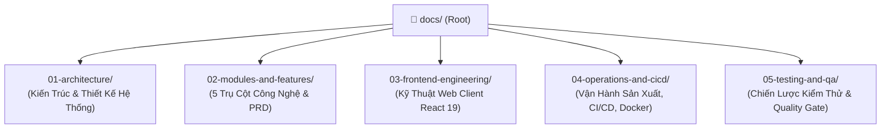

# Trung Tâm Quản Trị & Điều Hướng Tài Liệu Kỹ Thuật VeriScholar (Master Documentation Portal)

Chào mừng bạn đến với Cổng tài liệu kỹ thuật chính thức của nền tảng **VeriScholar** — Hệ thống Phân tích & Trợ lý Nghiên cứu Khoa học Đẳng cấp Quốc tế dành cho Học giả và Viện Nghiên cứu.

Toàn bộ hệ thống tài liệu đã được tái cấu trúc theo mô hình phân tầng khoa học (**Enterprise Hierarchical Taxonomy**), bảo đảm thông tin phản ánh 100% hiện trạng sản xuất, lưu trữ vĩnh viễn không thất thoát và cập nhật liên tục theo tiến độ dự án.

---

## 🏛️ SƠ ĐỒ CẤU TRÚC PHÂN TẦNG TÀI LIỆU (DOCUMENTATION TAXONOMY)



---

## 📑 BẢNG CHỈ MỤC TÀI LIỆU TOÀN DIỆN (MASTER NAVIGATION INDEX)

### 1. Phân Hệ 01: Kiến Trúc & Thiết Kế Hệ Thống ([`docs/01-architecture/`](file:///home/VeriScholar/Workspace/VeriScholar/docs/01-architecture/README.md))
| Tài liệu | Mô tả tóm tắt nội dung |
| :--- | :--- |
| **[architecture-overview.md](file:///home/VeriScholar/Workspace/VeriScholar/docs/01-architecture/architecture-overview.md)** | Kiến trúc lục giác (Hexagonal Architecture), phân tầng Ingress/Core/Persistence/Sandbox, và ranh giới nghiệp vụ bất biến. |
| **[backend-techstack.md](file:///home/VeriScholar/Workspace/VeriScholar/docs/01-architecture/backend-techstack.md)** | Toàn cảnh công nghệ Backend 5 Trụ Cột: Python 3.12, `uv` Monorepo, FastAPI, PostgreSQL 16 pgvector, Redis 7, ARQ Worker, PyMuPDF, Langfuse. |
| **[database-design.md](file:///home/VeriScholar/Workspace/VeriScholar/docs/01-architecture/database-design.md)** | Thiết kế CSDL PostgreSQL 16 + pgvector: Lược đồ quan hệ, triggers OCC (`handle_occ_and_timestamp`), triggers ngắt nguồn (`handle_note_source_detached`), chỉ mục HNSW và Full-Text. |
| **[api-specification.md](file:///home/VeriScholar/Workspace/VeriScholar/docs/01-architecture/api-specification.md)** | Quy chuẩn giao tiếp API: RESTful AIP-136/AIP-158, Unbuffered SSE Streaming, phân trang server-side, chuẩn xử lý lỗi RFC 7807 (Problem Details). |
| **[ai-guardrails-and-rag.md](file:///home/VeriScholar/Workspace/VeriScholar/docs/01-architecture/ai-guardrails-and-rag.md)** | Hàng rào an toàn AI: RAG 2 tầng, trích xuất tọa độ Bounding Box, ghép bảng (Table Stitching), kiểm tra tiền đề câu hỏi (Presupposition Validation). |
| **[prompt-management.md](file:///home/VeriScholar/Workspace/VeriScholar/docs/01-architecture/prompt-management.md)** | Quản lý Prompt học thuật: Phân tầng chỉ thị (System / Developer / User), định danh Socratic Mentor, co giãn ngân sách token (Elastic Table Budgeting). |
| **[scholar-profile-and-identity.md](file:///home/VeriScholar/Workspace/VeriScholar/docs/01-architecture/scholar-profile-and-identity.md)** | Hồ sơ học giả Academic Luxury 3 Tabs, định danh ORCID iD, Google Scholar, luồng Google Identity Services (GIS OAuth 2.0) và phòng thủ tấn công OIDC Confused Deputy Attack (CVSS 8.8). |
| **[directory-structure.md](file:///home/VeriScholar/Workspace/VeriScholar/docs/01-architecture/directory-structure.md)** | Cấu trúc thư mục Backend Monorepo `uv workspace`: `apps/api` (Driving Adapters), `packages/core` (Domain Entities & Ports), và quy chuẩn cách ly I/O tuyệt đối. |
| **[swagger-offline.md](file:///home/VeriScholar/Workspace/VeriScholar/docs/01-architecture/swagger-offline.md)** | Đặc tả ngoại tuyến Swagger OpenAPI 3.1.0 đầy đủ các schemas, payloads, headers và HTTP response codes. |

---

### 2. Phân Hệ 02: Đặc Tả Chi Tiết 5 Trụ Cột Công Nghệ ([`docs/02-modules-and-features/`](file:///home/VeriScholar/Workspace/VeriScholar/docs/02-modules-and-features/README.md))
| Tài liệu | Mô tả tóm tắt nội dung |
| :--- | :--- |
| **[prd.md](file:///home/VeriScholar/Workspace/VeriScholar/docs/02-modules-and-features/prd.md)** | Bản đặc tả yêu cầu sản phẩm (PRD) hoàn chỉnh 5 Trụ Cột: Bài toán nghiên cứu, cam kết bảo mật không lưu trữ (Zero-Retention Guarantee), SLAs hiệu năng và quy chuẩn bảo mật. |
| **[pillar-1-deep-reading.md](file:///home/VeriScholar/Workspace/VeriScholar/docs/02-modules-and-features/pillar-1-deep-reading.md)** | **Trụ Cột 1:** Không gian đọc sâu đa tab PDF.js, hiển thị lớp phủ Bounding Box, hỏi đáp đối thoại Socratic Copilot, và lưu trữ phiên đọc (Session Snapshots). |
| **[pillar-2-latex-writing.md](file:///home/VeriScholar/Workspace/VeriScholar/docs/02-modules-and-features/pillar-2-latex-writing.md)** | **Trụ Cột 2:** Không gian soạn thảo 3 cột thích ứng, **đồng bộ 1-chạm sang Overleaf** (`POST /api/v1/drafts/{id}:export-overleaf`), vòng lặp tự vá lỗi biên dịch LaTeX Sandbox, và bộ máy kiểm chứng sự thật SAFE Fact-Checking. |
| **[pillar-3-knowledge-capital.md](file:///home/VeriScholar/Workspace/VeriScholar/docs/02-modules-and-features/pillar-3-knowledge-capital.md)** | **Trụ Cột 3:** Sổ tay tri thức học giả, **Ký ức liên tưởng chủ động** (`POST /api/v1/drafts/{id}/associative-suggestions`), thẻ gợi ý Tia sáng Tri thức (Spark of Insight), Bản chụp bằng chứng đóng băng (Frozen Evidence Snapshot), và đồ thị trích dẫn 2-hop (GraphRAG). |
| **[pillar-4-literature-matrix.md](file:///home/VeriScholar/Workspace/VeriScholar/docs/02-modules-and-features/pillar-4-literature-matrix.md)** | **Trụ Cột 4:** **Ma trận so sánh tài liệu quy mô lớn (100+ bài báo)** với phân trang Server-side (`limit`, `offset`, `search`), bộ nhớ đệm truy vấn Redis, bộ lọc đa tiêu chí, xuất file CSV/Excel UTF-8 BOM chuẩn RFC 4180, và quản lý thư mục nghiên cứu. |
| **[pillar-5-enterprise-stack.md](file:///home/VeriScholar/Workspace/VeriScholar/docs/02-modules-and-features/pillar-5-enterprise-stack.md)** | **Trụ Cột 5:** Cụm triển khai On-Premise Air-Gapped (`deploy/docker-compose.enterprise.yml`), bộ cài đặt 1 lệnh (`scripts/bootstrap_enterprise.sh`), di trú CSDL Zero-Downtime (`init_db.py`), CD tự động kèm Auto-Rollback (`deploy_production.sh`), và phân hệ Hồ sơ học giả Academic Luxury. |

---

### 3. Phân Hệ 03: Kỹ Thuật Phát Triển Frontend Web ([`docs/03-frontend-engineering/`](file:///home/VeriScholar/Workspace/VeriScholar/docs/03-frontend-engineering/README.md))
| Tài liệu | Mô tả tóm tắt nội dung |
| :--- | :--- |
| **[frontend-architecture-and-standards.md](file:///home/VeriScholar/Workspace/VeriScholar/docs/03-frontend-engineering/frontend-architecture-and-standards.md)** | Kiến trúc ứng dụng React 19, TypeScript 5.9, Vite 8, TanStack Query v5, Zustand v5, tiêu chuẩn viết React Hooks, và quy chuẩn an toàn kiểu dữ liệu. |
| **[directory-structure.md](file:///home/VeriScholar/Workspace/VeriScholar/docs/03-frontend-engineering/directory-structure.md)** | Cấu trúc thư mục theo mô hình hướng tính năng (`apps/web/src/features/`): `auth`, `reader`, `writing`, `library`, `dashboard`. |
| **[academic-luxury-design-system.md](file:///home/VeriScholar/Workspace/VeriScholar/docs/03-frontend-engineering/academic-luxury-design-system.md)** | Hệ thống thiết kế Academic Luxury: Hệ màu Slate/Emerald/Indigo, kiểu chữ học thuật Serif/Sans, công thức toán KaTeX, và cơ chế vẽ lớp phủ tọa độ Bounding Box trực quan trên PDF Canvas. |

---

### 4. Phân Hệ 04: Vận Hành Sản Xuất, CI/CD & Hạ Tầng ([`docs/04-operations-and-cicd/`](file:///home/VeriScholar/Workspace/VeriScholar/docs/04-operations-and-cicd/README.md))
| Tài liệu | Mô tả tóm tắt nội dung |
| :--- | :--- |
| **[ci-quality-gates-guide.md](file:///home/VeriScholar/Workspace/VeriScholar/docs/04-operations-and-cicd/ci-quality-gates-guide.md)** | Hướng dẫn đường ống CI 9 chốt chặn: Ruff, Pytest với JUnit XML & Coverage, Hexagonal Boundary Check, Gitleaks, Oxlint, TypeScript, **Vitest Suite (378 tests)**, và **Docker Validation Gate**. |
| **[cd-and-production-operations.md](file:///home/VeriScholar/Workspace/VeriScholar/docs/04-operations-and-cicd/cd-and-production-operations.md)** | Hướng dẫn triển khai liên tục CD 6 pha khép kín: Pre-flight checks, Zero-Downtime Migration, đóng gói Web, Nginx reload, Systemd API restart, và **cơ chế Auto-Rollback khi health-check thất bại**. |
| **[docker-enterprise-guide.md](file:///home/VeriScholar/Workspace/VeriScholar/docs/04-operations-and-cicd/docker-enterprise-guide.md)** | Hướng dẫn vận hành hạ tầng Docker Enterprise: PostgreSQL 16 pgvector, PgBouncer pooler, Redis 7, ARQ Worker và kịch bản `bootstrap_enterprise.sh`. |
| **[logging-and-observability.md](file:///home/VeriScholar/Workspace/VeriScholar/docs/04-operations-and-cicd/logging-and-observability.md)** | Hệ thống nhật ký có cấu trúc Structlog JSON, PureASGITracingMiddleware, correlation ID (`x-request-id`), bọc lọc thông tin PII, và đo lường LLM qua Langfuse. |

---

### 5. Phân Hệ 05: Chiến Lược Kiểm Thử & Đảm Bảo Chất Lượng ([`docs/05-testing-and-qa/`](file:///home/VeriScholar/Workspace/VeriScholar/docs/05-testing-and-qa/README.md))
| Tài liệu | Mô tả tóm tắt nội dung |
| :--- | :--- |
| **[testing-strategy.md](file:///home/VeriScholar/Workspace/VeriScholar/docs/05-testing-and-qa/testing-strategy.md)** | Chiến lược kiểm thử đa tầng: Pytest backend (27 tests), 4 bài test an ninh thâm nhập (SQLi, XSS, Role Escalation, JWT Tampering), Vitest client (63 files, 378 tests), thanh lọc triệt để 2.105 dòng test trùng lặp. |
| **[quality-gates-certification.md](file:///home/VeriScholar/Workspace/VeriScholar/docs/05-testing-and-qa/quality-gates-certification.md)** | Báo cáo kiểm toán độc lập chính thức từ Lead Reviewer / Architecture Gatekeeper cấp chứng chỉ nghiệm thu Quality Gate Pass (100/100). |
| **[api-eval-snapshots.md](file:///home/VeriScholar/Workspace/VeriScholar/docs/05-testing-and-qa/api-eval-snapshots.md)** | Bộ ảnh chụp kiểm thử AI và đánh giá API ngoại tuyến (Offline Snapshot & Evaluation Datasets). |

---

## 🚀 HƯỚNG DẪN KHỞI ĐỘNG NHANH CHO KỸ SƯ MỚI (QUICK START)

```bash
# 1. Sao chép kho mã nguồn
git clone https://github.com/verischolar/verischolar.git
cd verischolar

# 2. Cài đặt phụ thuộc Backend (Python 3.12 + uv)
uv sync --all-packages

# 3. Cài đặt phụ thuộc Frontend (Node.js 20 + pnpm)
pnpm --dir apps/web install

# 4. Chạy kiểm thử toàn diện cục bộ (Pytest & Vitest)
uv run pytest
pnpm --dir apps/web test:run

# 5. Khởi động môi trường phát triển cục bộ
# Terminal 1: Backend API
uv run uvicorn api:app --reload --host 127.0.0.1 --port 8000
# Terminal 2: Frontend Web Client
pnpm --dir apps/web dev

# 6. Triển khai lên Production (Zero-Downtime)
./scripts/deploy_production.sh
```

---
*Bản quyền © 2026 VeriScholar Platform. Mọi quyền được bảo lưu.*
