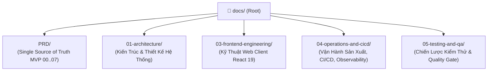

# Trung Tâm Quản Trị & Điều Hướng Tài Liệu Kỹ Thuật VeriScholar (Master Documentation Portal)

Chào mừng bạn đến với Cổng tài liệu kỹ thuật chính thức của nền tảng **VeriScholar** — Hệ thống Phân tích & Trợ lý Nghiên cứu Khoa học dành cho Học giả và Nghiên cứu sinh.

> **Single Source of Truth (Nguồn Chân Lý Duy Nhất):** Toàn bộ phạm vi sản phẩm, kiến trúc dữ liệu, giao diện và giám sát của phiên bản MVP được quy định chính thức tại thư mục **[`docs/PRD/`](PRD/00-overview-and-cleanup.md)** (`00-overview-and-cleanup.md` đến `07-monitoring-and-langfuse.md`).

---

## 🏛️ SƠ ĐỒ CẤU TRÚC PHÂN TẦNG TÀI LIỆU (DOCUMENTATION TAXONOMY)

---

## 📑 BẢNG CHỈ MỤC TÀI LIỆU TOÀN DIỆN (MASTER NAVIGATION INDEX)

### 0. Đặc Tả Yêu Cầu Sản Phẩm Chuẩn MVP ([`docs/PRD/`](PRD/00-overview-and-cleanup.md))
| Tài liệu | Mô tả tóm tắt nội dung |
| :--- | :--- |
| **[00-overview-and-cleanup.md](PRD/00-overview-and-cleanup.md)** | Tổng quan kiến trúc MVP, Taskbar 4 mục cốt lõi, lược đồ PostgreSQL + `pgvector`, và danh mục dọn dẹp các tính năng ngoài phạm vi. |
| **[01-auth-and-user.md](PRD/01-auth-and-user.md)** | Xác thực JWT, OTP qua Redis, Google Identity Services (GIS OAuth 2.0), và Modal Tài khoản & Giao diện. |
| **[02-discovery-and-documents-crud.md](PRD/02-discovery-and-documents-crud.md)** | Tìm kiếm bài báo học thuật ngoài, tải lên PDF, trích xuất cấu trúc/chunks và quản lý tài liệu. |
| **[03-sessions-and-deep-reading-crud.md](PRD/03-sessions-and-deep-reading-crud.md)** | Không gian Đọc sâu đa bài báo (1–5 PDF), Hybrid RAG SSE chat, đối chiếu Bounding Box, Smart Notes và Reference Drawer. |
| **[04-context-table-and-roadmap.md](PRD/04-context-table-and-roadmap.md)** | Bảng tổng hợp ngữ cảnh (Context Table) và lộ trình đọc bài báo học thuật trong phiên đọc. |
| **[05-favorite-library-and-graphrag.md](PRD/05-favorite-library-and-graphrag.md)** | Kho Yêu thích (`/library`), cây thư mục phân cấp và **4-Entity GraphRAG trên PostgreSQL + `pgvector`**. |
| **[06-agentic-overleaf-writing.md](PRD/06-agentic-overleaf-writing.md)** | Không gian Soạn thảo LaTeX nội bộ (`/writing`), biên dịch E2B/Tectonic Sandbox, trợ lý AI và xuất gói `.zip`. |
| **[07-monitoring-and-langfuse.md](PRD/07-monitoring-and-langfuse.md)** | Kiến trúc giám sát 3 tầng: Structlog JSON (`trace_id`), Langfuse Cloud (`verischolar-dev`, `verischolar-prod`), Sentry & Webhook. |

---

### 1. Phân Hệ 01: Kiến Trúc & Thiết Kế Hệ Thống ([`docs/01-architecture/`](01-architecture/README.md))
| Tài liệu | Mô tả tóm tắt nội dung |
| :--- | :--- |
| **[architecture-overview.md](01-architecture/architecture-overview.md)** | Kiến trúc lục giác (Hexagonal Architecture), phân tầng Ingress/Core/Persistence/Sandbox, và ranh giới nghiệp vụ bất biến. |
| **[backend-techstack.md](01-architecture/backend-techstack.md)** | Toàn cảnh công nghệ Backend: Python 3.12, `uv` Monorepo, FastAPI, PostgreSQL + `pgvector`, Redis 7, PyMuPDF, E2B Sandbox, Langfuse. |
| **[database-design.md](01-architecture/database-design.md)** | Thiết kế CSDL PostgreSQL + `pgvector`: Lược đồ quan hệ, bảng đồ thị `graph_nodes` & `graph_edges`, triggers OCC (`handle_occ_and_timestamp`), chỉ mục HNSW và Full-Text. |
| **[api-specification.md](01-architecture/api-specification.md)** | Quy chuẩn giao tiếp API: RESTful AIP-136, Unbuffered SSE Streaming, phân trang server-side, chuẩn xử lý lỗi. |
| **[ai-guardrails-and-rag.md](01-architecture/ai-guardrails-and-rag.md)** | Hàng rào an toàn AI: Hybrid RAG + GraphRAG, trích xuất tọa độ Bounding Box, đóng băng ngữ cảnh XML CDATA. |
| **[prompt-management.md](01-architecture/prompt-management.md)** | Quản lý Prompt học thuật: Phân tầng chỉ thị (System / Developer / User), định danh Socratic Mentor. |
| **[scholar-profile-and-identity.md](01-architecture/scholar-profile-and-identity.md)** | Hồ sơ học giả Academic Luxury 3 Tabs, định danh ORCID iD, Google Scholar, và phòng thủ OIDC Confused Deputy Attack. |
| **[directory-structure.md](01-architecture/directory-structure.md)** | Cấu trúc thư mục Backend Monorepo `uv workspace`: `apps/api` (Driving Adapters), `packages/core` (Domain Entities & Ports). |
| **[swagger-offline.md](01-architecture/swagger-offline.md)** | Đặc tả ngoại tuyến Swagger OpenAPI 3.1.0 đầy đủ các schemas, payloads, headers và HTTP response codes. |

---

### 2. Phân Hệ 03: Kỹ Thuật Phát Triển Frontend Web ([`docs/03-frontend-engineering/`](03-frontend-engineering/README.md))
| Tài liệu | Mô tả tóm tắt nội dung |
| :--- | :--- |
| **[frontend-architecture-and-standards.md](03-frontend-engineering/frontend-architecture-and-standards.md)** | Kiến trúc ứng dụng React 19, TypeScript, Vite, TanStack Query v5, Zustand v5, tiêu chuẩn viết React Hooks. |
| **[directory-structure.md](03-frontend-engineering/directory-structure.md)** | Cấu trúc thư mục theo mô hình hướng tính năng (`apps/web/src/features/`): `auth`, `dashboard`, `discovery`, `documents`, `library`, `notes`, `reader`, `sessions`, `writing`. |
| **[academic-luxury-design-system.md](03-frontend-engineering/academic-luxury-design-system.md)** | Hệ thống thiết kế Academic Luxury: Hệ màu học thuật, kiểu chữ Serif/Sans, công thức toán KaTeX, và lớp phủ tọa độ Bounding Box trực quan trên PDF Canvas. |

---

### 3. Phân Hệ 04: Vận Hành Sản Xuất, CI/CD & Quan Sát ([`docs/04-operations-and-cicd/`](04-operations-and-cicd/README.md))
| Tài liệu | Mô tả tóm tắt nội dung |
| :--- | :--- |
| **[ci-quality-gates-guide.md](04-operations-and-cicd/ci-quality-gates-guide.md)** | Hướng dẫn đường ống CI: Ruff, Pytest, Hexagonal Boundary Check, Gitleaks, Oxlint, TypeScript, Vitest Suite, và Docker Validation Gate. |
| **[cd-and-production-operations.md](04-operations-and-cicd/cd-and-production-operations.md)** | Hướng dẫn triển khai liên tục CD: Pre-flight checks, Zero-Downtime Migration, đóng gói Web, Nginx reload, Systemd API restart, và Auto-Rollback. |
| **[logging-and-observability.md](04-operations-and-cicd/logging-and-observability.md)** | Hệ thống nhật ký Structlog JSON, `PureASGITracingMiddleware`, `trace_id`, bọc lọc PII, và đo lường LLM qua Langfuse (`verischolar-dev` / `verischolar-prod`). |

---

### 4. Phân Hệ 05: Chiến Lược Kiểm Thử & Đảm Bảo Chất Lượng ([`docs/05-testing-and-qa/`](05-testing-and-qa/README.md))
| Tài liệu | Mô tả tóm tắt nội dung |
| :--- | :--- |
| **[testing-strategy.md](05-testing-and-qa/testing-strategy.md)** | Khung kiểm thử sạch cho MVP: Pytest (`ENVIRONMENT=test`, PostgreSQL + `pgvector`), Vitest + `jsdom` (`apps/web`), và cổng chất lượng CI. |

---
*Bản quyền © 2026 VeriScholar Platform. Mọi quyền được bảo lưu.*
