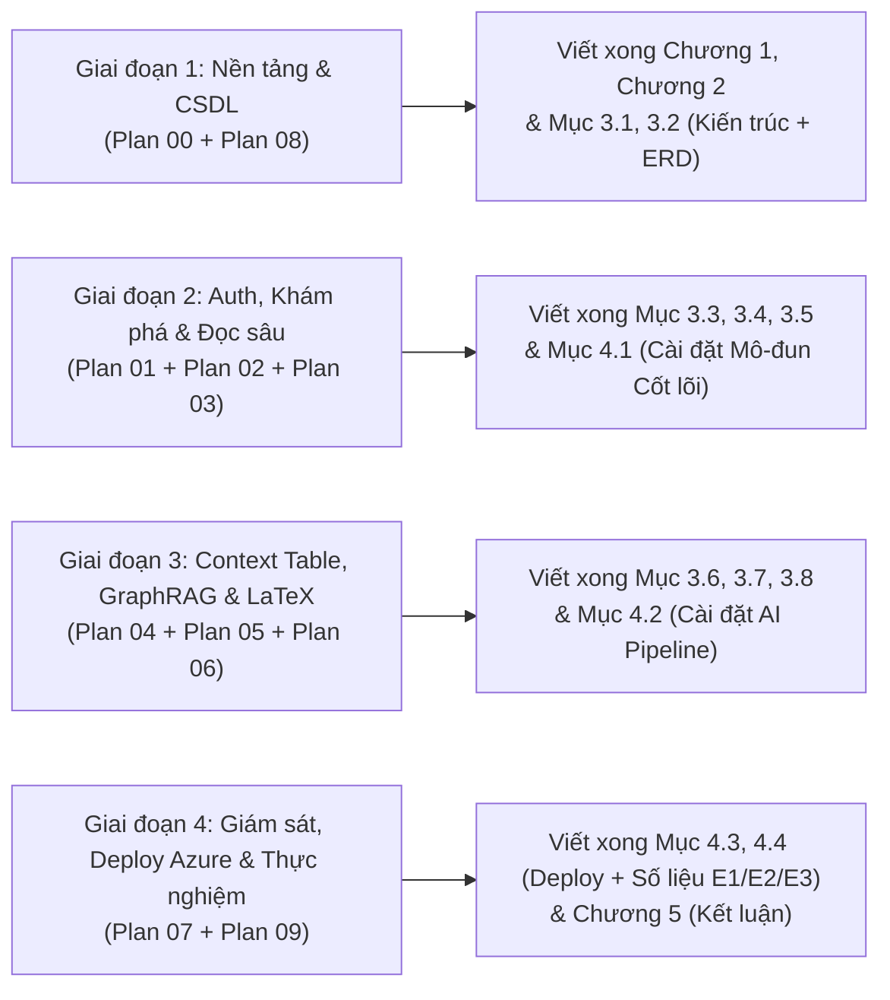

# Đề Cương Chi Tiết & Bản Đồ Ánh Xạ Báo Cáo Đồ Án Tốt Nghiệp Đại Học (Graduation Thesis Blueprint & Parallel Coding Guide)

**Đề tài gợi ý:** *Nghiên cứu và Xây dựng Nền tảng Trợ lý AI Nghiên cứu Khoa học Toàn trình Kết hợp Hybrid RAG Minh chứng Tọa độ, Mạng Tri thức 4-Thực thể (GraphRAG) và Tác nhân Tự sửa lỗi LaTeX (VeriScholar)*  
**Mục đích tài liệu:** Giúp sinh viên **vừa lập trình từng mô-đun theo kế hoạch TDD (`docs/superpowers/plans/`) vừa viết song song từng chương mục của Báo cáo Đồ án Tốt nghiệp** mà không phải chờ code xong mới viết.

---

## 1. Lộ Trình Lập Trình Song Song Với Viết Báo Cáo Đồ Án (Parallel Coding & Thesis Writing Roadmap)

---

## 2. Đề Cương 5 Chương Chuẩn Đồ Án Tốt Nghiệp CNTT & Nguồn Tư Liệu Trực Tiếp

### Chương 1: Giới Thiệu Đề Tài & Bài Toán Thực Tế (Introduction & Problem Formulation)

| Mục trong Báo cáo Đồ án | Nội dung cần trình bày | Tài liệu Nguồn trong Repo để trích xuất trực tiếp |
| :--- | :--- | :--- |
| **1.1. Đặt vấn đề & Bối cảnh nghiên cứu** | Sự bùng nổ số lượng bài báo khoa học (arXiv, Semantic Scholar) và hiện tượng ảo giác trích dẫn (Hallucination) của các công cụ LLM hội thoại thông thường. | [`PRD/00-overview-and-cleanup.md`](PRD/00-overview-and-cleanup.md) (Mục 1.1 & 1.2) |
| **1.2. Phân tích hạn chế của các giải pháp hiện có** | So sánh hạn chế của công cụ đọc PDF truyền thống, ChatPDF đơn lẻ (mất bố cục 2 cột, không chỉ rõ hộp tọa độ Bounding Box) và Overleaf thuần túy. | Bảng *Before vs. After Value Matrix* tại Mục 1.3 của toàn bộ [`PRD/01-auth-and-user.md`](PRD/01-auth-and-user.md) $\rightarrow$ [`PRD/06-agentic-overleaf-writing.md`](PRD/06-agentic-overleaf-writing.md) |
| **1.3. Mục tiêu và phạm vi của đề tài** | Xây dựng hệ sinh thái khép kín 4 không gian: Khám phá (`/discovery`) $\rightarrow$ Đọc sâu & Bảng ngữ cảnh (`/sessions`) $\rightarrow$ Thư viện & GraphRAG (`/library`) $\rightarrow$ Soạn thảo LaTeX (`/writing`). | [`PRD/00-overview-and-cleanup.md`](PRD/00-overview-and-cleanup.md) (Mục 2 & Mục 4) |
| **1.4. Đóng góp chính của đồ án** | (1) Nạp tài liệu 2 tầng + Khử trùng lặp CAS SHA-256; (2) Hybrid RAG RRF đối chiếu tọa độ `[0..1000]` trên PDF; (3) 4-Entity GraphRAG thuần PostgreSQL `pgvector` không cần Neo4j; (4) Tác nhân LangGraph tự sửa lỗi biên dịch LaTeX trên E2B Sandbox. | [`PRD/00-overview-and-cleanup.md`](PRD/00-overview-and-cleanup.md), [`PRD/08-deployment-and-system-evaluation.md`](PRD/08-deployment-and-system-evaluation.md) |
| **1.5. Bố cục báo cáo** | Tóm tắt nội dung 5 chương của quyển thuyết minh đồ án. | Mục 2 của tài liệu này |

---

### Chương 2: Cơ Sở Lý Thuyết & Công Nghệ Sử Dụng (Theoretical Background & Technologies)

| Mục trong Báo cáo Đồ án | Nội dung lý thuyết & Công thức toán học cần đưa vào | Tài liệu Nguồn trong Repo để trích xuất trực tiếp |
| :--- | :--- | :--- |
| **2.1. Kiến trúc Phần mềm Lục giác (Hexagonal Architecture / Ports & Adapters)** | Nguyên lý cô lập miền nghiệp vụ thuần khiết (`packages/core/`) khỏi tầng giao vận (`apps/api/`) và cơ sở dữ liệu; kiểm chứng tự động bằng cây cú pháp trừu tượng (Python AST). | [`specs/00-foundation-architecture-and-db.md`](specs/00-foundation-architecture-and-db.md) (Mục 1), [`specs/08-universal-agent-harness-spec.md`](specs/08-universal-agent-harness-spec.md) |
| **2.2. Tìm kiếm Lai (Hybrid Search) & Thuật toán Hợp nhất Xếp hạng Đảo ngược (RRF)** | Biểu diễn vector dày 1024 chiều (`BGE-M3` trên chỉ mục đồ thị `pgvector` HNSW), tìm kiếm từ khóa toàn văn (`tsvector` GIN) và công thức hợp nhất $\text{RRF}(d) = \sum \frac{1}{k + \text{rank}_i(d)}$ với $k=60$. | [`specs/03-sessions-and-deep-reading-spec.md`](specs/03-sessions-and-deep-reading-spec.md) (Mục 3), [`specs/09-deployment-cicd-and-evaluation-spec.md`](specs/09-deployment-cicd-and-evaluation-spec.md) (Mục 4 - Thực nghiệm 2) |
| **2.3. Đồ thị Tri thức Học thuật (Academic GraphRAG) trên CSDL Quan hệ** | Mô hình hóa 4 thực thể học thuật (`Paper`, `Method`, `Dataset`, `MetricResult`) và 4 loại cạnh quan hệ; thuật toán hợp nhất nút trùng lặp (Canonical Hub Merging) và duyệt đồ thị 2 bước bằng truy vấn đệ quy SQL CTE. | [`specs/05-favorite-library-and-graphrag-spec.md`](specs/05-favorite-library-and-graphrag-spec.md) (Mục 2 & Mục 3) |
| **2.4. Máy trạng thái Tác nhân AI (LangGraph ReAct StateGraph) & Sandbox Đám mây** | Chu trình Suy luận - Hành động - Quan sát (ReAct) giới hạn 3 vòng lặp để tự động đọc nhật ký lỗi `pdflatex`/`bibtex` từ E2B Cloud Sandbox và vá mã nguồn LaTeX. | [`specs/06-agentic-overleaf-writing-spec.md`](specs/06-agentic-overleaf-writing-spec.md) (Mục 3 & Mục 4) |
| **2.5. Truyền tải Sự kiện Thời gian thực (Server-Sent Events - SSE) & Chuẩn hóa Tọa độ PDF** | Giao thức HTTP/1.1 Chunked SSE một chiều độ trễ thấp và phép biến đổi hệ tọa độ trang PDF sang không gian chuẩn hóa `[0..1000]` độc lập độ phân giải. | [`specs/03-sessions-and-deep-reading-spec.md`](specs/03-sessions-and-deep-reading-spec.md) (Mục 2 & Mục 4) |

---

### Chương 3: Phân Tích & Thiết Kế Hệ Thống (System Analysis & Design)

| Mục trong Báo cáo Đồ án | Sơ đồ & Bảng thiết kế cần có trong báo cáo | Tài liệu Nguồn trong Repo (Có sẵn Sơ đồ Mermaid & Bảng) |
| :--- | :--- | :--- |
| **3.1. Xác định Tác nhân (Actors) & Tổng quan Ca sử dụng (Use Case Diagram)** | Bảng phân loại tác nhân và danh mục Use Case toàn hệ thống (30 Use Cases chuẩn BA từ `UC-00.1` đến `UC-08.4`). | Mục 2 của [`PRD/00-overview-and-cleanup.md`](PRD/00-overview-and-cleanup.md) $\rightarrow$ [`PRD/08-deployment-and-system-evaluation.md`](PRD/08-deployment-and-system-evaluation.md) |
| **3.2. Thiết kế Kiến trúc Tổng thể & Thiết kế Cơ sở dữ liệu Vật lý (16 Bảng)** | Sơ đồ khối kiến trúc 4 tầng và Sơ đồ Thực thể Liên kết (ERD) của 16 bảng PostgreSQL 16+ kèm chỉ mục HNSW/GIN. | [`specs/00-foundation-architecture-and-db.md`](specs/00-foundation-architecture-and-db.md) (Mục 1 & Mục 2), [`superpowers/specs/2026-10-25-foundation-architecture-and-db-design.md`](superpowers/specs/2026-10-25-foundation-architecture-and-db-design.md) |
| **3.3. Phân tích & Thiết kế Phân hệ Xác thực, Hồ sơ Học giả & Khóa BYOK** | Đặc tả Use Case `UC-01.1..01.4`, sơ đồ trình tự (Sequence Diagram) đăng nhập JWT/OTP/Google OAuth và mã hóa khóa API bằng AES-256-GCM. | [`PRD/01-auth-and-user.md`](PRD/01-auth-and-user.md), [`specs/01-auth-and-user-spec.md`](specs/01-auth-and-user-spec.md) |
| **3.4. Phân tích & Thiết kế Phân hệ Khám phá Học thuật & Nạp Tài liệu 2 Tầng** | Đặc tả `UC-02.1..02.4`, luồng tìm kiếm liên hợp (Exa + Semantic Scholar + arXiv) và cơ chế lưu trữ khử trùng lặp CAS SHA-256. | [`PRD/02-discovery-and-documents-crud.md`](PRD/02-discovery-and-documents-crud.md), [`specs/02-discovery-and-documents-spec.md`](specs/02-discovery-and-documents-spec.md) |
| **3.5. Phân tích & Thiết kế Phân hệ Đọc sâu Đa bài báo & Đối thoại Hybrid RAG** | Đặc tả `UC-03.1..03.5`, sơ đồ luồng SSE Hybrid RAG kèm trích dẫn nhảy trang PDF (`BoundingBox`) và quản lý Ghi chú thông minh. | [`PRD/03-sessions-and-deep-reading-crud.md`](PRD/03-sessions-and-deep-reading-crud.md), [`specs/03-sessions-and-deep-reading-spec.md`](specs/03-sessions-and-deep-reading-spec.md) |
| **3.6. Phân tích & Thiết kế Phân hệ Bảng Ngữ cảnh 3 Cột & Lộ trình Đọc Socratic** | Đặc tả `UC-04.1..04.3`, thiết kế bảng đối chiếu 3 cột và thuật toán xây dựng lộ trình đọc tài liệu tham khảo tuần tự. | [`PRD/04-context-table-and-roadmap.md`](PRD/04-context-table-and-roadmap.md), [`specs/04-context-table-and-roadmap-spec.md`](specs/04-context-table-and-roadmap-spec.md) |
| **3.7. Phân tích & Thiết kế Phân hệ Thư viện Yêu thích & Mạng Tri thức 4-Entity GraphRAG** | Đặc tả `UC-05.1..05.4`, lược đồ `graph_nodes`/`graph_edges`, thuật toán trích xuất thực thể và truy vấn tổng hợp liên bài báo. | [`PRD/05-favorite-library-and-graphrag.md`](PRD/05-favorite-library-and-graphrag.md), [`specs/05-favorite-library-and-graphrag-spec.md`](specs/05-favorite-library-and-graphrag-spec.md) |
| **3.8. Phân tích & Thiết kế Phân hệ Soạn thảo LaTeX & Tác nhân LangGraph + E2B** | Đặc tả `UC-06.1..06.4`, sơ đồ máy trạng thái LangGraph tự sửa lỗi biên dịch LaTeX và cơ chế hoàn tác 1 chạm (`previous_tex_content`). | [`PRD/06-agentic-overleaf-writing.md`](PRD/06-agentic-overleaf-writing.md), [`specs/06-agentic-overleaf-writing-spec.md`](specs/06-agentic-overleaf-writing-spec.md) |

---

### Chương 4: Cài Đặt, Triển Khai Hạ Tầng & Thực Nghiệm Đánh Giá (Implementation, Deployment & Quantitative Evaluation)

| Mục trong Báo cáo Đồ án | Nội dung thực thi & Bảng biểu kết quả thực nghiệm | Kế hoạch TDD & Spec đối ứng |
| :--- | :--- | :--- |
| **4.1. Môi trường Cài đặt & Tổ chức Kho mã nguồn Monorepo** | Cấu trúc thư mục `packages/core`, `apps/api`, `apps/web`, `deploy/`; bộ công cụ `uv`, `pnpm`, `PostgreSQL 18 + pgvector`, `Redis 7` và kịch bản khởi tạo dữ liệu mẫu `scripts/dev/seed.py`. | [`superpowers/plans/2026-10-25-00-foundation-architecture-and-db.md`](superpowers/plans/2026-10-25-00-foundation-architecture-and-db.md) $\rightarrow$ [`superpowers/plans/2026-10-25-08-universal-agent-harness.md`](superpowers/plans/2026-10-25-08-universal-agent-harness.md) |
| **4.2. Kiến trúc Giám sát Vận hành, Khử thông tin Nhạy cảm & Truy vết Langfuse** | Triển khai `PureASGITracingMiddleware` đo `ttfb_ms`, nhật ký Structlog JSON tự động che khóa API và theo dõi chi phí token trên Langfuse Cloud. | [`PRD/07-monitoring-and-langfuse.md`](PRD/07-monitoring-and-langfuse.md), [`specs/07-monitoring-and-langfuse-spec.md`](specs/07-monitoring-and-langfuse-spec.md), [`superpowers/plans/2026-10-25-07-monitoring-and-langfuse.md`](superpowers/plans/2026-10-25-07-monitoring-and-langfuse.md) |
| **4.3. Triển khai Hệ thống trên Máy chủ Azure Ubuntu VM & Pipeline CI/CD 2 Tầng** | Sơ đồ triển khai vật lý trên Azure Ubuntu VM, cấu hình Nginx TLS 1.3 tắt bộ đệm cho 5 tuyến SSE, cô lập cổng DB nội bộ và luồng GitHub Actions CI/CD 2 tầng Fast-Fail. | [`PRD/08-deployment-and-system-evaluation.md`](PRD/08-deployment-and-system-evaluation.md), [`specs/09-deployment-cicd-and-evaluation-spec.md`](specs/09-deployment-cicd-and-evaluation-spec.md) (Mục 1, 2, 3), [`superpowers/plans/2026-10-25-09-deployment-cicd-and-evaluation.md`](superpowers/plans/2026-10-25-09-deployment-cicd-and-evaluation.md) |
| **4.4. Kết quả Thực nghiệm Định lượng (E1: Độ trễ, E2: Độ chính xác AI, E3: Ma trận Kiểm thử)** | Trình bày bảng kết quả đo thực tế đối chiếu với SLA mục tiêu: `PERF-01..05` (TTFT $< 1.5\text{s}$), `Recall@5 >= 0.85`, `Bounding Box IoU >= 0.85`, tỷ lệ tự sửa lỗi LaTeX $\ge 90\%$ và 4 Cổng Kiểm thử Tự động. | [`specs/09-deployment-cicd-and-evaluation-spec.md`](specs/09-deployment-cicd-and-evaluation-spec.md) (Mục 4: Thực nghiệm 1, 2, 3) |

---

### Chương 5: Kết Luận & Hướng Phát Triển (Conclusion & Future Work)

| Mục trong Báo cáo Đồ án | Nội dung tổng kết | Nguồn tham chiếu |
| :--- | :--- | :--- |
| **5.1. Kết quả đạt được** | Hoàn thiện nền tảng VeriScholar MVP chạy thực tế trên Azure Ubuntu VM, giải quyết trọn vẹn bài toán đọc sâu minh chứng tọa độ, tổng hợp đồ thị tri thức 4 thực thể và soạn thảo LaTeX tự sửa lỗi. | Tổng hợp từ bảng nghiệm thu tại [`PRD/08-deployment-and-system-evaluation.md`](PRD/08-deployment-and-system-evaluation.md) (Mục 4.2) |
| **5.2. Hạn chế của đề tài** | Phụ thuộc kết nối mạng tới E2B Cloud khi biên dịch các gói LaTeX ngoại cỡ; giới hạn tối đa 5 bài báo mở đồng thời trong một phiên đọc sâu để tối ưu bộ nhớ trình duyệt. | [`PRD/00-overview-and-cleanup.md`](PRD/00-overview-and-cleanup.md), [`PRD/06-agentic-overleaf-writing.md`](PRD/06-agentic-overleaf-writing.md) |
| **5.3. Hướng phát triển tiếp theo** | (1) Hỗ trợ cộng tác thời gian thực nhiều tác giả qua CRDT/Yjs trên trình soạn thảo LaTeX; (2) Bổ sung phân tích biểu đồ hình ảnh đa phương thức chuyên sâu; (3) Triển khai cụm worker phân tán cho thư viện hàng chục nghìn bài báo. | Lộ trình mở rộng hậu MVP |

---

## 6. Danh Mục 30 Sơ Đồ Kiến Trúc, Use Case & UML Tuần Tự Chuẩn Bài Báo Khoa Học (Paper-Grade Figure Catalog)

Toàn bộ các sơ đồ Mermaid trong `docs/PRD/` và `docs/specs/` đã được chuẩn hóa theo phong cách **Kiến trúc Khái niệm Bài báo Khoa học (Paper-Grade Conceptual Pipeline & UML)** — không chứa tên file mã nguồn (`.tsx`, `.py`), không chứa thẻ HTML gây lỗi hiển thị, chữ to rõ trên khổ giấy dọc A4 khi xuất ra ảnh PNG/SVG để chèn vào Đồ án Tốt nghiệp:

| Hình vẽ gợi ý trong Đồ án | Loại sơ đồ | Nội dung biểu diễn học thuật | Nguồn trích xuất trực tiếp |
| :--- | :--- | :--- | :--- |
| **Hình 1.1** | Conceptual Flow | Chu trình nghiên cứu khoa học toàn trình 5 bước trên VeriScholar | [`docs/PRD/00-overview-and-cleanup.md`](./PRD/00-overview-and-cleanup.md) |
| **Hình 2.1 – 2.8** | Use Case Diagrams | Sơ đồ Tác nhân & Ca sử dụng (Use Case) cho toàn bộ 8 phân hệ (`PRD-01` $\rightarrow$ `PRD-08`) | [`docs/PRD/01-auth-and-user.md`](./PRD/01-auth-and-user.md) $\rightarrow$ [`docs/PRD/08-deployment-and-system-evaluation.md`](./PRD/08-deployment-and-system-evaluation.md) |
| **Hình 3.1** | Hexagonal Architecture | Kiến trúc Lục giác 3 tầng (Driving Adapters $\rightarrow$ Pure Core $\rightarrow$ Driven Adapters) | [`docs/specs/00-foundation-architecture-and-db.md`](./specs/00-foundation-architecture-and-db.md) (Block #1) |
| **Hình 3.2** | Entity-Relationship (`erDiagram`) | Lược đồ Quan hệ Thực thể (ERD) 16 bảng PostgreSQL 18 + `pgvector` | [`docs/specs/00-foundation-architecture-and-db.md`](./specs/00-foundation-architecture-and-db.md) (Block #2) |
| **Hình 3.3 & 3.4** | Pipeline + `sequenceDiagram` | Kiến trúc Bảo mật Định danh & Két khóa BYOK AES-256-GCM + Biểu đồ Tuần tự UML | [`docs/specs/01-auth-and-user-spec.md`](./specs/01-auth-and-user-spec.md) |
| **Hình 3.5 – 3.7** | Pipeline + `stateDiagram-v2` + `sequenceDiagram` | Đường ống Khám phá Đa nguồn & Nạp 2 Tầng + Máy trạng thái Tài liệu + Biểu đồ Tuần tự | [`docs/specs/02-discovery-and-documents-spec.md`](./specs/02-discovery-and-documents-spec.md) |
| **Hình 3.8 & 3.9** | Paper-Style RAG + `sequenceDiagram` | Kiến trúc Hybrid RAG (HNSW Cosine + BM25 FTS + RRF $k=60$) & Đồng bộ Khung viền vàng BBox | [`docs/specs/03-sessions-and-deep-reading-spec.md`](./specs/03-sessions-and-deep-reading-spec.md) |
| **Hình 3.10 & 3.11** | Pipeline + `sequenceDiagram` | Bảng Ngữ cảnh 3 Cột & Lộ trình Socratic ($A \rightarrow B \rightarrow C \rightarrow D$) + Biểu đồ Tuần tự Nạp lười | [`docs/specs/04-context-table-and-roadmap-spec.md`](./specs/04-context-table-and-roadmap-spec.md) |
| **Hình 3.12 & 3.13** | GraphRAG Pipeline + `sequenceDiagram` | Đường ống Trích xuất & Hợp nhất Đỉnh Đồ thị 4 Thực thể (Canonical Hub Merging) + Biểu đồ Tuần tự | [`docs/specs/05-favorite-library-and-graphrag-spec.md`](./specs/05-favorite-library-and-graphrag-spec.md) |
| **Hình 3.14 – 3.16** | System + ReAct Flowchart + `sequenceDiagram` | Kiến trúc IDE LaTeX 3 Cột + Lưu đồ Thuật toán ReAct Tự sửa lỗi 3 vòng + Biểu đồ Tuần tự E2B | [`docs/specs/06-agentic-overleaf-writing-spec.md`](./specs/06-agentic-overleaf-writing-spec.md) |
| **Hình 3.17 & 3.18** | Telemetry Pipeline + `sequenceDiagram` | Kiến trúc Quan sát 3 Tầng (Langfuse + Khử PII) + Biểu đồ Tuần tự Truy vết ASGI | [`docs/specs/07-monitoring-and-langfuse-spec.md`](./specs/07-monitoring-and-langfuse-spec.md) |
| **Hình 3.19 & 3.20** | Harness Architecture + `sequenceDiagram` | Kiến trúc Khung Tác nhân 4 Tầng & Giao thức Tự học Chống tái phạm (`/learn`) | [`docs/specs/08-universal-agent-harness-spec.md`](./specs/08-universal-agent-harness-spec.md) |
| **Hình 4.1** | Cloud Deployment Topology | Kiến trúc Triển khaiThực tế trên Máy chủ Đám mây Azure Ubuntu VM & Nginx SSE Không đệm | [`docs/specs/09-deployment-cicd-and-evaluation-spec.md`](./specs/09-deployment-cicd-and-evaluation-spec.md) |

