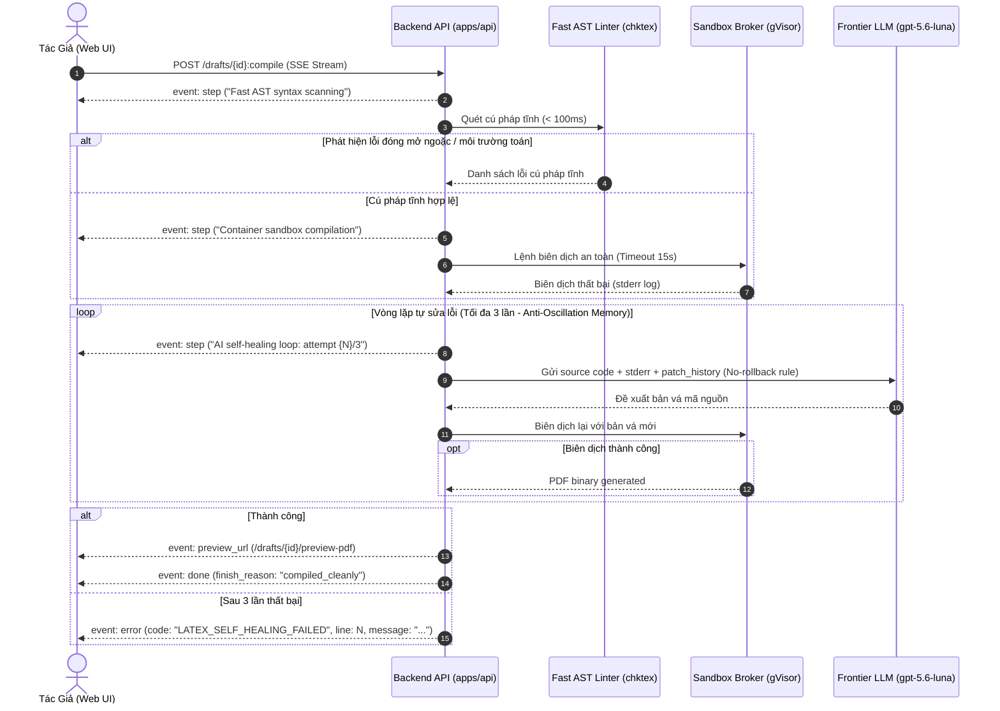
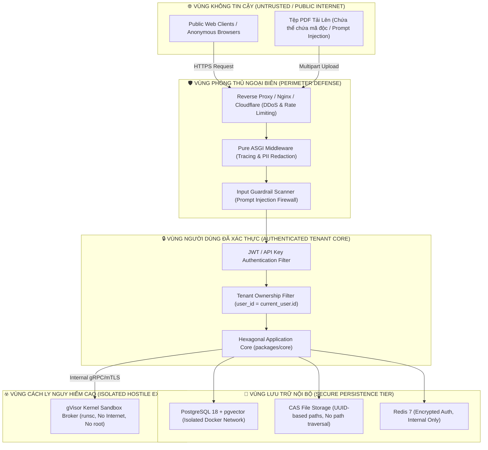

# Kiến Trúc Hệ Thống & Phần Mềm VeriScholar (Production-Grade Architecture Specification)

Tài liệu này xác lập quy chuẩn kiến trúc hệ thống (**System Architecture**), kiến trúc phần mềm lục giác (**Hexagonal / Ports & Adapters Architecture**), thiết kế thành phần chi tiết, mô hình dữ liệu, ranh giới tin cậy (**Trust Boundaries & Threat Modeling**), và quy tắc kỹ thuật vận hành theo chuẩn mực quốc tế:
- **Clean Architecture** (Robert C. Martin)
- **Clean Code** (Robert C. Martin)
- **Designing Data-Intensive Applications v2** (Martin Kleppmann)
- **AI Engineering & Machine Learning Systems Design** (Chip Huyen)

---

## 1. TỔNG QUAN HỆ THỐNG & CONTEXT DIAGRAM (C4 MODEL LEVEL 1 & 2)

### 1.1. Bối cảnh Hệ thống (System Context - Level 1)

VeriScholar là nền tảng trợ lý nghiên cứu và soạn thảo bài báo khoa học dựa trên Hybrid RAG đa phương thức và kiểm chứng sự thật có căn cứ tọa độ (`BoundingBox`).

```mermaid
flowchart TB
    Researcher["👨‍🔬 Người Nghiên Cứu / Tác Giả<br/>(Sinh viên, Nghiên cứu sinh, Giảng viên)"]
    Reviewer["👥 Đồng Nghiệp / Phản Biện<br/>(Collaborators / Reviewers)"]

    subgraph VeriScholarBoundary ["🛡️ Ranh Giới Hệ Thống VeriScholar (System Boundary)"]
        VeriScholarPlatform["Hệ Thống Trợ Lý Khoa Học VeriScholar<br/>- Đọc sâu đa bài & Chatbot Socratic<br/>- Sổ tay Smart Notes & Active Recall<br/>- Soạn thảo LaTeX & Sandbox Compiler<br/>- SAFE Fact-Checking & Citation Graph<br/>- Quản lý Thư viện & RAG Phân tầng"]
    end

    subgraph ExternalAcademicTier ["🌐 Dịch Vụ Học Thuật Quốc Tế (Official Academic Gateways)"]
        Crossref["Crossref & DOI.org API"]
        SemanticScholar["Semantic Scholar Graph API"]
        ArXiv["arXiv.org API"]
        PubMed["PubMed / NCBI E-utilities"]
        Unpaywall["Unpaywall Open-Access API"]
    end

    subgraph ExternalInferenceTier ["🤖 Hạ Tầng Suy Luận AI (Inference Engines)"]
        OpenAI["OpenAI API / Cloud Frontier LLM<br/>(gpt-5.6-luna / text-embedding-3-small)"]
        Cohere["Cohere Rerank API v3.5"]
        LocalLLM["Docker Model Runner / Ollama<br/>(Offline Local Inference)"]
    end

    Researcher -->|Upload PDF, Hỏi đáp, Soạn thảo, Quản lý kho| VeriScholarPlatform
    Reviewer -->|Xem chia sẻ, Bình luận bản thảo (Read-Only/Comment)| VeriScholarPlatform
    VeriScholarPlatform -->|Phân giải DOI, Tải Open-Access PDF| ExternalAcademicTier
    VeriScholarPlatform -->|Dense Vectors, LLM Stream, Cross-Encoder Rerank| ExternalInferenceTier
```

---

## 2. KIẾN TRÚC PHẦN MỀM LỤC GIÁC (HEXAGONAL / PORTS & ADAPTERS)

Hệ thống tuân thủ triệt để nguyên lý phụ thuộc hướng tâm (**The Dependency Rule**): Nghiệp vụ miền (`packages/core`) hoàn toàn không phụ thuộc vào framework, cơ sở dữ liệu hay hạ tầng mạng.

```mermaid
flowchart TD
    subgraph DrivingLayer ["🔌 DRIVING ADAPTERS (Tầng Tiếp Nhận & Điều Khiển - apps/api)"]
        HTTPRouters["FastAPI Routers (/documents, /sessions, /notes, /drafts, /folders, /library, /shares)"]
        SSEEngine["Server-Sent Events Streaming Engine (Token, Citations, Reasoning)"]
        ASGITracing["Pure ASGI Tracing Middleware (X-Request-ID, TTFB, Client Abort HTTP 499)"]
        AuthMiddleware["JWT Authentication & RBAC Middleware"]
    end

    subgraph InboundPortsLayer ["🚪 INBOUND PORTS / USE CASES (Giao Diện Nghiệp Vụ - packages/core/application)"]
        IngestDocUC["IngestDocumentUseCase"]
        ParseDocUC["ParseDocumentUseCase"]
        AskSessionUC["AskSessionQuestionUseCase"]
        CompileDraftUC["CompileDraftSandboxUseCase"]
        VerifyClaimsUC["VerifyDraftClaimsUseCase"]
        ResolveRefsUC["ResolveReferencesUseCase"]
        SynthesizeLibUC["SynthesizeLibraryUseCase"]
    end

    subgraph DomainCoreLayer ["💎 PURE DOMAIN CORE (Thực Thể & Quy Tắc Miền - packages/core/domain)"]
        DocEntity["Document Entity (CAS Blob, Multi-Tenant)"]
        ChunkEntity["DocumentChunk Entity (Immutable, Normalized BBox)"]
        SessionEntity["ResearchSession Entity (Max 5 Papers, Viewport State)"]
        TurnEntity["SessionTurn Entity (Question, Grounded Answer, Citations)"]
        NoteEntity["ResearchNote Entity (Frozen Evidence Snapshot)"]
        DraftEntity["Draft Entity (OCC Version, LaTeX Source)"]
        GuardrailsService["3-Tier AI Guardrails (Input, XML Sandboxing, Grounding)"]
        ValueObjects["BoundingBox [x0,y0,x1,y1,page] | PageMetadata | ViewportState"]
    end

    subgraph OutboundPortsLayer ["🚪 OUTBOUND PORTS (Giao Diện Hạ Tầng - packages/core/ports)"]
        IDocRepo["IDocumentRepository"]
        IChunkRepo["IDocumentChunkRepository (Vector + Lexical)"]
        ISessionRepo["IResearchSessionRepository"]
        IDraftRepo["IDraftRepository"]
        INoteRepo["IResearchNoteRepository"]
        ITaskQueue["ITaskQueuePort (Durable Queue)"]
        ISandboxBroker["ISandboxBrokerPort (Compile Sandbox)"]
        ILLMGateway["ILLMGatewayPort (Stream, Thinking Toggle)"]
        IEmbedding["IEmbeddingPort (1536-dim)"]
        IRerank["IRerankPort (Cross-Encoder)"]
        IStorage["IBlobStoragePort (CAS Physical Files)"]
        IIdempotency["IIdempotencyPort (24h Cache)"]
    end

    subgraph DrivenLayer ["🔌 DRIVEN ADAPTERS (Hạ Tầng Cụ Thể - packages/core/infrastructure & apps/api)"]
        SQLDocRepo["PostgresDocumentRepository (SQLAlchemy Async)"]
        SQLChunkRepo["PostgresChunkRepository (pgvector HNSW + tsvector GIN)"]
        RedisTaskQueue["RedisStreamsTaskQueueAdapter"]
        PyMuPDFParser["PyMuPDFEngineAdapter (Layout-Aware BBox)"]
        LocalCAS["LocalStorageAdapter (Content-Addressable Storage)"]
        OpenAIGateway["OpenAIGatewayAdapter (gpt-5.6-luna / text-embedding-3-small)"]
        CohereAdapter["CohereRerankAdapter (v3.5)"]
        SandboxClient["SandboxGRPCClientAdapter (gVisor runsc)"]
        RedisIdempotency["RedisIdempotencyAdapter (TTL 24h)"]
    end

    DrivingLayer --> InboundPortsLayer
    InboundPortsLayer --> DomainCoreLayer
    DomainCoreLayer --> OutboundPortsLayer
    DrivenLayer -.->|Implements| OutboundPortsLayer
```



---

## 3. KIẾN TRÚC DỮ LIỆU & LƯU TRỮ (DATA-INTENSIVE ARCHITECTURE)
*(Áp dụng các nguyên lý từ "Designing Data-Intensive Applications v2" — Martin Kleppmann)*

### 3.1. Phân Tách Lưu Trữ Đa Người Thuê & Khử Trùng Lặp (Multi-Tenant CAS Blob Deduplication)
- **Vấn đề:** Nhiều nhà nghiên cứu cùng tải lên bài báo phổ biến (ví dụ: *Attention Is All You Need*, 2.2MB). Nếu lưu trữ trùng lặp: lãng phí dung lượng đĩa, tốn chi phí bóc tách và tính toán vector embedding.
- **Giải pháp:** Content-Addressable Storage (CAS):
  1. File vật lý được lưu trữ theo mã băm SHA-256: `storage/blobs/{content_hash}.pdf`.
  2. Bảng `document_storage_blobs` theo dõi `content_hash`, `file_size_bytes`, `storage_path`, và biến đếm tham chiếu `ref_count`.
  3. Bảng `documents` lưu trữ thực thể nghiệp vụ riêng biệt của từng người dùng (`user_id`, UUID độc lập, trạng thái riêng, thư mục riêng).
  4. **Quy trình Ingestion Lũy Đẳng (Idempotent Ingestion):**
     - Khi User B nạp file trùng `content_hash` với User A: Tái sử dụng ngay lập tức các vector chunks trong DB, tăng `ref_count = ref_count + 1`, tạo bản ghi `documents` mới cho User B dưới 500ms mà không cần bóc tách lại.
  5. **Cam kết Bảo mật Xóa Sạch (Zero-Retention Guarantee):**
     - Khi User A xóa bài báo: `ON DELETE CASCADE` xóa toàn bộ chunks, summaries, chat history thuộc sở hữu của User A.
     - `ref_count` trong `document_storage_blobs` giảm 1.
     - Tệp PDF vật lý trên đĩa cứng chỉ bị xóa vĩnh viễn (`unlink`) khi `ref_count == 0`, bảo đảm không bao giờ xóa nhầm tài liệu của User B trong khi vẫn thực thi triệt để chính sách Zero-Retention khi người dùng cuối cùng rời đi.

### 3.2. Cơ Chế Khóa Lạc Quan Bất Biến (RFC 9110 / RFC 7232 OCC)
- Áp dụng trên các thực thể có đột biến dữ liệu: `research_notes`, `drafts`, `research_sessions`.
- Cột `version INT NOT NULL DEFAULT 1` được quản trị tự động qua Database Trigger `handle_occ_and_timestamp()`:
  ```sql
  CREATE OR REPLACE FUNCTION handle_occ_and_timestamp()
  RETURNS TRIGGER AS $$
  BEGIN
      NEW.updated_at = NOW();
      NEW.version = OLD.version + 1;
      RETURN NEW;
  END;
  $$ LANGUAGE plpgsql;
  ```
- Tầng giao thức HTTP:
  - Phản hồi trả về `ETag: "v{version}"`.
  - Client gửi yêu cầu sửa đổi đính kèm `If-Match: "v{version}"`.
  - Nếu `version` trong DB đã bị thay đổi trước đó: Hệ thống từ chối ngay với **`HTTP 412 Precondition Failed`**, ngăn chặn hoàn toàn hiện tượng Lost Update (ghi đè mất dữ liệu).

### 3.3. Bảo Toàn Bằng Chứng Đóng Băng (Frozen Evidence Snapshot)
- Khi người dùng xóa một bài báo PDF khỏi kho thư viện:
  - Khóa ngoại `document_id` trong `research_notes` được cấu hình `ON DELETE SET NULL`.
  - Database Trigger `handle_note_source_detached()` lập tức chuyển cờ `is_source_detached = TRUE`.
  - Toàn bộ trích dẫn nguyên văn (`quote_text`), số trang (`page_number`), tọa độ (`bounding_boxes`), tên bài báo, tác giả được bảo tồn bất biến trong trường `frozen_snapshot JSONB`.
  - Người dùng không bao giờ bị mất tư duy ghi chú, giao diện hiển thị huy hiệu `[⚠️ Nguồn đã ngắt]` và hỗ trợ tính năng re-link khi tải lại file PDF.

### 3.4. Kiểm Soát Tranh Chấp Số Lượng Bài Báo trong Phiên (Phantom Read Prevention)
- Giới hạn cứng: Mỗi phiên nghiên cứu chỉ chứa từ 1 đến tối đa 5 bài báo.
- Để chống hiện tượng tranh chấp ghi đồng thời (Race Condition / Write Skew khi 2 request nạp bài báo thứ 5 cùng 1 thời điểm):
  - Trước khi chèn bản ghi vào `session_documents`, hệ thống thực thi khóa hàng tường minh:
    ```sql
    PERFORM 1 FROM research_sessions WHERE id = :session_id FOR UPDATE;
    ```
  - Đếm số lượng bài hiện tại. Nếu `>= 5`, trả về mã lỗi `SESSION_CAPACITY_EXCEEDED` (`HTTP 422`).

---

## 4. HẠ TẦNG XỬ LÝ NỀN BỀN VỮNG (ASYNC WORKERS & TASK QUEUE)

### 4.1. Chống Thất Thoát Tác Vụ (Task Evaporation Mitigation)
- **Vấn đề:** Sử dụng `FastAPI.BackgroundTasks` in-memory sẽ làm mất toàn bộ các tác vụ đang bóc tách PDF khi container khởi động lại hoặc gặp sự cố OOM-Killed.
- **Giải pháp Production:** **Redis Streams Durable Task Broker**:
  1. **Transactional Outbox / Stream Enqueue:** Khi nhận file PDF, API lưu file vật lý vào CAS, ghi DB `documents(status='processing')`, và ghi nhận tác vụ vào Redis Stream `stream:ingestion_tasks`.
  2. **Dedicated Ingestion Worker Pool (`apps/worker`):**
     - Đọc tác vụ qua Redis Consumer Groups (`XREADGROUP`).
     - Xác nhận hoàn tất tường minh (`XACK`).
     - Giới hạn tài nguyên Worker: Tối đa 2GB RAM, 2 vCPU.
     - **Dead-Letter Queue (DLQ):** Tác vụ thất bại quá 3 lần tự động chuyển vào `stream:ingestion_dlq` kèm log truy vết chi tiết, chuyển trạng thái document sang `failed` và ghi rõ `error_message`.

---

## 5. KIẾN TRÚC MÁY BIÊN DỊCH CÔ LẬP CẤP KERNEL (SANDBOX BROKER SERVICE)

### 5.1. Mô Hình Cách Ly Nghiêm Ngặt (Privilege Escalation Defense)
- **Quy tắc An Toàn Số 1:** Tuyệt đối **KHÔNG** gắn Docker Socket (`/var/run/docker.sock`) vào máy chủ Backend API. Việc gắn socket Docker tương đương cấp quyền root máy chủ máy chủ, tạo lỗ hổng chí mạng cho phép kẻ tấn công kiểm soát toàn bộ hạ tầng qua mã LaTeX độc hại (như `\write18`).
- **Kiến trúc Dedicate Sandbox Broker (`apps/sandbox-broker`):**
  - Vận hành dưới dạng microservice riêng biệt trên mạng nội bộ.
  - Giao tiếp với Backend API thông qua **gRPC nội bộ có xác thực mTLS**.
  - Tầng thực thi Sandbox sử dụng Container được ảo hóa Kernel bằng **gVisor (`runsc`)**:
    - Ngăn chặn hoàn toàn các cuộc tấn công vượt ngục container (Container Escape).
    - Cờ biên dịch bắt buộc: `--no-shell-escape` (triệt tiêu thực thi lệnh shell).
    - Giới hạn cgroups ngặt nghèo: 1 vCPU, 512MB RAM, `tmpfs` ghi đĩa trên RAM, mạng bị ngắt cách ly (`--network none`).
    - Ngắt cứng Timeout tại giây thứ 15 cho mỗi lượt biên dịch.

### 5.2. Vòng Lặp Agent Tự Vá Lỗi Cú Pháp (Agentic Self-Healing Loop)


---

## 6. KIẾN TRÚC AN TOÀN AI (3-TIER AI GUARDRAILS & OBSERVALITY)
*(Áp dụng phương pháp luận từ "AI Engineering" — Chip Huyen)*

### 6.1. Hàng Rào An Toàn AI 3 Tầng
1. **Tầng 1: Input Guardrail (`AIGuardrailsService.scan_user_input`):**
   - Quét mẫu chữ ký Prompt Injection trực tiếp: `SYSTEM_OVERRIDE`, `JAILBREAK_PERSONA`, `PROMPT_LEAKAGE`.
   - Quét thẻ phân tách giả mạo: `</untrusted_document_context>`, `<![CDATA[`, `]]>`.
   - Ngưỡng giới hạn ký tự: Giới hạn câu hỏi $L \le 4.000$ ký tự chống làm tràn ngữ cảnh (DoS context).
   - Nếu phát hiện vi phạm: Kích hoạt từ chối lịch thiệp ngay tại bước 0, **không gọi LLM, tiết kiệm 100% chi phí API**.
2. **Tầng 2: Context Sandboxing Guardrail (`build_sandboxed_context`):**
   - Đóng gói toàn bộ các đoạn văn trích xuất từ PDF vào thẻ dữ liệu cô lập:
     ```xml
     <untrusted_document_context>
     <evidence_chunk id="cit_1" page="3" title="...">
     <![CDATA[
     ...nội dung trích dẫn...
     ]]>
     </evidence_chunk>
     </untrusted_document_context>
     ```
   - Tự động trung hòa chuỗi ký tự thoát: Biến đổi chuỗi `]]>` thành `]] >`.
   - Gắn kèm Security Directive bất biến: Ép LLM xem tài liệu là dữ liệu thụ động, tuyệt đối không chấp hành mệnh lệnh nằm trong PDF.
3. **Tầng 3: Output Grounding Guardrail (`verify_output_grounding`):**
   - Bóc tách toàn bộ thẻ trích dẫn `[^cit_N]` trong câu trả lời sinh ra.
   - Đối soát chéo với tập hợp `valid_citation_ids` từ các chunks được trả về bởi Reranker.
   - Tự động làm sạch các thẻ trích dẫn ảo giác khỏi phản hồi trước khi ghi vào cơ sở dữ liệu.

### 6.2. Quan Sát Vận Hành (Observability & Pure ASGI Tracing)
- Bọc ngoài cùng bằng `PureASGITracingMiddleware` (không đệm dữ liệu vào RAM):
  - Sinh mã vết duy nhất `X-Request-ID` (UUID) và liên kết xuyên suốt qua `structlog.contextvars`.
  - Đo lường chính xác chỉ số **TTFB (Time-To-First-Byte)** tại thời điểm phát sinh sự kiện `http.response.start`.
  - Bắt sự kiện ngắt kết nối máy trạm **HTTP 499 (Client Closed Request)**: Lập tức hủy bỏ coroutine đang chạy và giải phóng tài nguyên LLM streaming.
  - Tự động khử định danh dữ liệu cá nhân (**PII & Secret Sanitization**): Mặt nạ hóa các chuỗi token bí mật (OpenAI `sk-proj`, Gemini `AIzaSy`, Bearer JWT) thành `***REDACTED***`.

---

## 7. RANH GIỚI TIN CẬY & MA TRẬN PHÂN QUYỀN (TRUST BOUNDARIES & RBAC)

### 7.1. Sơ Đồ Ranh Giới Tin Cậy (Trust Boundaries)



### 7.2. Ma Trận Vai Trò & Phân Quyền (RBAC Matrix)

| Quyền Hạn (Permission) | Khách Vãng Lai (`anonymous`) | Người Dùng (`researcher`) | Quản Trị Viên (`admin`) |
| :--- | :---: | :---: | :---: |
| Xem tài nguyên chia sẻ (`GET /shares/{token}`) | ✅ | ✅ | ✅ |
| Tải lên PDF & Tạo phiên làm việc (`POST /documents`, `/sessions`) | ❌ | ✅ | ✅ |
| Đọc & Thao tác trên tài nguyên của chính mình | ❌ | ✅ (Tenant-isolated) | ✅ (Tenant-isolated) |
| Thao tác trên tài nguyên của người dùng khác | ❌ | ❌ (HTTP 404/403) | ❌ (Chỉ xem Audit log) |
| Biên dịch mã Sandbox LaTeX (`POST /drafts/{id}:compile`) | ❌ | ✅ (Giới hạn 30 req/h) | ✅ (Không giới hạn) |
| Đọc nhật ký kiểm toán hệ thống (`audit logs`) | ❌ | ❌ | ✅ |
| Thu hồi liên kết chia sẻ công khai (`DELETE /shares/{token}`) | ❌ | ✅ (Chỉ tài nguyên sở hữu) | ✅ |

---

## 8. BẤT BIẾN TỌA ĐỘ VÀ ĐỒ THỊ TRÍCH DẪN (SPATIAL & GRAPH INVARIANTS)

1. **Bất biến Tọa độ Bounding Box:**
   - Định dạng chuẩn: `[x0, y0, x1, y1, page]`.
   - `page`: Số nguyên đánh số từ 1 (**1-indexed integer**, `page >= 1`).
   - Tọa độ `x0, y0, x1, y1`: Số thực chuẩn hóa `[0.0, 1.0]` tương đối với khổ trang.
   - Gốc tọa độ `(0.0, 0.0)` nằm ở **góc trên cùng bên trái (Top-Left)**.
   - **Quy tắc Non-null tuyệt đối:** Nếu không xác định được tọa độ, trả về `[]`, không bao giờ trả về `null`.
2. **Bất biến Đồ thị Trích dẫn (Graph Invariants):**
   - Khống chế độ sâu duyệt đa bước tối đa: $k\text{-hop} \le 2$.
   - Thuật toán duyệt tích hợp bộ kiểm tra chu trình (`visited_set`), ngắt hoàn toàn nguy cơ lặp vô hạn do trích dẫn chéo.
   - Ranh giới cách ly bộ đệm: Không bao giờ đưa tài liệu chưa công bố của người dùng vào cache dùng chung của hệ thống.
