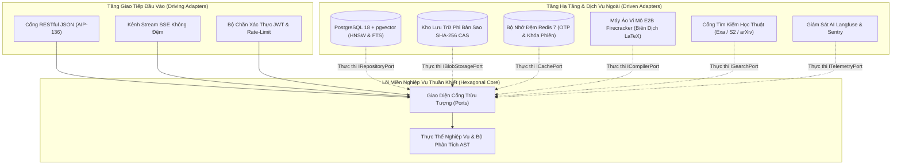
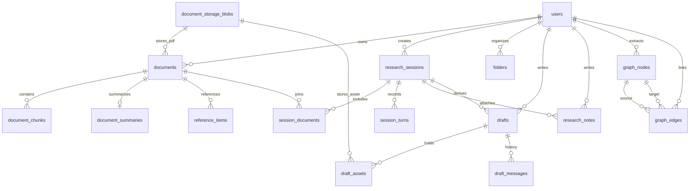

# ĐẶC TẢ KỸ THUẬT: PHÂN HỆ NỀN TẢNG KIẾN TRÚC HỆ THỐNG, CSDL 16 BẢNG & LƯU TRỮ CAS
# (FOUNDATION ARCHITECTURE, POSTGRESQL 16-TABLE SCHEMA & CAS STORAGE SPECIFICATION)

**Mã phân hệ:** `SPEC-00`  
**Phiên bản:** `2.0-OFFICIAL`  
**Vai trò phụ trách:** Kỹ sư Trưởng Kiến trúc Hệ thống (Senior Technical Lead / System Architect)  
**Tài liệu Nghiệp vụ liên đới (BA PRD):** [`00-overview-and-cleanup.md`](../PRD/00-overview-and-cleanup.md)  
**Trạng thái:** CHÍNH THỨC BAN HÀNH (RELEASE CANDIDATE)

---

## 1. Mục Tiêu Kỹ Thuật & Phạm Vi Triển Khai (Technical Goals & Scope)

### 1.1. Mục tiêu kỹ thuật cốt lõi
1. **Kiến trúc Lục giác Cô lập Tuyệt đối (Strict Hexagonal Architecture):** Đảm bảo miền nghiệp vụ lõi (`packages/core`) hoàn toàn độc lập với mọi framework I/O, database ORM, thư viện mạng. Mọi phụ thuộc chỉ được phép đi một chiều từ ngoài (`apps/api`) vào trong lõi.
2. **Lược đồ CSDL PostgreSQL 16+ pgvector Chuẩn hóa 16 Bảng:** Định nghĩa tường minh toàn bộ 16 bảng CSDL phục vụ đầy đủ 6 luồng giá trị học thuật của VeriScholar MVP, tích hợp chỉ mục vector HNSW (`vector_cosine_ops`) và chỉ mục tìm kiếm toàn văn GIN (`to_tsvector`).
3. **Lưu trữ Nội dung Định danh CAS Khử trùng lặp & Tiêu hủy Tức thì:** Cài đặt cơ chế Content-Addressable Storage (CAS) theo băm SHA-256 phân tán 2 tầng tại `storage/blobs/`, cam kết tiêu hủy vật lý tức thì (`zero-retention`) ngay khi `ref_count <= 0`.
4. **Cô lập Đa người dùng Tuyệt đối (Multi-Tenant Scoping Invariant):** 100% bảng nghiệp vụ gắn khóa ngoại `user_id FK users.id ON DELETE CASCADE`. Mọi truy vấn bắt buộc có điều kiện `WHERE user_id = :current_user_id`.

---

## 2. Ranh Giới Kiến Trúc Lục Giác & Tổ Chức Workspace

Hệ thống được tổ chức theo cấu trúc `uv workspace` monorepo:



### Ràng buộc bất biến kiến trúc (Invariants):
* `packages/core/src/core/domain/` và `ports/`: **CẤM IMPORT** `fastapi`, `starlette`, `sqlalchemy`, `sqlmodel`, `alembic`, `redis`, `pymupdf`, `fitz`, `httpx`, `aiohttp`, `requests`, `aiofiles`, `e2b`, `langfuse`, `openai`, hoặc import từ `apps`.
* Mọi giao diện tương tác ngoài đều thông qua `Ports` (Protocol trong `packages/core/src/core/ports/`).

---

## 3. Lược Đồ Chi Tiết 16 Bảng CSDL PostgreSQL 16+

Toàn bộ hệ thống VeriScholar gồm chính xác **16 bảng PostgreSQL**:



### 3.1. Danh Mục 12 Bảng Hiện Có (As-Is & Cải Tiến)

| # | Bảng PostgreSQL | File Model | Nâng cấp kỹ thuật cần thực hiện |
|---|---|---|---|
| **1** | `users` | [`user.py`](../../apps/api/src/api/db/models/user.py) | Thêm `theme_preference VARCHAR(20) DEFAULT 'system'`, `byok_api_key_encrypted TEXT NULL` (hoặc bảng `user_api_keys` chuẩn hóa có `UNIQUE(user_id, provider)`). |
| **2** | `documents` | [`document.py`](../../apps/api/src/api/db/models/document.py) | Thêm `is_starred BOOLEAN DEFAULT FALSE INDEX`, `folder_id UUID FK folders.id SET NULL`. |
| **3** | `document_chunks` | [`chunk.py`](../../apps/api/src/api/db/models/chunk.py) | Thêm `user_id UUID FK users.id CASCADE INDEX`, `parent_content TEXT NULL` (ngữ cảnh mẹ phân cấp cho Parent-Child RAG), chuyển `embedding` sang `Vector(1536)` (HNSW `vector_cosine_ops`), thêm `content_tsv TSVECTOR GENERATED ALWAYS AS (to_tsvector('simple', text_content)) STORED` (GIN index). |
| **4** | `document_storage_blobs` | [`blob.py`](../../apps/api/src/api/db/models/blob.py) | Quản lý mã băm SHA-256 (`content_hash`), kích thước byte, đường dẫn lưu file, và bộ đếm `ref_count` (xử lý tại tầng Repository PostgreSQL, giữ `IBlobStoragePort` hoàn toàn phi trạng thái). |
| **5** | `document_summaries` | [`summary.py`](../../apps/api/src/api/db/models/summary.py) | Thêm `user_id UUID FK users.id CASCADE INDEX`; lưu tóm tắt 3 phần (`problem_statement`, `core_contributions`, `limitations`, kèm `key_findings JSONB`) gắn trích dẫn Bounding Box. |
| **6** | `reference_items` | [`reference.py`](../../apps/api/src/api/db/models/reference.py) | Thêm `user_id UUID FK users.id CASCADE INDEX`; lưu danh mục trích dẫn cuối bài (DOI, arXiv, title, authors, year, `resolution_status`). |
| **7** | `research_sessions` | [`session.py`](../../apps/api/src/api/db/models/session.py) | Phiên đọc sâu đa bài báo (1–5 PDF đồng thời), lưu trạng thái viewport và active tab. |
| **8** | `session_documents` | [`session.py`](../../apps/api/src/api/db/models/session.py) | Bảng junction Many-to-Many giữa `research_sessions` và `documents`, kiểm soát giới hạn tối đa 5 bài. |
| **9** | `session_turns` | [`session.py`](../../apps/api/src/api/db/models/session.py) | Thêm `user_id UUID FK users.id CASCADE INDEX` và `trace_id VARCHAR(64) NULL` để đồng bộ giám sát trực tiếp với Langfuse trace. Export tường minh trong `models/__init__.py`. |
| **10** | `research_notes` | [`note.py`](../../apps/api/src/api/db/models/note.py) | Ghi chú học thuật nhúng trong phiên đọc, gắn trích dẫn Bounding Box và bản chụp chứng cứ `frozen_snapshot` (tự động đóng băng qua trigger `BEFORE UPDATE` `trg_freeze_note_citation_on_detach` khi `chunk_id` chuyển từ `NOT NULL` sang `NULL`). |
| **11** | `folders` | [`folder.py`](../../apps/api/src/api/db/models/folder.py) | Cây thư mục đề tài phân cấp trong Kho Yêu thích (`parent_id FK folders.id CASCADE`). |
| **12** | `drafts` | [`draft.py`](../../apps/api/src/api/db/models/draft.py) | Thêm `bib_content TEXT DEFAULT ''`, `source_session_id UUID FK research_sessions.id SET NULL`, `pdf_preview_storage_path TEXT NULL`, `previous_snapshot JSONB NULL`. |

### 3.2. Danh Mục 4 Bảng Mới (Delta DDL Specifications)

#### 13. Bảng `graph_nodes` (Đỉnh Tri Thức Đồ Thị 4 Thực Thể)
* **File model:** `apps/api/src/api/db/models/graph.py`
* **Mục đích:** Lưu trữ các thực thể học thuật (`Paper`, `Method`, `Dataset`, `MetricResult`), hỗ trợ gộp đỉnh dùng chung giữa nhiều bài báo của cùng 1 user (Canonical Entity Merging).
```sql
CREATE TABLE graph_nodes (
    id UUID PRIMARY KEY DEFAULT gen_random_uuid(),
    user_id UUID NOT NULL REFERENCES users(id) ON DELETE CASCADE,
    document_id UUID NULL REFERENCES documents(id) ON DELETE SET NULL,
    node_type VARCHAR(30) NOT NULL CHECK (node_type IN ('Paper', 'Method', 'Dataset', 'MetricResult')),
    canonical_name VARCHAR(255) NOT NULL,
    description TEXT NULL,
    metadata_json JSONB NOT NULL DEFAULT '{}'::jsonb,
    source_chunk_id UUID NULL REFERENCES document_chunks(id) ON DELETE SET NULL,
    page_number INT NULL,
    embedding vector(1536) NULL,
    created_at TIMESTAMPTZ NOT NULL DEFAULT NOW(),
    updated_at TIMESTAMPTZ NOT NULL DEFAULT NOW(),
    CONSTRAINT uq_graph_nodes_user_type_canonical UNIQUE (user_id, node_type, canonical_name)
);

CREATE INDEX idx_graph_nodes_user_doc ON graph_nodes(user_id, document_id);
CREATE INDEX idx_graph_nodes_user_type ON graph_nodes(user_id, node_type);
CREATE INDEX idx_graph_nodes_embedding ON graph_nodes USING hnsw (embedding vector_cosine_ops);
```

#### 14. Bảng `graph_edges` (Cạnh Quan Hệ Đồ Thị 4 Loại Cố Định)
* **File model:** `apps/api/src/api/db/models/graph.py`
* **Mục đích:** Kết nối các đỉnh tri thức theo 4 quan hệ học thuật chuẩn mực (`PROPOSES`, `EVALUATED_ON`, `ACHIEVES`, `CITES`).
```sql
CREATE TABLE graph_edges (
    id UUID PRIMARY KEY DEFAULT gen_random_uuid(),
    user_id UUID NOT NULL REFERENCES users(id) ON DELETE CASCADE,
    document_id UUID NOT NULL REFERENCES documents(id) ON DELETE CASCADE,
    source_node_id UUID NOT NULL REFERENCES graph_nodes(id) ON DELETE CASCADE,
    target_node_id UUID NOT NULL REFERENCES graph_nodes(id) ON DELETE CASCADE,
    edge_type VARCHAR(30) NOT NULL CHECK (edge_type IN ('PROPOSES', 'EVALUATED_ON', 'ACHIEVES', 'CITES')),
    evidence_chunk_id UUID NULL REFERENCES document_chunks(id) ON DELETE SET NULL,
    page_number INT NULL,
    weight DOUBLE PRECISION NOT NULL DEFAULT 1.0,
    created_at TIMESTAMPTZ NOT NULL DEFAULT NOW(),
    updated_at TIMESTAMPTZ NOT NULL DEFAULT NOW()
);

CREATE INDEX idx_graph_edges_user_source ON graph_edges(user_id, source_node_id);
CREATE INDEX idx_graph_edges_user_target ON graph_edges(user_id, target_node_id);
CREATE INDEX idx_graph_edges_user_type ON graph_edges(user_id, edge_type);
CREATE INDEX idx_graph_edges_user_doc ON graph_edges(user_id, document_id);
```

#### 15. Bảng `draft_assets` (Tài Sản & Hình Ảnh Bản Thảo LaTeX)
* **File model:** `apps/api/src/api/db/models/draft_asset.py`
* **Mục đích:** Quản lý các file đính kèm trong thư mục `figures/` của bản thảo, tích hợp Content-Addressable Storage.
```sql
CREATE TABLE draft_assets (
    id UUID PRIMARY KEY DEFAULT gen_random_uuid(),
    draft_id UUID NOT NULL REFERENCES drafts(id) ON DELETE CASCADE,
    user_id UUID NOT NULL REFERENCES users(id) ON DELETE CASCADE,
    filename VARCHAR(255) NOT NULL,
    mime_type VARCHAR(100) NOT NULL CHECK (mime_type IN ('image/png', 'image/jpeg', 'image/webp', 'application/pdf')),
    file_size_bytes BIGINT NOT NULL,
    blob_id UUID NULL REFERENCES document_storage_blobs(id) ON DELETE SET NULL,
    storage_path TEXT NOT NULL,
    created_at TIMESTAMPTZ NOT NULL DEFAULT NOW(),
    updated_at TIMESTAMPTZ NOT NULL DEFAULT NOW(),
    CONSTRAINT uq_draft_assets_draft_filename UNIQUE (draft_id, filename)
);

CREATE INDEX idx_draft_assets_user_draft ON draft_assets(user_id, draft_id);
```

#### 16. Bảng `draft_messages` (Lịch Sử Hội Thoại Với Trợ Lý Soạn Thảo)
* **File model:** `apps/api/src/api/db/models/draft_message.py`
* **Mục đích:** Lưu trữ lịch sử hội thoại trợ lý AI bên Cột 3 của không gian viết bài, kèm dấu vết công cụ và lượt biên dịch.
```sql
CREATE TABLE draft_messages (
    id UUID PRIMARY KEY DEFAULT gen_random_uuid(),
    draft_id UUID NOT NULL REFERENCES drafts(id) ON DELETE CASCADE,
    user_id UUID NOT NULL REFERENCES users(id) ON DELETE CASCADE,
    role VARCHAR(20) NOT NULL CHECK (role IN ('user', 'assistant', 'tool')),
    content TEXT NOT NULL,
    tool_calls JSONB NULL,
    compile_attempts SMALLINT NOT NULL DEFAULT 0,
    trace_id VARCHAR(64) NULL,
    created_at TIMESTAMPTZ NOT NULL DEFAULT NOW()
);

CREATE INDEX idx_draft_messages_user_draft_time ON draft_messages(user_id, draft_id, created_at);
```

#### 17. Bảng `wiki_pages` (Trang Wiki Tri Thức Học Thuật Biên Soạn)
* **File model:** `apps/api/src/api/db/models/wiki.py`
* **Mục đích:** Lưu trữ các trang Wiki Markdown đã được biên soạn bởi `5.6 Luna` (`OPENAI_MODEL`) kèm thẻ `[[wikilink]]` và vector embedding 1536d phục vụ truy vấn tri thức và AI viết bài.
```sql
CREATE TABLE wiki_pages (
    id UUID PRIMARY KEY DEFAULT gen_random_uuid(),
    user_id UUID NOT NULL REFERENCES users(id) ON DELETE CASCADE,
    folder_id UUID NULL REFERENCES folders(id) ON DELETE SET NULL,
    slug VARCHAR(255) NOT NULL,
    title VARCHAR(255) NOT NULL,
    page_type VARCHAR(50) NOT NULL CHECK (page_type IN ('method', 'dataset', 'topic', 'research_gap', 'comparison')),
    content_markdown TEXT NOT NULL,
    metadata_json JSONB NOT NULL DEFAULT '{}'::jsonb,
    embedding VECTOR(1536) NULL,
    created_at TIMESTAMPTZ NOT NULL DEFAULT NOW(),
    updated_at TIMESTAMPTZ NOT NULL DEFAULT NOW(),
    CONSTRAINT uq_wiki_pages_user_slug UNIQUE (user_id, slug)
);

CREATE INDEX idx_wiki_pages_user_folder ON wiki_pages(user_id, folder_id);
CREATE INDEX idx_wiki_pages_embedding ON wiki_pages 
USING hnsw (embedding vector_cosine_ops) WITH (m = 16, ef_construction = 64);
```

---

## 4. Quản Lý Lưu Trữ File Vật Lý (Content-Addressable Storage — CAS)

Hệ thống sử dụng cơ chế lưu trữ nội dung định danh theo băm (**Content-Addressable Storage - CAS**) tại `storage/blobs/`:

```text
storage/blobs/
├── e3/
│   └── b0/
│       └── e3b0c44298fc1c149afbf4c8996fb92427ae41e4649b934ca495991b7852b855.pdf
└── 4f/
    └── a1/
        └── 4fa1...892.png
```

### 4.1. Thuật toán sinh khóa & đường dẫn 2 tầng
1. File nhị phân (PDF hoặc ảnh) được tính băm SHA-256 trên nội dung thô:
   $$\text{hash} = \text{SHA-256}(\text{raw\_bytes})$$
2. Đường dẫn lưu trữ phân tán 2 tầng:
   $$\text{path} = \text{storage/blobs/} + \text{hash}[0:2] + \text{/} + \text{hash}[2:4] + \text{/} + \text{hash} + \text{ext}$$

### 4.2. Vòng đời tiêu hủy tức thì (Zero-Retention Guarantee)
* **Khử trùng lặp khi ghi (Upload Deduplication):** Kiểm tra `content_hash` trong `document_storage_blobs`. Nếu đã có: tăng `ref_count += 1`, trỏ bản ghi mới vào `blob_id` sẵn có mà không ghi thêm file xuống đĩa.
* **Tiêu hủy tức thì khi xóa (Synchronous Purge):** Khi người dùng xóa tài liệu (`DELETE /api/v1/documents/{id}`):
  - Xóa bản ghi `documents` (PostgreSQL cascade xóa chunks, summaries, references).
  - Giảm `document_storage_blobs.ref_count -= 1`.
  - Ngay khi `ref_count <= 0`: Xóa bản ghi blob và gọi `target_path.unlink()` xóa vĩnh viễn file nhị phân vật lý trên đĩa cứng ngay trong cùng chu kỳ request. Dọn sạch thư mục cha rỗng nếu có.

---

## 5. Quy Trình Khởi Tạo CSDL Idempotent (`init_db.py`)

Hệ thống sử dụng hàm `ensure_database_schema(conn: AsyncConnection)` chạy tự động khi API khởi động:
1. Tạo extension `vector` (`CREATE EXTENSION IF NOT EXISTS vector;`).
2. Chạy `Base.metadata.create_all` tạo đủ 16 bảng.
3. Áp dụng các lệnh `ALTER TABLE ... ADD COLUMN IF NOT EXISTS` cho các volume CSDL cũ (Idempotent DDL Patches).
4. Tạo chỉ mục HNSW (`idx_document_chunks_embedding_hnsw`, `idx_graph_nodes_embedding`) và GIN (`idx_document_chunks_content_tsv`), cùng trigger `trg_freeze_note_citation_on_detach` trên `research_notes` nếu chưa có.
5. **Fail-Fast Policy:** Nếu không kết nối được PostgreSQL lúc khởi động, API bắt buộc phải fail-fast và báo lỗi rõ ràng. Tuyệt đối cấm fallback sang SQLite.

### 5.1. Ma Trận Mã Lỗi Hệ Thống Nền Tảng (Deterministic Foundation Error Codes Matrix)

Mọi ngoại lệ phát sinh ở tầng nền tảng (CSDL, Lưu trữ CAS, Cô lập đa người dùng) bắt buộc phải ánh xạ về cấu trúc JSON lỗi chuẩn mực của nền tảng:

| HTTP Status | Mã lỗi chuẩn (`error.code`) | Điều kiện kích hoạt (Trigger Condition) | Cấu trúc Payload JSON trả về | Hành vi xử lý tại Frontend / Hệ thống |
| :--- | :--- | :--- | :--- | :--- |
| `404 Not Found` | `RESOURCE_NOT_FOUND_OR_FORBIDDEN` | Người dùng truy vấn bản ghi (`document`, `session`, `folder`, `draft`, `note`) không tồn tại hoặc thuộc quyền sở hữu của `user_id` khác (ngăn chặn dò quét ID giữa các học giả). | `{"error": {"code": "RESOURCE_NOT_FOUND_OR_FORBIDDEN", "message": "Tài nguyên không tồn tại hoặc bạn không có quyền truy cập.", "trace_id": "..."}}` | Chuyển hướng về trang danh sách phân hệ tương ứng và hiển thị thông báo cảnh báo nhẹ. |
| `409 Conflict` | `CAS_INTEGRITY_MISMATCH` | Mã băm SHA-256 tính toán lại từ luồng tệp tải lên không khớp với chữ ký hoặc bản ghi `document_storage_blobs` hiện hành. | `{"error": {"code": "CAS_INTEGRITY_MISMATCH", "message": "Tệp tải lên bị hỏng hoặc không toàn vẹn trong quá trình truyền tải.", "trace_id": "..."}}` | Hủy giao dịch tải lên, xóa tệp tạm và hiển thị nút "Thử tải lên lại". |
| `413 Payload Too Large` | `STORAGE_PAYLOAD_TOO_LARGE` | Dung lượng luồng byte vượt quá ngưỡng giới hạn an toàn của tầng lưu trữ CAS (50MB đối với PDF tài liệu, 10MB đối với ảnh bản thảo). | `{"error": {"code": "STORAGE_PAYLOAD_TOO_LARGE", "message": "Kích thước tệp vượt quá giới hạn cho phép.", "max_bytes": 52428800, "trace_id": "..."}}` | Ngắt luồng tải lên ngay tại trình duyệt và báo rõ dung lượng tối đa cho phép. |
| `500 Internal Server Error` | `CAS_DISK_IO_FAILURE` | Lỗi đọc/ghi hoặc xóa tệp vật lý trên phân vùng `storage/blobs/` (đầy ổ đĩa hoặc lỗi quyền tệp hệ thống). | `{"error": {"code": "CAS_DISK_IO_FAILURE", "message": "Lỗi truy xuất hệ thống lưu trữ tệp vật lý.", "trace_id": "..."}}` | Rollback toàn bộ giao dịch PostgreSQL trong cùng chu kỳ request để đảm bảo không sinh bản ghi mồ côi. |
| `503 Service Unavailable` | `DATABASE_UNAVAILABLE` | Mất kết nối tới cụm PostgreSQL 16+ hoặc extension `vector` chưa sẵn sàng khi gọi `/api/v1/health` hoặc khởi động ứng dụng. | `{"error": {"code": "DATABASE_UNAVAILABLE", "message": "Hệ thống cơ sở dữ liệu đang bảo trì hoặc mất kết nối.", "trace_id": "..."}}` | Tiến trình khởi động dừng ngay lập tức (Fail-fast) hoặc hiển thị màn hình bảo trì kèm mã `trace_id`. |

---

## 6. Tập Tin Neo Tham Chiếu Trong Codebase (Codebase Anchors)

Khi lập trình viên hoặc AI Agent triển khai các tính năng, bắt buộc phải đối chiếu và tuân thủ các pattern từ các tệp neo sau:

| Vai trò kiến trúc | Tệp neo chuẩn mực trong repo | Nguyên tắc bắt chước |
| :--- | :--- | :--- |
| **Base Model & UUID** | [`base.py`](../../apps/api/src/api/db/models/base.py) | Kế thừa `IdentifiableTimestampedModel` cho bảng có `id, created_at, updated_at`. |
| **Existing Models** | [`chunk.py`](../../apps/api/src/api/db/models/chunk.py), [`session.py`](../../apps/api/src/api/db/models/session.py) | Tham chiếu cách cấu hình `Mapped`, `mapped_column`, Foreign Keys và Table Args. |
| **Storage Port & Adapter** | [`storage.py`](../../packages/core/src/core/ports/storage.py), [`local.py`](../../packages/core/src/core/adapters/storage/local.py) | Tuân thủ protocol `IBlobStoragePort` và triển khai async file I/O với `asyncio.to_thread`. |
| **Session & DI Engine** | [`session.py`](../../apps/api/src/api/db/session.py), [`deps.py`](../../apps/api/src/api/deps.py) | Sử dụng `get_db` async generator session và injection dependencies chuẩn FastAPI. |

---

## 7. Ma Trận Kiểm Thử TDD Nền Tảng (TDD Verification Matrix)

Mọi thay đổi trên tầng nền tảng phải vượt qua đầy đủ ma trận kiểm thử sau:

| Test Case | Tệp kiểm thử | Mục tiêu kiểm chứng | Kỳ vọng nghiệm thu |
| :--- | :--- | :--- | :--- |
| `test_core_has_zero_framework_imports` | `apps/api/tests/test_architecture_boundary.py` | Quét AST toàn bộ `packages/core/src/core/domain/` và `ports/` | 0 dòng import `fastapi`, `sqlalchemy`, `redis`, `pymupdf`. |
| `test_no_absolute_file_urls_in_markdown` | `apps/api/tests/test_architecture_boundary.py` | Quét toàn bộ `.md` docs trong repo tìm `file:///` | 0 liên kết tuyệt đối máy chủ. |
| `test_cas_path_distribution` | `packages/core/tests/test_cas_storage.py` | Kiểm tra thuật toán băm SHA-256 và chia nhánh thư mục 2 tầng | Đúng định dạng `storage/blobs/ab/cd/abcd...`. |
| `test_ensure_database_schema_idempotency` | `apps/api/tests/test_db_bootstrap.py` | Chạy `ensure_database_schema()` 2 lần liên tiếp | Không nổ ngoại lệ, 16 bảng và extension sẵn sàng. |
| `test_multi_tenant_user_isolation` | `apps/api/tests/test_multi_tenant_isolation.py` | User 1 tạo Document, User 2 cố gắng query | Trả về `404 NOT_FOUND` hoặc rỗng, không rò rỉ dữ liệu. |
| `test_cas_blob_reference_counting_purge` | `apps/api/tests/test_cas_lifecycle.py` | Nạp 2 tài liệu cùng file băm (`ref_count=2`), xóa lần 1 còn file, xóa lần 2 file bị unlink | File nhị phân vật lý bị xóa sạch khi `ref_count=0`. |

---

## 8. Tiêu Chí Hoàn Thành Kỹ Thuật (Definition of Done)

- [ ] Toàn bộ 16 bảng PostgreSQL và chỉ mục HNSW/GIN được khai báo đầy đủ bằng SQLAlchemy trong `apps/api/src/api/db/models/`.
- [ ] Không còn code SQLite fallback trong `init_db.py` hay bất kỳ đâu trong repo.
- [ ] Hàm `ensure_database_schema()` chạy thành công và an toàn trên cả database trống lẫn database đã có dữ liệu.
- [ ] Cơ chế CAS hỗ trợ đa dạng định dạng (`pdf`, `png`, `webp`) và tiêu hủy vật lý tức thì khi `ref_count <= 0`.
- [ ] Vượt qua 100% exit code 0 trên cả **4 Cổng Xác Minh**:
  1. `uv run ruff check .`
  2. `uv run pytest`
  3. `npm --prefix apps/web run test`
  4. `npm --prefix apps/web run build`
