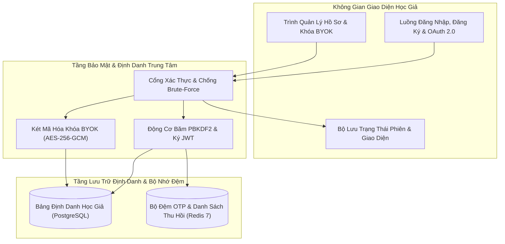
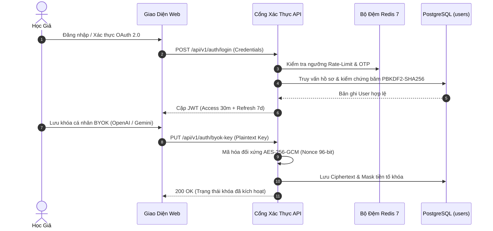

# ĐẶC TẢ KỸ THUẬT: PHÂN HỆ XÁC THỰC, QUẢN LÝ TÀI KHOẢN & BẢO MẬT KHÓA RIÊNG HỌC GIẢ
# (AUTHENTICATION, USER PROFILE & BYOK SECURITY SPECIFICATION)

**Trạng thái:** DỰ THẢO CHÍNH THỨC (TECHNICAL SPECIFICATION V1)  
**Nguồn tham chiếu PRD:** [`01-auth-and-user.md`](../PRD/01-auth-and-user.md)  
**Phân hệ kỹ thuật:** Phân Hệ Xác Thực & Quản Lý Học Giả (Authentication & Scholar Profile)  
**File nền tảng liên đới:** [`00-foundation-architecture-and-db.md`](./00-foundation-architecture-and-db.md)

---

## 1. Usecase & Bối Cảnh Người Dùng (Real-World User Journey & Value)

### A. Usecase 1: Đăng Ký & Đăng Nhập Học Giả Liền Mạch (Seamless Scholar Authentication)
- **Bối cảnh & Vấn đề thực tế:** Sinh viên và nghiên cứu sinh thường truy cập nền tảng từ máy tính phòng thí nghiệm, thư viện trường, hoặc laptop cá nhân. Quá trình đăng nhập phải an toàn nhưng không được gây phiền toái (như bắt nhập lại mật khẩu liên tục mỗi khi đổi tab hoặc tải lại trang). Khi quên mật khẩu, việc nhận mã OTP khôi phục qua email phải diễn ra trong vài giây mà không bị trễ.
- **Giải pháp của phân hệ:**
  - Cung cấp phương thức đăng nhập bằng Email/Password kèm hỗ trợ OAuth (Google, GitHub) nhanh chóng.
  - Quản lý phiên làm việc bằng cặp JWT Access Token (15 phút) và Refresh Token (7 ngày) kết hợp Redis OTP (hết hạn sau 300s, giới hạn tối đa 5 lần thử sai) nhằm ngăn chặn tấn công dò quét brute-force.

### B. Usecase 2: Quản Lý Khóa Cá Nhân BYOK Tự Chủ Tuyệt Đối (Bring Your Own Key Security)
- **Bối cảnh & Vấn đề thực tế:** Nhiều nghiên cứu sinh và giảng viên có sẵn tài khoản OpenAI hoặc Claude riêng với hạn mức tín dụng nghiên cứu cao. Họ muốn dùng chính khóa API của mình để tương tác với mô hình cao cấp nhất (GPT-4o, Claude 3.5 Sonnet) mà không bị phụ thuộc vào quota dùng thử của nền tảng. Tuy nhiên, họ rất lo lắng về nguy cơ rò rỉ khóa API cá nhân nếu cơ sở dữ liệu bị lộ.
- **Giải pháp của phân hệ:**
  - Cung cấp giao diện cấu hình BYOK trong trang hồ sơ cá nhân. Khóa API gửi lên từ trình duyệt được mã hóa ngay lập tức bằng thuật toán chuẩn quân đội **AES-256-GCM** với khóa chủ bí mật của server (`BYOK_ENCRYPTION_KEY`).
  - Khi lưu trữ trong PostgreSQL, giá trị chỉ là một chuỗi mã hóa vô nghĩa kèm nonce ngẫu nhiên; khi cần gọi LLM, hệ thống mới giải mã trên bộ nhớ tạm (in-memory) và xóa ngay sau khi request hoàn tất, đảm bảo an toàn tuyệt đối.

### C. Usecase 3: Cá Nhân Hóa Hồ Sơ & Chế Độ Đọc Đêm (Profile Customization & Dark Theme)
- **Bối cảnh & Vấn đề thực tế:** Nhà nghiên cứu thường xuyên làm việc vào ban đêm để đọc tài liệu. Họ cần giao diện có chế độ nền tối (Dark mode) dịu mắt, đồng thời lưu giữ các thông tin học thuật (tên trường đại học, viện nghiên cứu) đồng bộ trên mọi thiết bị.
- **Giải pháp của phân hệ:**
  - Cho phép cập nhật hồ sơ cá nhân, chọn chủ đề giao diện (`light`, `dark`, hoặc `system`) và lưu trữ trực tiếp vào cột `theme_preference` trong bảng `users`, giúp giao diện người dùng đồng bộ tự động ngay khi đăng nhập từ bất kỳ thiết bị nào.

---

## 2. Phạm Vi & Bảng Đối Chiếu Hiện Trạng (`As-Is` vs `Delta`)

Phân hệ này chịu trách nhiệm toàn bộ vòng đời xác thực học giả, cấp phát và thu hồi phiên làm việc (JWT), xác thực email/khôi phục mật khẩu qua Redis OTP, quản lý hồ sơ cá nhân và cô lập dữ liệu đa người dùng.



### Bảng Kiểm Kê Thành Phần Mã Nguồn
| Thành phần | Đường dẫn File | Trạng thái | Nội dung chi tiết |
|---|---|---|---|
| **API Endpoints** | [`apps/api/src/api/v1/endpoints/auth.py`](../../apps/api/src/api/v1/endpoints/auth.py) | **KEEP** | 13 endpoints đầy đủ: Register, Login, Google, GitHub, Logout, Refresh, Forgot-Password, Reset-Password, Verify-Email, Resend-Verification, Me (GET/PATCH), Change-Password. |
| **Logic Service** | [`apps/api/src/api/services/auth_service.py`](../../apps/api/src/api/services/auth_service.py) | **MODIFY** | Đã có sẵn mã hóa mật khẩu, sinh JWT HMAC-SHA256, OTP Redis. Bổ sung hàm mã hóa/giải mã khóa cá nhân **BYOK AES-256-GCM**. |
| **Model CSDL** | [`apps/api/src/api/db/models/user.py`](../../apps/api/src/api/db/models/user.py) | **MODIFY** | Bổ sung 2 cột: `theme_preference` (mặc định `'system'`) và `byok_api_key_encrypted` (TEXT nullable). |
| **Pydantic Schemas** | [`apps/api/src/api/schemas/auth.py`](../../apps/api/src/api/schemas/auth.py) | **MODIFY** | Bổ sung trường `theme_preference` và `byok_api_key` vào `UserProfileResponse` và `UpdateProfileRequest`. |
| **Domain Entity** | `packages/core/src/core/domain/entities/user.py` | **KEEP** | Thực thể User thuần Python không phụ thuộc ORM. |
| **Frontend UI** | `apps/web/src/features/auth/` | **KEEP** | Form Đăng nhập, Đăng ký, Quên/Đặt lại mật khẩu đã kết nối API. |
| **Frontend Modal** | `apps/web/src/components/profile/UserProfileModal.tsx` | **MODIFY** | Chuẩn hóa Modal 3 Tabs: Tab 1 (Hồ sơ học thuật), Tab 2 (Bảo mật & BYOK API Key), Tab 3 (Giao diện Sáng/Tối). |

---

## 3. Mô Hình Dữ Liệu & Ràng Buộc PostgreSQL (`Database Schema & Invariants`)

### A. Lược Đồ Bảng `users` Chuẩn Hóa
```sql
CREATE TABLE users (
    id UUID PRIMARY KEY DEFAULT gen_random_uuid(),
    email VARCHAR(255) NOT NULL,
    full_name VARCHAR(100) NOT NULL,
    hashed_password VARCHAR(255) NOT NULL,
    is_active BOOLEAN NOT NULL DEFAULT TRUE,
    role VARCHAR(30) NOT NULL DEFAULT 'researcher',
    institution VARCHAR(255) NULL,
    department VARCHAR(255) NULL,
    academic_rank VARCHAR(100) NULL,
    orcid_id VARCHAR(50) NULL,
    avatar_url VARCHAR(500) NULL,
    is_verified BOOLEAN NOT NULL DEFAULT FALSE,
    bio VARCHAR(1000) NULL,
    research_interests VARCHAR(500) NULL,
    google_scholar_url VARCHAR(500) NULL,
    theme_preference VARCHAR(20) NOT NULL DEFAULT 'system',
    byok_api_key_encrypted TEXT NULL,
    created_at TIMESTAMPTZ NOT NULL DEFAULT NOW(),
    updated_at TIMESTAMPTZ NOT NULL DEFAULT NOW(),
    CONSTRAINT uq_users_email UNIQUE (email),
    CONSTRAINT ck_users_theme CHECK (theme_preference IN ('light', 'dark', 'system'))
);

CREATE UNIQUE INDEX idx_users_email_lower ON users (LOWER(email));
CREATE INDEX idx_users_role_active ON users (role, is_active);
```

### B. Quy Tắc Cô Lập Dữ Liệu Đa Người Dùng (Multi-Tenant Isolation Invariant)
1. **Khóa Ngoại Bắt Buộc:** Tất cả các thực thể nghiệp vụ của học giả (`documents`, `research_sessions`, `research_notes`, `folders`, `drafts`, `graph_nodes`, `graph_edges`, `draft_assets`, `draft_messages`) bắt buộc có cột `user_id UUID NOT NULL REFERENCES users(id) ON DELETE CASCADE`.
2. **Quy Tắc Truy Vấn:** Tất cả câu lệnh `SELECT`, `UPDATE`, `DELETE` trong tầng Service hoặc Repository bắt buộc gắn điều kiện lọc:
   ```python
   stmt = select(DocumentModel).where(
       DocumentModel.id == document_id,
       DocumentModel.user_id == current_user.id
   )
   ```
3. **Phản Hồi Lỗi An Toàn:** Khi người dùng cố truy vấn ID tài nguyên của người khác, API phải trả về `HTTP 404 NOT_FOUND` với mã lỗi `RESOURCE_NOT_FOUND` (thay vì `403 FORBIDDEN`) để ngăn chặn việc dò quét sự tồn tại của tài nguyên (ID Enumeration Defense).

---

## 4. Hợp Đồng API REST & Bảng Mã Lỗi (REST Contracts & Error Schemas)

Tất cả API Auth đều tuân thủ chuẩn phong bì phản hồi chuẩn (`SingleResponseEnvelope`) và phong bì lỗi (`ErrorResponse`).

### A. Chuẩn Phong Bì Phản Hồi Lỗi Chuẩn Hóa (`ErrorResponse`)
Khi xảy ra lỗi, backend trả về cấu trúc JSON đồng nhất tuân thủ [`apps/api/src/api/schemas/error.py`](../../apps/api/src/api/schemas/error.py):
```json
{
  "success": false,
  "error": {
    "code": "EMAIL_ALREADY_EXISTS",
    "message": "Địa chỉ email này đã được sử dụng. Vui lòng đăng nhập hoặc sử dụng tính năng quên mật khẩu.",
    "field": "email",
    "action": "Vui lòng đăng nhập bằng tài khoản này hoặc sử dụng chức năng quên mật khẩu."
  },
  "meta": {
    "request_id": "req_892a01bf23cd",
    "timestamp": "2026-10-25T09:12:00Z"
  }
}
```

### B. Danh Mục Endpoints Chi Tiết

#### 1. Đăng ký tài khoản (`POST /api/v1/auth/register`)
- **Headers:** `Content-Type: application/json`
- **Request Body:**
  ```json
  {
    "email": "scholar@university.edu.vn",
    "password": "SecurePassword123!",
    "full_name": "TS. Nguyễn Văn A"
  }
  ```
- **Response (HTTP 201 Created):**
  ```json
  {
    "success": true,
    "data": {
      "user": {
        "id": "3fa85f64-5717-4562-b3fc-2c963f66afa6",
        "email": "scholar@university.edu.vn",
        "full_name": "TS. Nguyễn Văn A",
        "role": "researcher",
        "is_verified": false
      },
      "tokens": {
        "access_token": "eyJhbGciOi...",
        "refresh_token": "eyJhbGciOi...",
        "token_type": "bearer",
        "expires_in": 900
      }
    },
    "meta": {
      "request_id": "req_892a01bf23cd",
      "timestamp": "2026-10-25T09:12:00Z"
    }
  }
  ```

#### 2. Đăng nhập (`POST /api/v1/auth/login`)
- **Request Body:**
  ```json
  {
    "email": "scholar@university.edu.vn",
    "password": "SecurePassword123!",
    "remember_me": true
  }
  ```
- **Response (HTTP 200 OK):** Trả về cấu trúc tương tự `register` kèm thời hạn refresh token mở rộng (nếu `remember_me=true`, refresh token có hạn 30 ngày; mặc định 7 ngày).

#### 3. Đăng nhập Google OAuth 2.0 (`POST /api/v1/auth/google`)
- **Request Body:** `{ "credential": "<Google_ID_Token_JWT>" }`
- **Xử lý:** Backend xác minh token qua Google API certs, tự động trích xuất `email`, `name`, `picture`. Nếu user chưa có tài khoản $\rightarrow$ tự động tạo tài khoản với cờ `is_verified=true`.

#### 4. Đăng nhập GitHub OAuth (`POST /api/v1/auth/github`)
- **Request Body:** `{ "code": "<GitHub_Auth_Code>" }`
- **Xử lý:** Trao đổi auth code lấy access token từ GitHub API, lấy email chính và thông tin người dùng. Tự động liên kết hoặc tạo tài khoản mới với cờ `is_verified=true`.

#### 5. Đăng xuất thu hồi phiên (`POST /api/v1/auth/logout`)
- **Headers:** `Authorization: Bearer <access_token>`
- **Request Body:** `{ "refresh_token": "eyJhbGciOi..." }`
- **Xử lý:** Đưa `refresh_token` và `access_token` vào danh sách đen (Blacklist) trong Redis với thời gian TTL bằng thời gian sống còn lại của token.

#### 6. Làm mới Access Token (`POST /api/v1/auth/refresh`)
- **Request Body:** `{ "refresh_token": "eyJhbGciOi..." }`
- **Response (HTTP 200 OK):** Cấp cặp access token và refresh token mới (áp dụng cơ chế Refresh Token Rotation).

#### 7. Khôi phục mật khẩu (`POST /api/v1/auth/forgot-password`)
- **Request Body:** `{ "email": "scholar@university.edu.vn" }`
- **Response (HTTP 200 OK):**
  ```json
  {
    "success": true,
    "data": {
      "message": "Nếu email tồn tại trên hệ thống, mã xác thực OTP đã được gửi.",
      "expires_in_seconds": 300
    },
    "meta": { "request_id": "req_892a01bf23cd" }
  }
  ```
- **Fallback Môi trường Dev:** Nếu `SMTP_HOST` chưa cấu hình, mã OTP được ghi ra file log [`storage/logs/auth-emails.log`](../../storage/logs/auth-emails.log) để lập trình viên copy kiểm thử.

#### 8. Đặt lại mật khẩu (`POST /api/v1/auth/reset-password`)
- **Request Body:**
  ```json
  {
    "email": "scholar@university.edu.vn",
    "otp_code": "849201",
    "new_password": "NewSecurePassword456!"
  }
  ```

#### 9. Xác thực tài khoản email (`POST /api/v1/auth/verify-email`)
- **Request Body:** `{ "email": "scholar@university.edu.vn", "otp_code": "849201" }`
- **Response (HTTP 200 OK):** Cập nhật `is_verified = true` trong cơ sở dữ liệu.

#### 10. Gửi lại mã xác thực email (`POST /api/v1/auth/resend-verification`)
- **Request Body:** `{ "email": "scholar@university.edu.vn" }`
- **Xử lý:** Áp dụng rate limit 3 lần / 15 phút, sinh mã OTP 6 chữ số mới vào Redis.

#### 11. Xem hồ sơ cá nhân (`GET /api/v1/auth/me`)
- **Headers:** `Authorization: Bearer <access_token>`
- **Response (HTTP 200 OK):** Trả về đầy đủ thông tin hồ sơ `UserProfileResponse`. Trường `byok_api_key_encrypted` được chuyển thành `has_byok: true` và `byok_masked: "sk-proj-...4f8A"`.

#### 12. Cập nhật hồ sơ & BYOK (`PATCH /api/v1/auth/me`)
- **Headers:** `Authorization: Bearer <access_token>`
- **Request Body:**
  ```json
  {
    "full_name": "PGS. TS. Nguyễn Văn A",
    "institution": "Đại học Bách Khoa",
    "department": "Khoa Khoa học Máy tính",
    "orcid_id": "0000-0002-1825-0097",
    "theme_preference": "dark",
    "byok_api_key": "sk-proj-custom-openai-key"
  }
  ```
- **Response (HTTP 200 OK):** Trả về thông tin đã cập nhật. Khóa BYOK không bao giờ được trả về nguyên văn thô.

#### 13. Đổi mật khẩu chủ động (`POST /api/v1/auth/change-password`)
- **Headers:** `Authorization: Bearer <access_token>`
- **Request Body:**
  ```json
  {
    "current_password": "OldPassword123!",
    "new_password": "NewSecurePassword456!"
  }
  ```

---

### C. Ma Trận Mã Lỗi Chuẩn Hóa (Deterministic Error Codes Matrix)

Bảng ma trận dưới đây quy định toàn bộ các mã lỗi tất định của Phân hệ Xác thực và Hồ sơ Học giả, đảm bảo bất kỳ mô hình AI hoặc lập trình viên nào cũng có thể cài đặt logic xử lý lỗi chính xác tuyệt đối mà không bị sai lệch:

| HTTP Status | Mã Lỗi (`error_code`) | Điều Kiện Kích Hoạt (Trigger Condition) | Thông Điệp Tiếng Việt Chuẩn Hóa (`message`) | Trường Lỗi (`field`) & Hành Động Khắc Phục (`action`) |
| :--- | :--- | :--- | :--- | :--- |
| `400 Bad Request` | `INVALID_PAYLOAD` | Body yêu cầu rỗng, sai định dạng JSON hoặc thiếu các trường bắt buộc | `"Dữ liệu yêu cầu không hợp lệ hoặc thiếu trường bắt buộc."` | `field: null` — Kiểm tra cấu trúc body request theo schema. |
| `400 Bad Request` | `WEAK_PASSWORD` | Mật khẩu ngắn hơn 8 ký tự hoặc thiếu ít nhất 1 chữ cái và 1 chữ số | `"Mật khẩu phải chứa ít nhất 8 ký tự bao gồm cả chữ cái và chữ số."` | `field: "password"` — Yêu cầu người dùng tăng cường độ phức tạp mật khẩu. |
| `400 Bad Request` | `INVALID_EMAIL_FORMAT` | Email sai định dạng RFC 5322 hoặc sử dụng tên miền email rác dùng 1 lần | `"Địa chỉ email không đúng định dạng học thuật hoặc thuộc miền tạm thời bị hạn chế."` | `field: "email"` — Nhập email học thuật hoặc cá nhân hợp lệ. |
| `400 Bad Request` | `INVALID_ORCID_FORMAT` | Trường `orcid_id` không khớp biểu thức chính quy `^\d{4}-\d{4}-\d{4}-\d{3}[\dX]$` | `"Mã định danh ORCID phải tuân thủ định dạng chuẩn quốc tế 16 ký tự (ví dụ: 0000-0002-1825-0097)."` | `field: "orcid_id"` — Nhập mã ORCID chuẩn gồm 16 chữ số chia 4 nhóm. |
| `400 Bad Request` | `INVALID_THEME_PREFERENCE` | Trường `theme_preference` nhận giá trị khác với bộ ba `['light', 'dark', 'system']` | `"Tùy chọn giao diện không hợp lệ. Chỉ chấp nhận các giá trị: light, dark hoặc system."` | `field: "theme_preference"` — Chọn một trong 3 giá trị cho phép. |
| `400 Bad Request` | `INVALID_OTP_FORMAT` | Mã OTP gửi lên không phải là chuỗi đúng 6 chữ số nguyên | `"Mã xác thực OTP phải là chuỗi 6 chữ số."` | `field: "otp_code"` — Nhập đủ 6 số nhận được từ hòm thư. |
| `400 Bad Request` | `PASSWORD_MISMATCH` | Mật khẩu hiện tại cung cấp trong endpoint đổi mật khẩu không khớp với bản băm lưu trong CSDL | `"Mật khẩu hiện tại không chính xác. Vui lòng kiểm tra lại."` | `field: "current_password"` — Nhập đúng mật khẩu đang sử dụng. |
| `401 Unauthorized` | `INVALID_CREDENTIALS` | Đăng nhập thất bại do sai email hoặc sai mật khẩu PBKDF2 (thông điệp trung tính chống dò quét) | `"Email hoặc mật khẩu không chính xác."` | `field: null` — Kiểm tra lại thông tin hoặc bấm Quên mật khẩu. |
| `401 Unauthorized` | `TOKEN_EXPIRED` | Access Token JWT đã quá hạn 15 phút (`exp < current_time`) | `"Phiên làm việc đã hết hạn. Vui lòng làm mới phiên."` | `field: null` — Client tự động gọi endpoint `/auth/refresh` bằng refresh token. |
| `401 Unauthorized` | `TOKEN_INVALID` | Chữ ký HMAC-SHA256 của JWT không khớp, token bị giả mạo hoặc giải mã lỗi | `"Mã xác thực không hợp lệ hoặc đã bị can thiệp."` | `field: null` — Xóa bỏ token và điều hướng về trang đăng nhập. |
| `401 Unauthorized` | `REFRESH_TOKEN_EXPIRED` | Refresh token JWT đã quá hạn (7 ngày hoặc 30 ngày) | `"Phiên đăng nhập dài hạn đã hết hạn. Vui lòng đăng nhập lại."` | `field: "refresh_token"` — Xóa phiên lưu trữ và đưa về màn hình Đăng nhập. |
| `401 Unauthorized` | `REFRESH_TOKEN_REVOKED` | Refresh token nằm trong danh sách đen Redis (Blacklist) do đã đăng xuất trước đó | `"Phiên đăng nhập đã bị thu hồi. Vui lòng đăng nhập lại."` | `field: "refresh_token"` — Xóa phiên đăng nhập cục bộ. |
| `401 Unauthorized` | `USER_INACTIVE` | Tài khoản học giả có cờ `is_active = False` do vi phạm điều khoản hoặc bị khóa | `"Tài khoản học giả này đã bị tạm khóa. Vui lòng liên hệ ban quản trị."` | `field: null` — Liên hệ bộ phận hỗ trợ kỹ thuật. |
| `403 Forbidden` | `ACCOUNT_NOT_VERIFIED` | Học giả chưa xác thực email (`is_verified = False`) nhưng truy cập tính năng yêu cầu kích hoạt | `"Tài khoản chưa được kích hoạt qua email. Vui lòng hoàn tất xác thực để tiếp tục."` | `field: null` — Mở modal nhắc xác thực email hoặc gửi lại mã. |
| `404 Not Found` | `RESOURCE_NOT_FOUND` | Học giả A cố truy cập tài nguyên của học giả B (trả về 404 thay vì 403 để chống ID Enumeration) | `"Không tìm thấy tài nguyên yêu cầu hoặc bạn không có quyền truy cập."` | `field: null` — Điều hướng người dùng về trang chủ an toàn. |
| `404 Not Found` | `USER_NOT_FOUND` | Không tìm thấy bản ghi người dùng tương ứng với ID trong token | `"Không tìm thấy thông tin tài khoản người dùng."` | `field: null` — Thực hiện đăng xuất và xóa cache client. |
| `409 Conflict` | `EMAIL_ALREADY_EXISTS` | Đăng ký tài khoản mới với địa chỉ email đã tồn tại trong bảng `users` | `"Địa chỉ email này đã được sử dụng. Vui lòng đăng nhập hoặc sử dụng tính năng quên mật khẩu."` | `field: "email"` — Điều hướng người dùng sang form Đăng nhập. |
| `422 Unprocessable Entity` | `BYOK_KEY_INVALID` | Khóa OpenAI API cá nhân gửi lên không vượt qua bước kiểm tra kết nối với nhà cung cấp (lỗi 401 upstream) | `"Khóa API không hợp lệ hoặc đã bị thu hồi bởi nhà cung cấp. Vui lòng kiểm tra lại."` | `field: "byok_api_key"` — Nhập khóa API hợp lệ từ OpenAI Platform. |
| `422 Unprocessable Entity` | `BYOK_QUOTA_EXCEEDED` | Khóa OpenAI API hợp lệ nhưng tài khoản bên thứ ba đã cạn số dư tín dụng (`insufficient_quota`) | `"Khóa API hợp lệ nhưng tài khoản của bạn tại nhà cung cấp AI đã hết số dư tín dụng."` | `field: "byok_api_key"` — Nạp thêm tín dụng vào tài khoản OpenAI của bạn. |
| `429 Too Many Requests` | `OTP_RATE_LIMITED` | Yêu cầu gửi lại OTP quá 3 lần trong vòng 15 phút cho cùng một địa chỉ email | `"Bạn đã yêu cầu gửi mã xác thực quá nhiều lần. Vui lòng thử lại sau 15 phút."` | `field: "email"` — Khóa nút gửi mã và kích hoạt đồng hồ đếm ngược. |
| `429 Too Many Requests` | `OTP_MAX_ATTEMPTS_EXCEEDED` | Nhập sai mã OTP quá 5 lần liên tiếp; Redis tự động hủy mã OTP và khóa tạm thời | `"Bạn đã nhập sai mã xác thực quá số lần cho phép. Mã OTP đã bị hủy. Vui lòng thử lại sau 15 phút."` | `field: "otp_code"` — Vô hiệu hóa ô nhập OTP và yêu cầu chờ hết thời gian. |
| `429 Too Many Requests` | `AUTH_RATE_LIMITED` | Thử đăng nhập sai mật khẩu quá 10 lần liên tục từ cùng một địa chỉ mạng | `"Quá nhiều lần đăng nhập không thành công. Vui lòng thử lại sau 5 phút."` | `field: null` — Tạm khóa form đăng nhập trong 5 phút. |
| `500 Internal Server Error` | `BYOK_ENCRYPTION_FAILED` | Không thể mã hóa khóa BYOK bằng AES-256-GCM do cấu hình thiếu biến môi trường `BYOK_ENCRYPTION_KEY` | `"Lỗi hệ thống trong quá trình mã hóa bảo mật khóa cá nhân. Vui lòng liên hệ ban quản trị."` | `field: null` — Kiểm tra lại biến môi trường server. |
| `500 Internal Server Error` | `INTERNAL_SERVER_ERROR` | Lỗi ngoại lệ hệ thống chưa xác định phát sinh trong quá trình xử lý | `"Đã xảy ra sự cố nội bộ trong quá trình xử lý yêu cầu. Vui lòng thử lại sau."` | `field: null` — Báo cáo sự cố kèm mã `request_id` cho kỹ thuật. |
| `502 Bad Gateway` | `OAUTH_PROVIDER_UNAVAILABLE` | Không thể kết nối xác minh chứng thư số với máy chủ Google hoặc GitHub OAuth | `"Không thể kết nối đến nhà cung cấp xác thực bên thứ ba. Vui lòng thử lại sau."` | `field: null` — Đề xuất đăng nhập tạm thời bằng Email/Mật khẩu. |
| `504 Gateway Timeout` | `UPSTREAM_TIMEOUT` | Yêu cầu xác thực khóa BYOK tới máy chủ OpenAI vượt quá thời gian chờ (> 10 giây) | `"Quá thời gian chờ phản hồi từ máy chủ nhà cung cấp AI. Vui lòng thử lại sau."` | `field: "byok_api_key"` — Thử lại thao tác lưu khóa sau vài giây. |

---

## 5. Thiết Kế Cơ Chế Bảo Mật & Quản Lý Khóa Cá Nhân (BYOK Encryption)

### A. Lưu Trữ Khóa Cá Nhân BYOK An Toàn (AES-256-GCM)
Học giả có thể đưa API Key OpenAI riêng của họ vào hệ thống để không bị giới hạn quota:
1. **Khóa Chủ Máy Chủ (Master Encryption Key):** Được cung cấp qua biến môi trường `BYOK_ENCRYPTION_KEY` (32 bytes hex).
2. **Quy Trình Mã Hóa:**
   - Khi nhận `byok_api_key`: Backend sinh một số ngẫu nhiên `nonce` (12 bytes).
   - Mã hóa khóa bằng thuật toán `AES-256-GCM` kèm tag xác thực tính toàn vẹn 16 bytes.
   - Ghép chuỗi base64: `base64(nonce + ciphertext + tag)` và lưu vào cột `users.byok_api_key_encrypted`.
3. **Quy Trình Giải Mã Tại Runtime:**
   - Khi thực hiện các cuộc gọi LLM trong phiên đọc hoặc viết của user đó: Backend kiểm tra nếu `byok_api_key_encrypted IS NOT NULL`, giải mã trên RAM và truyền trực tiếp vào OpenAI client của lượt gọi đó. Khóa không bao giờ được ghi vào log hay gửi ra giao diện.

### B. Cơ Chế Quản Lý OTP Qua Redis 7
- **Cấu trúc Key:** `verischolar:otp:{email}`
- **Dữ liệu lưu:** JSON string `{ "code": "6-digit-string", "user_id": "uuid", "attempts": 0 }`
- **Thời hạn TTL:** Cố định `300 giây` (5 phút).
- **Chống Brute Force (Rate Limiting):**
  - Giới hạn thử sai tối đa 5 lần; lần thứ 6 nhập sai sẽ tự động vô hiệu hóa mã OTP trong Redis.
  - Giới hạn gửi lại mã: Tối đa 3 lần yêu cầu gửi OTP trong vòng 15 phút cho một địa chỉ email (kiểm soát qua key `verischolar:rate_limit:otp:{email}` với TTL 900s).

---

## 6. Thiết Kế Giao Diện & Quản Lý Trạng Thái (Frontend UI/UX)

### A. Quản Lý Trạng Thái Toàn Cục (`useAuthStore.ts`)
Sử dụng Zustand v5 kết hợp middleware `persist` lưu `accessToken` và `user` vào `localStorage`:
```typescript
interface AuthState {
  user: UserProfile | null;
  accessToken: string | null;
  isAuthenticated: boolean;
  theme: "light" | "dark" | "system";
  setAuth: (user: UserProfile, token: string) => void;
  clearAuth: () => void;
  setTheme: (theme: "light" | "dark" | "system") => void;
  updateUser: (patch: Partial<UserProfile>) => void;
}
```

### B. Axios / Fetch Interceptor (Tự Động Bơm Token & Làm Mới Phiên)
1. **Request Interceptor:** Tự động đính kèm `Authorization: Bearer <accessToken>` vào tất cả HTTP requests gửi tới `/api/v1/*` (ngoại trừ các endpoint public: `/auth/login`, `/auth/register`, `/auth/forgot-password`).
2. **Response Interceptor:**
   - Nếu nhận mã lỗi `401 Unauthorized`:
   - Tạm dừng các request đang chờ trong hàng đợi.
   - Gọi `POST /api/v1/auth/refresh` bằng refresh token.
   - Nếu cấp lại token thành công $\rightarrow$ cập nhật token mới vào store và retry lại các request ban đầu.
   - Nếu refresh token cũng hết hạn $\rightarrow$ xóa phiên đăng nhập (`clearAuth()`) và điều hướng người dùng về màn hình đăng nhập.

### C. Modal Hồ Sơ Học Giả 3 Tabs (`UserProfileModal.tsx`)
1. **Tab 1 — Hồ sơ Học giả (Academic Profile):** Cho phép sửa Họ tên, Học hàm/Học vị, Đơn vị công tác, Khoa/Bộ môn, Mã định danh ORCID iD, Link Google Scholar.
2. **Tab 2 — Bảo mật & Khóa BYOK (Security & BYOK):** Form Đổi mật khẩu, và ô cấu hình khóa cá nhân OpenAI (`byok_api_key`) với nút "Xác thực & Lưu khóa" (có nút hiển thị trạng thái kết nối tới OpenAI).
3. **Tab 3 — Giao diện & Tùy biến (Appearance):** 3 nút chuyển đổi giao diện trực quan: `☀️ Sáng`, `🌙 Tối`, `💻 Theo hệ điều hành`.

---

## 7. Tập Tin Neo Tham Chiếu Trong Codebase (Codebase Anchors)

Mọi thay đổi kỹ thuật của phân hệ Xác thực và Hồ sơ phải tuân thủ và tham chiếu từ các tệp sau:

| Vai trò kiến trúc | Tệp neo chuẩn mực trong repo | Nguyên tắc bắt chước |
| :--- | :--- | :--- |
| **API Endpoints Pattern** | [`apps/api/src/api/v1/endpoints/auth.py`](../../apps/api/src/api/v1/endpoints/auth.py) | Tham chiếu cách định nghĩa Router, xử lý lỗi `ErrorResponse`, và phân quyền JWT. |
| **Business Logic Service** | [`apps/api/src/api/services/auth_service.py`](../../apps/api/src/api/services/auth_service.py) | Bổ sung hàm mã hóa/giải mã AES-256-GCM dùng `cryptography.hazmat.primitives.ciphers.aead.AESGCM`. |
| **Database Model** | [`apps/api/src/api/db/models/user.py`](../../apps/api/src/api/db/models/user.py) | Bổ sung cột `theme_preference` và `byok_api_key_encrypted`. |
| **Pydantic Schemas** | [`apps/api/src/api/schemas/auth.py`](../../apps/api/src/api/schemas/auth.py) | Cập nhật request/response schema với validation chặt chẽ. |
| **Error Handling Schema** | [`apps/api/src/api/schemas/error.py`](../../apps/api/src/api/schemas/error.py) | Chuẩn hóa cấu trúc phong bì lỗi `ErrorResponse` và `ErrorDetail`. |

---

## 8. Ma Trận Kiểm Thử TDD Bắt Buộc (Auth TDD Test Matrix)



| Tên Test Case | File Kiểm Thử | Mục tiêu kiểm chứng | Kỳ vọng nghiệm thu |
|---|---|---|---|
| `test_password_hashing_and_verification` | `packages/core/tests/test_password_crypto.py` | Kiểm tra thuật toán băm mật khẩu PBKDF2 | Mật khẩu đúng xác thực thành công, mật khẩu sai trả về `False`. |
| `test_byok_aes_gcm_encryption_roundtrip` | `apps/api/tests/test_byok_crypto.py` | Mã hóa chuỗi `sk-proj-test123` rồi giải mã lại | Chuỗi giải mã khớp 100% với chuỗi ban đầu, ciphertext không chứa chuỗi gốc. |
| `test_jwt_access_and_refresh_token_lifecycle` | `apps/api/tests/test_jwt_tokens.py` | Sinh token, kiểm tra hạn `exp`, kiểm tra giải mã payload `sub=user_id` | Token hợp lệ giải mã đúng `user_id`, token quá hạn ném lỗi `401`. |
| `test_user_registration_and_duplicate_conflict` | `apps/api/tests/test_auth_endpoints.py` | Đăng ký user mới và đăng ký lại đúng email đó | Lần 1 trả về `201 Created`, lần 2 trả về `409 Conflict`. |
| `test_login_success_and_wrong_password` | `apps/api/tests/test_auth_endpoints.py` | Đăng nhập đúng mật khẩu và sai mật khẩu | Đúng trả về cặp token, sai trả về `401 Unauthorized`. |
| `test_redis_otp_verification_and_rate_limit` | `apps/api/tests/test_redis_otp.py` | Yêu cầu OTP, nhập mã đúng, và thử nhập sai 6 lần liên tiếp | Nhập đúng reset mật khẩu thành công; nhập sai 6 lần xóa mã OTP khỏi Redis. |
| `test_update_profile_and_theme_preference` | `apps/api/tests/test_user_profile.py` | Cập nhật họ tên và theme `'dark'` | Dữ liệu lưu chuẩn trong PostgreSQL, trả về đúng `theme_preference='dark'`. |

---

## 9. Tiêu Chí Nghiệm Thu Kỹ Thuật (Definition of Done)

- [ ] Lược đồ bảng `users` được cập nhật đầy đủ các trường `theme_preference` và `byok_api_key_encrypted`.
- [ ] 13 endpoint trong `auth.py` hoạt động ổn định, có rate-limiting qua Redis và xử lý lỗi đồng nhất theo đúng Ma Trận Mã Lỗi Chuẩn Hóa.
- [ ] Cơ chế mã hóa khóa cá nhân BYOK sử dụng thuật toán AES-256-GCM an toàn, không bao giờ để lộ khóa thô ra log hoặc response.
- [ ] Mọi thao tác truy vấn dữ liệu học giả đều được cô lập triệt để theo `user_id`.
- [ ] Toàn bộ kịch bản kiểm thử trong Ma trận Kiểm thử Mục 8 đạt `100% PASS`.
