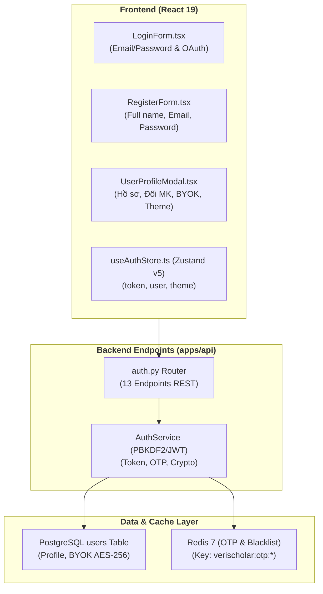
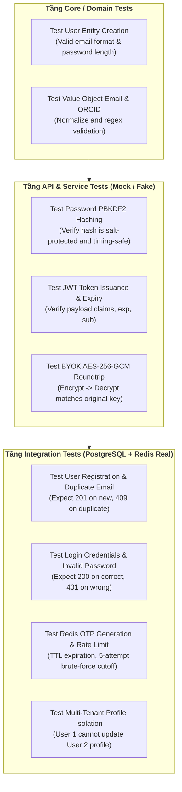

# ĐẶC TẢ KỸ THUẬT: XÁC THỰC, QUẢN LÝ TÀI KHOẢN & PHÂN QUYỀN HỌC GIẢ
# (FILE 01: AUTHENTICATION, USER PROFILE & MULTI-TENANT ISOLATION SPEC)

**Trạng thái:** DỰ THẢO CHÍNH THỨC (TECHNICAL SPECIFICATION V1)  
**Nguồn tham chiếu PRD:** [`docs/PRD/01-auth-and-user.md`](file:///home/dammanhdungvn/Downloads/Workspace/VeriScholar/docs/PRD/01-auth-and-user.md)  
**Phân hệ kỹ thuật:** Trụ cột 1 (Nền móng & Xác thực)  
**File nền tảng liên đới:** [`docs/specs/00-foundation-architecture-and-db.md`](file:///home/dammanhdungvn/Downloads/Workspace/VeriScholar/docs/specs/00-foundation-architecture-and-db.md)

---

## 1. Phạm Vi & Bảng Đối Chiếu Hiện Trạng (`As-Is` vs `Delta`)

Module 01 chịu trách nhiệm toàn bộ vòng đời xác thực học giả, cấp phát và thu hồi phiên làm việc (JWT), xác thực email/khôi phục mật khẩu qua Redis OTP, quản lý hồ sơ cá nhân và cô lập dữ liệu đa người dùng.



### Bảng Kiểm Kê Thành Phần Mã Nguồn
| Thành phần | Đường dẫn File | Trạng thái | Nội dung chi tiết |
|---|---|---|---|
| **API Endpoints** | [`apps/api/src/api/v1/endpoints/auth.py`](file:///home/dammanhdungvn/Downloads/Workspace/VeriScholar/apps/api/src/api/v1/endpoints/auth.py) | **KEEP** | 13 endpoints đầy đủ: Register, Login, Google, GitHub, Logout, Refresh, Forgot-Password, Reset-Password, Verify-Email, Resend-Verification, Me (GET/PATCH), Change-Password. |
| **Logic Service** | [`apps/api/src/api/services/auth_service.py`](file:///home/dammanhdungvn/Downloads/Workspace/VeriScholar/apps/api/src/api/services/auth_service.py) | **MODIFY** | Đã có sẵn mã hóa mật khẩu, sinh JWT HMAC-SHA256, OTP Redis. Cần bổ sung hàm mã hóa/giải mã khóa cá nhân **BYOK AES-256-GCM**. |
| **Model CSDL** | [`apps/api/src/api/db/models/user.py`](file:///home/dammanhdungvn/Downloads/Workspace/VeriScholar/apps/api/src/api/db/models/user.py) | **MODIFY** | Bổ sung 2 cột: `theme_preference` (mặc định `'system'`) và `byok_api_key_encrypted` (TEXT nullable). |
| **Pydantic Schemas** | [`apps/api/src/api/schemas/auth.py`](file:///home/dammanhdungvn/Downloads/Workspace/VeriScholar/apps/api/src/api/schemas/auth.py) | **MODIFY** | Bổ sung trường `theme_preference` và `byok_api_key` vào `UserProfileResponse` và `UpdateProfileRequest`. |
| **Domain Entity** | `packages/core/src/core/domain/entities/user.py` | **KEEP** | Thực thể User thuần Python không phụ thuộc ORM. |
| **Frontend UI** | `apps/web/src/features/auth/` | **KEEP** | Form Đăng nhập, Đăng ký, Quên/Đặt lại mật khẩu đã kết nối API. |
| **Frontend Modal** | `apps/web/src/components/profile/UserProfileModal.tsx` | **MODIFY** | Chuẩn hóa Modal 3 Tabs: Tab 1 (Hồ sơ học thuật), Tab 2 (Bảo mật & BYOK API Key), Tab 3 (Giao diện Sáng/Tối). |

---

## 2. Mô Hình Dữ Liệu & Ràng Buộc PostgreSQL (`Database Schema & Invariants`)

### A. Lược Đồ Bảng `users` Chuẩn Hóa
```sql
CREATE TABLE users (
    id UUID PRIMARY KEY DEFAULT gen_random_uuid(),
    email VARCHAR(255) NOT NULL,
    full_name VARCHAR(100) NOT NULL,
    hashed_password VARCHAR(255) NOT NULL,
    is_active BOOLEAN NOT NULL DEFAULT TRUE,
    role VARCHAR(30) NOT NULL DEFAULT 'researcher',
    institution VARCHAR(255) NULL,
    department VARCHAR(255) NULL,
    academic_rank VARCHAR(100) NULL,
    orcid_id VARCHAR(50) NULL,
    avatar_url VARCHAR(500) NULL,
    is_verified BOOLEAN NOT NULL DEFAULT FALSE,
    bio VARCHAR(1000) NULL,
    research_interests VARCHAR(500) NULL,
    google_scholar_url VARCHAR(500) NULL,
    theme_preference VARCHAR(20) NOT NULL DEFAULT 'system',
    byok_api_key_encrypted TEXT NULL,
    created_at TIMESTAMPTZ NOT NULL DEFAULT NOW(),
    updated_at TIMESTAMPTZ NOT NULL DEFAULT NOW(),
    CONSTRAINT uq_users_email UNIQUE (email),
    CONSTRAINT ck_users_theme CHECK (theme_preference IN ('light', 'dark', 'system'))
);

CREATE UNIQUE INDEX idx_users_email_lower ON users (LOWER(email));
CREATE INDEX idx_users_role_active ON users (role, is_active);
```

### B. Quy Tắc Cô Lập Dữ Liệu Đa Người Dùng (Multi-Tenant Isolation Invariant)
1. **Khóa Ngoại Bắt Buộc:** Tất cả các thực thể nghiệp vụ của học giả (`documents`, `research_sessions`, `research_notes`, `folders`, `drafts`, `graph_nodes`, `graph_edges`, `draft_assets`, `draft_messages`) bắt buộc có cột `user_id UUID NOT NULL REFERENCES users(id) ON DELETE CASCADE`.
2. **Quy Tắc Truy Vấn:** Tất cả câu lệnh `SELECT`, `UPDATE`, `DELETE` trong tầng Service hoặc Repository bắt buộc gắn điều kiện lọc:
   ```python
   stmt = select(DocumentModel).where(
       DocumentModel.id == document_id,
       DocumentModel.user_id == current_user.id
   )
   ```
3. **Phản Hồi Lỗi An Toàn:** Khi người dùng cố truy vấn ID tài nguyên của người khác, API phải trả về `HTTP 404 NOT_FOUND` với mã lỗi `RESOURCE_NOT_FOUND` (thay vì `403 FORBIDDEN`) để ngăn chặn việc dò quét sự tồn tại của tài nguyên (ID Enumeration Defense).

---

## 3. Hợp Đồng API REST & Bảng Mã Lỗi (REST Contracts & Error Schemas)

Tất cả API Auth đều tuân thủ chuẩn phong bì phản hồi chuẩn (Response Envelope) và trả về mã `trace_id` trong headers.

### A. Danh Mục Endpoints Chi Tiết

#### 1. Đăng ký tài khoản (`POST /api/v1/auth/register`)
- **Headers:** `Content-Type: application/json`
- **Request Body:**
  ```json
  {
    "email": "scholar@university.edu.vn",
    "password": "SecurePassword123!",
    "full_name": "TS. Nguyễn Văn A"
  }
  ```
- **Response (HTTP 201 Created):**
  ```json
  {
    "user": {
      "id": "3fa85f64-5717-4562-b3fc-2c963f66afa6",
      "email": "scholar@university.edu.vn",
      "full_name": "TS. Nguyễn Văn A",
      "role": "researcher",
      "is_verified": false
    },
    "tokens": {
      "access_token": "eyJhbGciOi...",
      "refresh_token": "eyJhbGciOi...",
      "token_type": "bearer",
      "expires_in": 3600
    }
  }
  ```

#### 2. Đăng nhập (`POST /api/v1/auth/login`)
- **Request Body:**
  ```json
  {
    "email": "scholar@university.edu.vn",
    "password": "SecurePassword123!",
    "remember_me": true
  }
  ```
- **Response (HTTP 200 OK):** Trả về cấu trúc tương tự `register` kèm thời hạn token mở rộng (nếu `remember_me=true`, refresh token có hạn 30 ngày).

#### 3. Đăng nhập Google OAuth 2.0 (`POST /api/v1/auth/google`)
- **Request Body:** `{ "credential": "<Google_ID_Token_JWT>" }`
- **Xử lý:** Backend xác minh token qua Google API certs, tự động trích xuất `email`, `name`, `picture`. Nếu user chưa có tài khoản $\rightarrow$ tự động tạo tài khoản với cờ `is_verified=true`.

#### 4. Khôi phục mật khẩu (`POST /api/v1/auth/forgot-password`)
- **Request Body:** `{ "email": "scholar@university.edu.vn" }`
- **Response (HTTP 200 OK):**
  ```json
  {
    "message": "Nếu email tồn tại, mã xác thực OTP đã được gửi.",
    "expires_in_seconds": 300
  }
  ```
- **Fallback Môi trường Dev:** Nếu `SMTP_HOST` chưa cấu hình, mã OTP được ghi ra file log [`storage/logs/auth-emails.log`](file:///home/dammanhdungvn/Downloads/Workspace/VeriScholar/storage/logs/auth-emails.log) để lập trình viên copy kiểm thử.

#### 5. Đặt lại mật khẩu (`POST /api/v1/auth/reset-password`)
- **Request Body:**
  ```json
  {
    "email": "scholar@university.edu.vn",
    "otp_code": "849201",
    "new_password": "NewSecurePassword456!"
  }
  ```

#### 6. Xem & Cập nhật Hồ sơ (`GET / PATCH /api/v1/auth/me`)
- **Headers:** `Authorization: Bearer <access_token>`
- **PATCH Request Body:**
  ```json
  {
    "full_name": "PGS. TS. Nguyễn Văn A",
    "institution": "Đại học Bách Khoa",
    "department": "Khoa Khoa học Máy tính",
    "orcid_id": "0000-0002-1825-0097",
    "theme_preference": "dark",
    "byok_api_key": "sk-proj-custom-openai-key"
  }
  ```
- **Response (HTTP 200 OK):** Trả về thông tin đã cập nhật. Lưu ý: trường `byok_api_key` không bao giờ được trả về nguyên văn; Backend chỉ trả về `has_byok: true` và `byok_masked: "sk-proj-...4f8A"`.

---

## 4. Thiết Kế Cơ Chế Bảo Mật & Quản Lý Khóa Cá Nhân (BYOK Encryption)

### A. Lưu Trữ Khóa Cá Nhân BYOK An Toàn (AES-256-GCM)
Học giả có thể đưa API Key OpenAI riêng của họ vào hệ thống để không bị giới hạn quota:
1. **Khóa Chủ Máy Chủ (Master Encryption Key):** Được cung cấp qua biến môi trường `BYOK_ENCRYPTION_KEY` (32 bytes hex).
2. **Quy Trình Mã Hóa:**
   - Khi nhận `byok_api_key`: Backend sinh một số ngẫu nhiên `nonce` (12 bytes).
   - Mã hóa khóa bằng thuật toán `AES-256-GCM` kèm tag xác thực tính toàn vẹn 16 bytes.
   - Ghép chuỗi base64: `base64(nonce + ciphertext + tag)` và lưu vào cột `users.byok_api_key_encrypted`.
3. **Quy Trình Giải Mã Tại Runtime:**
   - Khi thực hiện các cuộc gọi LLM trong phiên đọc hoặc viết của user đó: Backend kiểm tra nếu `byok_api_key_encrypted IS NOT NULL`, giải mã trên RAM và truyền trực tiếp vào OpenAI client của lượt gọi đó. Khóa không bao giờ được ghi vào log hay gửi ra giao diện.

### B. Cơ Chế Quản Lý OTP Qua Redis 7
- **Cấu trúc Key:** `verischolar:otp:{email}`
- **Dữ liệu lưu:** JSON string `{ "code": "6-digit-string", "user_id": "uuid", "attempts": 0 }`
- **Thời hạn TTL:** Cố định `300 giây` (5 phút).
- **Chống Brute Force (Rate Limiting):**
  - Giới hạn thử sai tối đa 5 lần; lần thứ 6 nhập sai sẽ tự động vô hiệu hóa mã OTP trong Redis.
  - Giới hạn gửi lại mã: Tối đa 3 lần yêu cầu gửi OTP trong vòng 15 phút cho một địa chỉ email (kiểm soát qua key `verischolar:rate_limit:otp:{email}` với TTL 900s).

---

## 5. Thiết Kế Giao Diện & Quản Lý Trạng Thái (Frontend UI/UX)

### A. Quản Lý Trạng Thái Toàn Cục (`useAuthStore.ts`)
Sử dụng Zustand v5 kết hợp middleware `persist` lưu `accessToken` và `user` vào `localStorage`:
```typescript
interface AuthState {
  user: UserProfile | null;
  accessToken: string | null;
  isAuthenticated: boolean;
  theme: "light" | "dark" | "system";
  setAuth: (user: UserProfile, token: string) => void;
  clearAuth: () => void;
  setTheme: (theme: "light" | "dark" | "system") => void;
  updateUser: (patch: Partial<UserProfile>) => void;
}
```

### B. Axios / Fetch Interceptor (Tự Động Bơm Token & Làm Mới Phiên)
1. **Request Interceptor:** Tự động đính kèm `Authorization: Bearer <accessToken>` vào tất cả HTTP requests gửi tới `/api/v1/*` (ngoại trừ các endpoint public: `/auth/login`, `/auth/register`, `/auth/forgot-password`).
2. **Response Interceptor:**
   - Nếu nhận mã lỗi `401 Unauthorized`:
   - Tạm dừng các request đang chờ trong hàng đợi.
   - Gọi `POST /api/v1/auth/refresh` bằng refresh token.
   - Nếu cấp lại token thành công $\rightarrow$ cập nhật token mới vào store và retry lại các request ban đầu.
   - Nếu refresh token cũng hết hạn $\rightarrow$ xóa phiên đăng nhập (`clearAuth()`) và điều hướng người dùng về màn hình đăng nhập.

### C. Modal Hồ Sơ Học Giả 3 Tabs (`UserProfileModal.tsx`)
1. **Tab 1 — Hồ sơ Học giả (Academic Profile):** Cho phép sửa Họ tên, Học hàm/Học vị, Đơn vị công tác, Khoa/Bộ môn, Mã định danh ORCID iD, Link Google Scholar.
2. **Tab 2 — Bảo mật & Khóa BYOK (Security & BYOK):** Form Đổi mật khẩu, và ô cấu hình khóa cá nhân OpenAI (`byok_api_key`) với nút "Xác thực & Lưu khóa" (có nút hiển thị trạng thái kết nối tới OpenAI).
3. **Tab 3 — Giao diện & Tùy biến (Appearance):** 3 nút chuyển đổi giao diện trực quan: `☀️ Sáng`, `🌙 Tối`, `💻 Theo hệ điều hành`.

---

## 6. Ma Trận Kiểm Thử TDD Bắt Buộc (Auth TDD Test Matrix)



| Tên Test Case | File Kiểm Thử | Mục tiêu kiểm chứng | Kỳ vọng nghiệm thu |
|---|---|---|---|
| `test_password_hashing_and_verification` | `packages/core/tests/test_password_crypto.py` | Kiểm tra thuật toán băm mật khẩu PBKDF2 | Mật khẩu đúng xác thực thành công, mật khẩu sai trả về `False`. |
| `test_byok_aes_gcm_encryption_roundtrip` | `apps/api/tests/test_byok_crypto.py` | Mã hóa chuỗi `sk-proj-test123` rồi giải mã lại | Chuỗi giải mã khớp 100% với chuỗi ban đầu, ciphertext không chứa chuỗi gốc. |
| `test_jwt_access_and_refresh_token_lifecycle` | `apps/api/tests/test_jwt_tokens.py` | Sinh token, kiểm tra hạn `exp`, kiểm tra giải mã payload `sub=user_id` | Token hợp lệ giải mã đúng `user_id`, token quá hạn ném lỗi `401`. |
| `test_user_registration_and_duplicate_conflict` | `apps/api/tests/test_auth_endpoints.py` | Đăng ký user mới và đăng ký lại đúng email đó | Lần 1 trả về `201 Created`, lần 2 trả về `409 Conflict`. |
| `test_login_success_and_wrong_password` | `apps/api/tests/test_auth_endpoints.py` | Đăng nhập đúng mật khẩu và sai mật khẩu | Đúng trả về cặp token, sai trả về `401 Unauthorized`. |
| `test_redis_otp_verification_and_rate_limit` | `apps/api/tests/test_redis_otp.py` | Yêu cầu OTP, nhập mã đúng, và thử nhập sai 6 lần liên tiếp | Nhập đúng reset mật khẩu thành công; nhập sai 6 lần xóa mã OTP khỏi Redis. |
| `test_update_profile_and_theme_preference` | `apps/api/tests/test_user_profile.py` | Cập nhật họ tên và theme `'dark'` | Dữ liệu lưu chuẩn trong PostgreSQL, trả về đúng `theme_preference='dark'`. |

---

## 7. Tiêu Chí Nghiệm Thu Kỹ Thuật (Definition of Done)

- [ ] Lược đồ bảng `users` được cập nhật đầy đủ các trường `theme_preference` và `byok_api_key_encrypted`.
- [ ] 13 endpoint trong `auth.py` hoạt động ổn định, có rate-limiting qua Redis và xử lý lỗi đồng nhất.
- [ ] Cơ chế mã hóa khóa cá nhân BYOK sử dụng thuật toán AES-256-GCM an toàn, không bao giờ để lộ khóa thô ra log hoặc response.
- [ ] Mọi thao tác truy vấn dữ liệu học giả đều được cô lập triệt để theo `user_id`.
- [ ] Toàn bộ kịch bản kiểm thử trong Ma trận Kiểm thử Mục 6 đạt `100% PASS`.
