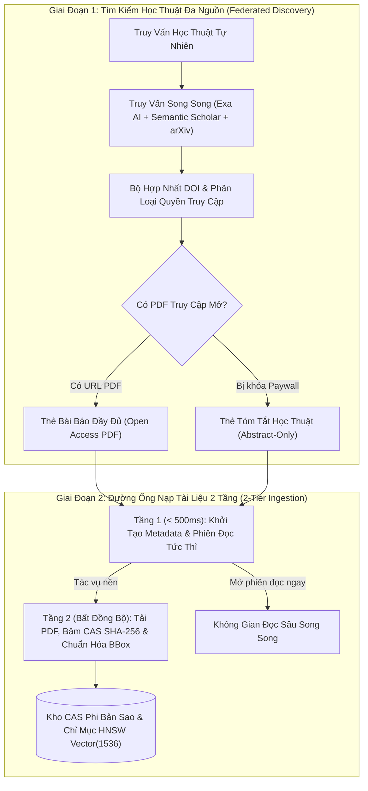
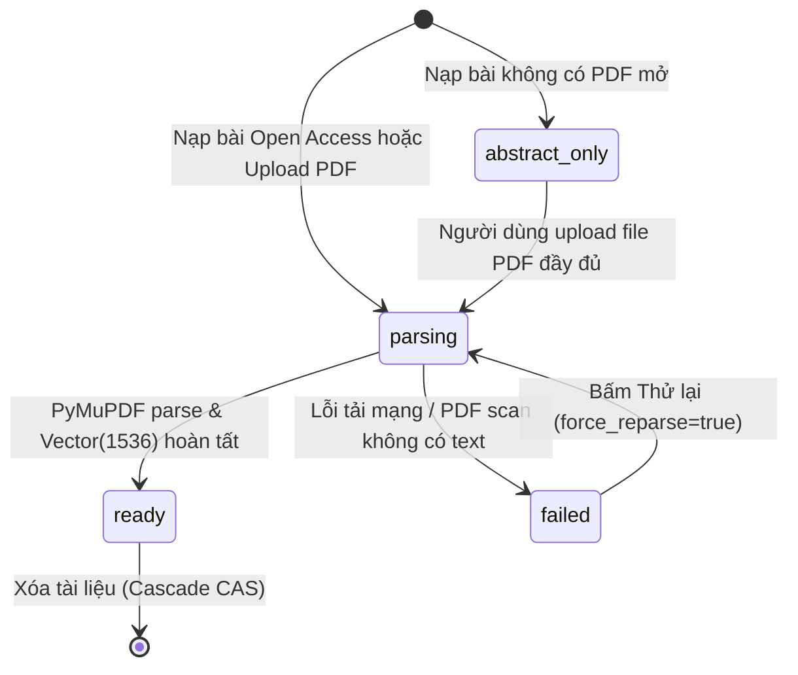
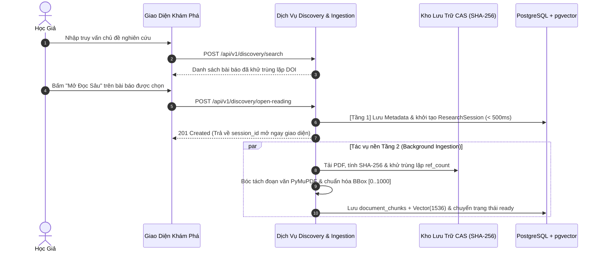

# ĐẶC TẢ KỸ THUẬT: PHÂN HỆ KHÁM PHÁ ĐỀ TÀI & NẠP TÀI LIỆU 2 TẦNG
# (SCHOLARLY DISCOVERY, 2-TIER INGESTION & DOCUMENTS CRUD SPECIFICATION)

**Trạng thái:** DỰ THẢO CHÍNH THỨC (TECHNICAL SPECIFICATION V1)  
**Nguồn tham chiếu PRD:** [`02-discovery-and-documents-crud.md`](../PRD/02-discovery-and-documents-crud.md)  
**Phân hệ kỹ thuật:** Phân Hệ Khám Phá & Nạp Tài Liệu (Discovery & Ingestion)  
**File nền tảng liên đới:** [`00-foundation-architecture-and-db.md`](./00-foundation-architecture-and-db.md)

---

## 1. Usecase & Bối Cảnh Người Dùng (Real-World User Journey & Value)

### A. Usecase 1: Khám Phá Đề Tài Từ Con Số Không (Zero-to-Reading Across Open Access & Paywalls)
- **Bối cảnh & Vấn đề thực tế:** Khi bắt đầu một đề tài nghiên cứu mới, học giả không biết nên tìm bài báo ở đâu ngoài Google Scholar. Tuy nhiên, rất nhiều bài báo quan trọng nằm sau bức tường phí (Paywall) của IEEE, Springer hay Elsevier. Khi người dùng gặp bài bị khóa, đa số các công cụ AI khác sẽ báo lỗi hoặc bỏ cuộc, khiến học giả mất dấu tài liệu quan trọng.
- **Giải pháp của phân hệ:**
  - Tích hợp tìm kiếm đa nguồn học thuật (Exa AI, Semantic Scholar, arXiv) với cơ chế phân loại trạng thái linh hoạt 2 chế độ:
    - **Bài Open Access:** Hiển thị nút `[📖 Mở Đọc Sâu (Full PDF)]` để mở xem toàn văn PDF kèm Bounding Box vàng.
    - **Bài Paywall:** Không chặn người dùng mà hiển thị nút `[📄 Xem Tóm Tắt (Abstract)]` cho phép đọc tóm tắt, mục tiêu nghiên cứu và trích dẫn, kèm nút `[📤 Tải lên file PDF]` để người dùng tự tải bản PDF có sẵn của mình lên tiếp tục phân tích.

### B. Usecase 2: Trải Nghiệm Nạp 2 Tầng Không Chờ Đợi (Instant Zero-Waiting 2-Tier Ingestion)
- **Bối cảnh & Vấn đề thực tế:** Một file PDF bài báo khoa học 30–50 trang chứa nhiều hình ảnh, công thức và bảng biểu. Nếu bắt người dùng chờ hệ thống tải file, bóc tách OCR, chia đoạn chunking và tạo vector embedding (thường mất 20–40 giây), người dùng sẽ cảm thấy ứng dụng bị đơ và rời bỏ.
- **Giải pháp của phân hệ:**
  - Thiết kế đường ống nạp 2 tầng bất đối xứng:
    - **Tầng 1 (Tức thì < 500ms):** Lưu ngay tiêu đề, tác giả, DOI và tóm tắt vào CSDL, khởi tạo ngay phiên đọc và đưa người dùng vào màn hình làm việc tức thì.
    - **Tầng 2 (Chạy ngầm BackgroundTasks):** Hệ thống âm thầm tải file PDF về kho CAS, dùng PyMuPDF bóc tách từng khối văn bản gắn tọa độ hình học (Bounding Box) và tính toán vector embedding `Vector(1536)` mà không làm nghẽn giao diện người dùng.

### C. Usecase 3: Tải Lên & Quản Lý Tài Liệu PDF Cá Nhân (Personal PDF Upload & CAS Dedup)
- **Bối cảnh & Vấn đề thực tế:** Người dùng có tài liệu nội bộ, báo cáo kỹ thuật riêng tải từ trường đại học muốn đối thoại với AI. Họ cần tải file lên dễ dàng (`<= 50MB`, `<= 100 trang`) và muốn tài liệu của mình được bảo mật, không bị trùng lặp lãng phí dung lượng ổ đĩa.
- **Giải pháp của phân hệ:**
  - Hỗ trợ tải file PDF trực tiếp qua `POST /api/v1/documents/upload` với kiểm tra MIME type và giới hạn dung lượng chặt chẽ. Áp dụng Content-Addressable Storage (CAS) tự động khử trùng lặp qua mã băm SHA-256 giúp tiết kiệm tối đa dung lượng máy chủ.

---

## 2. Phạm Vi & Bảng Đối Chiếu Hiện Trạng (`As-Is` vs `Delta`)

Phân hệ này giải quyết bài toán khởi đầu nghiên cứu khoa học từ con số 0 (**Zero-to-Reading**): tìm kiếm bài báo ngoài theo chủ đề (Exa AI, Semantic Scholar, arXiv), nạp bài báo 2 tầng linh hoạt theo 2 trạng thái (**Full PDF** hoặc **Abstract-Only**), tải lên tài liệu PDF cá nhân (`<= 50MB`, `<= 100 trang`), bóc tách khối văn bản gắn tọa độ Bounding Box và lưu trữ vào kho CAS.



### Bảng Kiểm Kê Thành Phần Mã Nguồn
| Thành phần | Đường dẫn File | Trạng thái | Nội dung chi tiết |
|---|---|---|---|
| **Discovery API** | `apps/api/src/api/v1/endpoints/discovery.py` | **CREATE** | Tạo mới 2 endpoint: `POST /api/v1/discovery/search` (tìm bài báo ngoài) và `POST /api/v1/discovery/open-reading` (khởi tạo phiên đọc từ kết quả tìm kiếm). Mount vào `api_v1_router`. |
| **Documents API** | [`apps/api/src/api/v1/endpoints/documents.py`](../../apps/api/src/api/v1/endpoints/documents.py) | **KEEP** | Giữ nguyên CRUD tài liệu: `POST /upload`, `GET /`, `GET /{id}`, `PATCH /{id}`, `DELETE /{id}`, `POST /{id}:parse`. |
| **Ingestion Pipeline** | [`apps/api/src/api/services/document_service.py`](../../apps/api/src/api/services/document_service.py) | **MODIFY** | Bổ sung logic phân biệt 2 trạng thái `ready` (cho abstract-only) và `parsing` $\rightarrow$ `ready` (cho full PDF), bóc tách Bounding Box PyMuPDF và sinh embedding `Vector(1536)`. |
| **Exa & arXiv Adapter** | `packages/core/src/core/services/` & `apps/api/src/api/adapters/` | **MODIFY** | Tách cổng trừu tượng `IScholarlySearchPort` trong Core và cài đặt Adapter gọi Exa AI SDK (`category="research paper"`) + Semantic Scholar + arXiv. |
| **Discovery UI** | [`apps/web/src/features/discovery/components/DiscoveryPage.tsx`](../../apps/web/src/features/discovery/components/DiscoveryPage.tsx) | **MODIFY** | Thay thế code tìm kiếm nhầm trong danh sách tài liệu local cũ bằng gọi API `POST /api/v1/discovery/search`, hiển thị thẻ kết quả với 2 nút tương ứng. |
| **Documents UI** | `apps/web/src/features/documents/` | **KEEP** | Danh sách tài liệu, Modal upload PDF kéo thả, thanh tiến trình parse tài liệu. |

---

## 3. Mô Hình Dữ Liệu & Ràng Buộc Trạng Thái (`Database Schema & Status Lifecycle`)

### A. Vòng Đời Trạng Thái Tài Liệu (`documents.status`)
Bảng `documents` (đã đặc tả ở Spec 00) quản lý trạng thái tài liệu qua 4 giá trị bất biến:
1. `status = 'abstract_only'`: Bài báo được tạo từ kết quả tìm kiếm không có link PDF. Chỉ có metadata và Abstract (được lưu trong `document_chunks` chunk 0). Khung đọc bên trái hiển thị thẻ học thuật `AbstractCardViewer.tsx`.
2. `status = 'parsing'`: Bài báo đang tải file PDF ngầm hoặc đang chạy PyMuPDF bóc tách văn bản. Khung đọc bên trái hiển thị thanh tiến trình `progress: 0..100%`.
3. `status = 'ready'`: Toàn bộ các trang PDF đã được bóc tách xong thành các chunks, tính đủ tọa độ Bounding Box và hoàn tất nhúng vector `Vector(1536)`.
4. `status = 'failed'`: Xảy ra lỗi khi tải PDF hoặc file không phải là Digital PDF (PDF scan/ảnh không có text layer). Kèm thông điệp `error_message`.



### B. Ràng Buộc Kiểm Tra Hợp Lệ Của File Tải Lên (Validation Invariants)
- **Định dạng file:** Bắt buộc là file PDF nhị phân hợp lệ (Magic bytes `%PDF-`).
- **Dung lượng tối đa:** `50 MB` ($52.428.800$ bytes). Vượt quá trả về `413 PAYLOAD_TOO_LARGE`.
- **Số trang tối đa:** `<= 100 trang`. Vượt quá trả về `422 UNPROCESSABLE_ENTITY`.
- **Lớp văn bản (Text Layer Check):** Kiểm tra trang 1 có ít nhất 50 ký tự văn bản có thể trích xuất. Nếu trang 1 không có text (PDF scan thuần ảnh), trả về lỗi `PDF_NO_TEXT_LAYER` và hướng dẫn người dùng cung cấp bản số hóa có OCR.

---

## 4. Hợp Đồng API REST & Ma Trận Mã Lỗi (REST Contracts & Error Codes Matrix)

Tất cả API Khám phá và Quản lý Tài liệu đều tuân thủ chuẩn phong bì phản hồi (`SingleResponseEnvelope`) và phong bì lỗi chuẩn hóa (`ErrorResponse`).

### A. Chuẩn Phong Bì Phản Hồi Lỗi Chuẩn Hóa (`ErrorResponse`)
Khi có lỗi phát sinh, backend trả về cấu trúc lỗi đồng nhất tuân thủ [`apps/api/src/api/schemas/error.py`](../../apps/api/src/api/schemas/error.py):
```json
{
  "success": false,
  "error": {
    "code": "PDF_FILE_TOO_LARGE",
    "message": "Dung lượng tệp vượt quá giới hạn tối đa 50MB cho phép của hệ thống.",
    "field": "file",
    "action": "Vui lòng nén dung lượng tệp PDF hoặc chọn tài liệu có dung lượng nhỏ hơn 50MB."
  },
  "meta": {
    "request_id": "req_782b12fa910e",
    "timestamp": "2026-10-25T09:15:00Z"
  }
}
```

### B. API Khám Phá Bài Báo (`apps/api/src/api/v1/endpoints/discovery.py`)

#### 1. Tìm kiếm bài báo học thuật (`POST /api/v1/discovery/search`)
- **Headers:** `Authorization: Bearer <token>`, `Content-Type: application/json`
- **Request Body:**
  ```json
  {
    "query": "Direct Preference Optimization language models",
    "limit": 10
  }
  ```
- **Response (HTTP 200 OK):**
  ```json
  {
    "success": true,
    "data": [
      {
        "title": "Direct Preference Optimization: Your Language Model is Secretly a Reward Model",
        "authors": ["Rafael Rafailov", "Archit Sharma", "Eric Mitchell", "Stefano Ermon"],
        "publication_year": 2023,
        "venue": "NeurIPS 2023",
        "doi": "10.48550/arXiv.2305.18290",
        "arxiv_id": "2305.18290",
        "abstract": "While standard RLHF pipelines are complex and unstable...",
        "access_status": "open_access_pdf",
        "pdf_url": "https://arxiv.org/pdf/2305.18290.pdf"
      },
      {
        "title": "A general theoretical paradigm for preference learning",
        "authors": ["Author A", "Author B"],
        "publication_year": 2024,
        "venue": "Nature Machine Intelligence",
        "doi": "10.1038/s42256-024-00800-x",
        "arxiv_id": null,
        "abstract": "Preference optimization has become the standard technique...",
        "access_status": "abstract_only",
        "pdf_url": null
      }
    ],
    "meta": {
      "total_results": 2,
      "request_id": "req_disc_892a01"
    }
  }
  ```

#### 2. Mở phiên đọc từ kết quả tìm kiếm (`POST /api/v1/discovery/open-reading`)
- **Mục đích:** Tạo tức thì bài báo và phiên đọc sâu mới (Zero-to-Reading) chỉ trong 1 request duy nhất.
- **Request Body:**
  ```json
  {
    "title": "Direct Preference Optimization: Your Language Model is Secretly a Reward Model",
    "authors": ["Rafael Rafailov", "Archit Sharma"],
    "publication_year": 2023,
    "doi": "10.48550/arXiv.2305.18290",
    "arxiv_id": "2305.18290",
    "abstract": "While standard RLHF pipelines are complex...",
    "pdf_url": "https://arxiv.org/pdf/2305.18290.pdf"
  }
  ```
- **Response (HTTP 201 Created):**
  ```json
  {
    "success": true,
    "data": {
      "session_id": "8a9b1c2d-3e4f-5a6b-7c8d-9e0f1a2b3c4d",
      "document_id": "1a2b3c4d-5e6f-7a8b-9c0d-1e2f3a4b5c6d",
      "status": "parsing",
      "access_status": "open_access_pdf"
    },
    "meta": { "request_id": "req_open_1294ab" }
  }
  ```
  *(Nếu `pdf_url` là `null`, trả về `status: "abstract_only"`, `access_status: "abstract_only"`).*

---

### C. API Quản Lý Tài Liệu PDF (`apps/api/src/api/v1/endpoints/documents.py`)

#### 1. Tải lên tài liệu PDF cá nhân (`POST /api/v1/documents` hoặc alias `/upload`)
- **Headers:** `Content-Type: multipart/form-data`
- **Form Data:**
  - `file`: File nhị phân (`.pdf`)
  - `title`: Chuỗi tiêu đề tùy chọn (mặc định lấy tên file)
  - `folder_id`: UUID thư mục tùy chọn
- **Xử lý:**
  - Tính băm SHA-256. Kiểm tra `document_storage_blobs`.
  - Lưu file vào `storage/blobs/ab/cd/hash.pdf`.
  - Tạo `DocumentModel` với `status="parsing"`, kích hoạt tác vụ ngầm bóc tách.
- **Response (HTTP 202 Accepted):**
  ```json
  {
    "success": true,
    "data": {
      "id": "1a2b3c4d-5e6f-7a8b-9c0d-1e2f3a4b5c6d",
      "filename": "dpo_paper.pdf",
      "file_size_bytes": 1420580,
      "status": "parsing",
      "stage": "validation",
      "progress": 0
    },
    "meta": { "request_id": "req_up_8829aa" }
  }
  ```

#### 2. Lấy chi tiết tài liệu & Bounding Boxes (`GET /api/v1/documents/{id}`)
- **Headers:** `Authorization: Bearer <token>`
- **Response (HTTP 200 OK):**
  Trả về metadata tài liệu, tóm tắt 3 phần `DocumentSummary`, danh mục trích dẫn `references`, và mảng chunks kèm tọa độ `bounding_boxes: [[x0, y0, x1, y1]]` của từng đoạn văn bản.

#### 3. Bổ sung PDF cho bài báo Abstract-Only (`POST /api/v1/documents/{id}/attach-pdf`)
- **Mục đích:** Nâng cấp bài báo từ `status="abstract_only"` lên `status="ready"` bằng cách nạp file PDF đầy đủ.
- **Headers:** `Content-Type: multipart/form-data`
- **Xử lý:** Lưu file PDF vào CAS, chuyển `status` sang `parsing`, kích hoạt PyMuPDF trích xuất toàn bài.

#### 4. Liệt kê & Lọc danh mục tài liệu (`GET /api/v1/documents`)
- **Headers:** `Authorization: Bearer <token>`
- **Query Params:** `folder_id` (UUID tùy chọn), `starred` (boolean tùy chọn), `query` (tìm theo tiêu đề/tác giả), `page` (int, mặc định 1), `per_page` (int, mặc định 20).
- **Response (HTTP 200 OK):** Trả về danh sách tài liệu thuộc sở hữu của học giả hiện tại.

#### 5. Cập nhật thông tin tài liệu (`PATCH /api/v1/documents/{id}`)
- **Headers:** `Authorization: Bearer <token>`
- **Request Body:** `{ "title": "Tên mới", "folder_id": "uuid-or-null", "is_starred": true }`
- **Response (HTTP 200 OK):** Trả về metadata tài liệu sau khi cập nhật.

#### 6. Tiêu hủy tài liệu cá nhân & Dọn dẹp CAS (`DELETE /api/v1/documents/{id}`)
- **Headers:** `Authorization: Bearer <token>`
- **Xử lý:**
  - Xóa bản ghi tài liệu và toàn bộ chunks khỏi PostgreSQL.
  - Kiểm tra `document_storage_blobs`: nếu không còn tài liệu nào khác trỏ tới cùng hash SHA-256 (`ref_count = 0`), tiêu hủy ngay lập tức tệp vật lý trên đĩa cứng trong cùng chu kỳ xử lý (Zero-Retention Invariant).
- **Response (HTTP 200 OK):** `{ "success": true, "data": { "deleted_id": "{id}", "purged_physical_file": true } }`

#### 7. Yêu cầu bóc tách lại tài liệu (`POST /api/v1/documents/{id}:parse`)
- **Headers:** `Authorization: Bearer <token>`
- **Query Params:** `force_reparse=true`
- **Xử lý:** Kích hoạt lại tiến trình phân tích cấu trúc PyMuPDF và sinh lại embedding vector nếu lần trước bị gián đoạn hoặc thất bại.

---

### D. Ma Trận Mã Lỗi Chuẩn Hóa (Deterministic Error Codes Matrix)

Bảng ma trận dưới đây quy định toàn bộ các mã lỗi tất định của Phân hệ Khám phá và Nạp Tài liệu, đảm bảo mọi mô hình AI và kỹ sư phát triển đều có thể cài đặt logic xử lý lỗi chuẩn xác, nhất quán:

| HTTP Status | Mã Lỗi (`error_code`) | Điều Kiện Kích Hoạt (Trigger Condition) | Thông Điệp Tiếng Việt Chuẩn Hóa (`message`) | Trường Lỗi (`field`) & Hành Động Khắc Phục (`action`) |
| :--- | :--- | :--- | :--- | :--- |
| `400 Bad Request` | `SEARCH_QUERY_EMPTY` | Tham số `query` để trống, rỗng hoặc chỉ toàn khoảng trắng trong `POST /api/v1/discovery/search` | `"Từ khóa tìm kiếm không được để trống. Vui lòng nhập chủ đề nghiên cứu hoặc tên bài báo."` | `field: "query"` — Nhập câu truy vấn có độ dài tối thiểu 2 ký tự. |
| `400 Bad Request` | `SEARCH_LIMIT_OUT_OF_RANGE` | Tham số `limit` nhỏ hơn 1 hoặc lớn hơn 50 | `"Số lượng kết quả tìm kiếm phải nằm trong khoảng từ 1 đến 50."` | `field: "limit"` — Điều chỉnh tham số `limit` trong phạm vi hợp lệ. |
| `400 Bad Request` | `DOCUMENT_ALREADY_ATTACHED` | Gọi `POST /attach-pdf` trên tài liệu đã có sẵn file PDF (`status != 'abstract_only'`) | `"Tài liệu này đã có sẵn file PDF toàn văn. Không thể đính kèm thêm."` | `field: null` — Không cần nạp thêm file PDF cho tài liệu này. |
| `400 Bad Request` | `INVALID_DOCUMENT_UPDATE` | Body cập nhật `PATCH /documents/{id}` rỗng hoặc không có trường dữ liệu nào thay đổi | `"Dữ liệu cập nhật tài liệu không hợp lệ hoặc không có thay đổi."` | `field: null` — Cung cấp ít nhất một trường cần sửa (`title`, `folder_id`, `is_starred`). |
| `401 Unauthorized` | `AUTHENTICATION_REQUIRED` | Không có Bearer token hoặc token không hợp lệ khi gọi API quản lý tài liệu | `"Yêu cầu xác thực tài khoản để thực hiện thao tác này."` | `field: null` — Đính kèm header `Authorization: Bearer <access_token>`. |
| `404 Not Found` | `DOCUMENT_NOT_FOUND` | `document_id` không tồn tại trong cơ sở dữ liệu hoặc thuộc sở hữu của học giả khác | `"Không tìm thấy tài liệu yêu cầu hoặc bạn không có quyền truy cập."` | `field: "id"` — Kiểm tra lại định danh tài liệu trong danh mục cá nhân. |
| `404 Not Found` | `FOLDER_NOT_FOUND` | `folder_id` truyền vào khi tải file hoặc cập nhật không tồn tại trong tài khoản học giả | `"Không tìm thấy thư mục lưu trữ được chỉ định."` | `field: "folder_id"` — Chọn thư mục hợp lệ hoặc để trống để lưu ở thư mục gốc. |
| `413 Payload Too Large` | `PDF_FILE_TOO_LARGE` | Dung lượng file PDF tải lên vượt quá giới hạn 50MB ($52.428.800$ bytes) | `"Dung lượng tệp vượt quá giới hạn tối đa 50MB cho phép của hệ thống."` | `field: "file"` — Nén dung lượng file PDF hoặc chia nhỏ tài liệu dưới 50MB. |
| `415 Unsupported Media Type` | `PDF_INVALID_MIME_TYPE` | Tệp tải lên có MIME type khác với `application/pdf` | `"Định dạng tệp không được hỗ trợ. Hệ thống chỉ chấp nhận tệp tài liệu PDF (.pdf)."` | `field: "file"` — Chọn đúng tệp có định dạng `.pdf`. |
| `422 Unprocessable Entity` | `PDF_MAGIC_BYTES_MISMATCH` | Tệp có đuôi `.pdf` nhưng 4 bytes đầu không khớp header `%PDF-` (file giả mạo hoặc hỏng nặng) | `"Tệp tải lên không phải là tệp PDF hợp lệ hoặc cấu trúc tệp đã bị hư hại."` | `field: "file"` — Kiểm tra tính toàn vẹn của tệp tài liệu gốc trên máy tính. |
| `422 Unprocessable Entity` | `PDF_PAGE_LIMIT_EXCEEDED` | Tổng số trang của tài liệu vượt quá giới hạn 100 trang (`doc.page_count > 100`) | `"Số lượng trang của tài liệu vượt quá giới hạn 100 trang của phiên bản thử nghiệm."` | `field: "file"` — Cắt bớt phần phụ lục hoặc chia nhỏ tài liệu dưới 100 trang. |
| `422 Unprocessable Entity` | `PDF_NO_TEXT_LAYER` | Trang 1 của tài liệu có ít hơn 50 ký tự văn bản có thể trích xuất (PDF scan ảnh thuần túy) | `"Tài liệu là tệp quét ảnh thuần túy không có lớp văn bản số hóa. Vui lòng cung cấp bản số hóa có OCR."` | `field: "file"` — Chạy phần mềm OCR quét chữ trước khi nạp tài liệu vào hệ thống. |
| `422 Unprocessable Entity` | `PDF_PASSWORD_PROTECTED` | Tệp PDF bị khóa bằng mật khẩu hoặc bị mã hóa bảo vệ bản quyền DRM | `"Tệp PDF được bảo vệ bằng mật khẩu hoặc bị khóa quyền trích xuất. Vui lòng mở khóa tệp trước khi tải lên."` | `field: "file"` — Gỡ bỏ mật khẩu bảo vệ trên file PDF trước khi tải lên. |
| `422 Unprocessable Entity` | `OPEN_ACCESS_DOWNLOAD_FAILED` | Không thể tải file PDF từ liên kết Open Access ngoài (lỗi mạng, HTTP 403/404 từ upstream, hoặc Captcha) | `"Không thể tải tệp PDF từ nguồn học thuật mở bên ngoài. Bạn có thể tự tải tệp lên từ máy tính."` | `field: "pdf_url"` — Bấm nút Tự tải PDF từ máy tính để tiếp tục đọc bài. |
| `422 Unprocessable Entity` | `DOCUMENT_ALREADY_READY` | Gọi `POST /api/v1/documents/{id}:parse` trên bài báo đã ở trạng thái `ready` mà không có cờ `force_reparse=true` | `"Tài liệu đã được bóc tách và sẵn sàng nghiên cứu. Sử dụng cờ force_reparse=true nếu muốn phân tích lại."` | `field: null` — Truyền tham số `force_reparse=true` nếu cần ép buộc phân tích lại. |
| `429 Too Many Requests` | `DISCOVERY_SEARCH_RATE_LIMITED` | Học giả thực hiện quá 20 lượt tìm kiếm bài báo trong vòng 1 phút | `"Bạn đã gửi quá nhiều yêu cầu tìm kiếm. Vui lòng đợi 1 phút trước khi tiếp tục."` | `field: null` — Tạm dừng gửi yêu cầu và đợi hết thời gian giới hạn. |
| `429 Too Many Requests` | `DOCUMENT_UPLOAD_RATE_LIMITED` | Học giả tải lên quá 10 file PDF trong vòng 5 phút | `"Tần suất tải tài liệu lên quá nhanh. Vui lòng đợi trong giây lát."` | `field: null` — Giãn cách thời gian giữa các lần tải tệp lên hệ thống. |
| `500 Internal Server Error` | `CAS_STORAGE_WRITE_FAILED` | Lỗi ghi tệp nhị phân vào hệ thống lưu trữ CAS nội bộ hoặc ổ cứng đầy dung lượng | `"Sự cố lưu trữ tệp vào hệ thống kho dữ liệu nội bộ. Vui lòng liên hệ quản trị viên."` | `field: null` — Báo cáo sự cố hệ thống lưu trữ kèm mã `request_id`. |
| `500 Internal Server Error` | `PARSE_JOB_FAILED` | Ngoại lệ nghiêm trọng trong tiến trình PyMuPDF bóc tách đoạn văn hoặc tính vector nhúng | `"Tiến trình bóc tách cấu trúc tài liệu gặp sự cố kỹ thuật. Bạn có thể bấm Thử lại sau."` | `field: null` — Cập nhật trạng thái `failed`, cho phép bấm phân tích lại. |
| `500 Internal Server Error` | `INTERNAL_SERVER_ERROR` | Lỗi ngoại lệ hệ thống chưa xác định phát sinh trong quá trình xử lý backend | `"Đã xảy ra sự cố nội bộ trong quá trình xử lý yêu cầu. Vui lòng thử lại sau."` | `field: null` — Ghi log chi tiết và cung cấp `request_id` cho kỹ thuật. |
| `502 Bad Gateway` | `SEARCH_UPSTREAM_ERROR` | Cổng tìm kiếm học thuật ngoài (Exa AI, Semantic Scholar, arXiv) trả về mã lỗi HTTP 5xx | `"Máy chủ tìm kiếm học thuật quốc tế đang gặp sự cố kết nối. Vui lòng thử lại sau."` | `field: null` — Thử lại sau ít phút hoặc tìm kiếm chủ đề khác. |
| `504 Gateway Timeout` | `SEARCH_UPSTREAM_TIMEOUT` | Yêu cầu tìm kiếm bài báo ngoài bị quá thời gian chờ (> 15 giây) | `"Quá thời gian chờ phản hồi từ các kho dữ liệu học thuật quốc tế. Vui lòng thử lại với từ khóa ngắn gọn hơn."` | `field: null` — Rút ngắn hoặc tối ưu hóa câu truy vấn học thuật. |

---

## 5. Thiết Kế Đường Ống Bóc Tách Kỹ Thuật (Ingestion & PyMuPDF Chunking)

### A. Thuật Toán Trích Xuất Khối Văn Bản & Bounding Box
Trong [`apps/api/src/api/adapters/chunk_extractor.py`](../../apps/api/src/api/adapters/chunk_extractor.py), sử dụng PyMuPDF (`pymupdf`):
1. **Lấy khối chữ theo trang (Page Blocks):**
   ```python
   page = doc.load_page(page_num)
   blocks = page.get_text("blocks")  # (x0, y0, x1, y1, text, block_no, block_type)
   ```
2. **Chuẩn hóa Tọa độ Hệ số Tương đối (Normalized 0..1000):**
   Để hiển thị lớp phủ Bounding Box chuẩn xác trên mọi độ phân giải màn hình và mức độ zoom, tọa độ pixel điểm ảnh được chuẩn hóa theo tỷ lệ kích thước trang:
   $$x0_{\text{norm}} = \frac{x0}{\text{page\_width}} \times 1000, \quad y0_{\text{norm}} = \frac{y0}{\text{page\_height}} \times 1000$$
3. **Cắt đoạn theo ngưỡng Token (Chunking Invariant):**
   - Kích thước mục tiêu: `512 tokens` (khoảng 1.800–2.200 ký tự).
   - Độ gối đầu (Overlap): `50 tokens` để bảo tồn mạch ngữ nghĩa giữa các đoạn liền kề.
   - Gắn kết mảng tọa độ `bounding_boxes: [[x0, y0, x1, y1], ...]` tương ứng với các dòng chữ nằm trong chunk đó.

### B. Sinh Vector Nhúng (Embedding Generation)
1. Gọi OpenAI Embedding API với mô hình cố định `text-embedding-3-small`.
2. Đầu ra là vector `1536 chiều`. Lưu trực tiếp vào cột `document_chunks.embedding` kiểu `Vector(1536)`.
3. Tự động kích hoạt cập nhật chỉ mục `HNSW` trong PostgreSQL.

---

## 6. Thiết Kế Giao Diện & Tương Tác Frontend (`apps/web`)

### A. Giao Diện Khám Phá Bài Báo (`DiscoveryPage.tsx`)
1. **Thanh tìm kiếm trung tâm lớn:** Ô tìm kiếm với gợi ý từ khóa học thuật phổ biến (Deep Learning, NLP, Quantum Computing, CRISPR...).
2. **Thẻ kết quả bài báo (Scholarly Result Card):**
   - Tiêu đề in đậm font Serif (Playfair Display / Merriweather).
   - Danh sách tác giả, năm xuất bản, tên hội nghị/tạp chí (`venue`).
   - Huy hiệu trạng thái truy cập:
     - Xanh lá: `🟢 Open Access PDF`
     - Xám: `🔒 Abstract Only (Paywall)`
   - Nút hành động chính:
     - Nếu có PDF: Nút xanh `[📖 Mở Đọc Sâu (Full PDF)]` $\rightarrow$ gọi `open-reading` $\rightarrow$ chuyển sang `/dashboard/{sessionId}`.
     - Nếu không có PDF: Nút viền xám `[📄 Xem Tóm Tắt (Abstract)]` $\rightarrow$ gọi `open-reading` $\rightarrow$ mở phiên đọc ở chế độ xem thẻ tóm tắt.

### B. Trình Xem Thẻ Tóm Tắt (`AbstractCardViewer.tsx`)
Khi bài báo ở trạng thái `status="abstract_only"`:
- Khung bên trái hiển thị một giao diện thẻ bài báo trang trọng:
  - Header: Tiêu đề bài báo, Tác giả, Năm, Link DOI chuyển hướng sang trang web gốc của nhà xuất bản.
  - Body: Toàn văn đoạn Abstract được định dạng đẹp mắt với khoảng cách dòng thoáng (leading-relaxed).
  - Callout Banner màu hổ phách (Amber Warning): *"Bài báo này hiện mới có đoạn tóm tắt. Bạn có thể hỏi đáp với AI về ý tưởng chính hoặc tải file PDF gốc lên để mở khóa toàn bộ bài báo."*
  - Nút bấm lớn trung tâm: `[📤 Tải lên file PDF đầy đủ]` mở hộp thoại chọn file nạp vào endpoint `POST /api/v1/documents/{id}/attach-pdf`.

---

## 7. Tập Tin Neo Tham Chiếu Trong Codebase (Codebase Anchors)

Mọi thay đổi kỹ thuật của phân hệ Khám phá và Quản lý tài liệu phải tuân thủ và tham chiếu từ các tệp sau:

| Vai trò kiến trúc | Tệp neo chuẩn mực trong repo | Nguyên tắc bắt chước |
| :--- | :--- | :--- |
| **API Endpoints Pattern** | [`apps/api/src/api/v1/endpoints/documents.py`](../../apps/api/src/api/v1/endpoints/documents.py) | Tham chiếu cách định nghĩa Router, xử lý upload `UploadFile`, streaming PDF file và quản lý OCC version. |
| **Discovery Endpoints** | `apps/api/src/api/v1/endpoints/discovery.py` | Tham chiếu cách định nghĩa router tìm kiếm ngoài và nạp Zero-to-Reading. |
| **Document Service & Ingestion** | [`apps/api/src/api/services/document_service.py`](../../apps/api/src/api/services/document_service.py) | Tham chiếu cách gọi `BackgroundTasks`, tính SHA-256 hash và liên kết với `IBlobStoragePort`. |
| **Structure & Chunk Extractor** | [`apps/api/src/api/adapters/chunk_extractor.py`](../../apps/api/src/api/adapters/chunk_extractor.py) | Tham chiếu cách dùng PyMuPDF bóc tách blocks và tính chuẩn hóa tọa độ `[0..1000]`. |
| **Storage Adapter** | [`packages/core/src/core/adapters/storage/local.py`](../../packages/core/src/core/adapters/storage/local.py) | Tham chiếu cấu trúc lưu trữ `storage/blobs/{hash[:2]}/{hash[2:4]}/{hash}`. |
| **Error Handling Schema** | [`apps/api/src/api/schemas/error.py`](../../apps/api/src/api/schemas/error.py) | Chuẩn hóa cấu trúc phong bì lỗi `ErrorResponse` và `ErrorDetail`. |

---

## 8. Ma Trận Kiểm Thử TDD Bắt Buộc (Discovery & Documents TDD Matrix)



| Tên Test Case | File Kiểm Thử | Mục tiêu kiểm chứng | Kỳ vọng nghiệm thu |
|---|---|---|---|
| `test_validate_pdf_file_limits` | `packages/core/tests/test_pdf_validator.py` | Kiểm tra file > 50MB hoặc > 100 trang | Ném lỗi `FileLimitExceededException`. |
| `test_discovery_search_and_classify_access` | `apps/api/tests/test_discovery_endpoints.py` | Gọi `POST /api/v1/discovery/search` với mock search port | Trả về danh sách bài có phân loại đúng `open_access_pdf` và `abstract_only`. |
| `test_open_reading_creates_session_and_document` | `apps/api/tests/test_discovery_endpoints.py` | Gọi `POST /api/v1/discovery/open-reading` | Trả về `session_id` và `document_id` hợp lệ, liên kết đúng trong DB. |
| `test_document_upload_and_cas_deduplication` | `apps/api/tests/test_document_upload.py` | Tải lên 2 file PDF có cùng nội dung | Chỉ tạo 1 file nhị phân trong `storage/blobs/`, `ref_count=2`. |
| `test_attach_pdf_to_abstract_only_document` | `apps/api/tests/test_document_attach.py` | Nạp file PDF vào bài báo `abstract_only` | Chuyển trạng thái sang `parsing`, bóc tách chunks và hoàn tất sang `ready`. |
| `test_document_delete_purges_chunks_and_blob` | `apps/api/tests/test_document_delete.py` | Xóa bài báo duy nhất của blob đó | Bảng `documents` và `document_chunks` sạch bản ghi, file trên đĩa bị xóa. |

---

## 9. Tiêu Chí Nghiệm Thu Kỹ Thuật (Definition of Done)

- [ ] 2 API `POST /api/v1/discovery/search` và `POST /api/v1/discovery/open-reading` được cài đặt hoàn chỉnh và mount vào API router.
- [ ] Giao diện `DiscoveryPage.tsx` tìm kiếm được bài báo thực tế từ internet và hiển thị đúng 2 loại nút bấm (`Full PDF` vs `Abstract`).
- [ ] Quy trình nạp bài 2 tầng đảm bảo phản hồi tức thì (`< 500ms`) cho người dùng trước khi tải ngầm PDF.
- [ ] Hỗ trợ đầy đủ luồng nâng cấp bài báo `abstract_only` sang `ready` qua `attach-pdf`.
- [ ] Toàn bộ các API đều xử lý lỗi tất định theo đúng Ma Trận Mã Lỗi Chuẩn Hóa Mục 4.D.
- [ ] Toàn bộ kịch bản kiểm thử trong Ma trận Kiểm thử Mục 8 đạt `100% PASS`.
