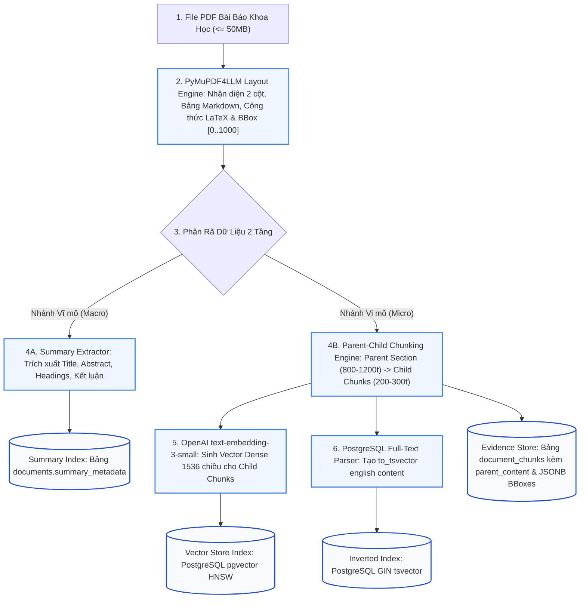
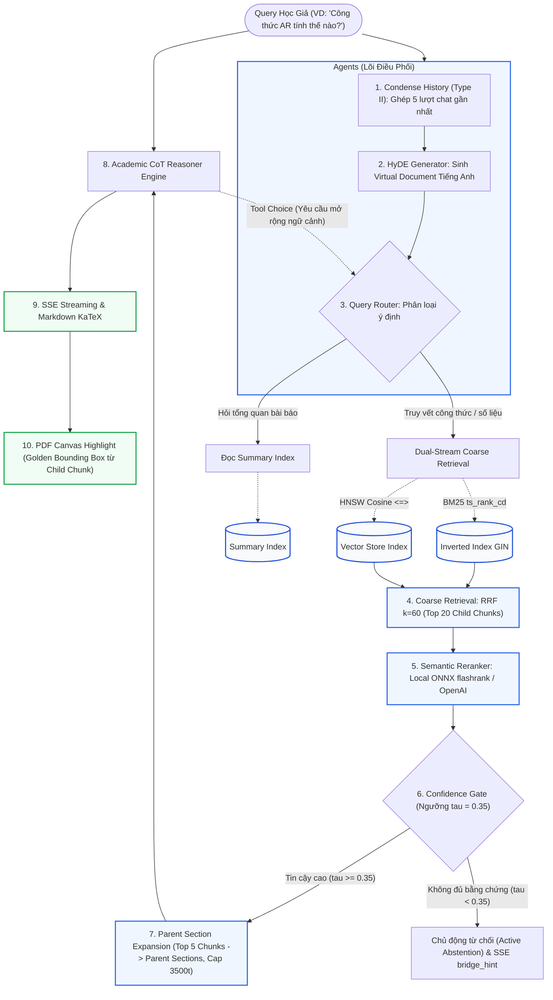
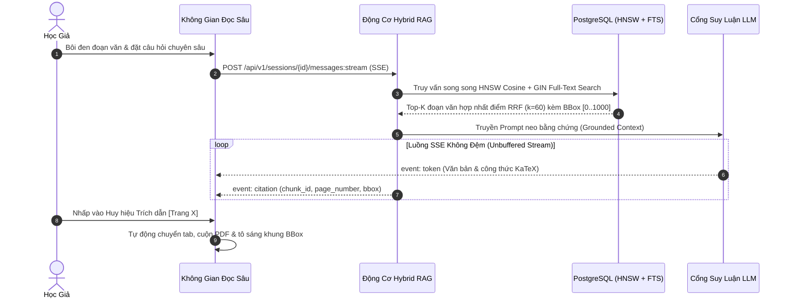

# ĐẶC TẢ KỸ THUẬT: PHÂN HỆ PHIÊN ĐỌC SÂU, QUẢN LÝ ĐA TAB & HYBRID RAG CHAT CÓ BOUNDING BOX
# (DEEP READING SESSIONS, MULTI-TAB PDF, RAG GROUNDING & SCHOLAR NOTES SPECIFICATION)

**Trạng thái:** DỰ THẢO CHÍNH THỨC (TECHNICAL SPECIFICATION V1)  
**Nguồn tham chiếu PRD:** [`03-sessions-and-deep-reading-crud.md`](../PRD/03-sessions-and-deep-reading-crud.md)  
**Phân hệ kỹ thuật:** Phân Hệ Đọc Sâu & Đối Thoại Minh Chứng (Deep Reading & Grounded Chat)  
**File nền tảng liên đới:** [`00-foundation-architecture-and-db.md`](./00-foundation-architecture-and-db.md)

---

## 1. Usecase & Bối Cảnh Người Dùng (Real-World User Journey & Value)

### A. Usecase 1: Đọc Sâu & Đối Chiếu Song Song Nhiều Bài Báo (Multi-Paper Comparative Reading)
- **Bối cảnh & Vấn đề thực tế:** Khi nghiên cứu một chủ đề (ví dụ: *Cơ chế Attention trong NLP*), người dùng hiếm khi chỉ đọc 1 bài báo duy nhất mà cần mở bài báo gốc (Vaswani et al., 2017) cùng với 2-3 bài báo cải tiến (BERT, RoBERTa) để đối chiếu sự khác biệt. Nếu phải liên tục mở nhiều tab trình duyệt riêng biệt rồi copy paste qua lại, họ sẽ mất mạch tập trung và không thể hỏi AI so sánh đồng thời giữa các tài liệu.
- **Giải pháp của phân hệ:**
  - Cung cấp thanh quản lý đa tab học thuật (`DocumentTabBar.tsx`) cho phép mở đồng thời từ 1 đến 5 bài báo trong cùng một phiên nghiên cứu.
  - Người dùng dễ dàng chuyển đổi tab xem PDF, đóng bớt tài liệu bằng nút `[✕]` mà không xóa mất file, và AI có thể truy xuất ngữ cảnh chéo giữa các bài báo đang mở trong tab để trả lời câu hỏi so sánh.

### B. Usecase 2: Đối Thoại Minh Chứng Tuyệt Đối Chống Ảo Giác Với Bounding Box Vàng (Zero-Hallucination Grounded Chat)
- **Bối cảnh & Vấn đề thực tế:** Nỗi sợ lớn nhất của các nhà khoa học khi sử dụng AI là hiện tượng ảo giác (Hallucination) — AI tự bịa ra công thức toán hoặc trích dẫn sai số trang. Trong các bài báo khoa học, một câu khẳng định sai có thể làm hỏng toàn bộ luận án.
- **Giải pháp của phân hệ:**
  - Mọi câu trả lời của Trợ lý Socratic bắt buộc phải kèm huy hiệu bảo chứng nguồn gốc `[📄 Tên bài • Trang X]`.
  - Khi người dùng nhấp chuột vào huy hiệu: giao diện tự động chuyển tab (nếu tài liệu ở tab khác), cuộn mượt mà đến đúng trang PDF và vẽ một khung chữ nhật màu vàng nhấp nháy (**Golden Bounding Box**) bao quanh chính xác đoạn văn gốc làm bằng chứng, mang lại niềm tin tuyệt đối cho học giả.

### C. Usecase 3: Trích Xuất & Lưu Trữ Ghi Chú Học Thuật Tại Chỗ (In-Context Scholar Notes)
- **Bối cảnh & Vấn đề thực tế:** Trong lúc đọc tài liệu, người dùng phát hiện một định lý hoặc công thức hay và muốn ghi chú lại kèm suy nghĩ cá nhân để dùng cho bài viết sau này mà không muốn mở thêm ứng dụng Notion hay Google Docs bên ngoài.
- **Giải pháp của phân hệ:**
  - Khi bôi đen bất kỳ đoạn văn bản nào trên trang PDF, menu ngữ cảnh nổi `ScholarSelectionMenu.tsx` xuất hiện với các nút hành động 1 chạm: `[💬 Đưa vào Chat để hỏi thêm]` hoặc `[📝 Lưu vào Sổ tay Ghi chú]`.
  - Toàn bộ ghi chú được lưu vào bảng `research_notes` kèm số trang và trích dẫn gốc, sẵn sàng chuyển giao sang không gian viết bài.

---

## 2. Phạm Vi & Bảng Đối Chiếu Hiện Trạng (`As-Is` vs `Delta`)

Phân hệ này là không gian làm việc trung tâm nhất của VeriScholar (`/dashboard/:sessionId`):
- **Cột trái:** Trình đọc `PdfCanvasViewer.tsx` render PDF gốc sắc nét, hỗ trợ lớp phủ Bounding Box vàng nhấp nháy khi bấm trích dẫn, và menu nổi khi bôi đen văn bản (`ScholarSelectionMenu.tsx`). Khi bài báo ở trạng thái `status='abstract_only'`, cột trái tự động chuyển sang `AbstractCardViewer.tsx`.
- **Cột phải:** Trợ lý Socratic Chat Tiếng Việt streaming SSE unbuffered, hiển thị công thức toán KaTeX và các huy hiệu bảo chứng `[📄 Tên bài • Trang X]` bấm vào là cuộn PDF bên trái.
- **Thanh Tab trên:** Quản lý 1–5 bài báo mở đồng thời trong phiên đọc (`DocumentTabBar.tsx`).
- **Ngăn trượt:** Sổ tay ghi chú (`NotesPanelContainer.tsx`) bám sát tài liệu gốc.

### A. Kiến Trúc Tổng Thể 2 Tầng (2-Tier Architecture Visualization)

Phân hệ Deep Reading vận hành theo mô hình **SOTA 3-Stage Advanced RAG (Structure-Aware Ingestion, Two-Stage Hybrid Retrieval & Reranking, Academic CoT Grounding)** tách biệt tường minh 2 giai đoạn:

#### 1. Sơ Đồ Tầng 1: Quy Trình Nạp Bài Báo & Đánh Chỉ Mục Kép (Offline Ingestion Pipeline)
*(Kích hoạt 1 lần duy nhất khi người dùng tải PDF lên hoặc chọn "Mở Đọc Sâu", xử lý bất đồng bộ qua BackgroundTasks)*



#### 2. Sơ Đồ Tầng 2: Trợ Lý Hỏi Đáp & Suy Luận Đọc Sâu (Online Agentic Inference Runtime)
*(Kích hoạt thời gian thực mỗi khi học giả đặt câu hỏi trong phiên đọc PDF)*



### B. Bảng Kiểm Kê Thành Phần Mã Nguồn
| Thành phần | Đường dẫn File | Trạng thái | Nội dung chi tiết |
|---|---|---|---|
| **Sessions API** | [`apps/api/src/api/v1/endpoints/sessions.py`](../../apps/api/src/api/v1/endpoints/sessions.py) | **MODIFY** | Đã có Session CRUD. Cần bổ sung `DELETE /api/v1/sessions/{id}/documents/{doc_id}` để đóng 1 bài báo khỏi thanh Tab (giải phóng slot 5 bài). |
| **Chat SSE Endpoint** | `POST /api/v1/sessions/{id}/messages` trong `sessions.py` | **MODIFY** | Chuẩn hóa sự kiện SSE unbuffered: `token`, `citation`, `bridge_hint`, `done`, `error`; bổ sung `DELETE /api/v1/sessions/{id}/messages` (Reset Chat). |
| **Notes API** | [`apps/api/src/api/v1/endpoints/notes.py`](../../apps/api/src/api/v1/endpoints/notes.py) | **KEEP** | Giữ nguyên CRUD ghi chú: `POST /`, `GET /`, `GET /{id}`, `PATCH /{id}`, `DELETE /{id}`. |
| **Embedding Service** | `apps/api/src/api/services/embedding_service.py` | **CREATE** | Động cơ sinh vector Dense 1536 chiều bằng OpenAI `text-embedding-3-small` với cơ chế batching ($\le 128$ chunks/call). |
| **Chat Service** | [`apps/api/src/api/services/session_chat_service.py`](../../apps/api/src/api/services/session_chat_service.py) | **MODIFY** | Tích hợp Agent Query Transformation (Condense + HyDE), Dual-Stream HNSW Cosine + BM25 tsvector qua RRF $k=60$, CRAG thresholding và Window Expansion. |
| **PDF Canvas** | `apps/web/src/features/reader/components/PdfCanvasViewer.tsx` | **KEEP** | Render canvas PDF, lớp vẽ `BboxHighlightLayer.tsx`, sự kiện lắng nghe cuộn trang. |
| **Abstract Viewer** | `apps/web/src/features/reader/components/AbstractCardViewer.tsx` | **CREATE** | Tạo mới component hiển thị thẻ tóm tắt học thuật khi bài báo ở trạng thái `abstract_only`. |
| **Selection Menu** | `apps/web/src/features/reader/components/ScholarSelectionMenu.tsx` | **KEEP** | Menu nổi khi bôi đen văn bản: `[💬 Đưa vào Chat]`, `[📝 Vào sổ tay]`, `[📋 Trích dẫn]`. |

---

## 3. Mô Hình Dữ Liệu & Ràng Buộc Phiên Đọc (`Database Invariants`)

### A. Ràng Buộc Tối Đa 5 Bài Báo Mỗi Phiên (`session_documents`)
- Khóa chính: `PRIMARY KEY (session_id, document_id)`.
- Ràng buộc số lượng: Trước khi thực hiện `INSERT INTO session_documents`, Backend bắt buộc đếm số bài hiện có:
  $$\text{SELECT COUNT(*) FROM session_documents WHERE session\_id = :session\_id}$$
  Nếu `count >= 5`, ném lỗi `HTTP 409 CONFLICT` với mã `MAX_SESSION_DOCUMENTS_REACHED` kèm thông báo: *"Phiên đọc đã đạt giới hạn tối đa 5 tab bài báo để bảo toàn chất lượng hội thoại của AI."*
- **Xử lý UX Thân Thiện (Tab Eviction Dialog):** Khi nhận mã lỗi này (từ Bảng Tham Khảo & Lộ Trình Socratic hoặc Gợi ý Bắc cầu), giao diện Frontend hiển thị hộp thoại chọn nhanh: *"Bạn muốn đóng bớt tab bài báo nào để mở bài mới?"* liệt kê danh sách 5 bài đang mở. Khi người dùng chọn 1 bài, Frontend tự động gọi `DELETE /api/v1/sessions/{id}/documents/{doc_id}` rồi thực hiện nạp bài mới ngay lập tức mà không làm đứt mạch làm việc.

### B. Lưu Trữ Trạng Thái Viewport (`research_sessions.viewport_state`)
Mỗi khi người dùng cuộn trang PDF hoặc đổi tỷ lệ zoom trên giao diện, Frontend gọi debounce (500ms) tới `PATCH /api/v1/sessions/{id}/viewport` để lưu:
```json
{
  "active_document_id": "1a2b3c4d-...",
  "page": 4,
  "zoom_ratio": 1.25,
  "scroll_top": 350.5
}
```
Khi người dùng mở lại phiên đọc, giao diện khôi phục chính xác trang và vị trí đang đọc dở.

---

## 4. Hợp Đồng API REST & Luồng Streaming SSE (API & SSE Contracts)

### A. Quản Lý Phiên Đọc & Tab Bài Báo (`sessions.py`)

#### 1. Đóng một bài báo khỏi phiên (`DELETE /api/v1/sessions/{id}/documents/{document_id}`)
- **Mục đích:** Gỡ bài báo ra khỏi phiên đọc hiện tại (giải phóng slot trong giới hạn 5 bài). Không xóa file PDF gốc trong CSDL.
- **Headers:** `Authorization: Bearer <token>`
- **Response (HTTP 204 No Content):** Không có nội dung.
- **Xử lý:** Xóa bản ghi trong `session_documents`. Nếu `document_id` đang là `active_document_id`, tự động chuyển `active_document_id` sang một bài báo còn lại trong phiên.

#### 2. Cập nhật viewport (`PATCH /api/v1/sessions/{id}/viewport`)
- **Request Body:**
  ```json
  {
    "active_document_id": "1a2b3c4d-5e6f-7a8b-9c0d-1e2f3a4b5c6d",
    "page": 3,
    "zoom_ratio": 1.5,
    "scroll_top": 210.0
  }
  ```
- **Response (HTTP 200 OK):** Trả về phiên đọc đã cập nhật.

---

### B. Luồng Streaming Hỏi Đáp RAG (`POST /api/v1/sessions/{id}/messages`)

- **Headers:** `Authorization: Bearer <token>`, `Content-Type: application/json`, `Accept: text/event-stream`
- **Request Body:**
  ```json
  {
    "content": "Giải thích trực quan ý nghĩa toán học của công thức Attention trong bài?",
    "document_id": "1a2b3c4d-5e6f-7a8b-9c0d-1e2f3a4b5c6d",
    "selected_text": "Attention(Q, K, V) = softmax(QK^T / sqrt(d_k)) V",
    "selected_page": 4
  }
  ```
- **Luồng Sự Kiện SSE (Unbuffered Server-Sent Events):**

1. **Sự kiện `citation` (Bắn ra ngay khi trích xuất được chunk liên quan):**
   ```text
   event: citation
   data: {"citation_id": 1, "document_id": "1a2b...", "paper_title": "Attention Is All You Need", "page_number": 4, "bounding_boxes": [[120, 340, 480, 390]], "snippet": "Attention(Q, K, V) = softmax..."}
   ```
2. **Sự kiện `token` (Nội dung câu trả lời Markdown streaming thời gian thực):**
   ```text
   event: token
   data: {"delta": "Công "}

   event: token
   data: {"delta": "thức này biểu diễn..."}
   ```
3. **Sự kiện `bridge_hint` (Gợi ý Lộ trình Học Tuần tự nếu câu hỏi chạm vào khái niệm nền tảng):**
   ```text
   event: bridge_hint
   data: {"ref_index": 14, "concept_name": "Bahdanau Attention", "paper_title": "Neural Machine Translation by Jointly Learning to Align and Translate", "authors": "Bahdanau et al.", "year": 2014, "can_ingest": true}
   ```
4. **Sự kiện `done` (Kết thúc lượt trả lời):**
   ```text
   event: done
   data: {"turn_id": "9f8e7d6c-...", "trace_id": "trace-chat-89a1", "prompt_tokens": 820, "completion_tokens": 340}
   ```

#### 3. Xóa sạch lịch sử chat để hỏi lại từ đầu (`DELETE /api/v1/sessions/{id}/messages`)
- **Mục đích:** Xóa toàn bộ bản ghi `session_turns` thuộc `session_id` đó.
- **Response (HTTP 204 No Content).**

### C. Ma Trận Mã Lỗi Chuẩn Hóa Phiên Đọc Sâu (Deterministic Deep Reading Error Codes Matrix)

| HTTP Status / SSE Event | Mã lỗi chuẩn (`error.code`) | Điều kiện kích hoạt (Trigger Condition) | Cấu trúc Payload JSON / SSE trả về | Hành vi xử lý tại Frontend / Hệ thống |
| :--- | :--- | :--- | :--- | :--- |
| `404 Not Found` | `SESSION_OR_DOCUMENT_NOT_FOUND` | Truy cập `session_id`, `document_id` hoặc `note_id` không tồn tại hoặc thuộc quyền sở hữu của `user_id` khác. | `{"error": {"code": "SESSION_OR_DOCUMENT_NOT_FOUND", "message": "Không tìm thấy phiên đọc hoặc tài liệu yêu cầu.", "trace_id": "..."}}` | Chuyển hướng người dùng về trang danh sách phiên đọc `/dashboard`. |
| `409 Conflict` | `MAX_SESSION_DOCUMENTS_REACHED` | Thêm bài báo mới vào `session_documents` khi phiên đọc đã mở đủ 5/5 bài báo. | `{"error": {"code": "MAX_SESSION_DOCUMENTS_REACHED", "message": "Phiên đọc đã đạt giới hạn tối đa 5 tab bài báo.", "current_count": 5, "max_limit": 5, "trace_id": "..."}}` | Mở hộp thoại **Tab Eviction Dialog** cho phép học giả chọn đóng nhanh 1 bài báo đang mở rồi tự động nạp bài mới. |
| `422 Unprocessable Entity` | `SESSION_NO_ACTIVE_DOCUMENTS` | Gửi tin nhắn hỏi đáp `POST /api/v1/sessions/{id}/messages` khi phiên đọc chưa có bài báo nào được gắn vào (`count == 0`). | `{"error": {"code": "SESSION_NO_ACTIVE_DOCUMENTS", "message": "Vui lòng thêm ít nhất 1 bài báo vào phiên trước khi đặt câu hỏi.", "trace_id": "..."}}` | Hiển thị thông báo nhắc chọn bài báo trên khung Chat và mở modal chọn tài liệu. |
| `SSE event: error` | `GROUNDED_CITATIONS_NOT_FOUND` | Truy vấn Hybrid RAG không tìm thấy đoạn trích nào vượt ngưỡng liên quan tối thiểu đối với câu hỏi số liệu cụ thể. | `event: error\ndata: {"code": "GROUNDED_CITATIONS_NOT_FOUND", "message": "Thông tin này không được đề cập trong các tài liệu đang mở."}` | Hiển thị bong bóng phản hồi trung thực báo rõ tài liệu không đề cập, tuyệt đối không sinh huy hiệu trích dẫn giả. |
| `SSE event: error` | `LLM_STREAM_INTERRUPTED` | Kết nối tới nhà cung cấp LLM bị đứt giữa chừng hoặc khóa BYOK của người dùng hết hạn mức khi đang truyền luồng SSE. | `event: error\ndata: {"code": "LLM_STREAM_INTERRUPTED", "message": "Luồng phản hồi AI bị gián đoạn. Vui lòng thử lại.", "trace_id": "..."}` | Giữ lại phần văn bản đã hiển thị, đính kèm nút `[🔄 Thử gửi lại câu hỏi]` ngay dưới tin nhắn. |

---

## 5. Thiết Kế Thuật Toán Advanced RAG & Hàng Rào Chống Ảo Giác (Academic Advanced RAG Engine)

### A. Mô Hình Phân Tách Hai Tầng (Two-Tier Architectural Decoupling)

Để bảo đảm tính ổn định và triệt tiêu toàn bộ điểm mù kỹ thuật, hệ thống phân định rõ ràng giữa hai giai đoạn:

1. **Tầng 1 (Offline Ingestion & Dual Indexing Pipeline):**
   - Xảy ra khi tài liệu được tải lên hoặc khi người dùng bấm "Mở Đọc Sâu" từ kết quả tìm kiếm.
   - Chạy bất đồng bộ qua `BackgroundTasks` trong FastAPI, đảm bảo không khóa luồng I/O người dùng.
   - **Bất biến kỹ thuật bắt buộc:** 100% chunks phải được sinh vector Dense 1536 chiều qua model `text-embedding-3-small`, tuyệt đối cấm lưu `embedding = NULL`.
   - Sinh đồng thời **Summary Index** (Abstract, đề mục, kết luận) và **Vector Store Index** (512-token chunks kèm mảng Bounding Box chuẩn hóa $[0..1000]$).

2. **Tầng 2 (Online Agentic Inference & Visual Grounding Runtime):**
   - Kích hoạt mỗi khi học giả gửi câu hỏi trong phiên đọc.
   - Vận hành theo mô hình Agentic RAG với vòng lặp phản hồi (`Tool Choice`), xóa bỏ rào cản đa ngôn ngữ bằng `HyDE` và bảo toàn công thức toán học đa dòng qua cơ chế `CRAG Window Expansion`.

---

### B. Đặc Tả 7 Khối Chức Năng Tiền Định (Deterministic Component I/O Contracts)

Mọi kỹ sư và mô hình AI thực thi bắt buộc phải tuân thủ nghiêm ngặt hợp đồng đầu vào (Input) và đầu ra kỳ vọng (Expected Output) của từng khối:

```
+-----------------------------------------------------------------------------------+
| 1. INDEXING (PyMuPDF4LLM Layout + Parent-Child Chunks + text-embedding-3-small)    |
| Input: File PDF gốc (<= 50MB, <= 100 trang)                                       |
| Output: Bảng document_chunks có parent_content, embedding(1536) & BBox JSONB      |
+-----------------------------------------------------------------------------------+
                                          |
                                          v
+-----------------------------------------------------------------------------------+
| 2. QUERY IMPROVEMENT (Condense History Type II + HyDE English Virtual Document)   |
| Input: user_query (Tiếng Việt/Anh) + 5 turns chat_history                         |
| Output: standalone_query (text) + hyde_vector (1536-dim float array)              |
+-----------------------------------------------------------------------------------+
                                          |
                                          v
+-----------------------------------------------------------------------------------+
| 3. QUERY ROUTING (Semantic Scope Router)                                          |
| Input: standalone_query + session_scope                                            |
| Output: ROUTE_TYPE ("SUMMARY_INDEX" hoặc "DEEP_CHUNKS")                            |
+-----------------------------------------------------------------------------------+
                                          |
                                          v
+-----------------------------------------------------------------------------------+
| 4. COARSE RETRIEVAL (Dual-Stream Hybrid Search + RRF k=60, Top 20)                |
| Input: hyde_vector (Dense) + standalone_query (Sparse) + active_doc_ids           |
| Output: Top 20 candidate child chunks kèm rrf_score & cosine_similarity           |
+-----------------------------------------------------------------------------------+
                                          |
                                          v
+-----------------------------------------------------------------------------------+
| 5. SEMANTIC RERANKING & CONFIDENCE GATE (Local ONNX flashrank / OpenAI)           |
| Input: Top 20 candidate child chunks + standalone_query                            |
| Process: Rerank score S >= 0.65 -> Top 5 fine chunks; S_max < 0.35 -> Abstain     |
| Output: Top 5 fine child chunks HOẶC cờ ABSTAIN kèm gợi ý CITES qua SSE           |
+-----------------------------------------------------------------------------------+
                                          |
                                          v
+-----------------------------------------------------------------------------------+
| 6. PARENT-CHILD CONTEXT PACKAGING (Deduplication + Token Budget Cap 3500)         |
| Input: Top 5 fine child chunks + parent_content + standalone_query                |
| Process: Khử trùng lặp Parent Sections + áp trần MAX_EVIDENCE_TOKENS = 3500       |
| Output: Augmented System Prompt kèm chỉ thị gắn thẻ trích dẫn [cit_x]             |
+-----------------------------------------------------------------------------------+
                                          |
                                          v
+-----------------------------------------------------------------------------------+
| 7. GENERATION & VISUAL PROOF (Streaming Reasoner & Golden BBox Canvas)            |
| Input: Augmented Prompt gửi tới LLM (OpenAI OPENAI_MODEL)                         |
| Output: SSE Stream (Markdown KaTeX) + Ánh xạ [cit_x] vào BBox của Child Chunk     |
+-----------------------------------------------------------------------------------+
```

#### Chi tiết Hợp đồng Dữ liệu từng Khối:

1. **Khối 1: INDEXING & STRUCTURE-AWARE PARENT-CHILD DUAL STORE PIPELINE**
   * **Input:** File PDF nhị phân (`bytes`), `document_id` (UUID), `user_id` (UUID).
   * **Process:** 
     - **Bóc tách nhận thức cấu trúc:** Sử dụng `pymupdf4llm` kết hợp phân tích bảng `page.find_tables()` có sẵn trong PyMuPDF.
     - **Bảng biểu số liệu:** Tự động chuyển đổi thành bảng Markdown Table hoàn chỉnh (cột, hàng) và tính toán bounding box bao quanh toàn bộ bảng.
     - **Công thức Toán học (LaTeX):** Nhận diện công thức qua regex heuristic và bọc trong ký hiệu `$$...$$` hoặc `\[...\]`. Nếu công thức là ảnh quét, tự động fallback sang OpenAI Vision (`gpt-4o-mini`) qua `OPENAI_API_KEY`.
     - **Phân cấp Parent-Child Chunking:**
       - **Child Chunks (200–300 tokens):** Phục vụ tìm kiếm chính xác cao. Tính vector dense 1536 chiều bằng `OpenAI text-embedding-3-small` (batch $\le 128$) và phân tích từ khóa `content_tsv` bằng `to_tsvector('english', content)`. Tọa độ Bounding Box được chuẩn hóa $[0..1000]$.
       - **Parent Section (800–1200 tokens):** Đoạn văn bản bao quát trọn vẹn ngữ cảnh lập luận (theo tiêu đề mục Markdown H1/H2), được lưu vào cột `parent_content` của bảng `document_chunks`.
     - **4 Trụ Cột Summary Index:** Trích xuất tri thức vĩ mô lưu vào `documents.summary_metadata`: `original_problem`, `proposed_solution`, `key_insights`, `quantitative_results`.
   * **Expected Output:**
     ```json
     {
       "document_id": "6439868d-b7e0-4bd4-9db5-ff94f1ff3adc",
       "chunk_index": 19,
       "page_number": 3,
       "content": "Answer Relevance (AR) is defined as...",
       "parent_content": "### 3. Metric Formulation\n\nTo evaluate generative retrieval systems...",
       "embedding": [0.0124, -0.0451, ..., 0.0892],
       "bounding_boxes": [{"x": 120.5, "y": 450.2, "width": 410.0, "height": 85.4}],
       "summary_metadata": {
         "original_problem": ["Evaluating RAG systems requires human ground truth which is expensive..."],
         "proposed_solution": ["Ragas introduces reference-free evaluation metrics including AR, QA, and Context Relevance..."],
         "key_insights": ["Synthetic question generation allows quantifying semantic overlap without human labels..."],
         "quantitative_results": ["High correlation with human annotators (Pearson r > 0.82)..."]
       }
     }
     ```

2. **Khối 2: QUERY IMPROVEMENT (Chat Engine Type II & HyDE)**
   * **Input:** `raw_query` (string), `chat_history` (list 5 turns gần nhất).
   * **Process:**
     - LLM tạo `condensed_query` độc lập ngữ cảnh.
     - HyDE Prompt sinh đoạn văn giả định học thuật Tiếng Anh (Virtual Document) dài 100-150 từ chứa các thuật ngữ toán học kỳ vọng.
     - Gọi `embedding_service` để vector hóa Virtual Document thành $\mathbf{u}_{\text{hyde}} \in \mathbb{R}^{1536}$.
   * **Expected Output:**
     ```json
     {
       "condensed_query": "Công thức tính Answer Relevance (AR) trong Ragas",
       "hyde_text": "Answer Relevance (AR) in Ragas is calculated by generating synthetic questions...",
       "hyde_vector": [0.0115, -0.0389, ..., 0.0711]
     }
     ```

3. **Khối 3: QUERY ROUTING (Semantic Scope Router)**
   * **Input:** `condensed_query`, `active_document_ids`.
   * **Process:** Phân loại ý định người dùng (Ý định vĩ mô như Tóm tắt/Đóng góp $\rightarrow$ `SUMMARY_INDEX`; Ý định vi mô như Công thức/Thực nghiệm/Số liệu $\rightarrow$ `DEEP_CHUNKS`).
   * **Expected Output:** `{"route": "DEEP_CHUNKS", "target_doc_ids": ["6439868d-..."]}`.

4. **Khối 4: COARSE RETRIEVAL (Dual-Stream Hybrid Search + RRF k=60)**
   * **Input:** `hyde_vector`, `condensed_query`, `active_doc_ids`, `user_id`.
   * **Process:** Thực thi câu lệnh SQL CTE kết hợp HNSW Cosine distance và Full-Text Search ts_rank_cd qua thuật toán Reciprocal Rank Fusion ($k=60$). Thu về $K_{\text{coarse}} = 20$ Child Chunks ứng viên tiềm năng nhất kèm `parent_content` và `bounding_boxes`.
   * **Expected Output:** Danh sách Top 20 candidate child chunks có điểm RRF cao nhất.

5. **Khối 5: SEMANTIC RERANKING & CONFIDENCE GATE**
   * **Input:** Top 20 candidate child chunks, `condensed_query`.
   * **Process:**
     - **Tái xếp hạng sâu:** Đưa 20 ứng viên qua bộ Semantic Reranker. Mặc định kích hoạt bộ Local ONNX Cross-Encoder (`flashrank`, mô hình nhẹ ~100MB, suy luận 30–50ms trên CPU VPS, 0 chi phí API). Khi cần thiết, có thể kích hoạt OpenAI Structured Reranker (`gpt-4o-mini`) thông qua `OPENAI_API_KEY`.
     - **Lọc ngưỡng chất lượng:** Giữ lại các chunk có $\mathcal{S}_{\text{rerank}} \ge 0.65$, chọn ra Top $K_{\text{fine}} = 5$ Child Chunks có điểm tương quan cao nhất.
     - **Cơ chế Chủ động từ chối (Active Abstention Gate):** Nếu điểm cao nhất $\mathcal{S}_{\text{max}} < 0.35$, hệ thống kích hoạt cờ `abstain = True`, không gửi context thiếu căn cứ cho LLM và phát sự kiện SSE `bridge_hint` chứa bài báo liên quan trong đồ thị CITES để học giả chủ động mở tab mới.
   * **Expected Output:**
     ```json
     {
       "rerank_verdict": "CONFIDENT_TOP_CHUNKS",
       "top_chunks": [
         {"chunk_index": 19, "page": 3, "rerank_score": 0.92, "content": "AR = (1/n) * sum(cos(q, q_i))..."}
       ],
       "abstain": false
     }
     ```

6. **Khối 6: PARENT-CHILD CONTEXT EXPANSION & ACADEMIC COT PACKAGING**
   * **Input:** Top 5 fine child chunks, `parent_content`, `condensed_query`.
   * **Process:**
     - Nạp `parent_content` của các Child Chunks chiến thắng để cung cấp ngữ cảnh lập luận trọn vẹn cho LLM.
     - **Khử trùng lặp (Deduplication):** Nếu nhiều Child Chunk thuộc về cùng một Parent Section, Parent Section đó chỉ xuất hiện duy nhất 1 lần trong prompt.
     - **Trần ngân sách Token:** Giới hạn tổng dung lượng các Parent Sections $\le 3500$ tokens (`MAX_EVIDENCE_TOKENS = 3500`) để chống tràn ngữ cảnh và bảo đảm độ trễ phản hồi.
     - **Chỉ thị Academic CoT System Prompt:** Ép mô hình phân tích số liệu thực nghiệm từ bảng Markdown (cột, hàng) và công thức toán học LaTeX, suy luận từng bước giải thích bản chất trực giác trước khi đưa ra kết luận, gắn huy hiệu trích dẫn `[cit_x]` neo vào Child Chunk tương ứng.
   * **Expected Output:** Chuỗi Augmented System Prompt học thuật chuẩn mực, cô lập và sạch sẽ.

7. **Khối 7: GENERATION & VISUAL PROOF (Streaming Reasoner & Golden BBox Canvas)**
   * **Input:** Augmented Prompt gửi tới LLM (`OPENAI_MODEL`).
   * **Process:** 
     - LLM sinh streaming token theo định dạng Markdown KaTeX.
     - Backend bóc tách huy hiệu `[cit_x]` và đẩy sự kiện SSE `citation` chứa mảng `bounding_boxes` của **Child Chunk** tương ứng (chính xác $\text{IoU} \ge 0.85$).
     - Tuyệt đối không để lộ mã định danh kỹ thuật nội bộ (`[target_id: ...]`) trên giao diện người dùng theo chuẩn Tối giản Radical Minimalism.
     - Frontend React Canvas nhận sự kiện, tự động cuộn trang và vẽ **Khung viền vàng nhấp nháy nét đứt** (`border: 2px dashed #f59e0b; background: rgba(245, 158, 11, 0.12); border-radius: 6px`) bao quanh đúng đoạn văn hoặc bảng số liệu được trích dẫn.
   * **Expected Output:** Phản hồi hiển thị chuẩn KaTeX kèm Bounding Box vàng chính xác và huy hiệu trích dẫn tương tác tức thì.

---

### C. Truy Vấn Hybrid Search Trực Tiếp Trong PostgreSQL (RRF k=60, Top 20)

`SessionChatService` thực thi truy vấn trực tiếp trong PostgreSQL kết hợp **Vector Cosine (`pgvector`)** qua vector HyDE và **Full-Text Search (`tsvector`)** qua thuật toán Reciprocal Rank Fusion ($k=60$). Truy vấn lấy ra Top 20 candidate child chunks kèm `parent_content` để chuyển tiếp sang bộ Semantic Reranker:

```sql
WITH vector_ranks AS (
    SELECT id, document_id, chunk_index, page_number, content, parent_content, bounding_boxes,
           (1.0 - (embedding <=> CAST(:hyde_vector AS vector))) AS cosine_sim,
           ROW_NUMBER() OVER (ORDER BY embedding <=> CAST(:hyde_vector AS vector)) AS rank_vec
    FROM document_chunks
    WHERE document_id = ANY(:active_doc_ids) AND user_id = :user_id
      AND embedding IS NOT NULL
    ORDER BY embedding <=> CAST(:hyde_vector AS vector)
    LIMIT 25
),
fts_ranks AS (
    SELECT id, document_id, chunk_index, page_number, content, parent_content, bounding_boxes,
           ts_rank_cd(content_tsv, plainto_tsquery('english', :fts_query)) AS fts_score,
           ROW_NUMBER() OVER (ORDER BY ts_rank_cd(content_tsv, plainto_tsquery('english', :fts_query)) DESC) AS rank_fts
    FROM document_chunks
    WHERE document_id = ANY(:active_doc_ids) AND user_id = :user_id
      AND content_tsv @@ plainto_tsquery('english', :fts_query)
    ORDER BY ts_rank_cd(content_tsv, plainto_tsquery('english', :fts_query)) DESC
    LIMIT 25
),
combined AS (
    SELECT COALESCE(v.id, f.id) AS chunk_id,
           COALESCE(v.cosine_sim, 0.0) AS max_cosine_sim,
           (COALESCE(1.0 / (60.0 + v.rank_vec), 0.0) + COALESCE(1.0 / (60.0 + f.rank_fts), 0.0)) AS rrf_score
    FROM vector_ranks v
    FULL OUTER JOIN fts_ranks f ON v.id = f.id
)
SELECT c.id AS chunk_id, c.document_id, c.chunk_index, c.page_number,
       c.content AS text_content, c.parent_content, c.bounding_boxes,
       d.title AS document_title, d.filename,
       cb.max_cosine_sim, cb.rrf_score
FROM combined cb
JOIN document_chunks c ON cb.chunk_id = c.id
JOIN documents d ON c.document_id = d.id
ORDER BY cb.rrf_score DESC
LIMIT :limit;
```

---

### D. Hàng Rào Bảo Vệ & Cơ Chế Agent Feedback Loop (Tool Choice)

1. **Vòng lặp Phản hồi của Agent (Feedback Loop):**
   - Khi LLM nhận thấy `Retrieval Context` bị ngắt quãng giữa công thức hoặc thiếu định nghĩa biến số, LLM kích hoạt sự kiện gọi công cụ ngầm (`Tool Choice: expand_context(document_id, page_number, chunk_index, direction="both")`).
   - Service tự động nạp bổ sung chunk $[i-1, i+1]$ hoặc mở rộng Parent Section và tái kích hoạt lượt suy luận trước khi gửi token ra giao diện.

2. **Hàng rào Bảo vệ theo Trạng thái Tài liệu (Guardrail Rules):**
   - **Tài liệu đang xử lý (`status='parsing'`):** Chỉ nạp bản tóm tắt từ `documents.summary_metadata` vào ngữ cảnh; kèm thông báo tiến trình bóc tách ngầm cho học giả.
   - **Tài liệu chỉ có Tóm tắt (`status='abstract_only'`):** Tuyệt đối cấm suy diễn số liệu thực nghiệm chi tiết; hướng dẫn học giả tải file PDF cá nhân lên để đọc sâu.
   - **Chủ động từ chối (Active Abstention):** Khi điểm $\mathcal{S}_{\text{max}} < 0.35$, hệ thống trả về thông báo trung thực: *"Tài liệu trong các tab hiện tại không đề cập đến nội dung này"*, đồng thời bắn sự kiện SSE `bridge_hint` gợi ý bài báo liên quan trong đồ thị tri thức để học giả mở thêm tab, triệt tiêu 100% ảo giác.

---

### E. Bảng Phân Tích Khắc Phục Triệt Để 2 Lỗi Kỹ Thuật Đã Chứng Minh

| Lỗi phát hiện trên thực tế | Nguyên nhân gốc rễ trong mã nguồn | Giải pháp Advanced RAG chuẩn hóa trong Spec |
| :--- | :--- | :--- |
| **"AI bảo không có công thức $AR$ trong bài báo Ragas"** | 1. `document_service.py` lưu `embedding = None` khi nạp file.<br/>2. `session_chat_service.py` gọi hàm tìm kiếm nhưng truyền `query_embedding = None`.<br/>3. Tìm kiếm từ khóa Tiếng Việt *"Công thức AR"* trên bài báo Tiếng Anh trả về 0 kết quả. | **Khối 1 (Indexing):** Ép buộc gọi `embedding_service` sinh vector 1536 chiều.<br/>**Khối 2 (HyDE):** Tự động sinh Virtual Document Tiếng Anh và đối soát qua chỉ mục HNSW vector, khớp trúng Chunk 19/20 trên Trang 3. |
| **"Khung viền vàng Bounding Box bị lệch trang hoặc biến mất"** | 1. Do truy vấn rỗng, hệ thống lấy nhầm chunk Trang 1 (Abstract) hoặc không có tọa độ.<br/>2. Các bài báo "Mở Đọc Sâu" bị kẹt ở `status='processing'` với 0 chunks do quên gọi background worker. | **Khối 4 & 5 (RRF & CRAG):** RRF đưa đúng chunk Trang 3 lên đầu bảng; CRAG mở rộng cửa sổ bao trọn công thức. Sửa `open_reading_session` kích hoạt background ingestion tự động. |

---

## 6. Thiết Kế Giao Diện & Tương Tác Frontend (`apps/web`)

### A. Tương Tác Hai Chiều: Chat Huy Hiệu $\leftrightarrow$ PDF Bounding Box
1. **Từ Chat sang PDF:**
   - Người dùng bấm vào huy hiệu `[📄 Attention Is All You Need • Trang 4]`.
   - Global Event Bus phát sự kiện `NAVIGATE_TO_CITATION`:
     ```typescript
     window.dispatchEvent(new CustomEvent("scholar:focus-bbox", {
       detail: { documentId, pageNumber: 4, boundingBoxes: [[120, 340, 480, 390]] }
     }));
     ```
   - `PdfCanvasViewer.tsx` tự động chuyển Tab nếu bài báo khác đang active, cuộn trang mượt đến trang 4 và kích hoạt `BboxHighlightLayer.tsx` vẽ khung viền vàng nhấp nháy trong 3 giây.
2. **Từ PDF sang Chat:**
   - Người dùng dùng chuột bôi đen đoạn văn trên PDF.
   - `ScholarSelectionMenu.tsx` hiện ra ngay phía trên con trỏ chuột.
   - Bấm `[💬 Đưa vào Chat]`: Tự động chèn nội dung bôi đen vào ô nhập chat bên phải kèm chip hiển thị: `Đoạn trích từ Trang 4 [✕]`.

### B. Nút Dừng Trả Lời & Reset Chat
1. **Nút `[⏹️ Dừng trả lời]`:** Khi luồng SSE đang nhận dữ liệu, nút Gửi chuyển thành nút Dừng màu đỏ. Bấm nút sẽ gọi `AbortController.abort()`, ngắt ngay kết nối stream và giữ lại các đoạn chữ đã in ra.
2. **Nút `[🔄 Reset Chat]`:** Trên thanh tiêu đề chat, nút Reset mở modal xác nhận: *"Bạn có muốn xóa toàn bộ lịch sử hỏi đáp của phiên đọc này để bắt đầu lại không?"*. Xác nhận sẽ gọi `DELETE /api/v1/sessions/{id}/messages`.

### C. Thanh Nhập Liệu Tối Giản & Popover Tinh Chỉnh Suy Luận Đa Nhà Cung Cấp (Vendor-Agnostic Reasoning Popover)

Theo định hướng giao diện tối giản 80/20 và loại bỏ hoàn toàn các thành phần dư thừa (như icon bàn tay), thanh nhập liệu được chuẩn hóa thành một khối Pill thống nhất (`DashboardChatInputBox.tsx`) với cơ chế điều khiển suy luận sâu tách lớp độc lập với nhà cung cấp:

```
+-------------------------------------------------------------------------+
|                               [ High ] (↺)                             |
|                                5.6 Luna >                               |
|                     (•)-------(•)-------(•)=======●                     |
|                     Off       Low       Med      High                   |
+-------------------------------------------------------------------------+
| [+] Đính kèm PDF... | Đặt câu hỏi về tài liệu...        | [🧠]  [↑]     |
+-------------------------------------------------------------------------+
```

1. **Thanh Nhập Liệu Chuẩn Hóa (Chat Input Pill):**
   - **Bên trái:** Nút `+` (`+ Do anything` / Đính kèm bài báo PDF hoặc thêm ngữ cảnh).
   - **Trung tâm:** `textarea` tự động co giãn độ cao theo độ dài văn bản (tối đa 240px).
   - **Bên phải:**
     - Nút **Bộ não (Reasoning Control)**: Kích hoạt Popover tinh chỉnh mức độ tư duy. Khi đang bật (`low`/`medium`/`high`), icon có viền sáng xanh dương nhạt.
     - Nút **Gửi (ArrowUp)**: Nút tròn mũi tên gửi câu hỏi.
     - *(Tuyệt đối không hiển thị icon Bàn tay hay các icon tính năng chưa hoàn thiện)*.

2. **Popover Tinh Chỉnh Suy Luận (Reasoning Popover):**
   - **Vị trí hiển thị:** Nổi ngay phía trên icon Bộ não, tự động đóng khi nhấp ra ngoài (click-outside).
   - **Tiêu đề trạng thái:** Hiển thị mức độ hiện tại bằng chữ lớn màu xanh dương (ví dụ: `High` với mã màu `#38bdf8`), kèm icon reset/hoàn tác ở góc phải để trở về mức mặc định `High`.
   - **Định danh mô hình:** Ghi rõ `5.6 Luna >` (cho phép người dùng nhận diện mô hình đang tương tác).
   - **Thanh trượt 4 nấc (Stepped Slider):** Gồm 4 điểm dừng định lượng:
     - `Off`: Tắt suy luận, mô hình trả lời trực tiếp tốc độ cao.
     - `Low`: Suy luận ngắn gọn, tập trung trả lời câu hỏi trực tiếp.
     - `Medium`: Suy luận cân bằng, rà soát logic trước khi phản hồi.
     - `High`: Suy luận chuyên sâu (Socratic Deep Reasoning), mổ xẻ đa chiều các bằng chứng khoa học.

3. **Kiến Trúc Lục Giác & Ánh Xạ Adapter Độc Lập Nhà Cung Cấp (Vendor-Agnostic Mapping):**
   Để bảo đảm hệ thống không bị "khóa cứng" vào OpenAI (Vendor Lock-in), tầng Domain và UI chỉ giao tiếp qua Value Object trung lập:
   $$\text{ReasoningEffortLevel} \in \{\text{'off'},\ \text{'low'},\ \text{'medium'},\ \text{'high'}\}$$
   Tầng Adapter (`apps/api/src/api/adapters/`) chịu trách nhiệm ánh xạ tương thích với từng SDK được cấu hình:

| Nhà cung cấp / Model | Nấc `Off` | Nấc `Low` | Nấc `Medium` | Nấc `High` |
| :--- | :--- | :--- | :--- | :--- |
| **OpenAI (`5.6-luna`, `o3`)** | Bỏ qua hoặc `null` | `reasoning_effort="low"` | `reasoning_effort="medium"` | `reasoning_effort="high"` |
| **Google Gemini (Thinking)** | `thinking_budget=0` | `thinking_budget=1024` | `thinking_budget=4096` | `thinking_budget=16384` |
| **Anthropic Claude (Thinking)** | `type="disabled"` | `budget_tokens=2048` | `budget_tokens=8192` | `budget_tokens=32768` |
| **Local / DMR (DeepSeek R1)** | Thêm chỉ thị trả lời nhanh | Kích hoạt nấc CoT ngắn | Kích hoạt CoT tiêu chuẩn | Kích hoạt CoT chuyên sâu |

### D. Bộ Nhớ Đệm Trình Duyệt Tức Thì Cho PDF (Zero-Latency Browser CacheStorage)
Kế thừa giải pháp kỹ thuật từ nền tảng AlphaXiv (`pdf-cache`):
- Sử dụng CacheStorage API bản địa: `window.caches.open("verischolar-pdfs-v1")`.
- Lưu trữ cục bộ tối đa 500 bài báo gần nhất dạng binary `ArrayBuffer`.
- Khi người dùng chuyển đổi Tab hoặc mở lại phiên đọc:
  1. Kiểm tra cache hit: `const cached = await cache.match(pdfUrl);`
  2. Nếu có, nạp trực tiếp vào `pdfjs-dist` trong $0$ms, hoàn toàn không gọi lại mạng về kho CAS.
  3. Nếu không có (Cache Miss), tải ngầm từ API backend, ghi vào `cache` và hiển thị đồng thời.

### E. Giao Diện Suy Luận Chuỗi Tư Duy Thu Gọn (Reasoning Thinking Accordion UI)
Phục vụ các mô hình có dòng suy luận sâu (DeepSeek-R1, OpenAI o1/o3-mini, Gemini 2.0 Flash Thinking):
1. **Component `ReasoningThinkingAccordion.tsx`:**
   - **Giai đoạn Đang suy luận:** Hiển thị thẻ card nhỏ với hiệu ứng sóng ánh sáng (CSS Shimmer Pulse Animation), spinner xoay nhẹ và bộ đếm giây: `Thinking... (2.4s)`.
   - **Giai đoạn Hoàn tất suy luận:** Tự động chuyển đổi mượt sang icon tích tròn `✓ Thinking Finished` kèm chevron mở rộng `v`.
   - Mặc định thẻ này **tự động gập gọn** thành một dải mỏng để giữ khung chat luôn tinh gọn, nhường chỗ cho câu trả lời chính thức hiển thị bên dưới.
   - Khi học giả bấm vào dải `Thinking Finished`, toàn bộ các bước suy luận trung gian (Chain-of-Thought) sẽ mở trượt xuống để đối chứng logic.

### F. Tính Năng Rê Chuột Chọn Vùng Bounding Box (Interactive Drag-to-Crop)
Kế thừa giải pháp `ReactCrop` từ AlphaXiv:
1. **Tương tác trực tiếp trên PDF Canvas:** Học giả có thể nhấn giữ chuột trái và kéo một khung chữ nhật bao quanh bất kỳ sơ đồ, công thức toán hoặc bảng số liệu nào trên trang PDF.
2. **Kích hoạt tức thì:** Một menu tác vụ nổi tinh gọn hiện ra ngay phía trên vùng vừa crop:
   - `[💬 Hỏi AI về vùng này]`: Tự động cắt ảnh snapshot của vùng đó và đính kèm vào khung chat kèm số trang và tọa độ BBox.
   - `[📝 Lưu vào sổ tay]`: Lưu nhanh ảnh snapshot công thức vào Sổ tay trích dẫn.

### G. Chế Độ Đọc Ban Đêm Cho Canvas PDF (Canvas Dark Mode Invert Filter)
1. Thêm nút chuyển đổi Chế độ đọc ban đêm trên thanh công cụ PDF.
2. Áp dụng bộ lọc CSS chuẩn quốc tế trên thẻ `<canvas>` của `pdfjs-dist`:
   ```css
   .canvas-dark-mode canvas {
     filter: invert(90%) hue-rotate(180deg) contrast(90%);
   }
   ```
3. Lớp văn bản trong suốt `TextLayer` (`opacity: 0`) được giữ nguyên độc lập phía trên canvas, giúp học giả bôi đen, sao chép văn bản trơn tru và bảo vệ thị lực tối đa khi đọc đêm.

---

## 7. Tập Tin Neo Tham Chiếu Trong Codebase (Codebase Anchors)

Mọi thay đổi kỹ thuật của phân hệ Phiên đọc sâu và Hỏi đáp Bounding Box phải tuân thủ và tham chiếu từ các tệp sau:

| Vai trò kiến trúc | Tệp neo chuẩn mực trong repo | Nguyên tắc bắt chước |
| :--- | :--- | :--- |
| **Session Endpoints Pattern** | [`apps/api/src/api/v1/endpoints/sessions.py`](../../apps/api/src/api/v1/endpoints/sessions.py) | Tham chiếu cách xử lý Session CRUD, gán/gỡ Tab PDF, và lưu trạng thái viewport. |
| **Chat & RAG Streaming Service** | [`apps/api/src/api/services/session_chat_service.py`](../../apps/api/src/api/services/session_chat_service.py) | Tham chiếu cách sinh SSE stream unbuffered, hybrid RAG và format citation tags. |
| **In-Session Notes API** | [`apps/api/src/api/v1/endpoints/notes.py`](../../apps/api/src/api/v1/endpoints/notes.py) | Tham chiếu CRUD ghi chú gắn Bounding Box và trích dẫn bài báo. |
| **Frontend Reader & Canvas** | `apps/web/src/features/reader/components/PdfCanvasViewer.tsx` | Tham chiếu cách render PDF canvas, đồng bộ zoom và vẽ lớp phủ `BboxHighlightLayer`. |
| **Selection Toolbar** | `apps/web/src/features/reader/components/ScholarSelectionMenu.tsx` | Menu nổi khi bôi đen text: `[💬 Đưa vào Chat]`, `[📝 Vào sổ tay]`, `[📋 Trích dẫn]`. |
| **In-Session Notes Panel** | `apps/web/src/features/notes/components/NotesPanelContainer.tsx` | Ngăn trượt phụ bên phải quản lý các đoạn trích đã ghim. |

---

## 8. Ma Trận Kiểm Thử TDD Bắt Buộc (Deep Reading TDD Matrix)



| Tên Test Case | File Kiểm Thử | Mục tiêu kiểm chứng | Kỳ vọng nghiệm thu |
|---|---|---|---|
| `test_session_max_5_documents_limit` | `apps/api/tests/test_session_tabs.py` | Thêm bài báo thứ 6 vào phiên đọc | Trả về `409 Conflict` với mã lỗi `MAX_SESSION_DOCUMENTS_REACHED`. |
| `test_close_document_tab_reassigns_active` | `apps/api/tests/test_session_tabs.py` | Đóng tab bài báo đang active qua `DELETE .../documents/{id}` | Xóa junction row, `active_document_id` tự chuyển sang bài còn lại. |
| `test_structure_aware_table_and_formula_extraction` | `apps/api/tests/test_chunk_extraction.py` | Bóc tách PDF chứa bảng 2 cột và công thức toán học | Bảng được trích xuất thành Markdown Table hoàn chỉnh, công thức toán được bao bọc dạng LaTeX chuẩn `$$...$$`. |
| `test_hybrid_rag_search_rrf_scoring` | `apps/api/tests/test_session_chat.py` | Thực thi truy vấn Coarse Hybrid RAG với mock embedding | Trả về top 20 candidate child chunks kèm `parent_content` và `rrf_score`. |
| `test_semantic_reranking_top_k` | `apps/api/tests/test_session_chat.py` | Đưa 20 ứng viên qua bộ Semantic Reranker | Lọc Top 5 fine child chunks có điểm $\mathcal{S} \ge 0.65$. |
| `test_active_abstention_and_bridge_hint` | `apps/api/tests/test_session_chat.py` | Truy vấn khi không có chunk nào đạt $\mathcal{S} \ge 0.35$ | Hệ thống không gọi LLM suy diễn bừa bãi, phát cờ abstain và sự kiện SSE `bridge_hint`. |
| `test_parent_child_deduplication_and_budget_cap` | `apps/api/tests/test_session_chat.py` | Đóng gói ngữ cảnh khi nhiều child chunks cùng parent | Khử trùng lặp Parent Section và áp trần cứng `MAX_EVIDENCE_TOKENS = 3500`. |
| `test_chat_sse_stream_event_sequence` | `apps/api/tests/test_session_chat.py` | Gửi câu hỏi và đọc stream response | Nhận đủ các events: `citation`, `token`, `done`. |
| `test_reset_chat_purges_messages_only` | `apps/api/tests/test_session_chat.py` | Gọi `DELETE /api/v1/sessions/{id}/messages` | Bảng `session_turns` bị xóa hết, `research_sessions` vẫn nguyên vẹn. |
| `test_save_and_restore_viewport_state` | `apps/api/tests/test_session_viewport.py` | Gọi `PATCH .../viewport` với `page=4`, lấy lại `GET` | Dữ liệu `viewport_state` trả về đúng `page=4`, `zoom_ratio=1.25`. |

---

## 9. Tiêu Chí Nghiệm Thu Kỹ Thuật (Definition of Done)

- [ ] Giới hạn tối đa 5 bài báo / phiên đọc được thực thi nghiêm ngặt cả ở Frontend lẫn Backend API.
- [ ] Endpoint `DELETE /api/v1/sessions/{id}/documents/{document_id}` cho phép đóng tab an toàn không xóa file gốc.
- [ ] Pipeline nạp tài liệu trích xuất bảo toàn bảng số liệu Markdown Table và công thức toán LaTeX, lưu trữ `parent_content` phục vụ mở rộng ngữ cảnh.
- [ ] Kiến trúc truy xuất 2 tầng (Coarse RRF Top 20 $\rightarrow$ Semantic Reranker Top 5) hoạt động độc lập chỉ với `OPENAI_API_KEY` và Local ONNX Reranker.
- [ ] Giao diện hỗ trợ chuyển đổi linh hoạt: hiển thị `PdfCanvasViewer.tsx` khi có PDF và `AbstractCardViewer.tsx` khi bài báo ở dạng tóm tắt.
- [ ] Luồng SSE phát đúng các sự kiện và huy hiệu citation `[cit_x]` bấm vào là cuộn trang PDF và tô viền vàng Bounding Box của Child Chunk.
- [ ] Toàn bộ kịch bản kiểm thử trong Ma trận Kiểm thử Mục 8 đạt `100% PASS`.
