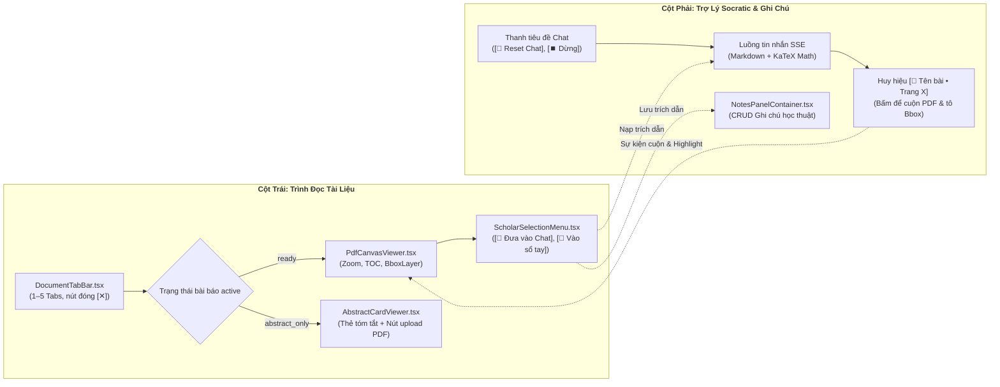
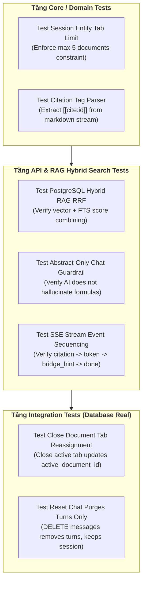

# ĐẶC TẢ KỸ THUẬT: PHÂN HỆ PHIÊN ĐỌC SÂU, QUẢN LÝ ĐA TAB & HYBRID RAG CHAT CÓ BOUNDING BOX
# (DEEP READING SESSIONS, MULTI-TAB PDF, RAG GROUNDING & SCHOLAR NOTES SPECIFICATION)

**Trạng thái:** DỰ THẢO CHÍNH THỨC (TECHNICAL SPECIFICATION V1)  
**Nguồn tham chiếu PRD:** [`docs/PRD/03-sessions-and-deep-reading-crud.md`](file:///home/dammanhdungvn/Downloads/Workspace/VeriScholar/docs/PRD/03-sessions-and-deep-reading-crud.md)  
**Phân hệ kỹ thuật:** Phân Hệ Đọc Sâu & Đối Thoại Minh Chứng (Deep Reading & Grounded Chat)  
**File nền tảng liên đới:** [`docs/specs/00-foundation-architecture-and-db.md`](file:///home/dammanhdungvn/Downloads/Workspace/VeriScholar/docs/specs/00-foundation-architecture-and-db.md)

---

## 1. Usecase & Bối Cảnh Người Dùng (Real-World User Journey & Value)

### A. Usecase 1: Đọc Sâu & Đối Chiếu Song Song Nhiều Bài Báo (Multi-Paper Comparative Reading)
- **Bối cảnh & Vấn đề thực tế:** Khi nghiên cứu một chủ đề (ví dụ: *Cơ chế Attention trong NLP*), người dùng hiếm khi chỉ đọc 1 bài báo duy nhất mà cần mở bài báo gốc (Vaswani et al., 2017) cùng với 2-3 bài báo cải tiến (BERT, RoBERTa) để đối chiếu sự khác biệt. Nếu phải liên tục mở nhiều tab trình duyệt riêng biệt rồi copy paste qua lại, họ sẽ mất mạch tập trung và không thể hỏi AI so sánh đồng thời giữa các tài liệu.
- **Giải pháp của phân hệ:**
  - Cung cấp thanh quản lý đa tab học thuật (`DocumentTabBar.tsx`) cho phép mở đồng thời từ 1 đến 5 bài báo trong cùng một phiên nghiên cứu.
  - Người dùng dễ dàng chuyển đổi tab xem PDF, đóng bớt tài liệu bằng nút `[✕]` mà không xóa mất file, và AI có thể truy xuất ngữ cảnh chéo giữa các bài báo đang mở trong tab để trả lời câu hỏi so sánh.

### B. Usecase 2: Đối Thoại Minh Chứng Tuyệt Đối Chống Ảo Giác Với Bounding Box Vàng (Zero-Hallucination Grounded Chat)
- **Bối cảnh & Vấn đề thực tế:** Nỗi sợ lớn nhất của các nhà khoa học khi sử dụng AI là hiện tượng ảo giác (Hallucination) — AI tự bịa ra công thức toán hoặc trích dẫn sai số trang. Trong các bài báo khoa học, một câu khẳng định sai có thể làm hỏng toàn bộ luận án.
- **Giải pháp của phân hệ:**
  - Mọi câu trả lời của Trợ lý Socratic bắt buộc phải kèm huy hiệu bảo chứng nguồn gốc `[📄 Tên bài • Trang X]`.
  - Khi người dùng nhấp chuột vào huy hiệu: giao diện tự động chuyển tab (nếu tài liệu ở tab khác), cuộn mượt mà đến đúng trang PDF và vẽ một khung chữ nhật màu vàng nhấp nháy (**Golden Bounding Box**) bao quanh chính xác đoạn văn gốc làm bằng chứng, mang lại niềm tin tuyệt đối cho học giả.

### C. Usecase 3: Trích Xuất & Lưu Trữ Ghi Chú Học Thuật Tại Chỗ (In-Context Scholar Notes)
- **Bối cảnh & Vấn đề thực tế:** Trong lúc đọc tài liệu, người dùng phát hiện một định lý hoặc công thức hay và muốn ghi chú lại kèm suy nghĩ cá nhân để dùng cho bài viết sau này mà không muốn mở thêm ứng dụng Notion hay Google Docs bên ngoài.
- **Giải pháp của phân hệ:**
  - Khi bôi đen bất kỳ đoạn văn bản nào trên trang PDF, menu ngữ cảnh nổi `ScholarSelectionMenu.tsx` xuất hiện với các nút hành động 1 chạm: `[💬 Đưa vào Chat để hỏi thêm]` hoặc `[📝 Lưu vào Sổ tay Ghi chú]`.
  - Toàn bộ ghi chú được lưu vào bảng `research_notes` kèm số trang và trích dẫn gốc, sẵn sàng chuyển giao sang không gian viết bài.

---

## 2. Phạm Vi & Bảng Đối Chiếu Hiện Trạng (`As-Is` vs `Delta`)

Phân hệ này là không gian làm việc trung tâm nhất của VeriScholar (`/dashboard/:sessionId`):
- **Cột trái:** Trình đọc `PdfCanvasViewer.tsx` render PDF gốc sắc nét, hỗ trợ lớp phủ Bounding Box vàng nhấp nháy khi bấm trích dẫn, và menu nổi khi bôi đen văn bản (`ScholarSelectionMenu.tsx`). Khi bài báo ở trạng thái `status='abstract_only'`, cột trái tự động chuyển sang `AbstractCardViewer.tsx`.
- **Cột phải:** Trợ lý Socratic Chat Tiếng Việt streaming SSE unbuffered, hiển thị công thức toán KaTeX và các huy hiệu bảo chứng `[📄 Tên bài • Trang X]` bấm vào là cuộn PDF bên trái.
- **Thanh Tab trên:** Quản lý 1–5 bài báo mở đồng thời trong phiên đọc (`DocumentTabBar.tsx`).
- **Ngăn trượt:** Sổ tay ghi chú (`NotesPanelContainer.tsx`) bám sát tài liệu gốc.



### Bảng Kiểm Kê Thành Phần Mã Nguồn
| Thành phần | Đường dẫn File | Trạng thái | Nội dung chi tiết |
|---|---|---|---|
| **Sessions API** | [`apps/api/src/api/v1/endpoints/sessions.py`](file:///home/dammanhdungvn/Downloads/Workspace/VeriScholar/apps/api/src/api/v1/endpoints/sessions.py) | **MODIFY** | Đã có Session CRUD. Cần bổ sung `DELETE /api/v1/sessions/{id}/documents/{doc_id}` để đóng 1 bài báo khỏi thanh Tab (giải phóng slot 5 bài). |
| **Chat SSE Endpoint** | `POST /api/v1/sessions/{id}/messages` trong `sessions.py` | **MODIFY** | Chuẩn hóa sự kiện SSE unbuffered: `token`, `citation`, `bridge_hint`, `done`, `error`; bổ sung `DELETE /api/v1/sessions/{id}/messages` (Reset Chat). |
| **Notes API** | [`apps/api/src/api/v1/endpoints/notes.py`](file:///home/dammanhdungvn/Downloads/Workspace/VeriScholar/apps/api/src/api/v1/endpoints/notes.py) | **KEEP** | Giữ nguyên CRUD ghi chú: `POST /`, `GET /`, `GET /{id}`, `PATCH /{id}`, `DELETE /{id}`. |
| **Chat Service** | [`apps/api/src/api/services/session_chat_service.py`](file:///home/dammanhdungvn/Downloads/Workspace/VeriScholar/apps/api/src/api/services/session_chat_service.py) | **MODIFY** | Nâng cấp truy vấn Hybrid Search (Vector Cosine qua `pgvector` + FTS `content_tsv` qua RRF `k=60`) thay thế chấm điểm RAM cũ. |
| **PDF Canvas** | `apps/web/src/features/reader/components/PdfCanvasViewer.tsx` | **KEEP** | Render canvas PDF, lớp vẽ `BboxHighlightLayer.tsx`, sự kiện lắng nghe cuộn trang. |
| **Abstract Viewer** | `apps/web/src/features/reader/components/AbstractCardViewer.tsx` | **CREATE** | Tạo mới component hiển thị thẻ tóm tắt học thuật khi bài báo ở trạng thái `abstract_only`. |
| **Selection Menu** | `apps/web/src/features/reader/components/ScholarSelectionMenu.tsx` | **KEEP** | Menu nổi khi bôi đen văn bản: `[💬 Đưa vào Chat]`, `[📝 Vào sổ tay]`, `[📋 Trích dẫn]`. |

---

## 3. Mô Hình Dữ Liệu & Ràng Buộc Phiên Đọc (`Database Invariants`)

### A. Ràng Buộc Tối Đa 5 Bài Báo Mỗi Phiên (`session_documents`)
- Khóa chính: `PRIMARY KEY (session_id, document_id)`.
- Ràng buộc số lượng: Trước khi thực hiện `INSERT INTO session_documents`, Backend bắt buộc đếm số bài hiện có:
  $$\text{SELECT COUNT(*) FROM session_documents WHERE session\_id = :session\_id}$$
  Nếu `count >= 5`, ném lỗi `HTTP 409 CONFLICT` với mã `MAX_SESSION_DOCUMENTS_REACHED` kèm thông báo: *"Phiên đọc đã đạt giới hạn tối đa 5 tab bài báo để bảo toàn chất lượng hội thoại của AI."*
- **Xử lý UX Thân Thiện (Tab Eviction Dialog):** Khi nhận mã lỗi này (từ Bảng Tham Khảo & Lộ Trình Socratic hoặc Gợi ý Bắc cầu), giao diện Frontend hiển thị hộp thoại chọn nhanh: *"Bạn muốn đóng bớt tab bài báo nào để mở bài mới?"* liệt kê danh sách 5 bài đang mở. Khi người dùng chọn 1 bài, Frontend tự động gọi `DELETE /api/v1/sessions/{id}/documents/{doc_id}` rồi thực hiện nạp bài mới ngay lập tức mà không làm đứt mạch làm việc.

### B. Lưu Trữ Trạng Thái Viewport (`research_sessions.viewport_state`)
Mỗi khi người dùng cuộn trang PDF hoặc đổi tỷ lệ zoom trên giao diện, Frontend gọi debounce (500ms) tới `PATCH /api/v1/sessions/{id}/viewport` để lưu:
```json
{
  "active_document_id": "1a2b3c4d-...",
  "page": 4,
  "zoom_ratio": 1.25,
  "scroll_top": 350.5
}
```
Khi người dùng mở lại phiên đọc, giao diện khôi phục chính xác trang và vị trí đang đọc dở.

---

## 4. Hợp Đồng API REST & Luồng Streaming SSE (API & SSE Contracts)

### A. Quản Lý Phiên Đọc & Tab Bài Báo (`sessions.py`)

#### 1. Đóng một bài báo khỏi phiên (`DELETE /api/v1/sessions/{id}/documents/{document_id}`)
- **Mục đích:** Gỡ bài báo ra khỏi phiên đọc hiện tại (giải phóng slot trong giới hạn 5 bài). Không xóa file PDF gốc trong CSDL.
- **Headers:** `Authorization: Bearer <token>`
- **Response (HTTP 204 No Content):** Không có nội dung.
- **Xử lý:** Xóa bản ghi trong `session_documents`. Nếu `document_id` đang là `active_document_id`, tự động chuyển `active_document_id` sang một bài báo còn lại trong phiên.

#### 2. Cập nhật viewport (`PATCH /api/v1/sessions/{id}/viewport`)
- **Request Body:**
  ```json
  {
    "active_document_id": "1a2b3c4d-5e6f-7a8b-9c0d-1e2f3a4b5c6d",
    "page": 3,
    "zoom_ratio": 1.5,
    "scroll_top": 210.0
  }
  ```
- **Response (HTTP 200 OK):** Trả về phiên đọc đã cập nhật.

---

### B. Luồng Streaming Hỏi Đáp RAG (`POST /api/v1/sessions/{id}/messages`)

- **Headers:** `Authorization: Bearer <token>`, `Content-Type: application/json`, `Accept: text/event-stream`
- **Request Body:**
  ```json
  {
    "content": "Giải thích trực quan ý nghĩa toán học của công thức Attention trong bài?",
    "document_id": "1a2b3c4d-5e6f-7a8b-9c0d-1e2f3a4b5c6d",
    "selected_text": "Attention(Q, K, V) = softmax(QK^T / sqrt(d_k)) V",
    "selected_page": 4
  }
  ```
- **Luồng Sự Kiện SSE (Unbuffered Server-Sent Events):**

1. **Sự kiện `citation` (Bắn ra ngay khi trích xuất được chunk liên quan):**
   ```text
   event: citation
   data: {"citation_id": 1, "document_id": "1a2b...", "paper_title": "Attention Is All You Need", "page_number": 4, "bounding_boxes": [[120, 340, 480, 390]], "snippet": "Attention(Q, K, V) = softmax..."}
   ```
2. **Sự kiện `token` (Nội dung câu trả lời Markdown streaming thời gian thực):**
   ```text
   event: token
   data: {"delta": "Công "}

   event: token
   data: {"delta": "thức này biểu diễn..."}
   ```
3. **Sự kiện `bridge_hint` (Gợi ý Lộ trình Học Tuần tự nếu câu hỏi chạm vào khái niệm nền tảng):**
   ```text
   event: bridge_hint
   data: {"ref_index": 14, "concept_name": "Bahdanau Attention", "paper_title": "Neural Machine Translation by Jointly Learning to Align and Translate", "authors": "Bahdanau et al.", "year": 2014, "can_ingest": true}
   ```
4. **Sự kiện `done` (Kết thúc lượt trả lời):**
   ```text
   event: done
   data: {"turn_id": "9f8e7d6c-...", "trace_id": "trace-chat-89a1", "prompt_tokens": 820, "completion_tokens": 340}
   ```

#### 3. Xóa sạch lịch sử chat để hỏi lại từ đầu (`DELETE /api/v1/sessions/{id}/messages`)
- **Mục đích:** Xóa toàn bộ bản ghi `session_turns` thuộc `session_id` đó.
- **Response (HTTP 204 No Content).**

---

## 5. Thiết Kế Thuật Toán Hybrid RAG & Hàng Rào Chống Ảo Giác (Grounding Guardrail)

### A. Truy Vấn Hybrid Search Trực Tiếp Trong PostgreSQL (RRF k=60)
Thay vì xếp hạng từ khóa bằng Python trong RAM, `SessionChatService` thực thi truy vấn trực tiếp trong PostgreSQL kết hợp **Vector Cosine (`pgvector`)** và **Full-Text Search (`tsvector`)** qua thuật toán Reciprocal Rank Fusion (RRF):

```sql
WITH vector_ranks AS (
    SELECT id, document_id, page_number, content, bounding_boxes,
           ROW_NUMBER() OVER (ORDER BY embedding <=> :query_vector) AS rank_vec
    FROM document_chunks
    WHERE document_id IN (:active_doc_ids) AND user_id = :user_id
    LIMIT 20
),
fts_ranks AS (
    SELECT id, document_id, page_number, content, bounding_boxes,
           ROW_NUMBER() OVER (ORDER BY ts_rank_cd(content_tsv, to_tsquery('simple', :fts_query)) DESC) AS rank_fts
    FROM document_chunks
    WHERE document_id IN (:active_doc_ids) AND user_id = :user_id
      AND content_tsv @@ to_tsquery('simple', :fts_query)
    LIMIT 20
)
SELECT COALESCE(v.id, f.id) AS chunk_id,
       COALESCE(v.document_id, f.document_id) AS document_id,
       COALESCE(v.page_number, f.page_number) AS page_number,
       COALESCE(v.content, f.content) AS content,
       COALESCE(v.bounding_boxes, f.bounding_boxes) AS bounding_boxes,
       (COALESCE(1.0 / (60 + v.rank_vec), 0.0) + COALESCE(1.0 / (60 + f.rank_fts), 0.0)) AS rrf_score
FROM vector_ranks v
FULL OUTER JOIN fts_ranks f ON v.id = f.id
ORDER BY rrf_score DESC
LIMIT 5;
```

### B. Hàng Rào Bảo Vệ Theo Trạng Thái Tài Liệu (Guardrail Rules)
1. **Nếu tài liệu đang parse (`status='parsing'`):**
   - Chỉ nạp đoạn văn Abstract (chunk 0) vào ngữ cảnh RAG.
   - System Prompt tự động bổ sung chỉ thị: *"Tài liệu toàn văn đang được bóc tách ngầm. Chỉ trả lời dựa trên tóm tắt và thông báo cho người dùng biết dữ liệu đầy đủ sắp sẵn sàng."*
2. **Nếu tài liệu chỉ có Abstract (`status='abstract_only'`):**
   - Nghiêm cấm mô hình tự suy diễn hoặc bịa đặt các bảng số liệu thực nghiệm hay công thức chi tiết không xuất hiện trong Abstract.
3. **Định dạng Huy Hiệu Bảo Chứng Bắt Buộc:**
   - Mỗi câu chứa thông tin trích dẫn từ bài báo bắt buộc có cấu trúc tag: `[[cite:citation_id]]`.
   - Frontend tự động chuyển đổi tag này thành huy hiệu bấm được: `[📄 Tên bài • Trang X]`.

---

## 6. Thiết Kế Giao Diện & Tương Tác Frontend (`apps/web`)

### A. Tương Tác Hai Chiều: Chat Huy Hiệu $\leftrightarrow$ PDF Bounding Box
1. **Từ Chat sang PDF:**
   - Người dùng bấm vào huy hiệu `[📄 Attention Is All You Need • Trang 4]`.
   - Global Event Bus phát sự kiện `NAVIGATE_TO_CITATION`:
     ```typescript
     window.dispatchEvent(new CustomEvent("scholar:focus-bbox", {
       detail: { documentId, pageNumber: 4, boundingBoxes: [[120, 340, 480, 390]] }
     }));
     ```
   - `PdfCanvasViewer.tsx` tự động chuyển Tab nếu bài báo khác đang active, cuộn trang mượt đến trang 4 và kích hoạt `BboxHighlightLayer.tsx` vẽ khung viền vàng nhấp nháy trong 3 giây.
2. **Từ PDF sang Chat:**
   - Người dùng dùng chuột bôi đen đoạn văn trên PDF.
   - `ScholarSelectionMenu.tsx` hiện ra ngay phía trên con trỏ chuột.
   - Bấm `[💬 Đưa vào Chat]`: Tự động chèn nội dung bôi đen vào ô nhập chat bên phải kèm chip hiển thị: `Đoạn trích từ Trang 4 [✕]`.

### B. Nút Dừng Trả Lời & Reset Chat
1. **Nút `[⏹️ Dừng trả lời]`:** Khi luồng SSE đang nhận dữ liệu, nút Gửi chuyển thành nút Dừng màu đỏ. Bấm nút sẽ gọi `AbortController.abort()`, ngắt ngay kết nối stream và giữ lại các đoạn chữ đã in ra.
2. **Nút `[🔄 Reset Chat]`:** Trên thanh tiêu đề chat, nút Reset mở modal xác nhận: *"Bạn có muốn xóa toàn bộ lịch sử hỏi đáp của phiên đọc này để bắt đầu lại không?"*. Xác nhận sẽ gọi `DELETE /api/v1/sessions/{id}/messages`.

---

## 7. Ma Trận Kiểm Thử TDD Bắt Buộc (Deep Reading TDD Matrix)



| Tên Test Case | File Kiểm Thử | Mục tiêu kiểm chứng | Kỳ vọng nghiệm thu |
|---|---|---|---|
| `test_session_max_5_documents_limit` | `apps/api/tests/test_session_tabs.py` | Thêm bài báo thứ 6 vào phiên đọc | Trả về `409 Conflict` với mã lỗi `MAX_SESSION_DOCUMENTS_REACHED`. |
| `test_close_document_tab_reassigns_active` | `apps/api/tests/test_session_tabs.py` | Đóng tab bài báo đang active qua `DELETE .../documents/{id}` | Xóa junction row, `active_document_id` tự chuyển sang bài còn lại. |
| `test_hybrid_rag_search_rrf_scoring` | `apps/api/tests/test_session_chat.py` | Thực thi truy vấn Hybrid RAG với mock embedding | Trả về top 5 chunks có `rrf_score` cao nhất từ cả 2 nguồn. |
| `test_chat_sse_stream_event_sequence` | `apps/api/tests/test_session_chat.py` | Gửi câu hỏi và đọc stream response | Nhận đủ các events: `citation`, `token`, `done`. |
| `test_reset_chat_purges_messages_only` | `apps/api/tests/test_session_chat.py` | Gọi `DELETE /api/v1/sessions/{id}/messages` | Bảng `session_turns` bị xóa hết, `research_sessions` vẫn nguyên vẹn. |
| `test_save_and_restore_viewport_state` | `apps/api/tests/test_session_viewport.py` | Gọi `PATCH .../viewport` với `page=4`, lấy lại `GET` | Dữ liệu `viewport_state` trả về đúng `page=4`, `zoom_ratio=1.25`. |

---

## 8. Tiêu Chí Nghiệm Thu Kỹ Thuật (Definition of Done)

- [ ] Giới hạn tối đa 5 bài báo / phiên đọc được thực thi nghiêm ngặt cả ở Frontend lẫn Backend API.
- [ ] Endpoint `DELETE /api/v1/sessions/{id}/documents/{document_id}` cho phép đóng tab an toàn không xóa file gốc.
- [ ] Giao diện hỗ trợ chuyển đổi linh hoạt: hiển thị `PdfCanvasViewer.tsx` khi có PDF và `AbstractCardViewer.tsx` khi bài báo ở dạng tóm tắt.
- [ ] Luồng SSE phát đúng các sự kiện và huy hiệu citation bấm vào là cuộn trang PDF và tô viền vàng Bounding Box.
- [ ] Toàn bộ kịch bản kiểm thử trong Ma trận Kiểm thử Mục 6 đạt `100% PASS`.
