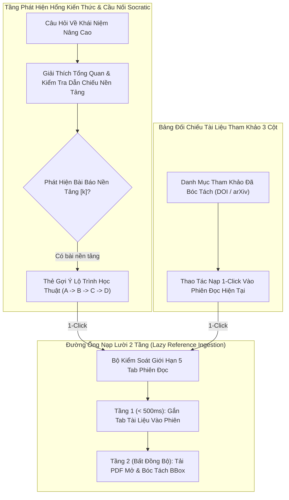
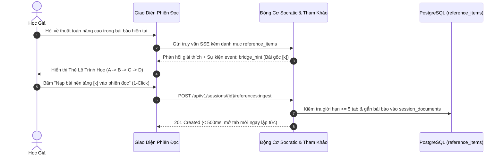

# ĐẶC TẢ KỸ THUẬT: PHÂN HỆ BẢNG NGỮ CẢNH 3 CỘT & LỘ TRÌNH HỌC TUẦN TỰ (A → B → C → D)
# (3-COLUMN CONTEXT TABLE, 2-TIER INGESTION & SOCRATIC ROADMAP SPECIFICATION)

**Trạng thái:** DỰ THẢO CHÍNH THỨC (TECHNICAL SPECIFICATION V1)  
**Nguồn tham chiếu PRD:** [`04-context-table-and-roadmap.md`](../PRD/04-context-table-and-roadmap.md)  
**Phân hệ kỹ thuật:** Phân Hệ Bảng Ngữ Cảnh & Lộ Trình Học (Context Table & Roadmap)  
**File nền tảng liên đới:** [`00-foundation-architecture-and-db.md`](./00-foundation-architecture-and-db.md)

---

## 1. Usecase & Bối Cảnh Người Dùng (Real-World User Journey & Value)

### A. Usecase 1: Chọn Lọc Ngữ Cảnh Tinh Gọn Qua Bảng 3 Cột (Selective Context Ingestion)
- **Bối cảnh & Vấn đề thực tế:** Một bài báo nghiên cứu chuyên sâu thường có từ 30 đến 70 tài liệu tham khảo trong mục References. Nếu nạp bừa bãi toàn bộ 50 tài liệu này vào phiên chat, ngữ cảnh AI sẽ bị loãng (Context Dilution), chi phí token tăng vọt và câu trả lời dễ bị nhiễu. Học giả chỉ muốn chọn đúng 2–3 bài báo thực sự liên quan đến khía cạnh họ đang thắc mắc.
- **Giải pháp của phân hệ:**
  - Cung cấp Bảng Ngữ Cảnh 3 Cột trực quan (`SmartReferenceDrawer.tsx`):
    - Cột 1: Tên bài báo + Tác giả + Mã định danh (DOI/arXiv).
    - Cột 2: Đường link gốc dẫn đến bài báo (Open Access URL).
    - Cột 3: Nút hành động trực tiếp `[➕ Thêm vào chat]` hoặc `[🗑️ Xóa khỏi chat]`.
  - Cho phép người dùng chủ động nạp thêm tài liệu tham khảo vào phiên đọc chỉ với 1 cú nhấp chuột trong `< 500ms`.

### B. Usecase 2: Chống Học Nhảy Cóc Bằng Gợi Ý Bắc Cầu Socratic (Socratic Bridge Hint: A → B → C → D)
- **Bối cảnh & Vấn đề thực tế:** Sinh viên mới bắt đầu đọc bài báo ứng dụng (ví dụ: *Bài báo D về Khuếch tán hình ảnh Stable Diffusion*). Họ hỏi AI một câu rất sâu về hàm mất mát, nhưng không hiểu được câu trả lời vì hàm mất mát đó kế thừa từ một nguyên lý toán học nền tảng ở *Bài báo B (DDPM 2020)*. Học nhảy cóc ($A \rightarrow D$) khiến người học bị ngợp và mất phương hướng.
- **Giải pháp của phân hệ:**
  - AI trong quá trình phân tích sẽ tự động đối chiếu các bài báo nền tảng trong danh mục `reference_items`.
  - Khi phát hiện lỗ hổng kiến thức, thay vì trả lời dồn dập, AI phát sự kiện `event: bridge_hint` hiển thị thẻ gợi ý **Gợi Ý Lộ Trình Học Tuần Tự (`BridgeHintCard.tsx`)**: *"💡 Để nắm vững phần này, bạn cần hiểu nguyên lý từ bài báo [3] (Ho et al., 2020)."* kèm nút `[➕ Nạp bài này vào phiên chat để tìm hiểu trước]`.

---

## 2. Phạm Vi & Bảng Đối Chiếu Hiện Trạng (`As-Is` vs `Delta`)

Phân hệ này giải quyết 2 bài toán trải nghiệm cốt lõi của học giả:
1. **Chống học nhảy cóc ($A \rightarrow D$):** Khi người dùng hỏi một khái niệm nâng cao ($D$) mà bài báo chỉ nhắc lướt qua vì kế thừa từ bài báo tham khảo nền tảng ($B$), AI tự động phát hiện và hiển thị thẻ **Gợi ý Lộ trình Học Tuần tự (`BridgeHintCard.tsx`)** kèm nút nạp 1-Click.
2. **Mở rộng Ngữ cảnh Bảng 3 Cột không đứt mạch đọc:** Bóc tách mục References cuối bài kết hợp Exa AI, hiển thị Bảng 3 Cột trực quan cho phép người dùng nạp thêm bài báo vào phiên chat trong `< 500ms`.



### Bảng Kiểm Kê Thành Phần Mã Nguồn
| Thành phần | Đường dẫn File | Trạng thái | Nội dung chi tiết |
|---|---|---|---|
| **References Endpoint** | [`apps/api/src/api/v1/endpoints/documents.py`](../../apps/api/src/api/v1/endpoints/documents.py) | **MODIFY** | Bổ sung `GET /api/v1/documents/{document_id}/references` trả về danh sách `reference_items` đã bóc tách/xác thực của bài báo (tránh gọi lại `:extract-references` tốn phí). |
| **Session Ingest Endpoint** | [`apps/api/src/api/v1/endpoints/sessions.py`](../../apps/api/src/api/v1/endpoints/sessions.py) | **CREATE** | Tạo mới `POST /api/v1/sessions/{session_id}/references:ingest` nhận `{ ref_index: int }` thực thi nạp 2 tầng trực tiếp vào phiên. |
| **Socratic Roadmap Service** | `packages/core/src/core/services/socratic_roadmap.py` | **CREATE** | Service thuần Python phân tích cú pháp trích dẫn trong văn bản và phát sinh payload `bridge_hint` trong SSE stream. |
| **Bảng 3 Cột UI** | `apps/web/src/features/reader/components/SmartReferenceDrawer.tsx` | **MODIFY** | Nâng cấp component bảng 3 cột chuẩn: Cột 1 (Name + DOI), Cột 2 (URL gốc), Cột 3 (Action nạp/gỡ khỏi chat). |
| **Bridge Hint Card UI** | `apps/web/src/features/reader/components/BridgeHintCard.tsx` | **CREATE** | Tạo mới component hiển thị thẻ lộ trình học tuần tự $A \rightarrow B \rightarrow C \rightarrow D$ gắn ở cuối tin nhắn bot. |

---

## 3. Mô Hình Dữ Liệu & Ràng Buộc Kỹ Thuật (`Database Invariants`)

### A. Ràng Buộc Bảng `reference_items`
Bảng `reference_items` (đã đặc tả ở Spec 00) lưu danh mục trích dẫn bóc tách từ cuối bài:
- `document_id`: UUID bài báo sở hữu danh mục trích dẫn (`ON DELETE CASCADE`).
- `ref_index`: Số thứ tự nguyên `[1]`, `[2]`, `[3]` trong văn bản gốc.
- `doi` & `arxiv_id`: Mã định danh chuẩn được trích xuất ưu tiên bằng regex.
- `resolved_document_id`: UUID của bài báo nếu bài báo tham khảo này đã được tải về hệ thống (hỗ trợ liên kết chéo tức thì).

### B. Kiểm Soát Giới Hạn Phiên Đọc (Max 5 Documents Invariant)
Khi gọi `POST /api/v1/sessions/{session_id}/references:ingest`:
- Backend đếm số lượng bài báo hiện có trong phiên đọc:
  $$\text{SELECT COUNT(*) FROM session_documents WHERE session\_id = :session\_id}$$
- Nếu `count >= 5`: Trả về lỗi `HTTP 409 CONFLICT` kèm payload gợi ý:
  ```json
  {
    "code": "MAX_SESSION_DOCUMENTS_REACHED",
    "message": "Phiên đọc đã đạt giới hạn tối đa 5 bài báo. Vui lòng đóng bớt một bài báo trên thanh Tab trước khi nạp thêm.",
    "current_count": 5,
    "max_limit": 5
  }
  ```

---

## 4. Hợp Đồng API REST & Cấu Trúc Sự Kiện SSE (API Contracts)

### A. Lấy Danh Mục References Đã Trích Xuất (`GET /api/v1/documents/{document_id}/references`)
- **Headers:** `Authorization: Bearer <token>`
- **Response (HTTP 200 OK):**
  ```json
  {
    "document_id": "1a2b3c4d-5e6f-7a8b-9c0d-1e2f3a4b5c6d",
    "total_references": 38,
    "references": [
      {
        "ref_index": 3,
        "raw_text": "Vaswani, A., et al. (2017). Attention is all you need. In NeurIPS.",
        "parsed_title": "Attention Is All You Need",
        "parsed_authors": ["Vaswani et al."],
        "parsed_year": 2017,
        "doi": "10.48550/arXiv.1706.03762",
        "arxiv_id": "1706.03762",
        "access_status": "open_access_pdf",
        "pdf_url": "https://arxiv.org/pdf/1706.03762.pdf",
        "is_in_session": false
      },
      {
        "ref_index": 14,
        "raw_text": "Bahdanau, D., et al. (2014). Neural machine translation...",
        "parsed_title": "Neural Machine Translation by Jointly Learning to Align and Translate",
        "parsed_authors": ["Bahdanau et al."],
        "parsed_year": 2014,
        "doi": "10.48550/arXiv.1409.0473",
        "arxiv_id": "1409.0473",
        "access_status": "open_access_pdf",
        "pdf_url": "https://arxiv.org/pdf/1409.0473.pdf",
        "is_in_session": true
      }
    ]
  }
  ```

---

### B. Nạp 2 Tầng Nhanh Vào Phiên Đọc (`POST /api/v1/sessions/{session_id}/references:ingest`)
- **Headers:** `Authorization: Bearer <token>`, `Content-Type: application/json`
- **Request Body:**
  ```json
  {
    "document_id": "1a2b3c4d-5e6f-7a8b-9c0d-1e2f3a4b5c6d",
    "ref_index": 3
  }
  ```
- **Xử lý 2 Tầng:**
  1. **Tầng 1 (< 500ms):**
     - Tra cứu thông tin bài `[3]` trong `reference_items`.
     - Tạo bản ghi trong `documents` với `title = parsed_title`, `doi = doi`, `status = "parsing"` (nếu có `pdf_url`) hoặc `status = "abstract_only"`.
     - Thêm bài mới vào `session_documents` của phiên.
     - Trả về ngay phản hồi HTTP 201. Frontend lập tức thêm Tab mới trên `DocumentTabBar.tsx`.
  2. **Tầng 2 (Chạy ngầm qua `BackgroundTasks`):**
     - Tải file PDF từ `pdf_url` về `storage/blobs/`.
     - Bóc tách PyMuPDF, cắt chunks và sinh nhúng `Vector(1536)`.
     - Cập nhật trạng thái `documents.status = "ready"` và bắn WebSocket/SSE cập nhật tiến trình.
- **Response (HTTP 201 Created):**
  ```json
  {
    "session_id": "8a9b1c2d-3e4f-5a6b-7c8d-9e0f1a2b3c4d",
    "document_id": "9c8b7a6d-5e4f-3a2b-1c0d-9e8f7a6b5c4d",
    "title": "Attention Is All You Need",
    "status": "parsing",
    "access_status": "open_access_pdf"
  }
  ```

---

### C. Cấu Trúc Sự Kiện SSE `bridge_hint` Trong Luồng Chat Socratic
Khi người dùng đặt câu hỏi có liên quan tới khái niệm nền tảng trong bài tham khảo, luồng SSE tại `POST /api/v1/sessions/{id}/messages` phát ra sự kiện:

```text
event: bridge_hint
data: {
  "ref_index": 3,
  "concept_name": "Cơ chế Tự Chú Ý (Self-Attention)",
  "paper_title": "Attention Is All You Need",
  "authors": "Vaswani et al.",
  "year": 2017,
  "doi": "10.48550/arXiv.1706.03762",
  "reason": "Bài báo hiện tại áp dụng kiến trúc Transformer nhưng không giải thích chi tiết ma trận Q, K, V. Nắm vững bài này sẽ giúp bạn hiểu trọn vẹn thuật toán.",
  "can_ingest": true
}
```

### D. Ma Trận Mã Lỗi Chuẩn Hóa Bảng Ngữ Cảnh & Lộ Trình Học (Deterministic Error Codes Matrix)

| HTTP Status | Mã lỗi chuẩn (`error.code`) | Điều kiện kích hoạt (Trigger Condition) | Cấu trúc Payload JSON trả về | Hành vi xử lý tại Frontend / Hệ thống |
| :--- | :--- | :--- | :--- | :--- |
| `404 Not Found` | `REFERENCE_ITEM_NOT_FOUND` | Chỉ mục `ref_index` yêu cầu nạp không tồn tại trong danh mục `reference_items` của bài báo nguồn. | `{"error": {"code": "REFERENCE_ITEM_NOT_FOUND", "message": "Không tìm thấy mục tài liệu tham khảo tương ứng.", "ref_index": 99, "trace_id": "..."}}` | Vô hiệu hóa nút nạp tại dòng tương ứng và hiển thị thông báo nhẹ. |
| `409 Conflict` | `MAX_SESSION_DOCUMENTS_REACHED` | Phiên đọc đã mở đủ 5/5 bài báo khi người dùng bấm nạp bài từ Bảng 3 Cột hoặc từ thẻ `BridgeHintCard`. | `{"error": {"code": "MAX_SESSION_DOCUMENTS_REACHED", "message": "Phiên đọc đã đạt giới hạn tối đa 5 bài báo.", "current_count": 5, "max_limit": 5, "trace_id": "..."}}` | Mở hộp thoại **Tab Eviction Dialog** để người dùng chọn đóng 1 bài cũ và tự động nạp tiếp bài tham khảo vừa chọn. |
| `409 Conflict` | `REFERENCE_ALREADY_IN_SESSION` | Bài báo tham khảo (`resolved_document_id`) đã có mặt trong `session_documents` của phiên đọc hiện tại. | `{"error": {"code": "REFERENCE_ALREADY_IN_SESSION", "message": "Bài báo tham khảo này đã được mở sẵn trong phiên đọc.", "document_id": "...", "trace_id": "..."}}` | Tự động chuyển tab active trên `DocumentTabBar.tsx` sang bài báo đó. |
| `201 Created (Fallback)` | `TIER2_PAYWALL_ABSTRACT_ONLY` | Bài báo tham khảo thuộc diện thu phí (`access_status == "paywalled"`) hoặc tải PDF Tầng 2 bị từ chối bởi nhà xuất bản. | `{"session_id": "...", "document_id": "...", "status": "abstract_only", "fallback_reason": "TIER2_PAYWALL_ABSTRACT_ONLY"}` | Mở Tab tài liệu ở chế độ `AbstractCardViewer.tsx` kèm nút cho phép người dùng tự tải file PDF bản quyền cá nhân lên. |

---

## 5. Thiết Kế Thuật Toán Socratic Bridge Hint ($A \rightarrow B \rightarrow C \rightarrow D$)

### A. Prompt Khung Chỉ Thị Định Dạng Bridge Hint
Trong prompt hệ thống của `SessionChatService`, nhúng hướng dẫn nhận diện tham chiếu:
```text
Nếu câu hỏi của người dùng yêu cầu giải thích sâu về một công thức, mô hình hoặc khái niệm nền tảng mà bài báo hiện tại kế thừa từ tài liệu tham khảo [ref_index] trong danh mục:
1. Trước hết hãy giải thích khái quát ý nghĩa trực quan của khái niệm đó bằng Tiếng Việt.
2. Nếu bài báo tham khảo [ref_index] có trong danh mục references, hãy xuất thẻ gợi ý ở cuối câu trả lời theo đúng cú pháp:
<bridge_hint ref_index="k" concept="Tên khái niệm" reason="Lý do cần đọc bài tham khảo trước" />
```

### B. Trích Xuất & Phát Sự Kiện Bất Đồng Bộ
Bộ bóc tách stream của FastAPI chặn tag `<bridge_hint ... />`, trích xuất các thuộc tính XML, đối chiếu với `reference_items` trong database để bổ sung metadata (`paper_title`, `authors`, `year`) rồi phát riêng thành sự kiện SSE `event: bridge_hint` trước khi phát `event: done`.

---

## 6. Thiết Kế Giao Diện & Tương Tác Frontend (`apps/web`)

### A. Giao Diện Ngăn Trượt Bảng 3 Cột (`SmartReferenceDrawer.tsx`)
Khi người dùng bấm nút **`[📚 Bảng References]`** trên thanh công cụ đọc bài:
1. **Ô tìm kiếm nhanh:** Lọc danh sách theo tên tác giả, năm hoặc từ khóa tiêu đề.
2. **Cấu trúc 3 cột sắc nét:**
   - **Cột 1 — Name & Metadata:** Tiêu đề bài báo font Serif, danh sách tác giả, năm, mã DOI/arXiv, kèm huy hiệu `🟢 Có sẵn PDF` hoặc `🔒 Abstract Only`.
   - **Cột 2 — URL Gốc:** Đường dẫn trực tiếp sang trang web nhà xuất bản kèm biểu tượng `↗`.
   - **Cột 3 — Hành động (Action):**
     - Nếu bài chưa có trong phiên: Nút **`[➕ Thêm vào chat này]`**.
     - Nếu bài đã mở trên thanh Tab: Nút viền đỏ **`[🗑️ Xóa khỏi chat]`** (gọi `DELETE .../documents/{id}`).
     - Nếu phiên đã đủ 5 bài: Nút bị vô hiệu hóa kèm tooltip giải thích lý do.

### B. Giao Diện Thẻ Lộ Trình Học Tuần Tự (`BridgeHintCard.tsx`)
Xuất hiện ở cuối bong bóng tin nhắn của AI với tông màu vàng hổ phách (Academic Amber Accent):
```text
┌────────────────────────────────────────────────────────────────────────┐
│ 💡 GỢI Ý LỘ TRÌNH HỌC TUẦN TỰ (A → B → C → D)                          │
│                                                                        │
│ Khái niệm: Cơ chế Tự Chú Ý (Self-Attention)                           │
│ Bài tham khảo nền tảng: [3] Attention Is All You Need (Vaswani, 2017) │
│                                                                        │
│ Lý do: Bài báo hiện tại kế thừa trực tiếp cơ chế Multi-Head Attention │
│ nhưng không giải thích chi tiết ma trận Q, K, V. Nắm vững bài [3] sẽ  │
│ giúp bạn hiểu trọn vẹn bản chất thuật toán.                           │
│                                                                        │
│ [➕ Nạp bài [3] vào phiên chat này]       [Bỏ qua]                    │
└────────────────────────────────────────────────────────────────────────┘
```
Bấm nút `[➕ Nạp bài [3]]` sẽ hiển thị spinner tải và chuyển hướng mượt mà, tự động mở Tab bài báo mới trên thanh `DocumentTabBar`.

---

## 7. Tập Tin Neo Tham Chiếu Trong Codebase (Codebase Anchors)

Mọi thay đổi kỹ thuật của phân hệ Bảng Ngữ Cảnh 3 Cột và Lộ Trình Học Socratic phải tuân thủ và tham chiếu từ các tệp sau:

| Vai trò kiến trúc | Tệp neo chuẩn mực trong repo | Nguyên tắc bắt chước |
| :--- | :--- | :--- |
| **References API Endpoint** | [`apps/api/src/api/v1/endpoints/documents.py`](../../apps/api/src/api/v1/endpoints/documents.py) | Tham chiếu cách bóc tách, lưu trữ và truy vấn danh mục tài liệu tham khảo `reference_items`. |
| **Session Ingestion Endpoint** | [`apps/api/src/api/v1/endpoints/sessions.py`](../../apps/api/src/api/v1/endpoints/sessions.py) | Tham chiếu cách nạp 2 tầng, kiểm soát hạn mức 5 tab và phát sinh tác vụ nền `BackgroundTasks`. |
| **Socratic Roadmap Core** | `packages/core/src/core/services/socratic_roadmap.py` | Thuần Python standard library, bóc tách cú pháp `<bridge_hint>` và tính toán đồ thị học tập tuần tự. |
| **Smart Reference Drawer** | `apps/web/src/features/reader/components/SmartReferenceDrawer.tsx` | Tham chiếu giao diện ngăn trượt 3 cột (Name, URL, Action) và đồng bộ trạng thái `in_session`. |
| **Bridge Hint Card Component** | `apps/web/src/features/reader/components/BridgeHintCard.tsx` | Tham chiếu thẻ giao diện Amber hiển thị lộ trình học $A \rightarrow B \rightarrow C \rightarrow D$ gắn ở cuối tin nhắn bot. |

---

## 8. Ma Trận Kiểm Thử TDD Bắt Buộc (Context Table & Roadmap TDD Matrix)



| Tên Test Case | File Kiểm Thử | Mục tiêu kiểm chứng | Kỳ vọng nghiệm thu |
|---|---|---|---|
| `test_extract_bridge_hint_xml_tag` | `packages/core/tests/test_socratic_roadmap.py` | Kiểm tra hàm bóc tách tag `<bridge_hint .../>` | Trả về đúng `ref_index`, `concept_name`, loại bỏ tag khỏi văn bản chat hiển thị. |
| `test_get_document_references_endpoint` | `apps/api/tests/test_references_endpoints.py` | Gọi `GET /api/v1/documents/{id}/references` | Trả về danh sách references đầy đủ thông tin `is_in_session`. |
| `test_ingest_reference_2_tier_fast_response` | `apps/api/tests/test_references_endpoints.py` | Gọi `POST /api/v1/sessions/{id}/references:ingest` | Trả về `HTTP 201` trong `< 500ms`, tạo đúng tài liệu và liên kết tab. |
| `test_ingest_reference_respects_5_docs_limit` | `apps/api/tests/test_references_endpoints.py` | Nạp bài thứ 6 khi phiên đọc đã có 5 bài | Trả về `409 Conflict` với mã `SESSION_TAB_LIMIT_EXCEEDED`. |
| `test_bridge_hint_event_in_chat_stream` | `apps/api/tests/test_socratic_roadmap_stream.py` | Giả lập LLM sinh tag bridge hint | Luồng SSE phát đúng `event: bridge_hint` chứa đầy đủ metadata bài tham khảo. |

---

## 9. Tiêu Chí Nghiệm Thu Kỹ Thuật (Definition of Done)

- [ ] API `GET /api/v1/documents/{id}/references` và `POST /api/v1/sessions/{id}/references:ingest` hoạt động ổn định.
- [ ] Bảng 3 Cột hiển thị đầy đủ thông tin, hỗ trợ nạp bài 1-Click và gỡ bài khỏi chat an toàn.
- [ ] Luồng SSE phát đúng sự kiện `bridge_hint` và giao diện hiển thị thẻ `BridgeHintCard.tsx` đẹp mắt.
- [ ] Giới hạn 5 bài báo / phiên được bảo vệ nghiêm ngặt khi nạp bài từ Bảng References hoặc thẻ Bridge Hint.
- [ ] Toàn bộ ma trận kiểm thử tại Mục 8 vượt qua `100% PASS`.
