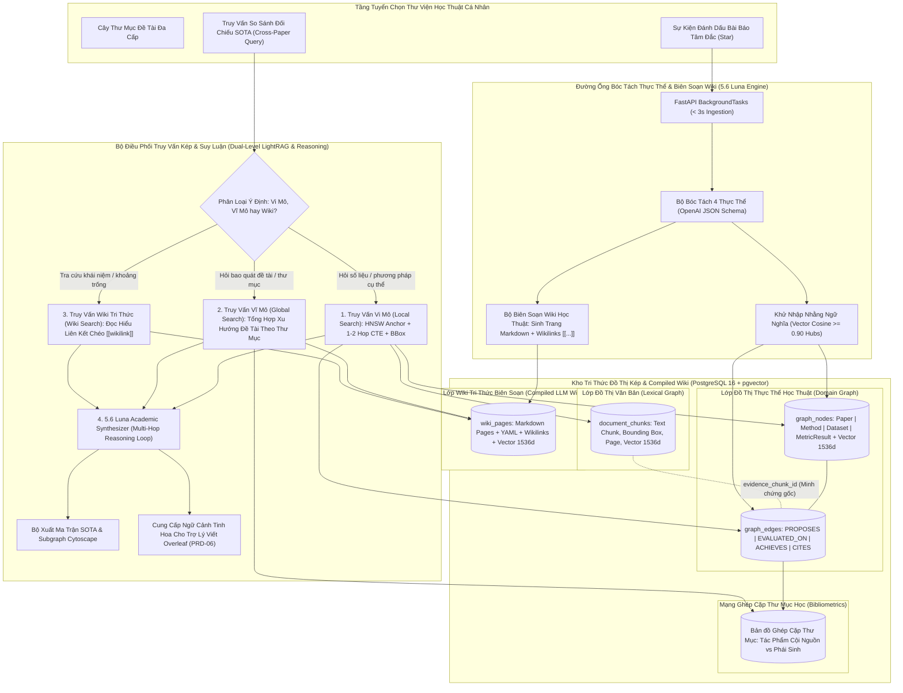
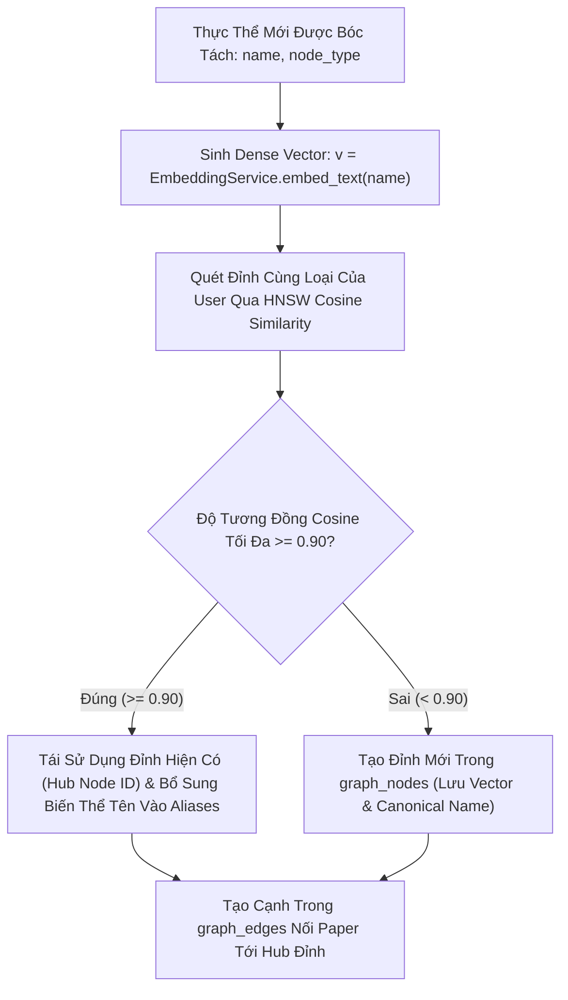
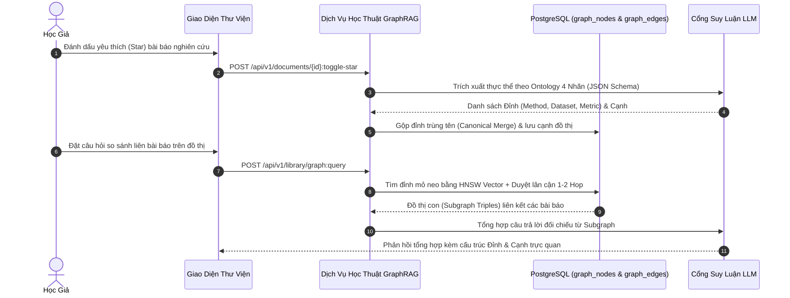

# ĐẶC TẢ KỸ THUẬT: PHÂN HỆ KHO PAPER YÊU THÍCH, GRAPHRAG 4 THỰC THỂ & WIKI TRI THỨC BIÊN SOẠN
# (FAVORITE PAPERS LIBRARY, POSTGRESQL LIGHTRAG & COMPILED ACADEMIC WIKI SPECIFICATION)

**Trạng thái:** DỰ THẢO CHÍNH THỨC (TECHNICAL SPECIFICATION V1)  
**Nguồn tham chiếu PRD:** [`05-favorite-library-and-graphrag.md`](../PRD/05-favorite-library-and-graphrag.md)  
**Phân hệ kỹ thuật:** Phân Hệ Thư Viện Yêu Thích & Mạng Tri Thức (Library & Knowledge Graph)  
**File nền tảng liên đới:** [`00-foundation-architecture-and-db.md`](./00-foundation-architecture-and-db.md)

---

## 1. Usecase & Bối Cảnh Người Dùng (Real-World User Journey & Value)

### A. Usecase 1: Quản Lý & Phân Loại Thư Viện Bài Báo Cá Nhân (Personal Paper Library & Folders)
- **Bối cảnh & Vấn đề thực tế:** Trong suốt quá trình làm nghiên cứu kéo dài nhiều tháng, một học giả đọc hàng trăm bài báo khác nhau. Nếu không có nơi lưu trữ tập trung, họ sẽ quên mất bài báo mình từng đọc nằm ở đâu, thuộc đề tài nào hoặc phải tải lại từ đầu rất mất thời gian.
- **Giải pháp của phân hệ:**
  - Cung cấp giao diện Kho Thư Viện Cá Nhân (`/library`) cho phép gắn dấu sao ⭐ để lưu bài báo tâm đắc.
  - Hỗ trợ tổ chức tài liệu theo cây thư mục đề tài (`folders` — ví dụ: *"Luận văn tốt nghiệp"*, *"Deep Learning y tế"*), giúp tìm kiếm và quản lý tài liệu ngăn nắp.

### B. Usecase 2: Đồ Thị Tri Thức Học Thuật Kết Nối Chéo (Cross-Paper Knowledge Graph)
- **Bối cảnh & Vấn đề thực tế:** Khi đọc nhiều bài báo độc lập, các khái niệm thường liên quan mật thiết với nhau (ví dụ: Bài báo 1 đề xuất thuật toán *AdamW*, Bài báo 2 và 3 áp dụng *AdamW* trên các tập dữ liệu khác nhau). Người dùng muốn nhìn thấy mạng lưới kết nối này để hiểu bức tranh toàn cảnh của ngành mà không có công cụ nào hỗ trợ kết nối tri thức chéo giữa các file PDF rời rạc.
- **Giải pháp của phân hệ:**
  - Tự động trích xuất 4 loại thực thể học thuật chuẩn: **Paper**, **Method**, **Dataset**, **MetricResult**.
  - Áp dụng kỹ thuật hợp nhất thực thể chuẩn mực (**Canonical Entity Merging**): Khi nhiều bài báo cùng nhắc đến phương pháp *"AdamW"*, hệ thống chỉ tạo duy nhất 1 nút Hub trung tâm và kết nối các cạnh quan hệ tới từng bài báo tương ứng.

### C. Usecase 3: Tổng Hợp Benchmark & So Sánh Đồ Thị Tức Thì (Cross-Paper Benchmark Synthesis)
- **Bối cảnh & Vấn đề thực tế:** Khi viết phần So sánh Thực nghiệm (Experiments) cho bài báo của mình hoặc chuẩn bị phản hồi (Rebuttal) khi bị Reviewer #2 chất vấn về bảng so sánh SOTA, học giả phải mất 30–50 giờ lật lại hàng chục bài báo cũ để tìm xem phương pháp nào đạt kết quả cao nhất trên tập dữ liệu *ImageNet* hoặc *GLUE*.
- **Giải pháp của phân hệ:**
  - Cung cấp ô tra cứu GraphRAG: người dùng chỉ cần gõ câu hỏi: *"Các bài báo trong kho của tôi đạt độ chính xác bao nhiêu trên ImageNet?"*. Hệ thống dùng thuật toán 2 bước (HNSW Vector Anchor Search $\rightarrow$ 1-Hop Graph Edge Traversal) để duyệt các cạnh `(Paper - EVALUATED_ON -> Dataset)` và `(Paper - ACHIEVES -> MetricResult)`, tổng hợp thành bảng so sánh hoàn chỉnh mà không cần mở lại từng file PDF.

### D. Usecase 4: Biên Soạn Wiki Học Thuật & Bộ Não Thứ Hai (Compiled Academic Wiki & Second Brain)
- **Bối cảnh & Vấn đề thực tế:** Đồ thị trực quan dạng mạng nhện (Cytoscape/Obsidian) thường chỉ đẹp mắt nhưng rất khó để AI Agent đọc hiểu hoặc trích xuất luận điểm có cấu trúc khi viết bài. Người dùng cần một kho tri thức đã được tổng hợp, liên kết chéo như Wikipedia học thuật cá nhân.
- **Giải pháp của phân hệ:**
  - Tận dụng `5.6 Luna` (`OPENAI_MODEL`) có năng lực Reasoning sâu để tự động biên soạn các bài báo thành các trang Wiki Markdown chuẩn mực: `[[Scaled Dot-Product Attention]]`, `[[ImageNet-1K Leaderboard]]`, `[[Quadratic Complexity Bottleneck]]`.
  - Mỗi trang lưu trữ độc lập trong bảng `wiki_pages` kèm cấu trúc YAML metadata và các thẻ liên kết `[[wikilink]]`, tạo thành "Bộ não thứ hai" (Second Brain) luôn sẵn sàng cho AI truy vấn.

### E. Usecase 5: Khai Phá Khoảng Trống Nghiên Cứu & Cung Cấp Tri Thức Cho AI Soạn Thảo Overleaf (Research Gap Extraction & Overleaf Substrate)
- **Bối cảnh & Vấn đề thực tế:** Khi bắt đầu viết luận văn hoặc bài báo khoa học mới (`06-agentic-overleaf-writing-spec.md`), việc tìm kiếm khoảng trống nghiên cứu (Research Gaps) và viết chương Tổng quan tài liệu (Related Work) đòi hỏi đọc lại hàng trăm trang PDF, khiến LLM bị tràn context và tiêu tốn hàng triệu token.
- **Giải pháp của phân hệ:**
  - Tự động khai phá các hạn chế thừa nhận từ mục *Limitations* và *Future Work* của toàn bộ bài báo trong thư mục đề tài, tổng hợp thành ma trận bài toán chưa giải quyết (*Unsolved Frontiers*).
  - Trợ lý Viết Overleaf chỉ cần truy vấn các trang Wiki tri thức đã biên soạn thay vì nạp lại toàn bộ PDF thô, giúp **tiết kiệm tới 70% chi phí token** và triệt tiêu hoàn toàn ảo giác.

---

## 2. Phạm Vi & Bảng Đối Chiếu Hiện Trạng (`As-Is` vs `Delta`)

Phân hệ này quản lý Kho Bài báo Yêu thích cá nhân (`/library`), cấu trúc cây thư mục đề tài (`folders`), hệ thống **Native Dual-Level LightRAG 4 Thực Thể** và **Compiled Academic LLM Wiki** vận hành thuần túy trên nền tgreSQL 16 + `pgvector` (không dùng Neo4j hay cơ sở dữ liệu đồ thị bên ngoài).



### Bảng Kiểm Kê Thành Phần Mã Nguồn
| Thành phần | Đường dẫn File | Trạng thái | Nội dung chi tiết |
|---|---|---|---|
| **Folders Endpoints** | [`apps/api/src/api/v1/endpoints/folders.py`](../../apps/api/src/api/v1/endpoints/folders.py) | **KEEP** | Giữ nguyên CRUD thư mục: `POST /`, `GET /tree`, `GET /{id}`, `PATCH /{id}`, `DELETE /{id}`, gán/gỡ bài báo. |
| **Star Endpoint** | [`apps/api/src/api/v1/endpoints/documents.py`](../../apps/api/src/api/v1/endpoints/documents.py) | **MODIFY** | Chuẩn hóa `POST /api/v1/documents/{id}:toggle-star` kích hoạt ngầm bóc tách đồ thị & biên soạn Wiki khi `is_starred=True`, và gỡ cạnh đồ thị khi `is_starred=False`. |
| **Graph Query API** | `apps/api/src/api/v1/endpoints/library.py` | **CREATE** | Tạo mới `POST /api/v1/library/graph-query` nhận câu hỏi ngữ nghĩa, duyệt đồ thị PostgreSQL và sinh câu trả lời tổng hợp. |
| **Wiki Endpoints** | `apps/api/src/api/v1/endpoints/library.py` | **CREATE** | Tạo mới `GET /api/v1/library/wiki`, `GET /api/v1/library/wiki/{slug}`, `POST /api/v1/library/research-gaps` phục vụ tra cứu Wiki và khai phá khoảng trống nghiên cứu. |
| **CSDL Graph Models** | `apps/api/src/api/db/models/graph.py` | **CREATE** | Tạo 2 SQLAlchemy models: `GraphNodeModel` (`graph_nodes`) và `GraphEdgeModel` (`graph_edges`) kèm cột `Vector(1536)`. |
| **CSDL Wiki Models** | `apps/api/src/api/db/models/wiki.py` | **CREATE** | Tạo SQLAlchemy model: `WikiPageModel` (`wiki_pages`) lưu trữ các trang Markdown học thuật đã biên soạn kèm vector embedding 1536d. |
| **Graph Extraction Core**| `packages/core/src/core/services/graph_extractor.py` | **CREATE** | Service bóc tách thực thể thuần Python sử dụng Structured Outputs JSON Schema. |
| **Wiki Compiler Core**| `packages/core/src/core/services/wiki_compiler.py` | **CREATE** | Service biên soạn tri thức thành các trang Wiki Markdown lồng ghép thẻ `[[wikilink]]` và YAML metadata. |
| **Library UI** | `apps/web/src/features/library/` | **MODIFY** | Giao diện cây thư mục, lưới bài báo đã Star, hộp thoại tra cứu tổng hợp GraphRAG và ngăn đọc Wiki tri thức. |

---

## 3. Mô Hình Dữ Liệu & Ràng Buộc GraphRAG 4 Thực Thể

### A. Cấu Trúc 4 Loại Đỉnh (`graph_nodes`) & 4 Loại Cạnh (`graph_edges`)
Tuân thủ nghiêm ngặt PRD 05 §3, đồ thị tri thức chỉ sử dụng đúng 4 nhãn thực thể và 4 kiểu quan hệ cố định:

| Nhãn Thực Thể (`node_type`) | Ý nghĩa học thuật | Thuộc tính trích xuất (`metadata_json`) |
| :--- | :--- | :--- |
| **1. `Paper`** | Bài báo khoa học gốc | `title`, `authors`, `year`, `doi`, `venue`, `citation_key` |
| **2. `Method`** | Mô hình / Thuật toán / Kiến trúc | `name`, `family` (ví dụ: Attention, CNN, Diffusion), `aliases` |
| **3. `Dataset`** | Tập dữ liệu chuẩn / Benchmark | `name`, `domain` (Vision, NLP, Speech), `split` (train/val/test) |
| **4. `MetricResult`** | Điểm số & Con số thực nghiệm | `metric_name` (BLEU, F1, Accuracy), `value`, `unit`, `task`, `split` |

| Kiểu Quan Hệ (`edge_type`) | Đỉnh Nguồn (`source`) | Đỉnh Đích (`target`) | Ý nghĩa học thuật |
| :--- | :--- | :--- | :--- |
| **`PROPOSES`** | `Paper` | `Method` | Bài báo này đề xuất phương pháp mới. |
| **`EVALUATED_ON`** | `Paper` hoặc `Method` | `Dataset` | Được thử nghiệm đánh giá trên tập dữ liệu. |
| **`ACHIEVES`** | `Method` | `MetricResult` | Đạt được con số hiệu năng cụ thể. |
| **`CITES`** | `Paper` | `Paper` | Dẫn chiếu trích dẫn bài báo tham khảo khác. |

#### Lược Đồ Bảng CSDL PostgreSQL (`pgvector` DDL):

```sql
-- 1. Bảng Đỉnh Đồ Thị (graph_nodes)
CREATE TABLE IF NOT EXISTS graph_nodes (
    id UUID PRIMARY KEY DEFAULT gen_random_uuid(),
    user_id UUID NOT NULL REFERENCES users(id) ON DELETE CASCADE,
    node_type VARCHAR(30) NOT NULL CHECK (node_type IN ('Paper', 'Method', 'Dataset', 'MetricResult')),
    canonical_name VARCHAR(255) NOT NULL,
    metadata_json JSONB NOT NULL DEFAULT '{}'::jsonb,
    embedding VECTOR(1536) NULL,
    created_at TIMESTAMPTZ NOT NULL DEFAULT NOW(),
    updated_at TIMESTAMPTZ NOT NULL DEFAULT NOW(),
    CONSTRAINT uq_graph_nodes_user_type_canonical UNIQUE (user_id, node_type, canonical_name)
);

CREATE INDEX IF NOT EXISTS idx_graph_nodes_user_type ON graph_nodes(user_id, node_type);
CREATE INDEX IF NOT EXISTS idx_graph_nodes_embedding ON graph_nodes 
USING hnsw (embedding vector_cosine_ops) WITH (m = 16, ef_construction = 64);

-- 2. Bảng Cạnh Đồ Thị (graph_edges) Liên Kết Chặt Với Lexical Graph
CREATE TABLE IF NOT EXISTS graph_edges (
    id UUID PRIMARY KEY DEFAULT gen_random_uuid(),
    user_id UUID NOT NULL REFERENCES users(id) ON DELETE CASCADE,
    document_id UUID NOT NULL REFERENCES documents(id) ON DELETE CASCADE,
    source_node_id UUID NOT NULL REFERENCES graph_nodes(id) ON DELETE CASCADE,
    target_node_id UUID NOT NULL REFERENCES graph_nodes(id) ON DELETE CASCADE,
    edge_type VARCHAR(30) NOT NULL CHECK (edge_type IN ('PROPOSES', 'EVALUATED_ON', 'ACHIEVES', 'CITES')),
    metadata_json JSONB NOT NULL DEFAULT '{}'::jsonb,
    evidence_chunk_id UUID NULL REFERENCES document_chunks(id) ON DELETE SET NULL,
    page_number INT NULL,
    created_at TIMESTAMPTZ NOT NULL DEFAULT NOW(),
    CONSTRAINT uq_graph_edges_user_doc_src_tgt_type UNIQUE (user_id, document_id, source_node_id, target_node_id, edge_type)
);

CREATE INDEX IF NOT EXISTS idx_graph_edges_user_doc ON graph_edges(user_id, document_id);
CREATE INDEX IF NOT EXISTS idx_graph_edges_source ON graph_edges(user_id, source_node_id);
CREATE INDEX IF NOT EXISTS idx_graph_edges_target ON graph_edges(user_id, target_node_id);
CREATE INDEX IF NOT EXISTS idx_graph_edges_evidence_chunk ON graph_edges(evidence_chunk_id);

-- 3. Bảng Tóm Tắt Cộng Đồng Cụm Đề Tài Phục Vụ Global Search (folder_community_summaries)
CREATE TABLE IF NOT EXISTS folder_community_summaries (
    id UUID PRIMARY KEY DEFAULT gen_random_uuid(),
    user_id UUID NOT NULL REFERENCES users(id) ON DELETE CASCADE,
    folder_id UUID NOT NULL REFERENCES folders(id) ON DELETE CASCADE,
    summary_text TEXT NOT NULL,
    key_findings JSONB NOT NULL DEFAULT '[]'::jsonb,
    embedding VECTOR(1536) NULL,
    updated_at TIMESTAMPTZ NOT NULL DEFAULT NOW(),
    CONSTRAINT uq_folder_summaries_user_folder UNIQUE (user_id, folder_id)
);

CREATE INDEX IF NOT EXISTS idx_folder_summaries_user ON folder_community_summaries(user_id);
CREATE INDEX IF NOT EXISTS idx_folder_summaries_embedding ON folder_community_summaries 
USING hnsw (embedding vector_cosine_ops) WITH (m = 16, ef_construction = 64);

-- 4. Bảng Trang Wiki Tri Thức Biên Soạn (wiki_pages) Cho Compiled LLM Wiki & Overleaf Agent
CREATE TABLE IF NOT EXISTS wiki_pages (
    id UUID PRIMARY KEY DEFAULT gen_random_uuid(),
    user_id UUID NOT NULL REFERENCES users(id) ON DELETE CASCADE,
    folder_id UUID NULL REFERENCES folders(id) ON DELETE SET NULL,
    slug VARCHAR(255) NOT NULL,
    title VARCHAR(255) NOT NULL,
    page_type VARCHAR(50) NOT NULL CHECK (page_type IN ('method', 'dataset', 'topic', 'research_gap', 'comparison')),
    content_markdown TEXT NOT NULL,
    metadata_json JSONB NOT NULL DEFAULT '{}'::jsonb,
    embedding VECTOR(1536) NULL,
    created_at TIMESTAMPTZ NOT NULL DEFAULT NOW(),
    updated_at TIMESTAMPTZ NOT NULL DEFAULT NOW(),
    CONSTRAINT uq_wiki_pages_user_slug UNIQUE (user_id, slug)
);

CREATE INDEX IF NOT EXISTS idx_wiki_pages_user_folder ON wiki_pages(user_id, folder_id);
CREATE INDEX IF NOT EXISTS idx_wiki_pages_embedding ON wiki_pages 
USING hnsw (embedding vector_cosine_ops) WITH (m = 16, ef_construction = 64);
```

---

### B. Mạng Ghép Cặp Thư Mục Học & Phân Loại Cội Nguồn (Connected Papers Bibliometrics)
Học hỏi từ kiến trúc của **Connected Papers**, hệ thống tự động phát hiện mối quan hệ họ hàng học thuật giữa các bài báo trong kho thông qua hai độ đo thư mục học cổ điển:

1. **Ghép cặp Thư mục (Bibliographic Coupling CTE):**
   Hai bài báo $A$ và $B$ có liên kết ghép cặp thư mục nếu cùng dẫn chiếu $\ge 2$ tài liệu tham khảo chung (ngưỡng mặc định `:min_shared_references = 2`):
   ```sql
   WITH paper_citations AS (
       SELECT source_node_id AS paper_id, target_node_id AS cited_ref_id
       FROM graph_edges
       WHERE user_id = :user_id AND edge_type = 'CITES'
   )
   SELECT 
       c1.paper_id AS paper_a_id,
       c2.paper_id AS paper_b_id,
       COUNT(DISTINCT c1.cited_ref_id) AS shared_reference_count
   FROM paper_citations c1
   JOIN paper_citations c2 ON c1.cited_ref_id = c2.cited_ref_id 
                          AND c1.paper_id < c2.paper_id
   GROUP BY c1.paper_id, c2.paper_id
   HAVING COUNT(DISTINCT c1.cited_ref_id) >= :min_shared_references;
   ```

2. **Phân Loại Tác Phẩm Cội Nguồn vs Phái Sinh (Prior Works vs Derivative Works):**
   - **Tác phẩm Cội nguồn (Prior Works):** Các bài báo được trích dẫn nhiều nhất bởi các bài báo khác trong kho cá nhân của học giả (bậc vào `In-Degree` trên cạnh `CITES` cao nhất). Đây là các công trình kinh điển bắt buộc phải trích dẫn tại Chương 2 của luận văn.
   - **Tác phẩm Phái sinh (Derivative Works):** Các bài báo mới nhất có nhiều trích dẫn hướng tới các tác phẩm cội nguồn (bậc ra `Out-Degree` cao nhất).

---

### C. Khử Nhập Nhằng Ngữ Nghĩa & Gộp Đỉnh Hub (Semantic Entity Disambiguation Algorithm)
Trong thực tế học thuật, cùng một phương pháp thường được viết dưới nhiều biến thể tên gọi khác nhau (ví dụ: *"Transformer"*, *"The Transformer model"*, *"Transformer architecture"*). Nếu chỉ chuẩn hóa chuỗi đơn giản qua `LOWER(TRIM(name))`, đồ thị sẽ bị phân mảnh thành nhiều đỉnh rời rạc, làm tê liệt khả năng đối chiếu SOTA.

Quy trình khử nhập nhằng ngữ nghĩa được thực thi tất định theo thuật toán sau:



1. **Sinh Vector Tên Thực Thể:**
   $$v_{\text{entity}} = \text{EmbeddingService.embed\_text}(name) \in \mathbb{R}^{1536}$$
2. **Tìm Kiếm Đỉnh Gần Nhất (Candidate Hub Search):**
   ```sql
   SELECT id, canonical_name, metadata_json,
          1 - (embedding <=> :v_entity) AS cosine_sim
   FROM graph_nodes
   WHERE user_id = :user_id AND node_type = :node_type
   ORDER BY embedding <=> :v_entity
   LIMIT 1;
   ```
3. **Quyết Định Gộp (Hub Assignment Rule):**
   - Nếu $\text{cosine\_sim} \ge 0.90$: Hệ thống **không tạo đỉnh mới**. Lấy `id` của đỉnh hiện có làm mốc Hub, cập nhật mảng phụ `metadata_json['aliases']` nếu tên mới chưa có trong danh sách.
   - Nếu $\text{cosine\_sim} < 0.90$: Hệ thống tạo bản ghi mới trong `graph_nodes` với `canonical_name = LOWER(TRIM(name))` và lưu `embedding = v_entity`.
4. **Bảo Toàn Ngữ Cảnh Đo Lường (Contextual Metric Tuple Binding):**
   Đối với các đỉnh thuộc loại `MetricResult`, mỗi con số thực nghiệm bắt buộc lưu kèm bộ ngữ cảnh đầy đủ trong `metadata_json`:
   ```json
   {
     "dataset": "WMT-2014 En-De",
     "task": "Machine Translation",
     "split": "test",
     "metric_name": "BLEU",
     "value": 28.4,
     "unit": "points",
     "page_number": 8
   }
   ```
   Điều này ngăn chặn triệt để việc nhầm lẫn giữa kết quả trên tập kiểm thử (*Test Set*) và tập phát triển (*Validation Set*).
5. **Vòng Đời Tiêu Hủy Khi Bỏ Star (Unstar Lifecycle):**
   - Khi bài báo bị gỡ Star (`is_starred = False` và `folder_id IS NULL`):
   - Xóa toàn bộ các cạnh trong `graph_edges WHERE document_id = :doc_id AND user_id = :user_id`.
   - Quét dọn các đỉnh mồ côi: xóa các đỉnh không còn bất kỳ cạnh nào liên kết (`COUNT(edges) == 0`). Đỉnh nào là Hub được bài báo khác tham chiếu tới thì được giữ nguyên vẹn.

---

## 4. Hợp Đồng API REST & Bảng Mã Lỗi (REST Contracts & Error Codes)

### A. Tra Cứu Tri Thức Đồ Thị Kép (`POST /api/v1/library/graph:query` & `/api/v1/library/graph-query`)
- **Headers:** `Authorization: Bearer <token>`, `Content-Type: application/json`
- **Route chuẩn:** `POST /api/v1/library/graph:query` (chuẩn Nginx không đệm streaming `proxy_buffering off`) kèm route alias `POST /api/v1/library/graph-query`.
- **Request Body:**
  ```json
  {
    "query": "Các bài báo trong đề tài này sử dụng kiến trúc Transformer đạt kết quả BLEU và Accuracy như thế nào?",
    "mode": "hybrid",
    "folder_id": "3fa85f64-5717-4562-b3fc-2c963f66afa6",
    "top_k": 5
  }
  ```
  *Ý nghĩa tham số `mode`:*
  - `"local"`: Chỉ thực thi truy vấn vi mô (HNSW Vector Anchor $\rightarrow$ 1-Hop CTE Traversal $\rightarrow$ Bảng đối chiếu số liệu SOTA kèm Bounding Box PDF).
  - `"global"`: Chỉ thực thi truy vấn vĩ mô (Quét báo cáo cộng đồng `folder_community_summaries` để trả lời câu hỏi xu hướng, bao quát đề tài).
  - `"hybrid"` (mặc định): Tự động kết hợp cả hai để đưa ra bức tranh toàn cảnh vừa có phân tích chủ đề vĩ mô vừa có số liệu đối chứng chi tiết.

- **Response (HTTP 200 OK):**
  ```json
  {
    "mode_used": "hybrid",
    "answer": "Trong Kho Yêu thích của bạn, có 2 bài báo chính áp dụng kiến trúc Transformer:\n1. **Attention Is All You Need (Vaswani et al., 2017)** (Tác phẩm Cội nguồn): Đạt điểm BLEU **28.4** trên tập dữ liệu WMT 2014 En-De.\n2. **Vision Transformer (Dosovitskiy et al., 2020)** (Tác phẩm Phái sinh): Mở rộng Attention sang thị giác máy tính, đạt Top-1 Accuracy **88.55%** trên tập dữ liệu ImageNet-1K.",
    "subgraph": {
      "nodes": [
        { "id": "uuid-1", "type": "Method", "name": "Transformer", "degree_centrality": 8, "role": "method_hub" },
        { "id": "uuid-2", "type": "Paper", "name": "Attention Is All You Need (2017)", "year": 2017, "degree_centrality": 14, "role": "prior_work" },
        { "id": "uuid-3", "type": "Paper", "name": "An Image is Worth 16x16 Words (2020)", "year": 2020, "degree_centrality": 6, "role": "derivative_work" },
        { "id": "uuid-4", "type": "MetricResult", "name": "BLEU: 28.4", "degree_centrality": 2, "role": "metric" },
        { "id": "uuid-5", "type": "MetricResult", "name": "Top-1 Accuracy: 88.55%", "degree_centrality": 2, "role": "metric" }
      ],
      "edges": [
        { "document_id": "uuid-doc-1", "source": "uuid-2", "target": "uuid-1", "type": "PROPOSES", "evidence_chunk_id": "chunk-101", "page_number": 3 },
        { "document_id": "uuid-doc-2", "source": "uuid-3", "target": "uuid-1", "type": "PROPOSES", "evidence_chunk_id": "chunk-202", "page_number": 2 },
        { "document_id": "uuid-doc-1", "source": "uuid-1", "target": "uuid-4", "type": "ACHIEVES", "evidence_chunk_id": "chunk-108", "page_number": 8 },
        { "document_id": "uuid-doc-2", "source": "uuid-1", "target": "uuid-5", "type": "ACHIEVES", "evidence_chunk_id": "chunk-205", "page_number": 5 }
      ]
    },
    "meta": {
      "trace_id": "trace-graph-78a1",
      "matched_entities": 5,
      "folder_id": "3fa85f64-5717-4562-b3fc-2c963f66afa6"
    }
  }
  ```

---

### B. Tra Cứu Mạng Ghép Cặp Thư Mục Học (`GET /api/v1/folders/{folder_id}/bibliometrics`)
- **Headers:** `Authorization: Bearer <token>`
- **Response (HTTP 200 OK):**
  ```json
  {
    "folder_id": "3fa85f64-5717-4562-b3fc-2c963f66afa6",
    "prior_works": [
      { "id": "uuid-2", "title": "Attention Is All You Need", "year": 2017, "in_degree": 5, "citation_key": "vaswani2017" }
    ],
    "derivative_works": [
      { "id": "uuid-3", "title": "An Image is Worth 16x16 Words", "year": 2020, "out_degree": 4, "citation_key": "dosovitskiy2020" }
    ],
    "coupling_edges": [
      { "paper_a_id": "uuid-2", "paper_b_id": "uuid-3", "shared_reference_count": 4 }
    ]
  }
  ```

---

### C. Bật/Tắt Yêu Thích Bài Báo (`POST /api/v1/documents/{document_id}:toggle-star`)
- **Headers:** `Authorization: Bearer <token>`, `Content-Type: application/json`
- **Request Body:**
  ```json
  {
    "folder_id": "3fa85f64-5717-4562-b3fc-2c963f66afa6"
  }
  ```
- **Response (HTTP 200 OK):**
  ```json
  {
    "document_id": "1a2b3c4d-5e6f-7a8b-9c0d-1e2f3a4b5c6d",
    "is_starred": true,
    "folder_id": "3fa85f64-5717-4562-b3fc-2c963f66afa6",
    "graph_extraction_status": "queued"
  }
  ```

---

### D. Tra Cứu Danh Mục & Đọc Trang Wiki Tri Thức (`GET /api/v1/library/wiki` & `GET /api/v1/library/wiki/{slug}`)
- **Mục đích:** Cung cấp API cho người dùng và Agent Viết Bài Overleaf tra cứu nhanh các trang Wiki học thuật đã biên soạn (`[[Scaled Dot-Product Attention]]`, `[[ImageNet-1K Leaderboard]]`).
- **Headers:** `Authorization: Bearer <token>`
- **1. Lấy danh sách trang Wiki (`GET /api/v1/library/wiki?folder_id=...&page_type=...`):**
  - **Response (HTTP 200 OK):**
    ```json
    {
      "total": 12,
      "pages": [
        {
          "id": "uuid-wiki-1",
          "slug": "scaled-dot-product-attention",
          "title": "Scaled Dot-Product Attention",
          "page_type": "method",
          "summary": "Cơ chế tính toán trọng số tương quan cốt lõi của kiến trúc Transformer...",
          "backlinks_count": 5,
          "updated_at": "2026-10-29T10:00:00Z"
        }
      ]
    }
    ```
- **2. Đọc chi tiết 1 trang Wiki (`GET /api/v1/library/wiki/{slug}`):**
  - **Response (HTTP 200 OK):** Trả về toàn văn Markdown kèm YAML frontmatter, các thẻ liên kết `[[wikilink]]` và danh sách tài liệu minh chứng gốc.

---

### E. Khai Phá Khoảng Trống Nghiên Cứu (`POST /api/v1/library/research-gaps`)
- **Mục đích:** Tự động quét và tổng hợp các hạn chế (*Limitations*), thách thức chưa giải quyết (*Unsolved Frontiers*) và gợi ý 2–3 hướng phát triển đề tài luận văn mới từ các bài báo trong thư mục.
- **Headers:** `Authorization: Bearer <token>`, `Content-Type: application/json`
- **Request Body:**
  ```json
  {
    "folder_id": "3fa85f64-5717-4562-b3fc-2c963f66afa6"
  }
  ```
- **Response (HTTP 200 OK):**
  ```json
  {
    "folder_id": "3fa85f64-5717-4562-b3fc-2c963f66afa6",
    "unsolved_frontiers": [
      {
        "domain": "Efficiency in Long Context",
        "acknowledged_by": ["Vaswani et al. (2017)", "Dosovitskiy et al. (2020)"],
        "bottleneck_description": "Độ phức tạp tính toán O(N^2) theo chiều dài chuỗi đầu vào vẫn là rào cản khi mở rộng sang chuỗi dài > 100k tokens.",
        "potential_solution": "Nghiên cứu kiến trúc State Space Models (Mamba) kết hợp Attention tuyến tính."
      }
    ],
    "suggested_topics": [
      {
        "title": "Tối ưu hóa bộ nhớ Attention đa tỷ lệ trên dữ liệu y tế chuỗi thời gian dài",
        "rationale": "Khắc phục trực tiếp điểm nghẽn bộ nhớ bậc hai được chỉ ra bởi 2 bài báo nền tảng."
      }
    ]
  }
  ```

---

### F. Ma Trận Mã Lỗi Chuẩn Hóa (Deterministic Error Codes Matrix)

Bảng ma trận dưới đây quy định toàn bộ các mã lỗi tất định của Phân hệ Kho Yêu Thích & GraphRAG 4 Thực Thể, đảm bảo bất kỳ mô hình AI hoặc lập trình viên nào cũng có thể cài đặt logic xử lý lỗi chính xác 100% mà không bị sai lệch:

| HTTP Status | Mã Lỗi (`error_code`) | Điều Kiện Kích Hoạt (Trigger Condition) | Thông Điệp Tiếng Việt Chuẩn Hóa (`message`) | Trường Lỗi (`field`) & Hành Động Khắc Phục (`action`) |
| :--- | :--- | :--- | :--- | :--- |
| `400 Bad Request` | `INVALID_FOLDER_NAME` | Tên thư mục rỗng, chỉ chứa khoảng trắng hoặc vượt quá 100 ký tự | `"Tên thư mục không hợp lệ. Vui lòng nhập từ 1 đến 100 ký tự hợp lệ."` | `field: "name"` — Nhập tên thư mục hợp lệ. |
| `400 Bad Request` | `INVALID_FOLDER_COLOR` | Mã màu thư mục không đúng định dạng hex (ví dụ: `#4F46E5`) | `"Mã màu thư mục không hợp lệ. Vui lòng cung cấp mã hex chuẩn (ví dụ: #4F46E5)."` | `field: "color"` — Chọn mã màu hợp lệ từ bảng màu. |
| `400 Bad Request` | `CYCLIC_FOLDER_HIERARCHY` | Thư mục cha được gán là chính nó hoặc là một thư mục con của nó trong cây phân cấp | `"Không thể di chuyển thư mục vào chính nó hoặc vào thư mục con của nó."` | `field: "parent_id"` — Chọn thư mục cha hợp lệ không gây vòng lặp. |
| `400 Bad Request` | `INVALID_GRAPH_ENTITY_TYPE` | Dữ liệu trích xuất đồ thị chứa loại thực thể nằm ngoài 4 loại chuẩn (`Paper`, `Method`, `Dataset`, `MetricResult`) | `"Loại thực thể đồ thị không hợp lệ. Hệ thống chỉ chấp nhận Paper, Method, Dataset hoặc MetricResult."` | `field: "type"` — Tuân thủ nghiêm ngặt 4 loại thực thể chuẩn. |
| `400 Bad Request` | `INVALID_GRAPH_EDGE_TYPE` | Cạnh quan hệ đồ thị khai báo loại nằm ngoài 4 kiểu chuẩn (`PROPOSES`, `EVALUATED_ON`, `ACHIEVES`, `CITES`) | `"Kiểu quan hệ đồ thị không hợp lệ. Hệ thống chỉ chấp nhận PROPOSES, EVALUATED_ON, ACHIEVES hoặc CITES."` | `field: "type"` — Tuân thủ nghiêm ngặt 4 kiểu quan hệ chuẩn. |
| `400 Bad Request` | `INVALID_SYNTHESIS_QUERY` | Câu hỏi tra cứu tổng hợp GraphRAG rỗng, chỉ chứa khoảng trắng hoặc vượt quá 1000 ký tự | `"Câu hỏi tra cứu tổng hợp không hợp lệ. Vui lòng nhập câu hỏi từ 3 đến 1000 ký tự."` | `field: "query"` — Nhập câu hỏi đối chiếu thực nghiệm cụ thể. |
| `400 Bad Request` | `INVALID_TOP_K` | Tham số `top_k` trong truy vấn GraphRAG nhỏ hơn 1 hoặc lớn hơn 50 | `"Số lượng kết quả trích xuất top_k phải nằm trong khoảng từ 1 đến 50."` | `field: "top_k"` — Đặt giá trị `top_k` hợp lệ (mặc định 5). |
| `401 Unauthorized` | `AUTH_TOKEN_INVALID` | Token JWT thiếu trong header `Authorization`, hết hạn hoặc chữ ký không hợp lệ | `"Phiên làm việc đã hết hạn hoặc không hợp lệ. Vui lòng đăng nhập lại."` | `field: null` — Điều hướng về trang đăng nhập hoặc làm mới token. |
| `403 Forbidden` | `FOLDER_ACCESS_DENIED` | Người dùng cố tình truy cập, sửa hoặc xóa thư mục thuộc quyền sở hữu của tài khoản khác | `"Bạn không có quyền thao tác trên thư mục này."` | `field: null` — Chỉ truy cập các tài nguyên thuộc quyền sở hữu cá nhân. |
| `404 Not Found` | `DOCUMENT_NOT_FOUND` | `document_id` không tồn tại trong hệ thống hoặc không thuộc quyền sở hữu của người dùng (ID Enumeration Defense) | `"Không tìm thấy tài liệu khoa học yêu cầu."` | `field: "document_id"` — Kiểm tra ID tài liệu từ danh sách hợp lệ. |
| `404 Not Found` | `FOLDER_NOT_FOUND` | `folder_id` không tồn tại trong hệ thống hoặc không thuộc quyền sở hữu của người dùng | `"Không tìm thấy thư mục đề tài yêu cầu."` | `field: "folder_id"` — Chọn thư mục tồn tại trong cây thư mục cá nhân. |
| `409 Conflict` | `DUPLICATE_FOLDER_NAME` | Tạo mới hoặc đổi tên thư mục trùng với tên thư mục đã tồn tại trong cùng một thư mục cha (`parent_id`) | `"Tên thư mục đã tồn tại trong cùng cấp phân nhánh. Vui lòng chọn tên khác."` | `field: "name"` — Nhập tên thư mục phân biệt. |
| `422 Unprocessable Entity` | `GRAPH_EXTRACTION_FAILED` | Mô hình LLM trích xuất thất bại sau 3 lần thử lại hoặc văn bản PDF không có cấu trúc học thuật bóc tách được | `"Quá trình bóc tách thực thể tri thức từ bài báo thất bại. Vui lòng kiểm tra lại định dạng tài liệu."` | `field: null` — Thử kích hoạt trích xuất lại hoặc kiểm tra lớp văn bản của tài liệu. |
| `503 Service Unavailable` | `EMBEDDING_SERVICE_UNAVAILABLE` | Dịch vụ tạo vector embedding phục vụ truy vấn HNSW gặp sự cố hoặc timeout mạng | `"Dịch vụ nhúng vector tạm thời không khả dụng. Vui lòng thử lại sau giây lát."` | `field: null` — Thử lại sau ít phút khi dịch vụ embedding phục hồi. |

**Cấu Trúc Phong Bì Phản Hồi Lỗi Chuẩn (`ErrorResponse`):**
```json
{
  "success": false,
  "error": {
    "code": "INVALID_FOLDER_NAME",
    "message": "Tên thư mục không hợp lệ. Vui lòng nhập từ 1 đến 100 ký tự hợp lệ.",
    "field": "name",
    "action": "Nhập tên thư mục hợp lệ."
  },
  "meta": {
    "request_id": "req_78a1bc9012ef",
    "trace_id": "trace-graph-78a1"
  }
}
```

---

## 5. Thiết Kế Thuật Toán Trích Xuất & Truy Vấn GraphRAG

### A. Trích Xuất Thực Thể Có Cấu Trúc (Structured Outputs Extraction)
Khi bài báo được Star, `FastAPI BackgroundTasks` gọi `GraphExtractorService` truyền toàn văn đoạn tóm tắt (Abstract) và các bảng thực nghiệm của bài báo vào mô hình LLM với JSON Schema bắt buộc theo chuẩn OpenAI Structured Outputs:

```json
{
  "type": "object",
  "properties": {
    "entities": {
      "type": "array",
      "items": {
        "type": "object",
        "properties": {
          "type": { "enum": ["Paper", "Method", "Dataset", "MetricResult"] },
          "name": { "type": "string" },
          "description": { "type": "string" },
          "page_number": { "type": "integer" },
          "context_tuple": {
            "type": "object",
            "properties": {
              "dataset": { "type": "string" },
              "task": { "type": "string" },
              "split": { "type": "string" },
              "metric_name": { "type": "string" },
              "value": { "type": "number" },
              "unit": { "type": "string" }
            }
          }
        },
        "required": ["type", "name", "page_number"]
      }
    },
    "relations": {
      "type": "array",
      "items": {
        "type": "object",
        "properties": {
          "source_name": { "type": "string" },
          "target_name": { "type": "string" },
          "type": { "enum": ["PROPOSES", "EVALUATED_ON", "ACHIEVES", "CITES"] },
          "page_number": { "type": "integer" }
        },
        "required": ["source_name", "target_name", "type", "page_number"]
      }
    }
  },
  "required": ["entities", "relations"],
  "additionalProperties": false
}
```

---

### B. Truy Vấn Đồ Thị Kép Đa Bước (2-Hop Multi-Hop CTE Traversal)
Để truy vấn tri thức đối chiếu và suy luận bắc cầu giữa nhiều bài báo trong thời gian $< 50$ms mà không cần hệ quản trị cơ sở dữ liệu đồ thị rời, hệ thống thực thi truy vấn CTE nguyên bản trên PostgreSQL kết hợp giữa **Lớp Thực Thể (Domain Graph)** và **Lớp Văn Bản Minh Chứng (Lexical Graph)**:

```sql
WITH RECURSIVE graph_hop AS (
    -- Bước 1: Tìm kiếm điểm neo ngữ nghĩa qua chỉ mục HNSW Cosine (Hop 0)
    SELECT 
        n.id AS current_node_id,
        n.node_type,
        n.canonical_name,
        n.metadata_json,
        0 AS hop_distance,
        ARRAY[n.id] AS path_ids,
        1 - (n.embedding <=> CAST(:query_vec AS vector)) AS similarity
    FROM graph_nodes n
    WHERE n.user_id = :user_id AND n.embedding IS NOT NULL
    ORDER BY n.embedding <=> CAST(:query_vec AS vector)
    LIMIT :top_k

    UNION ALL

    -- Bước 2: Nhảy đa bước (Multi-Hop Traversal: tối đa 2-hop) tìm liên kết bắc cầu chéo giữa các bài báo
    SELECT 
        CASE WHEN e.source_node_id = gh.current_node_id THEN e.target_node_id ELSE e.source_node_id END AS current_node_id,
        next_n.node_type,
        next_n.canonical_name,
        next_n.metadata_json,
        gh.hop_distance + 1 AS hop_distance,
        gh.path_ids || (CASE WHEN e.source_node_id = gh.current_node_id THEN e.target_node_id ELSE e.source_node_id END) AS path_ids,
        gh.similarity * 0.85 AS similarity
    FROM graph_hop gh
    JOIN graph_edges e ON (e.source_node_id = gh.current_node_id OR e.target_node_id = gh.current_node_id)
                      AND e.user_id = :user_id
    JOIN graph_nodes next_n ON next_n.id = (CASE WHEN e.source_node_id = gh.current_node_id THEN e.target_node_id ELSE e.source_node_id END)
    WHERE gh.hop_distance < 2
      AND NOT ((CASE WHEN e.source_node_id = gh.current_node_id THEN e.target_node_id ELSE e.source_node_id END) = ANY(gh.path_ids))
),
connected_edges AS (
    -- Quét toàn bộ cạnh liên đới các nút đã duyệt
    SELECT DISTINCT
        e.id AS edge_id,
        e.document_id,
        e.source_node_id,
        e.target_node_id,
        e.edge_type,
        e.metadata_json AS edge_metadata,
        e.evidence_chunk_id,
        e.page_number
    FROM graph_edges e
    WHERE e.user_id = :user_id
      AND (
          e.source_node_id IN (SELECT current_node_id FROM graph_hop)
          AND e.target_node_id IN (SELECT current_node_id FROM graph_hop)
      )
),
evidence_chunks AS (
    -- Kéo đoạn trích văn bản và tọa độ Bounding Box từ Lexical Graph để bảo đảm minh chứng
    SELECT 
        c.id AS chunk_id,
        c.document_id,
        c.page_number,
        c.content AS chunk_text,
        c.bounding_boxes AS bbox
    FROM document_chunks c
    WHERE c.id IN (
        SELECT evidence_chunk_id 
        FROM connected_edges 
        WHERE evidence_chunk_id IS NOT NULL
    )
)
SELECT 
    json_build_object(
        'nodes', (SELECT json_agg(DISTINCT jsonb_build_object('id', gh.current_node_id, 'name', gh.canonical_name, 'type', gh.node_type, 'hop', gh.hop_distance)) FROM graph_hop gh),
        'edges', (SELECT json_agg(e.*) FROM connected_edges e),
        'evidence', (SELECT json_agg(ev.*) FROM evidence_chunks ev)
    ) AS graph_subgraph_bundle;
```

---

### C. Động Cơ Điều Phối Truy Vấn Kép & Compiled Wiki Router (5 Chế Độ)
Học hỏi kiến trúc của **LightRAG** và **LLM Wiki**, bộ điều phối truy vấn phân loại câu hỏi người dùng thành 5 chế độ:

1. **Chế độ Vi Mô (Local Search):**
   - Áp dụng khi câu hỏi yêu cầu thống kê, so sánh hoặc tìm bài báo đề xuất/đánh giá chỉ số cụ thể (ví dụ: *"Có những bài báo nào trong kho đánh giá trên ImageNet đạt độ chính xác cao nhất?"*).
   - Truy vấn 2-Hop CTE (HNSW Anchor $\rightarrow$ Traversal), tổng hợp bảng ma trận đối chiếu kèm tọa độ Bounding Box viền vàng trên PDF thông qua `evidence_chunk_id`.
2. **Chế độ Vĩ Mô (Global Search):**
   - Áp dụng khi câu hỏi tìm kiếm tổng quan, xu hướng hoặc phân tích hạn chế xuyên suốt cả đề tài (ví dụ: *"Các bài báo trong thư mục này có điểm chung gì về kiến trúc và còn tồn tại hạn chế nào?"*).
   - Truy vấn vector trên bảng `folder_community_summaries` kết hợp đọc tổng hợp các đỉnh Hub của thư mục, sinh câu trả lời bao quát toàn diện mà không bị nghẽn ở các đỉnh chi tiết.
3. **Chế độ Lai Phức Hợp (Hybrid Search):**
   - Tự động kết hợp cả hai: Lấy bối cảnh chủ đề vĩ mô từ Báo cáo cộng đồng làm nền tảng, đồng thời chèn các minh chứng số liệu vi mô cụ thể kèm số trang gốc.
4. **Chế độ Wiki Tri Thức (Wiki Knowledge Search):**
   - Truy vấn trực tiếp các trang Markdown đã biên soạn trong bảng `wiki_pages` bằng HNSW Cosine Similarity.
   - Trả về toàn văn trang Wiki có cấu trúc lồng ghép các thẻ `[[wikilink]]`, giúp người dùng nắm bắt trọn vẹn ngữ cảnh khái niệm như đang đọc Wikipedia học thuật cá nhân.
5. **Chế độ Khai Phá Khoảng Trống (Research Gaps Search):**
   - Tự động quét các trang Wiki dạng `page_type='research_gap'` hoặc mục *Limitations* để tổng hợp các điểm nghẽn chưa được giải quyết (*Unsolved Frontiers*) và gợi ý ý tưởng đề tài mới.

---

### D. Quy Trình Biên Soạn Wiki Học Thuật & Bộ Não Thứ Hai (Compiled Academic LLM Wiki)
1. **Biên Soạn Tự Động Qua `5.6 Luna`:**
   - Mỗi khi bài báo được Star hoặc nạp vào thư mục, ngoài việc trích xuất đỉnh và cạnh, hệ thống gọi `5.6 Luna` (với chỉ thị tổng hợp Markdown học thuật) để cập nhật hoặc tạo mới các trang trong bảng `wiki_pages`:
     - **Trang Phương pháp (`page_type='method'`):** Tiêu đề `[[Tên Phương Pháp]]` (ví dụ: `[[Scaled Dot-Product Attention]]`), định nghĩa bản chất, công thức toán LaTeX, ưu thế thực nghiệm, nhược điểm và danh sách các bài báo đề xuất / áp dụng.
     - **Trang Tập dữ liệu (`page_type='dataset'`):** Tiêu đề `[[Tên Dataset]]` (ví dụ: `[[ImageNet-1K]]`), mô tả tác vụ, phân chia split và bảng xếp hạng SOTA đối chiếu các mô hình.
     - **Trang Khoảng trống Nghiên cứu (`page_type='research_gap'`):** Tiêu đề `[[Tên Thách Thức]]` (ví dụ: `[[Quadratic Complexity Bottleneck]]`), trích xuất toàn bộ các thừa nhận hạn chế từ các tác giả gốc và gợi ý hướng đi tương lai.
2. **Cấu Trúc Trang Wiki Chuẩn Mực:**
   ```markdown
   ---
   title: Scaled Dot-Product Attention
   type: method
   origin_paper: "Attention Is All You Need (2017)"
   aliases: ["Self-Attention", "Dot-Product Attention"]
   ---

   # Scaled Dot-Product Attention

   ## 1. Bản Chất Toán Học & Trực Giác
   Cơ chế Attention cốt lõi tính toán sự tương quan giữa Query ($Q$) và Key ($K$) được chuẩn hóa bởi hệ số căn bậc hai của chiều vector $\sqrt{d_k}$:
   $$\text{Attention}(Q, K, V) = \text{softmax}\left(\frac{QK^T}{\sqrt{d_k}}\right)V$$

   ## 2. Ưu Thế Thực Nghiệm & SOTA Leaderboard
   - Áp dụng lần đầu cho dịch máy: [[WMT 2014 English-to-German]] đạt 28.4 BLEU.
   - Mở rộng sang thị giác máy tính qua [[Vision Transformer]] trên [[ImageNet-1K]].

   ## 3. Hạn Chế Cốt Lõi (Limitations)
   - Chi phí tính toán và bộ nhớ tăng theo cấp số nhân $O(N^2)$ theo độ dài chuỗi $N$.
   - Liên kết tới khoảng trống nghiên cứu: [[Quadratic Complexity Bottleneck]].
   ```

---

### E. Cầu Nối Tri Thức Tinh Hoa Cho Trợ Lý Soạn Thảo Overleaf (PRD-06 Substrate)
1. **Xóa Bỏ Điểm Nghẽn Quá Tải Context:**
   - Khi Trợ lý Viết Bài (`apps/api/src/api/services/latex_agent_service.py`) soạn thảo phần *Related Work* hoặc *Methodology*, Agent không cần nạp lại 10–20 file PDF thô (mỗi file 10–15 trang, tương đương 150.000 tokens).
   - Agent kích hoạt công cụ `read_wiki_page(slug)` hoặc `search_wiki(query)` để nạp các trang Wiki đã được tổng hợp cô đọng (~500–800 tokens mỗi trang).
2. **Hiệu Quả Định Lượng:**
   - Tiết kiệm **$70\%$ chi phí token** cho mỗi lượt sinh nội dung LaTeX.
   - Tốc độ phản hồi của Agent tăng từ 25s xuống $< 4$s.
   - Triệt tiêu hoàn toàn hiện tượng trích dẫn sai số liệu SOTA nhờ các con số đã được kiểm chứng và neo chặt vào Bounding Box gốc.

---

## 6. Thiết Kế Giao Diện & Trực Quan Hóa Frontend (`apps/web`)

### A. Màn Hình Kho Yêu Thích (`LibraryWorkspaceView.tsx`)
1. **Thanh bên trái (Cây thư mục):**
   - Danh sách thư mục đề tài kèm số lượng bài báo trong mỗi thư mục.
   - Nút `[➕ Thư mục mới]` mở modal nhập tên và chọn màu sắc nhận diện.
2. **Khu vực trung tâm (Lưới bài báo):**
   - Danh sách thẻ bài báo đã Star với đầy đủ thông tin Tác giả, Năm, Hội nghị.
   - Nút ngôi sao vàng sáng `[⭐]` cho phép bấm để hủy Star hoặc đổi thư mục.
3. **Khu vực trên cùng (Hộp tra cứu tri thức GraphRAG Kép):**
   - Thanh tìm kiếm thông minh hỗ trợ 3 chế độ: Tự động (Hybrid), Vi mô (SOTA), và Vĩ mô (Chủ đề).
   - Khung trả lời hiển thị bảng so sánh đối chiếu và sơ đồ mạng lưới `cytoscape`.
4. **Quy tắc Trực quan hóa Mạng Tri Thức (Cytoscape Visual Encodings):**
   - **Kích thước Đỉnh (Node Size):** Tỷ lệ thuận với Bậc liên kết (Degree Centrality). Các đỉnh Hub như phương pháp trung tâm hoặc bài báo cội nguồn (*Prior Works*) có kích thước lớn nổi bật.
   - **Màu sắc Đỉnh (Node Color):** Phân loại theo vai trò (`Paper` theo niên đại từ nhạt đến đậm, `Method`, `Dataset`, `MetricResult`).
   - **Tương tác Neo Giữ Minh Chứng:** Nhấp đúp vào bất kỳ cạnh thực nghiệm nào sẽ kích hoạt mở đúng trang PDF và hiển thị viền vàng Bounding Box tương ứng.

---

## 7. Tập Tin Neo Tham Chiếu Trong Codebase (Codebase Anchors)

Mọi thay đổi kỹ thuật của phân hệ Thư Viện Yêu Thích và GraphRAG 4 Thực Thể phải tuân thủ và tham chiếu từ các tệp sau:

| Vai trò kiến trúc | Tệp neo chuẩn mực trong repo | Nguyên tắc bắt chước |
| :--- | :--- | :--- |
| **Folders Endpoints** | [`apps/api/src/api/v1/endpoints/folders.py`](../../apps/api/src/api/v1/endpoints/folders.py) | Tham chiếu CRUD thư mục đề tài, dựng cây thư mục phân cấp và gán/gỡ bài báo. |
| **Toggle Star Endpoint** | [`apps/api/src/api/v1/endpoints/documents.py`](../../apps/api/src/api/v1/endpoints/documents.py) | Tham chiếu cách toggle star và phát sinh tác vụ nền trích xuất GraphRAG tăng dần (< 3s). |
| **Graph Models & Schemas** | `apps/api/src/api/db/models/graph.py` | Tham chiếu mô hình SQLAlchemy cho `GraphNodeModel`, `GraphEdgeModel` và `FolderCommunitySummaryModel`. |
| **Graph Extraction Core** | `packages/core/src/core/services/graph_extractor.py` | Thuần Python, chuẩn hóa tên canonical, tính toán ghép cặp thư mục học và kiểm tra schema 4 thực thể cố định. |
| **Library Workspace UI** | `apps/web/src/features/library/` | Giao diện cây thư mục, thẻ bài báo đã Star, hộp tra cứu kép GraphRAG và sơ đồ Cytoscape. |

---

## 8. Ma Trận Kiểm Thử TDD Bắt Buộc (Library & GraphRAG TDD Matrix)



| Tên Test Case | File Kiểm Thử | Mục tiêu kiểm chứng | Kỳ vọng nghiệm thu |
|---|---|---|---|
| `test_validate_4_entity_and_edge_types` | `packages/core/tests/test_graph_domain.py` | Kiểm tra thực thể có nhãn ngoài 4 nhãn chuẩn | Ném lỗi `InvalidGraphEntityTypeException`. |
| `test_canonical_entity_merging_same_name` | `apps/api/tests/test_graph_extraction.py` | Nạp 2 bài báo cùng đề cập phương pháp `"Transformer"` | Chỉ tạo 1 bản ghi `graph_nodes`, tạo 2 cạnh riêng biệt. |
| `test_semantic_entity_disambiguation_threshold_090` | `apps/api/tests/test_graph_extraction.py` | Nạp 2 biến thể tên `"Transformer"` và `"The Transformer model"` (Cosine >= 0.90) | Tự động gộp vào 1 Hub duy nhất, bổ sung biến thể vào `aliases`. |
| `test_dual_graph_cte_traversal_with_lexical_evidence` | `apps/api/tests/test_graph_rag_query.py` | Truy vấn 2 bước CTE kết hợp Domain Graph và Lexical Graph | Trả về bundle gồm `anchors`, `edges`, `neighbors` và `evidence` có Bounding Box. |
| `test_multi_hop_graph_reasoning_cte` | `apps/api/tests/test_graph_rag_query.py` | Truy vấn 2-Hop CTE tìm liên kết nhân quả bắc cầu giữa 2 bài báo | Trả về chuỗi đường dẫn `hop_distance <= 2` nối qua đỉnh Hub trung gian. |
| `test_wiki_compiler_generates_markdown_with_wikilinks` | `apps/api/tests/test_wiki_compiler.py` | Biên soạn bài báo thành trang Markdown trong `wiki_pages` | Tạo trang Wiki có YAML metadata, thẻ `[[wikilink]]` và embedding vector 1536d. |
| `test_research_gap_extractor_limitations` | `apps/api/tests/test_research_gaps.py` | Gọi `POST /api/v1/library/research-gaps` cho thư mục có bài báo | Trích xuất các bài toán chưa giải quyết và gợi ý 2-3 đề tài luận văn mới. |
| `test_dual_level_graph_query_local_vs_global_mode` | `apps/api/tests/test_graph_rag_query.py` | Kiểm tra phân tách chế độ `mode="local"` và `mode="global"` | `local` gọi CTE SOTA, `global` gọi tóm tắt cộng đồng thư mục. |
| `test_bibliographic_coupling_prior_and_derivative_works` | `apps/api/tests/test_graph_bibliometrics.py` | Tính toán ghép cặp thư mục dựa trên trích dẫn chung | Xác định chính xác bài báo cội nguồn (Prior Works) có bậc vào cao nhất. |
| `test_incremental_indexing_preserves_unrelated_nodes` | `apps/api/tests/test_graph_lifecycle.py` | Thêm bài báo mới vào kho có sẵn | Hoàn tất trong < 3s, không làm thay đổi các đỉnh Hub không liên quan. |
| `test_unstar_removes_edges_and_prunes_orphans` | `apps/api/tests/test_graph_lifecycle.py` | Bỏ Star bài báo độc nhất | Cạnh bị xóa, đỉnh mồ côi bị dọn dẹp sạch; đỉnh dùng chung không bị mất. |
| `test_folders_crud_and_tree_hierarchy` | `apps/api/tests/test_folders_endpoints.py` | Tạo thư mục cha và thư mục con | `GET /folders/tree` trả về đúng cấu trúc lồng nhau. |

---

## 9. Tiêu Chí Nghiệm Thu Kỹ Thuật (Definition of Done)

- [ ] Lược đồ `graph_nodes`, `graph_edges`, `folder_community_summaries` và `wiki_pages` được tạo chuẩn trên PostgreSQL kèm chỉ mục `HNSW` và khóa ngoại `evidence_chunk_id` liên kết sang `document_chunks`.
- [ ] Cơ chế khử nhập nhằng ngữ nghĩa (Semantic Disambiguation Cosine $\ge 0.90$) hoạt động chính xác, tạo nên đồ thị liên kết chéo chống nổ đỉnh phân mảnh.
- [ ] Tự động biên soạn tri thức thành các trang Wiki Markdown học thuật lồng ghép thẻ `[[wikilink]]` lưu trong bảng `wiki_pages` phục vụ truy vấn và viết bài.
- [ ] Nạp tăng dần (Incremental Indexing) bóc tách chạy ngầm qua `FastAPI BackgroundTasks` sinh đồng thời vector dense 1536d cho từng đỉnh trong $< 3$ giây.
- [ ] Truy vấn 2-Hop CTE nguyên bản trả về kết quả dưới 50ms kèm đầy đủ minh chứng số trang và tọa độ Bounding Box.
- [ ] API `POST /api/v1/library/graph-query` hỗ trợ các chế độ `local`, `global`, `hybrid`, `wiki` và trả về subgraph tương thích Cytoscape.js.
- [ ] API `GET /api/v1/folders/{id}/bibliometrics` tính toán chính xác ghép cặp thư mục (Bibliographic Coupling) và phân loại Prior Works vs Derivative Works.
- [ ] API `POST /api/v1/library/research-gaps` tự động khai phá các điểm nghẽn chưa được giải quyết từ mục Limitations và đề xuất đề tài mới.
- [ ] Thao tác Star/Unstar tự động đồng bộ vòng đời dữ liệu đồ thị, bảo toàn cô lập `user_id`.
- [ ] Toàn bộ các mã lỗi trong Ma trận Mã Lỗi Chuẩn Hóa Mục 4.F được cài đặt đầy đủ theo chuẩn Error Envelope.
- [ ] Toàn bộ kịch bản kiểm thử trong Ma trận Kiểm thử Mục 8 đạt `100% PASS`.
