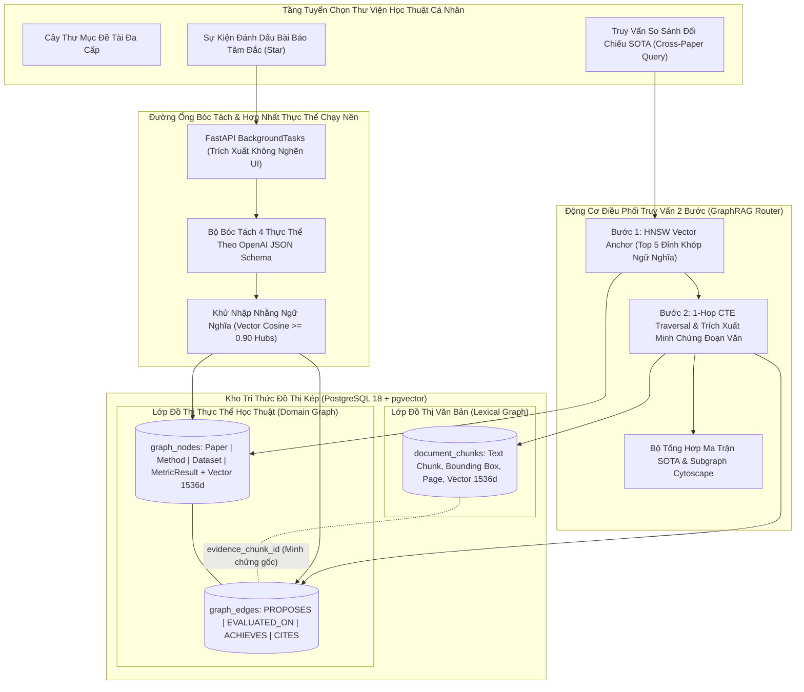
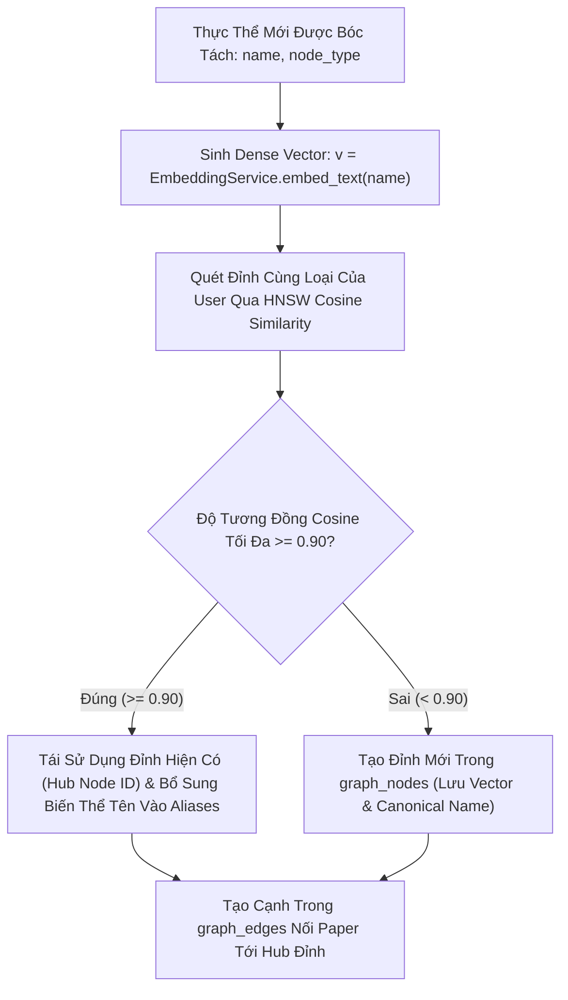
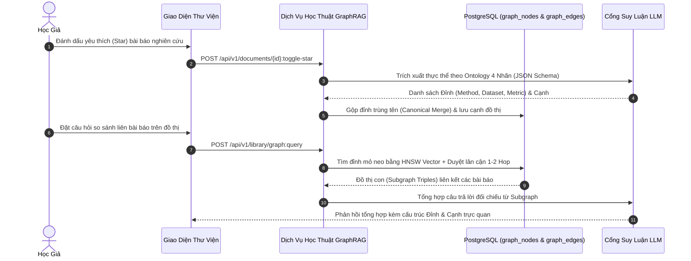

# ĐẶC TẢ KỸ THUẬT: PHÂN HỆ KHO PAPER YÊU THÍCH & HỆ THỐNG GRAPHRAG 4 THỰC THỂ
# (FAVORITE PAPERS LIBRARY, FOLDERS CRUD & POSTGRESQL GRAPHRAG SPECIFICATION)

**Trạng thái:** DỰ THẢO CHÍNH THỨC (TECHNICAL SPECIFICATION V1)  
**Nguồn tham chiếu PRD:** [`05-favorite-library-and-graphrag.md`](../PRD/05-favorite-library-and-graphrag.md)  
**Phân hệ kỹ thuật:** Phân Hệ Thư Viện Yêu Thích & Mạng Tri Thức (Library & Knowledge Graph)  
**File nền tảng liên đới:** [`00-foundation-architecture-and-db.md`](./00-foundation-architecture-and-db.md)

---

## 1. Usecase & Bối Cảnh Người Dùng (Real-World User Journey & Value)

### A. Usecase 1: Quản Lý & Phân Loại Thư Viện Bài Báo Cá Nhân (Personal Paper Library & Folders)
- **Bối cảnh & Vấn đề thực tế:** Trong suốt quá trình làm nghiên cứu kéo dài nhiều tháng, một học giả đọc hàng trăm bài báo khác nhau. Nếu không có nơi lưu trữ tập trung, họ sẽ quên mất bài báo mình từng đọc nằm ở đâu, thuộc đề tài nào hoặc phải tải lại từ đầu rất mất thời gian.
- **Giải pháp của phân hệ:**
  - Cung cấp giao diện Kho Thư Viện Cá Nhân (`/library`) cho phép gắn dấu sao ⭐ để lưu bài báo tâm đắc.
  - Hỗ trợ tổ chức tài liệu theo cây thư mục đề tài (`folders` — ví dụ: *"Luận văn tốt nghiệp"*, *"Deep Learning y tế"*), giúp tìm kiếm và quản lý tài liệu ngăn nắp.

### B. Usecase 2: Đồ Thị Tri Thức Học Thuật Kết Nối Chéo (Cross-Paper Knowledge Graph)
- **Bối cảnh & Vấn đề thực tế:** Khi đọc nhiều bài báo độc lập, các khái niệm thường liên quan mật thiết với nhau (ví dụ: Bài báo 1 đề xuất thuật toán *AdamW*, Bài báo 2 và 3 áp dụng *AdamW* trên các tập dữ liệu khác nhau). Người dùng muốn nhìn thấy mạng lưới kết nối này để hiểu bức tranh toàn cảnh của ngành mà không có công cụ nào hỗ trợ kết nối tri thức chéo giữa các file PDF rời rạc.
- **Giải pháp của phân hệ:**
  - Tự động trích xuất 4 loại thực thể học thuật chuẩn: **Paper**, **Method**, **Dataset**, **MetricResult**.
  - Áp dụng kỹ thuật hợp nhất thực thể chuẩn mực (**Canonical Entity Merging**): Khi nhiều bài báo cùng nhắc đến phương pháp *"AdamW"*, hệ thống chỉ tạo duy nhất 1 nút Hub trung tâm và kết nối các cạnh quan hệ tới từng bài báo tương ứng.

### C. Usecase 3: Tổng Hợp Benchmark & So Sánh Đồ Thị Tức Thì (Cross-Paper Benchmark Synthesis)
- **Bối cảnh & Vấn đề thực tế:** Khi viết phần So sánh Thực nghiệm (Experiments) cho bài báo của mình hoặc chuẩn bị phản hồi (Rebuttal) khi bị Reviewer #2 chất vấn về bảng so sánh SOTA, học giả phải mất 30–50 giờ lật lại hàng chục bài báo cũ để tìm xem phương pháp nào đạt kết quả cao nhất trên tập dữ liệu *ImageNet* hoặc *GLUE*.
- **Giải pháp của phân hệ:**
  - Cung cấp ô tra cứu GraphRAG: người dùng chỉ cần gõ câu hỏi: *"Các bài báo trong kho của tôi đạt độ chính xác bao nhiêu trên ImageNet?"*. Hệ thống dùng thuật toán 2 bước (HNSW Vector Anchor Search $\rightarrow$ 1-Hop Graph Edge Traversal) để duyệt các cạnh `(Paper - EVALUATED_ON -> Dataset)` và `(Paper - ACHIEVES -> MetricResult)`, tổng hợp thành bảng so sánh hoàn chỉnh mà không cần mở lại từng file PDF.

---

## 2. Phạm Vi & Bảng Đối Chiếu Hiện Trạng (`As-Is` vs `Delta`)

Phân hệ này quản lý Kho Bài báo Yêu thích cá nhân (`/library`), cấu trúc cây thư mục đề tài (`folders`), và hệ thống **4-Entity GraphRAG thuần PostgreSQL + `pgvector`** (loại bỏ hoàn toàn cơ sở dữ liệu đồ thị rời Neo4j).



### Bảng Kiểm Kê Thành Phần Mã Nguồn
| Thành phần | Đường dẫn File | Trạng thái | Nội dung chi tiết |
|---|---|---|---|
| **Folders Endpoints** | [`apps/api/src/api/v1/endpoints/folders.py`](../../apps/api/src/api/v1/endpoints/folders.py) | **KEEP** | Giữ nguyên CRUD thư mục: `POST /`, `GET /tree`, `GET /{id}`, `PATCH /{id}`, `DELETE /{id}`, gán/gỡ bài báo. |
| **Star Endpoint** | [`apps/api/src/api/v1/endpoints/documents.py`](../../apps/api/src/api/v1/endpoints/documents.py) | **MODIFY** | Chuẩn hóa `POST /api/v1/documents/{id}:toggle-star` kích hoạt ngầm bóc tách đồ thị khi `is_starred=True`, và gỡ cạnh đồ thị khi `is_starred=False`. |
| **Graph Query API** | `apps/api/src/api/v1/endpoints/library.py` | **CREATE** | Tạo mới `POST /api/v1/library/graph-query` nhận câu hỏi ngữ nghĩa, duyệt đồ thị PostgreSQL và sinh câu trả lời tổng hợp. |
| **CSDL Graph Models** | `apps/api/src/api/db/models/graph.py` | **CREATE** | Tạo 2 SQLAlchemy models: `GraphNodeModel` (`graph_nodes`) và `GraphEdgeModel` (`graph_edges`) kèm cột `Vector(1536)`. |
| **Graph Extraction Core**| `packages/core/src/core/services/graph_extractor.py` | **CREATE** | Service bóc tách thực thể thuần Python sử dụng Structured Outputs JSON Schema. |
| **Library UI** | `apps/web/src/features/library/` | **MODIFY** | Giao diện cây thư mục, lưới bài báo đã Star và hộp thoại tra cứu tổng hợp GraphRAG. |

---

## 3. Mô Hình Dữ Liệu & Ràng Buộc GraphRAG 4 Thực Thể

### A. Cấu Trúc 4 Loại Đỉnh (`graph_nodes`) & 4 Loại Cạnh (`graph_edges`)
Tuân thủ nghiêm ngặt PRD 05 §3, đồ thị tri thức chỉ sử dụng đúng 4 nhãn thực thể và 4 kiểu quan hệ cố định:

| Nhãn Thực Thể (`node_type`) | Ý nghĩa học thuật | Thuộc tính trích xuất (`metadata_json`) |
| :--- | :--- | :--- |
| **1. `Paper`** | Bài báo khoa học gốc | `title`, `authors`, `year`, `doi`, `venue`, `citation_key` |
| **2. `Method`** | Mô hình / Thuật toán / Kiến trúc | `name`, `family` (ví dụ: Attention, CNN, Diffusion), `aliases` |
| **3. `Dataset`** | Tập dữ liệu chuẩn / Benchmark | `name`, `domain` (Vision, NLP, Speech), `split` (train/val/test) |
| **4. `MetricResult`** | Điểm số & Con số thực nghiệm | `metric_name` (BLEU, F1, Accuracy), `value`, `unit`, `task`, `split` |

| Kiểu Quan Hệ (`edge_type`) | Đỉnh Nguồn (`source`) | Đỉnh Đích (`target`) | Ý nghĩa học thuật |
| :--- | :--- | :--- | :--- |
| **`PROPOSES`** | `Paper` | `Method` | Bài báo này đề xuất phương pháp mới. |
| **`EVALUATED_ON`** | `Paper` hoặc `Method` | `Dataset` | Được thử nghiệm đánh giá trên tập dữ liệu. |
| **`ACHIEVES`** | `Method` | `MetricResult` | Đạt được con số hiệu năng cụ thể. |
| **`CITES`** | `Paper` | `Paper` | Dẫn chiếu trích dẫn bài báo tham khảo khác. |

#### Lược Đồ Bảng CSDL PostgreSQL (`pgvector` DDL):

```sql
-- 1. Bảng Đỉnh Đồ Thị (graph_nodes)
CREATE TABLE IF NOT EXISTS graph_nodes (
    id UUID PRIMARY KEY DEFAULT gen_random_uuid(),
    user_id UUID NOT NULL REFERENCES users(id) ON DELETE CASCADE,
    node_type VARCHAR(30) NOT NULL CHECK (node_type IN ('Paper', 'Method', 'Dataset', 'MetricResult')),
    canonical_name VARCHAR(255) NOT NULL,
    metadata_json JSONB NOT NULL DEFAULT '{}'::jsonb,
    embedding VECTOR(1536) NULL,
    created_at TIMESTAMPTZ NOT NULL DEFAULT NOW(),
    updated_at TIMESTAMPTZ NOT NULL DEFAULT NOW(),
    CONSTRAINT uq_graph_nodes_user_type_canonical UNIQUE (user_id, node_type, canonical_name)
);

CREATE INDEX IF NOT EXISTS idx_graph_nodes_user_type ON graph_nodes(user_id, node_type);
CREATE INDEX IF NOT EXISTS idx_graph_nodes_embedding ON graph_nodes 
USING hnsw (embedding vector_cosine_ops) WITH (m = 16, ef_construction = 64);

-- 2. Bảng Cạnh Đồ Thị (graph_edges) Liên Kết Chặt Với Lexical Graph
CREATE TABLE IF NOT EXISTS graph_edges (
    id UUID PRIMARY KEY DEFAULT gen_random_uuid(),
    user_id UUID NOT NULL REFERENCES users(id) ON DELETE CASCADE,
    document_id UUID NOT NULL REFERENCES documents(id) ON DELETE CASCADE,
    source_node_id UUID NOT NULL REFERENCES graph_nodes(id) ON DELETE CASCADE,
    target_node_id UUID NOT NULL REFERENCES graph_nodes(id) ON DELETE CASCADE,
    edge_type VARCHAR(30) NOT NULL CHECK (edge_type IN ('PROPOSES', 'EVALUATED_ON', 'ACHIEVES', 'CITES')),
    metadata_json JSONB NOT NULL DEFAULT '{}'::jsonb,
    evidence_chunk_id UUID NULL REFERENCES document_chunks(id) ON DELETE SET NULL,
    page_number INT NULL,
    created_at TIMESTAMPTZ NOT NULL DEFAULT NOW(),
    CONSTRAINT uq_graph_edges_user_doc_src_tgt_type UNIQUE (user_id, document_id, source_node_id, target_node_id, edge_type)
);

CREATE INDEX IF NOT EXISTS idx_graph_edges_user_doc ON graph_edges(user_id, document_id);
CREATE INDEX IF NOT EXISTS idx_graph_edges_source ON graph_edges(user_id, source_node_id);
CREATE INDEX IF NOT EXISTS idx_graph_edges_target ON graph_edges(user_id, target_node_id);
CREATE INDEX IF NOT EXISTS idx_graph_edges_evidence_chunk ON graph_edges(evidence_chunk_id);
```

---

### B. Khử Nhập Nhằng Ngữ Nghĩa & Gộp Đỉnh Hub (Semantic Entity Disambiguation Algorithm)
Trong thực tế học thuật, cùng một phương pháp thường được viết dưới nhiều biến thể tên gọi khác nhau (ví dụ: *"Transformer"*, *"The Transformer model"*, *"Transformer architecture"*). Nếu chỉ chuẩn hóa chuỗi đơn giản qua `LOWER(TRIM(name))`, đồ thị sẽ bị phân mảnh thành nhiều đỉnh rời rạc, làm tê liệt khả năng đối chiếu SOTA.

Quy trình khử nhập nhằng ngữ nghĩa được thực thi tất định theo thuật toán sau:



1. **Sinh Vector Tên Thực Thể:**
   $$v_{\text{entity}} = \text{EmbeddingService.embed\_text}(name) \in \mathbb{R}^{1536}$$
2. **Tìm Kiếm Đỉnh Gần Nhất (Candidate Hub Search):**
   ```sql
   SELECT id, canonical_name, metadata_json,
          1 - (embedding <=> :v_entity) AS cosine_sim
   FROM graph_nodes
   WHERE user_id = :user_id AND node_type = :node_type
   ORDER BY embedding <=> :v_entity
   LIMIT 1;
   ```
3. **Quyết Định Gộp (Hub Assignment Rule):**
   - Nếu $\text{cosine\_sim} \ge 0.90$: Hệ thống **không tạo đỉnh mới**. Lấy `id` của đỉnh hiện có làm mốc Hub, cập nhật mảng phụ `metadata_json['aliases']` nếu tên mới chưa có trong danh sách.
   - Nếu $\text{cosine\_sim} < 0.90$: Hệ thống tạo bản ghi mới trong `graph_nodes` với `canonical_name = LOWER(TRIM(name))` và lưu `embedding = v_entity`.
4. **Bảo Toàn Ngữ Cảnh Đo Lường (Contextual Metric Tuple Binding):**
   Đối với các đỉnh thuộc loại `MetricResult`, mỗi con số thực nghiệm bắt buộc lưu kèm bộ ngữ cảnh đầy đủ trong `metadata_json`:
   ```json
   {
     "dataset": "WMT-2014 En-De",
     "task": "Machine Translation",
     "split": "test",
     "metric_name": "BLEU",
     "value": 28.4,
     "unit": "points",
     "page_number": 8
   }
   ```
   Điều này ngăn chặn triệt để việc nhầm lẫn giữa kết quả trên tập kiểm thử (*Test Set*) và tập phát triển (*Validation Set*).
5. **Vòng Đời Tiêu Hủy Khi Bỏ Star (Unstar Lifecycle):**
   - Khi bài báo bị gỡ Star (`is_starred = False` và `folder_id IS NULL`):
   - Xóa toàn bộ các cạnh trong `graph_edges WHERE document_id = :doc_id AND user_id = :user_id`.
   - Quét dọn các đỉnh mồ côi: xóa các đỉnh không còn bất kỳ cạnh nào liên kết (`COUNT(edges) == 0`). Đỉnh nào là Hub được bài báo khác tham chiếu tới thì được giữ nguyên vẹn.

---

## 4. Hợp Đồng API REST & Bảng Mã Lỗi (REST Contracts & Error Codes)

### A. Tra Cứu Tri Thức Đồ Thị Tổng Hợp (`POST /api/v1/folders/synthesis` hoặc `/api/v1/library/graph-query`)
- **Headers:** `Authorization: Bearer <token>`, `Content-Type: application/json`
- **Request Body:**
  ```json
  {
    "query": "Các bài báo trong kho của tôi sử dụng kiến trúc Transformer đạt kết quả BLEU và Accuracy như thế nào?",
    "top_k": 5
  }
  ```
- **Response (HTTP 200 OK):**
  ```json
  {
    "answer": "Trong Kho Yêu thích của bạn, có 2 bài báo chính áp dụng kiến trúc Transformer:\n1. **Attention Is All You Need (Vaswani et al., 2017)**: Đạt điểm BLEU **28.4** trên tập dữ liệu WMT 2014 En-De.\n2. **Vision Transformer (Dosovitskiy et al., 2020)**: Mở rộng sang thị giác máy tính, đạt Top-1 Accuracy **88.55%** trên tập dữ liệu ImageNet-1K.",
    "subgraph": {
      "nodes": [
        { "id": "uuid-1", "type": "Method", "name": "Transformer" },
        { "id": "uuid-2", "type": "Paper", "name": "Attention Is All You Need (2017)" },
        { "id": "uuid-3", "type": "Paper", "name": "An Image is Worth 16x16 Words (2020)" },
        { "id": "uuid-4", "type": "MetricResult", "name": "BLEU: 28.4" },
        { "id": "uuid-5", "type": "MetricResult", "name": "Top-1 Accuracy: 88.55%" }
      ],
      "edges": [
        { "source": "uuid-2", "target": "uuid-1", "type": "PROPOSES" },
        { "source": "uuid-3", "target": "uuid-1", "type": "PROPOSES" },
        { "source": "uuid-1", "target": "uuid-4", "type": "ACHIEVES" },
        { "source": "uuid-1", "target": "uuid-5", "type": "ACHIEVES" }
      ]
    },
    "meta": {
      "trace_id": "trace-graph-78a1",
      "matched_entities": 5
    }
  }
  ```

---

### B. Bật/Tắt Yêu Thích Bài Báo (`POST /api/v1/documents/{document_id}:toggle-star`)
- **Headers:** `Authorization: Bearer <token>`, `Content-Type: application/json`
- **Request Body:**
  ```json
  {
    "folder_id": "3fa85f64-5717-4562-b3fc-2c963f66afa6"
  }
  ```
- **Response (HTTP 200 OK):**
  ```json
  {
    "document_id": "1a2b3c4d-5e6f-7a8b-9c0d-1e2f3a4b5c6d",
    "is_starred": true,
    "folder_id": "3fa85f64-5717-4562-b3fc-2c963f66afa6",
    "graph_extraction_status": "queued"
  }
  ```

---

### C. Ma Trận Mã Lỗi Chuẩn Hóa (Deterministic Error Codes Matrix)

Bảng ma trận dưới đây quy định toàn bộ các mã lỗi tất định của Phân hệ Kho Yêu Thích & GraphRAG 4 Thực Thể, đảm bảo bất kỳ mô hình AI hoặc lập trình viên nào cũng có thể cài đặt logic xử lý lỗi chính xác 100% mà không bị sai lệch:

| HTTP Status | Mã Lỗi (`error_code`) | Điều Kiện Kích Hoạt (Trigger Condition) | Thông Điệp Tiếng Việt Chuẩn Hóa (`message`) | Trường Lỗi (`field`) & Hành Động Khắc Phục (`action`) |
| :--- | :--- | :--- | :--- | :--- |
| `400 Bad Request` | `INVALID_FOLDER_NAME` | Tên thư mục rỗng, chỉ chứa khoảng trắng hoặc vượt quá 100 ký tự | `"Tên thư mục không hợp lệ. Vui lòng nhập từ 1 đến 100 ký tự hợp lệ."` | `field: "name"` — Nhập tên thư mục hợp lệ. |
| `400 Bad Request` | `INVALID_FOLDER_COLOR` | Mã màu thư mục không đúng định dạng hex (ví dụ: `#4F46E5`) | `"Mã màu thư mục không hợp lệ. Vui lòng cung cấp mã hex chuẩn (ví dụ: #4F46E5)."` | `field: "color"` — Chọn mã màu hợp lệ từ bảng màu. |
| `400 Bad Request` | `CYCLIC_FOLDER_HIERARCHY` | Thư mục cha được gán là chính nó hoặc là một thư mục con của nó trong cây phân cấp | `"Không thể di chuyển thư mục vào chính nó hoặc vào thư mục con của nó."` | `field: "parent_id"` — Chọn thư mục cha hợp lệ không gây vòng lặp. |
| `400 Bad Request` | `INVALID_GRAPH_ENTITY_TYPE` | Dữ liệu trích xuất đồ thị chứa loại thực thể nằm ngoài 4 loại chuẩn (`Paper`, `Method`, `Dataset`, `MetricResult`) | `"Loại thực thể đồ thị không hợp lệ. Hệ thống chỉ chấp nhận Paper, Method, Dataset hoặc MetricResult."` | `field: "type"` — Tuân thủ nghiêm ngặt 4 loại thực thể chuẩn. |
| `400 Bad Request` | `INVALID_GRAPH_EDGE_TYPE` | Cạnh quan hệ đồ thị khai báo loại nằm ngoài 4 kiểu chuẩn (`PROPOSES`, `EVALUATED_ON`, `ACHIEVES`, `CITES`) | `"Kiểu quan hệ đồ thị không hợp lệ. Hệ thống chỉ chấp nhận PROPOSES, EVALUATED_ON, ACHIEVES hoặc CITES."` | `field: "type"` — Tuân thủ nghiêm ngặt 4 kiểu quan hệ chuẩn. |
| `400 Bad Request` | `INVALID_SYNTHESIS_QUERY` | Câu hỏi tra cứu tổng hợp GraphRAG rỗng, chỉ chứa khoảng trắng hoặc vượt quá 1000 ký tự | `"Câu hỏi tra cứu tổng hợp không hợp lệ. Vui lòng nhập câu hỏi từ 3 đến 1000 ký tự."` | `field: "query"` — Nhập câu hỏi đối chiếu thực nghiệm cụ thể. |
| `400 Bad Request` | `INVALID_TOP_K` | Tham số `top_k` trong truy vấn GraphRAG nhỏ hơn 1 hoặc lớn hơn 50 | `"Số lượng kết quả trích xuất top_k phải nằm trong khoảng từ 1 đến 50."` | `field: "top_k"` — Đặt giá trị `top_k` hợp lệ (mặc định 5). |
| `401 Unauthorized` | `AUTH_TOKEN_INVALID` | Token JWT thiếu trong header `Authorization`, hết hạn hoặc chữ ký không hợp lệ | `"Phiên làm việc đã hết hạn hoặc không hợp lệ. Vui lòng đăng nhập lại."` | `field: null` — Điều hướng về trang đăng nhập hoặc làm mới token. |
| `403 Forbidden` | `FOLDER_ACCESS_DENIED` | Người dùng cố tình truy cập, sửa hoặc xóa thư mục thuộc quyền sở hữu của tài khoản khác | `"Bạn không có quyền thao tác trên thư mục này."` | `field: null` — Chỉ truy cập các tài nguyên thuộc quyền sở hữu cá nhân. |
| `404 Not Found` | `DOCUMENT_NOT_FOUND` | `document_id` không tồn tại trong hệ thống hoặc không thuộc quyền sở hữu của người dùng (ID Enumeration Defense) | `"Không tìm thấy tài liệu khoa học yêu cầu."` | `field: "document_id"` — Kiểm tra ID tài liệu từ danh sách hợp lệ. |
| `404 Not Found` | `FOLDER_NOT_FOUND` | `folder_id` không tồn tại trong hệ thống hoặc không thuộc quyền sở hữu của người dùng | `"Không tìm thấy thư mục đề tài yêu cầu."` | `field: "folder_id"` — Chọn thư mục tồn tại trong cây thư mục cá nhân. |
| `409 Conflict` | `DUPLICATE_FOLDER_NAME` | Tạo mới hoặc đổi tên thư mục trùng với tên thư mục đã tồn tại trong cùng một thư mục cha (`parent_id`) | `"Tên thư mục đã tồn tại trong cùng cấp phân nhánh. Vui lòng chọn tên khác."` | `field: "name"` — Nhập tên thư mục phân biệt. |
| `422 Unprocessable Entity` | `GRAPH_EXTRACTION_FAILED` | Mô hình LLM trích xuất thất bại sau 3 lần thử lại hoặc văn bản PDF không có cấu trúc học thuật bóc tách được | `"Quá trình bóc tách thực thể tri thức từ bài báo thất bại. Vui lòng kiểm tra lại định dạng tài liệu."` | `field: null` — Thử kích hoạt trích xuất lại hoặc kiểm tra lớp văn bản của tài liệu. |
| `503 Service Unavailable` | `EMBEDDING_SERVICE_UNAVAILABLE` | Dịch vụ tạo vector embedding phục vụ truy vấn HNSW gặp sự cố hoặc timeout mạng | `"Dịch vụ nhúng vector tạm thời không khả dụng. Vui lòng thử lại sau giây lát."` | `field: null` — Thử lại sau ít phút khi dịch vụ embedding phục hồi. |

**Cấu Trúc Phong Bì Phản Hồi Lỗi Chuẩn (`ErrorResponse`):**
```json
{
  "success": false,
  "error": {
    "code": "INVALID_FOLDER_NAME",
    "message": "Tên thư mục không hợp lệ. Vui lòng nhập từ 1 đến 100 ký tự hợp lệ.",
    "field": "name",
    "action": "Nhập tên thư mục hợp lệ."
  },
  "meta": {
    "request_id": "req_78a1bc9012ef",
    "trace_id": "trace-graph-78a1"
  }
}
```

---

## 5. Thiết Kế Thuật Toán Trích Xuất & Truy Vấn GraphRAG

### A. Trích Xuất Thực Thể Có Cấu Trúc (Structured Outputs Extraction)
Khi bài báo được Star, `FastAPI BackgroundTasks` gọi `GraphExtractorService` truyền toàn văn đoạn tóm tắt (Abstract) và các bảng thực nghiệm của bài báo vào mô hình LLM với JSON Schema bắt buộc theo chuẩn OpenAI Structured Outputs:

```json
{
  "type": "object",
  "properties": {
    "entities": {
      "type": "array",
      "items": {
        "type": "object",
        "properties": {
          "type": { "enum": ["Paper", "Method", "Dataset", "MetricResult"] },
          "name": { "type": "string" },
          "description": { "type": "string" },
          "page_number": { "type": "integer" },
          "context_tuple": {
            "type": "object",
            "properties": {
              "dataset": { "type": "string" },
              "task": { "type": "string" },
              "split": { "type": "string" },
              "metric_name": { "type": "string" },
              "value": { "type": "number" },
              "unit": { "type": "string" }
            }
          }
        },
        "required": ["type", "name", "page_number"]
      }
    },
    "relations": {
      "type": "array",
      "items": {
        "type": "object",
        "properties": {
          "source_name": { "type": "string" },
          "target_name": { "type": "string" },
          "type": { "enum": ["PROPOSES", "EVALUATED_ON", "ACHIEVES", "CITES"] },
          "page_number": { "type": "integer" }
        },
        "required": ["source_name", "target_name", "type", "page_number"]
      }
    }
  },
  "required": ["entities", "relations"],
  "additionalProperties": false
}
```

---

### B. Truy Vấn Đồ Thị Kép 2 Bước (2-Step Dual-Graph CTE Traversal)
Để truy vấn tri thức đối chiếu trong thời gian $< 50$ms mà không cần hệ quản trị cơ sở dữ liệu đồ thị rời, hệ thống thực thi truy vấn CTE nguyên bản trên PostgreSQL kết hợp giữa **Lớp Thực Thể (Domain Graph)** và **Lớp Văn Bản Minh Chứng (Lexical Graph)**:

```sql
WITH anchor_nodes AS (
    -- Bước 1: Tìm kiếm điểm neo ngữ nghĩa qua chỉ mục HNSW Cosine
    SELECT 
        id, 
        node_type, 
        canonical_name, 
        metadata_json,
        1 - (embedding <=> CAST(:query_vec AS vector)) AS similarity
    FROM graph_nodes
    WHERE user_id = :user_id
    ORDER BY embedding <=> CAST(:query_vec AS vector)
    LIMIT :top_k
),
connected_edges AS (
    -- Bước 2: Mở rộng 1-Hop quét toàn bộ cạnh liên đới tới các điểm neo
    SELECT 
        e.id AS edge_id,
        e.document_id,
        e.source_node_id,
        e.target_node_id,
        e.edge_type,
        e.metadata_json AS edge_metadata,
        e.evidence_chunk_id,
        e.page_number
    FROM graph_edges e
    WHERE e.user_id = :user_id
      AND (
          e.source_node_id IN (SELECT id FROM anchor_nodes)
          OR e.target_node_id IN (SELECT id FROM anchor_nodes)
      )
),
neighbor_nodes AS (
    -- Quét toàn bộ các đỉnh lân cận ở đầu kia của cạnh
    SELECT DISTINCT
        n.id,
        n.node_type,
        n.canonical_name,
        n.metadata_json
    FROM graph_nodes n
    WHERE n.id IN (
        SELECT source_node_id FROM connected_edges
        UNION
        SELECT target_node_id FROM connected_edges
    )
),
evidence_chunks AS (
    -- Kéo đoạn trích văn bản và tọa độ Bounding Box từ Lexical Graph để bảo đảm minh chứng
    SELECT 
        c.id AS chunk_id,
        c.document_id,
        c.page_number,
        c.content AS chunk_text,
        c.bbox
    FROM document_chunks c
    WHERE c.id IN (
        SELECT evidence_chunk_id 
        FROM connected_edges 
        WHERE evidence_chunk_id IS NOT NULL
    )
)
SELECT 
    json_build_object(
        'anchors', (SELECT json_agg(a.*) FROM anchor_nodes a),
        'edges', (SELECT json_agg(e.*) FROM connected_edges e),
        'neighbors', (SELECT json_agg(nb.*) FROM neighbor_nodes nb),
        'evidence', (SELECT json_agg(ev.*) FROM evidence_chunks ev)
    ) AS graph_subgraph_bundle;
```

---

### C. Động Cơ Điều Phối Truy Vấn (Dual-Graph Retrieval Router)
Bám sát mô hình kiến trúc Lexical Graph + Domain Graph, bộ điều phối truy vấn phân loại câu hỏi người dùng thành 3 luồng:

1. **Luồng 1 — Tra cứu Đoạn Văn Bản Cụ Thể (Lexical Search):**
   - Áp dụng khi câu hỏi tìm kiếm định nghĩa hoặc chi tiết văn bản (ví dụ: *"Tác giả mô tả hàm mất mát ra sao?"*).
   - Truy vấn trực tiếp `document_chunks` thông qua Hybrid HNSW Dense Vector + BM25 RRF ($k=60$).
2. **Luồng 2 — Tra cứu Quan Hệ & So Sánh SOTA (Domain Graph Query):**
   - Áp dụng khi câu hỏi yêu cầu thống kê hoặc tìm bài báo đề xuất/đánh giá (ví dụ: *"Có những bài báo nào trong kho đánh giá trên ImageNet?"*).
   - Truy vấn 2 bước CTE phía trên, tổng hợp bảng ma trận đối chiếu kèm subgraph trực quan.
3. **Luồng 3 — Tra cứu Phức Hợp Đối Chiếu Kèm Minh Chứng (Hybrid Pattern Match):**
   - Kết hợp cả hai: Đồ thị Domain Graph xác định cấu trúc bộ ba `(Paper, Method, MetricResult)`, đồng thời `evidence_chunk_id` tải đúng đoạn văn và tọa độ Bounding Box để tô vàng trực tiếp trên PDF cho học giả.

---

## 6. Thiết Kế Giao Diện & Trực Quan Hóa Frontend (`apps/web`)

### A. Màn Hình Kho Yêu Thích (`LibraryWorkspaceView.tsx`)
1. **Thanh bên trái (Cây thư mục):**
   - Danh sách thư mục đề tài kèm số lượng bài báo trong mỗi thư mục.
   - Nút `[➕ Thư mục mới]` mở modal nhập tên và chọn màu sắc nhận diện.
2. **Khu vực trung tâm (Lưới bài báo):**
   - Danh sách thẻ bài báo đã Star với đầy đủ thông tin Tác giả, Năm, Hội nghị.
   - Nút ngôi sao vàng sáng `[⭐]` cho phép bấm để hủy Star hoặc đổi thư mục.
3. **Khu vực trên cùng (Hộp tra cứu tri thức GraphRAG):**
   - Thanh tìm kiếm thông minh: *"Hỏi đáp tổng hợp trên toàn bộ kho yêu thích..."*.
   - Khung trả lời hiển thị bảng so sánh đối chiếu và sơ đồ mini-graph (sử dụng thư viện `cytoscape` có sẵn).

---

## 7. Tập Tin Neo Tham Chiếu Trong Codebase (Codebase Anchors)

Mọi thay đổi kỹ thuật của phân hệ Thư Viện Yêu Thích và GraphRAG 4 Thực Thể phải tuân thủ và tham chiếu từ các tệp sau:

| Vai trò kiến trúc | Tệp neo chuẩn mực trong repo | Nguyên tắc bắt chước |
| :--- | :--- | :--- |
| **Folders Endpoints** | [`apps/api/src/api/v1/endpoints/folders.py`](../../apps/api/src/api/v1/endpoints/folders.py) | Tham chiếu CRUD thư mục đề tài, dựng cây thư mục phân cấp và gán/gỡ bài báo. |
| **Toggle Star Endpoint** | [`apps/api/src/api/v1/endpoints/documents.py`](../../apps/api/src/api/v1/endpoints/documents.py) | Tham chiếu cách toggle star và phát sinh tác vụ nền trích xuất GraphRAG. |
| **Graph Models & Schemas** | `apps/api/src/api/db/models/graph.py` | Tham chiếu mô hình SQLAlchemy cho `GraphNodeModel` và `GraphEdgeModel` với cột `Vector(1536)`. |
| **Graph Extraction Core** | `packages/core/src/core/services/graph_extractor.py` | Thuần Python, chuẩn hóa tên canonical và kiểm tra schema 4 thực thể cố định. |
| **Library Workspace UI** | `apps/web/src/features/library/` | Giao diện cây thư mục, thẻ bài báo đã Star và hộp tra cứu tổng hợp GraphRAG. |

---

## 8. Ma Trận Kiểm Thử TDD Bắt Buộc (Library & GraphRAG TDD Matrix)



| Tên Test Case | File Kiểm Thử | Mục tiêu kiểm chứng | Kỳ vọng nghiệm thu |
|---|---|---|---|
| `test_validate_4_entity_and_edge_types` | `packages/core/tests/test_graph_domain.py` | Kiểm tra thực thể có nhãn ngoài 4 nhãn chuẩn | Ném lỗi `InvalidGraphEntityTypeException`. |
| `test_canonical_entity_merging_same_name` | `apps/api/tests/test_graph_extraction.py` | Nạp 2 bài báo cùng đề cập phương pháp `"Transformer"` | Chỉ tạo 1 bản ghi `graph_nodes`, tạo 2 cạnh riêng biệt. |
| `test_semantic_entity_disambiguation_threshold_090` | `apps/api/tests/test_graph_extraction.py` | Nạp 2 biến thể tên `"Transformer"` và `"The Transformer model"` (Cosine >= 0.90) | Tự động gộp vào 1 Hub duy nhất, bổ sung biến thể vào `aliases`. |
| `test_dual_graph_cte_traversal_with_lexical_evidence` | `apps/api/tests/test_graph_rag_query.py` | Truy vấn 2 bước CTE kết hợp Domain Graph và Lexical Graph | Trả về bundle gồm `anchors`, `edges`, `neighbors` và `evidence` có Bounding Box. |
| `test_graph_query_1_hop_traversal` | `apps/api/tests/test_graph_rag_query.py` | Truy vấn GraphRAG bằng vector embedding | Trả về đúng các bộ ba `(Paper, PROPOSES, Method)` liên quan. |
| `test_unstar_removes_edges_and_prunes_orphans` | `apps/api/tests/test_graph_lifecycle.py` | Bỏ Star bài báo độc nhất | Cạnh bị xóa, đỉnh mồ côi bị dọn dẹp sạch; đỉnh dùng chung không bị mất. |
| `test_folders_crud_and_tree_hierarchy` | `apps/api/tests/test_folders_endpoints.py` | Tạo thư mục cha và thư mục con | `GET /folders/tree` trả về đúng cấu trúc lồng nhau. |

---

## 9. Tiêu Chí Nghiệm Thu Kỹ Thuật (Definition of Done)

- [ ] Lược đồ `graph_nodes` và `graph_edges` được tạo chuẩn trên PostgreSQL kèm chỉ mục `HNSW` và khóa ngoại `evidence_chunk_id` liên kết sang `document_chunks`.
- [ ] Cơ chế khử nhập nhằng ngữ nghĩa (Semantic Disambiguation Cosine $\ge 0.90$) hoạt động chính xác, tạo nên đồ thị liên kết chéo chống nổ đỉnh phân mảnh.
- [ ] Bóc tách thực thể chạy ngầm qua `FastAPI BackgroundTasks` sinh đồng thời vector dense 1536d cho từng đỉnh.
- [ ] Truy vấn 2 bước CTE nguyên bản trả về kết quả dưới 50ms kèm đầy đủ minh chứng số trang và tọa độ Bounding Box.
- [ ] API `POST /api/v1/library/graph-query` thực hiện truy vấn và trả về câu trả lời tổng hợp kèm cấu trúc subgraph tương thích Cytoscape.js.
- [ ] Thao tác Star/Unstar tự động đồng bộ vòng đời dữ liệu đồ thị, bảo toàn cô lập `user_id`.
- [ ] Toàn bộ các mã lỗi trong Ma trận Mã Lỗi Chuẩn Hóa Mục 4.C được cài đặt đầy đủ theo chuẩn Error Envelope.
- [ ] Toàn bộ kịch bản kiểm thử trong Ma trận Kiểm thử Mục 8 đạt `100% PASS`.
