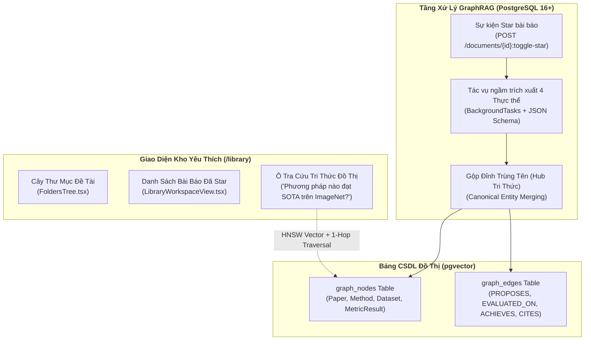
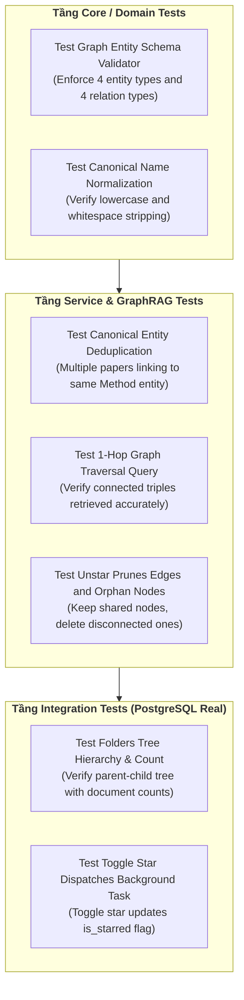

# ĐẶC TẢ KỸ THUẬT: PHÂN HỆ KHO PAPER YÊU THÍCH & HỆ THỐNG GRAPHRAG 4 THỰC THỂ
# (FAVORITE PAPERS LIBRARY, FOLDERS CRUD & POSTGRESQL GRAPHRAG SPECIFICATION)

**Trạng thái:** DỰ THẢO CHÍNH THỨC (TECHNICAL SPECIFICATION V1)  
**Nguồn tham chiếu PRD:** [`docs/PRD/05-favorite-library-and-graphrag.md`](file:///home/dammanhdungvn/Downloads/Workspace/VeriScholar/docs/PRD/05-favorite-library-and-graphrag.md)  
**Phân hệ kỹ thuật:** Phân Hệ Thư Viện Yêu Thích & Mạng Tri Thức (Library & Knowledge Graph)  
**File nền tảng liên đới:** [`docs/specs/00-foundation-architecture-and-db.md`](file:///home/dammanhdungvn/Downloads/Workspace/VeriScholar/docs/specs/00-foundation-architecture-and-db.md)

---

## 1. Usecase & Bối Cảnh Người Dùng (Real-World User Journey & Value)

### A. Usecase 1: Quản Lý & Phân Loại Thư Viện Bài Báo Cá Nhân (Personal Paper Library & Folders)
- **Bối cảnh & Vấn đề thực tế:** Trong suốt quá trình làm nghiên cứu kéo dài nhiều tháng, một học giả đọc hàng trăm bài báo khác nhau. Nếu không có nơi lưu trữ tập trung, họ sẽ quên mất bài báo mình từng đọc nằm ở đâu, thuộc đề tài nào hoặc phải tải lại từ đầu rất mất thời gian.
- **Giải pháp của phân hệ:**
  - Cung cấp giao diện Kho Thư Viện Cá Nhân (`/library`) cho phép gắn dấu sao ⭐ để lưu bài báo tâm đắc.
  - Hỗ trợ tổ chức tài liệu theo cây thư mục đề tài (`folders` — ví dụ: *"Luận văn tốt nghiệp"*, *"Deep Learning y tế"*), giúp tìm kiếm và quản lý tài liệu ngăn nắp.

### B. Usecase 2: Đồ Thị Tri Thức Học Thuật Kết Nối Chéo (Cross-Paper Knowledge Graph)
- **Bối cảnh & Vấn đề thực tế:** Khi đọc nhiều bài báo độc lập, các khái niệm thường liên quan mật thiết với nhau (ví dụ: Bài báo 1 đề xuất thuật toán *AdamW*, Bài báo 2 và 3 áp dụng *AdamW* trên các tập dữ liệu khác nhau). Người dùng muốn nhìn thấy mạng lưới kết nối này để hiểu bức tranh toàn cảnh của ngành mà không có công cụ nào hỗ trợ kết nối tri thức chéo giữa các file PDF rời rạc.
- **Giải pháp của phân hệ:**
  - Tự động trích xuất 4 loại thực thể học thuật chuẩn: **Paper**, **Method**, **Dataset**, **MetricResult**.
  - Áp dụng kỹ thuật hợp nhất thực thể chuẩn mực (**Canonical Entity Merging**): Khi nhiều bài báo cùng nhắc đến phương pháp *"AdamW"*, hệ thống chỉ tạo duy nhất 1 nút Hub trung tâm và kết nối các cạnh quan hệ tới từng bài báo tương ứng.

### C. Usecase 3: Tổng Hợp Benchmark & So Sánh Đồ Thị Tức Thì (Cross-Paper Benchmark Synthesis)
- **Bối cảnh & Vấn đề thực tế:** Khi viết phần So sánh Thực nghiệm (Experiments) cho bài báo của mình, học giả phải mở lại 10 bài báo cũ để tìm xem phương pháp nào đạt kết quả cao nhất trên tập dữ liệu *ImageNet* hoặc *GLUE*.
- **Giải pháp của phân hệ:**
  - Cung cấp ô tra cứu GraphRAG: người dùng chỉ cần gõ câu hỏi: *"Các bài báo trong kho của tôi đạt độ chính xác bao nhiêu trên ImageNet?"*. Hệ thống dùng thuật toán 2 bước (HNSW Vector Anchor Search $\rightarrow$ 1-Hop Graph Edge Traversal) để duyệt các cạnh `(Paper - EVALUATED_ON -> Dataset)` và `(Paper - ACHIEVES -> MetricResult)`, tổng hợp thành bảng so sánh hoàn chỉnh mà không cần mở lại từng file PDF.

---

## 2. Phạm Vi & Bảng Đối Chiếu Hiện Trạng (`As-Is` vs `Delta`)

Phân hệ này quản lý Kho Bài báo Yêu thích cá nhân (`/library`), cấu trúc cây thư mục đề tài (`folders`), và hệ thống **4-Entity GraphRAG thuần PostgreSQL + `pgvector`** (loại bỏ hoàn toàn cơ sở dữ liệu đồ thị rời Neo4j).



### Bảng Kiểm Kê Thành Phần Mã Nguồn
| Thành phần | Đường dẫn File | Trạng thái | Nội dung chi tiết |
|---|---|---|---|
| **Folders Endpoints** | [`apps/api/src/api/v1/endpoints/folders.py`](file:///home/dammanhdungvn/Downloads/Workspace/VeriScholar/apps/api/src/api/v1/endpoints/folders.py) | **KEEP** | Giữ nguyên CRUD thư mục: `POST /`, `GET /tree`, `GET /{id}`, `PATCH /{id}`, `DELETE /{id}`, gán/gỡ bài báo. |
| **Star Endpoint** | [`apps/api/src/api/v1/endpoints/documents.py`](file:///home/dammanhdungvn/Downloads/Workspace/VeriScholar/apps/api/src/api/v1/endpoints/documents.py) | **MODIFY** | Chuẩn hóa `POST /api/v1/documents/{id}:toggle-star` kích hoạt ngầm bóc tách đồ thị khi `is_starred=True`, và gỡ cạnh đồ thị khi `is_starred=False`. |
| **Graph Query API** | `apps/api/src/api/v1/endpoints/library.py` | **CREATE** | Tạo mới `POST /api/v1/library/graph-query` nhận câu hỏi ngữ nghĩa, duyệt đồ thị PostgreSQL và sinh câu trả lời tổng hợp. |
| **CSDL Graph Models** | `apps/api/src/api/db/models/graph.py` | **CREATE** | Tạo 2 SQLAlchemy models: `GraphNodeModel` (`graph_nodes`) và `GraphEdgeModel` (`graph_edges`) kèm cột `Vector(1536)`. |
| **Graph Extraction Core**| `packages/core/src/core/services/graph_extractor.py` | **CREATE** | Service bóc tách thực thể thuần Python sử dụng Structured Outputs JSON Schema. |
| **Library UI** | `apps/web/src/features/library/` | **MODIFY** | Giao diện cây thư mục, lưới bài báo đã Star và hộp thoại tra cứu tổng hợp GraphRAG. |

---

## 3. Mô Hình Dữ Liệu & Ràng Buộc GraphRAG 4 Thực Thể

### A. Cấu Trúc 4 Loại Đỉnh (`graph_nodes`) & 4 Loại Cạnh (`graph_edges`)
Tuân thủ nghiêm ngặt PRD 05 §3, đồ thị tri thức chỉ sử dụng đúng 4 nhãn thực thể và 4 kiểu quan hệ cố định:

| Nhãn Thực Thể (`node_type`) | Ý nghĩa học thuật | Thuộc tính trích xuất (`metadata_json`) |
| :--- | :--- | :--- |
| **1. `Paper`** | Bài báo khoa học gốc | `title`, `authors`, `year`, `doi`, `venue` |
| **2. `Method`** | Mô hình / Thuật toán / Kiến trúc | `name`, `family` (ví dụ: Attention, CNN, Diffusion) |
| **3. `Dataset`** | Tập dữ liệu chuẩn / Benchmark | `name`, `domain` (Vision, NLP, Speech), `split` |
| **4. `MetricResult`** | Điểm số & Con số thực nghiệm | `metric_name` (BLEU, F1, Accuracy), `value`, `unit` |

| Kiểu Quan Hệ (`edge_type`) | Đỉnh Nguồn (`source`) | Đỉnh Đích (`target`) | Ý nghĩa học thuật |
| :--- | :--- | :--- | :--- |
| **`PROPOSES`** | `Paper` | `Method` | Bài báo này đề xuất phương pháp mới. |
| **`EVALUATED_ON`** | `Paper` hoặc `Method` | `Dataset` | Được thử nghiệm đánh giá trên tập dữ liệu. |
| **`ACHIEVES`** | `Method` | `MetricResult` | Đạt được con số hiệu năng cụ thể. |
| **`CITES`** | `Paper` | `Paper` | Dẫn chiếu trích dẫn bài báo tham khảo khác. |

---

### B. Quy Tắc Gộp Đỉnh Trùng Tên (Canonical Entity Merging Invariant)
Để biến đồ thị thành **Mạng lưới Tri thức liên kết chéo (Cross-Paper Knowledge Network)** theo quyết định đã chốt:
1. **Chuẩn hóa tên định danh (`canonical_name`):**
   Mọi tên phương pháp hoặc tập dữ liệu đều được chuyển thành chữ thường và cắt tỉa khoảng trắng:
   $$\text{canonical\_name} = \text{LOWER}(\text{TRIM}(\text{name}))$$
   *(Ví dụ: `"Transformer"`, `"transformer "`, `"TRANSFORMER"` đều chuẩn hóa thành `"transformer"`).*
2. **Khóa Duy Nhất (Unique Invariant):**
   Trong bảng `graph_nodes`, mỗi người dùng chỉ có duy nhất 1 đỉnh cho cùng một cặp `(node_type, canonical_name)`:
   $$\text{CONSTRAINT uq\_graph\_nodes\_user\_type\_canonical UNIQUE (user\_id, node\_type, canonical\_name)}$$
3. **Cơ Chế Hub Liên Kết:**
   Khi bóc tách bài báo mới, nếu đỉnh `Method: "transformer"` đã tồn tại trong CSDL của user:
   - Hệ thống **tái sử dụng đỉnh sẵn có này** (Hub).
   - Tạo cạnh mới trong `graph_edges` nối từ `Paper` mới tới đỉnh `transformer`.
4. **Vòng Đời Tiêu Hủy Khi Bỏ Star (Unstar Lifecycle):**
   - Khi bài báo bị gỡ Star (`is_starred = False` và `folder_id IS NULL`):
   - Xóa toàn bộ các cạnh trong `graph_edges WHERE document_id = :doc_id AND user_id = :user_id`.
   - Quét các đỉnh liên quan: nếu một đỉnh không còn bất kỳ cạnh nào kết nối (`COUNT(edges) == 0`), xóa đỉnh đó khỏi `graph_nodes`. Đỉnh nào vẫn còn bài báo khác liên kết tới thì được giữ nguyên vẹn.

---

## 4. Hợp Đồng API REST (API Contracts)

### A. Tra Cứu Tri Thức Đồ Thị Tổng Hợp (`POST /api/v1/folders/synthesis` hoặc `/api/v1/library/graph-query`)
- **Headers:** `Authorization: Bearer <token>`, `Content-Type: application/json`
- **Request Body:**
  ```json
  {
    "query": "Các bài báo trong kho của tôi sử dụng kiến trúc Transformer đạt kết quả BLEU và Accuracy như thế nào?",
    "top_k": 5
  }
  ```
- **Response (HTTP 200 OK):**
  ```json
  {
    "answer": "Trong Kho Yêu thích của bạn, có 2 bài báo chính áp dụng kiến trúc Transformer:\n1. **Attention Is All You Need (Vaswani et al., 2017)**: Đạt điểm BLEU **28.4** trên tập dữ liệu WMT 2014 En-De.\n2. **Vision Transformer (Dosovitskiy et al., 2020)**: Mở rộng sang thị giác máy tính, đạt Top-1 Accuracy **88.55%** trên tập dữ liệu ImageNet-1K.",
    "subgraph": {
      "nodes": [
        { "id": "uuid-1", "type": "Method", "name": "Transformer" },
        { "id": "uuid-2", "type": "Paper", "name": "Attention Is All You Need (2017)" },
        { "id": "uuid-3", "type": "Paper", "name": "An Image is Worth 16x16 Words (2020)" },
        { "id": "uuid-4", "type": "MetricResult", "name": "BLEU: 28.4" },
        { "id": "uuid-5", "type": "MetricResult", "name": "Top-1 Accuracy: 88.55%" }
      ],
      "edges": [
        { "source": "uuid-2", "target": "uuid-1", "type": "PROPOSES" },
        { "source": "uuid-3", "target": "uuid-1", "type": "PROPOSES" },
        { "source": "uuid-1", "target": "uuid-4", "type": "ACHIEVES" },
        { "source": "uuid-1", "target": "uuid-5", "type": "ACHIEVES" }
      ]
    },
    "meta": {
      "trace_id": "trace-graph-78a1",
      "matched_entities": 5
    }
  }
  ```

---

### B. Bật/Tắt Yêu Thích Bài Báo (`POST /api/v1/documents/{document_id}:toggle-star`)
- **Headers:** `Authorization: Bearer <token>`, `Content-Type: application/json`
- **Request Body:**
  ```json
  {
    "folder_id": "3fa85f64-5717-4562-b3fc-2c963f66afa6"
  }
  ```
- **Response (HTTP 200 OK):**
  ```json
  {
    "document_id": "1a2b3c4d-5e6f-7a8b-9c0d-1e2f3a4b5c6d",
    "is_starred": true,
    "folder_id": "3fa85f64-5717-4562-b3fc-2c963f66afa6",
    "graph_extraction_status": "queued"
  }
  ```

---

## 5. Thiết Kế Thuật Toán Trích Xuất & Truy Vấn GraphRAG

### A. Trích Xuất Thực Thể Có Cấu Trúc (Structured Outputs Extraction)
Khi bài báo được Star, `BackgroundTasks` gọi `GraphExtractorService` truyền toàn văn đoạn tóm tắt và phần giới thiệu/kết luận của bài báo vào mô hình LLM với JSON Schema bắt buộc:

```json
{
  "type": "object",
  "properties": {
    "entities": {
      "type": "array",
      "items": {
        "type": "object",
        "properties": {
          "type": { "enum": ["Paper", "Method", "Dataset", "MetricResult"] },
          "name": { "type": "string" },
          "description": { "type": "string" },
          "page_number": { "type": "integer" }
        },
        "required": ["type", "name"]
      }
    },
    "relations": {
      "type": "array",
      "items": {
        "type": "object",
        "properties": {
          "source_name": { "type": "string" },
          "target_name": { "type": "string" },
          "type": { "enum": ["PROPOSES", "EVALUATED_ON", "ACHIEVES", "CITES"] }
        },
        "required": ["source_name", "target_name", "type"]
      }
    }
  },
  "required": ["entities", "relations"]
}
```

### B. Quy Trình Truy Vấn Đồ Thị 2 Bước (2-Step Graph Traversal)
1. **Bước 1 — Tìm kiếm Điểm Neo Vector (Vector Anchor Retrieval):**
   - Tính embedding vector của câu hỏi người dùng.
   - Tìm top 5 thực thể có độ tương đồng Cosine cao nhất trong bảng `graph_nodes WHERE user_id = :user_id` qua chỉ mục HNSW.
2. **Bước 2 — Mở rộng 1-Hop & Ghép Ngữ Cảnh Tri Thức (1-Hop Edge Expansion):**
   - Từ danh sách ID thực thể tìm được ở Bước 1, truy vấn tất cả các cạnh liên thuộc trong `graph_edges` để lấy toàn bộ các đỉnh liên quan trực tiếp:
     $$\text{SELECT * FROM graph\_edges WHERE source\_node\_id IN (:anchor\_ids) OR target\_node\_id IN (:anchor\_ids)}$$
   - Nạp toàn bộ bộ ba `(Source, Edge, Target)` vào ngữ cảnh Socratic Prompt để LLM trả lời và vẽ bảng so sánh đối chiếu.

---

## 6. Thiết Kế Giao Diện & Trực Quan Hóa Frontend (`apps/web`)

### A. Màn Hình Kho Yêu Thích (`LibraryWorkspaceView.tsx`)
1. **Thanh bên trái (Cây thư mục):**
   - Danh sách thư mục đề tài kèm số lượng bài báo trong mỗi thư mục.
   - Nút `[➕ Thư mục mới]` mở modal nhập tên và chọn màu sắc nhận diện.
2. **Khu vực trung tâm (Lưới bài báo):**
   - Danh sách thẻ bài báo đã Star với đầy đủ thông tin Tác giả, Năm, Hội nghị.
   - Nút ngôi sao vàng sáng `[⭐]` cho phép bấm để hủy Star hoặc đổi thư mục.
3. **Khu vực trên cùng (Hộp tra cứu tri thức GraphRAG):**
   - Thanh tìm kiếm thông minh: *"Hỏi đáp tổng hợp trên toàn bộ kho yêu thích..."*.
   - Khung trả lời hiển thị bảng so sánh đối chiếu và sơ đồ mini-graph (sử dụng thư viện `cytoscape` có sẵn).

---

## 7. Ma Trận Kiểm Thử TDD Bắt Buộc (Library & GraphRAG TDD Matrix)



| Tên Test Case | File Kiểm Thử | Mục tiêu kiểm chứng | Kỳ vọng nghiệm thu |
|---|---|---|---|
| `test_validate_4_entity_and_edge_types` | `packages/core/tests/test_graph_domain.py` | Kiểm tra thực thể có nhãn ngoài 4 nhãn chuẩn | Ném lỗi `InvalidGraphEntityTypeException`. |
| `test_canonical_entity_merging_same_name` | `apps/api/tests/test_graph_extraction.py` | Nạp 2 bài báo cùng đề cập phương pháp `"Transformer"` | Chỉ tạo 1 bản ghi `graph_nodes`, tạo 2 cạnh riêng biệt. |
| `test_graph_query_1_hop_traversal` | `apps/api/tests/test_graph_rag_query.py` | Truy vấn GraphRAG bằng vector embedding | Trả về đúng các bộ ba `(Paper, PROPOSES, Method)` liên quan. |
| `test_unstar_removes_edges_and_prunes_orphans` | `apps/api/tests/test_graph_lifecycle.py` | Bỏ Star bài báo độc nhất | Cạnh bị xóa, đỉnh mồ côi bị dọn dẹp sạch; đỉnh dùng chung không bị mất. |
| `test_folders_crud_and_tree_hierarchy` | `apps/api/tests/test_folders_endpoints.py` | Tạo thư mục cha và thư mục con | `GET /folders/tree` trả về đúng cấu trúc lồng nhau. |

---

## 8. Tiêu Chí Nghiệm Thu Kỹ Thuật (Definition of Done)

- [ ] Lược đồ `graph_nodes` và `graph_edges` được tạo chuẩn trên PostgreSQL kèm chỉ mục `HNSW`.
- [ ] Cơ chế gộp đỉnh trùng tên (Canonical Merging) hoạt động chính xác, tạo nên đồ thị liên kết chéo.
- [ ] API `POST /api/v1/library/graph-query` thực hiện truy vấn 2 bước và trả về câu trả lời tổng hợp kèm cấu trúc subgraph.
- [ ] Thao tác Star/Unstar tự động đồng bộ vòng đời dữ liệu đồ thị, bảo toàn cô lập `user_id`.
- [ ] Toàn bộ kịch bản kiểm thử trong Ma trận Kiểm thử Mục 6 đạt `100% PASS`.
