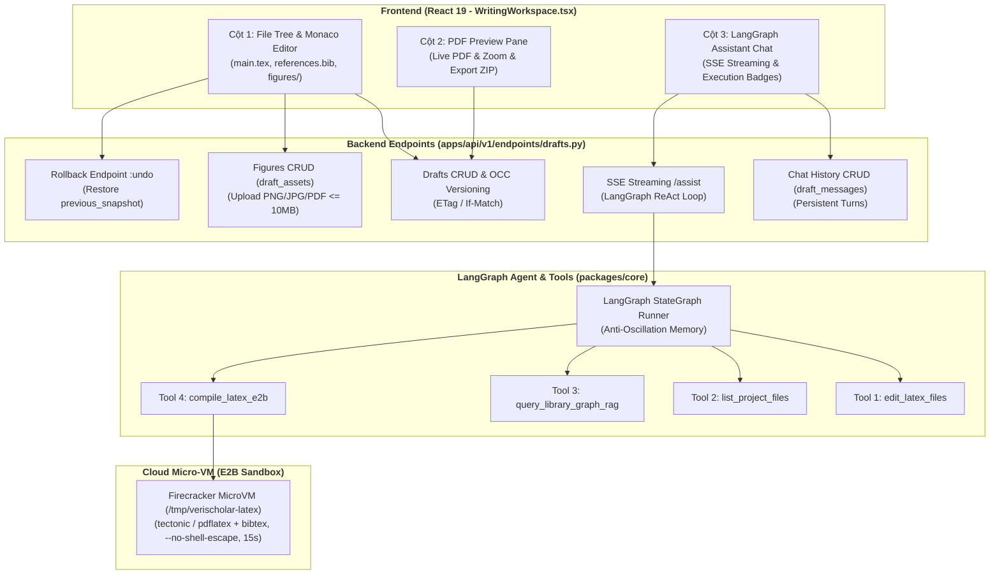
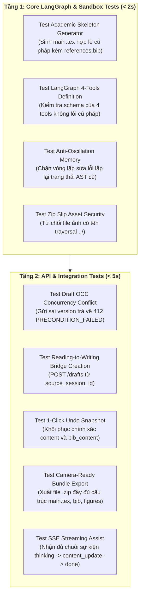

# ĐẶC TẢ KỸ THUẬT: PHÂN HỆ KHÔNG GIAN SOẠN THẢO AGENTIC OVERLEAF, LANGGRAPH AGENT & SANDBOX E2B
# (AGENTIC OVERLEAF WRITING WORKSPACE, LANGGRAPH AGENT & E2B SANDBOX SPECIFICATION)

**Trạng thái:** DỰ THẢO CHÍNH THỨC (TECHNICAL SPECIFICATION V1)  
**Nguồn tham chiếu PRD:** [`06-agentic-overleaf-writing.md`](../PRD/06-agentic-overleaf-writing.md)  
**Phân hệ kỹ thuật:** Phân Hệ Soạn Thảo & Agentic LaTeX (Writing Workspace & Agentic LaTeX)  
**File nền tảng liên đới:** [`00-foundation-architecture-and-db.md`](./00-foundation-architecture-and-db.md)

---

## 1. Usecase & Bối Cảnh Người Dùng (Real-World User Journey & Value)

### A. Usecase 1: Cầu Nối "Đọc Sang Viết" Khung Sườn Học Thuật Liền Mạch (Reading-to-Writing Bridge)
- **Bối cảnh & Vấn đề thực tế:** Khi một học giả hay sinh viên vừa hoàn thành phiên đọc sâu 3–5 bài báo trong Phân hệ Đọc Sâu, họ chuẩn bị bước vào giai đoạn viết báo cáo luận văn hoặc bài báo khoa học. Thông thường, họ phải mở Overleaf hoặc MS Word từ con số không, lên Google Scholar tìm kiếm thủ công từng đoạn mã BibTeX của từng bài báo, tạo file `references.bib`, dán vào, rồi tự gõ cấu trúc khung `\documentclass{...}`, `\section{Introduction}`, `\section{Related Work}`. Quá trình chuyển đổi thủ công này thường làm đứt gãy mạch tư duy, tốn 2–4 giờ đồng hồ và gây ra hội chứng "sợ trang giấy trắng".
- **Giải pháp của phân hệ:**
  - Trên thanh công cụ của Phiên đọc có nút **`[✍️ Bắt đầu viết bài từ phiên đọc này]`**.
  - Khi nhấp chuột, hệ thống tự động khởi tạo một bản thảo mới (`Draft`) kèm **Khung Sườn Học Thuật Chuẩn (Academic Skeleton)**:
    - **`references.bib`:** Đã nạp sẵn 100% mã trích dẫn BibTeX chuẩn (kèm citekey dạng `@article{vaswani2017attention, ...}`) của toàn bộ các bài báo trong phiên đọc.
    - **`main.tex`:** Cấu trúc bài báo LaTeX hoàn chỉnh, hợp lệ về mặt cú pháp: Tiêu đề lấy theo tên phiên đọc, các mục `\section{Introduction}`, `\section{Related Work}` (đã liệt kê sẵn các câu trích dẫn `\cite{...}` tới các bài vừa đọc), `\section{Methodology}`, `\section{Experiments}`, và `\bibliography{references}`.
    - **Bản PDF xem trước xuất hiện tức thì (< 1.5s):** Vì khung sườn là mã LaTeX chuẩn, Cột 2 hiển thị ngay bản dựng PDF đẹp mắt mà không gặp bất kỳ lỗi cú pháp nào.

### B. Usecase 2: Không Gian Soạn Thảo 3 Cột Kiểu Overleaf & Quản Lý Hình Ảnh Đa Tệp (`figures/`)
- **Bối cảnh & Vấn đề thực tế:** Bài báo khoa học chuẩn quốc tế (IEEE, ACM, Springer) bắt buộc phải có sơ đồ kiến trúc hệ thống và biểu đồ thực nghiệm đặt trong thư mục `figures/` để chèn vào văn bản qua lệnh `\includegraphics{figures/...}`. Người dùng cần một môi trường làm việc trực quan vừa có thể sửa code tay, vừa quản lý được ảnh tải lên, vừa xem trước PDF song song và vừa có AI trợ giúp.
- **Giải pháp của phân hệ:**
  - Không gian làm việc 3 cột `WritingWorkspace.tsx`:
    - **Cột 1 (Trái):** Cây thư mục dự án (chuyển đổi giữa `main.tex`, `references.bib` và danh sách ảnh `figures/` có nút `[➕ Tải ảnh lên]`), khung soạn thảo Monaco Editor có đánh số dòng, tô màu cú pháp, nút `[⚙️ Biên dịch PDF]` và nút `[↩️ Hoàn tác (Undo)]`.
    - **Cột 2 (Giữa):** Bản dựng PDF xem trước chất lượng cao (`WritingPreviewPane.tsx`) hỗ trợ phóng to/thu nhỏ và xuất gói nộp bài `.zip`.
    - **Cột 3 (Phải):** Khung hội thoại AI Agentic (`WritingAssistantPane.tsx`) lưu trữ toàn bộ lịch sử trao đổi vào CSDL.

### C. Usecase 3: Trợ Lý Agentic ReAct Tự Sửa Lỗi Biên Dịch Không Cần Can Thiệp (Zero-Click Self-Healing)
- **Bối cảnh & Vấn đề thực tế:** Ngôn ngữ LaTeX nổi tiếng là khó tính với các thông báo lỗi trừu tượng như `Missing $ inserted`, `Undefined control sequence`, `Runaway argument`, hiển thị dấu hỏi chấm `[?]` do undefined citations hoặc xung đột gói macro toán học (`Command already defined`). Người dùng không muốn phải bấm duyệt hay xác nhận từng bước trung gian. Khi gặp lỗi, họ muốn AI tự động tiếp quản, đọc log lỗi và tự sửa chữa cho đến khi biên dịch thành công.
- **Giải pháp của phân hệ:**
  - Khi người dùng bấm `[⚙️ Biên dịch PDF]` hoặc nhấn phím tắt `Ctrl+S`: E2B Sandbox MicroVM thực thi biên dịch.
  - Nếu gặp lỗi cú pháp: **LangGraph ReAct Agent** lập tức tự động tiếp quản:
    1. Tự động lưu bản chụp `previous_snapshot` trước khi sửa.
    2. Đọc log lỗi `stderr`, suy luận nguyên nhân (Reasoning).
    3. Tự động gọi công cụ `edit_latex_files` để vá code `main.tex` hoặc `references.bib` (Acting).
    4. Tự động gọi `compile_latex_e2b` để kiểm tra lại kết quả (Observation).
    5. Vòng lặp này tự động lặp lại cho đến khi biên dịch thành công ra PDF (ngân sách an toàn tối đa 3 lần thử).
  - Suốt quá trình, Cột 3 stream các bước chuyển trạng thái thời gian thực (*`⚠️ Gặp lỗi dòng 42` $\rightarrow$ `✍️ AI đang tự vá cú pháp` $\rightarrow$ `⚙️ Biên dịch lại (Lần 2/3)` $\rightarrow$ `🎉 Hoàn tất!`*). Bản dựng PDF tự động hiện lên Cột 2. Người dùng không cần bấm thêm bất kỳ thao tác nào, và nút **`[↩️ Hoàn tác]`** luôn sẵn sàng để khôi phục code gốc nếu muốn.

---

## 2. Phạm Vi & Bảng Đối Chiếu Hiện Trạng (`As-Is` vs `Delta`)

Phân hệ này chịu trách nhiệm trọn vẹn toàn bộ chu trình soạn thảo, quản lý tệp học thuật, trợ lý thông minh LangGraph và hạ tầng biên dịch LaTeX cô lập trên E2B Cloud Sandbox.



### Bảng Kiểm Kê Thành Phần Mã Nguồn
| Thành phần | Đường dẫn File | Trạng thái | Nội dung chi tiết |
|---|---|---|---|
| **API Endpoints** | [`apps/api/src/api/v1/endpoints/drafts.py`](../../apps/api/src/api/v1/endpoints/drafts.py) | **MODIFY** | Đã có CRUD cơ bản và OCC. Cần chuẩn hóa: luồng SSE unbuffered cho `/assist`, endpoint `POST :undo`, tải danh mục ảnh `figures/`, và xuất gói nộp bài chuẩn `:export-bundle`. |
| **Logic Service** | [`apps/api/src/api/services/draft_service.py`](../../apps/api/src/api/services/draft_service.py) | **MODIFY** | Tích hợp StateGraph LangGraph, cơ chế tự động lưu `previous_snapshot` trước Attempt 1, đóng gói bundle gửi sang E2B Sandbox. |
| **Model CSDL Draft** | [`apps/api/src/api/db/models/draft.py`](../../apps/api/src/api/db/models/draft.py) | **MODIFY** | Bổ sung các cột đã thiết kế ở Spec 00: `bib_content`, `source_session_id`, `pdf_preview_storage_path`, `previous_snapshot`. |
| **Model CSDL Assets** | `apps/api/src/api/db/models/draft_asset.py` | **NEW** | Bảng `draft_assets` quản lý file trong thư mục `figures/` tích hợp lưu trữ CAS. |
| **Model CSDL Messages** | `apps/api/src/api/db/models/draft_message.py` | **NEW** | Bảng `draft_messages` lưu vết lịch sử chat, các tool calls và lượt biên dịch. |
| **Compiler Service** | [`packages/core/src/core/services/latex_compiler.py`](../../packages/core/src/core/services/latex_compiler.py) | **MODIFY** | **Xóa bỏ vĩnh viễn** hàm preview giả lập PyMuPDF `_generate_in_memory_pdf_preview()`. Toàn bộ quá trình biên dịch chạy qua E2B Cloud Sandbox / binary `tectonic` thật. |
| **LangGraph Agent** | `packages/core/src/core/services/latex_agent.py` | **NEW** | Cài đặt `StateGraph` với 4 công cụ chuyên biệt và vòng lặp tự sửa lỗi ReAct (tối đa 3 lần). |
| **E2B Dockerfile** | `deploy/e2b.Dockerfile` | **NEW** | Dockerfile xây dựng Custom E2B Template chứa đầy đủ môi trường TeX Live và `tectonic`. |
| **Frontend Workspace** | `apps/web/src/features/writing/` | **MODIFY** | Tích hợp SSE unbuffered cho Cột 3, nút `[↩️ Hoàn tác]` trên HeaderBar, hiển thị cây thư mục file kèm `figures/`. |

---

## 3. Mô Hình Dữ Liệu & Ràng Buộc Kỹ Thuật (`Database Schema & Invariants`)

### A. Cập Nhật Bảng `drafts` (Bản Thảo Học Thuật)
Bảng `drafts` được nâng cấp để lưu trữ song song cả mã nguồn LaTeX và tài liệu tham khảo BibTeX:

```sql
-- DDL đã tích hợp trong ensure_database_schema()
ALTER TABLE drafts ADD COLUMN IF NOT EXISTS bib_content TEXT NOT NULL DEFAULT '';
ALTER TABLE drafts ADD COLUMN IF NOT EXISTS source_session_id UUID NULL REFERENCES research_sessions(id) ON DELETE SET NULL;
ALTER TABLE drafts ADD COLUMN IF NOT EXISTS pdf_preview_storage_path TEXT NULL;
ALTER TABLE drafts ADD COLUMN IF NOT EXISTS previous_snapshot JSONB NULL;
```

**Ràng buộc bất biến của `drafts`:**
1. **Kiểm soát đồng thời lạc quan (OCC - Optimistic Concurrency Control):** Cột `version` (INT, mặc định `1`, tăng tuần tiến `+1` sau mỗi lần ghi). Khi người dùng lưu tay hoặc Agent cập nhật, câu lệnh SQL bắt buộc kiểm tra:
   $$\text{UPDATE drafts SET version = version + 1, ... WHERE id = :id AND version = :client_version}$$
   Nếu không có dòng nào được cập nhật, trả về ngay mã lỗi `412 PRECONDITION_FAILED` (xung đột phiên bản).
2. **Snapshot Hoàn Tác Bất Biến (Undo Snapshot Guarantee):** Giá trị `previous_snapshot` phải có cấu trúc JSONB:
   ```json
   {
     "content": "\\documentclass{article}...",
     "bib_content": "@article{vaswani2017...",
     "version": 4,
     "saved_at": "2026-10-25T10:30:00Z"
   }
   ```
   Bản chụp này được ghi nhận **chính xác 1 lần duy nhất ngay trước khi Agent thực hiện lượt sửa đổi đầu tiên (Attempt 1)**. Người dùng có thể hoàn tác bất kỳ lúc nào để quay lại trạng thái trước khi AI can thiệp.

### B. Bảng Mới `draft_assets` (Quản Lý Thư Mục Hình Ảnh `figures/`)
Lưu trữ các tệp ảnh và sơ đồ minh họa đính kèm bản thảo:

```sql
CREATE TABLE IF NOT EXISTS draft_assets (
    id UUID PRIMARY KEY DEFAULT gen_random_uuid(),
    draft_id UUID NOT NULL REFERENCES drafts(id) ON DELETE CASCADE,
    user_id UUID NOT NULL REFERENCES users(id) ON DELETE CASCADE,
    filename VARCHAR(255) NOT NULL,
    mime_type VARCHAR(100) NOT NULL CHECK (mime_type IN ('image/png', 'image/jpeg', 'image/webp', 'application/pdf')),
    file_size_bytes BIGINT NOT NULL,
    blob_id UUID NULL REFERENCES document_storage_blobs(id) ON DELETE SET NULL,
    storage_path TEXT NOT NULL,
    created_at TIMESTAMPTZ NOT NULL DEFAULT NOW(),
    updated_at TIMESTAMPTZ NOT NULL DEFAULT NOW(),
    CONSTRAINT uq_draft_assets_draft_filename UNIQUE (draft_id, filename)
);

CREATE INDEX IF NOT EXISTS idx_draft_assets_user_draft ON draft_assets(user_id, draft_id);
```

**Ràng buộc bảo mật của `draft_assets`:**
- **Chống tấn công Path Traversal (Zip Slip):** Tên file `filename` phải được kiểm tra qua regex `^[a-zA-Z0-9_\-\.]+$`, nghiêm cấm chứa ký tự `..`, `/` hoặc `\`.
- **Hạn mức dung lượng:** Tối đa `10MB` cho mỗi file tải lên; tổng dung lượng thư mục `figures/` của một bản thảo không vượt quá `50MB`.

### C. Bảng Mới `draft_messages` (Lịch Sử Hội Thoại Agent Soạn Thảo)
Lưu trữ hội thoại Cột 3 để bảo toàn mạch làm việc khi người dùng tải lại trang:

```sql
CREATE TABLE IF NOT EXISTS draft_messages (
    id UUID PRIMARY KEY DEFAULT gen_random_uuid(),
    draft_id UUID NOT NULL REFERENCES drafts(id) ON DELETE CASCADE,
    user_id UUID NOT NULL REFERENCES users(id) ON DELETE CASCADE,
    role VARCHAR(20) NOT NULL CHECK (role IN ('user', 'assistant', 'tool')),
    content TEXT NOT NULL,
    tool_calls JSONB NULL,
    compile_attempts SMALLINT NOT NULL DEFAULT 0,
    trace_id VARCHAR(64) NULL,
    created_at TIMESTAMPTZ NOT NULL DEFAULT NOW()
);

CREATE INDEX IF NOT EXISTS idx_draft_messages_user_draft_time ON draft_messages(user_id, draft_id, created_at);
```

---

## 4. Hợp Đồng API REST & Luồng Streaming SSE (API & SSE Contracts)

### A. Khởi Tạo Bản Thảo Từ Phiên Đọc (`POST /api/v1/drafts`)
- **Request Body:**
  ```json
  {
    "title": "Nghiên cứu ứng dụng Transformer trong xử lý ảnh",
    "template": "academic_skeleton",
    "source_session_id": "9b1deb4d-3b7d-4bad-9bdd-2b0d7b3dcb6d"
  }
  ```
- **Xử lý Backend:**
  1. Truy vấn danh sách tài liệu từ `session_documents` của `source_session_id`.
  2. Tự động sinh nội dung `references.bib` từ metadata của các bài báo trong phiên đọc.
  3. Tự động sinh `main.tex` theo mẫu Khung Sườn Học Thuật Chuẩn: điền tiêu đề bài báo, tạo sẵn các mục `\section{Introduction}`, `\section{Related Work}` chứa các lệnh trích dẫn `\cite{...}` tới các bài báo tương ứng.
  4. Trả về mã `HTTP 201 Created` kèm `ETag: "v1"`.

### B. Hoàn Tác Thay Đổi Của AI (`POST /api/v1/drafts/{id}:undo`)
- **Mục đích:** Khôi phục mã nguồn `main.tex` và `references.bib` về trạng thái trước khi Agent thực hiện chỉnh sửa gần nhất.
- **Phản hồi `HTTP 200 OK`:**
  ```json
  {
    "success": true,
    "data": {
      "id": "draft-uuid",
      "title": "Nghiên cứu ứng dụng Transformer...",
      "content": "\\documentclass{article}...",
      "bib_content": "@article{...",
      "version": 5,
      "pdf_preview_url": "/api/v1/drafts/draft-uuid/preview.pdf"
    }
  }
  ```

### C. Biên Dịch Đơn Bản Thảo (`POST /api/v1/drafts/{id}/compile`)
- **Mục đích:** Biên dịch bản thảo trên E2B Sandbox MicroVM. Nếu phát hiện lỗi cú pháp, tự động kích hoạt vòng lặp ReAct tự vá lỗi (tối đa 3 lần).
- **Phản hồi `HTTP 200 OK`:**
  ```json
  {
    "success": true,
    "data": {
      "draft_id": "draft-uuid",
      "success": true,
      "pdf_preview_url": "/api/v1/drafts/draft-uuid/preview.pdf",
      "errors": [],
      "logs": "Output written on document.pdf (1 page)...",
      "retries_attempted": 1,
      "is_sandboxed": true
    }
  }
  ```

### D. Tương Tác Agentic Streaming Unbuffered (`POST /api/v1/drafts/{id}/assist`)
- **Request Body:**
  ```json
  {
    "prompt": "Hãy viết chi tiết mục Related Work so sánh các phương pháp Attention với Convolution từ các bài báo trong kho thư viện.",
    "current_content": "\\documentclass{article}...",
    "current_bib_content": "@article{...",
    "version": 2
  }
  ```
- **Định dạng luồng SSE (`Content-Type: text/event-stream`):**
  ```text
  event: thinking
  data: {"message": "🔍 Đang tra cứu thông tin phương pháp từ Kho GraphRAG..."}

  event: tool_call
  data: {"name": "query_library_graph_rag", "args": {"query": "Attention vs Convolution"}}

  event: tool_result
  data: {"name": "query_library_graph_rag", "count": 3}

  event: thinking
  data: {"message": "✍️ Đang cập nhật main.tex và bổ sung trích dẫn vào references.bib..."}

  event: content_update
  data: {"target_file": "main.tex", "patch_type": "full", "content": "...", "bib_content": "...", "new_version": 3}

  event: compile_status
  data: {"attempt": 1, "success": false, "message": "Missing \\end{equation} tại dòng 35. Đang tự động vá..."}

  event: compile_status
  data: {"attempt": 2, "success": true, "message": "Biên dịch thành công tại lần thử 2."}

  event: done
  data: {"pdf_preview_url": "/api/v1/drafts/draft-uuid/preview.pdf", "final_message": "Đã hoàn thành mục Related Work và biên dịch thành công ra PDF."}
  ```

### E. CRUD Thư Mục Hình Ảnh (`figures/`)
- `POST /api/v1/drafts/{id}/assets`: Tải file ảnh (`multipart/form-data`). File được lưu vào kho CAS và đăng ký vào bảng `draft_assets`.
- `GET /api/v1/drafts/{id}/assets`: Lấy danh sách ảnh hiện có (tên file, dung lượng, URL xem trước).
- `DELETE /api/v1/drafts/{id}/assets/{asset_id}`: Xóa ảnh khỏi bản thảo (giảm `ref_count` trong CAS).

### F. Xuất Gói Nộp Bài Học Thuật (`POST /api/v1/drafts/{id}:export-bundle`)
- Đóng gói file nén `.zip` đạt chuẩn nộp bài cho các hội nghị quốc tế (Camera-Ready Academic Bundle):
  - `main.tex`: Mã nguồn LaTeX chính.
  - `references.bib`: Danh mục trích dẫn BibTeX hoàn chỉnh.
  - `figures/`: Thư mục chứa toàn bộ hình ảnh đính kèm của bản thảo.
  - `preview.pdf`: File PDF chất lượng cao đã biên dịch thành công (nếu có).
  - `README.txt`: Hướng dẫn tái lập kết quả biên dịch và danh sách các gói phụ thuộc.
- **Cơ chế Fallback Linh Hoạt (Không Chặn Người Dùng):**
  - Hệ thống tự động kích hoạt 1 lượt biên dịch E2B trước khi nén zip.
  - Nếu mã nguồn có lỗi cú pháp và chưa thể tạo ra file PDF, hệ thống **tuyệt đối không chặn hoặc báo lỗi HTTP**, mà vẫn xuất trọn vẹn gói `.zip` chứa toàn bộ `main.tex`, `references.bib`, và thư mục `figures/`. File `README.txt` sẽ ghi rõ: *"Bản thảo chưa được biên dịch thành công lần cuối, vui lòng chạy tectonic hoặc pdflatex theo hướng dẫn bên dưới để kiểm tra lỗi cú pháp."* Giúp học giả luôn nắm toàn quyền sở hữu và tải về mã nguồn của mình bất cứ lúc nào.

---

### G. Ma Trận Mã Lỗi Chuẩn Hóa (Deterministic Error Codes Matrix)

Bảng ma trận dưới đây quy định toàn bộ các mã lỗi tất định của Phân hệ Soạn Thảo & Agentic LaTeX, đảm bảo bất kỳ mô hình AI hoặc lập trình viên nào cũng có thể cài đặt logic xử lý lỗi chính xác 100% mà không bị sai lệch:

| HTTP Status | Mã Lỗi (`error_code`) | Điều Kiện Kích Hoạt (Trigger Condition) | Thông Điệp Tiếng Việt Chuẩn Hóa (`message`) | Trường Lỗi (`field`) & Hành Động Khắc Phục (`action`) |
| :--- | :--- | :--- | :--- | :--- |
| `400 Bad Request` | `INVALID_DRAFT_TITLE` | Tiêu đề bản thảo rỗng, chỉ chứa khoảng trắng hoặc vượt quá 255 ký tự | `"Tiêu đề bản thảo không hợp lệ. Vui lòng nhập từ 1 đến 255 ký tự."` | `field: "title"` — Nhập tiêu đề bản thảo hợp lệ. |
| `400 Bad Request` | `INVALID_ASSET_FILENAME` | Tên file ảnh chứa ký tự điều khiển, dấu phân cách đường dẫn (`..`, `/`, `\`) vi phạm quy tắc an toàn Path Traversal / Zip Slip | `"Tên tệp hình ảnh không hợp lệ. Chỉ chấp nhận chữ cái, số, dấu gạch dưới, gạch ngang và dấu chấm."` | `field: "filename"` — Đổi tên file theo quy chuẩn an toàn. |
| `400 Bad Request` | `UNSUPPORTED_ASSET_MIME_TYPE` | Tải lên file vào `figures/` có MIME type ngoài danh mục `image/png`, `image/jpeg`, `image/webp`, `application/pdf` | `"Định dạng tệp không được hỗ trợ. Chỉ chấp nhận PNG, JPEG, WebP hoặc PDF vector."` | `field: "file"` — Chọn tệp đúng định dạng cho phép. |
| `400 Bad Request` | `ASSET_FILE_TOO_LARGE` | Dung lượng của một tệp ảnh tải lên vượt quá giới hạn đơn tệp `10MB` | `"Dung lượng tệp hình ảnh vượt quá giới hạn cho phép (tối đa 10MB/tệp)."` | `field: "file"` — Giảm dung lượng ảnh hoặc nén trước khi tải. |
| `400 Bad Request` | `DRAFT_ASSETS_QUOTA_EXCEEDED` | Tổng dung lượng các tệp trong thư mục `figures/` của bản thảo vượt quá hạn mức `50MB` | `"Tổng dung lượng thư mục hình ảnh của bản thảo vượt quá hạn mức cho phép (tối đa 50MB)."` | `field: "figures"` — Xóa bớt hình ảnh cũ không sử dụng trong bản thảo. |
| `400 Bad Request` | `EMPTY_PROMPT_CONTENT` | Yêu cầu prompt gửi tới trợ lý Agent qua endpoint `/assist` rỗng hoặc chỉ chứa khoảng trắng | `"Yêu cầu gửi tới trợ lý AI không được để trống."` | `field: "prompt"` — Nhập nội dung chỉ dẫn soạn thảo cụ thể. |
| `401 Unauthorized` | `AUTH_TOKEN_INVALID` | Token JWT thiếu trong header `Authorization`, hết hạn hoặc chữ ký không hợp lệ | `"Phiên làm việc đã hết hạn hoặc không hợp lệ. Vui lòng đăng nhập lại."` | `field: null` — Điều hướng về trang đăng nhập hoặc làm mới token. |
| `403 Forbidden` | `DRAFT_ACCESS_DENIED` | Người dùng cố tình truy cập hoặc chỉnh sửa bản thảo thuộc quyền sở hữu của tài khoản khác | `"Bạn không có quyền thao tác trên bản thảo này."` | `field: null` — Chỉ thao tác trên các bản thảo cá nhân. |
| `404 Not Found` | `DRAFT_NOT_FOUND` | `draft_id` không tồn tại trong hệ thống hoặc không thuộc về người dùng (ID Enumeration Defense) | `"Không tìm thấy bản thảo nghiên cứu yêu cầu."` | `field: "id"` — Kiểm tra ID bản thảo từ danh mục hợp lệ. |
| `404 Not Found` | `DRAFT_ASSET_NOT_FOUND` | `asset_id` không tồn tại trong thư mục `figures/` của bản thảo này | `"Không tìm thấy tệp hình ảnh đính kèm yêu cầu."` | `field: "asset_id"` — Kiểm tra danh mục hình ảnh của bản thảo. |
| `404 Not Found` | `SOURCE_SESSION_NOT_FOUND` | `source_session_id` khi tạo bản thảo từ phiên đọc không tồn tại hoặc không thuộc quyền sở hữu của người dùng | `"Không tìm thấy phiên nghiên cứu nguồn tương ứng."` | `field: "source_session_id"` — Chọn phiên nghiên cứu nguồn hợp lệ. |
| `409 Conflict` | `DUPLICATE_ASSET_FILENAME` | Tải lên file ảnh có tên trùng với một file ảnh đã tồn tại trong thư mục `figures/` của bản thảo | `"Tên tệp hình ảnh đã tồn tại trong dự án. Vui lòng đổi tên hoặc xóa tệp cũ trước."` | `field: "filename"` — Đổi tên file hoặc ghi đè có chủ đích. |
| `409 Conflict` | `NO_UNDO_SNAPSHOT_AVAILABLE` | Người dùng gọi `POST :undo` khi chưa từng có thao tác sửa đổi nào của AI hoặc `previous_snapshot` là null | `"Không có bản sao lưu trước đó để thực hiện thao tác hoàn tác."` | `field: null` — Nút hoàn tác chỉ khả dụng sau khi AI đã can thiệp. |
| `412 Precondition Failed` | `DRAFT_CONCURRENCY_CONFLICT` | Phiên bản `version` (hoặc `If-Match` ETag) từ client gửi lên không khớp với phiên bản hiện tại trong CSDL do có cập nhật đồng thời (OCC) | `"Bản thảo đã bị sửa đổi bởi một phiên làm việc khác. Vui lòng tải lại trang để cập nhật phiên bản mới nhất."` | `field: "version"` — Nạp lại bản thảo mới nhất và áp dụng lại thay đổi. |
| `422 Unprocessable Entity` | `LATEX_COMPILATION_TIMEOUT` | Quá trình biên dịch trong E2B Sandbox MicroVM vượt quá giới hạn thời gian an toàn `15 giây` (do hình ảnh quá nặng hoặc macro lồng nhau) | `"Thời gian biên dịch bản thảo vượt quá giới hạn an toàn 15 giây. Vui lòng tối ưu hóa hình ảnh hoặc kiểm tra vòng lặp macro."` | `field: null` — Giảm độ phân giải hình ảnh hoặc kiểm tra lại lệnh macro. |
| `422 Unprocessable Entity` | `LATEX_SELF_HEAL_EXHAUSTED` | Vòng lặp ReAct tự sửa lỗi biên dịch đã dùng hết ngân sách 3 lần thử mà mã nguồn vẫn còn lỗi cú pháp không thể xuất PDF | `"AI đã thử tự vá lỗi 3 lần nhưng chưa thể giải quyết triệt để lỗi cú pháp. Vui lòng kiểm tra nhật ký lỗi để xử lý thủ công."` | `field: null` — Mở nhật ký lỗi chi tiết để chỉnh sửa thủ công dòng bị lỗi. |
| `503 Service Unavailable` | `SANDBOX_SERVICE_UNAVAILABLE` | Dịch vụ E2B Sandbox MicroVM không thể khởi tạo, quá tải hoặc mất kết nối mạng | `"Hạ tầng biên dịch đám mây tạm thời không khả dụng. Vui lòng thử lại sau giây lát."` | `field: null` — Thử lại sau ít phút khi sandbox phục hồi. |

**Cấu Trúc Phong Bì Phản Hồi Lỗi Chuẩn (`ErrorResponse`):**
```json
{
  "success": false,
  "error": {
    "code": "DRAFT_CONCURRENCY_CONFLICT",
    "message": "Bản thảo đã bị sửa đổi bởi một phiên làm việc khác. Vui lòng tải lại trang để cập nhật phiên bản mới nhất.",
    "field": "version",
    "action": "Nạp lại bản thảo mới nhất và áp dụng lại thay đổi."
  },
  "meta": {
    "request_id": "req_89c2de0192ab",
    "trace_id": "trace-draft-89c2"
  }
}
```

---

## 5. Kiến Trúc LangGraph Agent & Vòng Lặp ReAct Tự Vá Lỗi

Agent soạn thảo được xây dựng dựa trên `StateGraph` của **LangGraph** theo mô hình **ReAct (Reasoning + Acting)** với bộ 4 công cụ (Tools) chuyên trách:

```mermaid
flowchart TD
    Start([Bắt đầu yêu cầu từ Cột 3]) --> SaveSnapshot[Lưu previous_snapshot nếu chưa lưu]
    SaveSnapshot --> AgentReasoning[Agent Reasoning Node: Suy luận kế hoạch & Chọn Tool]
    
    AgentReasoning -->|Cần dữ liệu bài báo| CallGraphRAG[Tool: query_library_graph_rag]
    AgentReasoning -->|Cần kiểm tra file ảnh| CallListFiles[Tool: list_project_files]
    AgentReasoning -->|Cần cập nhật văn bản| CallEdit[Tool: edit_latex_files]
    AgentReasoning -->|Cần kiểm tra bản dựng| CallCompile[Tool: compile_latex_e2b]
    
    CallGraphRAG --> AgentReasoning
    CallListFiles --> AgentReasoning
    CallEdit --> AgentReasoning
    
    CallCompile --> CheckCompile{Biên dịch thành công?}
    CheckCompile -->|Thành công (exit_code=0)| EmitSuccess[Emit PDF mới & Trả kết quả hoàn tất]
    CheckCompile -->|Thất bại & attempts < 3| SelfHeal[Node Self-Healing: Đọc stderr & Lập kế hoạch vá lỗi]
    CheckCompile -->|Thất bại & attempts >= 3| GracefulFail[Dừng vòng lặp: Báo cáo số dòng lỗi & Cách sửa cho người dùng]
    
    SelfHeal --> CallEdit
    EmitSuccess --> Done([Kết thúc])
    GracefulFail --> Done
```

### A. Chi Tiết 4 Công Cụ (Tools) Chuyên Biệt
1. **`edit_latex_files(target_file: str, content: str)`**:
   - Tham số: `target_file` (`"main.tex"` hoặc `"references.bib"`), `content` (nội dung mới).
   - Chức năng: Cập nhật nội dung mã nguồn trong bộ nhớ state và lưu xuống CSDL với OCC an toàn.
2. **`list_project_files()`**:
   - Trả về danh sách cấu trúc cây thư mục dự án: `main.tex`, `references.bib`, và danh sách tên chính xác của các file ảnh trong `figures/` (ví dụ: `figures/architecture_diagram.png`). Giúp Agent viết chính xác câu lệnh `\includegraphics{figures/...}` không bao giờ bị lỗi sai tên file.
3. **`query_library_graph_rag(query: str, top_k: int = 5)`**:
   - Gọi trực tiếp phân hệ GraphRAG (Spec 05) để tìm kiếm các phương pháp, bộ dữ liệu và kết quả thực nghiệm từ kho bài báo yêu thích của người dùng để viết phần Tổng quan hoặc So sánh phương pháp.
4. **`compile_latex_e2b()`**:
   - Đóng gói toàn bộ `main.tex`, `references.bib` và toàn bộ hình ảnh trong thư mục `figures/` từ bảng `draft_assets`.
   - Đẩy file lên thư mục `/tmp/verischolar-latex/` của E2B Sandbox MicroVM.
   - Thực thi trình biên dịch `tectonic --untrusted --outdir /tmp/verischolar-latex main.tex` (hoặc chuỗi lệnh `pdflatex -> bibtex -> pdflatex -> pdflatex` với cờ bắt buộc `--no-shell-escape` và giới hạn cứng `timeout = 15 giây`).
   - Trả về kết quả: `success: bool`, `logs: str`, `errors: list[LatexSyntaxError]`.

### B. Triệt Tiêu Hoàn Toàn Trình Xem Trước Giả Lập (Deprecation Notice)
> [!CAUTION]
> **Xóa Bỏ Vĩnh Viễn Hàm Preview PyMuPDF Giả Lập:**  
> Toàn bộ logic tại hàm `_generate_in_memory_pdf_preview()` trong file `packages/core/src/core/services/latex_compiler.py` (vốn cắt bỏ `\section{...}` và vẽ text thô) bị **xóa bỏ hoàn toàn**. Mọi bản dựng xem trước PDF phải là sản phẩm biên dịch thực thụ từ E2B Sandbox để đảm bảo công thức toán, bảng biểu và hình ảnh hiển thị chuẩn xác 100%.

---

## 6. Thiết Kế Giao Diện & Tương Tác Frontend (`apps/web`)

Giao diện Không gian Soạn thảo được tổ chức tại [`WritingWorkspace.tsx`](../../apps/web/src/features/writing/components/WritingWorkspace.tsx) với 3 cột thích ứng:

| Khu Vực | Component Phụ Trách | Hành Vi & Tương Tác Người Dùng |
|---|---|---|
| **Cột 1 (Trái)** | `WritingSidebar.tsx`<br>`WritingEditorPane.tsx` | • Cây thư mục hiển thị `main.tex`, `references.bib`, và thư mục `figures/` (kèm nút `[➕ Tải ảnh lên]`). Bấm vào tên ảnh sẽ tự chèn đoạn code `\begin{figure}...` vào editor.<br>• Monaco Editor tô màu cú pháp, tự động khóa nhẹ khi AI đang cập nhật (`AI đang biên dịch và tự vá lỗi...`).<br>• Nút **`[↩️ Hoàn tác (Undo)]`** sáng lên ngay sau khi AI sửa file để người dùng lùi về bản trước đó chỉ với 1 click. |
| **Cột 2 (Giữa)** | `WritingPreviewPane.tsx` | • Hiển thị bản dựng PDF trả về từ E2B Sandbox qua URL blob hoặc nhị phân.<br>• Công cụ phóng to, thu nhỏ, cuộn trang mượt mà và nút tải trực tiếp file PDF về máy. |
| **Cột 3 (Phải)** | `WritingAssistantPane.tsx` | • Lịch sử trao đổi với LangGraph Agent được lưu bền vững vào `draft_messages`.<br>• Hiển thị trực quan từng huy hiệu trạng thái execution badges theo thời gian thực (*`🔍 Tra cứu GraphRAG` $\rightarrow$ `✍️ Cập nhật main.tex` $\rightarrow$ `⚙️ Biên dịch E2B Lần 1/3`*).<br>• Nút **`[🔄 Làm mới đoạn chat]`** giúp dọn dẹp lịch sử trò chuyện mà không ảnh hưởng đến mã nguồn bài báo. |

---

## 7. Tập Tin Neo Tham Chiếu Trong Codebase (Codebase Anchors)

Mọi thay đổi kỹ thuật của phân hệ Soạn Thảo & Agentic LaTeX phải tuân thủ và tham chiếu từ các tệp sau:

| Vai trò kiến trúc | Tệp neo chuẩn mực trong repo | Nguyên tắc bắt chước |
| :--- | :--- | :--- |
| **Drafts Endpoints** | [`apps/api/src/api/v1/endpoints/drafts.py`](../../apps/api/src/api/v1/endpoints/drafts.py) | Tham chiếu CRUD bản thảo, OCC ETag/If-Match, endpoint `:undo` và `:export-bundle`. |
| **Draft Logic Service** | [`apps/api/src/api/services/draft_service.py`](../../apps/api/src/api/services/draft_service.py) | Tham chiếu cách điều phối StateGraph LangGraph, quản trị snapshot và đóng gói bundle gửi sang E2B Sandbox. |
| **LaTeX Compiler Service** | [`packages/core/src/core/services/latex_compiler.py`](../../packages/core/src/core/services/latex_compiler.py) | Biên dịch thực tế qua binary `tectonic` hoặc E2B Cloud Sandbox (loại bỏ hoàn toàn giả lập PyMuPDF). |
| **LangGraph Agent & Tools** | `packages/core/src/core/services/latex_agent.py` | Cài đặt `StateGraph` với 4 công cụ chuyên biệt và vòng lặp tự sửa lỗi ReAct (tối đa 3 lần). |
| **Writing Workspace UI** | `apps/web/src/features/writing/components/WritingWorkspace.tsx` | Không gian làm việc 3 cột (Quản lý file & Editor, Preview PDF, Assistant Chat). |

---

## 8. Ma Trận Kiểm Thử TDD Bắt Buộc (Writing & LangGraph TDD Matrix)

Mọi thay đổi kỹ thuật thuộc Phân hệ Soạn thảo & Agentic LaTeX phải vượt qua đầy đủ các kịch bản kiểm thử tự động sau:



| Tên Test Case | File Kiểm Thử | Mục tiêu kiểm chứng | Kỳ vọng nghiệm thu |
|---|---|---|---|
| `test_academic_skeleton_generation` | `packages/core/tests/test_draft_skeleton.py` | Tạo draft từ danh sách 3 papers | `main.tex` chứa đúng 3 citekey, `references.bib` hợp lệ cú pháp. |
| `test_asset_security_filename_sanitization` | `packages/core/tests/test_draft_asset_security.py` | Tải lên file ảnh có tên `../../etc/passwd` | Ném lỗi `ZipSlipSecurityError`, mã HTTP `400 BAD REQUEST`. |
| `test_draft_occ_optimistic_locking` | `apps/api/tests/test_drafts_occ.py` | 2 requests cùng sửa version 1 đồng thời | Request 1 thành công (version 2), Request 2 nhận mã lỗi `412`. |
| `test_reading_to_writing_bridge_endpoint` | `apps/api/tests/test_drafts_bridge.py` | Gọi `POST /api/v1/drafts` kèm `source_session_id` | Tạo draft thành công, liên kết `source_session_id`, `version=1`. |
| `test_undo_snapshot_lifecycle` | `apps/api/tests/test_drafts_undo.py` | Sửa draft qua AI rồi gọi `POST :undo` | Khôi phục nguyên vẹn nội dung ban đầu, `version` tăng tuần tiến. |
| `test_export_submission_bundle_zip` | `apps/api/tests/test_drafts_export.py` | Gọi `POST /api/v1/drafts/{id}:export-bundle` | Trả về stream `.zip` chứa đủ `main.tex`, `references.bib`, `figures/`. |
| `test_assist_sse_event_stream_unbuffered` | `apps/api/tests/test_drafts_assist_sse.py` | Gửi prompt vào endpoint `/assist` | Nhận stream SSE chuẩn định dạng, kết thúc bằng event `done`. |

---

## 9. Tiêu Chí Nghiệm Thu Kỹ Thuật (Definition of Done)

- [ ] Phân hệ có tên định danh rõ ràng là **Phân Hệ Soạn Thảo & Agentic LaTeX (Writing Workspace & Agentic LaTeX)**, không dùng số thứ tự định danh trong nội dung tài liệu.
- [ ] Phần **Usecase & Bối Cảnh Người Dùng** được đặt ngay tại Mục 1 ở đầu file, mô tả đầy đủ 3 kịch bản: Cầu nối Khung sườn học thuật, Quản lý ảnh `figures/`, và Vòng lặp ReAct tự sửa lỗi biên dịch tự trị.
- [ ] Cầu nối từ Đọc sang Viết tự động khởi tạo sẵn `main.tex` và `references.bib` hợp lệ 100% cú pháp, hiển thị bản dựng PDF xem trước tức thì trên Cột 2 mà không gặp lỗi.
- [ ] Xóa bỏ vĩnh viễn hàm preview giả lập PyMuPDF `_generate_in_memory_pdf_preview()`.
- [ ] Cơ chế `previous_snapshot` ghi nhận bản chụp trước Attempt 1 và endpoint `:undo` khôi phục an toàn trong 1 click.
- [ ] Toàn bộ các mã lỗi trong Ma trận Mã Lỗi Chuẩn Hóa Mục 4.G được cài đặt đầy đủ theo chuẩn Error Envelope.
- [ ] Toàn bộ 7 bài test trong Ma trận TDD Mục 8 đạt trạng thái `100% PASS` trên môi trường kiểm thử.
