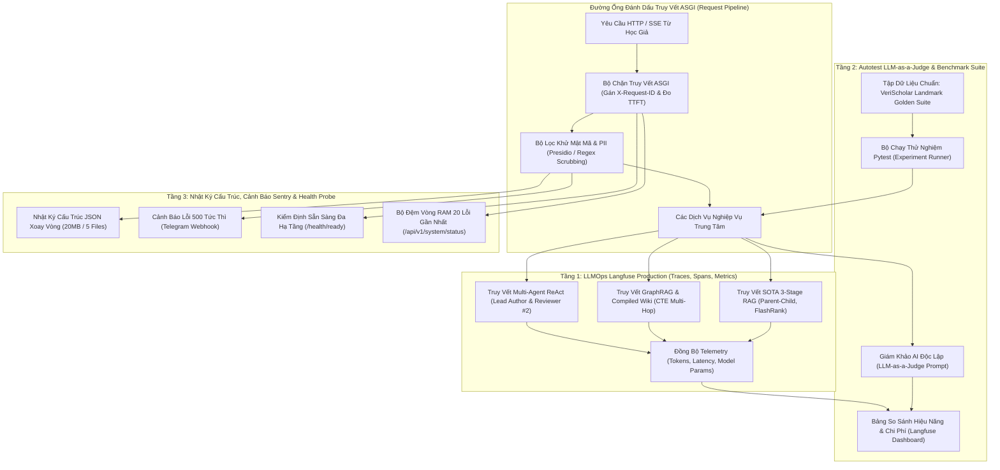
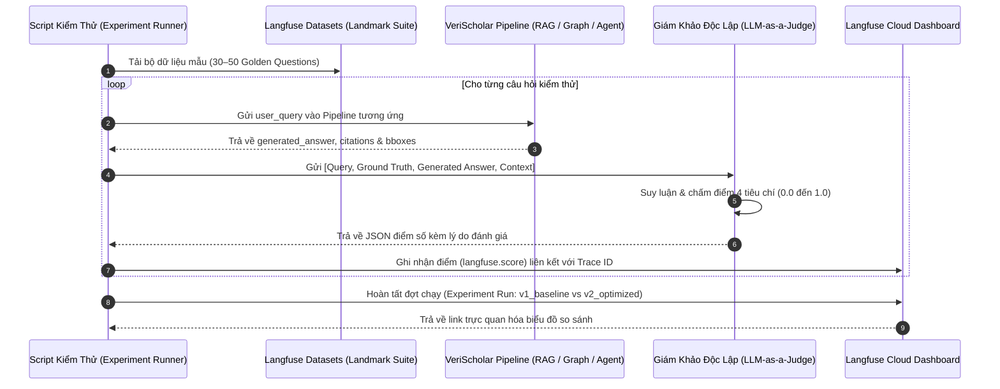
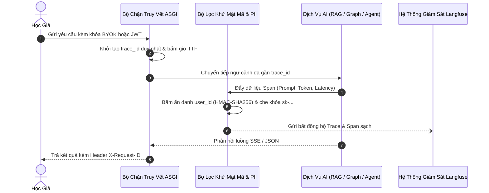

# ĐẶC TẢ KỸ THUẬT: PHÂN HỆ GIÁM SÁT, LLMOPS LANGFUSE & ĐÁNH GIÁ LLM-AS-A-JUDGE
# (SYSTEM MONITORING, PRODUCTION LLMOPS, SENTRY ALERTING & BENCHMARK EVALUATION SPECIFICATION)

**Trạng thái:** DỰ THẢO CHÍNH THỨC (TECHNICAL SPECIFICATION V1)  
**Nguồn tham chiếu PRD:** [`07-monitoring-and-langfuse.md`](../PRD/07-monitoring-and-langfuse.md)  
**Phân hệ kỹ thuật:** Phân Hệ Giám Sát & Vận Hành (Monitoring, LLMOps & Evaluation)  
**File nền tảng liên đới:** [`00-foundation-architecture-and-db.md`](./00-foundation-architecture-and-db.md), [`03-sessions-and-deep-reading-spec.md`](./03-sessions-and-deep-reading-spec.md), [`05-favorite-library-and-graphrag-spec.md`](./05-favorite-library-and-graphrag-spec.md), [`06-agentic-overleaf-writing-spec.md`](./06-agentic-overleaf-writing-spec.md)

---

## 1. Usecase & Bối Cảnh Người Dùng (Real-World User Journey & Value)

### A. Usecase 1: Tinh Tế & An Tâm Với Bắt Lỗi Toàn Trình (Seamless User Error Experience & Zero-Effort Debugging)
- **Bối cảnh & Vấn đề thực tế:** Khi hệ thống gặp sự cố (ví dụ: mất kết nối tạm thời tới API ngoài hoặc tài liệu PDF bị lỗi cấu trúc font), hiển thị một chuỗi mã lỗi kỹ thuật thô như `HTTP 500: tr_9c1fa8fe` to tướng trên màn hình sẽ khiến học giả hoang mang, có cảm giác ứng dụng bị vỡ và thiếu chuyên nghiệp. Ngược lại, nếu chỉ hiện chung chung "Đã có lỗi xảy ra", lập trình viên sẽ không thể nào tìm ra dòng code gây lỗi khi người dùng phản ánh.
- **Giải pháp của phân hệ:**
  - **Giao diện người dùng thanh lịch:** Màn hình chỉ hiển thị thông điệp tiếng Việt thân thiện kèm giải pháp khắc phục:
    > *"Hệ thống tạm thời chưa thể trích xuất đoạn văn này. Vui lòng bấm [Thử lại] sau giây lát."*  
    > *(Mã tham chiếu: `#9c1f` — chỉ là một dòng chữ xám mờ tinh tế ở góc dưới để người dùng đính kèm nếu gửi yêu cầu hỗ trợ).*
  - **Lập trình viên không cần bắt người dùng chép mã:** Mã `trace_id` được liên kết tự động với `user_id` và email của họ dưới tầng Middleware. Khi người dùng báo lỗi, quản trị viên chỉ cần tìm theo email trên Langfuse hoặc Sentry, hoặc mở danh sách 20 lỗi gần nhất: **toàn bộ câu hỏi, model AI nào phản hồi, và dòng code bị gãy đều hiện ra ngay lập tức trong 3 giây.**

### B. Usecase 2: Báo Động Tức Thì Qua Webhook Khi Có Sự Cố Nghiêm Trọng (Instant Telegram/Discord Alerting)
- **Bối cảnh & Vấn đề thực tế:** Dự án được triển khai lên máy chủ VPS đơn. Vào ban đêm hoặc lúc người vận hành đang làm việc khác, database PostgreSQL có thể bị đầy RAM, Redis bị crash, hoặc tài khoản E2B/OpenAI hết hạn/hết tiền. Toàn bộ người dùng truy cập web đều bị lỗi 500 nhưng người vận hành hoàn toàn không hay biết cho đến khi nhận hàng loạt phàn nàn.
- **Giải pháp của phân hệ:**
  - Tầng cảnh báo lỗi tự động: Bất cứ khi nào xuất hiện lỗi `500 Internal Server Error` hoặc lỗi sập kết nối dịch vụ trên môi trường `production`, hệ thống tự động bắn một tin nhắn cảnh báo ngắn gọn vào kênh Telegram/Discord cá nhân:
    > *"🚨 [ALERT] VeriScholar Production gặp lỗi 500!*  
    > *Đường dẫn: POST /api/v1/drafts/compile*  
    > *Nguyên nhân: Connection to E2B timed out (quá hạn 15s)*  
    > *Mã tra cứu: tr_a7f9b12 — Thời gian: 2026-10-25 10:45:00Z"*
  - Áp dụng cơ chế bắn bất đồng bộ ngầm (**Fire-and-Forget** qua `asyncio.create_task` với timeout 3s) để không làm chậm trễ thời gian phản hồi HTTP của người dùng.

### C. Usecase 3: Đo Lường Chi Phí AI & Kiểm Soát Chất Lượng Bounding Box (Cost & Quality Observability via Langfuse)
- **Bối cảnh & Vấn đề thực tế:** Khi mở hệ thống cho người dùng trải nghiệm, tài khoản OpenAI bị trừ tiền nhanh chóng mà không rõ tính năng nào (Đọc tài liệu RAG, Tìm kiếm Exa, hay AI viết bài LaTeX) đang tiêu tốn nhiều token nhất. Người vận hành cũng không thể biết câu trả lời của AI có thực sự trích dẫn đúng bài báo (có Bounding Box vàng) hay đang "chém gió" gây mất uy tín khoa học.
- **Giải pháp của phân hệ:**
  - Toàn bộ luồng thực thi AI được đẩy lên **Langfuse Cloud** (phân định rõ `verischolar-dev` và `verischolar-prod`).
  - Đo lường chi tiết chi phí USD, thời gian phản hồi (TTFB/Latency), số lượng token input/output và reasoning tokens cho từng lượt query.
  - Theo dõi 4 chỉ số chất lượng học thuật cốt lõi:
    1. `bbox_grounded` (`1.0` hoặc `0.0`): Câu trả lời có trích xuất được tọa độ Bounding Box vàng bảo chứng hay không.
    2. `citations_count` (số nguyên $\ge 0$): Số lượng trích dẫn khoa học hợp lệ gắn kèm câu trả lời.
    3. `e2b_compile_attempts` (`1`, `2`, `3` hoặc `0`): Số lượt thử cần thiết để biên dịch thành công bài báo LaTeX.
    4. `user_feedback` (`1.0` = 👍, `0.0` = 👎): Đánh giá trực tiếp của người dùng tại chân mỗi câu trả lời.

### D. Usecase 4: Giám Sát Sức Khỏe & Hiệu Năng Hệ Thống Trong 1 Nốt Nhạc (Deep Health Ping & In-Memory Metrics)
- **Bối cảnh & Vấn đề thực tế:** Để kiểm tra máy chủ VPS có ổn định không, lập trình viên thường phải mở terminal gõ các lệnh phức tạp như `docker ps`, `free -m`, `psql`.
- **Giải pháp của phân hệ:**
  - `GET /health/ready`: Deep-ping kiểm tra đồng thời PostgreSQL 16+ `pgvector`, Redis 7, ổ đĩa lưu file CAS `storage/blobs/`, OpenAI và E2B. Link này có thể gắn trực tiếp vào dịch vụ miễn phí UptimeRobot để tự động báo động khi máy chủ sập nguồn.
  - `GET /api/v1/system/status`: Mở trình duyệt lên là thấy ngay: thời gian máy chủ đã chạy liên tục (`uptime`), tỷ lệ request thành công (`2xx`/`4xx`/`5xx`), độ trễ trung bình, và danh sách **20 lỗi gần nhất** lưu trong bộ nhớ RAM mà không cần đụng vào terminal.

### E. Usecase 5: Đánh Giá Tự Động Định Lượng LLM-as-a-Judge & Benchmark 3 Kiến Trúc (Automated CI/CD Evaluation & 3-Track Benchmark)
- **Bối cảnh & Vấn đề thực tế:** Khi thay đổi prompt, đổi model (ví dụ từ `gpt-4o-mini` sang `5.6 Luna`), hoặc tối ưu hóa kích thước chunk, lập trình viên không thể đọc lại hàng trăm câu trả lời thủ công để xem chất lượng tăng hay giảm. Mặt khác, các kiến trúc Advanced RAG, GraphRAG và Agentic RAG có thế mạnh hoàn toàn khác nhau (trích xuất số liệu hẹp vs tóm tắt vĩ mô vs phản biện đa bước), không thể đánh giá bằng một bài test phẳng.
- **Giải pháp của phân hệ:**
  - **Tích hợp Langfuse Datasets & Experiment Runner:** Bộ dữ liệu kiểm thử chuẩn (**VeriScholar Landmark Golden Suite**) được lưu trên Langfuse Datasets. Mỗi khi có phiên bản code mới, script kiểm thử tự động chạy qua hệ thống và gửi kết quả lên Langfuse.
  - **Giám khảo độc lập LLM-as-a-Judge:** Mô hình lớn (`5.6 Luna` hoặc `gpt-4o`) đóng vai trò giám khảo, chấm điểm tự động trên thang $0.0 - 1.0$ theo 4 tiêu chí học thuật:
    1. *Faithfulness / Groundedness* (Không bịa đặt số liệu).
    2. *Answer Relevance* (Đúng trọng tâm câu hỏi học thuật).
    3. *Citation & Bounding Box Precision* (Trích dẫn đúng trang và hộp tọa độ).
    4. *Multi-Hop Completeness* (Giải quyết trọn vẹn các bước suy luận bắc cầu).
  - **Bảng so sánh trực quan đa kiến trúc (Comparison Matrix Dashboard):** Trực quan hóa điểm số, độ trễ và chi phí token giữa các phiên bản trên giao diện Langfuse, chứng minh tính ưu việt của hệ thống bằng số liệu khoa học.

---

## 2. Phạm Vi & Bảng Đối Chiếu Hiện Trạng (`As-Is` vs `Delta`)

Phân hệ Giám sát, Vận hành & Đo lường chịu trách nhiệm giám sát toàn bộ hoạt động từ tầng mạng, hạ tầng máy chủ, cơ sở dữ liệu cho đến các mô hình AI ngôn ngữ lớn và khung đánh giá định lượng LLM-as-a-Judge.



### Bảng Kiểm Kê Thành Phần Mã Nguồn
| Thành phần | Đường dẫn File | Trạng thái | Nội dung chi tiết |
|---|---|---|---|
| **Cấu hình Môi trường** | [`apps/api/src/api/core/config.py`](../../apps/api/src/api/core/config.py) | **MODIFY** | Chuẩn hóa duy nhất 2 môi trường: `development` và `production` (+ chế độ `test`). Cấu hình cờ Langfuse: `LANGFUSE_ENABLED`, `LANGFUSE_HOST`, `LANGFUSE_SAMPLE_RATE`, `LANGFUSE_MASK_INPUT_OUTPUT`. |
| **Tracing Middleware** | [`apps/api/src/api/middleware/tracing.py`](../../apps/api/src/api/middleware/tracing.py) | **MODIFY** | `PureASGITracingMiddleware`: duy trì bộ đếm request in-memory (`total`, `2xx`, `4xx`, `5xx`), tính `avg_duration_ms` và duy trì Ring Buffer `deque(maxlen=20)` cho 20 lỗi gần nhất. |
| **Ghi Log Hệ Thống** | [`apps/api/src/api/core/logging.py`](../../apps/api/src/api/core/logging.py) | **MODIFY** | Cấu hình `structlog`: ghi ra console có màu ở `development`, ghi JSON 1 dòng kèm xoay vòng file `storage/logs/api-error.log` ở `production`. |
| **Langfuse Service** | [`apps/api/src/api/services/ai_tracing_service.py`](../../apps/api/src/api/services/ai_tracing_service.py) | **MODIFY** | Tích hợp hoàn chỉnh No-Op facade, làm sạch khóa nhạy cảm (`scrub_sensitive_text`), ẩn danh user (`pseudonymize_user_id`), bóc tách token (Prompt, Completion, Reasoning), ghi nhận đa span phân cấp. |
| **LLM Judge Service** | `apps/api/src/api/services/llm_judge_service.py` | **NEW** | Động cơ chấm điểm tự động 4 tiêu chí học thuật: `Faithfulness`, `Answer Relevance`, `Citation Precision`, `Multi-Hop Completeness`. |
| **Benchmark Dataset** | `apps/api/src/api/benchmarks/landmark_golden_suite.py` | **NEW** | Nạp và định nghĩa 30–50 bài test học thuật chuẩn hóa từ các bài báo kinh điển (*Attention, LoRA, ResNet, FlashAttention*), phân bổ vào 3 Track chuyên biệt. |
| **Evaluation CLI / Runner** | `scripts/run_langfuse_evals.py` | **NEW** | Script chạy kiểm thử tự động, đẩy kết quả và liên kết trace lên Langfuse Datasets để vẽ biểu đồ so sánh phiên bản. |
| **Dịch Vụ Cảnh Báo** | `apps/api/src/api/services/alert_service.py` | **NEW** | Gửi cảnh báo lỗi 500 về Webhook Telegram/Discord dạng bất đồng bộ ngầm (`asyncio.create_task`). |
| **Health & Status Endpoints** | `apps/api/src/api/v1/endpoints/health.py` | **NEW** | Tách riêng các endpoint giám sát: `/health/ready` (deep ping đa hạ tầng) và `/api/v1/system/status` (báo cáo hiệu năng và danh sách 20 lỗi gần nhất). |
| **Feedback Endpoint** | `apps/api/src/api/v1/endpoints/feedback.py` | **NEW** | Endpoint `POST /api/v1/sessions/{id}/messages/{msg_id}/feedback` ghi nhận điểm 👍 / 👎 gửi lên Langfuse. |

---

## 3. Kiến Trúc Giám Sát, LLMOps & Đánh Giá 3 Tầng Thực Chiến

### A. Tầng 1: Quy Chuẩn LLMOps Langfuse Cho Môi Trường Production

Khi đưa hệ thống AI vào môi trường sản xuất, việc quyết định lưu trữ dữ liệu tuân thủ sự đánh đổi nghiêm ngặt giữa **Bảo Mật Dữ Liệu (Privacy)**, **Chi Phí Lưu Trữ (Storage Cost)** và **Khả Năng Gỡ Lỗi (Observability)**:

```
[Học giả nhập câu hỏi / tải tài liệu]
                  │
                  ▼
   [Bộ Lọc Presidio & Regex Scrubber]
   • Ẩn danh hóa user_id (HMAC-SHA256)
   • Tẩy rửa khóa API: sk-*, AIzaSy*, Bearer, JWT
                  │
                  ▼
        [3 Phân Hệ AI Hoạt Động]
  (Advanced RAG / GraphRAG / Overleaf Agent)
                  │
        ┌─────────┴─────────┐
        ▼                   ▼
 [ĐẨY LÊN LANGFUSE TRACE] [DROP / LOẠI BỎ KHỎI TRACE]
 • Token Usage (Prompt, Completion, Reasoning)   • Khóa bí mật & Token xác thực
 • Latency từng Span (Search, Rerank, LLM)       • 90% Raw Chunks khi chạy thành công (Sampling)
 • Model Name & Params (5.6 Luna, temp, top_p)   • Mảng số Dense Vector thô
 • Cấu trúc ReAct Loop (Thought/Tool Calls)      • Tệp nhị phân PDF thô (chỉ lưu SHA-256)
 • Điểm số tự động (Groundedness, Feedback)
```

#### 1. Dữ Liệu Bắt Buộc Ghi Nhận (Always Logged)
- **Token Usage 4 Chiều:** `prompt_tokens`, `completion_tokens`, `reasoning_tokens` (cho các mô hình reasoning như `5.6 Luna`), và `total_tokens`. Đây là dữ liệu sống còn để theo dõi chi phí USD của từng tính năng.
- **Thời Gian Phản Hồi Từng Chặng (Latency Breakdown):**
  - Thời gian truy xuất vector + lexical FTS (`retriever_duration_ms`).
  - Thời gian tái xếp hạng FlashRank CPU (`reranker_duration_ms`).
  - Thời gian duyệt đồ thị đệ quy CTE (`graph_traversal_duration_ms`).
  - Thời gian nhận byte đầu tiên từ LLM (`ttft_ms`).
  - Thời gian tổng thể cho toàn bộ chu trình (`total_duration_ms`).
- **Cấu Trúc Cây Vòng Lặp Agentic (ReAct Execution Tree):**
  - Ghi nhận đầy đủ các bước: `Thought` $\rightarrow$ `Tool Call` (tên công cụ và tham số) $\rightarrow$ `Observation` (kết quả trả về) $\rightarrow$ `Final Answer`.
  - Giúp phát hiện ngay lý do tại sao Agent viết sai mã LaTeX hoặc rơi vào vòng lặp dao động.
- **Câu Query Đã Tối Ưu (Transformed / HyDE Query):** Ghi nhận cả câu hỏi gốc và các biến thể sinh ra từ bộ Query Rewriter để kiểm tra chất lượng mở rộng từ khóa.

#### 2. Dữ Liệu Tuyệt Đối Không Ghi Nhận Hoặc Bị Che Chắn (Never Logged / Masked)
- **Khóa Bí Mật & Thông Tin Xác Thực:** Mọi chuỗi khớp biểu thức chính quy Bearer Tokens, `sk-[a-zA-Z0-9_\-]{16,}`, `AIzaSy[a-zA-Z0-9_\-]{33}`, `eyJ...` (JWT) bị thay thế tức thì bằng `[REDACTED]`.
- **Định Danh Cá Nhân (PII):** `user_id` thật của người dùng được băm qua `HMAC-SHA256` kết hợp secret salt thành chuỗi hex 64 ký tự:
  $$\text{pseudonymized\_id} = \text{HMAC-SHA256}(\text{salt}, \text{user\_id})$$
- **Văn Bản Thô Khi Bật Chế Độ Zero Data Retention (ZDR):** Khi biến môi trường `LANGFUSE_MASK_INPUT_OUTPUT=true`, toàn bộ nội dung đoạn chat và tài liệu tải lên được thay thế bằng chuỗi tóm tắt độ dài và mã băm SHA-256 (`[MASKED_DATA: chars=1420, sha256=e3b0c442]`).

#### 3. Dữ Liệu Áp Dụng Lấy Mẫu Hoặc Loại Bỏ (Sampling & Dropped)
- **Mảng Vector Số Học Thô:** Không đẩy các mảng số thực `float[1536]` lên Langfuse vì cơ sở dữ liệu `pgvector` đã đảm nhiệm; chỉ lưu trữ số lượng kết quả và điểm tương đồng cosine cao nhất (`max_similarity`).
- **Lấy Mẫu Nội Dung Văn Bản Đầy Đủ (Text Sampling):**
  - Với các lượt truy vấn thành công (`HTTP 200`): Áp dụng tỷ lệ lấy mẫu `LANGFUSE_SAMPLE_RATE` (mặc định $100\%$ ở `development` và $10\%$ ở `production` cho các đoạn văn bản dài hàng chục ngàn từ) để tiết kiệm dung lượng lưu trữ trên Langfuse.
  - Với các lượt truy vấn phát sinh lỗi (`HTTP 4xx/5xx` hoặc ngoại lệ nội bộ): **Tự động kích hoạt lưu $100\%$ toàn bộ nội dung** để phục vụ lập trình viên phân tích và sửa lỗi triệt để.

---

### B. Tầng 2: Hệ Thống Đánh Giá Tự Động LLM-as-a-Judge

Hệ thống cài đặt quy trình CI/CD đánh giá chất lượng tự động sử dụng **Langfuse Datasets** và một mô hình ngôn ngữ lớn đóng vai trò Giám khảo khách quan:



#### 1. Bốn Tiêu Chí Đánh Giá Chuẩn Học Thuật (The Scholarly Evaluation Quad)
1. **`faithfulness` (Tính Trung Thực & Chống Ảo Giác):**
   * *Định nghĩa:* Tỷ lệ các luận điểm/số liệu trong câu trả lời có thể suy luận trực tiếp từ ngữ cảnh trích xuất được.
   * *Thang điểm:* $0.0$ (Hoàn toàn bịa đặt) $\rightarrow$ $1.0$ (100% luận điểm có căn cứ tài liệu).
   * *Ngưỡng nghiệm thu:* $\ge 0.90$.
2. **`answer_relevance` (Độ Phù Hợp Trọng Tâm Câu Hỏi):**
   * *Định nghĩa:* Mức độ câu trả lời giải quyết đúng và trúng câu hỏi của học giả, không lan man hoặc trả lời lạc đề.
   * *Thang điểm:* $0.0$ (Lạc đề hoàn toàn) $\rightarrow$ $1.0$ (Đáp ứng trọn vẹn yêu cầu).
   * *Ngưỡng nghiệm thu:* $\ge 0.85$.
3. **`citation_and_bbox_precision` (Độ Chính Xác Trích Dẫn & Tọa Độ Vàng):**
   * *Định nghĩa:* Khả năng trích xuất chính xác số trang (`page`) và tọa độ hộp giới hạn $[x_0, y_0, x_1, y_1]$ trên PDF khớp với vị trí đoạn văn/bảng biểu đích thực tế.
   * *Thang điểm:* $0.0$ (Không có trích dẫn hoặc chỉ sai trang) $\rightarrow$ $1.0$ (Trích dẫn đúng trang và hộp giới hạn đạt $\text{IoU} \ge 0.75$).
   * *Ngưỡng nghiệm thu:* $\ge 0.85$.
4. **`multihop_completeness` (Độ Toàn Vẹn Suy Luận Bắc Cầu):**
   * *Định nghĩa:* Dành riêng cho GraphRAG và Agentic Overleaf Writing; đo lường mức độ hệ thống xâu chuỗi thành công các mối quan hệ đa tầng (ví dụ: liên kết phương pháp từ bài báo A với bộ dữ liệu ở bài báo B).
   * *Thang điểm:* $0.0$ (Bỏ sót các mắt xích logic) $\rightarrow$ $1.0$ (Xâu chuỗi hoàn hảo các thực thể liên quan).
   * *Ngưỡng nghiệm thu:* $\ge 0.80$.

#### 2. Cấu Trúc Prompt Chuẩn Của Giám Khảo LLM-as-a-Judge
Giám khảo được điều phối bằng mô hình `5.6 Luna` (`OPENAI_MODEL`) với nhiệt độ `temperature = 0.0` để đảm bảo tính nhất quán tuyệt đối giữa các lần chạy:

```python
LLM_JUDGE_SYSTEM_PROMPT = """
Bạn là một Chuyên gia Kiểm định Chất lượng Học thuật Cấp cao (Senior Academic Peer Reviewer).
Nhiệm vụ của bạn là đánh giá câu trả lời của Trợ lý Nghiên cứu Khoa học dựa trên:
1. Câu hỏi của người dùng (User Query)
2. Đáp án chuẩn mực (Ground Truth)
3. Ngữ cảnh trích xuất được từ tài liệu khoa học (Retrieved Context)
4. Câu trả lời của hệ thống (System Output)

Hãy phân tích kỹ lưỡng và chấm điểm trên thang từ 0.0 (Kém nhất) đến 1.0 (Hoàn hảo nhất) cho 4 tiêu chí:
- faithfulness: Toàn bộ câu khẳng định có được chứng minh bởi Retrieved Context không? Có bịa đặt số liệu không?
- answer_relevance: Câu trả lời có giải quyết trực tiếp câu hỏi không?
- citation_precision: Các trích dẫn [page, bbox] có khớp với vị trí thông tin trong Context không?
- multihop_completeness: Đối với câu hỏi bắc cầu, các thực thể và mối quan hệ có được kết nối đầy đủ không?

Trả về kết quả duy nhất ở định dạng JSON chuẩn:
{
  "faithfulness": <float>,
  "answer_relevance": <float>,
  "citation_precision": <float>,
  "multihop_completeness": <float>,
  "reasoning": "<Giải thích ngắn gọn lý do chấm điểm bằng tiếng Việt học thuật>"
}
"""
```

---

### C. Tầng 3: Đặc Tả Bộ Benchmark VeriScholar Landmark Golden Suite

Kế thừa triết lý của **QASPER (AI2)** về độ sâu tài liệu học thuật và **GraphRAG-Bench (ICLR 2026)** về phân tầng năng lực kiến trúc, bộ Benchmark nội sinh của VeriScholar gồm **36 câu hỏi chuẩn hóa** được xây dựng trên 4 bài báo kinh điển đã nạp sẵn trong hệ thống:
1. *Attention Is All You Need* (Vaswani et al., 2017)
2. *LoRA: Low-Rank Adaptation of Large Language Models* (Hu et al., 2021)
3. *Deep Residual Learning for Image Recognition* (He et al., 2016)
4. *FlashAttention: Fast and Memory-Efficient Exact Attention with IO-Awareness* (Dao et al., 2022)

```
                     ┌──────────────────────────────────────────────┐
                     │   VeriScholar Landmark Golden Suite (N=36)   │
                     └──────────────────────┬───────────────────────┘
                                            │
        ┌───────────────────────────────────┼───────────────────────────────────┐
        ▼                                   ▼                                   ▼
[TRACK 1: FACT RETRIEVAL]       [TRACK 2: GLOBAL GRAPH SYNTHESIS]   [TRACK 3: AGENTIC FACT-CHECK]
• 12 câu hỏi chi tiết hẹp       • 12 câu hỏi tổng quan vĩ mô        • 12 kịch bản phản biện đối kháng
• Đích nhắm: Advanced RAG       • Đích nhắm: GraphRAG & Wiki        • Đích nhắm: Multi-Agent Overleaf
• Trắc nghiệm: Bảng số liệu,    • Trắc nghiệm: Mối quan hệ          • Trắc nghiệm: Bắt lỗi trích dẫn ma,
  công thức toán, BBox vàng       phương pháp, chuỗi kế thừa          số liệu sai lệch, phản biện sơ hở
• Đánh giá: Faithfulness &      • Đánh giá: Multi-Hop Completeness  • Đánh giá: Critique Precision &
  Citation Precision              & Entity Coverage                   Zero-Hallucination Rate
```

#### 1. Track 1: Trích Xuất Dữ Liệu & Bảng Số Liệu Cụ Thể (Specific Fact & Metric Retrieval)
- **Kiến trúc khảo sát:** SOTA 3-Stage Advanced RAG (Spec 03).
- **Mục tiêu:** Kiểm tra khả năng trích xuất chính xác một con số cụ thể, một thông số siêu tham số (hyperparameter) hoặc một phương trình toán học nằm ở một trang xác định.
- **Ví dụ câu hỏi kiểm thử:**
  > *"Trong bài báo 'Attention Is All You Need', mô hình Transformer cơ sở (base model) đạt điểm BLEU là bao nhiêu trên tập kiểm thử WMT 2014 English-to-German, và tỷ lệ suy giảm chất lượng khi loại bỏ cơ chế Positional Encoding được báo cáo ở bảng nào?"*
- **Kỳ vọng:** Trả về chính xác $27.3\text{ BLEU}$, bảng đối chứng Table 3, và tô sáng đúng Bounding Box vàng trên trang 8 của bài báo.

#### 2. Track 2: Tổng Hợp Tri Thức & Kết Nối Đồ Thị Vĩ Mô (Global Cross-Paper Synthesis)
- **Kiến trúc khảo sát:** GraphRAG & Compiled LLM Wiki (Spec 05).
- **Mục tiêu:** Kiểm tra khả năng kết nối tri thức xuyên suốt nhiều bài báo khác nhau, tổng hợp xu hướng phát triển và so sánh các giải pháp giải quyết cùng một nút thắt kỹ thuật.
- **Ví dụ câu hỏi kiểm thử:**
  > *"So sánh cách thức tiếp cận bài toán nghẽn cổ chai bộ nhớ (Memory Bottleneck) trong tính toán cơ chế Attention giữa FlashAttention (tối ưu phần cứng SRAM/HBM) và LoRA (tối ưu không gian tham số trọng số ma trận $W_q, W_v$). Điểm tương đồng và khác biệt cốt lõi là gì?"*
- **Kỳ vọng:** Hệ thống tự động kích hoạt truy vấn đệ quy 2-hop CTE trên bảng `graph_nodes` và trang `wiki_pages`, tổng hợp thành bản so sánh 2 chiều mạch lạc mà không bị giới hạn bởi context window của từng trang PDF đơn lẻ.

#### 3. Track 3: Phản Biện Đối Kháng & Kiểm Tra Trích Dẫn Ma (Agentic Fact-Check & Peer Review)
- **Kiến trúc khảo sát:** Multi-Agent Collaborative System (Lead Author & Adversarial Reviewer #2 - Spec 06).
- **Mục tiêu:** Đưa ra các mệnh đề chứa trích dẫn sai lệch, số liệu bịa đặt hoặc thiếu số liệu đối chứng; kiểm tra xem tác nhân phản biện `Reviewer #2` có phát hiện và cảnh báo được không.
- **Ví dụ kịch bản kiểm thử:**
  > *Nhập đoạn văn bản LaTeX: "Phương pháp LoRA cho phép tăng tốc độ suy luận của mô hình lên gấp 10 lần nhờ loại bỏ hoàn toàn các phép nhân ma trận trọng số $\cite{vaswani2017attention}$."*
- **Kỳ vọng:** Tác nhân `Reviewer #2` phát hiện ngay 2 lỗi nghiêm trọng: (1) Trích dẫn nhầm bài báo Vaswani 2017 thay vì Hu 2021; (2) Nhầm lẫn bản chất LoRA (giảm bộ nhớ huấn luyện chứ không tăng tốc độ suy luận 10x). Agent phát sự kiện SSE `reviewer_critique` yêu cầu tác giả chính sửa lại trước khi biên dịch.

---

### D. Tầng 4: Quản Lý Lỗi Toàn Cục & Cảnh Báo Tức Thì (Sentry + Webhook Telegram)

1. **File Log Xoay Vòng Trên Máy Chủ (`storage/logs/api-error.log`):**
   - Mọi log từ mức `WARNING` và `ERROR` trở lên được ghi tự động vào file `api-error.log` với định dạng JSON 1 dòng.
   - Cơ chế xoay vòng: Giới hạn tối đa `20MB/file`, lưu giữ tối đa 5 file lịch sử gần nhất để chống tràn ổ đĩa VPS.
2. **Tích hợp Sentry SDK (`SENTRY_DSN`):**
   - Tự động bắt mọi ngoại lệ chưa xử lý ở cả Backend FastAPI và Frontend React.
   - Gắn kèm thẻ `environment` (`verischolar-dev` hoặc `verischolar-prod`) và trường `trace_id` để liên kết chéo với log máy chủ.
3. **Cảnh Báo Lỗi 500 Qua Webhook Telegram / Discord (`ALERT_WEBHOOK_URL`):**
   - Chỉ kích hoạt khi `ENVIRONMENT == "production"`.
   - Khi xảy ra lỗi `500` hoặc sập kết nối cơ sở dữ liệu, hàm `send_webhook_alert` gửi một thông báo định dạng Markdown:
     ```text
     🚨 [PROD ERROR ALERT] VeriScholar Service Exception
     ---------------------------------------------------
     • Trace ID: tr_9c1fa8fe2d
     • Endpoint: POST /api/v1/sessions/550e8400.../chat
     • Error Type: DatabaseConnectionError
     • Message: Connection to PostgreSQL timed out after 5.0s
     • Timestamp: 2026-10-25T10:45:00Z
     ```
   - Thực thi dưới dạng tác vụ nền ngầm qua `asyncio.create_task` với timeout 3 giây, cam kết không gây trễ hoặc làm gián đoạn luồng phản hồi cho người dùng.
   - **Chống bão cảnh báo (Alert Storm Cooldown / Deduplication):** Duy trì bộ nhớ đệm `dict[tuple[str, str], float]` theo cặp khóa `(endpoint_path, error_type)` với thời gian hồi (cooldown) **60 giây** trong RAM để ngăn chặn việc gửi hàng trăm tin nhắn trùng lặp vào Telegram/Discord khi một dịch vụ phụ trợ bị ngắt kết nối tạm thời.

---

### E. Tầng 5: Giám Sát Sức Khỏe & Hiệu Năng Tích Hợp Sẵn

Không cần thiết lập cụm Prometheus hay Grafana tốn hàng GB RAM, hệ thống tích hợp sẵn 2 điểm giám sát siêu nhẹ:

1. **Kiểm Tra Sức Khỏe Sâu (`GET /health/ready`):**
   - Kiểm tra kết nối và độ trễ thực tế (`latency_ms`) của:
     - **PostgreSQL 16+:** Chạy query `SELECT 1;` và kiểm tra extension `vector`.
     - **Redis 7:** Chạy lệnh `PING`.
     - **Ổ Cứng Lưu Trữ CAS (`storage/blobs/`):** Thử ghi và xóa file tạm `.health_probe`.
     - **Dịch Vụ Ngoài:** Kiểm tra tính sẵn sàng của biến môi trường OpenAI API, E2B Sandbox, Langfuse.
   - Nếu tất cả sẵn sàng: trả về `HTTP 200 OK` (`status: "ready"`). Nếu có bất kỳ thành phần nào hỏng: trả về `HTTP 503 SERVICE UNAVAILABLE` (`status: "unready"`). Phục vụ cắm vào UptimeRobot ping tự động mỗi 1–5 phút.
2. **Bảng Thống Kê Hiệu Năng & 20 Lỗi Gần Nhất (`GET /api/v1/system/status`):**
   - Trích xuất trực tiếp từ RAM của `PureASGITracingMiddleware` (chạy trên 1 worker Uvicorn duy nhất):
     - Thời gian máy chủ đã chạy liên tục (`uptime_seconds`).
     - Tổng số lượt request, số lượng `2xx`, `4xx`, `5xx`.
     - Độ trễ trung bình (`avg_duration_ms`) và thời gian nhận byte đầu tiên (`avg_ttfb_ms`).
     - Danh sách **20 lỗi gần nhất** lưu trong bộ đệm vòng (Ring Buffer `deque(maxlen=20)`).

---

## 4. Chuẩn Hóa Môi Trường & Cơ Chế Truy Vết `trace_id`

### A. Chuẩn Hóa Duy Nhất 2 Môi Trường
Hệ thống loại bỏ hoàn toàn các môi trường không dùng tới (`uat`, `staging`, `enterprise`). Chỉ duy trì đúng 2 môi trường:

| Thuộc Tính Cấu Hình | Môi Trường `development` (`.env.development`) | Môi Trường `production` (`.env.production`) |
|---|---|---|
| **`ENVIRONMENT`** | `development` | `production` |
| **`LANGFUSE_ENVIRONMENT`** | `verischolar-dev` | `verischolar-prod` |
| **`LOG_LEVEL`** | `DEBUG` | `INFO` |
| **`LOG_FORMAT`** | `console` (Màu sắc trực quan cho terminal) | `json` (JSON chuẩn 1 dòng ghi ra file) |
| **`LANGFUSE_SAMPLE_RATE`** | `1.0` (Ghi nhận 100% trace và text) | `0.1` (Sampling 10% text thành công, 100% text lỗi) |
| **`LANGFUSE_MASK_INPUT_OUTPUT`** | `false` (Hiển thị văn bản phục vụ gỡ lỗi) | `false` (Hiển thị nội dung học thuật, scrub khóa bí mật) |
| **Cảnh Báo Webhook Telegram** | Tắt (`ALERT_WEBHOOK_URL=""`) | **Bật** (Gửi tin nhắn khi có lỗi 500) |

*(Chế độ kiểm thử tự động `pytest` tự động thiết lập nội bộ `ENVIRONMENT=test` và `TEST_DATABASE_URL`).*

### B. Vòng Đời Của Mã Truy Vết Đồng Nhất (`trace_id` = `request_id`)
Mọi yêu cầu HTTP gửi đến hệ thống đều tuân thủ luồng truyền dẫn:

```
[Client gửi HTTP Request]
          │
          ▼
[PureASGITracingMiddleware]
  ├── Đọc header 'X-Request-ID' (nếu có) hoặc sinh mới: uuid4().hex[:12] -> 'trace_id'
  ├── Gắn trace_id vào structlog contextvars (request_id=trace_id)
  ├── Gắn trace_id vào scope['state']['request_id']
          │
          ▼
[FastAPI Endpoints / Services]
  ├── Ghi log hệ thống -> Tự động mang trường {"trace_id": "...", "path": "..."}
  ├── Gọi Langfuse Trace -> trace_id làm ID định danh câu query
          │
          ▼
[Client nhận HTTP Response]
  ├── Header: 'X-Request-ID: tr_9c1fa8fe2d'
  └── Nếu có lỗi: Body ErrorResponse trả về meta: {"trace_id": "tr_9c1fa8fe2d"}
```

---

## 5. Hợp Đồng API & Dữ Liệu Giám Sát (API Endpoints & Schemas)

### A. Kiểm Tra Sẵn Sàng Sâu (`GET /health/ready`)
- **Phản hồi Thành Công (`HTTP 200 OK`):**
  ```json
  {
    "status": "ready",
    "environment": "production",
    "version": "0.1.0",
    "uptime_seconds": 86400,
    "checks": {
      "database": {
        "status": "ok",
        "latency_ms": 2.15,
        "extension_vector": true
      },
      "redis": {
        "status": "ok",
        "latency_ms": 0.85
      },
      "storage": {
        "status": "ok",
        "writable": true,
        "used_mb": 142.5
      },
      "external_services": {
        "openai_configured": true,
        "e2b_configured": true,
        "langfuse_configured": true,
        "sentry_configured": true
      }
    }
  }
  ```

### B. Bảng Thống Kê Hiệu Năng & 20 Lỗi Gần Nhất (`GET /api/v1/system/status`)
- **Phản hồi Thành Công (`HTTP 200 OK`):**
  ```json
  {
    "success": true,
    "data": {
      "environment": "production",
      "uptime_seconds": 172800,
      "server_start_time": "2026-10-23T10:00:00Z",
      "metrics": {
        "total_requests": 14502,
        "status_2xx": 14210,
        "status_4xx": 280,
        "status_5xx": 12,
        "avg_duration_ms": 45.2,
        "avg_ttfb_ms": 18.4
      },
      "recent_errors": [
        {
          "timestamp": "2026-10-25T10:30:15Z",
          "trace_id": "tr_9c1fa8fe",
          "method": "POST",
          "path": "/api/v1/drafts/3fa85f64.../compile",
          "status_code": 500,
          "error_type": "LatexCompilationTimeout",
          "message": "Hardened Sandbox Timeout cutoff triggered at 15s."
        }
      ]
    }
  }
  ```

### C. Gửi Đánh Giá Người Dùng Cho Câu Trả Lời AI (`POST /api/v1/sessions/{session_id}/messages/{message_id}/feedback`)
- **Mục đích:** Ghi nhận đánh giá 👍 / 👎 của người dùng để gửi điểm số về đúng Trace ID trên Langfuse Cloud.
- **Request Body:**
  ```json
  {
    "score": 1.0,
    "comment": "Trích dẫn Bounding Box rất chính xác và giải thích dễ hiểu."
  }
  ```
- **Phản hồi `HTTP 200 OK`:**
  ```json
  {
    "success": true,
    "data": {
      "message_id": "message-uuid",
      "score": 1.0,
      "recorded_at": "2026-10-25T10:50:00Z"
    }
  }
  ```

### D. Kích Hoạt Đợt Chạy Benchmark Trực Tiếp (`POST /api/v1/evaluations/run-benchmark`)
- **Mục đích:** Kích hoạt chạy đánh giá LLM-as-a-Judge trên tập Landmark Suite và đẩy điểm lên Langfuse Datasets (phục vụ quản trị viên kiểm định hoặc gọi từ CI).
- **Request Body:**
  ```json
  {
    "track": "all",
    "dataset_name": "verischolar_scholarly_eval_v1",
    "experiment_name": "run_2026_10_29_luna_rag_v2"
  }
  ```
- **Phản hồi `HTTP 200 OK`:**
  ```json
  {
    "success": true,
    "data": {
      "experiment_name": "run_2026_10_29_luna_rag_v2",
      "total_questions": 36,
      "passed_count": 34,
      "mean_scores": {
        "faithfulness": 0.94,
        "answer_relevance": 0.91,
        "citation_precision": 0.89,
        "multihop_completeness": 0.86
      },
      "langfuse_dataset_url": "https://cloud.langfuse.com/project/.../datasets/verischolar_scholarly_eval_v1"
    }
  }
  ```

### E. Ma Trận Mã Lỗi Chuẩn Hóa Phân Hệ Giám Sát (Deterministic Monitoring Error Codes Matrix)

| HTTP Status | Mã lỗi chuẩn (`error.code`) | Điều kiện kích hoạt (Trigger Condition) | Cấu trúc Payload JSON trả về | Hành vi xử lý tại Frontend / Hệ thống |
| :--- | :--- | :--- | :--- | :--- |
| `404 Not Found` | `FEEDBACK_MESSAGE_NOT_FOUND` | Người dùng gửi đánh giá cho `message_id` hoặc `session_id` không tồn tại hoặc thuộc quyền sở hữu của học giả khác. | `{"error": {"code": "FEEDBACK_MESSAGE_NOT_FOUND", "message": "Không tìm thấy lượt phản hồi cần đánh giá.", "trace_id": "..."}}` | Hoàn tác trạng thái sáng của nút 👍/👎 và hiển thị thông báo nhẹ. |
| `422 Unprocessable Entity` | `INVALID_FEEDBACK_SCORE` | Giá trị `score` gửi lên nằm ngoài tập hợp hợp lệ `{0.0, 1.0}` hoặc bình luận vượt quá 1.000 ký tự. | `{"error": {"code": "INVALID_FEEDBACK_SCORE", "message": "Điểm đánh giá chỉ chấp nhận giá trị 0.0 hoặc 1.0.", "trace_id": "..."}}` | Chặn yêu cầu tại client và giữ nguyên trạng thái nút hiện hành. |
| `500 Internal Server Error` | `UNHANDLED_SERVER_EXCEPTION` | Ngoại lệ không lường trước phát sinh tại bất kỳ endpoint nghiệp vụ nào, được bắt bởi `PureASGITracingMiddleware`. | `{"error": {"code": "UNHANDLED_SERVER_EXCEPTION", "message": "Hệ thống tạm thời chưa thể xử lý yêu cầu này. Dữ liệu nghiên cứu của bạn đã được bảo vệ an toàn.", "trace_id": "tr_9c1fa8fe"}}` | Hiển thị hộp thông báo thân thiện Tiếng Việt kèm mã tham chiếu `#9c1f` (4 ký tự cuối của `trace_id`) và nút `[🔄 Thử lại]`. |
| `503 Service Unavailable` | `DEPENDENCY_UNREADY` | Một trong các thành phần bắt buộc (`database`, `redis`, `storage`) trả về trạng thái lỗi khi gọi `GET /health/ready`. | `{"status": "unready", "checks": {"database": {"status": "error", "detail": "Connection refused"}}, "trace_id": "..."}` | Báo động cho hệ thống giám sát ngoài (UptimeRobot / Docker Healthcheck) để khởi động lại dịch vụ phụ trợ. |

---

## 6. Thiết Kế Frontend & Trải Nghiệm Xử Lý Lỗi

### A. Giao Diện Thông Báo Lỗi Thân Thiện (React Error Boundary)
Giao diện người dùng áp dụng triệt để nguyên tắc **Trải nghiệm Thân thiện & Không gây Hoang mang**:
- Mọi lỗi phát sinh tại các component đều được bắt tại `ErrorBoundary.tsx`.
- Giao diện hiển thị thông điệp ấm áp:
  - *"Đã xảy ra sự cố khi tải trang. Dữ liệu của bạn đã được lưu an toàn."*
  - Kèm nút hành động chính: `[🔄 Tải lại trang]` hoặc `[⬅️ Quay về Dashboard]`.
  - **Mã tham chiếu hỗ trợ:** Đặt ở góc dưới dạng chữ nhỏ xám mờ: `Mã tham chiếu: #9c1f` kèm icon sao chép nhỏ. Tuyệt đối không hiển thị màn hình đỏ hoặc stack trace kỹ thuật cho người dùng cuối.

### B. Nút Đánh Giá Phản Hồi AI (AI Feedback Thumbs)
- Dưới mỗi khối câu trả lời của AI trong Phiên Đọc Sâu và Không Gian Soạn Thảo Học Thuật có 2 icon nhỏ: **👍 Hài lòng** và **👎 Chưa chính xác**.
- Khi người dùng bấm nút:
  - Giao diện sáng nhẹ icon đã chọn (Zero-Friction UX).
  - Trình duyệt ngầm gọi API feedback; hệ thống cập nhật chỉ số `user_feedback` trên Langfuse Cloud ngay lập tức.

---

## 7. Tập Tin Neo Tham Chiếu Trong Codebase (Codebase Anchors)

Mọi thay đổi kỹ thuật của phân hệ Giám Sát, Vận Hành & Đo Lường phải tuân thủ và tham chiếu từ các tệp sau:

| Vai trò kiến trúc | Tệp neo chuẩn mực trong repo | Nguyên tắc bắt chước |
| :--- | :--- | :--- |
| **Tracing Middleware** | [`apps/api/src/api/middleware/tracing.py`](../../apps/api/src/api/middleware/tracing.py) | Cài đặt `PureASGITracingMiddleware`, quản lý `X-Request-ID`, metrics RAM và deque 20 lỗi gần nhất. |
| **Environment Configuration** | [`apps/api/src/api/core/config.py`](../../apps/api/src/api/core/config.py) | Chỉ giữ 2 môi trường chuẩn (`development` và `production`), các cờ debug và secret keys. |
| **Structured Logging** | [`apps/api/src/api/core/logging.py`](../../apps/api/src/api/core/logging.py) | Cấu hình `structlog` với bộ lọc nhạy cảm `scrub_sensitive_text` và ghi file xoay vòng. |
| **Langfuse & Telemetry Service** | [`apps/api/src/api/services/ai_tracing_service.py`](../../apps/api/src/api/services/ai_tracing_service.py) | Quản lý telemetry, ghi nhận span LLM, bộ lọc No-Op fallback, băm ẩn danh `user_id` và token reasoning. |
| **LLM Judge Evaluator** | `apps/api/src/api/services/llm_judge_service.py` | Cài đặt logic giám khảo AI độc lập, chấm điểm 4 tiêu chí và trả về JSON chuẩn xác thực. |
| **Landmark Benchmark Suite** | `apps/api/src/api/benchmarks/landmark_golden_suite.py` | Chứa 36 câu hỏi test chia làm 3 track, gán nhãn ground truth và bài báo neo. |
| **Health Endpoints** | `apps/api/src/api/v1/endpoints/health.py` | Kiểm tra sẵn sàng `/health/ready` (deep ping đa dịch vụ) và báo cáo `/api/v1/system/status`. |

---

## 8. Ma Trận Kiểm Thử TDD Bắt Buộc (Monitoring, Langfuse & Benchmark TDD Matrix)

Mọi thay đổi kỹ thuật thuộc Phân hệ Giám sát, LLMOps & Đánh giá phải vượt qua đầy đủ các kịch bản kiểm thử tự động sau:



| Tên Test Case | File Kiểm Thử | Mục tiêu kiểm chứng | Kỳ vọng nghiệm thu |
|---|---|---|---|
| `test_secret_scrubber_cleanses_credentials` | `apps/api/tests/test_logging_scrubber.py` | Truyền chuỗi chứa Bearer token, OpenAI key và JWT | Toàn bộ bị thay thế bằng `[REDACTED]`. |
| `test_user_pseudonymization_hmac` | `apps/api/tests/test_telemetry_privacy.py` | Băm 1 `user_id` với secret key | Trả về chuỗi băm hex 64 ký tự, không lộ UUID gốc. |
| `test_tracing_middleware_generates_x_request_id` | `apps/api/tests/test_tracing_middleware.py` | Gửi request không có header X-Request-ID | Response trả về header `X-Request-ID` hợp lệ. |
| `test_readiness_probe_healthy_and_unhealthy` | `apps/api/tests/test_health_endpoints.py` | Gọi `/health/ready` trong điều kiện DB sống và DB ngắt | Trả về tương ứng `200 OK` và `503 SERVICE UNAVAILABLE`. |
| `test_system_status_ring_buffer_limit_20` | `apps/api/tests/test_system_status.py` | Kích hoạt 25 lỗi 500 liên tiếp | Mảng `recent_errors` chỉ lưu đúng 20 lỗi mới nhất. |
| `test_ai_feedback_score_submission` | `apps/api/tests/test_feedback_endpoint.py` | Gọi `POST /feedback` với `score=1.0` | Nhận mã `200 OK`, gửi điểm thành công lên Langfuse. |
| `test_webhook_alert_non_blocking_execution` | `apps/api/tests/test_alert_webhook.py` | Giả lập lỗi 500 với Webhook bị trễ 5s | API vẫn phản hồi trong `< 200ms`, Webhook chạy ngầm. |
| `test_langfuse_trace_hierarchy_and_token_accounting` | `apps/api/tests/test_langfuse_llmops.py` | Thực thi chu trình RAG có gọi LLM | Trace Langfuse chứa đủ Spans, Generations, và 4 trường token (prompt, completion, reasoning, total). |
| `test_llm_judge_scoring_quad_evaluator` | `apps/api/tests/test_llm_judge_service.py` | Gửi câu hỏi, ground truth và câu trả lời vào LLM Judge | Trả về đúng 4 chỉ số `faithfulness`, `answer_relevance`, `citation_precision`, `multihop_completeness` $\in [0.0, 1.0]$. |
| `test_landmark_golden_suite_track_partitioning` | `apps/api/tests/test_landmark_benchmark.py` | Nạp bộ benchmark nội sinh `LandmarkGoldenSuite` | Chứa đủ 36 câu hỏi, phân đều 12 câu cho mỗi Track (Fact, Graph, Agentic). |
| `test_benchmark_runner_links_trace_and_scores` | `apps/api/tests/test_benchmark_runner.py` | Chạy 1 câu test mẫu qua script Experiment Runner | Tạo trace trên Langfuse, đính kèm score của LLM Judge và liên kết dataset run name. |

---

## 9. Tiêu Chí Nghiệm Thu Kỹ Thuật (Definition of Done)

- [ ] Phân hệ có tên định danh rõ ràng là **Phân Hệ Giám Sát, LLMOps Langfuse & Đánh Giá LLM-as-a-Judge (System Monitoring, Production LLMOps & Benchmark Evaluation)**, không dùng số thứ tự định danh trong nội dung tài liệu.
- [ ] Phần **Usecase & Bối Cảnh Người Dùng** được đặt ngay tại Mục 1 ở đầu file, mô tả đầy đủ 5 kịch bản thực tế: Bắt lỗi thân thiện, Cảnh báo tức thì Telegram/Discord, Đo lường chi phí/chất lượng Langfuse, Giám sát sức khỏe hệ thống, và Đánh giá tự động định lượng LLM-as-a-Judge.
- [ ] Chuẩn hóa duy nhất 2 môi trường: `development` (`LANGFUSE_ENVIRONMENT=verischolar-dev`) và `production` (`LANGFUSE_ENVIRONMENT=verischolar-prod`).
- [ ] Cơ chế `trace_id` gắn kết xuyên suốt từ Middleware, log `structlog`, Langfuse trace, đến header HTTP `X-Request-ID`.
- [ ] Cấu trúc cây trace Langfuse ghi nhận chi tiết: Token Usage 4 chiều (`prompt`, `completion`, `reasoning`, `total`), Latency từng span, và các vòng lặp Thought $\rightarrow$ Tool Call $\rightarrow$ Observation của Agentic loop.
- [ ] Cơ chế Data Masking loại bỏ $100\%$ khóa bí mật (`sk-...`, Bearer, JWT), băm `user_id` qua `HMAC-SHA256`, và loại bỏ mảng vector thô khỏi trace Langfuse.
- [ ] Động cơ Giám khảo độc lập **LLM-as-a-Judge** chấm điểm tự động trên 4 chỉ số học thuật chuẩn mực: `faithfulness` ($\ge 0.90$), `answer_relevance` ($\ge 0.85$), `citation_and_bbox_precision` ($\ge 0.85$), và `multihop_completeness` ($\ge 0.80$).
- [ ] Bộ Benchmark nội sinh **VeriScholar Landmark Golden Suite** được phân bổ chuẩn mực thành 3 Track đánh giá chuyên biệt: Fact Retrieval (Advanced RAG), Global Graph Synthesis (GraphRAG & Wiki), và Agentic Fact-Check (Overleaf Lead Author & Reviewer #2).
- [ ] Điểm kiểm tra `/health/ready` deep-ping toàn bộ hạ tầng (PostgreSQL 16+ `pgvector`, Redis 7, CAS storage, E2B, OpenAI).
- [ ] Điểm kiểm tra `/api/v1/system/status` báo cáo uptime, metrics và bộ đệm vòng 20 lỗi gần nhất trong RAM.
- [ ] Toàn bộ 11 bài test trong Ma trận TDD Mục 8 đạt trạng thái `100% PASS` trên môi trường kiểm thử.
