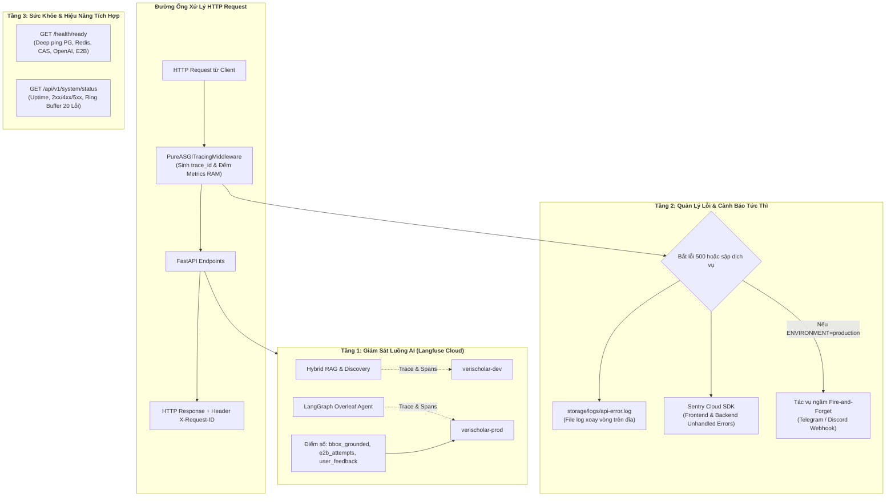
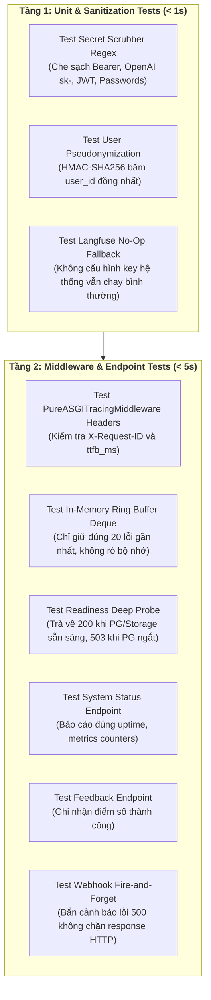

# ĐẶC TẢ KỸ THUẬT: PHÂN HỆ GIÁM SÁT, VẬN HÀNH & ĐO LƯỜNG (MONITORING & OBSERVABILITY)
# (SYSTEM MONITORING, TELEMETRY, SENTRY ALERTING & LANGFUSE OBSERVABILITY SPECIFICATION)

**Trạng thái:** DỰ THẢO CHÍNH THỨC (TECHNICAL SPECIFICATION V1)  
**Nguồn tham chiếu PRD:** [`docs/PRD/07-monitoring-and-langfuse.md`](file:///home/dammanhdungvn/Downloads/Workspace/VeriScholar/docs/PRD/07-monitoring-and-langfuse.md)  
**Phân hệ kỹ thuật:** Phân Hệ Giám Sát & Vận Hành (Monitoring & Telemetry)  
**File nền tảng liên đới:** [`docs/specs/00-foundation-architecture-and-db.md`](file:///home/dammanhdungvn/Downloads/Workspace/VeriScholar/docs/specs/00-foundation-architecture-and-db.md)

---

## 1. Usecase & Bối Cảnh Người Dùng (Real-World User Journey & Value)

### A. Usecase 1: Tinh Tế & An Tâm Với Bắt Lỗi Toàn Trình (Seamless User Error Experience & Zero-Effort Debugging)
- **Bối cảnh & Vấn đề thực tế:** Khi hệ thống gặp sự cố (ví dụ: mất kết nối tạm thời tới API ngoài hoặc tài liệu PDF bị lỗi cấu trúc font), hiển thị một chuỗi mã lỗi kỹ thuật thô như `HTTP 500: tr_9c1fa8fe` to tướng trên màn hình sẽ khiến học giả hoang mang, có cảm giác ứng dụng bị vỡ và thiếu chuyên nghiệp. Ngược lại, nếu chỉ hiện chung chung "Đã có lỗi xảy ra", lập trình viên sẽ không thể nào tìm ra dòng code gây lỗi khi người dùng phản ánh.
- **Giải pháp của phân hệ:**
  - **Giao diện người dùng thanh lịch:** Màn hình chỉ hiển thị thông điệp tiếng Việt thân thiện kèm giải pháp khắc phục:
    > *"Hệ thống tạm thời chưa thể trích xuất đoạn văn này. Vui lòng bấm [Thử lại] sau giây lát."*  
    > *(Mã tham chiếu: `#9c1f` — chỉ là một dòng chữ xám mờ tinh tế ở góc dưới để người dùng đính kèm nếu gửi yêu cầu hỗ trợ).*
  - **Lập trình viên không cần bắt người dùng chép mã:** Mã `trace_id` được liên kết tự động với `user_id` và email của họ dưới tầng Middleware. Khi người dùng báo lỗi, quản trị viên chỉ cần tìm theo email trên Langfuse hoặc Sentry, hoặc mở danh sách 20 lỗi gần nhất: **toàn bộ câu hỏi, model AI nào phản hồi, và dòng code bị gãy đều hiện ra ngay lập tức trong 3 giây.**

### B. Usecase 2: Báo Động Tức Thì Qua Webhook Khi Có Sự Cố Nghiêm Trọng (Instant Telegram/Discord Alerting)
- **Bối cảnh & Vấn đề thực tế:** Dự án được triển khai lên máy chủ VPS đơn. Vào ban đêm hoặc lúc người vận hành đang làm việc khác, database PostgreSQL có thể bị đầy RAM, Redis bị crash, hoặc tài khoản E2B/OpenAI hết hạn/hết tiền. Toàn bộ người dùng truy cập web đều bị lỗi 500 nhưng người vận hành hoàn toàn không hay biết cho đến khi nhận hàng loạt phàn nàn.
- **Giải pháp của phân hệ:**
  - Tầng cảnh báo lỗi tự động: Bất cứ khi nào xuất hiện lỗi `500 Internal Server Error` hoặc lỗi sập kết nối dịch vụ trên môi trường `production`, hệ thống tự động bắn một tin nhắn cảnh báo ngắn gọn vào kênh Telegram/Discord cá nhân:
    > *"🚨 [ALERT] VeriScholar Production gặp lỗi 500!*  
    > *Đường dẫn: POST /api/v1/drafts/compile*  
    > *Nguyên nhân: Connection to E2B timed out (quá hạn 15s)*  
    > *Mã tra cứu: tr_a7f9b12 — Thời gian: 2026-10-25 10:45:00Z"*
  - Áp dụng cơ chế bắn bất đồng bộ ngầm (**Fire-and-Forget** qua `asyncio.create_task` với timeout 3s) để không làm chậm trễ thời gian phản hồi HTTP của người dùng.

### C. Usecase 3: Đo Lường Chi Phí AI & Kiểm Soát Chất Lượng Bounding Box (Cost & Quality Observability via Langfuse)
- **Bối cảnh & Vấn đề thực tế:** Khi mở hệ thống cho người dùng trải nghiệm, tài khoản OpenAI bị trừ tiền nhanh chóng mà không rõ tính năng nào (Đọc tài liệu RAG, Tìm kiếm Exa, hay AI viết bài LaTeX) đang tiêu tốn nhiều token nhất. Người vận hành cũng không thể biết câu trả lời của AI có thực sự trích dẫn đúng bài báo (có Bounding Box vàng) hay đang "chém gió" gây mất uy tín khoa học.
- **Giải pháp của phân hệ:**
  - Toàn bộ luồng thực thi AI được đẩy lên **Langfuse Cloud** (phân định rõ `verischolar-dev` và `verischolar-prod`).
  - Đo lường chi tiết chi phí USD, thời gian phản hồi (TTFB/Latency), số lượng token input/output cho từng lượt query.
  - Theo dõi 3 chỉ số chất lượng học thuật cốt lõi:
    1. `bbox_grounded` (`1` hoặc `0`): Câu trả lời có trích xuất được tọa độ Bounding Box vàng bảo chứng hay không.
    2. `e2b_compile_attempts` (`1`, `2`, `3` hoặc `0`): Số lượt thử cần thiết để biên dịch thành công bài báo LaTeX.
    3. `user_feedback` (`1` = 👍, `0` = 👎): Đánh giá trực tiếp của người dùng tại chân mỗi câu trả lời.

### D. Usecase 4: Giám Sát Sức Khỏe & Hiệu Năng Hệ Thống Trong 1 Nốt Nhạc (Deep Health Ping & In-Memory Metrics)
- **Bối cảnh & Vấn đề thực tế:** Để kiểm tra máy chủ VPS có ổn định không, lập trình viên thường phải mở terminal gõ các lệnh phức tạp như `docker ps`, `free -m`, `psql`.
- **Giải pháp của phân hệ:**
  - `GET /health/ready`: Deep-ping kiểm tra đồng thời PostgreSQL 16+ `pgvector`, Redis 7, ổ đĩa lưu file CAS `storage/blobs/`, OpenAI và E2B. Link này có thể gắn trực tiếp vào dịch vụ miễn phí UptimeRobot để tự động báo động khi máy chủ sập nguồn.
  - `GET /api/v1/system/status`: Mở trình duyệt lên là thấy ngay: thời gian máy chủ đã chạy liên tục (`uptime`), tỷ lệ request thành công (`2xx`/`4xx`/`5xx`), độ trễ trung bình, và danh sách **20 lỗi gần nhất** lưu trong bộ nhớ RAM mà không cần đụng vào terminal.

---

## 2. Phạm Vi & Bảng Đối Chiếu Hiện Trạng (`As-Is` vs `Delta`)

Phân hệ Giám sát, Vận hành & Đo lường chịu trách nhiệm giám sát toàn bộ hoạt động từ tầng mạng, hạ tầng máy chủ, cơ sở dữ liệu cho đến các mô hình AI ngôn ngữ lớn.



### Bảng Kiểm Kê Thành Phần Mã Nguồn
| Thành phần | Đường dẫn File | Trạng thái | Nội dung chi tiết |
|---|---|---|---|
| **Cấu hình Môi trường** | [`apps/api/src/api/core/config.py`](file:///home/dammanhdungvn/Downloads/Workspace/VeriScholar/apps/api/src/api/core/config.py) | **MODIFY** | Chuẩn hóa duy nhất 2 môi trường: `development` và `production` (+ chế độ `test`). Xóa bỏ hoàn toàn cấu hình `uat`, `staging`, `enterprise`. |
| **Tracing Middleware** | [`apps/api/src/api/middleware/tracing.py`](file:///home/dammanhdungvn/Downloads/Workspace/VeriScholar/apps/api/src/api/middleware/tracing.py) | **MODIFY** | `PureASGITracingMiddleware`: duy trì bộ đếm request in-memory (`total`, `2xx`, `4xx`, `5xx`), tính `avg_duration_ms` và duy trì Ring Buffer `deque(maxlen=20)` cho 20 lỗi gần nhất. |
| **Ghi Log Hệ Thống** | [`apps/api/src/api/core/logging.py`](file:///home/dammanhdungvn/Downloads/Workspace/VeriScholar/apps/api/src/api/core/logging.py) | **MODIFY** | Cấu hình `structlog`: ghi ra console có màu ở `development`, ghi JSON 1 dòng kèm xoay vòng file `storage/logs/api-error.log` ở `production`. |
| **Langfuse Service** | [`apps/api/src/api/services/ai_tracing_service.py`](file:///home/dammanhdungvn/Downloads/Workspace/VeriScholar/apps/api/src/api/services/ai_tracing_service.py) | **KEEP** | Đã có sẵn No-Op facade, làm sạch khóa nhạy cảm (`scrub_sensitive_text`) và ẩn danh user (`pseudonymize_user_id`). Bổ sung ghi nhận 3 chỉ số Scores. |
| **Dịch Vụ Cảnh Báo** | `apps/api/src/api/services/alert_service.py` | **NEW** | Gửi cảnh báo lỗi 500 về Webhook Telegram/Discord dạng bất đồng bộ ngầm (`asyncio.create_task`). |
| **Health & Status Endpoints** | `apps/api/src/api/v1/endpoints/health.py` | **NEW** | Tách riêng các endpoint giám sát: `/health/ready` (deep ping đa hạ tầng) và `/api/v1/system/status` (báo cáo hiệu năng và danh sách 20 lỗi gần nhất). |
| **Feedback Endpoint** | `apps/api/src/api/v1/endpoints/feedback.py` | **NEW** | Endpoint `POST /api/v1/sessions/{id}/messages/{msg_id}/feedback` ghi nhận điểm 👍 / 👎 gửi lên Langfuse. |
| **GitHub Actions CI** | `.github/workflows/ci.yml` | **MODIFY** | Bổ sung service containers `postgres (pgvector/pgvector:0.8.6-pg18)` và `redis (redis:7-alpine)` cho môi trường CI tự động. |

---

## 3. Kiến Trúc Giám Sát 3 Tầng Thực Chiến

### A. Tầng 1: Giám Sát Luồng AI Trên Langfuse Cloud
Ghi nhận toàn bộ hoạt động trí tuệ nhân tạo trên Langfuse Cloud với 5 loại Observation chuẩn:

1. **`trace`:** Đại diện cho 1 chu trình nghiệp vụ trọn vẹn (ví dụ: một lượt hỏi đáp RAG tại Phiên đọc hoặc một lượt viết bài của LangGraph Agent). Được gắn ID bằng chính `trace_id` của request và gom nhóm theo `session_id` hoặc `draft_id`.
2. **`retriever`:** Ghi nhận bước tìm kiếm vector `pgvector` và xếp hạng lại bằng Cohere Reranker: danh sách `chunk_ids`, điểm tương đồng cosine và thời gian thực thi.
3. **`tool`:** Ghi nhận mỗi lần gọi công cụ bên ngoài: Exa Scholarly Search, `query_library_graph_rag`, `edit_latex_files`, `compile_latex_e2b`.
4. **`guardrail`:** Ghi nhận các bước kiểm tra an toàn: lọc mã độc Zip Slip khi tải ảnh, kiểm tra trạng thái tải PDF Tầng 2.
5. **`generation`:** Ghi nhận lệnh gọi trực tiếp tới LLM: ghi rõ tên model (`gpt-4o`, `gpt-4o-mini`), số lượng `prompt_tokens`, `completion_tokens`, chi phí quy đổi USD và thời gian tạo token đầu tiên (TTFT).

**3 Chỉ Số Đánh Giá Chất Lượng Học Thuật (Scores):**
- **`bbox_grounded`:** Gán giá trị `1.0` nếu câu trả lời RAG trích xuất được ít nhất 1 tọa độ Bounding Box vàng trên PDF; gán `0.0` nếu không có tọa độ.
- **`e2b_compile_attempts`:** Số lượt tự sửa lỗi mà Agent cần để biên dịch thành công trên E2B Sandbox (`1`, `2`, `3` hoặc `0` nếu thất bại).
- **`user_feedback`:** Điểm đánh giá thực tế của người dùng: `1.0` (Hài lòng 👍) hoặc `0.0` (Không hài lòng 👎).

### B. Tầng 2: Quản Lý Lỗi Toàn Cục & Cảnh Báo Tức Thì (Sentry + Webhook Telegram)
1. **File Log Xoay Vòng Trên Máy Chủ (`storage/logs/api-error.log`):**
   - Mọi log từ mức `WARNING` và `ERROR` trở lên được ghi tự động vào file `api-error.log` với định dạng JSON 1 dòng.
   - Cơ chế xoay vòng: Giới hạn tối đa `20MB/file`, lưu giữ tối đa 5 file lịch sử gần nhất để chống tràn ổ đĩa VPS.
2. **Tích hợp Sentry SDK (`SENTRY_DSN`):**
   - Tự động bắt mọi ngoại lệ chưa xử lý ở cả Backend FastAPI và Frontend React.
   - Gắn kèm thẻ `environment` (`verischolar-dev` hoặc `verischolar-prod`) và trường `trace_id` để liên kết chéo với log máy chủ.
3. **Cảnh Báo Lỗi 500 Qua Webhook Telegram / Discord (`ALERT_WEBHOOK_URL`):**
   - Chỉ kích hoạt khi `ENVIRONMENT == "production"`.
   - Khi xảy ra lỗi `500` hoặc sập kết nối cơ sở dữ liệu, hàm `send_webhook_alert` gửi một thông báo định dạng Markdown:
     ```text
     🚨 [PROD ERROR ALERT] VeriScholar Service Exception
     ---------------------------------------------------
     • Trace ID: tr_9c1fa8fe2d
     • Endpoint: POST /api/v1/sessions/550e8400.../chat
     • Error Type: DatabaseConnectionError
     • Message: Connection to PostgreSQL timed out after 5.0s
     • Timestamp: 2026-10-25T10:45:00Z
     ```
   - Thực thi dưới dạng tác vụ nền ngầm qua `asyncio.create_task` với timeout 3 giây, cam kết không gây trễ hoặc làm gián đoạn luồng phản hồi cho người dùng.

### C. Tầng 3: Giám Sát Sức Khỏe & Hiệu Năng Tích Hợp Sẵn
Không cần thiết lập cụm Prometheus hay Grafana tốn hàng GB RAM, hệ thống tích hợp sẵn 2 điểm giám sát siêu nhẹ:

1. **Kiểm Tra Sức Khỏe Sâu (`GET /health/ready`):**
   - Kiểm tra kết nối và độ trễ thực tế (`latency_ms`) của:
     - **PostgreSQL 16+:** Chạy query `SELECT 1;` và kiểm tra extension `vector`.
     - **Redis 7:** Chạy lệnh `PING`.
     - **Ổ Cứng Lưu Trữ CAS (`storage/blobs/`):** Thử ghi và xóa file tạm `.health_probe`.
     - **Dịch Vụ Ngoài:** Kiểm tra tính sẵn sàng của biến môi trường OpenAI API, E2B Sandbox, Langfuse.
   - Nếu tất cả sẵn sàng: trả về `HTTP 200 OK` (`status: "ready"`). Nếu có bất kỳ thành phần nào hỏng: trả về `HTTP 503 SERVICE UNAVAILABLE` (`status: "unready"`). Phục vụ cắm vào UptimeRobot ping tự động mỗi 1–5 phút.
2. **Bảng Thống Kê Hiệu Năng & 20 Lỗi Gần Nhất (`GET /api/v1/system/status`):**
   - Trích xuất trực tiếp từ RAM của `PureASGITracingMiddleware` (chạy trên 1 worker Uvicorn duy nhất):
     - Thời gian máy chủ đã chạy liên tục (`uptime_seconds`).
     - Tổng số lượt request, số lượng `2xx`, `4xx`, `5xx`.
     - Độ trễ trung bình (`avg_duration_ms`) và thời gian nhận byte đầu tiên (`avg_ttfb_ms`).
     - Danh sách **20 lỗi gần nhất** lưu trong bộ đệm vòng (Ring Buffer `deque(maxlen=20)`).

---

## 4. Chuẩn Hóa Môi Trường & Cơ Chế Truy Vết `trace_id`

### A. Chuẩn Hóa Duy Nhất 2 Môi Trường
Hệ thống loại bỏ hoàn toàn các môi trường không dùng tới (`uat`, `staging`, `enterprise`). Chỉ duy trì đúng 2 môi trường:

| Thuộc Tính Cấu Hình | Môi Trường `development` (`.env.development`) | Môi Trường `production` (`.env.production`) |
|---|---|---|
| **`ENVIRONMENT`** | `development` | `production` |
| **`LANGFUSE_ENVIRONMENT`** | `verischolar-dev` | `verischolar-prod` |
| **`LOG_LEVEL`** | `DEBUG` | `INFO` |
| **`LOG_FORMAT`** | `console` (Màu sắc trực quan cho terminal) | `json` (JSON chuẩn 1 dòng ghi ra file) |
| **`LANGFUSE_MASK_INPUT_OUTPUT`** | `false` (Hiển thị văn bản phục vụ gỡ lỗi) | `false` (Hiển thị nội dung học thuật, scrub khóa bí mật) |
| **Cảnh Báo Webhook Telegram** | Tắt (`ALERT_WEBHOOK_URL=""`) | **Bật** (Gửi tin nhắn khi có lỗi 500) |

*(Chế độ kiểm thử tự động `pytest` tự động thiết lập nội bộ `ENVIRONMENT=test` và `TEST_DATABASE_URL`).*

### B. Vòng Đời Của Mã Truy Vết Đồng Nhất (`trace_id` = `request_id`)
Mọi yêu cầu HTTP gửi đến hệ thống đều tuân thủ luồng truyền dẫn:

```
[Client gửi HTTP Request]
          │
          ▼
[PureASGITracingMiddleware]
  ├── Đọc header 'X-Request-ID' (nếu có) hoặc sinh mới: uuid4().hex[:12] -> 'trace_id'
  ├── Gắn trace_id vào structlog contextvars (request_id=trace_id)
  ├── Gắn trace_id vào scope['state']['request_id']
          │
          ▼
[FastAPI Endpoints / Services]
  ├── Ghi log hệ thống -> Tự động mang trường {"trace_id": "...", "path": "..."}
  ├── Gọi Langfuse Trace -> trace_id làm ID định danh câu query
          │
          ▼
[Client nhận HTTP Response]
  ├── Header: 'X-Request-ID: tr_9c1fa8fe2d'
  └── Nếu có lỗi: Body ErrorResponse trả về meta: {"trace_id": "tr_9c1fa8fe2d"}
```

---

## 5. Hợp Đồng API & Dữ Liệu Giám Sát (API Endpoints & Schemas)

### A. Kiểm Tra Sẵn Sàng Sâu (`GET /health/ready`)
- **Phản hồi Thành Công (`HTTP 200 OK`):**
  ```json
  {
    "status": "ready",
    "environment": "production",
    "version": "0.1.0",
    "uptime_seconds": 86400,
    "checks": {
      "database": {
        "status": "ok",
        "latency_ms": 2.15,
        "extension_vector": true
      },
      "redis": {
        "status": "ok",
        "latency_ms": 0.85
      },
      "storage": {
        "status": "ok",
        "writable": true,
        "used_mb": 142.5
      },
      "external_services": {
        "openai_configured": true,
        "e2b_configured": true,
        "langfuse_configured": true,
        "sentry_configured": true
      }
    }
  }
  ```

### B. Bảng Thống Kê Hiệu Năng & 20 Lỗi Gần Nhất (`GET /api/v1/system/status`)
- **Phản hồi Thành Công (`HTTP 200 OK`):**
  ```json
  {
    "success": true,
    "data": {
      "environment": "production",
      "uptime_seconds": 172800,
      "server_start_time": "2026-10-23T10:00:00Z",
      "metrics": {
        "total_requests": 14502,
        "status_2xx": 14210,
        "status_4xx": 280,
        "status_5xx": 12,
        "avg_duration_ms": 45.2,
        "avg_ttfb_ms": 18.4
      },
      "recent_errors": [
        {
          "timestamp": "2026-10-25T10:30:15Z",
          "trace_id": "tr_9c1fa8fe",
          "method": "POST",
          "path": "/api/v1/drafts/3fa85f64.../compile",
          "status_code": 500,
          "error_type": "LatexCompilationTimeout",
          "message": "Hardened Sandbox Timeout cutoff triggered at 15s."
        }
      ]
    }
  }
  ```

### C. Gửi Đánh Giá Người Dùng Cho Câu Trả Lời AI (`POST /api/v1/sessions/{session_id}/messages/{message_id}/feedback`)
- **Mục đích:** Ghi nhận đánh giá 👍 / 👎 của người dùng để gửi điểm số về đúng Trace ID trên Langfuse Cloud.
- **Request Body:**
  ```json
  {
    "score": 1.0,
    "comment": "Trích dẫn Bounding Box rất chính xác và giải thích dễ hiểu."
  }
  ```
- **Phản hồi `HTTP 200 OK`:**
  ```json
  {
    "success": true,
    "data": {
      "message_id": "message-uuid",
      "score": 1.0,
      "recorded_at": "2026-10-25T10:50:00Z"
    }
  }
  ```

---

## 6. Thiết Kế Frontend & Trải Nghiệm Xử Lý Lỗi

### A. Giao Diện Thông Báo Lỗi Thân Thiện (React Error Boundary)
Giao diện người dùng áp dụng triệt để nguyên tắc **Trải nghiệm Thân thiện & Không gây Hoang mang**:
- Mọi lỗi phát sinh tại các component đều được bắt tại `ErrorBoundary.tsx`.
- Giao diện hiển thị thông điệp ấm áp:
  - *"Đã xảy ra sự cố khi tải trang. Dữ liệu của bạn đã được lưu an toàn."*
  - Kèm nút hành động chính: `[🔄 Tải lại trang]` hoặc `[⬅️ Quay về Dashboard]`.
  - **Mã tham chiếu hỗ trợ:** Đặt ở góc dưới dạng chữ nhỏ xám mờ: `Mã tham chiếu: #9c1f` kèm icon sao chép nhỏ. Tuyệt đối không hiển thị màn hình đỏ hoặc stack trace kỹ thuật cho người dùng cuối.

### B. Nút Đánh Giá Phản Hồi AI (AI Feedback Thumbs)
- Dưới mỗi khối câu trả lời của AI trong Phiên Đọc Sâu và Không Gian Soạn Thảo Học Thuật có 2 icon nhỏ: **👍 Hài lòng** và **👎 Chưa chính xác**.
- Khi người dùng bấm nút:
  - Giao diện sáng nhẹ icon đã chọn (Zero-Friction UX).
  - Trình duyệt ngầm gọi API feedback; hệ thống cập nhật chỉ số `user_feedback` trên Langfuse Cloud ngay lập tức.

---

## 7. Ma Trận Kiểm Thử TDD Bắt Buộc (Monitoring & Telemetry TDD Matrix)

Mọi thay đổi kỹ thuật thuộc Phân hệ Giám sát & Vận hành phải vượt qua đầy đủ các kịch bản kiểm thử tự động sau:



| Tên Test Case | File Kiểm Thử | Mục tiêu kiểm chứng | Kỳ vọng nghiệm thu |
|---|---|---|---|
| `test_secret_scrubber_cleanses_credentials` | `apps/api/tests/test_logging_scrubber.py` | Truyền chuỗi chứa Bearer token và OpenAI key | Toàn bộ bị thay thế bằng `[REDACTED]`. |
| `test_user_pseudonymization_hmac` | `apps/api/tests/test_telemetry_privacy.py` | Băm 1 user_id với secret key | Trả về chuỗi băm hex 64 ký tự, không lộ UUID gốc. |
| `test_tracing_middleware_generates_x_request_id` | `apps/api/tests/test_tracing_middleware.py` | Gửi request không có header X-Request-ID | Response trả về header `X-Request-ID` hợp lệ. |
| `test_readiness_probe_healthy_and_unhealthy` | `apps/api/tests/test_health_endpoints.py` | Gọi `/health/ready` trong điều kiện DB sống và DB ngắt | Trả về tương ứng `200 OK` và `503 SERVICE UNAVAILABLE`. |
| `test_system_status_ring_buffer_limit_20` | `apps/api/tests/test_system_status.py` | Kích hoạt 25 lỗi 500 liên tiếp | Mảng `recent_errors` chỉ lưu đúng 20 lỗi mới nhất. |
| `test_ai_feedback_score_submission` | `apps/api/tests/test_feedback_endpoint.py` | Gọi `POST /feedback` với `score=1.0` | Nhận mã `200 OK`, gửi điểm thành công lên Langfuse. |
| `test_webhook_alert_non_blocking_execution` | `apps/api/tests/test_alert_webhook.py` | Giả lập lỗi 500 với Webhook bị trễ 5s | API vẫn phản hồi trong `< 200ms`, Webhook chạy ngầm. |

---

## 8. Tiêu Chí Nghiệm Thu Kỹ Thuật (Definition of Done)

- [ ] Phân hệ có tên định danh rõ ràng là **Phân Hệ Giám Sát, Vận Hành & Đo Lường (System Monitoring, Telemetry & Langfuse Observability)**, không dùng số thứ tự định danh trong nội dung tài liệu.
- [ ] Phần **Usecase & Bối Cảnh Người Dùng** được đặt ngay tại Mục 1 ở đầu file, mô tả đầy đủ 4 kịch bản thực tế: Trải nghiệm bắt lỗi thân thiện, Cảnh báo tức thì Telegram/Discord, Đo lường chi phí/chất lượng Langfuse, và Giám sát sức khỏe hệ thống.
- [ ] Chuẩn hóa duy nhất 2 môi trường: `development` (`LANGFUSE_ENVIRONMENT=verischolar-dev`) và `production` (`LANGFUSE_ENVIRONMENT=verischolar-prod`).
- [ ] Cơ chế `trace_id` gắn kết xuyên suốt từ Middleware, log `structlog`, Langfuse trace, đến header HTTP `X-Request-ID`.
- [ ] Điểm kiểm tra `/health/ready` deep-ping toàn bộ hạ tầng (PostgreSQL 16+ `pgvector`, Redis 7, CAS storage, E2B, OpenAI).
- [ ] Điểm kiểm tra `/api/v1/system/status` báo cáo uptime, metrics và bộ đệm vòng 20 lỗi gần nhất trong RAM.
- [ ] Toàn bộ 7 bài test trong Ma trận TDD Mục 7 đạt trạng thái `100% PASS` trên môi trường kiểm thử.
