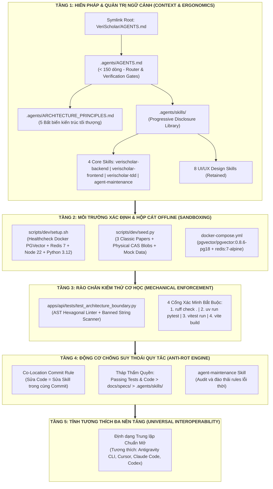
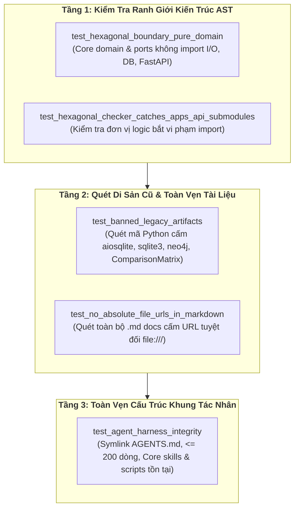

# ĐẶC TẢ KỸ THUẬT: KHUNG ĐIỀU HƯỚNG TÁC NHÂN ĐA NỀN TẢNG THUẦN DỰ ÁN (REPO-OWNED UNIVERSAL AGENT HARNESS)
# (UNIVERSAL AGENT HARNESS & ERGONOMICS TECHNICAL SPECIFICATION)

**Trạng thái:** DỰ THẢO CHÍNH THỨC (TECHNICAL SPECIFICATION V1)  
**Nguồn tham chiếu Thiết kế:** [`2026-10-25-universal-agent-harness-design.md`](../superpowers/specs/2026-10-25-universal-agent-harness-design.md) (Commit ``5b76b36``)  
**Tham chiếu thực tiễn:** Kiến trúc Agent Harness của Langfuse ([`temp/.agents/`](../../temp/.agents))  
**Phân hệ kỹ thuật:** Kỹ Nghệ Khung Tác Nhân & Công Thái Học Lập Trình AI (Agent Harness & Ergonomics Engineering)  
**Mục tiêu:** Thiết lập khung điều phối tác nhân đa nền tảng (Antigravity CLI, Cursor, Claude Code, Codex), tối ưu hóa cửa sổ ngữ cảnh qua Progressive Disclosure, cung cấp môi trường chạy thử xác định 100% offline và thiết lập rào chắn kiểm thử kiến trúc cơ học bằng mã tự động.

---

## 1. Usecase & Bối Cảnh Thực Tế (Real-World Use Cases & Engineering Value)

### A. Usecase 1: Triệt Tiêu Token Bloat & Hiện Tượng "Lost in the Middle"
- **Bối cảnh & Vấn đề thực tế:** Khi lập trình dự án quy mô lớn cùng các Agent AI (như Antigravity CLI, Claude Code hay Cursor), nếu nhồi nhét toàn bộ hàng nghìn dòng tài liệu kiến trúc, database, frontend, backend và quy chuẩn test vào một file prompt duy nhất (`AGENTS.md` hoặc `.cursorrules`), mỗi lượt prompt sẽ lãng phí từ 10.000 đến 30.000 tokens. Điều này làm loãng sự chú ý của mô hình (*Attention Dilution*), tăng độ trễ và khiến AI thường xuyên quên hoặc bỏ qua các quy tắc nằm ở giữa văn bản (*Lost in the Middle*).
- **Giải pháp của phân hệ:**
  - Thiết lập cơ chế **Tiết lộ Ngữ cảnh Tuần tự (Progressive Disclosure)**:
    - File gốc [`AGENTS.md`](../../AGENTS.md) được nén gọn dưới **150 dòng**, chỉ đóng vai trò như một "Bộ định tuyến" (Router) hướng dẫn tác nhân cách tra cứu và cổng kiểm tra.
    - Toàn bộ tri thức kỹ thuật chi tiết được đóng gói thành các **Kỹ Năng (Skills)** chuyên biệt trong `.agents/skills/`. Agent chỉ tải đúng tài liệu cần thiết cho tác vụ hiện tại (ví dụ: chỉ nạp `verischolar-backend` khi viết API, chỉ nạp `verischolar-frontend` khi viết UI).

### B. Usecase 2: Kiểm Thử Hộp Cát Ngoại Tuyến 100% Xác Định (Deterministic Offline Sandboxing)
- **Bối cảnh & Vấn đề thực tế:** Khi Agent phát triển hoặc kiểm thử các tính năng cốt lõi như Bộ đọc PDF Canvas, Trích xuất Bounding Box, hay Tìm kiếm Kết hợp (Hybrid RAG), nếu bắt buộc phải kết nối internet để tải file từ arXiv hoặc gọi API bên ngoài (OpenAI, Exa):
  - Chi phí API tăng vọt;
  - Tốc độ chạy test rất chậm (5–30 giây cho mỗi lượt tải mạng);
  - Dữ liệu ngẫu nhiên khiến kết quả test không thể tái lập (flaky tests).
- **Giải pháp của phân hệ:**
  - Cung cấp bộ công cụ developer xác định:
    - [`scripts/dev/setup.sh`](../../scripts/dev): Kiểm tra môi trường Docker PostgreSQL `pgvector`, Redis 7, Python 3.12, Node 22 trong vài giây.
    - [`scripts/dev/seed.py`](../../scripts/dev): Nạp sẵn tài khoản kiểm thử mặc định và **3 bài báo học thuật kinh điển** (*Attention Is All You Need*, *ResNet*, *BERT*). Script tự động sinh các file PDF vật lý hợp lệ khớp mã băm SHA-256 vào `storage/blobs/`, kèm đầy đủ đoạn trích (chunks) và tọa độ Bounding Box mẫu `[x0, y0, x1, y1]`.
  - Mọi Agent có thể chạy kiểm thử toàn trình Reader và RAG hoàn toàn offline với độ trễ `< 200ms`.

### C. Usecase 3: Rào Chắn Kiểm Thử Cơ Học Tự Động Bằng AST (Automated Mechanical Enforcement)
- **Bối cảnh & Vấn đề thực tế:** Con người hay AI đều có xu hướng đi đường tắt khi gặp bài toán khó: import lén lút một module ngoài vào tầng Core Domain, hoặc vô tình tái sử dụng các mẫu thiết kế di sản (như cơ chế SQLite fallback hoặc Neo4j cũ) nếu chỉ được nhắc nhở bằng văn bản thông thường.
- **Giải pháp của phân hệ:**
  - "Không bao giờ dùng văn xuôi cho những gì có thể gác cổng bằng mã tự động".
  - Xây dựng bài kiểm thử ranh giới kiến trúc tự động [`apps/api/tests/test_architecture_boundary.py`](../../apps/api/tests):
    - Dùng AST (Abstract Syntax Tree) phân tích mã nguồn `packages/core/src/core/domain/` và `ports/`: Cấm tuyệt đối import bất kỳ thư viện I/O, Database, Web framework (`fastapi`, `sqlalchemy`, `redis`, `fitz`, `httpx`, `aiofiles`) hoặc import từ `apps.api`.
    - Quét toàn bộ mã nguồn Python production trong `apps/api/src/` và `packages/core/src/`: Đánh trượt ngay lập tức nếu xuất hiện các chuỗi ký tự di sản cấm (`aiosqlite`, `sqlite3`, `neo4j`, `ComparisonMatrix`, `DeBERTa`).
    - Kiểm tra tính toàn vẹn của thư mục `.agents/`: Báo lỗi nếu thiếu file cốt lõi hoặc nếu `AGENTS.md` vượt quá 200 dòng.

### D. Usecase 4: Chống Suy Thoái Quy Tắc & Xung Đột Nhận Thức (Anti-Rot & Agent Drift Prevention)
- **Bối cảnh & Vấn đề thực tế:** Khi dự án phát triển qua nhiều tháng, các quyết định kiến trúc thay đổi nhưng tài liệu hướng dẫn agent không được cập nhật kịp thời. Các Agent mới tham gia sẽ đọc phải quy tắc cũ và sinh ra code xung đột với codebase hiện tại (*Agent Drift*).
- **Giải pháp của phân hệ:**
  - Thiết lập **Quy tắc Cam kết Cùng Vị Trí (Co-Location Commit Rule)**: Mọi thay đổi về cấu trúc router, schema database hoặc loại bỏ tính năng bắt buộc phải cập nhật hoặc xóa bỏ skill liên quan ngay trong cùng commit/PR.
  - Ban hành **Tháp Thẩm Quyền (Authority Hierarchy)**: Khi phát hiện mâu thuẫn giữa các nguồn tài liệu, Agent bắt buộc phải tuân theo thứ bậc:
    $$\mathbf{Code\ \&\ Passing\ Tests} > \mathbf{Technical\ Specs\ (docs/specs/)} > \mathbf{Agent\ Skills\ (.agents/skills/)}$$
  - Cung cấp skill chuyên biệt `agent-maintenance` để AI định kỳ tự rà soát, loại bỏ quy tắc mồ côi.

---

## 2. Kiến Trúc 5 Tầng & Bất Biến Ranh Giới (5-Layer Architecture & Invariants)

Hệ thống Harness Engineering của VeriScholar được thiết kế thành **5 tầng khép kín**:



### A. 5 Bất Biến Kiến Trúc Tối Thượng Của VeriScholar MVP
Mọi tác nhân AI khi tham gia phát triển dự án bắt buộc phải tuân thủ 5 bất biến (được định nghĩa bất di bất dịch trong [`.agents/ARCHITECTURE_PRINCIPLES.md`](../../.agents/ARCHITECTURE_PRINCIPLES.md)):

1. **Thuần PostgreSQL 16+ với `pgvector` & Redis 7:**
   - Tuyệt đối cấm sử dụng cơ sở dữ liệu đồ thị độc lập bên ngoài (như Neo4j). Toàn bộ thực thể và quan hệ đồ thị học thuật 4 tầng được lưu trữ trực tiếp trên PostgreSQL qua 2 bảng `graph_nodes` và `graph_edges`.
   - Tuyệt đối cấm cơ chế lưu trữ fallback SQLite (`aiosqlite`, `sqlite3`). Mọi môi trường kiểm thử và sản xuất đều chạy trực tiếp trên PostgreSQL.
2. **Kiến Trúc Lục Giác Độc Lập (Hexagonal Core Isolation):**
   - Lõi nghiệp vụ `packages/core/src/core/domain/` và `ports/` độc lập hoàn toàn. Chỉ được phụ thuộc vào Standard Library và `pydantic`.
   - Chiều phụ thuộc một chiều duy nhất: `apps/api` phụ thuộc vào `packages/core`. Cấm tuyệt đối `packages/core` import từ `apps/api`.
3. **Lưu Trữ CAS SHA-256 Với Cam Kết Tiêu Hủy Tức Thì (Zero-Retention Guarantee):**
   - Toàn bộ file PDF và hình ảnh trích xuất được định danh theo mã băm SHA-256 và lưu trong `storage/blobs/{hash[:2]}/{hash[2:4]}/{hash}`.
   - Khi `ref_count <= 0`, file nhị phân vật lý trên đĩa cứng phải bị xóa vĩnh viễn ngay lập tức bằng `os.unlink()`.
4. **Cô Lập Tuyệt Đối Qua E2B MicroVM Sandbox:**
   - Mọi tác vụ biên dịch LaTeX và render PDF chạy cô lập trong container Firecracker MicroVM của E2B với cờ `--no-shell-escape` và giới hạn thời gian chạy 15 giây.
   - Tuyệt đối cấm gọi lệnh `pdflatex`, `xelatex` hay thực thi shell script trực tiếp trên máy chủ host.
5. **Giám Sát 3 Tầng Nhẹ Nhàng & Đồng Nhất (3-Tier Monitoring):**
   - Mã định danh `trace_id` đồng nhất từ client frontend qua header HTTP `X-Trace-ID` tới các span của Langfuse.
   - Langfuse SDK ghi nhận chi phí token, độ trễ RAG và điểm phản hồi người dùng.
   - Báo lỗi khẩn cấp tới Telegram/Discord Webhook hoàn toàn bất đồng bộ (BackgroundTasks), không bao giờ làm nghẽn luồng xử lý HTTP chính.

---

## 3. Cấu Trúc Bố Cục Thư Mục & Đặc Tả Chi Tiết Từng Thành Phần

```text
VeriScholar/
├── AGENTS.md -> .agents/AGENTS.md                  # Symlink gốc chuẩn mở cho mọi Agent AI
├── docker-compose.yml                              # Cấu hình container dịch vụ: PostgreSQL (pgvector) + Redis 7
├── .agents/
│   ├── AGENTS.md                                   # Hiến pháp tối cao (< 150 dòng)
│   ├── ARCHITECTURE_PRINCIPLES.md                  # 5 Bất biến kiến trúc chi tiết
│   └── skills/
│       ├── verischolar-backend/
│       │   └── SKILL.md                            # Cẩm nang FastAPI, SQLAlchemy Async, pgvector SQL RRF
│       ├── verischolar-frontend/
│       │   └── SKILL.md                            # Cẩm nang React 19, Canvas Viewer, Bbox Highlight, KaTeX
│       ├── verischolar-tdd/
│       │   └── SKILL.md                            # Quy trình TDD, Transaction Rollback, Mocks E2B/OpenAI
│       ├── agent-maintenance/
│       │   └── SKILL.md                            # Quy trình bảo trì harness, chống lỗi thời quy tắc (Rule Rot)
│       ├── ui-ux-pro-max/                          # [Retained] Thiết kế UI/UX thông minh
│       ├── ui-styling/                             # [Retained] Tailwind CSS & Shadcn/UI components
│       ├── design/                                 # [Retained] Thiết kế thương hiệu & vector visual
│       ├── brand/                                  # [Retained] Giọng văn & phong cách thương hiệu
│       ├── banner-design/                          # [Retained] Banner & hình ảnh truyền thông
│       ├── design-system/                          # [Retained] Design tokens & component specs
│       ├── slides/                                 # [Retained] Trình chiếu báo cáo khoa học HTML
│       └── web-design-guidelines/                  # [Retained] Đánh giá khả năng tiếp cận & trải nghiệm web
├── scripts/
│   └── dev/
│       ├── setup.sh                                # Kiểm tra môi trường cục bộ (Python, Node, Docker, DB)
│       └── seed.py                                 # Seeder nạp 3 bài báo mẫu học thuật & physical CAS blobs
└── apps/
    └── api/
        └── tests/
            └── test_architecture_boundary.py       # Bài test gác cổng kiến trúc tự động (AST + Lexical)
```

### A. Đặc Tả [`AGENTS.md`](../../AGENTS.md) (Hiến Pháp Tối Cao)
* **Kích thước:** Nghiêm ngặt dưới **150 dòng**.
* **Nội dung bao gồm:**
  1. *Định danh Dự án & Scope:* Giới thiệu ngắn gọn VeriScholar MVP (Nền tảng Trợ lý AI Nghiên cứu Khoa học Toàn trình) bám sát tài liệu trong `docs/PRD/` và `docs/specs/`.
  2. *Quy tắc Làm việc Cốt lõi (Operating Rules):*
     - Tuân thủ quy trình TDD: Test đỏ trước $\rightarrow$ Code xanh sau $\rightarrow$ Refactor.
     - Tuân thủ Kiến trúc Lục giác: `packages/core` là thuần Python, không bao giờ import từ `apps/api`.
     - Phải chạy đầy đủ **4 Cổng Xác Minh** trước khi báo cáo hoàn thành.
  3. *Bộ Định Tuyến Kỹ Năng (Skill Router):*
     - Tác vụ Backend / API / Database $\rightarrow$ Đọc `.agents/skills/verischolar-backend/SKILL.md`.
     - Tác vụ Frontend / PDF Viewer / KaTeX $\rightarrow$ Đọc `.agents/skills/verischolar-frontend/SKILL.md`.
     - Viết Unit / Integration Test $\rightarrow$ Đọc `.agents/skills/verischolar-tdd/SKILL.md`.
     - Thay đổi quy tắc / Cập nhật kiến trúc $\rightarrow$ Đọc `.agents/skills/agent-maintenance/SKILL.md`.
     - Thiết kế giao diện / Trải nghiệm người dùng $\rightarrow$ Sử dụng các skills UI tương ứng.

### B. Đặc Tả 4 Kỹ Năng Nghiệp Vụ Cốt Lõi (`.agents/skills/`)

#### 1. `verischolar-backend/SKILL.md`
* **Mục tiêu:** Hướng dẫn agent cách viết code backend nhất quán theo chuẩn AIP-136 và SQLAlchemy 2.0 Async.
* **Quy chuẩn bắt buộc:**
  * Cấu trúc router tại `apps/api/src/api/v1/endpoints/`.
  * Quản lý database session: Sử dụng Dependency Injection `Depends(get_db)` cho các request HTTP; đối với tác vụ nền `BackgroundTasks`, bắt buộc khởi tạo session độc lập qua context manager `async with AsyncSessionLocal() as session:`.
  * Truy vấn Hybrid Search: Kết hợp Cosine Distance (`<->` của `pgvector`) và Full-Text Search PostgreSQL (`to_tsvector('simple', content)`) sử dụng thuật toán Reciprocal Rank Fusion (RRF) viết bằng câu lệnh SQL thuần, tối ưu hóa qua chỉ mục HNSW.

#### 2. `verischolar-frontend/SKILL.md`
* **Mục tiêu:** Hướng dẫn agent phát triển giao diện nghiên cứu học thuật trên React 19 và Tailwind CSS.
* **Quy chuẩn bắt buộc:**
  * Quản lý trạng thái bằng Zustand stores (`useAuthStore`, `useSessionStore`, `useDraftStore`).
  * Tích hợp `PdfCanvasViewer`: Lớp vẽ Bounding Box `[x0, y0, x1, y1]` theo tỷ lệ phần trăm độc lập với độ phân giải DPI của màn hình.
  * Hiển thị công thức toán học và phản biện bằng KaTeX và Markdown học thuật.
  * Xử lý luồng stream Server-Sent Events (SSE) không bộ đệm qua thư viện `@microsoft/fetch-event-source` với cơ chế tự động reconnect và gắn kèm `X-Trace-ID`.

#### 3. `verischolar-tdd/SKILL.md`
* **Mục tiêu:** Cẩm nang TDD và kiểm thử tự động xác định 100%.
* **Quy chuẩn bắt buộc:**
  * Cơ chế Rollback Fixture: Mọi test case truy cập cơ sở dữ liệu đều chạy trong một transaction lồng nhau và tự động `rollback()` khi kết thúc test, không để lại dữ liệu rác trong database.
  * Mocks độc lập: Hướng dẫn chi tiết cách mock E2B client runner và OpenAI Embeddings/Chat completions để test chạy cô lập không phụ thuộc mạng bên ngoài.
  * Kiểm thử cô lập đa người dùng: Bắt buộc viết test case thử nghiệm User B truy cập tài nguyên của User A và khẳng định hệ thống trả về `404 NOT_FOUND`.

#### 4. `agent-maintenance/SKILL.md`
* **Mục tiêu:** Quy chuẩn bảo trì hệ thống harness, ngăn chặn hiện tượng Rule Rot.
* **Quy chuẩn bắt buộc:**
  * Bắt buộc tuân thủ Co-Location Commit Rule: Sửa mã nguồn/endpoint/bảng CSDL $\rightarrow$ cập nhật skill tương ứng trong cùng commit.
  * Hướng dẫn chạy bài test ranh giới kiến trúc `test_architecture_boundary.py` để phát hiện code vi phạm.
  * Áp dụng Tháp thẩm quyền: Khi phát hiện mâu thuẫn giữa skill và code đã chạy pass test, agent phải ưu tiên code thực tế và cập nhật lại skill.

### C. Đặc Tả Bộ Công Cụ Developer Xác Định (`scripts/dev/`)

#### 1. `scripts/dev/setup.sh`
* **Chức năng:**
  * Khởi động Docker container nếu chưa chạy: `docker compose up -d` (chạy cả PostgreSQL 18 `pgvector` và Redis 7).
  * Kiểm tra và xác nhận sự tồn tại của extension `vector` trong PostgreSQL: `SELECT extname FROM pg_extension WHERE extname = 'vector';`.
  * Ping kiểm tra dịch vụ Redis 7 qua `redis-cli ping`.
  * Kiểm tra các công cụ hệ thống: Python 3.12+, Node.js 22+, `uv`, `pnpm`.
  * Chạy đồng bộ thư viện: `uv sync --all-packages` và `pnpm install`.
  * In ra thông báo trạng thái môi trường dev sẵn sàng bằng mã màu ANSI rõ ràng.

#### 2. `scripts/dev/seed.py`
* **Chức năng:**
  * Nạp 1 tài khoản học giả mặc định:
    * Email: `dev@verischolar.edu.vn`
    * Password: `ScholarDev@123456`
    * Trạng thái: Đã xác thực (`is_active = True`, `is_verified = True`).
  * Nạp 3 bài báo kinh điển:
    1. *Attention Is All You Need (Vaswani et al., 2017)*:
       - Hash CAS SHA-256 thực tế từ file [`data/papers/Attention Is All You Need.pdf`](../../data/papers/Attention%20Is%20All%20You%20Need.pdf).
       - Nạp 10 chunks mẫu kèm vector embedding và dữ liệu đồ thị tri thức 4 thực thể tương thích.
    2. *Deep Residual Learning for Image Recognition (He et al., 2016)*:
       - Tự động sinh file PDF hợp lệ tối thiểu vào `storage/blobs/` để CAS hashing trỏ tới file thật.
       - Nạp các đoạn trích có tọa độ Bounding Box mẫu `[x0, y0, x1, y1]`.
    3. *BERT: Pre-training of Deep Bidirectional Transformers (Devlin et al., 2018)*:
       - Tự động sinh file PDF hợp lệ tối thiểu vào `storage/blobs/`.
  * Nạp 1 phiên đọc sâu mẫu (`session`) gắn với bài báo *Attention Is All You Need*.
  * Nạp 1 bản thảo học thuật mẫu (`draft`) có nội dung văn bản hoàn chỉnh.

---

## 4. Rào Chắn Kiểm Thử Kiến Trúc Cơ Học (`test_architecture_boundary.py`)

Để loại bỏ hoàn toàn khả năng AI vi phạm kiến trúc, toàn bộ quy tắc được cơ học hóa thành file kiểm thử:
* **Vị trí:** `apps/api/tests/test_architecture_boundary.py`

### A. Kiểm Tra Ranh Giới Lục Giác Bằng Cây Cú Pháp (AST Hexagonal Checker)
* **Đối tượng quét:** Toàn bộ file `.py` trong `packages/core/src/core/domain/` và `packages/core/src/core/ports/`.
* **Cơ chế:** Phân tích `ast.parse()` để duyệt qua tất cả các node `ast.Import` và `ast.ImportFrom`.
* **Quy tắc kiểm tra:**
  * **Whitelist được phép:** Standard Library của Python (`typing`, `uuid`, `datetime`, `enum`, `dataclasses`, `abc`, `math`, `re`, `json`, v.v.) và thư viện `pydantic`.
  * **Blacklist cấm tuyệt đối:** Mọi thư viện liên quan đến Web framework, Database ORM, Network I/O hoặc File parsing:
    * `fastapi`, `starlette`
    * `sqlalchemy`, `sqlmodel`, `alembic`
    * `redis`, `aioredis`
    * `httpx`, `aiohttp`, `requests`
    * `fitz`, `pymupdf`, `pdfplumber`
    * `e2b`, `langfuse`, `openai`
    * Bất kỳ import nào từ package ứng dụng: `apps.api` hoặc `api`.
* **Hành vi:** Báo lỗi `AssertionError` chỉ rõ chính xác file và dòng code vi phạm ranh giới lục giác.

### B. Quét Chuỗi Ký Tự Di Sản Bị Cấm (Lexical Banned Keywords Scan)
* **Đối tượng quét:** Toàn bộ file `.py` trong mã nguồn sản xuất (`apps/api/src/` và `packages/core/src/`). Bỏ qua thư mục `tests/`, `docs/`, `node_modules/`, `.git/`.
* **Danh sách từ khóa cấm tuyệt đối:**
  * `aiosqlite` (Tàn dư của SQLite fallback)
  * `sqlite3` (Tàn dư của SQLite fallback)
  * `neo4j` (Tàn dư của cơ sở dữ liệu đồ thị rời)
  * `ComparisonMatrix` (Tàn dư của module ma trận đối chiếu đã bị xóa bỏ)
  * `DeBERTa` (Tàn dư của mô hình NLI cục bộ nặng)
* **Hành vi:** Báo lỗi `AssertionError` chỉ rõ file vi phạm, yêu cầu loại bỏ sạch sẽ các tàn dư kiến trúc cũ.

### C. Kiểm Tra Tính Toàn Vẹn Của Hệ Thống Harness (Harness Integrity Check)
* **Đối tượng quét:** Thư mục gốc và `.agents/`.
* **Quy tắc kiểm tra:**
  1. Kiểm tra file symlink `AGENTS.md` tại thư mục gốc trỏ chính xác về `.agents/AGENTS.md`.
  2. Kiểm tra sự tồn tại của các file bắt buộc:
     * `.agents/AGENTS.md`
     * `.agents/ARCHITECTURE_PRINCIPLES.md`
     * `.agents/skills/verischolar-backend/SKILL.md`
     * `.agents/skills/verischolar-frontend/SKILL.md`
     * `.agents/skills/verischolar-tdd/SKILL.md`
     * `.agents/skills/agent-maintenance/SKILL.md`
     * `scripts/dev/setup.sh`
     * `scripts/dev/seed.py`
  3. Kiểm tra số dòng của `.agents/AGENTS.md`: Báo lỗi nếu số dòng $> 200$ dòng để duy trì độ tinh gọn tối thượng.

---

## 5. Quy Chuẩn Vận Hành & Bảo Trì Hệ Thống (Operations & Maintenance Protocol)

### A. Quy Trình 4 Cổng Kiểm Tra Bắt Buộc (The 4 Verification Gates)
Bất kỳ Agent AI nào (bao gồm cả lập trình viên con người) trước khi tạo commit hoặc tuyên bố hoàn thành một task, **bắt buộc phải chạy và xác nhận 100% exit code 0** của 4 lệnh sau:

```bash
# 1. Kiểm tra định dạng và quy chuẩn mã nguồn Python
uv run ruff check .

# 2. Chạy toàn bộ test suite backend (bao gồm bài test ranh giới kiến trúc)
uv run pytest

# 3. Chạy toàn bộ unit & integration tests frontend
npm --prefix apps/web run test

# 4. Kiểm tra biên dịch và build production giao diện frontend
npm --prefix apps/web run build
```

### B. Quy Trình Đồng Bộ & Chống Lỗi Thời (Living Feedback Loop)
1. **Khi thêm một Endpoint mới:**
   - Tạo router và kiểm thử TDD.
   - Bổ sung ví dụ vào `.agents/skills/verischolar-backend/SKILL.md` trong cùng commit.
2. **Khi thay đổi cấu trúc bảng CSDL:**
   - Tạo migration Alembic và cập nhật entity trong Core Domain.
   - Cập nhật hướng dẫn truy vấn trong `verischolar-backend/SKILL.md`.
   - Cập nhật `scripts/dev/seed.py` để nạp dữ liệu mẫu mới.
3. **Khi loại bỏ một phân hệ/tính năng:**
   - Xóa bỏ mã nguồn và các test case tương ứng.
   - Xóa bỏ các dòng hướng dẫn liên quan trong `.agents/skills/`.
   - Bổ sung tên class/từ khóa của tính năng cũ vào danh sách cấm của `test_architecture_boundary.py` để đảm bảo không một Agent nào có thể vô tình sinh lại nó trong tương lai.

---

## 6. Kế Hoạch Triển Khai Thực Thi (Implementation Blueprint)

Quá trình hiện thực hóa bộ Harness Engineering được chia thành **4 giai đoạn tuần tự**:

### Giai Đoạn 1: Dọn Dẹp Môi Trường & Mã Nguồn Di Sản
1. Dọn dẹp toàn bộ các tệp unstaged/deleted di sản của hệ thống cũ đang tồn tại trong working tree.
2. Dọn sạch hàm rác `init_sqlite_fallback()` trong [`apps/api/src/api/db/session.py`](../../apps/api/src/api/db/session.py) và [`apps/api/src/api/__init__.py`](../../apps/api/src/api/__init__.py).
3. Dọn sạch class `ComparisonMatrixRow` và `ComparisonMatrixResult` trong [`packages/core/src/core/domain/entities/folder.py`](../../packages/core/src/core/domain/entities/folder.py).

### Giai Đoạn 2: Thiết Lập Cấu Trúc `.agents/` & Kỹ Năng Cốt Lõi
1. Khởi tạo thư mục `.agents/` và tạo symlink `AGENTS.md` ở thư mục gốc.
2. Soạn thảo file [`AGENTS.md`](../../AGENTS.md) tinh gọn (< 150 dòng).
3. Soạn thảo file [`.agents/ARCHITECTURE_PRINCIPLES.md`](../../.agents/ARCHITECTURE_PRINCIPLES.md) ghi nhận 5 bất biến.
4. Xây dựng 4 thư mục skill:
   * `.agents/skills/verischolar-backend/SKILL.md`
   * `.agents/skills/verischolar-frontend/SKILL.md`
   * `.agents/skills/verischolar-tdd/SKILL.md`
   * `.agents/skills/agent-maintenance/SKILL.md`
5. Giữ nguyên vẹn 8 thư mục kỹ năng thiết kế UI/UX hiện có trong `.agents/skills/`.

### Giai Đoạn 3: Xây Dựng Bộ Công Cụ Developer Xác Định
1. Cập nhật [`docker-compose.yml`](../../docker-compose.yml): Bổ sung service `redis:7-alpine`.
2. Tạo script [`scripts/dev/setup.sh`](../../scripts/dev/setup.sh) với quyền thực thi `chmod +x`.
3. Tạo script [`scripts/dev/seed.py`](../../scripts/dev/seed.py) nạp 3 bài báo mẫu và đảm bảo physical PDF blobs trong `storage/blobs/`.

### Giai Đoạn 4: Hiện Thực Hóa Rào Chắn Kiểm Thử & Chạy Nghiệm Thu
1. Tạo bài test [`apps/api/tests/test_architecture_boundary.py`](../../apps/api/tests/test_architecture_boundary.py) cài đặt đầy đủ 3 kiểm tra: AST Hexagonal checker, Banned keywords scanner, và Harness integrity checker.
2. Chạy toàn bộ **4 Cổng Xác Minh** (`ruff`, `pytest`, `npm test`, `npm build`).
3. Cam kết mã nguồn bằng commit chuẩn Convention.

---

## 7. Tập Tin Neo Tham Chiếu Trong Codebase (Codebase Anchors)

Mọi thay đổi kỹ thuật của phân hệ Khung Điều Hướng Tác Nhân & Công Thái Học phải tuân thủ và tham chiếu từ các tệp sau:

| Vai trò kiến trúc | Tệp neo chuẩn mực trong repo | Nguyên tắc bắt chước |
| :--- | :--- | :--- |
| **Root Agent Symlink** | [`AGENTS.md`](../../AGENTS.md) | Symlink trỏ về `.agents/AGENTS.md`, tối giản dưới 150 dòng, đóng vai trò Skill Router & Verification Gates. |
| **Architecture Principles** | [`.agents/ARCHITECTURE_PRINCIPLES.md`](../../.agents/ARCHITECTURE_PRINCIPLES.md) | Định nghĩa 5 bất biến kiến trúc tối thượng của VeriScholar MVP. |
| **Progressive Disclosure Skills** | [`.agents/skills/`](../../.agents/skills) | 4 core skills (`verischolar-backend`, `verischolar-frontend`, `verischolar-tdd`, `agent-maintenance`) và các kỹ năng thiết kế UI/UX. |
| **Deterministic Developer Tools** | [`scripts/dev/setup.sh`](../../scripts/dev/setup.sh)<br>[`scripts/dev/seed.py`](../../scripts/dev/seed.py) | Thiết lập môi trường và seed dữ liệu mẫu 3 bài báo kinh điển kèm file CAS vật lý xác định 100% offline. |
| **Automated Boundary Gatekeeper** | [`apps/api/tests/test_architecture_boundary.py`](../../apps/api/tests/test_architecture_boundary.py) | Rào chắn cơ học tự động dùng AST kiểm tra Kiến trúc Lục giác, chuỗi di sản cấm và liên kết Markdown tương đối. |

---

## 8. Ma Trận Kiểm Thử TDD Bắt Buộc (Harness Engineering TDD Matrix)

Mọi thay đổi cấu trúc của Agent Harness bắt buộc phải vượt qua đầy đủ ma trận kiểm thử cơ học tự động:



| Tên Test Case | File Kiểm Thử | Mục tiêu kiểm chứng | Kỳ vọng nghiệm thu |
|---|---|---|---|
| `test_hexagonal_boundary_pure_domain` | `apps/api/tests/test_architecture_boundary.py` | Quét AST `packages/core/src/core/domain` và `ports` | 0 vi phạm import thư viện I/O, Database, Web framework hoặc `apps.api`. |
| `test_hexagonal_checker_catches_apps_api_submodules` | `apps/api/tests/test_architecture_boundary.py` | Kiểm thử hàm `check_ast_violations()` với chuỗi import vi phạm mẫu | Phát hiện chính xác 2 vi phạm import từ `apps.api`. |
| `test_banned_legacy_artifacts` | `apps/api/tests/test_architecture_boundary.py` | Quét toàn bộ mã nguồn Python trong `apps/api/src` và `packages/core/src` | 0 dòng code chứa các từ khóa cấm (`aiosqlite`, `sqlite3`, `neo4j`, `ComparisonMatrix`, `DeBERTa`). |
| `test_no_absolute_file_urls_in_markdown` | `apps/api/tests/test_architecture_boundary.py` | Quét toàn bộ file `.md` trong `docs/`, `.agents/`, root | 0 liên kết chứa URL tuyệt đối máy chủ (file:// scheme). |
| `test_agent_harness_integrity` | `apps/api/tests/test_architecture_boundary.py` | Kiểm tra symlink, độ dài dòng, file bất biến và script thực thi | `AGENTS.md` là symlink hợp lệ, `<= 200` dòng, scripts có cờ thực thi `+x`. |

---

## 9. Tiêu Chí Nghiệm Thu Kỹ Thuật (Definition of Done)

- [ ] Root `AGENTS.md` là symlink hợp lệ tới `.agents/AGENTS.md`, độ dài tối giản dưới 150 dòng.
- [ ] 5 Bất biến kiến trúc tối thượng được ghi nhận đầy đủ trong `.agents/ARCHITECTURE_PRINCIPLES.md`.
- [ ] Rào chắn kiểm thử ranh giới `apps/api/tests/test_architecture_boundary.py` kiểm tra AST Lục giác, Banned keywords, Harness integrity và Zero absolute file URLs đạt `100% PASS`.
- [ ] Bộ công cụ developer `scripts/dev/setup.sh` và `scripts/dev/seed.py` cấp quyền thực thi và hoạt động offline xác định.
- [ ] Toàn bộ 5 bài test trong Ma trận TDD Mục 8 đạt trạng thái `100% PASS` trên môi trường kiểm thử.
- [ ] Bốn Cổng Xác Minh Bắt Buộc (`ruff`, `pytest`, `npm test`, `npm build`) đồng loạt đạt exit code 0.
