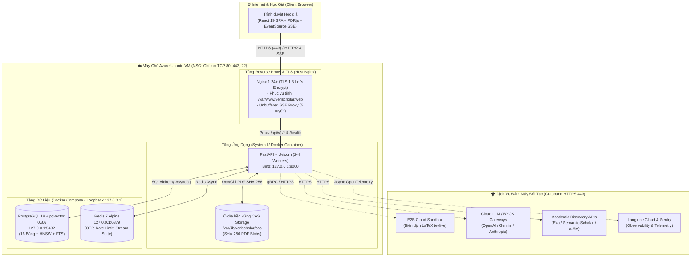

# Đặc Tả Kỹ Thuật Phân Hệ 09: Hạ Tầng Triển Khai Azure Ubuntu, CI/CD 2 Tầng & Khung Thực Nghiệm Đồ Án (Deployment, CI/CD & Quantitative Evaluation Spec)

**Phiên bản:** 2.0-OFFICIAL  
**Trạng thái:** Sẵn sàng Triển khai & Nghiệm thu Đồ án (Production & Thesis Ready)  
**Tài liệu nghiệp vụ đối ứng:** [`../PRD/08-deployment-and-system-evaluation.md`](../PRD/08-deployment-and-system-evaluation.md)  
**Phụ thuộc nền tảng:** [`00-foundation-architecture-and-db.md`](./00-foundation-architecture-and-db.md), [`07-monitoring-and-langfuse-spec.md`](./07-monitoring-and-langfuse-spec.md), [`08-universal-agent-harness-spec.md`](./08-universal-agent-harness-spec.md)

---

## 1. Kiến Trúc Triển Khai Vật Lý Trên Máy Chủ Azure Ubuntu VM (Deployment Topology)

Hệ thống VeriScholar MVP được thiết kế để vận hành tối ưu trên một máy ảo **Azure Ubuntu Server 22.04 / 24.04 LTS** (khuyến nghị cấu hình tối thiểu cho môi trường thực nghiệm/bảo vệ đồ án: `Standard_B2ms` hoặc `Standard_D2s_v5` — 2 vCPU, 8 GB RAM, 64 GB Premium SSD).



### 1.1. Hai Chế Độ Vận Hành Trên Azure Ubuntu VM
1. **Chế độ Hybrid Tiết Kiệm RAM (Khuyên dùng cho VM 4GB–8GB RAM):**
   - **PostgreSQL 18 (`pgvector`) & Redis 7:** Chạy qua [`../../docker-compose.yml`](../../docker-compose.yml) với cổng bind cứng vào `127.0.0.1:5432` và `127.0.0.1:6379`.
   - **FastAPI Backend:** Chạy trực tiếp qua `systemd` ([`../../deploy/systemd/verischolar-api.service`](../../deploy/systemd/verischolar-api.service)) sử dụng môi trường ảo `.venv/bin/uvicorn` đã đồng bộ bằng `uv sync --all-packages --frozen`.
   - **React 19 Web UI & Reverse Proxy:** Biên dịch ra `/var/www/verischolar/web` và phục vụ trực tiếp bởi Nginx trên máy chủ theo cấu hình [`../../deploy/nginx/production-host.conf`](../../deploy/nginx/production-host.conf).
2. **Chế độ Đóng Gói Container Toàn Phần (Full Containerized Mode):**
   - Đóng gói Backend qua [`../../deploy/Dockerfile.api`](../../deploy/Dockerfile.api) (dùng `uv sync --all-packages --frozen --no-dev` và gắn volume `/app/data/cas`) và Frontend qua [`../../deploy/Dockerfile.web`](../../deploy/Dockerfile.web) (multi-stage Node 22 build + `nginx:alpine` với [`../../deploy/nginx/verischolar.conf`](../../deploy/nginx/verischolar.conf)).

---

## 2. Hợp Đồng Cấu Hình Nginx Reverse Proxy & 5 Tuyến Unbuffered SSE

Để ngăn chặn triệt để hiện tượng Nginx gom bộ đệm làm đơ giao diện khi AI đang stream câu trả lời, cả hai tệp [`../../deploy/nginx/production-host.conf`](../../deploy/nginx/production-host.conf) và [`../../deploy/nginx/verischolar.conf`](../../deploy/nginx/verischolar.conf) bắt buộc định nghĩa khối `location` chuyên biệt cho toàn bộ **5 tuyến SSE** của VeriScholar MVP:

```nginx
    # Khối định tuyến SSE không bộ đệm cho toàn bộ 5 tính năng Streaming của VeriScholar MVP:
    # 1. POST /api/v1/sessions/{id}/messages:stream (Hybrid RAG Socratic Chat)
    # 2. POST /api/v1/sessions/{id}/context-table:stream (Bảng ngữ cảnh 3 cột)
    # 3. GET|POST /api/v1/documents/{id}/summary:stream (Tóm tắt cấu trúc bài báo)
    # 4. POST /api/v1/library/graph:query (Truy vấn mạng tri thức 4-Entity GraphRAG)
    # 5. POST /api/v1/drafts/{id}/chat:stream (Trợ lý soạn thảo LaTeX LangGraph)
    location ~* ^/api/v1/(sessions/.*/(chat|messages|messages:stream|context-table:stream)|documents/.*/summary:stream|library/graph:query|drafts/.*/chat:stream) {
        proxy_pass http://127.0.0.1:8000; # (hoặc http://api:8000 trong mạng container)
        proxy_http_version 1.1;
        proxy_buffering off;
        proxy_cache off;
        proxy_read_timeout 600s;
        add_header X-Accel-Buffering "no" always;
        proxy_set_header Connection "";
        proxy_set_header Host $host;
        proxy_set_header X-Real-IP $remote_addr;
        proxy_set_header X-Forwarded-For $proxy_add_x_forwarded_for;
        proxy_set_header X-Forwarded-Proto $scheme;
        chunked_transfer_encoding on;
    }
```

### 2.1. Bảng Biến Môi Trường Sản Xuất (`.env` Matrix trên Azure Ubuntu)

| Nhóm cấu hình | Tên biến môi trường | Giá trị mẫu / Quy chuẩn bảo mật |
| :--- | :--- | :--- |
| **Cơ sở dữ liệu & Cache** | `DATABASE_URL` | `postgresql+asyncpg://verischolar:<STRONG_PASS>@127.0.0.1:5432/verischolar` |
| | `REDIS_URL` | `redis://127.0.0.1:6379/0` |
| **Bảo mật & Mã hóa BYOK** | `JWT_SECRET_KEY` | Chuỗi ngẫu nhiên $\ge 64$ ký tự hex (`openssl rand -hex 32`). |
| | `BYOK_MASTER_KEY` | Khóa AES-256-GCM 32-byte mã hóa base64 dùng riêng cho `user_api_keys`. |
| **Kho Lưu trữ CAS** | `CAS_STORAGE_ROOT` | `/var/lib/verischolar/cas` (hoặc `/app/data/cas` trong container). |
| **Dịch vụ Đám mây Ngoại vi** | `E2B_API_KEY` | Khóa kết nối E2B Cloud Sandbox phục vụ biên dịch LaTeX (`Spec-06`). |
| | `EXA_API_KEY`, `S2_API_KEY` | Khóa truy vấn bài báo học thuật ngoài (`Spec-02`). |
| **Giám sát & Telemetry** | `LANGFUSE_PUBLIC_KEY`, `LANGFUSE_SECRET_KEY` | Khóa kết nối dự án `verischolar-prod` trên Langfuse Cloud (`Spec-07`). |

---

## 3. Kiến Trúc CI/CD 2 Tầng Trên GitHub Actions (`ci.yml` & `cd.yml`)

### 3.1. Luồng Continuous Integration 2 Tầng Fast-Fail ([`../../.github/workflows/ci.yml`](../../.github/workflows/ci.yml))
Pipeline CI loại bỏ hoàn toàn bước lọc đường dẫn trung gian gây trễ và loại bỏ trình biên dịch `Tectonic` di sản, chia làm 2 tầng rõ rệt:

1. **Tầng 1 — Kiểm tra Chất lượng & Bảo mật Song song (Chạy tức thì):**
   - **`security-scan`:** Quét toàn bộ lịch sử commit bằng `gitleaks/gitleaks-action@v2` để chặn rò rỉ khóa API.
   - **`backend-quality-gates`:**
     - Khởi tạo 2 GitHub Actions Service Containers: `postgres` (`pgvector/pgvector:0.8.6-pg18`, cổng `5432`, healthcheck `pg_isready`) và `redis` (`redis:7-alpine`, cổng `6379`, healthcheck `redis-cli ping`).
     - Chạy `uv sync --all-packages --frozen`.
     - Chạy kiểm tra định dạng & linter: `uv run ruff check .` và `uv run ruff format --check .`.
     - Chạy toàn bộ kiểm thử ranh giới kiến trúc, đơn vị và tích hợp: `uv run pytest -v --junitxml=test-results.xml`.
   - **`frontend-quality-gates`:**
     - Cài đặt gói với `pnpm install --frozen-lockfile`.
     - Chạy `pnpm lint` (Oxlint), `pnpm exec tsc -b`, `pnpm test:run --passWithNoTests` và `pnpm build`.
2. **Tầng 2 — Xác minh Đóng gói Container & Kịch bản Triển khai (`docker-validation`):**
   - Chỉ kích hoạt khi `needs: [backend-quality-gates, frontend-quality-gates]` đều thành công.
   - Kiểm tra cú pháp `bash -n scripts/deploy_production.sh scripts/deploy_web.sh`.
   - Đóng gói thử `deploy/Dockerfile.api` (kiểm tra `python -c "import api"`) và `deploy/Dockerfile.web`.

### 3.2. Kịch bản Tự động Triển khai (`scripts/deploy_production.sh` & `scripts/deploy_web.sh`)
- **`scripts/deploy_web.sh`:** Biên dịch gói tĩnh React 19 (`pnpm --dir apps/web build`), đồng bộ nguyên tử (atomic sync) sang thư mục đích (`WEB_DEPLOY_ROOT`, mặc định `/var/www/verischolar/web`) và kiểm tra/tải lại Nginx nếu có quyền root/systemd.
- **`scripts/deploy_production.sh`:** Khởi chạy `docker compose up -d postgres redis`, đợi healthcheck, chạy `uv sync --all-packages --frozen`, thực thi hàm khởi tạo lược đồ `ensure_database_schema()`, gọi `scripts/deploy_web.sh`, khởi động lại `verischolar-api` và kiểm tra điểm cuối `/health`.

---

## 4. Khung Thực Nghiệm & Đánh Giá Định Lượng Phục Vụ Đồ Án Tốt Nghiệp (Quantitative System Evaluation Framework)

Mục này cung cấp phương pháp luận, công thức đo lường và bảng chỉ tiêu chuẩn để sinh viên thực hiện **Chương 4 (Cài đặt, Triển khai & Thực nghiệm Đánh giá)** của Báo cáo Đồ án Tốt nghiệp.

### Thực Nghiệm 1: Hiệu Năng Hệ Thống & Độ Trễ Phản Hồi Streaming (Performance & Latency Benchmarks)

Đo đạc trên máy chủ Azure Ubuntu VM (2 vCPU, 8 GB RAM) với tập dữ liệu chuẩn gồm 20 bài báo khoa học kinh điển (trong đó có 3 bài seed mặc định: *Attention Is All You Need*, *Deep Residual Learning*, *BERT*) trên 30 lần truy vấn lặp lại để lấy trung vị (**P50**) và phân vị thứ 95 (**P95**):

| Mã chỉ số | Tên phép đo thực nghiệm | Điểm đo kỹ thuật (Instrumentation Point) | Ngưỡng SLA mục tiêu (Target) | Ý nghĩa trong Báo cáo Đồ án |
| :--- | :--- | :--- | :--- | :--- |
| **PERF-01** | **SSE Time-To-First-Token (TTFT)** | `PureASGITracingMiddleware` (`ttfb_ms` từ lúc nhận POST tới chunk `event: token` đầu tiên) | **P50 $< 800\text{ms}$**<br/>**P95 $< 1500\text{ms}$** | Chứng minh kiến trúc Async FastAPI + Nginx Unbuffered SSE phản hồi tức thì. |
| **PERF-02** | **Tier-1 Metadata Ingestion** | Thời gian xử lý `POST /api/v1/documents:ingest-metadata` (chỉ lưu siêu dữ liệu + tóm tắt) | **P95 $< 500\text{ms}$** | Chứng minh hiệu quả của cơ chế Nạp 2 tầng (tránh tải/bóc tách PDF thừa ở Bảng ngữ cảnh). |
| **PERF-03** | **Tier-2 Full PDF Parsing & Embedding** | Thời gian bóc tách PDF (15–20 trang), chia chunk kèm tọa độ BBox và tạo vector HNSW | **P95 $< 15.0\text{s}$** (hoặc $0\text{ms}$ khi trùng SHA-256 CAS) | Chứng minh tác dụng khử trùng lặp của kho lưu trữ Content-Addressable Storage (CAS). |
| **PERF-04** | **2-Hop GraphRAG Recursive CTE Query** | Thời gian thực thi truy vấn đệ quy SQL trên bảng `graph_nodes` & `graph_edges` | **P95 $< 50\text{ms}$** (chưa tính thời gian LLM tổng hợp) | Chứng minh việc dùng PostgreSQL + `pgvector` thay thế Neo4j đạt tốc độ truy vấn đồ thị cực nhanh mà không tốn thêm RAM. |
| **PERF-05** | **E2B Cloud Sandbox LaTeX Compile** | Thời gian từ lúc gửi gói `.tex` + `.bib` lên E2B tới khi nhận tệp PDF trả về | **P95 $< 5.0\text{s}$** | Chứng minh tính khả thi của việc tách trình biên dịch TeX nặng sang Cloud Sandbox cô lập. |

---

### Thực Nghiệm 2: Độ Chính Xác Truy Xuất AI & Minh Chứng Tọa Độ (AI Retrieval & Grounding Accuracy)

Thực hiện đánh giá chất lượng AI trên bộ câu hỏi kiểm định chuẩn (**Golden Academic QA Dataset** gồm 50 câu hỏi đa bài báo có gán nhãn đoạn văn bản đích và tọa độ hộp giới hạn chuẩn trên trang PDF):

1. **Độ thu hồi Truy xuất Lai (Hybrid Search `Recall@K` với $K \in \{3, 5, 10\}$):**
   - So sánh 3 phương pháp trên cùng tập dữ liệu:
     - *Baseline 1 (Lexical FTS thuần túy):* Chỉ dùng `tsvector` (`ts_rank_cd`).
     - *Baseline 2 (Dense Vector thuần túy):* Chỉ dùng khoảng cách Cosine `<=>` trên chỉ mục HNSW `pgvector`.
     - *Phương pháp đề xuất (VeriScholar Hybrid RRF):* Kết hợp Dense Vector + Lexical FTS qua công thức Reciprocal Rank Fusion:
       $$\text{RRF\_Score}(d) = \frac{1}{60 + \text{rank}_{\text{vector}}(d)} + \frac{1}{60 + \text{rank}_{\text{fts}}(d)}$$
   - **Chỉ tiêu nghiệm thu:** Phương pháp Hybrid RRF đạt **`Recall@5 >= 0.85`**, vượt trội hơn cả hai phương pháp đơn lẻ khi truy vấn các thuật ngữ viết tắt toán học hoặc tên mô hình/bộ dữ liệu đặc thù (*BLEU*, *WMT 2014*, *Multi-Head Attention*).
2. **Độ khớp Tọa độ Minh chứng Trực quan (`Bounding Box IoU`):**
   - Đo tỷ lệ giao trên hợp (Intersection over Union - IoU) giữa hộp tọa độ chuẩn hóa `[x0, y0, x1, y1, page]` (thang `[0..1000]`) do hệ thống tô sáng trên `PdfCanvasViewer` và hộp tọa độ nhãn thực tế:
     $$\text{IoU}(B_{\text{pred}}, B_{\text{gt}}) = \frac{\text{Area}(B_{\text{pred}} \cap B_{\text{gt}})}{\text{Area}(B_{\text{pred}} \cup B_{\text{gt}})}$$
   - **Chỉ tiêu nghiệm thu:** Đạt **`IoU trung bình >= 0.85`** và **100% đúng số trang (`page`)**.
3. **Tỷ lệ Tự sửa lỗi Biên dịch LaTeX của LangGraph ReAct Loop (`Self-Healing Success Rate`):**
   - Thử nghiệm 30 yêu cầu chỉnh sửa LaTeX cố tình chứa lỗi cú pháp phổ biến (thiếu dấu `}`, quên đóng môi trường `\end{tabular}`, sai khóa trích dẫn `\cite{...}`).
   - **Chỉ tiêu nghiệm thu:** Vòng lặp `compile_e2b -> diagnose_error -> edit_tex` (tối đa 3 lần thử) tự động khắc phục và xuất PDF thành công **$\ge 90\%$** trường hợp mà không cần người dùng can thiệp thủ công.

---

### Thực Nghiệm 3: Ma Trận Kiểm Thử Tự Động & Kỷ Luật Ranh Giới Kiến Trúc (Automated Verification Matrix)

Bảng tổng hợp minh chứng chất lượng phần mềm đưa vào mục **Kiểm thử Hệ thống** của Đồ án Tốt nghiệp:

| Cổng xác minh | Lệnh thực thi chuẩn | Phạm vi bảo vệ kỹ thuật | Tiêu chí nghiệm thu |
| :--- | :--- | :--- | :--- |
| **Cổng 1: Python Linter & Formatter** | `uv run ruff check . && uv run ruff format --check .` | Chuẩn hóa PEP8, phát hiện biến thừa, lỗi import và đồng nhất định dạng toàn bộ `apps/api` & `packages/core`. | `0 errors`, exit code `0`. |
| **Cổng 2: Backend, DB & Boundary Tests** | `uv run pytest -v` | Kiểm thử AST Kiến trúc Lục giác (`test_architecture_boundary.py`), kiểm thử liên kết tài liệu, cấu hình Nginx SSE và kiểm thử tích hợp 16 bảng PostgreSQL với Transaction Rollback. | `100% passed`, exit code `0`. |
| **Cổng 3: Frontend Lint & Unit Tests** | `npm --prefix apps/web run lint && npm --prefix apps/web run test` | Kiểm tra quy tắc React 19 hooks (Oxlint) và kiểm thử đơn vị các store Zustand, parser SSE và tính toán tọa độ PDF. | `0 errors`, exit code `0`. |
| **Cổng 4: Production Bundle Build** | `npm --prefix apps/web run build` | Kiểm tra kiểu tĩnh nghiêm ngặt (`tsc -b`) và đóng gói tài sản giao diện tối ưu qua Vite 8. | Biên dịch thành công `dist/`, exit code `0`. |
