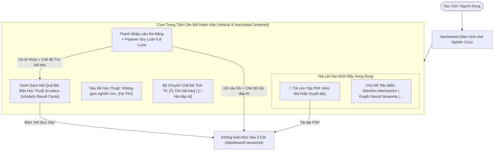

# Thiết Kế Kiến Trúc: Hợp Nhất Trạm Nghiên Cứu Tập Trung Tại `/dashboard` (Unified Scholarly Research Hub Design)

> **Document Class:** Technical Specification & UX Design Document  
> **Status:** Approved (Phương Án 3 - Chuẩn Perplexity / Claude)  
> **Route:** `/dashboard` (hoặc `/dashboard/:sessionId`)  
> **Tuân thủ quy chuẩn:** `AGENTS.md` (Relative Markdown links only, Radical Minimalism, Responsive UX)

---

## 1. Bối Cảnh & Vấn Đề (Problem Statement)
- **Lỗi giao diện (Responsive Void):** Màn hình chờ hiện tại (`showStandbyHero`) chỉ hiển thị một thẻ kéo thả PDF đơn lẻ bị treo lơ lửng sát mép trên cùng, bên dưới là khoảng trống đen rất lớn trên màn hình rộng (1080p, 2K, Ultrawide).
- **Thiếu thành phần cốt lõi:** Thanh nhập liệu với bộ chọn suy luận **5.6 Luna** không xuất hiện ở màn hình chờ; người dùng không thể đặt câu hỏi hoặc tương tác với AI khi chưa có phiên đọc.
- **Trải nghiệm phân mảnh:** Tính năng Khám phá bài báo học thuật (Plan 02) nằm ở một trang riêng biệt (`/discovery`), tách rời khỏi luồng làm việc chính tại `/dashboard`, khiến người dùng không biết cách bắt đầu tìm kiếm bài báo.

---

## 2. Giải Pháp: Trạm Nghiên Cứu Hợp Nhất (Unified Scholarly Hub)
Khi người dùng truy cập `/dashboard` mà chưa chọn phiên đọc nào, giao diện hiển thị **Cụm Trung Tâm Cân Đối Hoàn Hảo** (theo chuẩn Claude / Perplexity):

---

## 3. Các Thành Phần Kỹ Thuật Chi Tiết

### 3.1. Căn Chỉnh Responsive Toàn Diện
- Khung trung tâm sử dụng `min-h-full flex-1 flex flex-col items-center justify-center px-4 py-8 max-w-4xl mx-auto w-full`.
- Tự động chuyển đổi mượt mà giữa trạng thái Hero (chưa có kết quả tìm kiếm) và trạng thái hiển thị kết quả (Search Results View) có cuộn nội dung tự nhiên.

### 3.2. Thanh Nhập Liệu Đa Năng (Unified Input Bar)
- Tích hợp `ReasoningPopover` điều khiển 4 mức suy luận của mô hình **5.6 Luna** (`Off`, `Low`, `Medium`, `High`).
- Cho phép học giả:
  - Chọn chế độ **Tìm bài báo khoa học** (kết nối trực tiếp `discoveryApi.search`)
  - Hoặc chọn chế độ **Hỏi đáp học thuật** (tự động tạo phiên và streaming SSE qua `session_chat_service`).

### 3.3. Thẻ Gợi Ý Chủ Đề Học Thuật & Nạp PDF Nhẹ Nhàng
- Gợi ý 4 chủ đề nghiên cứu kinh điển:
  1. `Attention Mechanism & Transformer`
  2. `Graph Neural Networks & Drug Discovery`
  3. `Deep Residual Learning (ResNet)`
  4. `Diffusion Models & Generative AI`
- Bấm vào chip chủ đề $\rightarrow$ Điền vào ô tìm kiếm và kích hoạt tìm kiếm bài báo ngay lập tức.
- Vùng tải lên PDF gọn gàng (`HeroUploadDropzone` phiên bản compact hoặc nút tải lên kèm khu vực dropzone thanh lịch) với đầy đủ tiến trình tải lên, bóc tách PyMuPDF 2 cột và nạp CAS.

### 3.4. Kết Quả Tìm Kiếm Hiển Thị Tức Thì (In-place Discovery Cards)
- Danh sách `ScholarlyResultCard` hiển thị ngay bên dưới thanh tìm kiếm với đầy đủ huy hiệu:
  - `🟢 Có sẵn PDF Open Access` kèm nút `[📖 Mở Đọc Sâu]`
  - `🔒 Chỉ có Tóm tắt (Paywall)` kèm nút `[📄 Xem Tóm Tắt]`
- Bấm mở đọc sâu lập tức gọi `discoveryApi.openReading` và chuyển sang `/dashboard/:sessionId` mượt mà.
