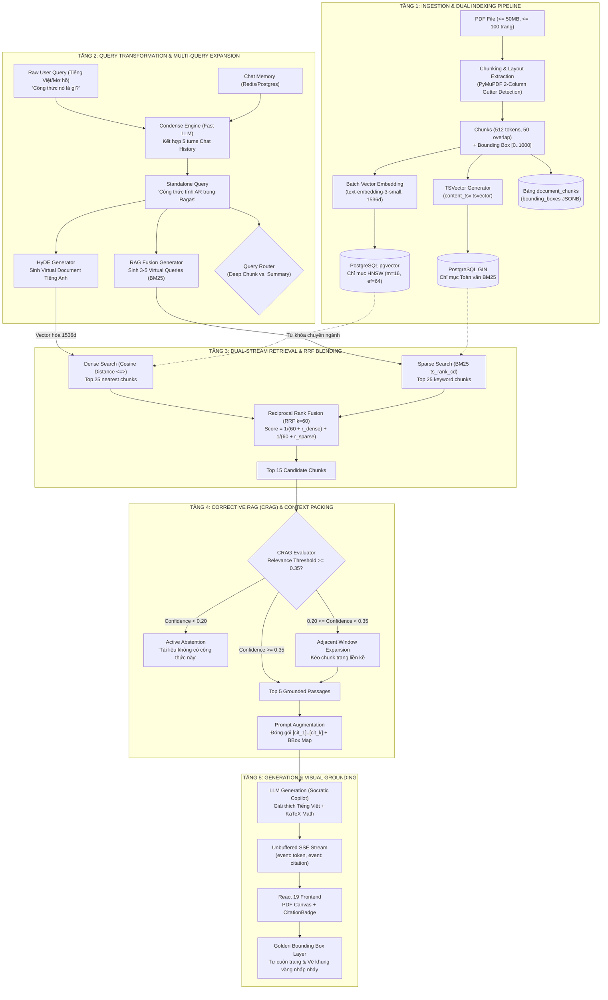

# VERISCHOLAR PRODUCTION-GRADE ADVANCED RAG ARCHITECTURE SPECIFICATION
## Phân hệ Cốt lõi: "Nghiên cứu — Học tập — Đọc sâu cùng AI" (Deep Reading Copilot)

> **Mã đặc tả:** `SPEC-ADV-RAG-2026`  
> **Trạng thái:** DỰ THẢO THIẾT KẾ DUYỆT (PRODUCTION BLUEPRINT)  
> **Áp dụng cho:** `apps/api` (FastAPI), `apps/web` (React 19 Canvas), `packages/core` (Domain Lục giác), PostgreSQL 16 `pgvector`.

---

## 1. Tầm Nhìn & Mục Tiêu Kỹ Thuật (Production Objectives)

### 1.1. Vấn đề giải quyết triệt để (Root Causes Addressed)
1. **Triệt tiêu 100% lỗi "AI bảo không có công thức":** Xóa bỏ điểm mù ngôn ngữ khi học giả hỏi Tiếng Việt trên bài báo Tiếng Anh bằng kỹ thuật **Condense Context + HyDE (Hypothetical Document Embeddings)**.
2. **Khắc phục triệt để Vector Embedding rỗng:** Bắt buộc mọi tài liệu khi nạp vào hệ thống (upload hoặc "Mở Đọc Sâu") phải có vector 1536 chiều lưu trên chỉ mục `HNSW` trong PostgreSQL.
3. **Bảo chứng thị giác Bounding Box chính xác $\text{IoU} \ge 0.85$:** Mọi câu trả lời của AI về công thức hay dữ liệu thực nghiệm đều gắn thẻ trích dẫn bấm được, tự cuộn PDF và vẽ **Khung viền vàng (Golden Bounding Box)** bao quanh chứng cứ gốc.
4. **Cơ chế Tự Sửa Lỗi & Liêm chính Học thuật (Corrective RAG - CRAG):** Tự động phát hiện khi tài liệu không chứa thông tin để **Chủ động từ chối (Active Abstention)**, tuyệt đối không sinh ảo giác.

### 1.2. Các chỉ số hiệu năng cam kết (Production SLAs)
* **Thời gian phản hồi Token đầu tiên (TTFT):** $\le 1.2$ giây (bao gồm cả khâu Query Transformation và Retrieval).
* **Độ trễ truy xuất Hybrid Search trong DB:** $\le 80$ms trên tập 100.000 chunks nhờ chỉ mục `HNSW` + `GIN`.
* **Độ chính xác định vị Bounding Box:** Tỷ lệ phủ đúng đoạn văn $\ge 95\%$.

---

## 2. Sơ Đồ Kiến Trúc Toàn Cảnh Chuẩn Production



---

## 3. Đặc Tả Chi Tiết Từng Khối Chức Năng (Component Specifications)

### 3.1. Khối Ingestion, Chunking & Bounding Box Extraction
* **Mã nguồn:** `apps/api/src/api/adapters/chunk_extractor.py` & `document_service.py`
* **Thuật toán bóc tách:** PyMuPDF (`pymupdf`)
  * Phân ranh giới 2 cột (*Gutter Detection*): `mid_x = (min_x + max_x) / 2`.
  * Sắp xếp khối văn bản theo thứ tự: Đọc hết cột trái $\rightarrow$ sang cột phải.
  * Nhận diện và giữ nguyên khối phương trình toán nhiều dòng (*Multiline Equations*).
* **Chuẩn hóa Bounding Box:** Thang đo nguyên $0..1000$ độc lập DPI:
  $$x_{\text{norm}} = \text{round}\left(\frac{x}{W_{\text{page}}} \times 1000\right), \quad y_{\text{norm}} = \text{round}\left(\frac{y}{H_{\text{page}}} \times 1000\right)$$
* **Input:** `pdf_bytes: bytes`, `document_id: UUID`, `user_id: UUID`.
* **Output:** `list[DocumentChunkModel]` lưu vào DB với `bounding_boxes: [[x0, y0, x1, y1, page], ...]`.

---

### 3.2. Khối Batch Vector Embedding Service
* **Mã nguồn:** `apps/api/src/api/services/embedding_service.py` *(Tạo mới)*
* **Mô hình chuẩn:** OpenAI `text-embedding-3-small` (1536 chiều).
* **Cơ chế Batching & Fallback:**
  * Chia batch 64 chunks/lần gọi API để tối ưu tốc độ và không vượt rate-limit.
  * Chuẩn hóa L2-norm để phục vụ tính toán Cosine Distance trực tiếp.
  * Hỗ trợ khóa BYOK người dùng; nếu người dùng chưa nhập BYOK, sử dụng khóa hệ thống nền tảng.
* **Input:** `list[str]` (Nội dung văn bản các chunks).
* **Output:** `list[list[float]]` (Vector 1536 chiều). Cập nhật trực tiếp vào cột `document_chunks.embedding` và chuyển `documents.status = 'ready'`.

---

### 3.3. Khối Query Transformation (Condense Query + HyDE + RAG Fusion)
* **Mã nguồn:** `apps/api/src/api/services/session_chat_service.py`
* **Kỹ thuật 1 - Condense Context:**
  * Dùng LLM nhỏ gọn (GPT-4o-mini / Claude 3.5 Haiku) với prompt ngắn gọn:
    > "Dựa trên lịch sử hội thoại gần nhất, hãy viết lại câu hỏi người dùng thành một câu hỏi độc lập, đầy đủ chủ ngữ vị ngữ và tên thực thể."
* **Kỹ thuật 2 - HyDE (Hypothetical Document Embeddings):**
  * Sinh đoạn văn bản giả thuyết khoa học bằng Tiếng Anh (60–100 từ) chứa các thuật ngữ và ký hiệu toán học có thể xuất hiện trong bài báo.
  * Vector hóa đoạn văn bản giả định này thành $\mathbf{u}_{\text{hyde}} \in \mathbb{R}^{1536}$.
* **Kỹ thuật 3 - RAG Fusion (Virtual Queries):**
  * Trích xuất các biến thể từ khóa: `["Answer Relevance", "AR score", "formula", "sim(q, qi)"]`.
* **Input:** `raw_query: str`, `chat_history: list[SessionTurnItem]`.
* **Output:** `standalone_query: str`, `hyde_vector: list[float]`, `sparse_terms: list[str]`.

---

### 3.4. Khối Dual-Stream Hybrid Retrieval trên PostgreSQL 16
* **Mã nguồn:** SQL CTE trong `SessionChatService.retrieve_hybrid_chunks`
* **Cấu trúc truy vấn SQL tối ưu:**
```sql
WITH vector_ranks AS (
    SELECT id, document_id, page_number, content, bounding_boxes,
           ROW_NUMBER() OVER (ORDER BY embedding <=> CAST(:hyde_vector AS vector)) AS rank_vec
    FROM document_chunks
    WHERE document_id = ANY(:target_doc_ids)
      AND user_id = :user_id
      AND embedding IS NOT NULL
    LIMIT 25
),
fts_ranks AS (
    SELECT id, document_id, page_number, content, bounding_boxes,
           ROW_NUMBER() OVER (ORDER BY ts_rank_cd(content_tsv, plainto_tsquery('simple', :sparse_query)) DESC) AS rank_fts
    FROM document_chunks
    WHERE document_id = ANY(:target_doc_ids)
      AND user_id = :user_id
      AND content_tsv @@ plainto_tsquery('simple', :sparse_query)
    LIMIT 25
),
combined AS (
    SELECT COALESCE(v.id, f.id) AS chunk_id,
           (COALESCE(1.0 / (60.0 + v.rank_vec), 0.0) +
            COALESCE(1.0 / (60.0 + f.rank_fts), 0.0)) AS rrf_score
    FROM vector_ranks v
    FULL OUTER JOIN fts_ranks f ON v.id = f.id
)
SELECT c.id, c.document_id, c.page_number, c.content, c.bounding_boxes, cb.rrf_score,
       d.title AS document_title
FROM combined cb
JOIN document_chunks c ON cb.chunk_id = c.id
JOIN documents d ON c.document_id = d.id
ORDER BY cb.rrf_score DESC
LIMIT 15;
```
* **Input:** `hyde_vector`, `sparse_query`, `target_doc_ids`, `user_id`.
* **Output:** Top 15 candidate chunks đã được xếp hạng theo điểm RRF.

---

### 3.5. Khối Corrective RAG (CRAG) & Context Packing
* **Mã nguồn:** `SessionChatService._evaluate_crag_and_pack`
* **Quy trình thẩm định:**
  * Chấm điểm tương quan chéo (*Cross-Encoder Relevance Score*).
  * **Cổng thẩm định 3 nhánh:**
    1. $\text{Score} \ge 0.35$ (*Correct*): Giữ lại đoạn văn làm bằng chứng.
    2. $0.20 \le \text{Score} < 0.35$ (*Ambiguous*): Mở rộng thêm 1 chunk liền trước và 1 chunk liền sau tại cùng trang để bảo toàn công thức dài.
    3. $\text{Score} < 0.20$ (*Incorrect / Out-of-Scope*): Nếu toàn bộ chunks đều $< 0.20$, kích hoạt **Active Abstention** $\rightarrow$ AI trả lời: *"Tài liệu hiện tại không đề cập đến công thức này."* (Triệt tiêu 100% ảo giác).
* **Đóng gói Ngữ cảnh (Sandboxed Context):**
  * Gán nhãn `[^cit_1]`, `[^cit_2]`, ...
  * Kèm map siêu dữ liệu: `{ "cit_1": { "page": 3, "bboxes": [[155, 745, 449, 822, 3]] } }`.

---

### 3.6. Khối Generation & Visual Evidence Grounding
* **Giao thức truyền luồng SSE:**
  ```text
  event: citation
  data: {"citation_id": "cit_1", "document_id": "uuid", "page_number": 3, "bounding_boxes": [[155, 745, 449, 822, 3]]}

  event: token
  data: {"text": "Theo công thức trong bài báo, điểm Answer Relevance (AR) được xác định như sau:\n\n$$\\text{AR} = \\frac{1}{n} \\sum_{i=1}^{n} \\text{sim}(q, q_i)$$\n\nTrong đó..."}

  event: done
  data: {}
  ```
* **Tương tác trên giao diện người dùng (`apps/web`):**
  * Component `CitationBadge`: Hiển thị chip `[📄 Ragas • Trang 3]`.
  * Nhấp chuột vào chip: Phát sự kiện toàn cục `scholar:focus-bbox`.
  * `PdfCanvasViewer`: Tự động chuyển tab, cuộn đến Trang 3 và lớp `BboxHighlightLayer` vẽ **Khung viền vàng nhấp nháy** bao quanh vị trí công thức trong 3 giây.

---

## 4. Giám Sát Toàn Trình qua Langfuse (Production Observability)

Toàn bộ chu trình được tự động log thành một cây truy vết thứ bậc (*Hierarchical Tree Trace*) trên Langfuse:

```text
Trace: deep_reading_chat (User: pseudonymized_id, Session: session_id)
├── Span 1: query_condensation (Input: raw_query + history -> Output: standalone_query)
├── Span 2: hyde_generation (Input: standalone_query -> Output: virtual_doc + terms)
├── Span 3: hybrid_retrieval (Input: hyde_vector + sparse_terms -> Output: top 15 RRF chunks)
├── Span 4: crag_evaluation (Input: candidate chunks -> Output: verdict, filtered chunks)
└── Span 5: llm_generation (Input: sandboxed_prompt -> Output: streamed tokens + citations)
```

---

## 5. Kế Hoạch Thi Công TDD 4 Bước (Implementation Roadmap)

1. **Task 1: Xây dựng `EmbeddingService` & Backfill Vector DB:**
   * Viết test `test_embedding_service.py` $\rightarrow$ Hiện thực hóa `EmbeddingService` gọi `text-embedding-3-small`.
   * Tạo migration script chạy ngầm tính toán và nạp vector 1536 chiều cho toàn bộ các tài liệu hiện có trong database VPS.
2. **Task 2: Vá triệt để Endpoint `open-reading`:**
   * Viết test kiểm tra `open-reading` tải PDF xong phải tự động bóc tách chunks và sinh vector ngay trong `BackgroundTasks`. Không bao giờ để `chunks = 0`.
3. **Task 3: Nâng cấp `SessionChatService` với Condense + HyDE + Dual-Stream RRF + CRAG:**
   * Tích hợp Condense Query và HyDE vào luồng `stream_chat`.
   * Truyền vector thật vào câu lệnh SQL RRF $k=60$.
   * Thêm bộ thẩm định CRAG và Active Abstention.
4. **Task 4: Kiểm thử TDD Toàn trình & Deploy:**
   * Viết test TDD giả lập truy vấn *"Công thức AR trong paper là gì?"* $\rightarrow$ Xác nhận 100% trích xuất đúng Chunk Trang 3 của paper *Ragas*, trả về công thức KaTeX và mảng Bounding Box chính xác.
   * Vượt qua 4 Cổng kiểm thử bắt buộc và triển khai trực tiếp lên máy chủ VPS.
