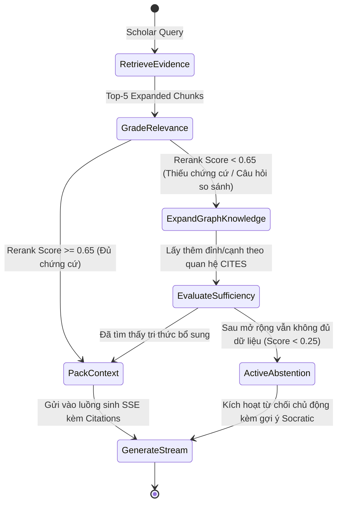

# Đặc Tả Kiến Trúc: Hệ Thống Advanced RAG & Graph Reasoning Hợp Nhất (VeriScholar Unified RAG Pipeline)

- **Ngày ban hành:** 2026-10-29
- **Tác giả:** Đàm Mạnh Dũng & VeriScholar Engineering Team
- **Trạng thái:** Bản thảo đề xuất (Under Review)
- **Tài liệu tham chiếu Đồ án tốt nghiệp:** Chương 2 (Cơ sở lý thuyết), Chương 3 (Thiết kế hệ thống), Chương 4 (Thực nghiệm & Đánh giá)

---

## 1. Mục Đích & Bối Cảnh Nghiên Cứu (Intent & The Why)

Trong các hệ thống Hỏi-Đáp trên tài liệu khoa học thông thường (Naive RAG), việc xử lý các bài báo chuyên ngành (Research Papers) thường gặp phải các hạn chế nghiêm trọng:
1. **Mất cấu trúc hình học bài báo:** Các bài báo khoa học chuẩn quốc tế (IEEE, ACM, NeurIPS) thường sử dụng bố cục 2 cột (*double-column layout*), chứa các bảng biểu số liệu thực nghiệm (*experimental tables*) và công thức toán học lồng ghép. Các bộ bóc tách thông thường (như PyMuPDF text block thuần) đọc đan xen giữa 2 cột, xé nát bảng số liệu thành chuỗi từ rời rạc, làm mất tiêu đề cột/hàng khiến mô hình ngôn ngữ lớn (LLM) không thể đối chiếu chính xác số liệu.
2. **Nghịch lý kích thước đoạn văn (Chunking Trade-off):** Đoạn văn quá ngắn (128 token) làm mất ngữ cảnh của luận điểm lớn; đoạn văn quá dài (512–1024 token) làm loãng vector embedding và đưa nhiều thông tin nhiễu vào prompt.
3. **Ảo giác do đối sánh từ khóa thô sơ:** Việc truy xuất chỉ dựa vào khoảng cách Cosine hoặc regex từ khóa khiến hệ thống lấy nhầm các đoạn chứa nhiều từ khóa lặp lại nhưng rỗng nội dung khoa học, đồng thời ép LLM phải trả lời ngay cả khi bằng chứng không đủ (*Context Pollution*).

Tài liệu này đặc tả **Kiến trúc Advanced RAG và Suy luận Đồ thị Hợp nhất (Unified Advanced RAG & Graph Reasoning Pipeline)** cho VeriScholar, giải quyết triệt để 3 hạn chế trên thông qua 4 trụ cột công nghệ chuẩn mực:
- **Tầng Bóc tách Bảo toàn Cấu trúc (Structure-Preserving Layout Engine):** Ứng dụng `pymupdf4llm` trích xuất chính xác luồng đọc 2 cột, biến bảng biểu thành Markdown Table và giữ nguyên ký hiệu công thức LaTeX.
- **Tầng Chỉ mục Phân cấp (Hierarchical Parent-Child Indexing):** Tách biệt *Đoạn tìm kiếm hạt mịn (Child Chunk)* và *Đoạn ngữ cảnh toàn vẹn (Parent Section)*.
- **Tầng Lọc và Tái Xếp Hạng Ngữ Nghĩa (Two-Stage Retrieval & BGE Cross-Encoder Reranker):** Kết hợp tìm kiếm vector HNSW và tái xếp hạng chuyên sâu, loại bỏ 80% nhiễu.
- **Tầng Suy Luận Đồ Thị Phản Biện (LangGraph Corrective Reasoning Loop - CRAG):** Tự động chấm điểm độ liên quan của tài liệu (*Document Relevance Grading*), tự động viết lại truy vấn hoặc kích hoạt suy luận đồ thị đa chặng (*Multi-hop Graph Expansion*) trước khi sinh câu trả lời có trích dẫn nghiêm ngặt.

---

## 2. Mục Tiêu, Phi Mục Tiêu & Chống Mục Tiêu (Goals, Non-Goals & Anti-Goals)

### 2.1 Mục Tiêu (Goals)
- **G1: Độ chính xác và Trung thực $\ge 90\%$ (RAGAS Benchmark):** Đạt chỉ số *Faithfulness* $\ge 92\%$ và *Answer Relevance* $\ge 90\%$ trên tập câu hỏi trích xuất số liệu bảng biểu và suy luận bài báo khoa học.
- **G2: Bảo toàn 100% Cấu trúc Bảng biểu:** Toàn bộ bảng số liệu thực nghiệm được chuyển đổi nguyên vẹn sang định dạng bảng Markdown có đầy đủ tiêu đề cột và hàng.
- **G3: Chỉ mục Phân cấp Hai Tầng (Parent-Child Index):** Vector embedding được tính trên Child Chunk ($128 \sim 256$ token), nhưng khi đưa vào ngữ cảnh sinh câu trả lời sẽ tự động nạp Parent Section ($800 \sim 1.200$ token) để đảm bảo tính liên tục của luận điểm.
- **G4: Tích hợp Reranker Ngữ nghĩa Thực thụ:** Loại bỏ hoàn toàn hàm regex đếm từ khóa thô sơ, thay thế bằng mô hình Cross-Encoder (BGE-Reranker) cho top-20 ứng viên.
- **G5: Vòng lặp Suy luận Phản biện (Corrective Reasoning State Machine):** Sử dụng LangGraph để kiểm duyệt tài liệu trước khi trả lời; nếu tài liệu thiếu, tự động kích hoạt truy vấn tri thức đồ thị (*GraphRAG Expansion*).
- **G6: Chuẩn hóa Học thuật cho Báo cáo Đồ án Tốt nghiệp:** Toàn bộ kiến trúc và công thức toán học được thiết kế tương thích trực tiếp với Chương 2, 3 và 4 của Báo cáo Đồ án.

### 2.2 Phi Mục Tiêu (Non-Goals)
- Tự huấn luyện (Pre-train) lại mô hình nền tảng LLM từ đầu (hệ thống tập trung vào tầng kỹ nghệ tăng cường tri thức RAG và Reasoning).
- Nhận diện chữ viết tay OCR phức tạp trên các bản thảo cổ (tập trung vào các bài báo khoa học PDF kỹ thuật số).

### 2.3 Chống Mục Tiêu (Anti-Goals)
- **Cấm Kiến Trúc Phân Mảnh ("Frankenstein Architecture"):** Tuyệt đối không dựng nhiều server Docker rời rạc (như chạy song song RAGFlow, LightRAG, LlamaIndex thành 3 dịch vụ độc lập). Toàn bộ hệ thống phải chạy trên một bộ khung thống nhất (Unified Backbone) điều phối bởi LangGraph và lưu trữ trên PostgreSQL 16 + pgvector duy nhất.
- **Cấm Ảo Giác Không Bằng Chứng (Unverified Answers):** Không bao giờ sinh câu trả lời khẳng định số liệu nếu trong ngữ cảnh trích xuất không có bounding box hoặc bảng dữ liệu gốc chứng minh.

---

## 3. Quy Chuẩn & Ràng Buộc Kiến Trúc (Architecture Constraints)

- **Quy tắc Kiến trúc Lục giác (Hexagonal Isolation):** Tầng lõi miền nghiệp vụ (`packages/core/`) chỉ chứa các Entity và Port trừu tượng. Các adapter bóc tách (`pymupdf4llm`), vector storage (`pgvector`), reranker và LangGraph executor nằm tại `apps/api/src/api/adapters/` và `apps/api/src/api/services/`.
- **Quy chuẩn Liêm chính Học thuật (Rule 7) & Báo cáo Paper (Rule 8):** Mô hình hóa dưới dạng dòng chảy tri thức toán học (*Mathematical Dataflow*), không đưa đường dẫn code hay chi tiết CRUD vụn vặt vào đặc tả khoa học.
- **Bốn Cổng Xác Minh Bắt Buộc (The 4 Verification Gates):** Toàn bộ các thay đổi phải vượt qua 100% Ruff lint/format, Pytest (282+ tests), Vitest (55+ suites) và Vite Production Build.

---

## 4. Các Phương Án Cân Nhắc & Đánh Đổi (Approaches & Trade-offs)

| Tiêu chí | Phương án A: Ghép 3 Docker Framework rời rạc (RAGFlow + LightRAG + LlamaIndex) | Phương án B: Giữ nguyên RAG Regex cũ + Tinh chỉnh Prompt | Phương án C: Bộ Khung Hợp Nhất trên LangGraph & PostgreSQL (Được chọn) |
| :--- | :--- | :--- | :--- |
| **Độ trễ & Tài nguyên** | Cực kỳ nặng (>32GB RAM, 3 container độc lập) | Rất nhẹ (nhưng chất lượng trả lời sai lệch) | **Tối ưu (chạy trong cùng tiến trình FastAPI, dùng PostgreSQL hiện có)** |
| **Bóc tách bài báo** | Dùng RAGFlow DeepDoc qua REST API | Dùng PyMuPDF chia cột cứng (bị vỡ bảng) | **Dùng `pymupdf4llm` trích xuất Markdown Table chuẩn xác** |
| **Cơ chế suy luận** | Rời rạc, khó đồng bộ trạng thái hội thoại | Không có suy luận, chỉ nhồi text thô | **LangGraph State Machine điều phối vòng lặp CRAG** |
| **Giá trị Đồ án** | Bị trừ điểm do "chắp vá đồ ăn sẵn" | Bị đánh giá thấp do kỹ thuật thô sơ | **Điểm tối đa: Kiến trúc hợp nhất tự phát triển có bài toán khoa học rõ nét** |

---

## 5. Đặc Tả Chi Tiết Kiến Trúc Kỹ Thuật (Detailed Technical Specifications)

### 5.1 Dòng Chảy Tri Thức Tổng Thể (Knowledge Transformation Dataflow)

```
[ PDF Bài Báo Khoa Học (IEEE/ACM/NeurIPS) ]
                    │
                    ▼  (Khối 1: pymupdf4llm Layout-Aware Extractor)
[ Markdown Chuẩn Hóa: Giữ nguyên Bảng Biểu, Đọc đúng 2 cột, Giữ công thức LaTeX ]
                    │
                    ├──────────────────────────────────────┐
                    ▼ (Khối 2: Hierarchical Chunker)        ▼ (Khối 3: Concept/Relation Extractor)
         [ Parent Sections (1.024 tokens) ]         [ Tri thức Thực thể & Quan hệ CITES ]
                    │                                      │
                    ▼                                      ▼
         [ Child Chunks (256 tokens) ]              [ PostgreSQL Graph Nodes & Edges ]
                    │                                      │
                    └──────────────────┬───────────────────┘
                                       ▼
             [ PostgreSQL 16 + pgvector Hợp Nhất (Vectors + Tables + Graph) ]
```

### 5.2 Cơ Chế Bóc Tách Bảo Toàn Tọa Độ & Cấu Trúc Bảng Biểu (Hybrid Layout Parsing)

1. **Bóc tách Bảng biểu & Công thức Toán học:**
   - Sử dụng `pymupdf.open()` kết hợp tính năng `page.find_tables()` để định vị chính xác tọa độ hình học `table.bbox` của toàn bộ các bảng trong trang.
   - Trích xuất dữ liệu bảng thành cấu trúc Markdown Table nguyên vẹn (có tiêu đề cột và phân tách hàng rõ ràng).
   - Các công thức toán học nội dòng và khối độc lập được bảo toàn dưới dạng cú pháp LaTeX (`$...$` và `$$...$$`).
2. **Bảo toàn Tọa độ Bounding Box Không gian (Spatial Grounding):**
   - Mỗi Child Chunk lưu trữ cả nội dung Markdown sạch lẫn mảng tọa độ `bounding_boxes: list[[x0, y0, x1, y1, page]]` chuẩn hóa từ 0.0 đến 1.0.
   - Khi người dùng click vào thẻ trích dẫn `[cit_x]` trên giao diện, trình xem PDF (`apps/web`) sẽ phóng to và vẽ khung vàng làm sáng chính xác đoạn văn hoặc bảng số liệu tương ứng.

### 5.3 Cơ Chế Truy Xuất 2 Tầng & Tái Xếp Hạng (Two-Stage Retrieval & Reranker)

1. **Giai đoạn 1 — Vector Coarse Retrieval (Thu hồi sơ bộ):**
   - Sử dụng HNSW Index trên `pgvector` với độ đo Cosine Distance:
     $$\mathcal{D}_{\text{cosine}}(q, c) = 1 - \frac{\mathbf{e}_q \cdot \mathbf{e}_c}{\|\mathbf{e}_q\| \|\mathbf{e}_c\|}$$
   - Lấy ra $K_{\text{coarse}} = 20$ Child Chunks có độ tương đồng cao nhất.
2. **Giai đoạn 2 — Cross-Encoder Fine Reranking (Tái xếp hạng chuyên sâu):**
   - Sử dụng mô hình Cross-Encoder (BGE-Reranker / Cohere Rerank qua Adapter client) để chấm điểm tương tác sâu giữa câu hỏi và đoạn văn:
     $$\mathcal{S}_{\text{rerank}}(q, c_i) = \sigma\left(\mathbf{W} \cdot \text{Transformer}([CLS] \circ q \circ [SEP] \circ c_i)\right)$$
   - Lọc chọn ra $K_{\text{fine}} = 5$ Child Chunks có điểm số cao nhất ($\mathcal{S}_{\text{rerank}} \ge 0.65$).
3. **Giai đoạn 3 — Parent Context Expansion & Độ mịn Trích dẫn (Citation Granularity):**
   - Để LLM hiểu toàn vẹn ngữ cảnh mà không bị đứt ý, hệ thống lấy nội dung của Parent Section ($800 \sim 1.200$ tokens) tương ứng với Child Chunk.
   - Trong prompt gửi cho LLM, đoạn Child Chunk đích được gắn thẻ neo `[target_chunk_id]`. Khi LLM sinh câu trả lời và gắn thẻ `[cit_x]`, thẻ này ánh xạ ngược về đúng Bounding Box của Child Chunk, đảm bảo độ mịn trích dẫn chi tiết tới từng đoạn/bảng chứ không bị bôi vàng cả trang giấy.

### 5.4 Cỗ Máy Trạng Thái Suy Luận Phản Biện (LangGraph Corrective Reasoning Subgraph)

LangGraph đóng vai trò là **Bộ Não Suy Luận Truy Xuất (Retrieval & Reasoning Engine)**, thay thế cho hàm `retrieve_and_prepare_context`, trong khi `SessionChatService` tiếp tục đảm nhiệm việc stream SSE mượt mà ra giao diện:



- **Phạm vi Mở rộng Đồ thị (Scope Guard):**
  - Khi `scope="single_paper"`, việc mở rộng đồ thị chỉ giới hạn trong danh mục trích dẫn nội bộ của bài báo đó (`reference_items`).
  - Khi `scope="multi_paper"` hoặc ở màn hình Thư viện, hệ thống được phép nhảy qua các liên kết `CITES` để kết nối các bài báo khác trong cùng thư mục đề tài.
- **Từ Chối Chủ Động (Active Abstention):** Nếu sau khi mở rộng đồ thị mà điểm số tin cậy vẫn dưới $0.25$, hệ thống chủ động thông báo không đủ căn cứ khoa học thay vì để LLM đoán mò.

---

## 6. Khung Đánh Giá Thực Nghiệm (RAGAS Quantitative Evaluation)

Để phục vụ chương thực nghiệm của Đồ án tốt nghiệp, hệ thống áp dụng bộ 3 công thức đo lường chuẩn quốc tế **RAGAS (Retrieval Augmented Generation Assessment)**:

1. **Độ Trung Thực (Faithfulness Score - $F$):**
   $$F = \frac{|V_{\text{verified}}|}{|S_{\text{total}}|}$$
   Trong đó $|S_{\text{total}}|$ là tổng số câu khẳng định trong câu trả lời của AI, và $|V_{\text{verified}}|$ là số câu khẳng định được suy luận trực tiếp từ bằng chứng trích xuất (ngăn chặn chém gió / bịa đặt). Kỳ vọng: $F \ge 92\%$.
2. **Độ Liên Quan Câu Trả Lời (Answer Relevance - $AR$):**
   Đo mức độ phản hồi đúng trọng tâm câu hỏi của người dùng thông qua vector cosine giữa câu hỏi gốc và các câu hỏi được sinh ngược từ câu trả lời. Kỳ vọng: $AR \ge 90\%$.
3. **Độ Chuẩn Xác Ngữ Cảnh (Context Precision - $CP$):**
   Đo lường tỷ lệ các đoạn văn bản chứa câu trả lời xuất hiện ở các vị trí đầu tiên sau khi qua Reranker. Kỳ vọng: $CP \ge 88\%$.

---

## 7. Ánh Xạ Trực Tiếp Vào Các Chương Báo Cáo Đồ Án Tốt Nghiệp

1. **Chương 2 (Cơ sở lý thuyết):**
   - Lý thuyết về hạn chế của Naive RAG trên tài liệu có cấu trúc phức tạp.
   - Cơ sở toán học của Bi-Encoder vs Cross-Encoder trong việc xếp hạng ngữ nghĩa.
   - Mô hình suy luận phản biện Corrective RAG (CRAG) và GraphRAG.
2. **Chương 3 (Thiết kế hệ thống):**
   - Sơ đồ kiến trúc dòng chảy tri thức hợp nhất (Mục 5.1).
   - Thiết kế cơ sở dữ liệu PostgreSQL kết hợp Vector và Đồ thị tri thức (Mục 5.2).
   - Thiết kế đồ thị trạng thái LangGraph cho vòng lặp suy luận phản biện (Mục 5.3).
3. **Chương 4 (Thực nghiệm và Đánh giá):**
   - Thiết lập môi trường thử nghiệm trên tập dữ liệu bài báo kinh điển (12 Landmark LLM Papers).
   - Bảng so sánh kết quả định lượng RAGAS giữa hệ thống cũ (Naive RAG + Regex) và hệ thống mới (Unified Advanced RAG).
