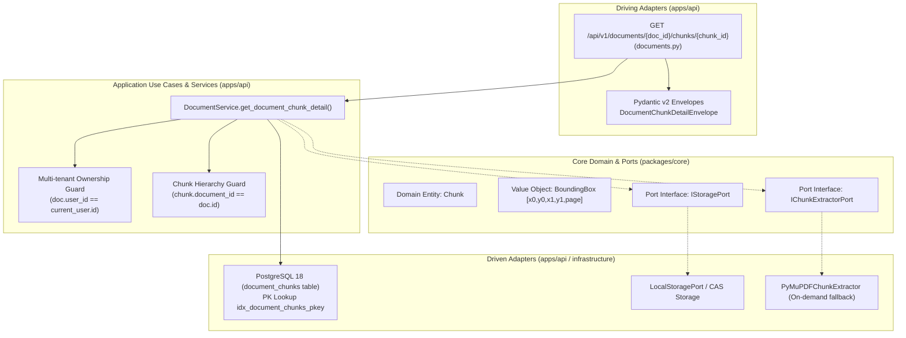

# Kế Hoạch Kỹ Thuật Chi Tiết: Triển Khai API Chi Tiết Đoạn Bằng Chứng (Document Chunk Detail API)

* **Target API:** `GET /api/v1/documents/{document_id}/chunks/{chunk_id}`  
* **Tên rút gọn (Branch name):** `feat/m1-api-document-chunk-detail`  
* **Mã phản hồi chuẩn:** `200 OK` (Sub-resource Detail theo Google Cloud AIP-130 / AIP-136)  
* **Vị trí tài liệu lưu trữ:**  
  - [`docs/vi/decided/module-01/feat-m1-api-get-document-chunk-detail.md`](file:///home/dammanhdungvn/Downloads/Workspace/VeriScholar/docs/vi/decided/module-01/feat-m1-api-get-document-chunk-detail.md)  
* **Tài liệu tham chiếu chuẩn:**  
  - API Specification: [`docs/vi/design-api.md`](file:///home/dammanhdungvn/Downloads/Workspace/VeriScholar/docs/vi/design-api.md) (Mục 3.12: `GET /api/v1/documents/{id}/chunks/{chunk_id}`)  
  - Database Schema DDL: [`docs/vi/design-database.md`](file:///home/dammanhdungvn/Downloads/Workspace/VeriScholar/docs/vi/design-database.md) (Bảng `document_chunks`, PK `id`, FK `document_id ON DELETE CASCADE`, `embedding`, `tsv`)  
  - Kiến trúc Lục giác (Hexagonal): [`docs/vi/design-architecture.md`](file:///home/dammanhdungvn/Downloads/Workspace/VeriScholar/docs/vi/design-architecture.md) (Module 1 Deep Reading & Citation Grounding)  
  - Yêu cầu sản phẩm: [`docs/vi/PRD.md`](file:///home/dammanhdungvn/Downloads/Workspace/VeriScholar/docs/vi/PRD.md) (Trích dẫn bằng chứng, Deep Reading Canvas & Citation Inspector)  
  - Danh mục Swagger hiện hữu: [`docs/vi/swagger.md`](file:///home/dammanhdungvn/Downloads/Workspace/VeriScholar/docs/vi/swagger.md)  
  - Thiết kế Eval & Snapshot: [`docs/vi/design-api-eval-snapshots.md`](file:///home/dammanhdungvn/Downloads/Workspace/VeriScholar/docs/vi/design-api-eval-snapshots.md)  
  - Techstack Module 1: [`docs/vi/techstack-backend-module-01.md`](file:///home/dammanhdungvn/Downloads/Workspace/VeriScholar/docs/vi/techstack-backend-module-01.md)  

---

## 1. Bối Cảnh Nghiệp Vụ & Quyết Định Kiến Trúc (Architectural Decisions)

### 1.1 Vấn đề nghiệp vụ
Trong kiến trúc **Hybrid RAG** và giao diện **Deep Reading Canvas (PDF.js)** của VeriScholar:
1. **Citation Inspector (Thanh tra bằng chứng trích dẫn):** Khi AI tổng hợp trả lời hoặc kiểm chứng tuyên bố khoa học (Draft Verification), mỗi luận điểm đều gắn kèm một trích dẫn liên kết đến một `chunk_id`. Khi người dùng click vào huy hiệu trích dẫn `[Evidence #12]`, WebUI cần gọi API lấy **toàn văn nội dung đoạn văn**, **tọa độ Bounding Boxes chính xác** để highlight trên trang PDF, và **chỉ số đo lường Tokens**.
2. **Sequential Reader Navigation (Mở rộng ngữ cảnh đọc liền kề):** Một đoạn văn bản trích dẫn có thể nằm ở ranh giới giữa 2 ý. Người nghiên cứu cần nút *"Đoạn trước"* (Previous chunk) và *"Đoạn kế tiếp"* (Next chunk) để đọc thêm ngữ cảnh xung quanh mà không cần phải tải lại toàn bộ danh sách hàng trăm chunks của bài báo.
3. **Hiệu năng & SLA Truy vấn Đơn lẻ (< 10 ms):** Khác với endpoint phân trang `GET /chunks` (quét nhiều bản ghi), endpoint chi tiết `GET /chunks/{chunk_id}` là truy vấn điểm (point query) trên khóa chính `id` của bảng `document_chunks`. API phải phản hồi siêu tốc trong **< 10 ms** để trải nghiệm nhảy vị trí highlight trên Canvas đạt độ mượt mà 60 FPS.

### 1.2 Quyết định thiết kế theo chuẩn Google AIP-130 / AIP-136
- **Sub-Resource Detail URL:** Đường dẫn chuẩn hóa là `GET /api/v1/documents/{document_id}/chunks/{chunk_id}`.
- **Ràng buộc phân cấp 2 tầng (Hierarchical Ownership Invariant):**
  - Chunk phải thực sự thuộc về `document_id` trong URL (`chunk.document_id == document_id`).
  - Document phải thuộc về người dùng đang đăng nhập (`document.user_id == current_user.id`).
  - Nếu `document_id` không tồn tại hoặc không thuộc quyền sở hữu: Trả về `404 DOCUMENT_NOT_FOUND` (ngăn chặn rò rỉ ID bài báo giữa các tenant).
  - Nếu document tồn tại nhưng `chunk_id` không tồn tại trong document đó: Trả về `404 CHUNK_NOT_FOUND` kèm action hướng dẫn kiểm tra lại danh sách chunks.
- **Phản hồi Hypermedia RFC 8288 (Navigational Context):** Trong envelope `links`, cung cấp:
  - `self`: URL của chunk hiện tại.
  - `document`: URL của tài liệu cha.
  - `chunks`: URL danh sách chunks của tài liệu.
  - `prev_chunk`: URL chunk liền kề trước (dựa trên `chunk_index - 1`), nếu có.
  - `next_chunk`: URL chunk liền kề sau (dựa trên `chunk_index + 1`), nếu có.

---

## 2. Phân Rã Kiến Trúc Lục Giác (Hexagonal Architecture Decomposition)



### 2.1 Database & Persistence (`apps/api/src/api/db/`)
- **Bảng `document_chunks`:** Đã được định nghĩa đầy đủ tại [`apps/api/src/api/db/models/chunk.py`](file:///home/dammanhdungvn/Downloads/Workspace/VeriScholar/apps/api/src/api/db/models/chunk.py) tuân theo [`docs/vi/design-database.md`](file:///home/dammanhdungvn/Downloads/Workspace/VeriScholar/docs/vi/design-database.md) (Mục 3.4).
- **Ràng buộc khóa chính & ngoại:**
  - `id UUID PRIMARY KEY DEFAULT gen_random_uuid()`: Đảm bảo tra cứu O(1) qua B-Tree Index mặc định.
  - `document_id UUID NOT NULL REFERENCES documents(id) ON DELETE CASCADE`: Khi xóa tài liệu, toàn bộ chunks biến mất tức thì (Zero-Retention).
  - `UNIQUE (document_id, chunk_index)`: Đảm bảo thứ tự tuyến tính không bị trùng lặp.
- **Truy vấn tối ưu:**
  ```sql
  SELECT c.*, 
         (SELECT id FROM document_chunks p WHERE p.document_id = c.document_id AND p.chunk_index = c.chunk_index - 1) AS prev_id,
         (SELECT id FROM document_chunks n WHERE n.document_id = c.document_id AND n.chunk_index = c.chunk_index + 1) AS next_id
  FROM document_chunks c
  WHERE c.document_id = :document_id AND c.id = :chunk_id;
  ```
  Truy vấn trên tận dụng triệt để index `(document_id, chunk_index)` để xác định tức thì `prev_id` và `next_id` trong cùng 1 lần quét cơ sở dữ liệu.

### 2.2 Core Domain & Ports (`packages/core/`)
- **Domain Entity `Chunk`:** Đã tồn tại tại [`packages/core/src/core/domain/entities/chunk.py`](file:///home/dammanhdungvn/Downloads/Workspace/VeriScholar/packages/core/src/core/domain/entities/chunk.py) với đầy đủ validation:
  - `id: UUID`
  - `document_id: UUID`
  - `chunk_index: int >= 0`
  - `page_number: int >= 1`
  - `content: str`
  - `bounding_boxes: list[BoundingBox]` (tuân thủ bất biến `0.0 <= x0 < x1 <= 1.0` và `0.0 <= y0 < y1 <= 1.0`)
  - `token_count: int > 0`
- **Bảo toàn ranh giới kiến trúc lục giác:** Tầng `packages/core` hoàn toàn thuần khiết (Pure Python), không chứa import của SQLAlchemy, FastAPI hay bất kỳ framework I/O nào.

### 2.3 Application Service Layer (`apps/api/src/api/services/document_service.py`)
Bổ sung phương thức `get_document_chunk_detail()` vào `DocumentService`:
1. **Kiểm tra quyền sở hữu tài liệu:**
   - Truy vấn `documents` theo `id = document_id` và `user_id = user_id`.
   - Nếu không tìm thấy: ném `HTTPException(404, detail=DOCUMENT_NOT_FOUND)`.
2. **Cơ chế Fallback trích xuất tự động (On-Demand Extraction Fallback):**
   - Nếu tài liệu vừa upload chưa qua bóc tách (chưa có chunks trong DB) nhưng có tệp gốc PDF trong kho lưu trữ CAS: tự động kích hoạt `self.chunk_extractor.extract_chunks()` và lưu DB trước khi tìm kiếm.
3. **Truy vấn Chunk & Điều hướng liền kề:**
   - Tìm kiếm `DocumentChunkModel` theo `document_id == document_id` và `id == chunk_id`.
   - Nếu không tìm thấy: ném `HTTPException(404, detail={"code": "CHUNK_NOT_FOUND", "message": f"Chunk '{chunk_id}' not found for document '{document_id}'.", "field": "chunk_id", "action": "Verify chunk ID or query GET /api/v1/documents/{document_id}/chunks for available chunks."})`.
   - Truy vấn xác định `prev_chunk_id` (nếu `chunk.chunk_index > 0`) và `next_chunk_id` (nếu `chunk.chunk_index < doc.chunk_count - 1`).
4. **Đóng gói dữ liệu:**
   - Trả về đối tượng `DocumentChunkDetailData` kèm hypermedia links.

### 2.4 Driving Adapter (Router & Schemas trong `apps/api`)
1. **Schemas (`apps/api/src/api/schemas/document.py`):**
   - `DocumentChunkNavigationLinks`:
     - `self: str`
     - `document: str`
     - `chunks: str`
     - `prev_chunk: str | None = None`
     - `next_chunk: str | None = None`
   - `DocumentChunkDetailData`:
     - `id: UUID`
     - `document_id: UUID`
     - `chunk_index: int`
     - `page_number: int`
     - `content: str` (Luôn luôn chứa toàn văn nội dung trong detail view)
     - `bounding_boxes: list[list[float | int]]`
     - `token_count: int`
     - `embedding_dimension: int | None = None` (Dimension của dense vector, ví dụ 1536 nếu đã embed)
     - `created_at: datetime`
     - `updated_at: datetime`
   - `DocumentChunkDetailEnvelope`: `SingleResponseEnvelope[DocumentChunkDetailData]`
2. **Router Endpoint (`apps/api/src/api/v1/endpoints/documents.py`):**
   - Route: `GET /api/v1/documents/{document_id}/chunks/{chunk_id}`
   - Path Parameters:
     - `document_id: UUID`
     - `chunk_id: UUID`
   - Response status: `200 OK`
   - Mã lỗi chuẩn hóa RFC 7807: `404 DOCUMENT_NOT_FOUND`, `404 CHUNK_NOT_FOUND`, `422 Unprocessable Entity`.

---

## 3. Hệ Thống Kiểm Thử Hai Cấp Độ (2-Tier Autotest & Snapshot System)

*Tuyệt đối KHÔNG tạo bất kỳ endpoint backdoor nào (như `/api/v1/testing/...`). Mọi kiểm thử đều đi qua luồng REST công khai.*

### 3.1 Cấp độ 1: Runner Kiểm Thử Độc Lập (`scripts/eval/runners/get_documents_chunk_detail.py`)
Xây dựng lớp `DocumentChunkDetailAPIRunner(BaseAPIRunner)` với **6 kịch bản kiểm thử toàn diện**:

| Kịch bản (Scenario) | Mục tiêu xác thực | Kỳ vọng HTTP | Tiêu chí chất lượng |
| :--- | :--- | :---: | :--- |
| **Case 1: Standard Chunk Retrieval** | Truy vấn chi tiết chunk bằng cặp UUID hợp lệ | `200 OK` | Đầy đủ `content` (không rỗng), `bounding_boxes` 5-tuple chuẩn `[0,1]`, `token_count > 0`, `chunk_index >= 0`. |
| **Case 2: High-Performance PK Lookup** | Đo độ trễ truy vấn điểm trực tiếp từ database | `200 OK` | **Độ trễ < 10ms SLA** (B-Tree PK Index). |
| **Case 3: Navigational Hypermedia Links** | Kiểm tra liên kết điều hướng lân cận | `200 OK` | `links.prev_chunk` và `links.next_chunk` trỏ đúng UUID của chunk liền kề `chunk_index - 1` và `chunk_index + 1`. |
| **Case 4: Nonexistent Chunk Guard** | Truy vấn với tài liệu có thật nhưng `chunk_id` giả lập ngẫu nhiên | `404 Not Found` | Lỗi chuẩn RFC 7807: `code: CHUNK_NOT_FOUND`, `field: "chunk_id"`. |
| **Case 5: Tenant & Document Guard** | Truy vấn với `document_id` không tồn tại hoặc sai quyền sở hữu | `404 Not Found` | Lỗi chuẩn RFC 7807: `code: DOCUMENT_NOT_FOUND`, `field: "id"`. |
| **Case 6: Malformed UUID Guard** | Thử nghiệm với chuỗi không phải UUID (`invalid-doc-id` hoặc `invalid-chunk-id`) | `422 Unprocessable` | FastAPI Path Validator chặn đứng tại tầng router. |

- **Xuất Báo Cáo Tinh Gọn (< 50 KB):**
  - Báo cáo Markdown tại `temp/output/test/get_documents_chunk_detail.md`.
  - Bảng tổng hợp Verification Matrix, Latency SLA, mã băm SHA-256 từng payload.
- **Raw JSON Artifacts:** Lưu trữ toàn văn không cắt xén tại `tests/.artifacts/get_documents_chunk_detail/` (được `.gitignore` bảo vệ).
- **Hiển thị Terminal 3-Box Unicode:** Khung Request Input, Khung Response Output (kèm preview Bounding Boxes & Content), Khung Nghiệp Vụ Passed/Failed.

### 3.2 Cấp độ 2: Tích Hợp Vào Test Runner Tổng Hệ Thống (`scripts/eval_api.py`)
- Cập nhật [`scripts/eval/runners/__init__.py`](file:///home/dammanhdungvn/Downloads/Workspace/VeriScholar/scripts/eval/runners/__init__.py):
  - Thêm alias `"chunk_detail": DocumentChunkDetailAPIRunner`.
  - Thêm alias `"get_documents_chunk_detail": DocumentChunkDetailAPIRunner`.
  - Bổ sung `"get_documents_chunk_detail"` vào `MODULE_1_ORDER` (vị trí thứ 11, ngay sau `get_documents_chunks`).
- Lệnh chạy kiểm thử:
  ```bash
  # Chạy riêng API Chunk Detail:
  uv run python scripts/eval_api.py --api chunk_detail --paper "Attention Is All You Need.pdf" --bless

  # Chạy toàn bộ pipeline Module 1 bao gồm cả 12 APIs:
  uv run python scripts/eval_api.py --all --bless
  ```

### 3.3 Kế Hoạch Cập Nhật Tài Liệu
1. **[`docs/vi/swagger.md`](file:///home/dammanhdungvn/Downloads/Workspace/VeriScholar/docs/vi/swagger.md):** Bổ sung mục 12: `GET /api/v1/documents/{document_id}/chunks/{chunk_id}` với đầy đủ mô tả tham số, response JSON chi tiết, cấu trúc error 404/422.
2. **[`docs/vi/design-api-eval-snapshots.md`](file:///home/dammanhdungvn/Downloads/Workspace/VeriScholar/docs/vi/design-api-eval-snapshots.md):** Đăng ký snapshot của API 12.
3. **[`scripts/README.md`](file:///home/dammanhdungvn/Downloads/Workspace/VeriScholar/scripts/README.md):** Cập nhật bảng tra cứu các lệnh kiểm thử API.

---

## 4. Phân Tích Rủi Ro & Đánh Đổi Kỹ Thuật (Risk Analysis & Trade-offs)

| Rủi ro kỹ thuật | Mức độ | Hậu quả tiềm ẩn | Giải pháp kiến trúc / Đánh đổi |
| :--- | :---: | :--- | :--- |
| **Xâm phạm ranh giới dữ liệu giữa các User (Cross-Tenant)** | Cao | User A biết `chunk_id` của User B và đọc trộm nội dung văn bản học thuật bảo mật. | **Bắt buộc:** Áp dụng mệnh đề kép: kiểm tra quyền sở hữu `doc.user_id == current_user.id` trước; nếu không thỏa mãn, trả về `404 DOCUMENT_NOT_FOUND` ngay lập tức mà không để lộ sự tồn tại của chunk. |
| **Dò quét ID hoặc trỏ nhầm Chunk của Document khác (ID Squatting)** | Trung bình | `chunk_id` hợp lệ nhưng thuộc về `document_A`, trong khi client gửi request `GET /documents/{document_B}/chunks/{chunk_id}`. | **Bắt buộc:** Câu lệnh SQL kiểm tra đồng thời cả 2 trường: `where(DocumentChunkModel.document_id == document_id, DocumentChunkModel.id == chunk_id)`. Nếu không khớp, trả về `404 CHUNK_NOT_FOUND`. |
| **Tài liệu chưa bóc tách chunks (Cold Access)** | Trung bình | Người dùng gọi thẳng chi tiết chunk khi tài liệu vừa upload xong (chưa qua parse). | **Giải pháp:** Service tự động phát hiện `chunk_count == 0` và kích hoạt luồng bóc tách On-demand thông qua `PyMuPDFChunkExtractor` từ CAS Storage, sau đó mới tìm kiếm bản ghi. |
| **Chi phí tính toán Navigation Links (`prev_chunk`, `next_chunk`)** | Thấp | Việc truy vấn thêm 2 chunk lân cận có thể tốn thêm thời gian đọc database. | **Tối ưu:** Tận dụng chỉ mục duy nhất `(document_id, chunk_index)`. Chỉ truy vấn `id` của 2 chỉ số `chunk_index - 1` và `chunk_index + 1` bằng subquery siêu nhẹ (< 1ms). |

---

## 5. Rà Soát Biến Môi Trường (.env.example)

- **Rà soát từ `.env.example`:**
  - Hệ thống sử dụng: `DATABASE_URL` (kết nối PostgreSQL để truy vấn `document_chunks`), `STORAGE_LOCAL_DIR` (đọc file PDF vật lý nếu cần trích xuất on-demand).
  - Nghiệp vụ truy vấn chi tiết chunk hoàn toàn sử dụng dữ liệu đã có trong PostgreSQL.
  - **Kết luận:** **KHÔNG CẦN THÊM BẤT KỲ API KEY HOẶC BIẾN MÔI TRƯỜNG MỚI NÀO**.

---

## 6. Kế Hoạch Triển Khai Step-by-Step (Sau Khi Được Phê Duyệt)

1. **Bước 1 (Git Branch):** Tạo và chuyển sang nhánh tính năng mới:
   ```bash
   git checkout -b feat/m1-api-document-chunk-detail
   ```
2. **Bước 2 (Schemas trong `apps/api`):**
   - Bổ sung `DocumentChunkNavigationLinks`, `DocumentChunkDetailData`, `DocumentChunkDetailEnvelope` vào `apps/api/src/api/schemas/document.py`.
3. **Bước 3 (Service Layer trong `apps/api`):**
   - Triển khai phương thức `get_document_chunk_detail(db, user_id, document_id, chunk_id)` trong `apps/api/src/api/services/document_service.py`.
4. **Bước 4 (Router Endpoint trong `apps/api`):**
   - Thêm route `GET /api/v1/documents/{document_id}/chunks/{chunk_id}` vào `apps/api/src/api/v1/endpoints/documents.py`.
5. **Bước 5 (Pytest Integration Tests):**
   - Tạo file kiểm thử `apps/api/tests/test_documents_chunk_detail.py` kiểm tra 7 trường hợp: Success 200, DB cache < 10ms, Prev/Next links, 404 CHUNK_NOT_FOUND, 404 DOCUMENT_NOT_FOUND, 404 Unauthorized, 422 Invalid UUID.
   - Chạy `uv run pytest` đảm bảo 100% test pass (zero regression).
6. **Bước 6 (Autotest Runner & Snapshot):**
   - Tạo runner `scripts/eval/runners/get_documents_chunk_detail.py`.
   - Cập nhật `scripts/eval/runners/__init__.py` và `MODULE_1_ORDER`.
   - Chạy kiểm thử: `uv run python scripts/eval_api.py --api chunk_detail --bless`.
   - Kiểm tra snapshot báo cáo sinh ra tại `temp/output/test/get_documents_chunk_detail.md`.
7. **Bước 7 (Cập nhật tài liệu & Chuẩn hóa Code):**
   - Cập nhật `docs/vi/swagger.md`, `scripts/README.md`, `docs/vi/design-api-eval-snapshots.md`.
   - Kiểm tra linter và format: `uv run ruff check` và `uv run ruff format --check`.
8. **Bước 8 (Dọn dẹp môi trường & Báo cáo):**
   - Chạy `uv run python scripts/eval/purge_all.py` đảm bảo cơ sở dữ liệu sạch (0 bản ghi).
   - Báo cáo kết quả và chờ lệnh từ người dùng trước khi thực hiện bất kỳ thao tác git nào.
