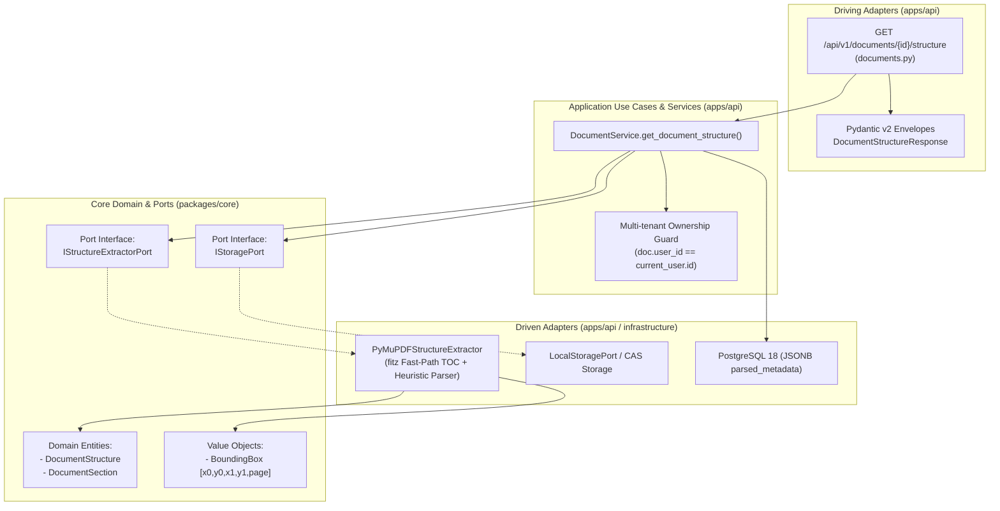

# Kế Hoạch Kỹ Thuật Chi Tiết: Triển Khai API Cấu Trúc Bài Báo Khoa Học (Document Structure, TOC & Sections API)

* **Target API:** `GET /api/v1/documents/{id}/structure`  
* **Tên rút gọn (Branch name):** `feat/m1-api-document-structure`  
* **Mã phản hồi chuẩn:** `200 OK` (Singleton Sub-resource theo Google Cloud AIP-130 / AIP-136)  
* **Vị trí tài liệu lưu trữ:**  
  - [`docs/vi/decided/module-01/feat-m1-api-get-document-structure.md`](file:///home/dammanhdungvn/Downloads/Workspace/VeriScholar/docs/vi/decided/module-01/feat-m1-api-get-document-structure.md)  
* **Tài liệu tham chiếu chuẩn:**  
  - API Specification: [`docs/vi/design-api.md`](file:///home/dammanhdungvn/Downloads/Workspace/VeriScholar/docs/vi/design-api.md) (Mục 3.10: `GET /api/v1/documents/{id}/structure`)  
  - Database Schema DDL: [`docs/vi/design-database.md`](file:///home/dammanhdungvn/Downloads/Workspace/VeriScholar/docs/vi/design-database.md) (Bảng `documents.parsed_metadata JSONB` & GIN index)  
  - Kiến trúc Lục giác (Hexagonal): [`docs/vi/design-architecture.md`](file:///home/dammanhdungvn/Downloads/Workspace/VeriScholar/docs/vi/design-architecture.md) (Two-Tier Ingestion & PDF.js Structure Navigator)  
  - Yêu cầu sản phẩm: [`docs/vi/PRD.md`](file:///home/dammanhdungvn/Downloads/Workspace/VeriScholar/docs/vi/PRD.md) (Module 1 Deep Reading & Structure Navigation)  
  - Thiết kế Eval & Báo cáo: [`docs/vi/design-api-eval-snapshots.md`](file:///home/dammanhdungvn/Downloads/Workspace/VeriScholar/docs/vi/design-api-eval-snapshots.md)  
  - Công nghệ Module 1: [`docs/vi/techstack-backend-module-01.md`](file:///home/dammanhdungvn/Downloads/Workspace/VeriScholar/docs/vi/techstack-backend-module-01.md)  
  - Tập dữ liệu Ground Truth: [`data/golden-dataset/golden_eval_dataset.json`](file:///home/dammanhdungvn/Downloads/Workspace/VeriScholar/data/golden-dataset/golden_eval_dataset.json)  

---

## 1. Bối Cảnh Nghiệp Vụ & Quyết Định Kiến Trúc (Architectural Decisions)

### 1.1 Vấn đề nghiệp vụ
Khi người dùng tải một bài báo khoa học lên VeriScholar và mở giao diện đọc sâu (Deep Reading PDF.js Canvas):
1. **Cần cây mục lục (TOC / Headings Navigator) ngay lập tức:** Người nghiên cứu không đọc tuần tự từ đầu đến cuối mà nhảy ngay đến các phần trọng yếu (*"3 Model Architecture"*, *"4 Experiments"*, *"Abstract"*). WebUI cần danh sách Sections kèm số trang và tọa độ Bounding Box để nhảy đến chính xác vị trí hiển thị trên Canvas.
2. **Abstract Bounding Box (Visual Grounding):** Cần trích xuất toàn văn phần Abstract cùng vùng bao hình học chuẩn hóa `[x0, y0, x1, y1, page]` để highlight khối tóm tắt của tác giả.
3. **Hiệu năng & SLA Caching:** Việc phân tích cấu trúc PDF tiêu tốn từ 100ms - 300ms. Tuy nhiên, khi người dùng lật qua lại giữa các tab hoặc tải lại trang, API phải trả về trong **< 15ms** thông qua bộ đệm Database Caching (`documents.parsed_metadata`).

### 1.2 Quyết định thiết kế theo chuẩn Google AIP-130 / AIP-136
- **Singleton Sub-Resource:** Mỗi tài liệu `documents/{id}` có duy nhất một thực thể cấu trúc đại diện (`structure`). Do đó, đường dẫn chuẩn là `GET /api/v1/documents/{id}/structure` (không sử dụng số nhiều `/structures` và không có ID phụ).
- **Two-Tier Extraction & Database Caching:**
  - **Lần đầu gọi (Cache Miss):** Nếu `doc.parsed_metadata["structure"]` chưa tồn tại, hệ thống đọc luồng byte PDF từ CAS `IStoragePort`, gọi `IStructureExtractorPort` để trích xuất Title, Abstract, Sections (kèm Bounding Boxes), lưu vào `doc.parsed_metadata["structure"]` và cập nhật `doc.title` (nếu đang null).
  - **Lần gọi sau (Cache Hit):** Truy vấn trực tiếp từ cột JSONB trong PostgreSQL, phản hồi cực nhanh (< 15ms).
  - **Tùy chọn tái bóc tách (`force_refresh: bool = False`):** Hỗ trợ query parameter `?force_refresh=true` để xóa cache và ép phân tích lại từ tệp PDF gốc khi cần.

---

## 2. Phân Rã Kiến Trúc Lục Giác (Hexagonal Architecture Decomposition)



### 2.1 Database & Persistence (`apps/api/src/api/db/`)
- **Bảng `documents`:** Cột `parsed_metadata JSONB NULL` đã được định nghĩa trong schema DDL [`docs/vi/design-database.md`](file:///home/dammanhdungvn/Downloads/Workspace/VeriScholar/docs/vi/design-database.md) và model [`apps/api/src/api/db/models/document.py`](file:///home/dammanhdungvn/Downloads/Workspace/VeriScholar/apps/api/src/api/db/models/document.py).
- **Cấu trúc lưu trữ JSONB:**
  ```json
  {
    "structure": {
      "title": "Attention Is All You Need",
      "abstract": "The dominant sequence transduction models...",
      "abstract_bounding_boxes": [[0.1023, 0.2145, 0.8976, 0.2831, 1]],
      "sections": [
        {
          "title": "1 Introduction",
          "page_number": 1,
          "bounding_boxes": [[0.1023, 0.3512, 0.4851, 0.3724, 1]]
        },
        {
          "title": "2 Background",
          "page_number": 2,
          "bounding_boxes": [[0.1023, 0.1523, 0.4851, 0.1735, 2]]
        }
      ],
      "extracted_at": "2026-09-16T00:30:00Z"
    }
  }
  ```
- **Ràng buộc toàn vẹn:** Khóa ngoại `user_id REFERENCES users(id) ON DELETE CASCADE`. Khi tài liệu bị xóa, toàn bộ cấu trúc trong `parsed_metadata` bị xóa theo (Zero-Retention Guarantee).
- **Chỉ mục tối ưu:** `CREATE INDEX idx_documents_parsed_metadata ON documents USING gin(parsed_metadata);`.

### 2.2 Core Domain & Ports (`packages/core/`)
*Tuyệt đối tuân thủ bất biến kiến trúc lục giác: Không import `fitz`, `pymupdf`, `fastapi`, hay `sqlalchemy` vào `packages/core`.*

1. **Domain Entities & Value Objects (`packages/core/src/core/domain/entities/structure.py`):**
   - `DocumentSection`:
     - `title: str` (Tiêu đề mục, ví dụ: "1 Introduction")
     - `page_number: int` (Trang bắt đầu, >= 1)
     - `bounding_boxes: list[BoundingBox]` (Tọa độ chuẩn hóa `[x0, y0, x1, y1, page]`)
   - `DocumentStructure`:
     - `document_id: UUID`
     - `title: str | None`
     - `abstract: str | None`
     - `abstract_bounding_boxes: list[BoundingBox]`
     - `sections: list[DocumentSection]`
2. **Port Interface (`packages/core/src/core/ports/structure.py`):**
   ```python
   from abc import ABC, abstractmethod
   from core.domain.entities.structure import DocumentStructure

   class IStructureExtractorPort(ABC):
       """Port interface for extracting document outline, abstract, and sections."""

       @abstractmethod
       def extract_structure(self, pdf_bytes: bytes, document_id: str | None = None) -> DocumentStructure:
           """Synchronously parse PDF text stream and extract outline hierarchy."""
           raise NotImplementedError
   ```

### 2.3 Driven Adapter: Trích Xuất Cấu Trúc Bằng PyMuPDF (`apps/api`)
Tạo adapter concrete `PyMuPDFStructureExtractor` đặt tại `apps/api/src/api/adapters/pdf_structure_extractor.py`:
1. **Tầng 1: PDF Outline / Bookmarks (`doc.get_toc()`):**
   - Nếu tệp PDF có mục lục nhúng sẵn (PDF bookmarks / TOC outline), trích xuất trực tiếp danh sách tiêu đề, cấp độ (`lvl`), và trang đích.
   - Tìm tọa độ bounding box tương ứng của tiêu đề trên trang đích bằng cách tìm kiếm cụm từ (`page.search_for(title)`).
2. **Tầng 2: Heuristic Heading & Section Detection (Cho bài báo không có PDF Outline):**
   - Quét khối văn bản (`page.get_text("blocks")`) trên từng trang.
   - Phát hiện các đề mục đánh số học thuật:
     - Regex mẫu: `r"^(?:[1-9]\d*|I|II|III|IV|V|VI|VII|VIII|IX|X)\.?\s+([A-Z].*)$"` (ví dụ: `1 Introduction`, `2 Background`, `3 Model Architecture`).
     - Phát hiện đề mục con: `r"^(?:[1-9]\d*\.[1-9]\d*)\s+([A-Z].*)$"` (ví dụ: `3.1 Encoder and Decoder Stacks`).
     - Đề mục chuẩn không đánh số: `Abstract`, `Introduction`, `Background`, `Related Work`, `Model Architecture`, `Experiments`, `Results`, `Discussion`, `Conclusion`, `References`.
   - Tính toán Bounding Box chuẩn hóa `[x0/width, y0/height, x1/width, y1/height, page_num]` tuân thủ chặt chẽ bất biến tọa độ Top-Left `[0.0, 1.0]`.
3. **Trích Xuất Abstract:**
   - Quét trang 1 (và trang 2): Định vị từ khóa "Abstract".
   - Bóc tách đoạn văn nằm giữa "Abstract" và mục "1 Introduction".
   - Tính toán hợp nhất Bounding Box của toàn bộ vùng Abstract.
4. **An toàn tiến trình (Non-blocking):**
   - Bao bọc toàn bộ tác vụ CPU-bound trong `asyncio.to_thread()` để không gây nghẽn FastAPI Event Loop.

### 2.4 Application Service Layer (`apps/api/src/api/services/document_service.py`)
Bổ sung phương thức `get_document_structure()` vào `DocumentService`:
1. Kiểm tra quyền sở hữu: `doc.user_id == user_id`. Nếu sai, ném `DOCUMENT_NOT_FOUND` (404) để chống lộ ID bài báo.
2. Kiểm tra bộ đệm `doc.parsed_metadata`:
   - Nếu `not force_refresh` và `"structure"` đã tồn tại: Chuyển đổi dữ liệu JSONB sang `DocumentStructureData` và trả về ngay (**SLA < 15ms**).
3. Nếu chưa có hoặc `force_refresh=True`:
   - Đọc tệp PDF từ CAS Storage thông qua `self._storage_port`.
   - Chạy hàm trích xuất qua `asyncio.to_thread()`.
   - Ghi kết quả vào `doc.parsed_metadata["structure"]`.
   - Nếu `doc.title` đang trống và trích xuất được tiêu đề, cập nhật luôn `doc.title = extracted_title`.
   - `await db.flush()` lưu vào PostgreSQL.
   - Trả về `DocumentStructureData`.

### 2.5 Driving Adapter (Router & Schemas trong `apps/api`)
1. **Schemas (`apps/api/src/api/schemas/document.py`):**
   - `DocumentSectionResponse`:
     - `title: str`
     - `page_number: int`
     - `bounding_boxes: list[list[float]]` (kiểu `[[x0, y0, x1, y1, page]]`)
   - `DocumentStructureData`:
     - `document_id: UUID`
     - `title: str | None`
     - `abstract: str | None`
     - `abstract_bounding_boxes: list[list[float]]`
     - `sections: list[DocumentSectionResponse]`
   - `DocumentStructureEnvelope`: `SingleResponseEnvelope[DocumentStructureData]`
2. **Router Endpoint (`apps/api/src/api/v1/endpoints/documents.py`):**
   - Route: `GET /api/v1/documents/{document_id}/structure`
   - Parameters:
     - `document_id: UUID` (Path parameter)
     - `force_refresh: bool = Query(default=False, description="Ép buộc tái bóc tách từ PDF gốc")`
   - Response: `200 OK` (`DocumentStructureEnvelope`), `404 Not Found`, `422 Unprocessable Entity`.

---

## 3. Hệ Thống Kiểm Thử Hai Cấp Độ (2-Tier Autotest & Snapshot System)

*Tuyệt đối KHÔNG tạo bất kỳ endpoint backdoor nào (như `/api/v1/testing/...`). Mọi kiểm thử đều đi qua luồng REST công khai.*

### 3.1 Cấp độ 1: Runner Kiểm Thử Độc Lập (`scripts/eval/runners/get_documents_structure.py`)
Xây dựng lớp `DocumentStructureAPIRunner(BaseAPIRunner)` với **6 kịch bản kiểm thử toàn diện**:

| Kịch bản (Scenario) | Mục tiêu xác thực | Kỳ vọng HTTP | Tiêu chí chất lượng |
| :--- | :--- | :---: | :--- |
| **Case 1: Initial Extraction** | Bóc tách cấu trúc bài báo lần đầu từ PDF stream | `200 OK` | Có `title`, `abstract` (chuỗi dài > 50 ký tự), `abstract_bounding_boxes` hợp lệ `[0,1]`, danh sách `sections >= 3` mục. |
| **Case 2: Fast DB Cache Hit** | Đọc lại cấu trúc từ bộ đệm `parsed_metadata` trong PostgreSQL | `200 OK` | **Độ trễ < 15ms**; dữ liệu khớp 100% với lần 1. |
| **Case 3: Force Refresh Override** | Gửi `?force_refresh=true` để ép bóc tách lại từ tệp PDF | `200 OK` | Phân tích lại thành công, cập nhật timestamp `extracted_at`. |
| **Case 4: Ground Truth Matching** | Đối chiếu với `data/golden-dataset/golden_eval_dataset.json` | `200 OK` | Title Token Jaccard >= 0.85; Section Recall >= 0.85 so với `expected_sections`. |
| **Case 5: Nonexistent Document Guard** | Thử nghiệm với UUID ngẫu nhiên không tồn tại | `404 Not Found` | Lỗi chuẩn RFC 7807: `code: DOCUMENT_NOT_FOUND`, `field: "id"`. |
| **Case 6: Malformed UUID Guard** | Thử nghiệm với chuỗi không phải UUID (`invalid-uuid-format`) | `422 Unprocessable` | FastAPI Path Validator chặn đứng tại tầng router. |

- **Xuất Báo Cáo Tinh Gọn (< 50 KB):**
  - Báo cáo Markdown tại `temp/output/test/get_documents_structure.md`.
  - Bảng tổng hợp Verification Matrix, đối chiếu Ground Truth, mã băm SHA-256 từng payload.
- **Raw JSON Artifacts:** Lưu trữ toàn văn không cắt xén tại `tests/.artifacts/get_documents_structure/` (được `.gitignore` bảo vệ).
- **Hiển thị Terminal 3-Box Unicode:** Khung Request Input, Khung Response Output (kèm preview Sections & Abstract), Khung Nghiệp Vụ Passed/Failed.

### 3.2 Cấp độ 2: Tích Hợp Vào Test Runner Tổng Hệ Thống (`scripts/eval_api.py`)
- Cập nhật [`scripts/eval/runners/__init__.py`](file:///home/dammanhdungvn/Downloads/Workspace/VeriScholar/scripts/eval/runners/__init__.py):
  - Thêm alias `"structure": DocumentStructureAPIRunner`.
  - Thêm alias `"get_documents_structure": DocumentStructureAPIRunner`.
  - Bổ sung `"get_documents_structure"` vào `MODULE_1_ORDER` (vị trí thứ 10, ngay sau `post_documents_extract_references`).
- Lệnh chạy kiểm thử:
  ```bash
  # Chạy riêng API Structure trên bài báo chỉ định:
  uv run python scripts/eval_api.py --api structure --paper "Attention Is All You Need.pdf" --bless

  # Chạy toàn bộ pipeline Module 1 bao gồm cả Structure:
  uv run python scripts/eval_api.py --all --bless
  ```

### 3.3 Kế Hoạch Cập Nhật Tài Liệu
1. **[`docs/vi/swagger.md`](file:///home/dammanhdungvn/Downloads/Workspace/VeriScholar/docs/vi/swagger.md):** Bổ sung mục 10: `GET /api/v1/documents/{document_id}/structure` với đầy đủ tham số, request, response JSON ví dụ, các mã lỗi 404, 422.
2. **[`docs/vi/design-api-eval-snapshots.md`](file:///home/dammanhdungvn/Downloads/Workspace/VeriScholar/docs/vi/design-api-eval-snapshots.md):** Bổ sung mục đánh giá chất lượng cấu trúc bài báo khoa học (TOC/Section Heading Recall, Spatial BBox IoU).
3. **[`scripts/README.md`](file:///home/dammanhdungvn/Downloads/Workspace/VeriScholar/scripts/README.md):** Bổ sung hàng API thứ 10 vào bảng tra cứu lệnh chạy và đường dẫn snapshot.

---

## 4. Phân Tích Rủi Ro & Đánh Đổi Kỹ Thuật (Risk Analysis & Trade-offs)

| Rủi ro kỹ thuật | Mức độ | Hậu quả tiềm ẩn | Giải pháp kiến trúc / Đánh đổi |
| :--- | :---: | :--- | :--- |
| **PDF không có Bookmarks / TOC nhúng** | Cao | Các bài báo trên arXiv thường không có PDF outline; `doc.get_toc()` trả về rỗng `[]`. | **Đánh đổi:** Kết hợp 2 tầng (Hybrid): Ưu tiên `get_toc()` trước; nếu rỗng, tự động chuyển sang bộ quét heuristic font size + regex đánh số mục (`1 Introduction`, `2 Background`...). |
| **Tiêu đề Abstract bị dính văn bản** | Trung bình | Tọa độ Bounding Box của Abstract bị lệch hoặc gom luôn cả phần Title/Authors. | Giới hạn vùng quét Abstract từ sau khối Authors và kết thúc ngay khi gặp Section 1. Chuẩn hóa Bounding Box theo từng block text. |
| **Tắc nghẽn Event Loop do đọc PDF** | Cao | PyMuPDF parsing là tác vụ CPU-bound; nếu chạy trực tiếp trong async def sẽ làm chậm toàn bộ server FastAPI. | **Bắt buộc:** Luôn bọc tác vụ phân tích PDF trong `asyncio.to_thread()` để đẩy sang thread pool riêng. |
| **Rò rỉ dữ liệu giữa các User (Multi-tenant)** | Cao | Người dùng A đoán được UUID của Người dùng B và xem được cấu trúc tài liệu bí mật. | **Bắt buộc:** Áp dụng điều kiện kiểm tra `document.user_id == current_user.id`. Nếu không trùng, trả về `404 DOCUMENT_NOT_FOUND` (không dùng 403 để tránh lộ sự tồn tại của UUID). |
| **Dữ liệu mồ côi (Orphan Data)** | Thấp | Tệp cấu trúc lưu riêng khiến dữ liệu không đồng bộ khi xóa tài liệu. | Cấu trúc được lưu trực tiếp trong trường `parsed_metadata JSONB` của bảng `documents`. Khi xóa tài liệu (`DELETE /documents/{id}`), dữ liệu tự động biến mất theo bản ghi (Zero-Retention). |

---

## 5. Rà Soát Biến Môi Trường (.env.example)

- **Rà soát từ `.env.example`:**
  - Hệ thống sử dụng: `DATABASE_URL` (kết nối PostgreSQL 18 để đọc/ghi `parsed_metadata`), `STORAGE_LOCAL_DIR` (đọc file PDF vật lý từ CAS).
  - Tác vụ bóc tách cấu trúc bài báo (TOC, Headings, Sections, Abstract) **hoàn toàn sử dụng thư viện PyMuPDF mã nguồn mở chạy cục bộ**.
  - **Kết luận:** **KHÔNG CẦN THÊM BẤT KỲ API KEY HOẶC BIẾN MÔI TRƯỜNG MỚI NÀO**. Không tốn chi phí gọi LLM, hoàn toàn bảo mật theo chính sách Zero-Retention của VeriScholar.

---

## 6. Kế Hoạch Triển Khai Step-by-Step (Sau Khi Được Phê Duyệt)

1. **Bước 1 (Git Branch):** Tạo và chuyển sang nhánh mới:
   ```bash
   git checkout -b feat/m1-api-document-structure
   ```
2. **Bước 2 (Domain & Ports trong `packages/core`):**
   - Tạo file `packages/core/src/core/domain/entities/structure.py` định nghĩa `DocumentSection`, `DocumentStructure`.
   - Tạo file `packages/core/src/core/ports/structure.py` định nghĩa `IStructureExtractorPort`.
   - Kiểm tra ranh giới lục giác: Chạy `pytest packages/core/tests/domain/test_hexagonal_invariants.py` đảm bảo 100% không dính banned imports.
3. **Bước 3 (Adapter & Service trong `apps/api`):**
   - Tạo adapter `apps/api/src/api/adapters/pdf_structure_extractor.py` kế thừa `IStructureExtractorPort` sử dụng `pymupdf`.
   - Bổ sung schemas `DocumentSectionResponse`, `DocumentStructureData`, `DocumentStructureEnvelope` trong `apps/api/src/api/schemas/document.py`.
   - Triển khai phương thức `get_document_structure` trong `DocumentService`.
4. **Bước 4 (Router Endpoint):**
   - Đăng ký `GET /{document_id}/structure` trong `apps/api/src/api/v1/endpoints/documents.py`.
5. **Bước 5 (Unit Test & Pytest):**
   - Tạo `apps/api/tests/test_documents_structure.py` kiểm thử đầy đủ: Success 200, Cache 200, Force refresh, 404 nonexistent, 404 unauthorized, 422 invalid UUID.
   - Chạy `uv run pytest` đảm bảo toàn bộ 165+ tests hiện có đều pass (zero regression).
6. **Bước 6 (Autotest Runner & Snapshot):**
   - Triển khai runner `scripts/eval/runners/get_documents_structure.py`.
   - Cập nhật `scripts/eval/runners/__init__.py` và `MODULE_1_ORDER`.
   - Chạy autotest: `uv run python scripts/eval_api.py --api structure --bless`.
   - Sinh snapshot báo cáo tại `temp/output/test/get_documents_structure.md`.
7. **Bước 7 (Cập nhật tài liệu):**
   - Cập nhật `docs/vi/swagger.md`, `scripts/README.md`, `docs/vi/design-api-eval-snapshots.md`.
8. **Bước 8 (Dọn dẹp môi trường):**
   - Chạy `uv run python scripts/eval/purge_all.py` đảm bảo database sạch sẽ (0 bản ghi).
   - Báo cáo người dùng thẩm định trước khi commit.
