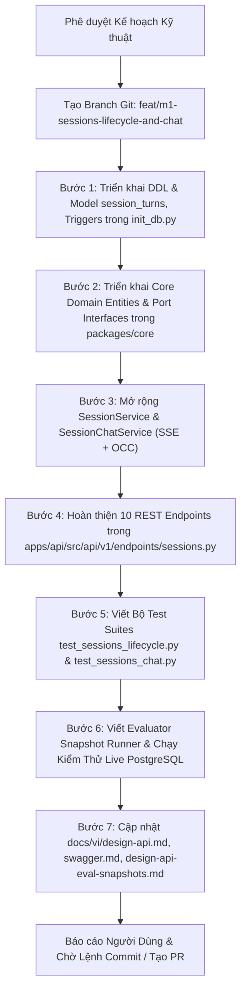

# Kế Hoạch Kỹ Thuật: Chu trình Sống Toàn Diện & Đối Thoại Đa Bài Báo (Research Sessions Lifecycle & Multi-Paper Chat)

> **Mã tài liệu:** `FEAT-M1-SESSIONS-LIFECYCLE-CHAT`  
> **Trạng thái:** `PLANNING / CHỜ PHÊ DUYỆT (CHƯA VIẾT CODE TRIỂN KHAI)`  
> **Tác giả:** Antigravity Agent & VeriScholar Engineering Team  
> **Ngày lập:** 17/09/2026  
> **Nhánh Git đề xuất:** `feat/m1-sessions-lifecycle-and-chat`  
> **Phạm vi TARGET:** 10 APIs hoàn chỉnh Module 1 (Session Management & Multi-Paper Chat):
> 1. `GET    /api/v1/sessions`                           # 46. Lấy lịch sử các phiên nghiên cứu (Sidebar History)
> 2. `GET    /api/v1/sessions/{id}`                      # 47. Khôi phục nguyên vẹn phiên (Snapshots, Tabs, Viewport)
> 3. `PATCH  /api/v1/sessions/{id}`                      # 48. Cập nhật tiêu đề / metadata phiên nghiên cứu (OCC If-Match)
> 4. `PATCH  /api/v1/sessions/{id}/viewport`             # 49. Tự động lưu vị trí cuộn trang PDF và Tab đang mở (OCC)
> 5. `DELETE /api/v1/sessions/{id}`                      # 50. Xóa phiên nghiên cứu (Cascade & TTL Cleanup)
> 6. `POST   /api/v1/sessions/{id}/documents`            # 51. Nạp bài vào phiên (Pure JSON: url hoặc document_id)
> 7. `POST   /api/v1/sessions/{id}/messages`             # 52. Gửi câu hỏi & Stream SSE (Cross-Document Namespacing)
> 8. `GET    /api/v1/sessions/{id}/messages`             # 53. Lấy lịch sử hội thoại của phiên (phân trang)
> 9. `DELETE /api/v1/sessions/{id}/messages`             # 54. Xóa lịch sử hội thoại của phiên (Idempotent 204)
> 10. `POST   /api/v1/sessions/{id}:restore-archived`     # 55. Tải lại file PDF gốc để kích hoạt lại phiên quá hạn TTL  
> **Chuẩn thiết kế:** RFC 9110 / RFC 7232 (Conditional Requests OCC ETag/If-Match), RFC 7807 (Problem Details), RFC 8895 (SSE), Google AIP-136 / AIP-158, Hexagonal Clean Architecture.

---

## 1. Khảo Sát Nghiên Cứu Thế Giới & Tùy Biến Cho VeriScholar (State of the Art & Customization)

### 1.1. Cách Các Nền Tảng AI Hàng Đầu Thế Giới Quản Trị Phiên Làm Việc & Chat Đa Tài Liệu
Để thiết kế một hệ thống chuẩn production và opensource đỉnh cao, chúng tôi đã khảo sát kiến trúc thực tế của các sản phẩm nổi tiếng:

1. **Google NotebookLM (Source-Centric Multi-Document Workspace):**
   - **Cơ chế:** Tổ chức theo mô hình "Notebook" chứa một tập hợp nguồn tài liệu (Sources) và bảng điều khiển trò chuyện hợp nhất. Mọi câu trả lời của AI đều được neo chỉ số nguồn tường minh (Source Number + Snippet) với trích dẫn neo về đúng đoạn văn bản gốc.
   - **Điểm mạnh:** Giữ nhà nghiên cứu luôn ở trong một ngữ cảnh tập trung, không bị nhảy tab; có khả năng tổng hợp chéo giữa các nguồn tài liệu.
   - **Hạn chế:** NotebookLM cho phép nạp tới 50 tài liệu mà không có cơ chế giới hạn dung lượng khắt khe ở tầng lõi, dẫn đến hiện tượng "Lost in the Middle" và độ trễ cao khi tìm kiếm đoạn trích.

2. **Perplexity Pro & Elicit (Research Threads & Context Isolation):**
   - **Cơ chế:** Quản lý lịch sử dưới dạng các Threads độc lập. Khi mở một thread cũ, toàn bộ trạng thái bài báo, câu hỏi và vị trí đọc được khôi phục nguyên vẹn.
   - **Điểm mạnh:** Tối ưu hóa phản hồi thời gian thực qua Server-Sent Events (SSE), có cơ chế phân biệt rõ câu trả lời tổng quan và suy luận chuyên sâu (Reasoning/Thinking).
   - **Hạn chế:** Không hỗ trợ đồng bộ vị trí đọc PDF đa người dùng/đa thiết bị bằng khóa lạc quan (OCC).

3. **Open-WebUI & LibreChat (Production Open-Source Workspace Standard):**
   - **Cơ chế:** Phân tách rõ ràng giữa Session (phiên làm việc), Junction Table (quan hệ nhiều - nhiều giữa Session và Files/Documents) và Message Turns (lượt hội thoại 1NF).
   - **Điểm mạnh:** Khi xóa Session thì tài liệu gốc không bị mất ngẫu nhiên; khi xóa tài liệu gốc thì liên kết trong phiên được ngắt an toàn thông qua khóa ngoại có ràng buộc `ON DELETE CASCADE` hoặc `ON DELETE SET NULL`.

### 1.2. Giải Pháp Tùy Biến Chuyên Biệt Cho VeriScholar (Tailored Customization)
Kế thừa tinh hoa từ các hệ thống trên, VeriScholar đưa ra kiến trúc tùy biến tối ưu cho bối cảnh đọc sâu học thuật:

```text
                                FRONTEND DUAL-PANE WORKSPACE
                     ┌──────────────────────────────────────────────────┐
                     │ Trái: PDF.js Canvas    │ Phải: Tab View (Chat)   │
                     │ - Active Document      │ - Cross-Doc Q&A         │
                     │ - Viewport State (OCC) │ - Thinking Stream (SSE) │
                     │ - Spatial Bounding Box │ - Citation Navigation   │
                     └──────────────────────────────────────────────────┘
                                       │                      │
       PATCH /viewport (OCC If-Match)  │                      │ POST /messages (SSE)
                                       ▼                      ▼
                     ┌──────────────────────────────────────────────────┐
                     │          FASTAPI DRIVING ADAPTER                 │
                     │  - OCC Concurrency Validator (ETag / If-Match)   │
                     │  - SSE Streaming Producer & Disconnect Guard     │
                     │  - Multi-Tenant Ownership Authorization          │
                     └──────────────────────────────────────────────────┘
                                       │                      │
                                       ▼                      ▼
                     ┌──────────────────────────────────────────────────┐
                     │          CORE DOMAIN & APPLICATION SERVICE       │
                     │  - Session Aggregate Root (Capacity Cap = 5)     │
                     │  - Cross-Document Context Namespacer (XML Tags)  │
                     │  - Abstention Gate (Threshold >= 0.35)           │
                     │  - Viewport & History Use Cases                  │
                     └──────────────────────────────────────────────────┘
                                       │                      │
                                       ▼                      ▼
                     ┌──────────────────────────────────────────────────┐
                     │       POSTGRESQL 18 PERSISTENCE (ACID)           │
                     │  - research_sessions (OCC trigger NEW.ver = +1)  │
                     │  - session_documents (Row Lock Capacity Guard)   │
                     │  - session_turns (1NF Atomic Turns, Citations)   │
                     └──────────────────────────────────────────────────┘
```

* **Kiểm Soát Đồng Thời Lạc Quan Bất Biến (Strict OCC via RFC 9110 / RFC 7232):**
  - Mọi thao tác cập nhật tiêu đề (`PATCH /sessions/{id}`) và lưu vị trí cuộn trang (`PATCH /sessions/{id}/viewport`) bắt buộc truyền header `If-Match: "v{version}"`.
  - Nếu phiên bản bị lệch (do người dùng mở 2 tab trình duyệt cùng lúc), API trả về `412 Precondition Failed` với mã lỗi `CONCURRENCY_CONFLICT`, ngăn chặn hoàn toàn lỗi "ghi đè thầm lặng" (silent overwrite).
* **Đóng Gói Ngữ Cảnh Tầng Server (Cross-Document XML Namespacing):**
  - Khi hỏi đáp đa bài báo (`scope: "multi_paper"`), các đoạn trích từ 1 - 5 bài báo được bọc trong các thẻ XML tường minh:
    ```xml
    <document id="doc_1" index="1" title="Attention Is All You Need">
      [Chunk 12, Page 4]: ...
    </document>
    <document id="doc_2" index="2" title="BERT: Pre-training of Deep Bidirectional Transformers">
      [Chunk 5, Page 2]: ...
    </document>
    ```
  - Định dạng này giúp LLM phân biệt chính xác luận điểm thuộc bài báo nào, loại bỏ triệt để hiện tượng lẫn lộn nguồn (source entanglement).
* **Trích Dẫn Không Gian Thực Tế (Spatial Bounding Box Resolution):**
  - Trích dẫn không chỉ dừng lại ở số trang, mà hệ thống tự động truy vấn tọa độ `bounding_boxes: [[x1, y1, x2, y2, page]]` từ bảng `document_chunks` để frontend vẽ ngay khung highlight vàng trên trang PDF.
* **Bảo Toàn Chi Phí Khi Người Dùng Hủy (Client Disconnect Guard - HTTP 499):**
  - Trong luồng SSE stream, nếu người dùng bấm "Dừng sinh" hoặc đóng tab, FastAPI phát hiện `request.is_disconnected()`, ngay lập tức hủy coroutine của LLM/DMR, chấm dứt việc tiêu hao token vô ích.

---

## 2. Ý Tưởng Nâng Cấp Sản Phẩm Đột Phá (Product Upgrades & Enhancements)

Ngoài các đặc tả chuẩn trong tài liệu thiết kế gốc, chúng tôi đề xuất 4 điểm nâng cấp chuyên nghiệp:

1. **Nâng cấp #1: Tìm kiếm & Lọc Lịch sử Phiên (`GET /api/v1/sessions?q=...&active_tab=...`):**
   - Bổ sung tham số tìm kiếm từ khóa `q` (tìm kiếm không dấu / case-insensitive trên `title`) và lọc theo tab `active_tab` hoặc trạng thái `is_archived`. Giúp các nhà nghiên cứu sở hữu hàng chục phiên làm việc tìm lại phiên cũ trong nháy mắt.
2. **Nâng cấp #2: Khôi phục Trọn Vẹn Kèm Thống Kê Hội Thoại (`GET /api/v1/sessions/{id}`):**
   - Nhúng thêm thông tin `message_count` (tổng số lượt trao đổi) và metadata tóm tắt của các bài báo (`documents`), giúp UI khởi động tức thì mà không cần nạp bổ sung các request phụ.
3. **Nâng cấp #3: Cơ chế Từ Chối Thông Minh (Abstention Guard với `finish_reason: "abstention"`):**
   - Khi không tìm thấy bất kỳ đoạn trích nào trong các tài liệu đạt điểm tương đồng / rerank threshold `>= 0.35`, hệ thống không bịa đặt (hallucinate) mà phát ra sự kiện SSE hoàn tất với `finish_reason: "abstention"` cùng câu giải thích lịch thiệp, giữ vững tính liêm chính học thuật của VeriScholar.
4. **Nâng cấp #4: Tự Động Lưu Vết Viewport Chống Nghẽn (Lightweight Viewport Sync):**
   - Endpoint `PATCH /api/v1/sessions/{id}/viewport` hỗ trợ trả về payload siêu nhẹ (chỉ gồm `version`, `viewport_state`, `active_tab`, `active_document_id`) để tối ưu hóa băng thông mạng khi người dùng cuộn trang liên tục.

---

## 3. Phân Rã Kiến Trúc Lục Giác & Chi Tiết Thiết Kế Kỹ Thuật

### 3.1. Tầng Cơ Sở Dữ Liệu & DDL Schema (`apps/api/src/api/db`)

#### A. Rà soát & Bổ sung Bảng `session_turns` (Lượt Hỏi - Đáp Chuẩn 1NF)
Bảng `research_sessions` và `session_documents` đã được khởi tạo trong task trước. Ta hoàn thiện bảng `session_turns` đại diện cho các lượt hỏi đáp nguyên tử:

```sql
CREATE TABLE IF NOT EXISTS session_turns (
    id UUID PRIMARY KEY DEFAULT gen_random_uuid(),
    session_id UUID NOT NULL REFERENCES research_sessions(id) ON DELETE CASCADE,
    question TEXT NOT NULL,
    answer TEXT NOT NULL,
    citations JSONB NOT NULL DEFAULT '[]'::jsonb,
    prompt_tokens INT NOT NULL DEFAULT 0,
    completion_tokens INT NOT NULL DEFAULT 0,
    latency_ms INT NOT NULL DEFAULT 0,
    finish_reason VARCHAR(30) NOT NULL DEFAULT 'stop' 
        CHECK (finish_reason IN ('stop', 'length', 'content_filter', 'abstention')),
    created_at TIMESTAMPTZ NOT NULL DEFAULT NOW()
);

CREATE INDEX IF NOT EXISTS idx_session_turns_session_created 
ON session_turns (session_id, created_at ASC);
```

#### B. Trigger Tự Động OCC và Capacity Guard
- Trigger `handle_occ_and_timestamp()` tự động tăng `NEW.version = OLD.version + 1` và cập nhật `NEW.updated_at = NOW()` khi bảng `research_sessions` có cập nhật.
- Trigger `trg_enforce_session_capacity` thực thi khóa hàng cha (`PERFORM 1 FROM research_sessions WHERE id = NEW.session_id FOR UPDATE`) trước khi chèn vào `session_documents` để chặn tuyệt đối race condition vượt ngưỡng 5 bài báo.

#### C. Cập nhật Hàm DDL Idempotent (`ensure_database_schema`)
Tích hợp khai báo bảng `session_turns`, trigger và index vào `apps/api/src/api/db/init_db.py` để tự động kích hoạt an toàn trong quá trình app lifespan.

---

### 3.2. Tầng Core Domain & Ports (`packages/core`)

Tuân thủ nguyên tắc Clean Architecture: **Không import bất kỳ thư viện I/O (FastAPI, SQLAlchemy, httpx, Redis) vào `packages/core`**.

1. **Domain Entities & Value Objects:**
   - [`ResearchSession`](file:///home/dammanhdungvn/Downloads/Workspace/VeriScholar/packages/core/src/core/domain/entities/session.py):
     - Thuộc tính: `id`, `user_id`, `title`, `document_ids`, `active_document_id`, `viewport_state`, `active_tab`, `is_archived`, `archived_at`, `version`, `created_at`, `updated_at`.
     - Nghiệp vụ bất biến:
       - `add_document(document_id)`: Kiểm tra độ dài <= 5.
       - `remove_document(document_id)`: Tự động chuyển `active_document_id` sang tài liệu kế tiếp nếu xóa tài liệu đang active.
       - `update_viewport(viewport_state, active_tab, active_document_id)`: Kiểm tra hợp lệ trang, tỉ lệ zoom và tab.
       - `update_title(title)`: Kiểm tra tiêu đề hợp lệ (1 - 255 ký tự).
       - `archive()` / `restore()`: Chuyển đổi cờ lưu trữ TTL.
   - `SessionTurn` (Value Object / Entity):
     - `turn_id`, `session_id`, `question`, `answer`, `citations: list[CitationItem]`, `tokens: TokenUsage`, `finish_reason`.
   - `CitationItem`:
     - `citation_id`, `document_id`, `document_title`, `page_number`, `bounding_boxes: list[list[float]]`, `score`.

2. **Port Protocols (`packages/core/src/core/ports/`):**
   - [`ISessionRepository`](file:///home/dammanhdungvn/Downloads/Workspace/VeriScholar/packages/core/src/core/ports/session.py):
     - `get_by_id(session_id: UUID, user_id: UUID) -> ResearchSession | None`
     - `list_sessions(user_id: UUID, page: int, per_page: int, include_archived: bool, query: str | None) -> tuple[list[ResearchSession], int]`
     - `update_occ(session: ResearchSession, expected_version: int) -> bool` (Trả về False nếu version không khớp -> 412)
     - `delete(session_id: UUID, user_id: UUID) -> bool`
     - `add_document_to_session(session_id: UUID, document_id: UUID, display_order: int) -> None`
     - `remove_document_from_session(session_id: UUID, document_id: UUID) -> None`
   - `ISessionChatRepository`:
     - `save_turn(turn: SessionTurn) -> None`
     - `list_turns(session_id: UUID, page: int, per_page: int) -> tuple[list[SessionTurn], int]`
     - `clear_turns(session_id: UUID) -> int`
   - `ICrossDocumentRAGPort`:
     - `retrieve_context(session_id: UUID, document_ids: list[UUID], query: str, top_k: int = 8) -> list[RetrievedChunk]`
     - `stream_synthesis(context_chunks: list[RetrievedChunk], query: str, enable_thinking: bool) -> AsyncIterator[SSEEvent]`

3. **Domain Exceptions (`packages/core/src/core/domain/exceptions.py`):**
   - `SessionNotFoundError` (AIP-136 code: `SESSION_NOT_FOUND` -> 404)
   - `SessionCapacityExceededError` (AIP-136 code: `SESSION_CAPACITY_EXCEEDED` -> 422)
   - `DocumentAlreadyInSessionError` (AIP-136 code: `DOCUMENT_ALREADY_IN_SESSION` -> 409)
   - `ConcurrencyConflictError` (AIP-136 code: `CONCURRENCY_CONFLICT` -> 412)
   - `ArchivedSessionForbiddenError` (AIP-136 code: `SESSION_ARCHIVED` -> 403)
   - `InvalidUrlSourceError` (AIP-136 code: `INVALID_URL_SOURCE` -> 422)

---

### 3.3. Tầng Application Services (`apps/api/src/api/services`)

Xây dựng và mở rộng 2 service chủ chốt:

1. **`SessionService` (`apps/api/src/api/services/session_service.py`):**
   - Điều phối toàn bộ các nghiệp vụ vòng đời phiên:
     - `list_history(user_id, page, per_page, include_archived, query)`: Trả về danh sách phân trang tối ưu hóa bằng câu lệnh SQL kết hợp tính toán `document_count` qua `COUNT(session_documents.document_id)`.
     - `get_session_detail(session_id, user_id)`: Khôi phục đầy đủ snapshot, tải metadata chi tiết của toàn bộ tài liệu gắn kèm.
     - `update_metadata_occ(session_id, user_id, title, expected_version)`: Thực thi kiểm tra điều kiện `WHERE id = :id AND user_id = :user_id AND version = :expected_version`. Nếu số bản ghi cập nhật = 0 -> Ném ngoại lệ `ConcurrencyConflictError`.
     - `update_viewport_occ(session_id, user_id, viewport_state, active_tab, active_document_id, expected_version)`: Cập nhật vị trí cuộn trang, đảm bảo `active_document_id` (nếu truyền) phải nằm trong danh sách bài báo của phiên.
     - `delete_session(session_id, user_id)`: Xóa phiên an toàn trong giao dịch ACID.
     - `add_document_to_session(session_id, user_id, source_type, document_id, url, title)`:
       - Nếu `source_type == "document_id"`: Kiểm tra tài liệu tồn tại, thuộc quyền sở hữu của người dùng, kiểm tra ngưỡng trần 5 bài, thêm vào `session_documents`.
       - Nếu `source_type == "url"`: Thẩm định URL (SSRF Protection), tải file PDF qua stream CAS blob, nạp vào bảng `documents` và gắn vào phiên.
     - `restore_archived_session(session_id, user_id, file)`: Nhận file PDF tải lại từ người dùng, kiểm tra mã băm SHA-256 hoặc tạo tài liệu mới, chuyển `is_archived = False`, cập nhật `archived_at = None`.

2. **`SessionChatService` (`apps/api/src/api/services/session_chat_service.py`):**
   - Quản lý luồng tương tác đối thoại đa bài:
     - `stream_chat(session_id, user_id, request_data, disconnect_checker)`:
       - 1. Kiểm tra quyền sở hữu phiên và trạng thái `is_archived`.
       - 2. Xác định danh sách tài liệu mục tiêu (`scope == "multi_paper"` -> toàn bộ `document_ids`; `scope == "single_paper"` -> `focused_document_id`).
       - 3. Trích xuất Semantic + Keyword Chunks từ pgvector theo danh sách tài liệu mục tiêu.
       - 4. Áp dụng Cross-Encoder Reranker. Nếu điểm số cao nhất `< 0.35`, phát sinh sự kiện `event: done` với `finish_reason: "abstention"`.
       - 5. Đóng gói Cross-Document XML Namespacing.
       - 6. Kích hoạt LLM (DMR hoặc Cloud LLM) qua Stream Generator.
       - 7. Nếu `disconnect_checker()` phát hiện client ngắt kết nối -> Hủy stream ngay lập tức.
       - 8. Khi hoàn tất, ghi bản ghi nguyên tử vào `session_turns`.
     - `get_messages(session_id, user_id, page, per_page)`: Lấy lịch sử hội thoại phân trang `ORDER BY created_at ASC`.
     - `clear_messages(session_id, user_id)`: Xóa toàn bộ tin nhắn của phiên (Idempotent 204).

---

### 3.4. Tầng Driving Adapters & REST Endpoints (`apps/api/src/api/v1/endpoints/sessions.py`)

Tổ chức 10 endpoints với đầy đủ OpenAPI Swagger docs, Response Envelopes và HTTP Status Codes:

| # | Phương thức & Đường dẫn | Chức năng & Tham số chính | Mã phản hồi |
|---|-------------------------|---------------------------|-------------|
| **46** | `GET /api/v1/sessions` | Lấy lịch sử phiên (`page`, `per_page`, `include_archived`, `q`) | `200 OK` (Paginated Envelope) |
| **47** | `GET /api/v1/sessions/{id}` | Khôi phục nguyên vẹn snapshot, tài liệu, tab, viewport | `200 OK` (Header `ETag: "v{version}"`) / `404` |
| **48** | `PATCH /api/v1/sessions/{id}` | Sửa tiêu đề phiên (Header `If-Match: "v{version}"`) | `200 OK` (Header `ETag: "v{version+1}"`) / `412` |
| **49** | `PATCH /api/v1/sessions/{id}/viewport` | Tự động lưu vị trí cuộn trang, tab (Header `If-Match`) | `200 OK` (Header `ETag: "v{version+1}"`) / `412` |
| **50** | `DELETE /api/v1/sessions/{id}` | Xóa phiên nghiên cứu | `204 No Content` / `404` |
| **51** | `POST /api/v1/sessions/{id}/documents` | Nạp bài vào phiên (`document_id` hoặc `url`) | `202 Accepted` / `422` / `409` |
| **52** | `POST /api/v1/sessions/{id}/messages` | Hỏi đáp đa bài & Stream SSE (`scope`, `enable_thinking`) | `200 OK` (`text/event-stream`) / `404` |
| **53** | `GET /api/v1/sessions/{id}/messages` | Lấy lịch sử hội thoại của phiên (`page`, `per_page`) | `200 OK` (Paginated Envelope) |
| **54** | `DELETE /api/v1/sessions/{id}/messages`| Xóa toàn bộ hội thoại của phiên | `204 No Content` (Idempotent) |
| **55** | `POST /api/v1/sessions/{id}:restore-archived`| Tải lại file PDF gốc kích hoạt lại phiên quá hạn | `200 OK` / `400` / `404` |

---

## 4. Đặc Tả Dữ Liệu Pydantic v2 Schemas (`apps/api/src/api/schemas/session.py`)

```python
class SessionHistoryItem(BaseModel):
    id: UUID
    title: str
    document_count: int
    active_tab: str
    is_archived: bool
    created_at: datetime
    updated_at: datetime


class SessionDetailData(BaseModel):
    id: UUID
    title: str
    document_ids: list[UUID]
    active_document_id: UUID | None
    viewport_state: ViewportStateSchema
    active_tab: str
    is_archived: bool
    version: int
    message_count: int
    documents: list[SessionDocumentItem]
    created_at: datetime
    updated_at: datetime


class SessionUpdateMetadataRequest(BaseModel):
    title: str = Field(..., min_length=1, max_length=255)

    @field_validator("title")
    @classmethod
    def validate_title_non_whitespace(cls, v: str) -> str:
        trimmed = v.strip()
        if not trimmed:
            raise ValueError("Title must not be empty or contain only whitespace")
        return trimmed


class SessionUpdateViewportRequest(BaseModel):
    active_document_id: UUID | None = None
    viewport_state: ViewportStateSchema
    active_tab: Literal["chat", "notes", "summary", "graph", "draft"] = "chat"


class SessionAddDocumentRequest(BaseModel):
    source_type: Literal["document_id", "url"]
    document_id: UUID | None = None
    url: HttpUrl | None = None
    title: str | None = Field(None, max_length=255)


class CitationSchema(BaseModel):
    citation_id: str
    document_id: UUID
    document_title: str
    page_number: int
    bounding_boxes: list[list[float]]
    score: float = 1.0


class SessionMessageItem(BaseModel):
    id: UUID
    session_id: UUID
    question: str
    answer: str
    citations: list[CitationSchema] = Field(default_factory=list)
    prompt_tokens: int = 0
    completion_tokens: int = 0
    total_tokens: int = 0
    latency_ms: int = 0
    finish_reason: Literal["stop", "length", "content_filter", "abstention"] = "stop"
    created_at: datetime


class SessionChatMessageRequest(BaseModel):
    question: str = Field(..., min_length=1, max_length=4000)
    stream: bool = True
    scope: Literal["multi_paper", "single_paper"] = "multi_paper"
    focused_document_id: UUID | None = None
    enable_thinking: bool = False
```

---

## 5. Rà Soát Biến Môi Trường (.env.example & Cấu Hình)

Đã rà soát tệp `.env.example` và đối chiếu với yêu cầu của toàn bộ 10 APIs TARGET:
- `POSTGRES_USER`, `POSTGRES_PASSWORD`, `POSTGRES_DB`, `POSTGRES_PORT`: Đã có đầy đủ cho cơ sở dữ liệu và pgvector.
- `REDIS_PORT`: Đã có cho hàng đợi và bộ đệm Idempotency.
- `LLM_PROVIDER`: Hỗ trợ `"docker-model-runner"`, `"openai"`, `"gemini"`.
- `DMR_BASE_URL`, `DMR_MODEL`: Cung cấp suy luận AI cục bộ.
- `OPENAI_API_KEY`, `OPENAI_MODEL`: Cung cấp suy luận AI đám mây (nếu bật thinking mode hoặc RAG cloud).

> [!NOTE]
> **Kết luận biến môi trường:** Bộ biến môi trường hiện tại trong `.env.example` đã **đầy đủ 100%**, không cần tạo thêm bất kỳ biến môi trường mới nào cho cụm tính năng này.

---

## 6. Kế Hoạch Kiểm Thử & Đánh Giá Chất Lượng 2 Cấp Độ

### 6.1. Cấp độ 1: Automated Test Suite (`apps/api/tests/`)
Xây dựng 2 file kiểm thử độc lập bao quát toàn bộ các ca kiểm thử biên và nghiệp vụ:

1. **`apps/api/tests/test_sessions_lifecycle.py` (Kiểm thử vòng đời phiên: APIs 46, 47, 48, 49, 50, 51, 55):**
   - `test_list_sessions_pagination_and_query`: Phân trang, lọc `is_archived`, tìm kiếm từ khóa `q`.
   - `test_get_session_snapshot_restore`: Trả về đúng `ETag`, thông tin snapshot, metadata tài liệu.
   - `test_patch_session_title_occ_success`: Cập nhật tiêu đề thành công với đúng `If-Match: "v1"` -> trả về `v2`.
   - `test_patch_session_title_occ_conflict_412`: Truyền `If-Match: "v999"` hoặc version cũ -> trả về HTTP `412 Precondition Failed`.
   - `test_patch_session_viewport_occ`: Cập nhật vị trí cuộn trang `page=4`, `zoom_ratio=1.25`, `active_tab="notes"`.
   - `test_delete_session_cascade_success`: Xóa phiên trả về `204`, kiểm tra cascade xóa các liên kết tài liệu.
   - `test_add_document_by_id_success`: Nạp thêm tài liệu thứ 2 vào phiên thành công (`202 Accepted`).
   - `test_add_document_capacity_exceeded_422`: Nạp tài liệu thứ 6 -> Bị chặn với lỗi `SESSION_CAPACITY_EXCEEDED`.
   - `test_add_duplicate_document_conflict_409`: Nạp tài liệu đã có trong phiên -> Bị chặn với lỗi `409 Conflict`.
   - `test_restore_archived_session_success`: Tải lại file PDF khôi phục trạng thái `is_archived = False`.

2. **`apps/api/tests/test_sessions_chat.py` (Kiểm thử hỏi đáp & SSE stream: APIs 52, 53, 54):**
   - `test_chat_stream_sse_multi_paper`: Stream SSE trả về các event `start`, `citations`, `token`, `done`.
   - `test_chat_stream_abstention_on_low_score`: Khi điểm tương đồng thấp, phát `finish_reason: "abstention"`.
   - `test_chat_stream_client_disconnect_abort`: Mô phỏng client hủy giữa chừng, server ngắt coroutine.
   - `test_get_chat_messages_pagination`: Phân trang lịch sử hội thoại chuẩn thời gian tăng dần.
   - `test_clear_chat_messages_idempotent`: Xóa lịch sử trả về `204`, gọi lại lần 2 vẫn trả về `204`.

### 6.2. Cấp độ 2: Snapshot Evaluator & Test Runner Tích Hợp (`scripts/eval/`)
- Xây dựng Evaluator Runner: `scripts/eval/runners/sessions_lifecycle_runner.py` kế thừa `BaseAPIRunner`.
- Tích hợp vào CLI runner tổng: `scripts/eval_api.py --api sessions-lifecycle`.
- Ma trận Snapshot kiểm định trên PostgreSQL thật:
  - Scenario 1: Khởi tạo phiên mẫu kèm 2 tài liệu.
  - Scenario 2: Liệt kê danh sách phiên (`GET /api/v1/sessions`).
  - Scenario 3: Lấy chi tiết snapshot phiên và ETag (`GET /api/v1/sessions/{id}`).
  - Scenario 4: Cập nhật tiêu đề với OCC (`PATCH /api/v1/sessions/{id}`).
  - Scenario 5: Cập nhật vị trí cuộn trang (`PATCH /api/v1/sessions/{id}/viewport`).
  - Scenario 6: Thử nghiệm xung đột đồng thời (OCC Mismatch -> HTTP 412).
  - Scenario 7: Nạp bài báo mới vào phiên (`POST /api/v1/sessions/{id}/documents`).
  - Scenario 8: Gửi câu hỏi & đón nhận dòng SSE Stream (`POST /api/v1/sessions/{id}/messages`).
  - Scenario 9: Lấy lịch sử hội thoại (`GET /api/v1/sessions/{id}/messages`).
  - Scenario 10: Xóa lịch sử hội thoại (`DELETE /api/v1/sessions/{id}/messages`).
  - Scenario 11: Xóa phiên làm việc (`DELETE /api/v1/sessions/{id}`).
- Cập nhật tài liệu: [docs/vi/design-api-eval-snapshots.md](file:///home/dammanhdungvn/Downloads/Workspace/VeriScholar/docs/vi/design-api-eval-snapshots.md) bổ sung Mục 7.3 đến 7.12 ghi nhận tiêu chuẩn snapshot cho 10 APIs này.

---

## 7. Phân Tích Rủi Ro & Đánh Đổi Kỹ Thuật (Risk & Trade-off Analysis)

| # | Rủi ro tiềm ẩn | Mức độ | Biện pháp giảm thiểu & Thiết kế phòng ngừa |
|---|----------------|--------|---------------------------------------------|
| 1 | **Race Condition khi nạp tài liệu đồng thời vượt trần 5 bài** | Cao | Áp dụng khóa hàng cấp cơ sở dữ liệu `PERFORM 1 FROM research_sessions WHERE id = NEW.session_id FOR UPDATE` trong Trigger của PostgreSQL, biến mọi request đồng thời thành tuần tự (serialized). |
| 2 | **Xung đột ghi đè vị trí cuộn trang (Lost Viewport Updates)** | Trung bình | Ép buộc kiểm tra OCC `If-Match: "v{version}"`. Nếu client có version cũ do trễ mạng, server trả về `412`, client tự động tải state mới nhất về merge thay vì ghi đè. |
| 3 | **Lãng phí Token khi người dùng hủy luồng chat SSE** | Cao | Đăng ký lắng nghe sự kiện TCP ngắt kết nối (`request.is_disconnected()`) trong vòng lặp sinh token, lập tức abort coroutine của LLM/DMR. |
| 4 | **Tải URL từ bên ngoài tiềm ẩn tấn công SSRF (Server-Side Request Forgery)** | Cao | Chặn tất cả IP nội bộ (localhost, 127.0.0.1, 10.0.0.0/8, 192.168.0.0/16), chỉ cho phép schema `http/https`, thẩm định Content-Type là `application/pdf` và giới hạn dung lượng tải tối đa 50MB. |
| 5 | **Độ trễ cao khi tìm kiếm trích dẫn đa bài (Cross-Document)** | Trung bình | Giới hạn tối đa 5 bài báo; tìm kiếm song song vector embeddings trên pgvector kết hợp HNSW index; áp dụng Cross-Encoder Rerank chỉ trên top 16 chunks có điểm cao nhất. |

---

## 8. Lộ Trình Triển Khai Chi Tiết Khi Được Phê Duyệt (Execution Roadmap)



---

> [!IMPORTANT]
> **Tuân thủ quy trình an toàn tuyệt đối:**
> - Hiện tại hệ thống **CHỈ DỪNG LẠI Ở BƯỚC LẬP KẾ HOẠCH**, hoàn toàn **CHƯA THAY ĐỔI HAY VIẾT MÃ NGUỒN CODING**.
> - Không tự động git add, git commit hoặc push branch.
> - Toàn bộ terminal ngầm của AI đã được kiểm tra và tắt sạch sẽ, không gây ảnh hưởng đến terminal của người dùng.
